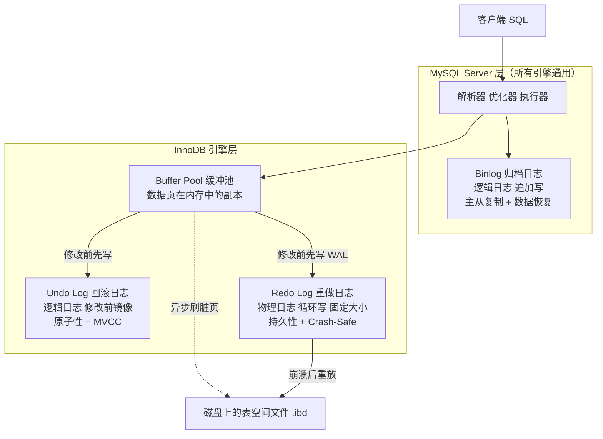
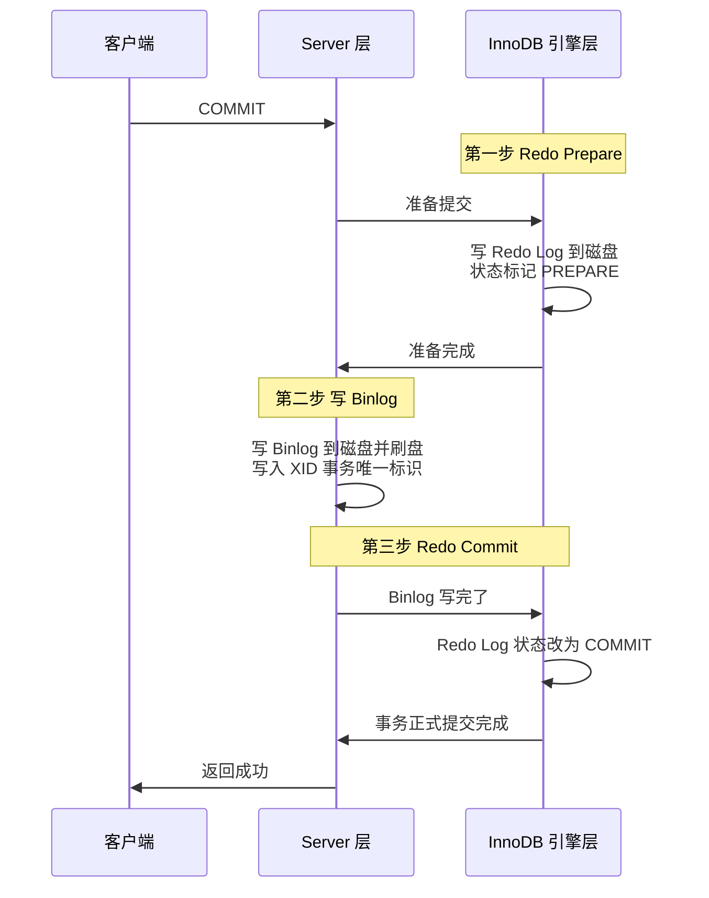
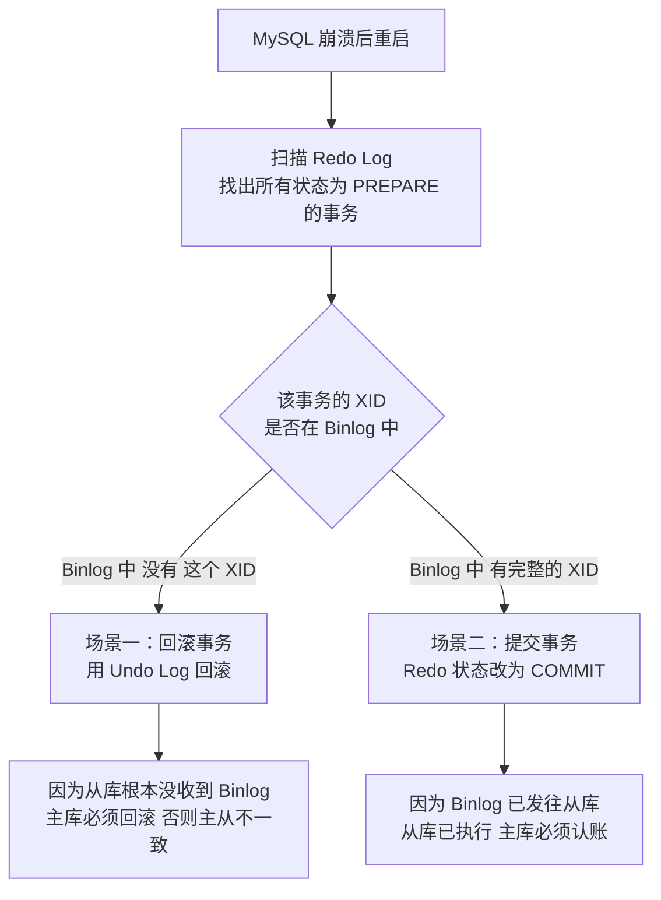
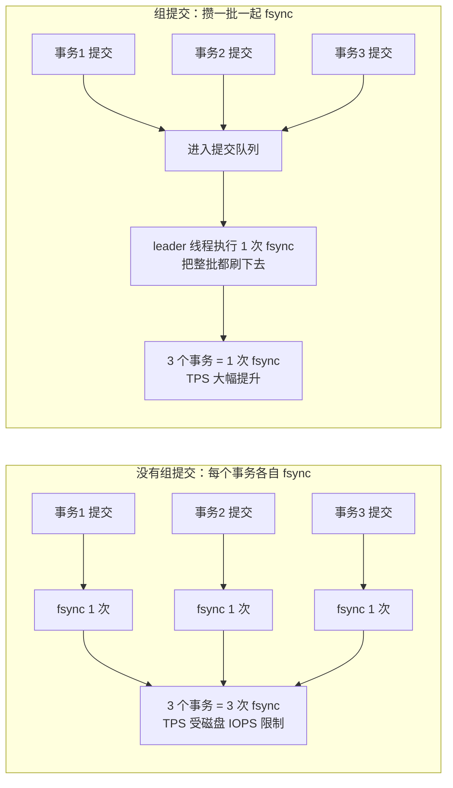

# 00 · MySQL 日志与内部两阶段提交

> **一句话主线**：MySQL 的三大日志各管一件事——**Undo Log 管「反悔」**（原子性 + MVCC）、**Redo Log 管「不丢」**（持久性 + 崩溃恢复）、**Binlog 管「同步」**（主从复制 + 数据恢复）。而 Redo（引擎层）与 Binlog（Server 层）是**两个独立模块**，必须靠**两阶段提交**把它们的写入绑成原子，否则崩溃后主从数据会分叉。**这四句话（后悔药 / 安全锁 / 同步桥 / 粘合剂）就是本模块的全部骨架。**
>
> **本模块定位**：`db/` 的**地基**。它解释的「内存改了、磁盘没刷怎么办」是后面所有模块的前提——锁（`01`）要写 undo、事务隔离（`03`）靠 undo 版本链、主从复制（`04`）搬的就是 binlog。

---

## 目录

- [零、⚠️ 术语消歧：两个「两阶段提交」](#零️-术语消歧两个两阶段提交)
- [一、核心前提（必记）](#一核心前提必记)
- [二、三大日志极简核心总结](#二三大日志极简核心总结)
- [三、三大日志核心区别速查表](#三三大日志核心区别速查表)
- [四、为什么必须有「两阶段提交」](#四为什么必须有两阶段提交)
- [五、崩溃恢复的两种核心场景](#五崩溃恢复的两种核心场景)
- [六、刷盘时机与「双 1 配置」](#六刷盘时机与双-1-配置)
- [七、组提交（Group Commit）：为什么双 1 还能快](#七组提交group-commit为什么双-1-还能快)
- [八、Binlog 的三种格式](#八binlog-的三种格式)
- [九、Checkpoint：Redo 与脏页的接力棒](#九checkpointredo-与脏页的接力棒)
- [本模块速记](#本模块速记考前-10-分钟)
- [面试官深挖追问](#面试官深挖追问)

---

## 零、⚠️ 术语消歧：两个「两阶段提交」

**这是最容易混淆的一点**，面试中说清楚是明显的加分项。本仓库里「两阶段提交」出现了**两次**，指的是**两件完全不同的事**：

| | **MySQL 内部的「两阶段提交」**（本模块） | **分布式 2PC**（XA 协议） |
|---|---|---|
| **要解决什么** | **单个 MySQL 实例内部**，Redo Log（存储引擎层）与 Binlog（Server 层）如何原子写入 | **跨多个数据库/服务**，如何让 N 个参与者一起提交或一起回滚 |
| **参与方** | Redo Log、Binlog —— **同一个进程内的两个日志文件** | 协调者 + 多个资源管理器（**不同实例 / 不同中间件**） |
| **两个阶段** | Prepare（写 Redo，标记 `PREPARE`）→ Commit（写 Binlog，Redo 改 `COMMIT`） | Prepare（各参与者锁定资源、不提交）→ Commit/Rollback（协调者统一发令） |
| **有协调者吗** | **无**（只是同一进程内两个日志文件的**顺序约定**） | **有**（独立的协调者组件） |
| **涉及网络吗** | **不涉及** | 涉及（参与者可能是不同机器） |
| **权威位置** | **本模块** | [`../distributed_consensus/02_分布式事务.md`](../distributed_consensus/02_分布式事务.md) |

> **一句话区分**：MySQL 的「两阶段提交」是**一个进程内两个日志文件**的对齐；分布式 2PC 是**多个进程之间**的对齐。
>
> 面试时如果面试官只说「讲讲两阶段提交」，**先反问一句**：「您是指 MySQL 内部 Redo/Binlog 的两阶段提交，还是 XA 的分布式 2PC？」——这个问题本身就能体现你分得清。

---

## 一、核心前提（必记）

1. **Undo Log、Redo Log 是 InnoDB 引擎独有**；**Binlog 是 MySQL Server 层日志**，所有引擎通用。
2. 三个日志的设计，本质是解决 MySQL **事务四大特性（ACID）** + **主从集群一致性**两大核心问题。
3. 所有磁盘写入核心原则：**内存修改优先，磁盘异步刷盘**——日志都是为了解决「内存改了、磁盘没刷」的风险。

**图 0-1：三大日志在 MySQL 架构中的位置**

---

## 二、三大日志极简核心总结

> **面试优先背这一节**，分点清晰、不啰嗦。

### 1. Undo Log 回滚日志

| 项 | 内容 |
|----|------|
| **核心作用** | 保证事务的**原子性** + 实现 **MVCC 多版本并发控制**（隔离性） |
| **记录内容** | **逻辑日志**，存「**数据修改前的原始值**」（比如把 `age` 从 4 改成 3，就存 4） |
| **核心能力** | 事务失败 / `ROLLBACK` 时，通过 Undo Log **一键回滚到修改前状态**——相当于「**后悔药**」 |
| **写入时机** | **修改数据前必须先写 Undo Log** |
| **生命周期** | **不是事务提交就删**——只要还有更早的 Read View 需要它，就必须保留（由 purge 线程清理），这是 MVCC 的关键 |

### 2. Redo Log 重做日志

| 项 | 内容 |
|----|------|
| **核心作用** | 保证事务的**持久性**（提交后数据绝对不丢），实现 **Crash-Safe 崩溃恢复** |
| **记录内容** | **物理日志**，存「**数据页的修改动作**」（比如：第 100 页第 5 行写入值 `Li`） |
| **核心原理** | 基于 **WAL（Write-Ahead Logging，写前日志）**：修改数据时**先改 Buffer Pool**，再**异步刷磁盘**；Redo Log 先记录所有内存修改，断电重启后**通过 Redo 重放**恢复未刷盘的修改 |
| **关键特性** | **固定大小、循环写入**（写满覆盖旧日志）——所以它是「**安全锁**」而不是档案 |
| **引擎归属** | **InnoDB 专属**，是数据持久化的兜底保障 |

> **⚠️ 常见误区**：「Redo Log 是数据恢复用的」——不准确。**Binlog 才是「归档恢复」**（可以恢复到任意时间点），Redo Log 是「**崩溃恢复**」（只保证重启后不丢未刷盘的修改，且是循环覆盖的，存不了历史）。

### 3. Binlog 归档日志

| 项 | 内容 |
|----|------|
| **核心作用** | **主从复制** + **数据全量备份 / 时间点恢复（PITR）**，是 MySQL 集群的核心 |
| **记录内容** | **逻辑日志**，存「所有增删改的 SQL 语句 / 行变更」，**只记录写操作，不记录查询** |
| **关键特性** | **追加写入**（写满切新文件，**不覆盖**旧日志），永久保存历史操作 |
| **引擎归属** | **Server 层**，所有引擎都能用，是「**同步桥**」 |

---

## 三、三大日志核心区别速查表

> 面试问到对比，直接答这张表。

| 特性 | Redo Log 重做日志 | Binlog 归档日志 | Undo Log 回滚日志 |
|------|------------------|----------------|------------------|
| **所属层级** | InnoDB **引擎层** | MySQL **Server 层** | InnoDB **引擎层** |
| **日志类型** | **物理**日志（数据页修改） | **逻辑**日志（SQL / 行变更） | **逻辑**日志（修改前原始值） |
| **核心功能** | 持久化、Crash-Safe | 主从复制、数据恢复（PITR） | 事务回滚、MVCC |
| **写入方式** | **循环写**（固定大小，会覆盖） | **追加写**（无限扩容，不覆盖） | 按需生成，**延迟清理** |
| **写入时机** | 事务执行中**持续写入** | 事务**提交时**写入（两阶段提交决定） | 数据修改**前**优先写入 |
| **是否可关闭** | 不能（`innodb_log_file_size` 可调） | 可以（`skip_log_bin`，但主从就废了） | 不能 |
| **一句话** | 「**安全锁**」 | 「**同步桥**」 | 「**后悔药**」 |

---

## 四、为什么必须有「两阶段提交」

### 1. 问题根源

Redo Log（引擎层）和 Binlog（Server 层）是**两个完全独立的日志模块**，如果各自提交，一定会出现「**日志不一致**」：

- Redo Log 写成功了，Binlog 没写 → 主库有数据，从库没有
- Binlog 写成功了，Redo Log 没写 → 从库有数据，主库没有

→ 最终导致：**主库和从库数据不一致、数据恢复失败**。

### 2. 核心目标

**强制绑定 Redo Log 和 Binlog 的写入结果，保证「要么都成功，要么都失败」**，日志 100% 一致。这是 MySQL 实现 Crash-Safe 的核心，也是保证主从一致的关键。

### 3. 完整流程（三步）

> **前提**：执行 `UPDATE` 等修改操作时，已经完成「加载数据到内存 → 写 Undo Log → 修改内存数据」这三步，准备提交事务。

**图 0-2：内部两阶段提交时序**

| 步骤 | 做什么 | 关键点 |
|------|--------|--------|
| **① Redo Prepare** | InnoDB 把本次事务的 Redo Log 写入磁盘，状态标记 **`PREPARE`** | 引擎层准备就绪，但**未最终提交** |
| **② 写 Binlog** | Server 层把本次事务的 Binlog **完整写入磁盘并刷盘**，并写入 **XID** | **Binlog 一旦落盘，这个修改逻辑上永久生效**，后续会同步给从库 |
| **③ Redo Commit** | Server 层通知引擎「Binlog 写完」，引擎把 Redo 状态改为 **`COMMIT`** | **整个事务正式提交完成** |

> **关键设计**：**Binlog 是「裁判」**。Redo 的最终状态取决于 Binlog 是否写成功——这直接决定了下面崩溃恢复的判断逻辑。

---

## 五、崩溃恢复的两种核心场景

MySQL 重启时会**自动校验 Redo Log 和 Binlog 的状态**，根据两阶段提交的断点自动完成恢复。**核心原则：以 Binlog 为准，保证主从一致。**

**图 0-3：崩溃恢复的判定逻辑**

### 场景 1：Redo 写完 `PREPARE` → Binlog 写入前 崩溃

| 项 | 内容 |
|----|------|
| **现象** | Redo Log 是 `PREPARE` 状态，Binlog 中**无此事务的 XID** |
| **恢复逻辑** | **直接回滚事务**（用 Undo Log） |
| **为什么** | 从库**没收到** Binlog，主库必须回滚，否则主从不一致 |

### 场景 2：Binlog 写完 → Redo 改 `COMMIT` 前 崩溃

| 项 | 内容 |
|----|------|
| **现象** | Redo Log 是 `PREPARE` 状态，Binlog 中**有此事务的完整 XID** |
| **恢复逻辑** | **直接提交事务**（把 Redo 改为 `COMMIT`） |
| **为什么** | Binlog **已经发往从库**，从库**已经执行**了这个操作，主库必须「认账」，否则主从不一致 |

> **一句话记**：**Redo `PREPARE` + Binlog 无 XID → 回滚；Redo `PREPARE` + Binlog 有 XID → 提交。** 判据就一个：**Binlog 里有没有这个事务**。

---

## 六、刷盘时机与「双 1 配置」

> 这一节是原笔记缺失的**高频追问**：面试官问「你怎么保证不丢数据」，答不到刷盘参数是不完整的。

### 1. `innodb_flush_log_at_trx_commit`（Redo Log 的刷盘策略）

| 值 | 行为 | 数据安全 | 性能 |
|----|------|---------|------|
| **1**（默认，**推荐**） | 每次事务提交都 **flush + fsync** Redo 到磁盘 | **最安全**：只要提交返回成功，断电也不丢 | 最低（每次都真正落盘） |
| **2** | 每次提交只 **write 到 OS 缓存**，由操作系统每秒 fsync 一次 | 中间档：MySQL 进程崩溃不丢（数据在 OS 缓存），**但操作系统崩溃 / 断电会丢约 1 秒** | 中等 |
| **0** | 每秒 write + flush 一次，提交时**什么都不做** | **最弱**：MySQL 进程崩溃就可能丢约 1 秒 | 最高 |

### 2. `sync_binlog`（Binlog 的刷盘策略）

| 值 | 行为 |
|----|------|
| **1**（**推荐**） | 每次事务提交都把 Binlog **flush 到磁盘** |
| **0** | 由操作系统决定何时刷（可能丢） |
| **N** | 每累计 N 个事务提交才刷一次（`N>1` 时崩溃可能丢最多 N 个事务） |

### 3. 「双 1 配置」是什么

> **`innodb_flush_log_at_trx_commit = 1` + `sync_binlog = 1`**

这是**金融级数据不丢的标准配置**（业界称「双 1」）：

| 收益 | 说明 |
|------|------|
| **最强的持久性** | 事务提交返回成功 → Redo 和 Binlog **都已真正落盘**，断电不丢 |
| **保证两阶段提交的正确性** | 如果 Binlog 没真正刷盘，「Binlog 落盘即永久生效」这个前提就不成立，崩溃恢复的判断会出错 → **双 1 是两阶段提交可靠的前提** |

**代价**：每次提交两次 fsync（Redo + Binlog），看起来性能会很差——**但实际不是**，因为有**组提交**（下一节）。

> ⚠️ **反过来的风险**：`sync_binlog=0` + `innodb_flush_log_at_trx_commit=1` 时，OS 崩溃会导致**主库 Redo 有、Binlog 没有** → 恢复时按「Binlog 无 XID」**回滚**，但 Redo 说已提交 → 出现**主从不一致的隐患**。所以**两个参数要成对使用**。

---

## 七、组提交（Group Commit）：为什么双 1 还能快

**问题**：如果每个事务提交都要 fsync 两次，TPS 会被磁盘 IOPS 卡死在几百——但生产上开了双 1 依然能跑到几万 TPS。**为什么？**

**答案**：**组提交（Group Commit）**——**多个并发事务共享一次 fsync**。

**图 0-4：组提交 vs 单事务提交**

**机制**：事务提交时**先进入一个队列**，队列里的事务选出（或轮流当）一个 **leader**，由 leader 执行一次 **fsync** 就把整批数据都刷下去，其他事务等待 leader 完成即可。

| 收益 | 说明 |
|------|------|
| **摊薄 fsync 成本** | N 个并发事务只花 1 次 fsync → TPS 提升可达成百上千倍 |
| **双 1 才可行** | 没有组提交，双 1 在生产上根本跑不起来 |

**代价与前提**：

- **需要并发**——如果业务是**串行提交**（前一事务提交完才发下一个），队列里永远只有一个事务，**组提交完全失效**，性能会退化到磁盘 IOPS 水平
- **MySQL 的组提交有三个阶段**（flush / sync / commit stage），用 `binlog_group_commit_sync_delay` 和 `binlog_group_commit_sync_no_delay_count` 可以**主动攒批**（牺牲延迟换吞吐）

> **面试话术**：「很多人以为开了双 1 就没法高性能，其实 MySQL 用**组提交**解决了——多个并发事务**共享一次 fsync**。所以双 1 的性能代价在**高并发**下可以忽略；但如果你的业务是**串行提交**（比如单线程跑批），组提交会失效，这时需要权衡是否降级到 `sync_binlog=0`。」

---

## 八、Binlog 的三种格式

由 `binlog_format` 参数控制。**MySQL 8.0 的默认值是 `ROW`**（也是 5.7.7 起的默认；再往前是 `STATEMENT`）。

| 格式 | 记录什么 | 优点 | 缺点 |
|------|---------|------|------|
| **STATEMENT** | 记录**原始 SQL 语句** | **日志最小**、写入最快、可读性好（能直接看到执行的 SQL） | ⚠️ **非确定性函数会导致主从不一致**：`NOW()` / `RAND()` / `UUID()` / `SYSDATE()` / 带 `LIMIT` 无 `ORDER BY` 的更新 |
| **ROW**（**8.0 默认**） | 记录**每一行的前后镜像**（before/after image） | **一致性最强**，不依赖语句的确定性 | **日志体积大**（一条 `UPDATE` 改 10 万行就记 10 万条）；**表必须有主键**，否则从库重放要全表扫描 |
| **MIXED** | 默认用 STATEMENT，**遇到非确定性语句自动切 ROW** | 折中 | 仍有判断失误的可能，行为不够可预测 |

> ⚠️ **`binlog_format` 已在 MySQL 8.0.34 被废弃**（标记 deprecated，未来版本移除），因为 ROW 已成为事实标准。面试中提到这点是加分项。

**为什么 ROW 成为默认？**

| 原因 | 说明 |
|------|------|
| **复制安全** | 彻底消除非确定性函数导致的**主从不一致** |
| **配合新特性** | `innodb_autoinc_lock_mode=2`（MySQL 8.0 默认）**对 STATEMENT 复制不安全**，必须配 ROW（见 [`01_MySQL_锁机制.md`](01_MySQL_锁机制.md) 的 AUTO-INC 一节） |
| **数据恢复更精确** | ROW 格式的 binlog 可以直接用于**数据闪回 / 精确恢复**（如美团开源的 `MyFlash`） |

**代价**：日志膨胀。所以生产上通常配合 `binlog_row_image=minimal`（只记主键 + 被改的列，不记整行）来控制体积。

---

## 九、Checkpoint：Redo 与脏页的接力棒

**问题**：Redo Log 是**循环写**的。如果一个脏页（内存已改、磁盘未刷的数据页）对应的 Redo 记录**被覆盖了**，那崩溃后就没法通过重放恢复它了。

**Checkpoint 解决的就是这个**：

> **Checkpoint 机制保证：在 Redo 记录被覆盖之前，它对应的脏页必须已经刷到磁盘。**

| 概念 | 说明 |
|------|------|
| **脏页（Dirty Page）** | Buffer Pool 中已被修改、但还没写回磁盘的数据页 |
| **Checkpoint LSN** | 一个位置标记：**该位置之前的脏页都已经刷盘**，对应的 Redo 可以安全覆盖 |
| **Redo 空间不足时** | InnoDB 会**强制推进 Checkpoint**——即**强行刷脏页**，腾出 Redo 空间 |
| **刷脏页的时机** | ① Redo 空间不足（强制）；② Buffer Pool 不足需要淘汰页面；③ 后台线程空闲时慢慢刷；④ MySQL 正常关闭 |

**两种 Checkpoint**（了解即可，不必背）：

| 类型 | 行为 |
|------|------|
| **Sharp Checkpoint（尖锐）** | 关闭数据库时把所有脏页一次刷完 |
| **Fuzzy Checkpoint（模糊）** | 运行时**分批、异步**刷一部分脏页——生产上绝大多数是这种 |

> **⚠️ 一个常见的线上问题**：**「刷脏页」导致的抖动**——当 Redo 空间不足被迫刷大量脏页时，会出现**明显的写入停顿**（俗称「刷脏页卡顿」）。这是 `innodb_log_file_size` 设得过小导致的，生产上一般调到 **1~2GB** 甚至更大。

---

## 本模块速记（考前 10 分钟）

| # | 问题 | 关键词速答 |
|---|------|-----------|
| 1 | 三大日志各属于哪一层？ | **Undo / Redo 是 InnoDB 引擎层**；**Binlog 是 Server 层**（所有引擎通用） |
| 2 | Undo Log 管什么？ | **原子性 + MVCC**。**逻辑日志**，存**修改前的原始值**，**修改数据前必须先写**。是「后悔药」 |
| 3 | Redo Log 管什么？ | **持久性 + Crash-Safe**。**物理日志**，存**数据页的修改动作**。基于 **WAL**。是「安全锁」 |
| 4 | Binlog 管什么？ | **主从复制 + 数据恢复（PITR）**。**逻辑日志**，记所有写操作。是「同步桥」 |
| 5 | Redo vs Binlog 三个关键差别？ | ① **层级**：引擎层 vs Server 层；② **类型**：物理 vs 逻辑；③ **写入**：**循环写（会覆盖）** vs **追加写（不覆盖）** |
| 6 | **为什么要内部两阶段提交？** | Redo（引擎层）与 Binlog（Server 层）是**两个独立模块**，各自提交会导致**主从数据分叉**。必须绑成原子 |
| 7 | 两阶段提交三步？ | ① **Redo Prepare**（写 Redo，标 `PREPARE`）→ ② **写 Binlog 并刷盘**（含 **XID**）→ ③ **Redo Commit**（改 `COMMIT`） |
| 8 | **崩溃恢复的判据是什么？** | **看 Binlog 里有没有这个事务的 XID**。Binlog **无** XID → **回滚**；Binlog **有** → **提交**。原则：**以 Binlog 为准** |
| 9 | 场景 1（Prepare 后、Binlog 前崩）怎么恢复？ | Redo `PREPARE` + Binlog **无 XID** → **回滚**（从库没收到，主库必须回滚） |
| 10 | 场景 2（Binlog 后、Commit 前崩）怎么恢复？ | Redo `PREPARE` + Binlog **有 XID** → **提交**（从库已执行，主库必须认账） |
| 11 | `innodb_flush_log_at_trx_commit` 三个值？ | **1**（默认，每次提交 fsync，最安全）、**2**（提交 write 到 OS 缓存，秒级 fsync，OS 崩溃丢 ~1s）、**0**（每秒一次，MySQL 崩溃丢 ~1s） |
| 12 | `sync_binlog` 是什么？ | Binlog 刷盘策略。**1** = 每次提交都刷（推荐）；0 = 交给 OS；N = 每 N 个事务刷一次 |
| 13 | **「双 1 配置」是什么？** | `innodb_flush_log_at_trx_commit=1` + `sync_binlog=1`。**金融级不丢数据标准**，也是两阶段提交可靠的前提 |
| 14 | **双 1 为什么还能高性能？** | **组提交（Group Commit）**——多个并发事务**共享一次 fsync**，摊薄成本。⚠️ **业务串行提交时组提交会失效** |
| 15 | binlog 三种格式？ | **STATEMENT**（记 SQL，日志小，**非确定性函数会不一致**）、**ROW**（记行前后镜像，**最一致但日志大**）、**MIXED**（自动切） |
| 16 | binlog 默认格式？ | **MySQL 8.0 默认 `ROW`**（5.7.7 起也是）。`binlog_format` 已于 **8.0.34 废弃**。ROW 大日志可用 `binlog_row_image=minimal` 控制 |
| 17 | 为什么 ROW 成了默认？ | ① **复制安全**（无非确定性函数问题）；② 配合 **`innodb_autoinc_lock_mode=2`**（8.0 默认，对 STATEMENT 复制不安全）；③ 便于**数据闪回精确恢复** |
| 18 | Checkpoint 解决什么？ | Redo 是**循环写**，必须保证**「Redo 记录被覆盖前，对应脏页已刷盘」**。否则崩溃后无法重放 |
| 19 | 什么时候强制刷脏页？ | ① **Redo 空间不足**（强制推进 Checkpoint）；② Buffer Pool 不足淘汰页面；③ 后台空闲刷；④ 正常关闭 |
| 20 | 「刷脏页卡顿」是什么？ | Redo 空间不足被迫刷大量脏页导致**写入停顿**。根因是 `innodb_log_file_size` 太小（生产建议 **1~2GB+**） |
| 21 | 一句话总结三大日志 + 2PC？ | **Undo 是后悔药、Redo 是安全锁、Binlog 是同步桥、两阶段提交是粘合剂** |
| 22 | MySQL 内部 2PC 与分布式 2PC 的区别？ | 内部 2PC 是**单实例内两个日志文件**对齐（**无协调者、无网络**）；分布式 2PC 是**跨服务**的 XA 协议（**有协调者**）。见 [`../distributed_consensus/02`](../distributed_consensus/02_分布式事务.md) |

---

## 面试官深挖追问

1. **「Redo Log 既然是循环写的，那持久性怎么保证？」**
   → 靠 **Checkpoint** 保证「**Redo 被覆盖前，对应脏页已刷盘**」。所以 Redo 不需要存全部历史——它只要保证「**所有未刷盘的修改**」都在 Redo 里就够了。这也是 Redo 能固定大小循环写的原因。而**历史归档**交给 Binlog。

2. **「为什么先写 Redo（Prepare）再写 Binlog，而不是反过来？」**
   → 顺序反了会导致**无法恢复**。假设先写 Binlog 再写 Redo：如果在两者之间崩溃，Redo 里没有这个事务 → **MySQL 根本不知道要恢复它**（恢复的入口是扫 Redo 找 `PREPARE`），但从库已经收到 Binlog 并执行了 → **主从永久不一致且无法自愈**。所以必须**先 Redo Prepare 作为「恢复的线索」，再 Binlog，最后 Redo Commit**。

3. **「Binlog 是「逻辑日志」吗？那 ROW 格式记的是行数据，还算逻辑日志吗？」**
   → **算**。这里「逻辑 vs 物理」的标准是**「记录的是做什么，还是在哪个物理位置做什么」**。Redo 记的是「**第 X 页第 Y 偏移改成 Z**」（物理位置），所以是物理日志；Binlog 的 ROW 格式记的是「**某行的 id=1 这行，从 (a,b) 变成 (c,d)**」（不关心物理位置，只描述数据变化），所以仍是**逻辑日志**。（严格说 ROW 格式在业界有时被描述为「物理逻辑日志」，但面试中按「Redo 物理、Binlog 逻辑」回答即可。）

4. **「`innodb_flush_log_at_trx_commit=2` 到底安不安全？」**
   → **分情况**：① **MySQL 进程崩溃（如 `kill -9`）**——安全，因为数据已经 write 到 OS 缓存，OS 还活着，会按自己的节奏 fsync 落盘；② **操作系统崩溃 / 主机断电**——**不安全**，最多丢约 1 秒的已提交事务。所以是「**MySQL 崩不丢、机器崩会丢**」的中间档。**金融场景必须用 1。**

5. **「组提交在什么情况下会失效？」**
   → **并发度足够高才有收益**。三种失效场景：① **业务串行提交**（前一事务 commit 返回后才发下一个）——队列里永远只有 1 个事务；② **低并发**——每秒就几个事务，攒不起来；③ **显式调用了会打断攒批的操作**（比如大事务长时间占住提交阶段）。这也是为什么「单线程跑批」的 MySQL 写入性能会明显低于「高并发写入」。

6. **「ROW 格式日志太大，生产上怎么治？」**
   → 三个手段：① **`binlog_row_image=minimal`**（只记主键 + 被修改的列，不记整行前后镜像）；② **`binlog_row_value_options`**（MySQL 8.0.3+，对大 JSON 的更新只记差异，**PARTIAL_JSON**）；③ **缩短保留时间 + 归档**（`binlog_expire_logs_seconds`，把老 binlog 备份到对象存储）。另外**避免一次性大事务**（`UPDATE` 影响几十万行）本身就是必要的——它既膨胀 binlog，又会拖长主从延迟。

7. **「如果 MySQL 用的是 MyISAM 引擎，还有两阶段提交吗？」**
   → **没有意义**。因为 MyISAM **既不支持事务，也没有 Redo / Undo Log**——它只有 Binlog（Server 层）。两阶段提交是为了对齐「引擎层日志」与「Server 层日志」，MyISAM 没有引擎层日志，自然谈不上对齐（也谈不上崩溃恢复的原子性）。**这也是 InnoDB 取代 MyISAM 的核心原因之一。**

8. **「你怎么在项目里排查『主从数据不一致』？」**
   → 分三步：① **定位不一致的范围**——用 **`pt-table-checksum`** 做主从数据校验，找出哪些表/哪些行不一致；② **查根因**——重点看是不是 `binlog_format=STATEMENT` 配了非确定性函数、或者从库被误写、或者 `sync_binlog=0` + 机器崩溃导致 binlog 丢失；③ **修复**——用 **`pt-table-sync`** 按主库为准修复从库，然后**改配置防复发**（切 ROW、开双 1、从库设 `read_only`）。**一句话**：**先量化（checksum），再归因，最后修 + 防**。

---

## 参考资料

见 [`99_参考资料.md`](99_参考资料.md)。
