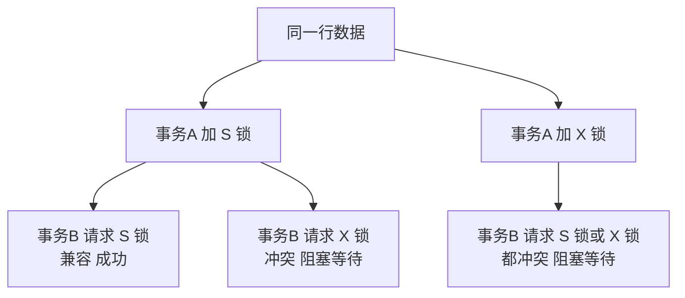
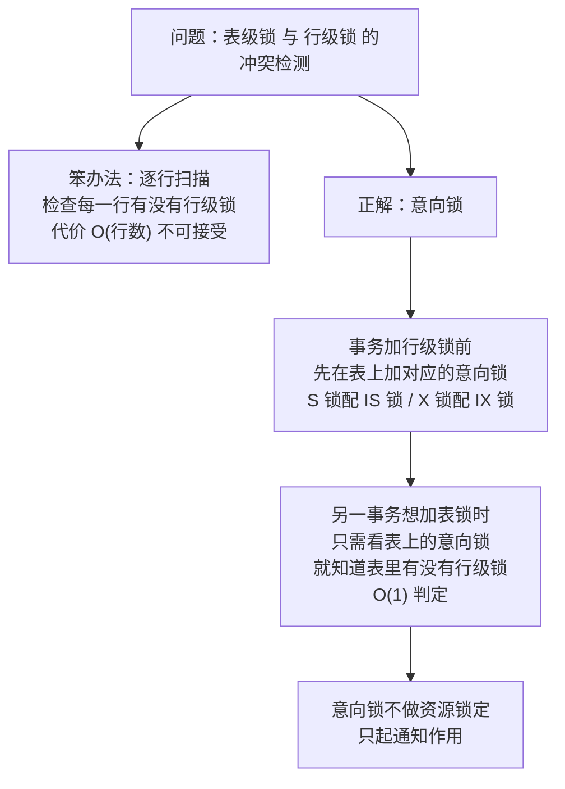
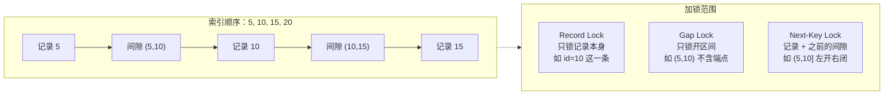

# 01 · MySQL 锁机制

> **一句话主线**：InnoDB 的锁体系可以用**两条主线**记住——**「隔离级别决定锁的范围，索引决定锁的位置」**。隔离级别（RR）决定了要用**间隙锁**防幻读；而 InnoDB 的锁**永远加在索引上**，没有索引就退化成表锁或隐藏聚簇索引锁。具体到算法层面就是**四种锁**：Record / Gap / Next-Key / Insert Intention；再加上**两种思想**（悲观 vs 乐观）和**意向锁**这个「表级信号灯」。
>
> **本模块定位**：`db/` 的**高频面试模块**。它与 [`03_MySQL_事务隔离与MVCC.md`](03_MySQL_事务隔离与MVCC.md) 是**一体两面**——`03` 讲「不加锁的读」（快照读），本模块讲「加锁的读」（当前读）。

---

## 目录

- [零、先分清两种「读」：快照读 vs 当前读](#零先分清两种读快照读-vs-当前读)
- [一、共享锁（S 锁）与排他锁（X 锁）](#一共享锁s-锁与排他锁x-锁)
- [二、意向锁（IS / IX）](#二意向锁is--ix)
- [三、行级锁的三种算法](#三行级锁的三种算法)
- [四、加锁规则与时机](#四加锁规则与时机)
- [五、插入意向锁（Insert Intention Lock）](#五插入意向锁insert-intention-lock)
- [六、AUTO-INC 锁](#六auto-inc-锁)
- [七、死锁](#七死锁)
- [八、锁的排查工具](#八锁的排查工具)
- [九、悲观锁](#九悲观锁)
- [十、乐观锁](#十乐观锁)
- [十一、悲观锁与乐观锁选型](#十一悲观锁与乐观锁选型)
- [本模块速记](#本模块速记考前-10-分钟)
- [面试官深挖追问](#面试官深挖追问)

---

## 零、先分清两种「读」：快照读 vs 当前读

> **这是理解本模块的总钥匙**——很多人背了所有锁类型，却答不出「什么时候会加锁」，就是因为没分清这两种读。

| | **快照读（Snapshot Read）** | **当前读（Current Read）** |
|---|---|---|
| **SQL 形式** | **普通 `SELECT`** | `SELECT ... FOR UPDATE`、`SELECT ... FOR SHARE`（旧写法 `LOCK IN SHARE MODE`）、`UPDATE`、`DELETE`、`INSERT` |
| **是否加锁** | **完全不加锁** | **加锁** |
| **读的是什么** | **MVCC 一致性快照**（undo 版本链 + Read View，见 [`03`](03_MySQL_事务隔离与MVCC.md)） | **记录的最新版本**（并锁定它，防止别人改） |
| **能防幻读吗** | RR 下能（靠**快照**，不是靠锁） | RR 下能（靠 **Next-Key Lock**） |
| **性能** | 高（无锁竞争） | 低（有锁等待） |

> ⚠️ **本模块下面讲的所有锁，都只作用于「当前读」**。普通 `SELECT` 走 MVCC，不加任何行锁——这是最常见的认知盲区。
>
> **面试话术**：「要区分快照读和当前读。**普通 `SELECT` 是快照读，走 MVCC 不加锁**；只有 `FOR UPDATE` / `UPDATE` / `DELETE` 这类当前读才加锁。所以我们平时说『这条 SQL 加了什么锁』，前提是它是个当前读。」

---

## 一、共享锁（S 锁）与排他锁（X 锁）

在锁的**级别**上，InnoDB 分为两种：**共享锁（S 锁）**、**排他锁（X 锁）**。

### 1. 共享锁（Shared Lock，又称读锁）

> **其他事务可以并发读，但任何事务想加 X 锁（`UPDATE` / `DELETE`）都必须等所有 S 锁释放。**

**加锁写法**：

```sql
-- MySQL 8.0 之前的写法
SELECT id, name FROM table1 WHERE id > 1 AND id < 10 LOCK IN SHARE MODE;

-- MySQL 8.0 及之后的推荐写法
SELECT id, name FROM table1 WHERE id > 1 AND id < 10 FOR SHARE;
```

对查询范围中的每行都加 S 锁：这些行**还可以被其他事务加 S 锁**，但**不能被加 X 锁**。

### 2. 排他锁（Exclusive Lock，又称写锁）

> **若事务 T1 对数据 A 加 X 锁，其他事务不能再对 A 加任何类型的锁。且持有 X 锁的事务既可读也可写。**

**加锁写法**：

```sql
SELECT id, name FROM table1 WHERE id > 1 AND id < 10 FOR UPDATE;
```

对查询命中的每条记录加 X 锁。当没有其他线程对结果集中任何一行持有 X 锁时申请成功，否则**阻塞**。

### 3. 兼容性总结

| 已持有 \ 新请求 | **S 锁** | **X 锁** |
|---|---|---|
| **S 锁** | ✅ 兼容 | ❌ 冲突 |
| **X 锁** | ❌ 冲突 | ❌ 冲突 |

**图 1-1：S 锁与 X 锁的并发行为**



### 4. 使用场景

**S 锁（读锁）的场景**：

| 场景 | 说明 |
|------|------|
| **读-读并发高且不允许脏读** | 例如**报表统计**：希望别的事务可以并发读，但禁止任何事务修改这些行 |
| **父子表一致性校验** | 先对**父表主键** `FOR SHARE`，再读子表——防止父记录在此期间被删（引用完整性） |

**X 锁（写锁）的场景**：

**① 读-改-写（Read-Modify-Write）——防止并发扣款出现负余额**

```sql
START TRANSACTION;

SELECT balance FROM account WHERE id = 1 FOR UPDATE;   -- 加 X 锁并读到最新余额
-- 应用层判断：若 balance >= 100 则继续，否则回滚
UPDATE account SET balance = balance - 100 WHERE id = 1;

COMMIT;
```

**② 悲观锁实现「秒杀库存」——防止超卖**

```sql
START TRANSACTION;

-- 加排他锁并读取当前库存
SELECT stock FROM merchandise WHERE id = 123 FOR UPDATE;
-- 应用层判断：若 stock > 0 则继续，否则回滚并返回「已售罄」

-- 真正扣库存（MySQL 8 支持把判断合并进 WHERE，可省掉一次应用层判断）
UPDATE merchandise SET stock = stock - 1 WHERE id = 123 AND stock > 0;

COMMIT;
```

> ⚠️ **常见误区**：`SELECT ... FOR UPDATE` 与 `UPDATE` 都用**同一个索引**（这里是主键 `id`）时，`UPDATE` **不会重复加锁**（同一事务内锁可重入）。但如果 `UPDATE` 用了**不同的索引**，就可能锁到**更多行**——这是「锁范围被放大」的典型原因。

---

## 二、意向锁（IS / IX）

除了 S 锁和 X 锁，InnoDB 还有两种锁：**IS 锁（意向共享锁）**和 **IX 锁（意向排他锁）**。「I」是 **Intention**（意向）的意思。

### 1. 为什么需要意向锁

**问题**：InnoDB 支持**多种粒度**的锁（表级锁、行级锁）。如果：

> 事务 T1 对 table1 的**某一行**加了行级锁；事务 T2 想对 table1 加**表级锁**。若 T2 申请成功，就能修改表中任意一行——**这跟 T1 冲突了**。
>
> 要解决这个问题，T2 加表锁时**必须知道表里有没有行级锁**。但 T2 **总不能逐行扫描判断有没有加锁吧？**（全表扫一遍代价无法接受）

**图 1-2：意向锁要解决的问题**



### 2. 意向锁是什么

> **意向锁是数据库管理系统中用于实现锁协议的一种锁机制，主要用来处理不同粒度锁（如行锁和表锁）之间的并发性问题。**（同粒度的锁之间一般通过互斥来解决并发）

| 要点 | 说明 |
|------|------|
| **不做锁定资源的操作** | 主要起**通知作用**，防止在已加锁的数据上设置不兼容的锁 |
| **不是用户请求的** | 而是 **MySQL 自动管理**的 |
| **是表级锁** | 会在**触发它的事务提交或回滚后释放** |

**机制**：事务想获取行级锁（或表级锁）时，MySQL **自动**先获取对应的表的意向锁。

| 意向锁 | 含义 |
|--------|------|
| **意向共享锁（IS）** | 表示事务打算在**某行**上加 **S 锁**（读之前会读） |
| **意向排他锁（IX）** | 表示事务打算在**某行**上加 **X 锁**（写之前会写） |

### 3. 举个例

**① 事务 T1 执行**：

```sql
SELECT * FROM table1 WHERE id = 1 FOR UPDATE;
```

InnoDB **先对表 table1 加 IX 锁**，**再对 id=1 的行加 X 锁**。

**② 此时事务 T2 想申请表锁**：

```sql
LOCK TABLES table1 WRITE;
```

**需等待**——因为检测到 table1 上已有 IX，知道「**table1 里面某行正被排他锁住**」，于是阻塞。

**③ 事务 T1 提交成功**，释放 table1 的 IX 锁，此时 T2 被唤醒，成功获取锁。

### 4. 意向锁兼容矩阵（必背）

| 已持有 \ 请求 | IS | IX | **S（表级）** | **X（表级）** |
|---|---|---|---|---|
| **IS** | ✅ 兼容 | ✅ 兼容 | ✅ 兼容 | ❌ 冲突 |
| **IX** | ✅ 兼容 | ✅ 兼容 | ✅ 兼容 | ❌ 冲突 |
| **S（表级）** | ✅ 兼容 | ❌ 冲突 | ✅ 兼容 | ❌ 冲突 |
| **X（表级）** | ❌ 冲突 | ❌ 冲突 | ❌ 冲突 | ❌ 冲突 |

> **记忆要点**：
> - **IS 与 IX 之间永远兼容**——因为它们只是「信号灯」，表示「我要在行上加锁」，两个不同事务可以在**不同的行**上加锁，不冲突
> - **意向锁与表级 S 锁兼容**（IS/IX 都不阻止别人加表级读锁）
> - **表级 X 锁与一切冲突**

---

## 三、行级锁的三种算法

InnoDB 的行级锁，按**锁定范围**分成三种，**必须结合「索引」来理解**。

### 1. 记录锁（Record Lock）

**只对索引记录加锁。**

```sql
SELECT * FROM users WHERE id = 5 FOR UPDATE;
```

对 `id = 5` 这条**索引记录**加锁，防止其他事务对 `id = 5` 这行做**插入、更新、删除**。

Record Lock 可以是**共享锁（S）**或**排他锁（X）**。

> ⚠️ **最关键的一点（必背）**：**Record Lock 锁的不是「这行数据」，而是「索引记录」**。
>
> **如果没有索引怎么办？** InnoDB 会创建一个**隐藏的聚簇索引**来锁定：
> - 有主键 → 用主键作聚簇索引
> - 无主键但有唯一非空索引 → 选它作聚簇索引
> - 都没有 → 创建一个**隐藏主键 `row_id`** 作聚簇索引
>
> **所以：即使你的 SQL 没用到索引，InnoDB 也一定会锁在「某个索引」上**——这就是「锁永远加在索引上」的含义。

### 2. 间隙锁（Gap Lock）

**锁住索引记录之间的「开区间」，不包含记录本身。**

**Gap 可以理解为 InnoDB 索引中「可以插入新值的位置」。**

```sql
-- 假设索引中已有 5 和 10，没有 7
SELECT * FROM users WHERE id = 7 FOR UPDATE;
```

由于 `id = 7` 的记录**不存在**，InnoDB 会加 **Gap Lock 锁住区间 (5, 10)**——**防止其他事务在这个间隙里插入新记录**。

> ⚠️ **间隙锁只在 REPEATABLE READ 及以上隔离级别生效**。**在 READ COMMITTED 下，间隙锁基本被禁用**（仅用于外键约束检查和重复键检查）——这正是 **RC 下会出现幻读**的原因。

**间隙锁是「防幻读」的核心**：幻读的本质是「两次查询之间别人**插入**了新行」，而间隙锁直接**锁住了插入的位置**。

### 3. 临键锁（Next-Key Lock）

**= 记录锁 + 该记录之前的间隙锁**，即**左开右闭**区间 `(prev, current]`。

```sql
-- 假设 age 是普通索引，表中 age 有 5, 10, 15, 20
SELECT * FROM users WHERE age = 10 FOR UPDATE;
```

执行时会加 **Next-Key Lock** 锁住 **(5, 10]**（左开右闭）：

| 索引 | 加锁情况 |
|------|---------|
| **age 索引（普通索引）** | Next-Key Lock 锁 **(5, 10]** |
| **主键索引** | record lock 锁住对应的记录（如 `id=5`） |

**为什么普通索引要额外锁主键？** 因为通过二级索引找到数据后要**回表**（见 [`02_MySQL_索引与执行计划.md`](02_MySQL_索引与执行计划.md)），所以要把它对应的主键记录也锁上，防止别人在主键上改动这行。

**图 1-3：三种行级锁的范围对比**



**Next-Key Lock 是 InnoDB 加锁的「基本单位」**——这一点在下一节的加锁规则里很关键。

---

## 四、加锁规则与时机

### 1. 四条基本原则

| # | 原则 |
|---|------|
| **1** | **所有锁都是加在索引上的** |
| **2** | **加锁的基本单位是 Next-Key Lock** |
| **3** | **查询过程中访问到的对象都会加锁** |
| **4** | **加锁顺序是从左向右，直到第一个不满足条件的记录** |

> 这些锁都是 InnoDB **自动**加上的，不需要用户手动操作。但理解原则，才能在写 SQL 时预判锁的范围。

### 2. 不同场景的加锁规则

| 查询类型 | 索引类型 | 加的锁 |
|---------|---------|--------|
| **等值查询（`=`）** | **唯一索引 / 主键** | Next-Key Lock **退化为 Record Lock**（因为唯一，不会有第二条） |
| **等值查询（`=`）** | **普通索引** | **保持 Next-Key Lock**，左右间隙都不能优化掉 |
| **范围查询（`>` `<` `>=` `<=`）** | **唯一索引 / 主键** | 保持 **Next-Key Lock**，不进行优化 |
| **范围查询** | **普通索引** | 同样保持 **Next-Key Lock** |
| **记录不存在** | 任意 | 对扫描到的第一个不满足条件的记录加 **Gap Lock** |

> **为什么唯一索引等值查询能「退化」？** 因为唯一索引保证**最多只有一条**匹配记录，不存在「间隙里还有别的值」的可能，所以不需要锁间隙，只锁那一条即可 → **锁范围最小，并发最好**。

### 3. 工作场景示例

假设 `users` 表数据如下：

| id | age | name |
|----|-----|------|
| 1 | 5 | Tom |
| 5 | 10 | Jack |
| 10 | 15 | Rose |
| 15 | 20 | Mike |

#### 场景一：等值查询（唯一索引）

```sql
SELECT * FROM users WHERE id = 5 FOR UPDATE;
```

**加锁情况**：`id` 是主键（唯一索引），Next-Key Lock **退化为 Record Lock** → **只在 `id=5` 的记录上加 X 型记录锁**。

✅ **这是锁范围最小的场景**——生产上要尽量让当前读走唯一索引等值查询。

#### 场景二：等值查询（普通索引）

```sql
SELECT * FROM users WHERE age = 10 FOR UPDATE;
```

**加锁情况**：

- 对 **age 索引**：`(5, 10]` 的 **Next-Key Lock**
- 对 **主键索引**：`id=5` 的记录锁
- 因为是普通索引，**间隙不能被优化掉**

#### 场景三：范围查询

```sql
SELECT * FROM users WHERE id > 5 AND id <= 15 FOR UPDATE;
```

**加锁情况**：

- `(5, 10]` 的 Next-Key Lock
- `(10, 15]` 的 Next-Key Lock
- `(15, 20]` 的 Next-Key Lock ← **会扫描到第一个不满足条件的记录**（原则 4）

> ⚠️ **注意最后一条**：范围查询会**多锁一个「边界外」的区间**，因为 InnoDB 要一路扫描到第一个不满足条件的记录才停。这是范围查询锁范围更大的原因。

#### 场景四：记录不存在

```sql
SELECT * FROM users WHERE id = 7 FOR UPDATE;
```

**加锁情况**：记录不存在 → 加 **Gap Lock 锁住 (5, 10)**。

> **这也是一个常被追问的点**：「查一条不存在的记录会加什么锁？」答：**Gap Lock**。而且因为间隙锁之间**互相兼容**（都是「我想插入」的信号），两个事务可以同时持有**同一个间隙**的 Gap Lock——但**插入意向锁**之间会冲突（见下一节）。

### 4. 不同隔离级别下的加锁行为

| 隔离级别 | 间隙锁 / Next-Key Lock | 幻读 |
|---------|---------------------|------|
| **READ UNCOMMITTED** | 基本不用 | 可能 |
| **READ COMMITTED** | **间隙锁基本被禁用**（仅外键约束、重复键检查用） | **可能**（当前读下） |
| **REPEATABLE READ**（**InnoDB 默认**） | **启用** Next-Key Lock | **快照读靠 MVCC 防住**；**当前读靠 Next-Key Lock 防住** |
| **SERIALIZABLE** | 所有 `SELECT` 退化为 `FOR SHARE` | 不可能 |

---

## 五、插入意向锁（Insert Intention Lock）

**一种特殊的间隙锁，表示事务「计划在某个间隙插入数据」的意图。**

**关键价值：允许不冲突的插入并发进行。**

**例子**：假设索引中有值 4 和 7：

| 事务 | 动作 | 结果 |
|------|------|------|
| T1 | 在间隙 (4,7) 中插入 **5** | 先获取「插入意向锁」（表示要插 5） |
| T2 | 在间隙 (4,7) 中插入 **6** | 先获取「插入意向锁」（表示要插 6） |
| | **两者不冲突，可以并发** | ✅ 因为插入的位置不同 |
| T3 | 也要插入 **6** | ❌ **需要阻塞**——和 T2 的位置冲突 |

> **它与间隙锁配合使用，既防止了幻读，又提升了并发**——如果只有一个「间隙锁」概念，那两个事务都会以为对方要占整个间隙，只能串行。

> ⚠️ **命名陷阱**：**插入意向锁虽然是「意向」的名字，但它是行级锁**，和**意向锁（IS/IX，表级锁）没有任何关系**。面试中被问到这个，能点破这个命名陷阱是加分项。

---

## 六、AUTO-INC 锁

**AUTO-INC 锁是一种特殊的表级锁**，由「插入带 `AUTO_INCREMENT` 列的表」的事务获取。

**作用**：**保护 `AUTO_INCREMENT` 列的自增值生成过程**，确保并发插入时自增值的**唯一性**，防止多个事务生成相同的自增值。

### 三种模式（`innodb_autoinc_lock_mode`）

| 模式 | 值 | 机制 | 特点 |
|------|----|------|------|
| **传统模式（traditional）** | **0** | **表级 AUTO-INC 锁**，持有到语句结束 | 最安全（保证语句内连续 + STATEMENT 复制安全），**性能最低** |
| **连续模式（consecutive）** | **1** | 「简单插入」用**轻量级互斥锁**分配；**批量插入**（`INSERT...SELECT`、`LOAD DATA`）仍用表级锁 | 平衡安全性与性能；保证语句内连续；STATEMENT 复制安全 |
| **交错模式（interleaved）** | **2** | **所有语句都不用表级锁**，统一用互斥锁 | **性能最高**；唯一且单调，但**不保证语句内连续**；**对 STATEMENT 复制不安全** |

> ### ⚠️ 勘误与补正：默认值变过
>
> | 版本 | 默认值 |
> |------|--------|
> | **MySQL 5.7 及之前** | **1（consecutive）** |
> | **MySQL 8.0 起** | **2（interleaved）** |
>
> **为什么 8.0 改成了 2？** 因为 MySQL 8.0 把 binlog 默认格式改成了 **ROW**（见 [`00_MySQL_日志与内部2PC.md`](00_MySQL_日志与内部2PC.md) 的第八节）——ROW 格式记录的是具体行数据，**不依赖自增值的连续性**，所以可以放心用性能最好的模式 2。
>
> **记住因果链**：**8.0 默认 ROW 复制 → 所以可以用 interleaved(2) → 所以自增值可能在语句内不连续**（例如 `INSERT ... SELECT` 批量插入时，多个并发事务的自增值会交错分配）。

---

## 七、死锁

> 原笔记在总结里提了一句「死锁预防」，但没有展开——**这是 MySQL 面试的高频追问**。

### 1. 死锁是怎么产生的

**两个（或多个）事务互相持有对方需要的锁，并等待对方释放** → 永久互相等待。

```sql
-- 事务 A                          -- 事务 B
START TRANSACTION;                START TRANSACTION;
UPDATE t SET v=1 WHERE id=1;      UPDATE t SET v=1 WHERE id=2;   -- B 先锁 id=2
UPDATE t SET v=1 WHERE id=2;      -- A 等 B 释放 id=2
                                  UPDATE t SET v=1 WHERE id=1;   -- B 等 A 释放 id=1
-- 死锁！
```

### 2. InnoDB 怎么处理死锁

| 机制 | 说明 |
|------|------|
| **死锁检测** | `innodb_deadlock_detect`（**默认 ON**）。InnoDB 维护一个等待图，检测到环就**立刻回滚其中一个事务**（选**代价最小**的——通常是修改行数最少的），报 `Deadlock found when trying to get lock` |
| **锁等待超时** | `innodb_lock_wait_timeout`（**默认 50 秒**）。如果没有死锁但一直等不到锁，超时后回滚 |

> ⚠️ **死锁检测的代价**：高并发下**死锁检测本身很贵**（要遍历等待图，复杂度可能接近 O(n²)）。所以有些场景会**关掉死锁检测**（`innodb_deadlock_detect=OFF`），靠 **`innodb_lock_wait_timeout` 兜底**——牺牲响应速度换吞吐。这是一个真实的生产调优取舍。

### 3. 怎么避免死锁

| 手段 | 说明 |
|------|------|
| **① 按固定顺序访问资源**（最重要） | 所有事务都**按同一个顺序**加锁（如都按 `id` 升序）→ 破坏「循环等待」条件 |
| **② 缩短事务、减少持锁时间** | 事务里不要做 RPC、不要做大批量操作；把无关操作移到事务外 |
| **③ 用合适索引缩小锁范围** | 走唯一索引等值查询（Record Lock）而非全表扫描（大量 Next-Key Lock） |
| **④ 降低隔离级别** | RC 下间隙锁被禁用，锁范围小很多，死锁概率显著下降（很多互联网公司用 RC 就是这个原因） |
| **⑤ 拆分大事务** | 大批量更新拆成小批次，减少锁持有时间与冲突窗口 |
| **⑥ 应用层重试** | 捕获死锁异常后**重试**（幂等前提下），这是最实用的兜底 |

---

## 八、锁的排查工具

> 「你线上遇到过锁等待/死锁吗？怎么查的？」——这是把「背锁类型」和「真正干过」区分开的问题。

| 工具 | 用途 |
|------|------|
| **`SHOW ENGINE INNODB STATUS\G`** | 最强利器。看 **`LATEST DETECTED DEADLOCK`** 段（最近一次死锁的完整现场，含两个事务的 SQL 与等待的锁），以及 **`TRANSACTIONS`** 段（当前活跃事务各自持有什么锁、在等什么锁） |
| **`information_schema.INNODB_TRX`** | 当前正在运行的事务：`trx_id`、`trx_state`（RUNNING / LOCK WAIT）、**`trx_started`**（跑了多久）、`trx_query`（正在执行的 SQL） |
| **`performance_schema.data_locks`** | **MySQL 8.0 推荐**。每一把锁的详情：`LOCK_TYPE`（TABLE / RECORD）、`LOCK_MODE`（X / S / X,GAP / X,REC_NOT_GAP）、`LOCK_DATA`（锁住的索引值） |
| **`performance_schema.data_lock_waits`** | **谁在等谁的锁**（`REQUESTING_ENGINE_TRANSACTION_ID` ↔ `BLOCKING_ENGINE_TRANSACTION_ID`），直接给出阻塞链路 |
| **`SHOW PROCESSLIST`** | 快速看有没有大量 `Waiting for table metadata lock` / 长时间 `Sending data` 的会话 |

**排查套路**：

```sql
-- 1. 找出阻塞源：谁在等谁
SELECT * FROM performance_schema.data_lock_waits;

-- 2. 看阻塞者的具体锁
SELECT * FROM performance_schema.data_locks WHERE ENGINE_TRANSACTION_ID = <阻塞者ID>;

-- 3. 看阻塞者在跑什么 SQL
SELECT trx_id, trx_state, trx_started, trx_query
FROM information_schema.INNODB_TRX;

-- 4. 看历史死锁现场
SHOW ENGINE INNODB STATUS\G   -- 关注 LATEST DETECTED DEADLOCK
```

> **⚠️ 一个极易踩的坑：`LOCK_MODE` 里的 `REC_NOT_GAP` 与 `GAP`**
>
> - `X,REC_NOT_GAP` = **纯记录锁**（只锁记录）
> - `X,GAP` = **纯间隙锁**（只锁间隙）
> - **`X`**（不带后缀）= **Next-Key Lock**（记录 + 间隙）
>
> 看 `data_locks` 时能读出这个区别，就能精确定位「为什么锁得比预期宽」——比如本该是 `REC_NOT_GAP`（走了唯一索引）却看到 `X`（说明索引没走对，退化成 Next-Key Lock 了）。

---

## 九、悲观锁

**核心思想**：**「悲观」地认为数据一定会被其他事务修改，所以提前加锁**——先获取锁，再执行业务操作。口诀是「**一锁二查三更新**」。

### 1. 悲观锁示例（行级锁）

```sql
-- 悲观锁示例（行级锁）
START TRANSACTION;

SELECT * FROM products WHERE id = 1 FOR UPDATE;   -- 加排他锁
UPDATE products SET stock = stock - 1 WHERE id = 1;

COMMIT;
```

修改 `id=1` 的记录前，先通过 `FOR UPDATE` 加锁再修改。若发生并发，**同一时间只有一个事务能获得 `id=1` 的锁**，其他事务必须等本次事务提交后才能执行。

### 2. 悲观锁示例（表级锁）

```sql
-- 表级锁
LOCK TABLES products WRITE;
-- 执行业务操作
-- ...
UNLOCK TABLES;
```

先对表加锁再操作，其他业务无法修改表中数据。体现了悲观的思想——加了锁之后安全感暴增。

> ⚠️ **注意**：`LOCK TABLES` 是 **MySQL Server 层的表锁**（不是 InnoDB 的行锁机制），它会**隐式提交当前事务**，且与 InnoDB 的行锁是两套体系。**生产上基本不用**，这里仅作概念说明。

### 3. 悲观锁实际场景一：金融转账

```sql
-- 转账操作：从账户 A 转 100 元到账户 B
START TRANSACTION;

-- 锁定付款方账户
SELECT balance FROM accounts WHERE id = 1 FOR UPDATE;
-- 应用层检查：若 balance >= 100 则继续，否则回滚

UPDATE accounts SET balance = balance - 100 WHERE id = 1;

-- 锁定收款方账户
SELECT balance FROM accounts WHERE id = 2 FOR UPDATE;

UPDATE accounts SET balance = balance + 100 WHERE id = 2;

COMMIT;
```

> ⚠️ **转账场景必须注意加锁顺序**：如果有的代码先锁 A 后锁 B，有的代码先锁 B 后锁 A，**并发时就会死锁**。所以转账的正确做法是**按账户 ID 大小排序后再依次加锁**（比如永远先锁 `id` 小的）——这正是上一节「按固定顺序访问资源」的实战应用。

### 4. 悲观锁实际场景二：库存扣减（防超卖）

```sql
-- 商品库存扣减
START TRANSACTION;

SELECT stock FROM products WHERE id = 1 FOR UPDATE;
-- 应用层检查：若 stock >= 1 则继续，否则回滚

UPDATE products SET stock = stock - 1 WHERE id = 1;

COMMIT;
```

---

## 十、乐观锁

**核心思想**：**「乐观」地认为数据不会被其他事务修改，不加锁直接操作**——先操作，**提交时检查是否发生冲突**。主要通过**版本号**或**时间戳**检测冲突。

> **MySQL 本身不提供内置乐观锁**，需要用户在表结构设计或应用层通过 **CAS 思想**自行实现。CAS 本质就是一种乐观锁技术：多个线程尝试用 CAS 同时更新同一变量时，只有其中一个能成功，其他线程**不会被挂起**，而是被告知失败并**可以重试**。

### 1. 核心流程（版本号）

```sql
-- 1. 查询数据时获取版本号
SELECT id, name, stock, version FROM products WHERE id = 1;

-- 2. 更新时检查版本号
UPDATE products
SET stock = stock - 1, version = version + 1
WHERE id = 1 AND version = 旧版本号;

-- 3. 检查更新结果
-- 如果影响行数为 0，说明数据被其他事务修改过（版本号已变），需要重试
```

### 2. 完整示例

```sql
-- 创建带有版本号的表
CREATE TABLE products (
    id INT PRIMARY KEY,
    name VARCHAR(50),
    stock INT,
    version INT DEFAULT 1
);

-- 乐观锁更新过程
START TRANSACTION;

-- 步骤1：读取数据和版本号
SELECT id, stock, version FROM products WHERE id = 1;
-- 假设获取到：version = 5, stock = 100

-- 步骤2：在应用程序中执行业务逻辑
-- 计算新库存：new_stock = 100 - 1 = 99

-- 步骤3：更新数据并检查版本号
UPDATE products
SET stock = 99, version = 6
WHERE id = 1 AND version = 5;

-- 步骤4：检查更新结果
-- 影响行数为 1 → 更新成功
-- 影响行数为 0 → 数据被其他事务修改，需要重试

COMMIT;
```

### 3. 用时间戳替代版本号

```sql
-- 使用时间戳实现乐观锁
-- 查询出更新时间
SELECT id, stock, updated_at FROM products WHERE id = 1;

-- 用更新时间戳做版本号，同时把更新时间刷新为当前时间
UPDATE products
SET stock = stock - 1, updated_at = NOW()
WHERE id = 1 AND updated_at = '2025-01-16 10:30:00';
```

> ⚠️ **时间戳做乐观锁的坑**：时间戳精度有限（`TIMESTAMP` 默认秒级，`DATETIME(3)` 才到毫秒）。**同一秒内的并发更新可能检测不到冲突**。所以生产上**优先用自增 `version` 整数**。

### 4. 应用层重试（Java 示例）

```java
// 【示例】乐观锁重试机制，按目标版本书写、未实测
public boolean updateProductStock(Long productId, int quantity) {
    int maxRetries = 3;

    for (int i = 0; i < maxRetries; i++) {
        // 1. 查询数据和版本号
        Product product = productMapper.selectById(productId);

        // 2. 尝试更新
        int affectedRows = productMapper.updateStock(
            productId,
            product.getStock() - quantity,
            product.getVersion()
        );

        // 3. 检查更新结果
        if (affectedRows > 0) {
            return true;   // 更新成功
        }

        // 4. 更新失败，短暂休眠后重试
        Thread.sleep(100);
    }

    return false;   // 重试多次后仍然失败
}
```

> 📦 **代码标注**：以上为**按目标版本书写、未实测**的示例（与 [`../java_interview/README.md`](../java_interview/README.md) 的标注约定一致）。面试讲思路即可。

> ⚠️ **⚠️ 这段重试代码有个隐患**：`Thread.sleep` 直接写在这里会**阻塞调用线程**，高并发下线程池会被打满。生产上要么用**有退避策略的重试**（指数退避 + 抖动），要么交给**上层框架**（如 Spring Retry）处理。

---

## 十一、悲观锁与乐观锁选型

### 1. 对比

| 维度 | 悲观锁 | 乐观锁 |
|------|--------|--------|
| **加锁时机** | 操作**前**加锁 | **不加锁**，提交时校验 |
| **实现方式** | `FOR UPDATE` / `LOCK TABLES` | 版本号 / 时间戳 + CAS |
| **冲突代价** | 等待（阻塞） | 重试（不阻塞） |
| **适合冲突率** | **高** | **低** |
| **是否阻塞** | 阻塞 | 非阻塞 |
| **典型场景** | 秒杀、转账、库存扣减 | 积分兑换、资料更新、配置修改 |

### 2. 选型建议

**悲观锁适用**：

- 写操作频繁（**写占比 > 30%**）
- **冲突概率高**的业务
- **临界区执行时间长**（包含 IO 操作）
- **强一致性要求**（金融交易）

**乐观锁适用**：

- 读操作频繁（**读占比 > 80%**）
- **冲突概率低**的业务
- **临界区执行时间短**（纯内存操作）
- **系统吞吐量要求高**
- **可以接受偶尔的重试**

> **为什么「临界区长」更适合悲观锁？** 因为乐观锁在临界区长时**重试的代价极高**（每次重试都要重做一遍长操作）；而悲观锁虽然一开始要等待，但**只需做一次**。反过来，临界区短且冲突少时，乐观锁几乎不会重试，性能远好于悲观锁。

### 3. 应用案例

**案例一：电商商品库存**

```sql
-- 悲观锁方案（适合秒杀场景：冲突极高）
START TRANSACTION;
SELECT stock FROM products WHERE id = 1 FOR UPDATE;
-- 应用层检查 stock > 0
UPDATE products SET stock = stock - 1 WHERE id = 1;
-- 创建订单 ...
COMMIT;
```

```sql
-- 乐观锁方案（适合普通商品：冲突低）
UPDATE products
SET stock = stock - 1, version = version + 1
WHERE id = 1 AND version = #{version} AND stock > 0;
-- 应用层检查影响行数：为 1 则创建订单；为 0 则提示「库存不足或版本冲突」
```

> **注意乐观锁方案里的 `AND stock > 0`**——它把「库存判断」也放进了 `WHERE`，这样**一条 SQL 同时完成了「判断 + 扣减 + 版本校验」**，比「先查后更新」少一次往返，也更安全。

**案例二：用户账户余额 / 积分**

```sql
-- 悲观锁方案（转账场景）
START TRANSACTION;
SELECT balance FROM accounts WHERE id = 1 FOR UPDATE;
-- 应用层检查 balance >= amount
UPDATE accounts SET balance = balance - amount WHERE id = 1;
-- 记录流水 ...
COMMIT;
```

```sql
-- 乐观锁方案（积分兑换场景）
UPDATE accounts
SET points = points - #{cost}, version = version + 1
WHERE id = 1 AND version = #{version} AND points >= #{cost};
```

### 4. 动态选择（进阶）

实际使用中可以**监控业务的冲突概率**来动态调整策略：

```java
// 【示例】智能锁选择策略，按目标版本书写、未实测
public void updateData(Data data) {
    // 根据冲突概率动态选择锁策略
    if (getConflictRate() > 0.1) {   // 冲突率 > 10%
        usePessimisticLock(data);    // 切换到悲观锁
    } else {
        useOptimisticLock(data);     // 使用乐观锁
    }
}
```

**配套要处理的细节点**：

- **监控冲突率**：按实际情况动态调整锁策略
- **设置重试上限**：乐观锁避免无限重试
- **降级机制**：乐观锁失败次数过多时降级到悲观锁
- **版本号字段加索引**：避免版本校验本身变成慢查询
- **死锁预防**：悲观锁场景下**按固定顺序加锁**

---

## 本模块速记（考前 10 分钟）

| # | 问题 | 关键词速答 |
|---|------|-----------|
| 1 | **快照读 vs 当前读？** | **普通 `SELECT` = 快照读，走 MVCC 完全不加锁**；`FOR UPDATE` / `FOR SHARE` / `UPDATE` / `DELETE` = **当前读，加锁**。**本模块所有锁只作用于当前读** |
| 2 | S 锁怎么加？ | MySQL 8.0 前 `LOCK IN SHARE MODE`，**8.0 起推荐 `FOR SHARE`** |
| 3 | X 锁怎么加？ | `FOR UPDATE` |
| 4 | S/X 兼容性？ | **S+S 兼容**；**S+X 冲突**；**X+X 冲突** |
| 5 | **意向锁是干什么的？** | **表级锁**，用于**不同粒度锁（表锁 vs 行锁）的冲突检测**。避免「加表锁时要逐行扫描」 |
| 6 | 意向锁会锁定资源吗？ | **不会**，只起**通知作用**。且**不是用户请求的**，MySQL 自动加 |
| 7 | IS / IX 怎么产生？ | 事务要给某行加 **S 锁 → 自动先给表加 IS**；加 **X 锁 → 先给表加 IX** |
| 8 | **意向锁兼容矩阵？** | **IS 与 IX 永远兼容**；两者都与**表级 S 锁兼容**；**表级 X 锁与一切冲突** |
| 9 | 意向锁何时释放？ | 触发它的事务**提交或回滚后**释放 |
| 10 | **记录锁锁的是什么？** | ⚠️ **锁的是「索引记录」，不是「行数据」**。没索引时 InnoDB 会建**隐藏聚簇索引**（无主键无唯一索引则用 `row_id`） |
| 11 | **间隙锁锁什么？** | **索引记录之间的开区间，不含记录本身**。锁的是「**可以插入新值的位置**」 |
| 12 | **间隙锁在 RC 下生效吗？** | ❌ **不生效**（仅用于外键约束和重复键检查）→ **这就是 RC 下会幻读的原因** |
| 13 | **临键锁是什么？** | **记录锁 + 该记录之前的间隙锁**，即 **左开右闭 `(prev, current]`**。⚠️ **它是 InnoDB 加锁的基本单位** |
| 14 | 加锁四条基本原则？ | ① **锁都加在索引上** ② **基本单位是 Next-Key Lock** ③ **访问到的对象都加锁** ④ **从左向右，直到第一个不满足条件的记录** |
| 15 | 唯一索引等值查询加什么锁？ | Next-Key Lock **退化为 Record Lock**（唯一，不会有第二条）→ **锁范围最小** |
| 16 | 普通索引等值查询加什么锁？ | **保持 Next-Key Lock**，左右间隙**不能优化掉**（还要锁对应的主键记录，因为要回表） |
| 17 | 范围查询为什么锁更多？ | 会**扫描到第一个不满足条件的记录**才停 → **多锁一个边界外区间** |
| 18 | 查不存在的记录加什么锁？ | **Gap Lock**（如查 id=7 且无此记录 → 锁 (5,10)） |
| 19 | **插入意向锁是什么？** | 特殊的**间隙锁**，表示「我计划在这个间隙插入」。**不同位置的插入可并发**，同位置才阻塞。**既防幻读又提并发** |
| 20 | ⚠️ 插入意向锁是表级锁吗？ | **不是！** 它是**行级锁**，和**表级的意向锁（IS/IX）毫无关系**——纯粹是命名撞车 |
| 21 | AUTO-INC 三种模式？ | **0 传统**（表级锁，最安全最慢）、**1 连续**（简单插入用轻量锁，批量仍用表锁）、**2 交错**（全用互斥锁，最快，**语句内不连续**） |
| 22 | ⚠️ AUTO-INC 默认值？ | **5.7 默认 1，MySQL 8.0 改为 2**。因为 **8.0 默认 ROW 复制**，不依赖自增值连续 |
| 23 | **InnoDB 怎么处理死锁？** | **死锁检测**（`innodb_deadlock_detect` 默认 ON）扫等待图发现循环 → **立刻回滚代价最小的事务**；兜底是 **`innodb_lock_wait_timeout`（默认 50 秒）** |
| 24 | 死锁检测有什么代价？ | **很贵**（高并发下接近 O(n²)）。有些场景**关掉它**，靠超时兜底，牺牲响应换吞吐 |
| 25 | **怎么避免死锁？** | ① **按固定顺序加锁**（最重要）② 缩短事务 ③ **用唯一索引缩小锁范围** ④ **降隔离级别到 RC**（间隙锁失效）⑤ 拆大事务 ⑥ **应用层重试** |
| 26 | 怎么排查死锁/锁等待？ | `SHOW ENGINE INNODB STATUS`（`LATEST DETECTED DEADLOCK`）、`information_schema.INNODB_TRX`、**`performance_schema.data_locks`**、**`data_lock_waits`**（MySQL 8.0 推荐） |
| 27 | `LOCK_MODE` 里 `X` / `X,GAP` / `X,REC_NOT_GAP` 的区别？ | `X` = **Next-Key Lock**（记录+间隙）；`X,GAP` = **纯间隙锁**；`X,REC_NOT_GAP` = **纯记录锁**。用它可判断「锁范围是否超出预期」 |
| 28 | 悲观锁的核心思想？ | 「**悲观**」认为一定会被改，**先加锁再操作**，口诀「一锁二查三更新」 |
| 29 | 乐观锁的核心思想？ | 「**乐观**」认为不会被改，**不加锁**，**提交时用版本号/时间戳校验**，失败则重试 |
| 30 | 乐观锁实现方式？ | **版本号（推荐）** 或 **时间戳** + CAS。⚠️ **MySQL 无内置乐观锁，需应用层自己实现** |
| 31 | 时间戳做乐观锁的坑？ | 时间戳**精度有限**（`TIMESTAMP` 默认秒级），**同秒内的并发更新检测不到冲突** → 优先用 `version` 整数 |
| 32 | 选型口诀？ | **冲突高、写多、临界区长、强一致 → 悲观锁**；**冲突低、读多、临界区短、可重试 → 乐观锁** |
| 33 | 为什么「临界区长」更适合悲观锁？ | 乐观锁重试要**重做整段长操作**（代价高）；悲观锁只等一次。反之临界区短时乐观锁几乎不重试，性能更好 |
| 34 | 转账场景的关键注意点？ | **必须按固定顺序加锁**（如按账户 ID 升序），否则并发转账会死锁 |
| 35 | 一句话总结 InnoDB 锁体系？ | **两类思想（悲观/乐观）、三种粒度（表/页/行）、四种算法（Record / Gap / Next-Key / Insert Intention）**。两条主线：**隔离级别决定锁的范围（RR 用 Next-Key 防幻读），索引决定锁的位置（无索引则退化）** |

---

## 面试官深挖追问

1. **「普通 `SELECT` 会加锁吗？」**
   → **不会**。普通 `SELECT` 是**快照读**，走 **MVCC**（undo 版本链 + Read View），**完全不加任何行锁**。只有 `FOR UPDATE` / `FOR SHARE` / `UPDATE` / `DELETE` 这类**当前读**才加锁。这是最容易被搞混的一点——很多人以为「RR 下查询就会加间隙锁」，其实只有**加锁的读**才会。

2. **「`FOR UPDATE` 和 `UPDATE` 的锁有什么区别？」**
   → 都加 **X 锁**，但 **`UPDATE` 会额外锁「被更新的那行对应的所有索引」**。举例：表上有索引 `a` 和 `b`，`UPDATE t SET a=? WHERE b=?`——它不仅锁 `b` 索引上命中的记录，**还会用新的 `a` 值去 `a` 索引上加锁**（因为要维护索引）。所以**更新语句的锁范围可能比你想的大**，尤其是**更新被索引的列**时。

3. **「为什么说『锁加在索引上』？如果 SQL 没有索引，会怎样？」**
   → 因为 InnoDB 的行锁**实现方式就是「锁住索引记录」**（在索引项上加锁标记）。**如果 SQL 没有可用索引** → 只能**全表扫描** → 扫描到的**每一行**都会被加锁（而且是 Next-Key Lock）→ 实际效果**接近锁全表**。所以「加索引」不只是为了查询快，**也是为了锁范围小、并发高**。

4. **「两个事务能同时持有同一个间隙的 Gap Lock 吗？」**
   → **能**。**Gap Lock 之间是互相兼容的**——因为间隙锁表达的只是「我打算在这个位置插入」的意图，**不阻止别人也有同样的意图**。真正冲突发生在**插入意向锁**之间：两个事务要往**同一个位置**插入时，第二个才会阻塞。这是 InnoDB 用「间隙锁 + 插入意向锁」两层设计来**兼顾防幻读与并发**的巧妙之处。

5. **「RC 隔离级别下还有幻读吗？为什么互联网公司爱用 RC？」**
   → **RC 下当前读仍可能幻读**，因为**间隙锁基本被禁用**（只在 `T` 范围内锁住命中的记录，不锁间隙），所以别人可以在你两次查询之间插入新行。**互联网公司爱用 RC 的原因**：① **锁范围小得多** → 并发性能显著更好、**死锁概率大幅降低**；② 很多业务（下单、更新状态）**能接受 RC 的语义**，靠**业务层幂等或唯一约束**兜底一致性；③ **主从复制用 ROW 格式时，RC 的 binlog 更小**（RC 下语句执行完就把不匹配的行的锁释放了）。代价是**需要业务自己保证不会有幻读问题**。

6. **「`innodb_lock_wait_timeout` 设为多少合适？设小了会怎样？」**
   → **默认 50 秒**，很多公司调到 **1~5 秒**。**设太大会**：一个卡住的事务会让**后面所有等待者都排队 50 秒**，连接池迅速打满、故障扩散（雪崩）。**设太小会**：正常的长事务被误杀回滚，业务报错率上升。所以合理值取决于**业务的最长事务耗时**——一般设为「**P99 事务耗时的 2~3 倍**」。同时要配合**监控**（`INNODB_TRX` 里 `trx_started` 超过阈值的告警）。

7. **「为什么高并发下有时会关掉死锁检测？」**
   → 因为**死锁检测的代价随并发数急剧上升**（要维护并遍历等待图，最坏接近 O(n²)）。当**几千个并发事务**时，**检测本身的开销可能超过业务本身**，导致 TPS 崩塌。所以有些高并发场景（如秒杀）会：**关掉 `innodb_deadlock_detect`** + 把 **`innodb_lock_wait_timeout` 调到很小（如 1 秒）** + **应用层重试**。代价是死锁只能靠超时发现，**响应变慢**，但吞吐保住了。

8. **「`SELECT ... FOR UPDATE` 没走索引，会锁什么？」**
   → **锁全表**（准确说是**扫描到的所有行的 Next-Key Lock**，实际效果等同锁全表）。因为没索引 → 全表扫描 → 每扫到一行就加一把 Next-Key Lock。**这是线上事故的经典原因**：一个没走索引的 `FOR UPDATE` 会把整张表锁住，后续所有写入全部阻塞。**排查方法**：`EXPLAIN` 看 `type` 是不是 `ALL`（全表扫）；线上用 `data_locks` 看锁了多少行。

9. **「乐观锁在极高并发下会有什么问题？」**
   → **重试风暴**。冲突率高时，大量事务失败重试，**CPU 被重试逻辑吃掉**，实际吞吐反而低于悲观锁——这就是「**活锁式**」的性能崩塌。所以：① 冲突率高（>10%）**应该换悲观锁**；② 或者用**「乐观锁 + 分段」**（把热点行拆成多行，如库存拆成 10 份，各自乐观锁，减少冲突）；③ 也可以用 **`UPDATE ... WHERE stock > 0`** 这种**原子 SQL** 完全绕开「先查后改」（不需要版本号，因为 MySQL 的 `UPDATE` 本身就是原子的）。

10. **「`UPDATE ... SET stock = stock - 1 WHERE id = 1 AND stock > 0` 这条 SQL 为什么能防超卖？它加什么锁？」**
    → 它能防超卖，是因为**「判断 + 扣减」在一条 SQL 里原子完成**，不存在「查完再改」的中间窗口。**它加什么锁**：如果 `id` 是**主键**，就是**主键索引上的 X 型 Record Lock**（唯一索引等值查询 → Next-Key Lock 退化为 Record Lock）；如果 `id` 没索引，就是**全表扫描 + 大量 Next-Key Lock**。**所以这条 SQL 防超卖的前提是 `id` 走了索引**——否则并发性能会很差。**这也说明**：「不加锁的乐观写法」其实底层还是靠数据库锁实现的，只是**锁的持有时间极短**（一条语句内）。

---

## 参考资料

见 [`99_参考资料.md`](99_参考资料.md)。
