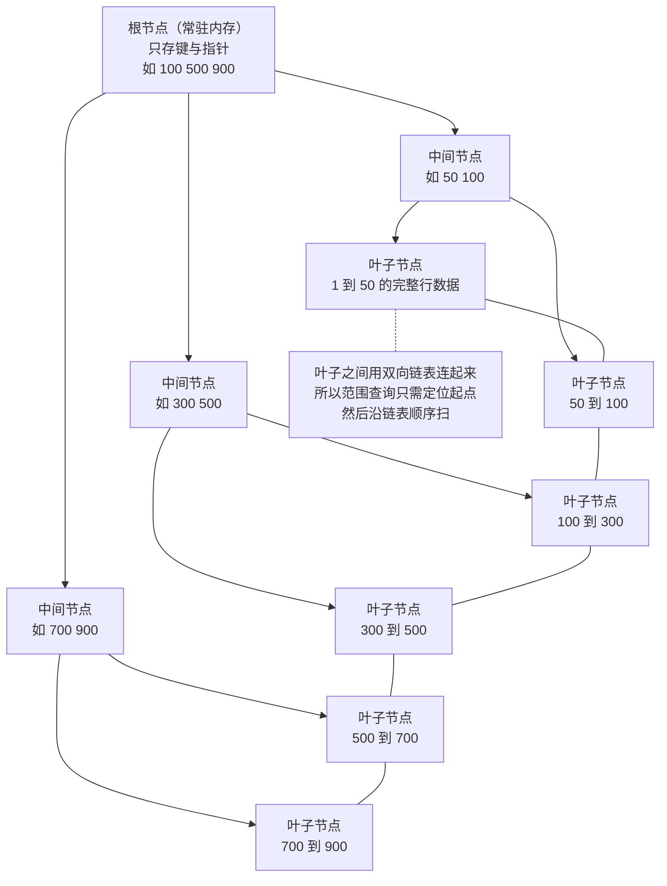
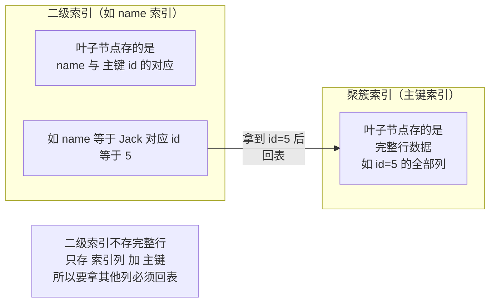

# 02 · MySQL 索引与执行计划

> **一句话主线**：InnoDB 用 **B+ 树**做索引，原因是它**矮胖**（树高低 → IO 少）、**叶子节点成链表**（天然支持范围查询）。而「**回表**」是理解一切 MySQL 性能问题的钥匙——通过二级索引查到的只是**主键值**，还要再回聚簇索引取整行数据。**避免回表的办法就是「覆盖索引」**。配合「最左前缀」「索引下推」「`EXPLAIN` 三看（type/key/Extra）」，就是索引优化的全部。
>
> **本模块定位**：`db/` 的**性能模块**。它与 [`01_MySQL_锁机制.md`](01_MySQL_锁机制.md) 有一条强关联：**索引决定锁的范围**——走唯一索引等值查询只锁一行，没索引就退化成接近锁全表。

---

## 目录

- [一、为什么是 B+ 树](#一为什么是-b-树)
- [二、聚簇索引与二级索引](#二聚簇索引与二级索引)
- [三、回表：一切性能问题的钥匙](#三回表一切性能问题的钥匙)
- [四、覆盖索引](#四覆盖索引)
- [五、联合索引与最左前缀原则](#五联合索引与最左前缀原则)
- [六、索引下推（ICP）](#六索引下推icp)
- [七、索引失效的六种场景](#七索引失效的六种场景)
- [八、EXPLAIN 关键列解读](#八explain-关键列解读)
- [九、慢查询定位](#九慢查询定位)
- [本模块速记](#本模块速记考前-10-分钟)
- [面试官深挖追问](#面试官深挖追问)

---

## 一、为什么是 B+ 树

**索引的本质**：把「**全表扫描**」变成「**按索引快速定位**」。核心矛盾是——数据在**磁盘**上，一次磁盘 IO 很贵（机械盘寻道 ~10ms），所以索引结构必须**让树高尽量小**。

### 1. 候选结构对比

| 结构 | 能否做索引 | 问题 |
|------|-----------|------|
| **哈希表** | 能，但只适合**等值查询** | ❌ **不支持范围查询**（`>`、`BETWEEN`、`ORDER BY` 全废）；❌ 哈希冲突要处理；❌ 数据量大时扩容代价高 |
| **有序数组** | 能，等值和范围都快（二分） | ❌ **插入代价 O(n)**（要移动后续元素）→ 只适合**静态数据** |
| **跳表** | 能 | 主要用于**内存**结构（如 Redis zset）；磁盘上树高比 B+ 树高，IO 更多 |
| **B 树**（每个节点都存数据） | 能 | ❌ 非叶节点也存数据 → **单个节点能放的键更少 → 树更高 → 磁盘 IO 更多**；❌ 范围查询要在树里回溯 |
| **B+ 树** | ✅ **InnoDB 的选择** | — |

### 2. B+ 树的两个关键优势

| 优势 | 说明 |
|------|------|
| **① 矮胖 → 树高低 → IO 少** | **非叶节点只存「键 + 子节点指针」，不存数据**。所以**一个 16KB 的页能放几百上千个键** → 三层 B+ 树就能存**约两千万行**，查任意一行**最多 3 次磁盘 IO** |
| **② 叶子节点成有序双向链表 → 范围查询极快** | 所有数据都在叶子层，且**叶子之间用指针串成链表**。所以 `BETWEEN` / `>` / `ORDER BY` 只需**定位到起点，然后沿链表顺序扫**，不需要回到上层 |

**图 2-1：B+ 树结构（三层可存约两千万行）**



> **算一笔账**：InnoDB 一页 **16KB**。假设主键 `BIGINT`（8 字节）+ 页指针（6 字节）= 14 字节，一页能放 `16×1024/14 ≈ 1170` 个键。三层 B+ 树：`1170 × 1170 × 1170 ≈ 16 亿`。**即使按最保守估计，三层也足以覆盖几千万行**——这就是「**树高低到三次 IO 就能查到任何一行**」的来源。

### 3. 为什么用 B+ 树而不是 B 树（一句话答）

> **B 树的非叶节点也存数据**，导致「一个页能放的键更少 → 树更高 → IO 更多」；而且 **B 树的范围查询需要在树上回溯**（从中序位置回到上层再下去），而 **B+ 树的叶子是链表，范围扫描一路向右即可**。

---

## 二、聚簇索引与二级索引

**图 2-2：聚簇索引与二级索引的结构关系**



| | **聚簇索引（Clustered Index）** | **二级索引（Secondary Index）** |
|---|---|---|
| **是什么** | **主键索引**（InnoDB 必有且只有一个） | 除主键外的其他索引，也叫「非聚簇索引」「辅助索引」 |
| **叶子存什么** | **完整行数据** | **索引列的值 + 主键值** |
| **数量** | 只有 1 个（数据即索引，索引即数据） | 可以有多个 |
| **找到数据要几步** | **1 步**（叶子就是数据） | **2 步**（先在二级索引找到主键，再回聚簇索引取整行 → **回表**） |

**InnoDB 必须有一个聚簇索引，选主键的顺序**：

1. **有主键** → 用主键
2. **无主键，但有唯一的非空索引** → 选它
3. **都没有** → InnoDB **创建一个隐藏列 `row_id`（6 字节）**作为聚簇索引

> ⚠️ **这就是「必须给表建主键」的技术原因**：没有主键时 InnoDB 会自动建隐藏 `row_id`，但**你无法控制它**，而且所有二级索引都要引用它——**表重建时 `row_id` 可能变化**，带来隐患。所以**生产规范要求每张表显式定义主键**。

> 💡 **另一个推论：自增主键 vs UUID 主键**
>
> | 主键类型 | 插入行为 | 后果 |
> |---------|---------|------|
> | **自增 `BIGINT`** | 新数据**永远追加到 B+ 树最右侧** | ✅ 顺序写，**页分裂少**，插入快、索引空间小 |
> | **UUID** | 新主键**随机分布** | ❌ **频繁页分裂**、随机 IO、插入慢；且 **36 字节远大于 8 字节** → 所有二级索引都变大 |
>
> 所以 **UUID 不适合做主键**（适合做 traceId 之类的业务标识）。这正好呼应 [`../distributed_consensus/05_分布式数据工程.md`](../distributed_consensus/05_分布式数据工程.md) 里雪花 ID 那一节讲的「趋势递增才有利于 B+ 树」。

---

## 三、回表：一切性能问题的钥匙

**回表**：通过**二级索引**查到主键值后，**再回到聚簇索引取完整行数据**的过程。

```sql
-- 假设 name 上有二级索引
SELECT * FROM users WHERE name = 'Jack';
```

**执行两步**：

| 步骤 | 做什么 |
|------|-------|
| **① 在 name 二级索引上找到 `Jack`** | 拿到对应的主键值（如 `id = 5`） |
| **② 回表** | 拿 `id = 5` 回**聚簇索引**取整行数据（因为 `SELECT *` 需要所有列） |

> **⚠️ 回表是「随机 IO」**：`id = 5` 在聚簇索引里的位置和 `name = 'Jack'` 在二级索引里的位置**没有关联**，所以第二步是**随机读**——这正是回表慢的原因。
>
> **如果一条 SQL 要回表几万次**（比如 `WHERE name LIKE 'a%'` 命中 5 万行），就是**5 万次随机 IO** → 性能崩塌。**优化方向只有一个：减少回表次数，最好一次都不回（覆盖索引）。**

---

## 四、覆盖索引

**核心思想**：**如果索引里已经有了查询需要的所有列，就不用回表了。**

```sql
-- name 上有索引；查询只要 id 和 name
SELECT id, name FROM users WHERE name = 'Jack';
```

因为**二级索引的叶子节点本来就存「索引列 + 主键」**，而这条 SQL 要的正是 `name`（索引列）和 `id`（主键）——**索引里全都有，不需要回表**。这就是**覆盖索引**。

| 判断依据 | `EXPLAIN` 的 `Extra` 列 |
|---------|----------------------|
| **用上了覆盖索引** | **`Using index`** |
| **需要回表** | 无 `Using index`（可能显示 `Using where` 等） |

**怎么让 SQL 走上覆盖索引**：

| 手段 | 例子 |
|------|------|
| **只查索引里有的列** | 把 `SELECT *` 改成 `SELECT id, name` |
| **建联合索引把常用列都包含进来** | `ALTER TABLE t ADD INDEX idx_a_b_c (a, b, c)`，让 `WHERE a=? ` 后的 `SELECT b, c` 都被覆盖 |
| **用「延迟关联」减少回表** | 见下方 |

**延迟关联（Late Row Lookup）**——回表次数从「全部命中行」降到「最终要返回的行」：

```sql
-- ❌ 差：先按 name 找到 1 万行，全部回表，再排序取 20 条
SELECT * FROM users WHERE name LIKE 'a%' ORDER BY id LIMIT 20;

-- ✅ 好：先在覆盖索引上取到 20 个主键（不回表），再回表 20 次
SELECT u.* FROM users u
INNER JOIN (
    SELECT id FROM users WHERE name LIKE 'a%' ORDER BY id LIMIT 20
) AS t ON u.id = t.id;
```

> **原理**：子查询在**二级索引**上完成「筛选 + 排序 + 分页」，**只把最终需要的 20 个 `id` 拿出来**，外层再回表 20 次。**回表次数从 1 万降到 20**——这是深分页优化的标准手段，与 [`../distributed_consensus/05_分布式数据工程.md`](../distributed_consensus/05_分布式数据工程.md) 里讲的 keyset 分页是同一类思路。

---

## 五、联合索引与最左前缀原则

**联合索引**：多个列组成的索引，如 `INDEX idx_abc (a, b, c)`。

### 1. 最左前缀原则

> **查询条件必须从联合索引的「最左列」开始连续匹配，才能用上索引。**

| 查询条件 | 能否用 `idx_abc(a,b,c)` | 用到几列 |
|---------|----------------------|---------|
| `WHERE a = 1` | ✅ | a |
| `WHERE a = 1 AND b = 2` | ✅ | a, b |
| `WHERE a = 1 AND b = 2 AND c = 3` | ✅ **全用上** | a, b, c |
| `WHERE b = 2` | ❌ | **完全用不上**（跳过了最左的 a） |
| `WHERE b = 2 AND c = 3` | ❌ | **完全用不上** |
| `WHERE a = 1 AND c = 3` | ⚠️ | **只用上 a**（c 断了，因为缺 b） |
| `WHERE a = 1 AND b > 2 AND c = 3` | ⚠️ | **a、b 用上，c 用不上**（b 是范围，后面失效） |

> **⚠️ 最关键的一条**：**范围查询会「截断」后续列**。`a = 1 AND b > 2 AND c = 3` 中，`c` 用不上索引——因为 `b` 已经是范围了，`c` 在范围内无序。
>
> **这也决定了联合索引的列顺序**：**等值查询的列放前面，范围查询的列放最后**。

### 2. 索引列顺序怎么定

| 原则 | 说明 |
|------|------|
| **① 等值条件优先于范围条件** | `WHERE a = ? AND b > ?` → 索引建 `(a, b)` 而不是 `(b, a)` |
| **② 区分度高的列放前面** | 区分度 = 不重复值数 / 总行数。`gender`（只有 2 个值）放前面几乎无筛选力 |
| **③ 考虑覆盖索引** | 把 `SELECT` 里的列也放进索引，避免回表 |
| **④ 考虑 `ORDER BY` / `GROUP BY`** | 联合索引天然有序，`WHERE a=? ORDER BY b` 时索引 `(a,b)` 可省掉排序（`Extra` 无 `Using filesort`） |

### 3. `ORDER BY` 与最左前缀

```sql
-- 索引 idx_ab (a, b)
SELECT * FROM t WHERE a = 1 ORDER BY b;        -- ✅ 用索引顺序，无需排序
SELECT * FROM t WHERE a > 1 ORDER BY b;        -- ❌ a 是范围，b 在范围内无序 → Using filesort
SELECT * FROM t ORDER BY b;                    -- ❌ 跳过 a → Using filesort
```

---

## 六、索引下推（ICP）

**全称 Index Condition Pushdown**（MySQL 5.6+），`EXPLAIN` 的 `Extra` 显示 **`Using index condition`**。

### 1. 没有 ICP 时（MySQL 5.6 之前）

```sql
-- 索引 idx_ab (a, b)。查询：a = 1 AND b LIKE '%x'
```

| 步骤 | 做什么 | 问题 |
|------|-------|------|
| ① | 在二级索引上按 `a = 1` 找到所有匹配项 | 可能有 1000 条 |
| ② | **每一条都回表**取出整行 | **1000 次随机 IO** |
| ③ | 在 Server 层用 `b LIKE '%x'` 过滤 | 最终可能只剩 10 条 |

**浪费**：990 次回表白做了。

### 2. 有 ICP 时

| 步骤 | 做什么 |
|------|-------|
| ① | 在二级索引上按 `a = 1` 找到匹配项 |
| ② | **直接在索引上判断 `b LIKE '%x'`**（虽然 `b` 因 `LIKE '%x'` 不能用于定位，但它的值**在索引里**，可以判断） |
| ③ | **只对通过判断的记录回表** | **回表从 1000 次降到 10 次** |

> **一句话**：**ICP 把「索引里能判断的条件下推到存储引擎层」，减少回表次数。**
>
> ⚠️ **注意区分两个 `Extra`**：
> - **`Using index condition`** = **索引下推（ICP）**——条件在索引上过滤，减少回表
> - **`Using index`** = **覆盖索引**——根本不需要回表
>
> 两者不是一回事，面试中经常被混淆。

---

## 七、索引失效的六种场景

| # | 场景 | 例子 | 为什么失效 |
|---|------|------|-----------|
| **1** | **对索引列做函数运算** | `WHERE YEAR(create_time) = 2026` | 索引存的是原始值，不能直接比较计算结果 → 改成 `WHERE create_time >= '2026-01-01' AND create_time < '2027-01-01'` |
| **2** | **对索引列做算术运算** | `WHERE id + 1 = 10` | 同上 → 改成 `WHERE id = 9` |
| **3** | **隐式类型转换** | `WHERE phone = 13800138000`（`phone` 是 `VARCHAR`） | ⚠️ **最隐蔽的坑**！MySQL 会把 `VARCHAR` 转成数字比较（**函数加在索引列上**）→ 全表扫。必须写 `WHERE phone = '13800138000'` |
| **4** | **`LIKE` 以 `%` 开头** | `WHERE name LIKE '%Jack'` | 前缀不确定 → 无法在 B+ 树上定位起点 → 只能全扫 |
| **5** | **`OR` 连接的列有一边没索引** | `WHERE a = 1 OR b = 2`（`b` 无索引） | 只要有一边要全表扫，整体就走全表扫 |
| **6** | **不满足最左前缀** | `WHERE b = 2`（索引是 `(a,b)`） | 见上一节 |

**补充两个容易忽略的**：

| 场景 | 说明 |
|------|------|
| **`!=` / `NOT IN` / `IS NOT NULL`** | 不是「失效」，而是**区分度低时优化器主动放弃索引**（回表代价 > 全扫）。走不走取决于优化器的成本估算 |
| **索引列区分度太低** | 如 `status` 只有 0/1 两个值 → 优化器认为走索引不如全扫（**回表次数 ≈ 总行数**） |

> ⚠️ **第 3 条（隐式类型转换）值得单独强调**——它是**线上最常见的「索引莫名失效」原因**：建了索引、SQL 也简单，就是慢。**排查方法**：`EXPLAIN` 看 `key` 是不是 `NULL`，再看**字段类型和参数类型是否一致**。

---

## 八、`EXPLAIN` 关键列解读

**用法**：`EXPLAIN SELECT ...`（MySQL 8.0.18+ 还支持 `EXPLAIN ANALYZE`，会**真正执行**并给出实际耗时）。

> **面试只需记住「三看」：看 `type`、看 `key`、看 `Extra`。**

### 1. 看 `type`（访问类型，**最重要**）——性能从好到坏

| type | 含义 | 说明 |
|------|------|------|
| `system` | 表只有一行 | 基本见不到 |
| **`const`** | **主键或唯一索引的等值查询** | ✅ **最好**。如 `WHERE id = 1` |
| **`eq_ref`** | **JOIN 时被驱动表用主键/唯一索引匹配** | ✅ 极好 |
| **`ref`** | **普通索引的等值查询** | ✅ 好。如 `WHERE name = 'Jack'` |
| **`range`** | **索引范围扫描** | ✅ 可接受。如 `WHERE id > 5`、`IN`、`BETWEEN` |
| **`index`** | **扫整个索引树**（不是全表，但也是全扫） | ⚠️ 较差，等于「走索引的全表扫描」 |
| **`ALL`** | **全表扫描** | ❌ **最差，必须优化** |

> **盯住两点**：**`type = ALL`** 说明没走索引（要优化）；**`type = index`** 也别高兴，它只是「扫了索引而不是表」，仍然要遍历全部索引项。

### 2. 看 `key` 与 `key_len`

| 列 | 看什么 |
|----|--------|
| **`possible_keys`** | 理论上可用的索引 |
| **`key`** | **实际用了哪个**。如果为 `NULL` → **没走索引** |
| **`key_len`** | **索引实际用了多少字节** → 可以推算**联合索引用到了几列**（这是判断「最左前缀用到第几列」的实用技巧） |
| **`rows`** | 预估要扫描多少行（**越小越好**） |
| **`filtered`** | 扫描后剩下多少比例（百分比）。`rows × filtered%` ≈ 最终返回行数 |

> **`key_len` 的实用价值**：联合索引 `(a INT, b VARCHAR(10))`，如果 `key_len` 只反映了 `a` 的 4 字节，说明 **`b` 没被用上**——一眼看出最左前缀断了。

### 3. 看 `Extra`（**信息量最大**）

| Extra 值 | 含义 | 好坏 |
|---------|------|------|
| **`Using index`** | **覆盖索引**（不用回表） | ✅✅ **最好** |
| **`Using index condition`** | **索引下推（ICP）** | ✅ 好 |
| **`Using where`** | Server 层有过滤条件 | 中性（配合 `type` 看） |
| **`Using filesort`** | ⚠️ **额外的排序**（没法用索引顺序） | ❌ 需优化 |
| **`Using temporary`** | ⚠️ **用了临时表**（常见于 `GROUP BY` / `DISTINCT` / `UNION`） | ❌ 需优化 |
| **`Using join buffer`** | JOIN 时被驱动表没走索引，用了连接缓冲 | ❌ 需优化（给被驱动表加索引） |
| **`Using MRR`** | 用了多范围读优化 | ✅ |

**优化口诀**：

> **`type` 要往 `const`/`ref` 靠，`key` 不能是 `NULL`，`Extra` 最怕 `Using filesort` 和 `Using temporary`，最想要 `Using index`。**

---

## 九、慢查询定位

### 1. 开启慢查询日志

```sql
-- 查看当前配置
SHOW VARIABLES LIKE 'slow_query_log%';
SHOW VARIABLES LIKE 'long_query_time';

-- 开启（生产建议用 my.cnf 持久化配置，不要运行时改）
SET GLOBAL slow_query_log = ON;
SET GLOBAL long_query_time = 1;                        -- 超过 1 秒记录
SET GLOBAL log_queries_not_using_indexes = ON;         -- 记录未走索引的（⚠️ 高并发下日志会爆，慎开）
```

| 参数 | 说明 |
|------|------|
| `slow_query_log` | 是否开启 |
| `long_query_time` | 阈值（秒），**默认 10**，生产一般设 0.5~1 |
| `log_output` | 输出到 `FILE` 还是 `TABLE`（**生产用 FILE**，写表会影响性能） |
| `log_queries_not_using_indexes` | 记录未用索引的 SQL。⚠️ **小表也会被记录，容易日志爆炸** |

### 2. 分析慢查询日志

| 工具 | 用途 |
|------|------|
| **`mysqldumpslow`** | MySQL 自带，做**简单聚合**（按出现次数、耗时排序） |
| **`pt-query-digest`**（Percona Toolkit） | **生产标准工具**。按「**总耗时 = 次数 × 单次耗时**」排序，找出**最值得优化的 SQL**（不一定是单次最慢的） |

> 💡 **关键认知**：优化要优先看**总耗时占比高的 SQL**，而不是单次最慢的。一条耗时 2 秒跑 1 次的 SQL，远不如一条耗时 50ms 跑 10 万次的 SQL 值得优化。

### 3. 优化套路（按收益排序）

| 优先级 | 手段 |
|--------|------|
| **1** | **加/改索引**（覆盖索引、联合索引列顺序、消除索引失效） |
| **2** | **改写 SQL**（避免 `SELECT *`、深分页改延迟关联、`OR` 拆 `UNION`、子查询换 `JOIN`） |
| **3** | **减少数据量**（分页、加时间范围、归档冷数据、分库分表见 [`../distributed_consensus/05`](../distributed_consensus/05_分布式数据工程.md)） |
| **4** | **架构层**（读写分离、加缓存，见 [`04`](04_MySQL_复制与高可用.md) 与 [`05_Redis_缓存三大问题.md`](05_Redis_缓存三大问题.md)） |

---

## 本模块速记（考前 10 分钟）

| # | 问题 | 关键词速答 |
|---|------|-----------|
| 1 | 为什么用 B+ 树？ | ① **非叶只存键+指针 → 一页放几百键 → 树矮 → IO 少**（三层可存约两千万行）② **叶子成双向链表 → 范围查询沿链表扫** |
| 2 | B+ 树比 B 树好在哪？ | B 树**非叶也存数据** → 一页放的键少 → 树更高 → IO 更多；且 B 树范围查询要**回溯** |
| 3 | 哈希索引为什么不用？ | ❌ **不支持范围查询**（`>` / `BETWEEN` / `ORDER BY` 全废），只适合等值 |
| 4 | **能存多少行？** | 三层 B+ 树 ≈ **两千万行**（一页 16KB，一页约 1170 个键，1170³ ≈ 16 亿，保守取千万级） |
| 5 | **聚簇索引 vs 二级索引？** | **聚簇（主键）索引叶子存「完整行数据」**；**二级索引叶子存「索引列 + 主键」** |
| 6 | InnoDB 怎么选聚簇索引？ | ① 有主键用主键；② 无主键但有唯一非空索引用它；③ 都没有 → **建隐藏列 `row_id`** |
| 7 | **为什么必须显式建主键？** | 不建时 InnoDB 自动建隐藏 `row_id`，**你无法控制**，且所有二级索引都引用它 → 表重建时可能变化 |
| 8 | **为什么 UUID 不适合做主键？** | ❌ **随机分布 → 频繁页分裂 + 随机 IO**；❌ 36 字节太宽，**所有二级索引都变大**。自增主键是**顺序追加，页分裂少** |
| 9 | **什么是回表？** | 二级索引查到**主键值**后，**再回聚簇索引取完整行**。⚠️ 第二步是**随机 IO**，回表几万次就崩 |
| 10 | **覆盖索引是什么？** | 索引里**已包含查询需要的所有列**，**不用回表**。判断：`Extra` 显示 **`Using index`** |
| 11 | 延迟关联（深分页优化）？ | **先在覆盖索引上做「筛选+排序+分页」只取主键**，外层再回表。**回表次数从 1 万降到 20** |
| 12 | **最左前缀原则？** | 联合索引**必须从最左列开始连续匹配**。跳过最左列 → 完全用不上；中间断了 → 只用到断点前 |
| 13 | **范围查询对联合索引的影响？** | ⚠️ **范围查询会「截断」后续列**。`a=1 AND b>2 AND c=3` → **c 用不上** |
| 14 | 联合索引列顺序怎么定？ | ① **等值列在范围列之前** ② **区分度高的列在前** ③ 考虑**覆盖索引** ④ 考虑 `ORDER BY` |
| 15 | `WHERE a=1 ORDER BY b` 能用索引吗？ | ✅ **能**（索引 `(a,b)` 天然有序，`Extra` 无 `Using filesort`）。但 `WHERE a>1 ORDER BY b` ❌（a 是范围，b 无序） |
| 16 | **索引下推（ICP）是什么？** | 把**索引里能判断的条件下推到引擎层**，**只对通过判断的记录回表**。`Extra` = **`Using index condition`** |
| 17 | ⚠️ `Using index` vs `Using index condition`？ | **`Using index` = 覆盖索引（不回表）**；**`Using index condition` = 索引下推（减少回表）**。**两者不同，常被混淆** |
| 18 | **索引失效六场景？** | ① **函数运算**（`YEAR(dt)`）② **算术运算**（`id+1`）③ **隐式类型转换**（`VARCHAR` 传数字）④ **`LIKE '%x'`** ⑤ **`OR` 有一边没索引** ⑥ **不满足最左前缀** |
| 19 | ⚠️ 最隐蔽的索引失效？ | **隐式类型转换**——`phone` 是 `VARCHAR` 却传 `13800138000`（数字），MySQL 把 `VARCHAR` 转数字 → **函数加在索引列上** → 全表扫 |
| 20 | `EXPLAIN` 看哪三列？ | **`type`、`key`、`Extra`** |
| 21 | `type` 从好到坏？ | `system` > **`const`**（主键/唯一等值）> **`eq_ref`**（JOIN 主键）> **`ref`**（普通索引等值）> **`range`** > `index` > **`ALL`**（全表，必须优化） |
| 22 | `type = index` 是好事吗？ | ⚠️ **不是**。它是「**扫整个索引树**」，仍要遍历全部索引项，只是比 `ALL` 稍好 |
| 23 | `key` 为 `NULL` 说明什么？ | **没走索引** → 要立刻排查 |
| 24 | `key_len` 有什么用？ | 推算**联合索引实际用到几列**——一眼看出最左前缀是否断掉 |
| 25 | **`Extra` 最怕什么？** | **`Using filesort`**（额外排序）、**`Using temporary`**（临时表）、`Using join buffer` |
| 26 | **`Extra` 最想要什么？** | **`Using index`**（覆盖索引） |
| 27 | 慢查询怎么定位？ | `slow_query_log` + `long_query_time`（默认 10 秒，生产设 0.5~1），然后用 **`pt-query-digest`** 分析 |
| 28 | 优先优化哪条 SQL？ | **按「总耗时 = 次数 × 单次耗时」排序**，而不是单次最慢的。50ms 跑 10 万次远比 2s 跑 1 次值得优化 |
| 29 | 优化手段优先级？ | **① 加/改索引 → ② 改写 SQL → ③ 减少数据量（归档/分页/分库分表）→ ④ 架构层（读写分离/缓存）** |
| 30 | `EXPLAIN` 和 `EXPLAIN ANALYZE` 的区别？ | `EXPLAIN` 只给**预估**（不执行）；**MySQL 8.0.18+ 的 `EXPLAIN ANALYZE` 会真正执行**并给出实际耗时与行数 |

---

## 面试官深挖追问

1. **「为什么 InnoDB 用 B+ 树，而不用哈希或跳表？」**
   → **哈希**的问题是无法做范围查询（`>`、`BETWEEN`、`ORDER BY`、`LIKE 'x%'` 全部失效），只能等值匹配——但真实业务大量是范围查询，所以哈希索引只作为**自适应哈希索引（AHI）**由 InnoDB 内部自动使用，不能作为主索引。**跳表**主要用于内存结构（Redis 的 zset），它的树高比 B+ 树高得多，在磁盘上意味着更多 IO。**B+ 树**同时兼顾「**树矮（IO 少）**」和「**叶子链表（范围快）**」，是磁盘索引的最优解。

2. **「`key_len` 具体怎么算？」**
   → 累加各列的「**索引中占用的字节数**」，但要注意它**包含可空标记和变长长度**：
   - `INT`（非空）= 4 字节
   - `VARCHAR(10) utf8mb4` = `10 × 4 = 40` 字节，**再加 2 字节长度前缀**；**若可为 NULL，再加 1 字节**
   - `BIGINT` = 8 字节
   - **联合索引**：`(a INT NOT NULL, b VARCHAR(10))` 若 `key_len = 4`，说明**只用到 `a`**；若 `key_len = 4 + 40 + 2 + 1 = 47`，说明**两列都用上了**。
   **实用价值**：不用猜，直接从上线的 `EXPLAIN` 反推「索引到底用了几列」。

3. **「`Using filesort` 一定是坏的吗？」**
   → **不完全是，但通常要优化**。它表示「**没法用索引顺序完成排序**」——注意 `filesort` 这个名字有误导性：**如果数据量小，MySQL 在内存里排（快排），并不会真的写文件**；只有数据量大超过 `sort_buffer_size` 时才用磁盘临时文件。所以：① **小结果集排序**（如 `LIMIT 20` 且 `rows` 很小）可以接受；② **大结果集 + 排序**才会真正慢。**优化方向**：让索引顺序和 `ORDER BY` 一致（见最左前缀与 `ORDER BY` 那一节的例子）。

4. **「`SELECT *` 到底有什么问题？」**
   → 三个问题：① **破坏覆盖索引**——本来索引里就有需要的数据，`SELECT *` 逼着回表；② **网络与内存开销**——多传了不需要的列（尤其是 `TEXT` / `BLOB` 大字段）；③ **表结构变更风险**——新增列会悄无声息地改变结果集，可能让程序的字段顺序依赖出错。**但也要客观**：如果确实需要所有列，`SELECT *` 与逐个列出**性能上没区别**；真正的价值在于**显式声明带来可读性与安全性**。

5. **「联合索引 `(a, b, c)`，`WHERE b = 2 AND c = 3 AND a = 1` 能用上吗？」**
   → **能，而且全用上**。因为**优化器会重排 `WHERE` 条件的顺序**，只要「`a`、`b`、`c` 三个等值条件都存在」，就会按索引顺序 `(a, b, c)` 去匹配。**这一点很重要**：最左前缀原则约束的是「**条件的集合**」，**不是「书写的顺序」**。但**注意**：如果是**范围条件**，即便重排也没用——`WHERE a > 1 AND b = 2 AND c = 3` 里，`b`、`c` 仍用不上。

6. **「为什么加了索引反而变慢了？」**
   → 常见四种原因：① **区分度太低**——如 `status` 只有 0/1，走索引要回表几乎全部行，不如全表扫（优化器可能因此**放弃索引**，`EXPLAIN` 里 `possible_keys` 有但 `key` 是 `NULL`）；② **索引选错**——多个索引时优化器选了个更差的（可用 `FORCE INDEX` 强制，但**这是治标**，根因通常是统计信息过期 → `ANALYZE TABLE` 刷新）；③ **回表代价大于全扫**——命中行数过多时（如命中 30% 的行），随机 IO 的总开销超过顺序全扫；④ **维护成本**——索引本身要占空间、写入时要维护，**写多读少的表加索引是负收益**。

7. **「你怎么判断一条 SQL 该不该加索引？加什么索引？」**
   → 一套流程：① **看慢查询日志 / `pt-query-digest`** 找出总耗时高的 SQL；② **`EXPLAIN` 三看**——`type` 是否 `ALL`、`key` 是否 `NULL`、`Extra` 有无 `filesort`/`temporary`；③ **看 `WHERE` + `ORDER BY` + `GROUP BY` 用到的列**，按「**等值列在前、范围列在后、区分度高在前**」定顺序；④ **看能不能覆盖**——把 `SELECT` 的列也加进索引（但别加太多，索引太宽会拖慢写入）；⑤ **验证**——加完后重新 `EXPLAIN` 对比 `rows`/`type`，再压测确认。**核心原则**：**先找到最值得优化的那条（总耗时高），再动它——不要凭感觉加索引。**

8. **「MySQL 8.0 有哪些索引相关的新特性？」**
   → 三个值得提的：① **降序索引（Descending Index）**——8.0 才真正支持 `INDEX (a DESC)`（5.7 里写了 `DESC` 也是升序存储），对 `ORDER BY a DESC, b ASC` 这种混合排序有用；② **不可见索引（Invisible Index）**——`ALTER TABLE ... ALTER INDEX idx INVISIBLE`，可以让优化器忽略某个索引但**不真正删除**，用于「安全地验证删掉索引的影响」（出问题一条语句就能恢复）；③ **函数索引（Functional Index）**——`INDEX ((YEAR(create_time)))`，把「函数运算导致索引失效」的场景**反过来建索引**。这三个都能体现你关注版本演进。

---

## 参考资料

见 [`99_参考资料.md`](99_参考资料.md)。
