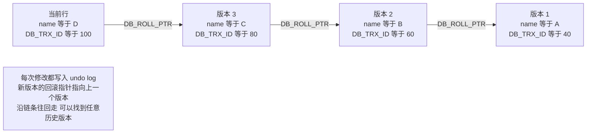
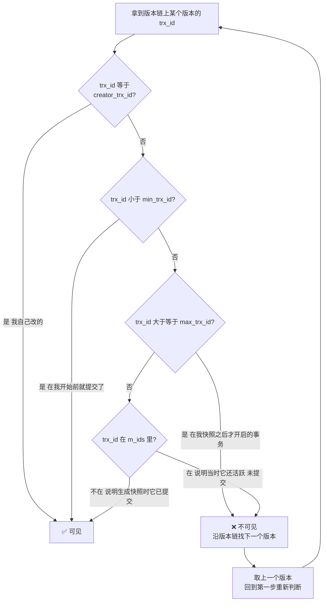
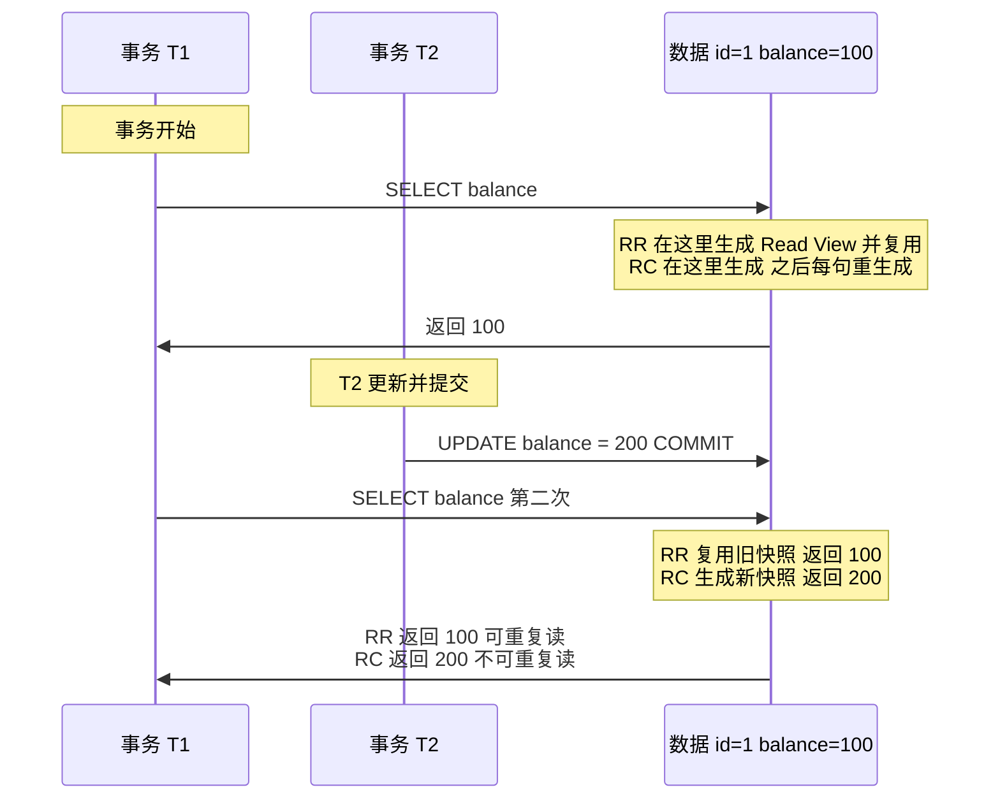

# 03 · MySQL 事务隔离与 MVCC

> **一句话主线**：InnoDB 用两套机制解决并发读写问题——**「不加锁的读」靠 MVCC**（undo 版本链 + Read View，实现一致性快照读），**「加锁的读」靠锁**（Next-Key Lock，见 [`01_MySQL_锁机制.md`](01_MySQL_锁机制.md)）。**RR 与 RC 的唯一本质差别是「Read View 的生成时机」**：RR 在事务第一次读时生成一次并复用，RC 每条语句都重新生成——**理解这一句，四种隔离级别的行为差异就全通了**。
>
> **本模块定位**：`db/` 的**原理模块**，是理解 `01`（锁）、`04`（主从一致性）、`05`（缓存一致性）为什么这么设计的地基。

---

## 目录

- [一、ACID 与三大日志的对应关系](#一acid-与三大日志的对应关系)
- [二、四种隔离级别](#二四种隔离级别)
- [三、三个并发问题](#三三个并发问题)
- [四、MVCC：undo 版本链](#四mvccundo-版本链)
- [五、Read View：可见性判断](#五read-view可见性判断)
- [六、RR 与 RC 的唯一本质差别](#六rr-与-rc-的唯一本质差别)
- [七、RR 下幻读到底有没有被解决](#七rr-下幻读到底有没有被解决)
- [八、当前读与幻读的经典案例](#八当前读与幻读的经典案例)
- [本模块速记](#本模块速记考前-10-分钟)
- [面试官深挖追问](#面试官深挖追问)

---

## 一、ACID 与三大日志的对应关系

> **这一节把 `00` 和 `03` 串起来**——ACID 不是口号，每一条都有具体的日志/机制在支撑。

| 特性 | 含义 | 靠什么实现 | 详见 |
|------|------|-----------|------|
| **A**tomicity 原子性 | 事务内的操作要么全成功，要么全失败 | **Undo Log**（回滚到修改前） | [`00`](00_MySQL_日志与内部2PC.md) |
| **C**onsistency 一致性 | 事务前后数据满足业务约束（如转账总额不变） | **是目的，不是手段**——靠 A、I、D 共同保证 + 业务约束 | — |
| **I**solation 隔离性 | 并发事务互不干扰 | **锁**（当前读）+ **MVCC**（快照读） | 本模块 + [`01`](01_MySQL_锁机制.md) |
| **D**urability 持久性 | 提交后数据不丢 | **Redo Log**（WAL + 崩溃恢复） | [`00`](00_MySQL_日志与内部2PC.md) |

> 💡 **一个容易被追问的点**：**C 是「目的」不是「机制」**。A、I、D 都是为了达成 C 的**手段**。所以严格说 MySQL 只实现了 AID 三个机制，C 由它们共同保证。

---

## 二、四种隔离级别

| 隔离级别 | 脏读 | 不可重复读 | 幻读 | 实现方式 | 性能 |
|---------|------|-----------|------|---------|------|
| **READ UNCOMMITTED**（读未提交） | ✅ 可能 | ✅ 可能 | ✅ 可能 | 直接读最新数据，不加任何处理 | 最高 |
| **READ COMMITTED**（读已提交） | ❌ 不可能 | ✅ 可能 | ✅ **当前读下可能** | **每次 `SELECT` 生成新 Read View**；间隙锁基本禁用 | 较高 |
| **REPEATABLE READ**（可重复读）**InnoDB 默认** | ❌ 不可能 | ❌ 不可能 | ❌ 快照读不可能；**当前读靠 Next-Key Lock 防住** | **事务首次读生成 Read View 并复用**；间隙锁启用 | 中 |
| **SERIALIZABLE**（串行化） | ❌ 不可能 | ❌ 不可能 | ❌ 不可能 | 所有 `SELECT` 隐式加 `FOR SHARE`（读写互斥） | 最低 |

> ⚠️ **两个必知的点**：
> 1. **InnoDB 的默认隔离级别是 REPEATABLE READ**（这点和 Oracle / PostgreSQL / SQL Server 不同，它们默认 RC）
> 2. **「RR 不能防幻读」是 SQL 标准说的**——标准里 RR 允许幻读，只有 SERIALIZABLE 才禁止。但 **InnoDB 的 RR 通过「MVCC + Next-Key Lock」在实际效果上防住了幻读**（有例外，见第七节）

**怎么查看与设置**：

```sql
-- 查看（MySQL 8.0）
SELECT @@transaction_isolation;        -- 5.7 及之前是 @@tx_isolation

-- 会话级设置
SET SESSION TRANSACTION ISOLATION LEVEL READ COMMITTED;

-- 全局设置
SET GLOBAL TRANSACTION ISOLATION LEVEL READ COMMITTED;
```

---

## 三、三个并发问题

| 问题 | 定义 | 举例 |
|------|------|------|
| **脏读（Dirty Read）** | 读到了**其他事务未提交**的数据 | T1 把余额改成 200（**未提交**），T2 读到 200；T1 回滚 → T2 读到的 200 是**脏数据** |
| **不可重复读（Non-Repeatable Read）** | **同一事务内两次读同一行**，结果不同（因为别人**改了/删了**它） | T1 第一次读余额 100；T2 把余额改成 200 并提交；T1 再读变成 200 |
| **幻读（Phantom Read）** | **同一事务内两次范围查询**，第二次**多出了（或少了）行**（因为别人**插入/删除了**） | T1 查 `WHERE age > 10` 得到 3 行；T2 插入一条 `age=25` 并提交；T1 再查变成 4 行 |

> **不可重复读 vs 幻读的区别（必考）**：
>
> | | 不可重复读 | 幻读 |
> |---|---|---|
> | **别人做了什么** | **`UPDATE` / `DELETE`** 已存在的行 | **`INSERT` / `DELETE`** 造成**行数变化** |
> | **关注点** | **同一行**的内容变了 | **结果集的行数**变了 |
> | **怎么防** | MVCC（快照） | **间隙锁 / Next-Key Lock**（锁住插入的位置） |
>
> **一句话记**：**不可重复读是「同一行内容变了」，幻读是「凭空多/少了行」。**

---

## 四、MVCC：undo 版本链

**MVCC（Multi-Version Concurrency Control，多版本并发控制）**——通过**保存数据的多个历史版本**，让「读」和「写」不互相阻塞。

### 1. 两个隐藏字段

InnoDB 的每一行都有两个**隐藏字段**（对用户不可见）：

| 隐藏字段 | 含义 |
|---------|------|
| **`DB_TRX_ID`**（6 字节） | **最后一次修改这一行的事务 ID** |
| **`DB_ROLL_PTR`**（7 字节） | **回滚指针**，指向 undo log 中这一行的**上一个版本** |

### 2. 版本链是怎么形成的

每次有人修改这一行，就会：

1. 把修改前的数据写入 **undo log**
2. 新版本的 `DB_ROLL_PTR` **指向上一个版本**

这样一行数据的**历史版本**就串成了一条**链表**——这就是**版本链**。

**图 3-1：undo 版本链**



> ⚠️ **重要推论**：**undo log 不是「事务提交就删」**。只要还有更早的 Read View 需要看到旧版本，这条 undo 记录就必须保留。清理工作由 **`purge` 线程**在「**没有任何 Read View 需要它**」之后才执行。所以**长事务会阻止 undo log 清理 → 版本链越来越长 → 回滚段膨胀**。这是「**禁止长事务**」的一个重要原因。

---

## 五、Read View：可见性判断

有了版本链，读取时**该从链条的哪个版本开始**？这就是 **Read View** 的作用。

**Read View** 是事务在读取时生成的一个「**快照**」，包含四个关键字段：

| 字段 | 含义 |
|------|------|
| **`m_ids`** | 生成 Read View 时，**当前活跃（未提交）的事务 ID 列表** |
| **`min_trx_id`** | `m_ids` 中的**最小值** |
| **`max_trx_id`** | 生成 Read View 时**系统应该分配给下一个事务的 ID**（即当前最大事务 ID + 1） |
| **`creator_trx_id`** | **创建这个 Read View 的事务自己的 ID** |

### 可见性判断算法

对于版本链上的某个版本，设它的 `DB_TRX_ID` 为 `trx_id`，**从上往下（从最新版本开始）逐个判断**：

**图 3-2：Read View 可见性判断流程**



**四步判断（从版本链最新版本往前遍历，找到第一个「可见」的版本就是读取结果）**：

| 判断 | 结论 |
|------|------|
| **① `trx_id == creator_trx_id`** | ✅ **可见**——这个版本是**我自己**改的，当然要看到 |
| **② `trx_id < min_trx_id`** | ✅ **可见**——这个版本在**我生成快照之前就已提交**，是历史数据 |
| **③ `trx_id >= max_trx_id`** | ❌ **不可见**——这个版本是**我生成快照之后才开启**的事务改的（未来的事务） |
| **④ `min_trx_id <= trx_id < max_trx_id`** | 看 **`trx_id` 是否在 `m_ids` 里**：<br>• **在** → ❌ 不可见（生成快照时它还活跃、未提交）<br>• **不在** → ✅ 可见（生成快照时它已提交） |

> **一句话理解**：**Read View 记录的是「我读的那一刻，哪些事务还没提交」**。凡是「那一刻还没提交的事务」所做的修改，我都看不见——所以我就看到了一个**一致的快照**。

---

## 六、RR 与 RC 的唯一本质差别

> **这是本模块最重要的一节**——弄懂它，四种隔离级别的行为就全通了。

| | **READ COMMITTED（RC）** | **REPEATABLE READ（RR）** |
|---|---|---|
| **何时生成 Read View** | **每一条 `SELECT` 语句都重新生成** | **事务中第一次 `SELECT` 时生成一次，之后复用** |
| **效果** | 每次读都看到「**截至本语句开始时刻**已提交的数据」→ **别人提交了就能看到** → **不可重复读** | 整个事务都用**同一个快照** → **别人提交了也看不到** → **可重复读** |
| **间隙锁** | **基本禁用**（仅外键约束、重复键检查） | **启用** |
| **幻读（当前读）** | **可能** | **不可能**（Next-Key Lock 防住） |

**图 3-3：RR 与 RC 的快照时机差异**



> **面试标准答法**：「RR 和 RC 的**唯一本质差别是 Read View 的生成时机**。**RC 每条 `SELECT` 都重新生成一次 Read View**，所以能看到别的事务最新提交的数据，产生不可重复读；**RR 只在事务第一次读时生成一次并复用整个事务**，所以整个事务看到的是同一个快照，实现了可重复读。除此之外还有一个差别：**RC 下间隙锁基本被禁用**，所以 RC 的当前读可能幻读，但换来的是更少的死锁和更高的并发。」

---

## 七、RR 下幻读到底有没有被解决

> ⚠️ **这是 MySQL 面试最经典的「陷阱题」之一**，答案**不是简单的「解决了」或「没解决」**。

### 正确表述

**InnoDB 的 RR 通过两套机制的配合，在绝大多数场景下防住了幻读，但不是「SQL 标准意义上的完美保证」**：

| 读的类型 | 靠什么防幻读 | 效果 |
|---------|------------|------|
| **快照读（普通 `SELECT`）** | **MVCC**（Read View 复用同一个快照） | ✅ **完全防住**。因为快照固定了，别人插入的行**在快照里根本不存在** |
| **当前读（`FOR UPDATE` / `UPDATE` / `DELETE`）** | **Next-Key Lock**（锁住记录 + 间隙） | ✅ **防住**。因为**插入的位置被锁住了**，别人插不进来 |

> **所以准确的回答是**：
>
> **「InnoDB 的 RR 下，快照读靠 MVCC 的快照防住幻读，当前读靠 Next-Key Lock 锁住间隙防住幻读。两者合起来，实际效果上幻读被防住了。」**
>
> ⚠️ **但要说清一个例外**：**如果同一事务内「先快照读、后当前读」，两边的结果可能不一致**——因为快照读看到的是旧快照，当前读看到的是最新数据。这就是下面第八节的经典案例。**严格说这不算「幻读」**（因为幻读的定义是「两次读的结果不一致」，这里只是「读与写看到的不同」），但面试官常拿它来追问。

### 补充：RC 下为什么无法防幻读

因为 **RC 每条语句生成新 Read View**（快照读看到最新已提交数据）+ **间隙锁被禁用**（当前读只锁住命中的记录，不锁间隙）→ 别人可以随意插入 → **幻读可能发生**。

---

## 八、当前读与幻读的经典案例

**这个案例是「RR 到底防没防住幻读」的标准追问材料**：

```sql
-- 事务 T1（RR 隔离级别）
START TRANSACTION;

-- ① 快照读：此时 id > 5 有 2 行（id=10, 15）
SELECT * FROM users WHERE id > 5;                       -- 返回 2 行

-- 事务 T2 插入一行 id=7 并提交
-- INSERT INTO users (id, name) VALUES (7, 'New'); COMMIT;

-- ② 快照读：还是 2 行（快照没变，防住了幻读）
SELECT * FROM users WHERE id > 5;                       -- 仍然返回 2 行

-- ③ 当前读：会返回 3 行！因为当前读看的是最新数据
SELECT * FROM users WHERE id > 5 FOR UPDATE;            -- 返回 3 行 ← 多出 id=7

-- ④ 如果基于③的结果去更新，就会「更新到一条之前没读到的行」
UPDATE users SET name = 'X' WHERE id > 5;               -- 影响 3 行
```

**怎么理解**：

| 观察 | 解释 |
|------|------|
| ② 仍然是 2 行 | **快照读看到的是固定快照** → 幻读被 MVCC 防住 ✅ |
| ③ 变成 3 行 | **当前读看的是最新数据**（且要用 Next-Key Lock 锁它） → 这是**「当前读的语义」**，不是 bug |
| ④ 更新了 3 行 | 这就是有些人说的「**RR 下也会幻读**」——准确的叫法是「**当前读读到了新插入的行**」 |

> **面试话术**：「严格说幻读的定义是『**同一事务内两次同样的读结果不一致**』。上面②两次**快照读**结果一致，说明 MVCC 防住了幻读；③是**当前读**，它本来就要看最新数据并加锁，读到新行是**符合语义的**。所以正确的说法是：**InnoDB 的 RR 下，快照读靠 MVCC 防幻读，当前读靠 Next-Key Lock 防幻读；但『快照读 + 当前读混合』时，两者看到的数据可能不同，这不是幻读，是两类读的语义差异。**」

---

## 本模块速记（考前 10 分钟）

| # | 问题 | 关键词速答 |
|---|------|-----------|
| 1 | ACID 各靠什么实现？ | **A** → **Undo Log**；**D** → **Redo Log**；**I** → **锁 + MVCC**；**C** → **是目的不是机制**，靠 AID 共同保证 |
| 2 | InnoDB 默认隔离级别？ | **REPEATABLE READ**（⚠️ 与 Oracle / PG / SQL Server 默认 RC 不同） |
| 3 | 四种隔离级别与三个问题？ | **RU**：脏读/不可重复读/幻读都可能；**RC**：不可重复读✅可能、**当前读幻读可能**；**RR**：不可重复读❌、**快照读幻读❌**；**SERIALIZABLE**：全部不可能 |
| 4 | 脏读是什么？ | 读到**其他事务未提交**的数据（对方回滚后就是脏数据） |
| 5 | **不可重复读 vs 幻读？** | **不可重复读 = 同一行内容变了**（别人 `UPDATE`/`DELETE`）；**幻读 = 结果集行数变了**（别人 `INSERT`/`DELETE`） |
| 6 | 怎么防不可重复读？ | **MVCC 快照** |
| 7 | 怎么防幻读？ | **MVCC 快照**（快照读）+ **Next-Key Lock 锁间隙**（当前读） |
| 8 | 查看隔离级别？ | MySQL 8.0：`SELECT @@transaction_isolation;`（**5.7 及之前是 `@@tx_isolation`**） |
| 9 | 行的两个隐藏字段？ | **`DB_TRX_ID`**（最后修改这行的事务 ID）+ **`DB_ROLL_PTR`**（回滚指针，指向 undo 里的上一个版本） |
| 10 | **版本链怎么形成？** | 每次修改：① 修改前数据写入 **undo log**；② 新版本的 `DB_ROLL_PTR` **指向上一个版本** |
| 11 | ⚠️ undo log 提交就删吗？ | **不是！** 只要有更早的 Read View 需要，就必须保留，由 **purge 线程**在「无人需要」后清理。**所以长事务会让版本链越来越长、回滚段膨胀** |
| 12 | **Read View 四个字段？** | **`m_ids`**（活跃未提交事务 ID 列表）、**`min_trx_id`**（最小）、**`max_trx_id`**（下一个要分配的 ID）、**`creator_trx_id`**（自己） |
| 13 | **可见性判断四步？** | ① `trx_id == creator_trx_id` → **可见**；② `trx_id < min_trx_id` → **可见**；③ `trx_id >= max_trx_id` → **不可见**；④ 在 `m_ids` 里 → **不可见**，不在 → **可见** |
| 14 | 为什么要沿版本链遍历？ | 从**最新版本**开始判断，**找到第一个「可见」的版本**就是读取结果 |
| 15 | **RR 与 RC 的唯一本质差别？** | **Read View 的生成时机**：**RC 每条 `SELECT` 重新生成**；**RR 事务首次读生成一次并复用** |
| 16 | RC 为什么不可重复读？ | 每条语句新快照 → **别人提交了就能看到** |
| 17 | RR 为什么可重复读？ | 整个事务复用同一个快照 → **别人提交了也看不到** |
| 18 | ⚠️ **RR 防住幻读了吗？** | **快照读靠 MVCC 防住**（快照里没有新行）；**当前读靠 Next-Key Lock 防住**（锁住插入位置）。**合起来实际防住了**，但**不是 SQL 标准意义上的完美保证** |
| 19 | RC 为什么防不住幻读？ | ① **每条语句新快照**（快照读看到最新）；② **间隙锁被禁用**（当前读没锁住插入位置）→ 别人能随意插入 |
| 20 | ⚠️ 「RR 下快照读+当前读混合」会怎样？ | **两者看到的数据可能不同**——快照读看旧快照，当前读看最新数据。⚠️ **这不叫幻读**（幻读定义是「两次同样的读结果不一致」），而是**两类读的语义差异** |
| 21 | 为什么互联网公司爱用 RC？ | ① **间隙锁禁用 → 锁范围小 → 并发高、死锁少**；② 业务能接受 RC 语义（靠唯一约束/幂等兜底）；③ ROW 格式下 RC 的 binlog 更小 |
| 22 | 为什么禁止长事务？ | ① **阻止 undo 清理** → 版本链膨胀、回滚段涨；② **持锁时间长** → 阻塞+死锁风险；③ **主从延迟**（大事务的 binlog 同步慢，见 [`04`](04_MySQL_复制与高可用.md)） |

---

## 面试官深挖追问

1. **「RR 到底有没有解决幻读？请直接回答。」**
   → 不要直接说「解决了」——这题考的是你知不知道边界。标准答法：「**分两种情况。快照读（普通 `SELECT`）靠 MVCC 彻底防住了幻读**，因为整个事务复用同一个 Read View，别人插入的行在快照里不存在；**当前读（`FOR UPDATE`/`UPDATE`）靠 Next-Key Lock 锁住间隙也防住了**，因为插入位置被锁了。**所以实际效果上幻读被防住了**。但要补充一个边界：**同一事务里先快照读、后当前读时，两者看到的数据可能不一致**（当前读会看到新插入的行），严格说不算幻读，是两类读的语义差异。」

2. **「为什么 undo log 不能事务提交就删？」**
   → 因为 **MVCC 需要它**。假设事务 T1 修改了 `id=1`（`balance` 100→200）并提交；事务 T2 在 T1 提交**之前**就生成了 Read View，那么 T2 读 `id=1` 时**应该看到 100**——这就要求 **undo log 里保留 100 这个旧版本**。只有当**所有持有「早于 T1 提交时刻」Read View 的事务都结束后**，`purge` 线程才能清理这条 undo。**推论**：**长事务会长期持有旧 Read View，导致 undo 无法清理**，这是「禁止长事务」的核心原因之一。

3. **「undo log 是逻辑日志，Redo log 是物理日志——那 undo 的修改要不要写 redo？」**
   → **要**。这是一个很容易被追问的细节：**undo log 本身的修改也需要持久化**（否则崩溃后无法回滚）。所以 InnoDB 对 undo 页的修改**也会写 redo log**——即「**undo 的持久性靠 redo 保证**」。这解释了为什么「undo log 不只是内存结构」，它有自己的**回滚段（rollback segment）空间**，也需要刷盘。

4. **「Read View 里的 `max_trx_id` 为什么是『下一个要分配的 ID』而不是『当前最大 ID』？」**
   → 因为判断规则③是 `trx_id >= max_trx_id → 不可见`。如果 `max_trx_id` 是「当前最大 ID」，那么**当前最大 ID 那个事务的修改就会被判成「可见」**——这是错的（它可能还没提交）。用「下一个要分配的 ID」+ `>=` 判断，就能把「**生成快照时还不存在的事务**」（未来的事务）**全部划为不可见**。**这是为了让 `m_ids` 不需要无限增长**——只要 `trx_id >= max_trx_id` 就一定是未来的，直接短路判断。

5. **「如果事务 A 修改了某行，事务 B 又改了同一行，A 回滚了，B 看到什么？」**
   → 这正是版本链 + Read View 要处理的场景。**A 回滚时，它产生的版本会被标记为「已回滚」**（undo 里的 `delete_flag`），`purge` 会跳过他。B 读的时候沿版本链找到的是 **A 修改之前的那个版本**（因为 A 的版本不可见/已失效），B 自己的修改则在版本链最新处。**关键点**：**A 回滚不会影响 B 已经写入的数据**——因为行锁保证了「A 和 B 不会同时修改同一行」（B 必须在 A 释放锁后才能改）。

6. **「为什么说 RC 的 binlog 比 RR 小？」**
   → 因为在 **ROW 格式**下，RC 和 RR 的差异体现在**「锁释放的时机」**：**RC 会在语句执行完就释放「不匹配的行的锁」**，而 RR 会一直持有到事务结束。这个差异影响了 **`binlog_row_image` 相关的记录量**吗？——**更准确的机制是**：RC 下每个语句都重新生成快照，**语句间的不匹配行不会被锁定**，所以在某些 `UPDATE ... WHERE` 场景下，RC 里被**判定为不匹配而跳过的行**不会进入 binlog（因为它们没被锁、也没被改），而 RR 里这些行**可能被锁住进而产生额外的行锁事件**。**面试中简单回答「RC 下语句级释放锁，binlog 涉及的行更少」即可**，不必深挖。

7. **「`SELECT ... FOR UPDATE` 在 RC 和 RR 下加锁有什么不同？」**
   → 三个差异：① **RC 下没有间隙锁**——只锁命中的记录（Record Lock），**不锁间隙**，所以允许幻读；② **RC 会释放不匹配行的锁**——`WHERE age > 10` 扫描时，如果扫到 `age = 5` 的行，RC 会在判断后**立刻释放**这行的锁，而 RR **会一直持有到事务结束**；③ **结果**：RC 的锁范围小得多 → **并发更高、死锁概率显著降低**。**这就是很多互联网公司选 RC 的核心理由**。

8. **「你可以用一个例子说明『不可重复读』和『幻读』的区别吗？」**
   → 用同一张表：
   - **不可重复读**：T1 读 `id=1` 的 `balance = 100`；T2 `UPDATE id=1 SET balance=200` 并提交；T1 再读 `id=1` 得到 200。→ **同一行（`id=1`）的内容变了**。
   - **幻读**：T1 查 `WHERE age > 10` 得到 3 行；T2 `INSERT` 一条 `age=25` 并提交；T1 再查 `WHERE age > 10` 得到 4 行。→ **同一条件（`age > 10`）的行数变了**。
   **一句话**：**不可重复读是「行变了」，幻读是「行多了/少了」。** 前者靠 MVCC 防，后者靠间隙锁防。

9. **「SERIALIZABLE 隔离级别是怎么实现的？为什么没人用？」**
   → **实现方式**：InnoDB 会把**所有普通 `SELECT` 隐式转成 `SELECT ... FOR SHARE`**（加共享锁）——这样读和读之间兼容，但**读和写互斥**，效果上等价于串行执行。**为什么没人用**：① **性能极差**——所有读都要加锁，并发度接近于 1；② **死锁概率激增**——大量的 S/X 锁互相等待。**实际场景**：只在「**对一致性要求极高且并发极低**」的场景用（如某些对账任务）。**生产上更常见的做法是「用 RR 或 RC + 业务层保证一致性」**。

10. **「为什么说『可重复读』这个名字有点误导？」**
    → 因为 RR 保证的是「**同一事务内多次读到的数据一致**」，但**不保证「读到的数据是最新的」**。在最开始那个 `SELECT` 之后别人改了数据，RR 下你**永远看不到**——这在某些业务里是**问题**（比如「用户刚改了昵称，自己刷新看不到」）。所以 RR 的正确理解是：**「事务内一致，但不保证实时」**。这也解释了为什么**很多互联网业务反而选 RC**——它们更希望「读到最新的已提交数据」，并用**唯一约束/幂等**来保证一致性，而不是靠隔离级别。

---

## 参考资料

见 [`99_参考资料.md`](99_参考资料.md)。
