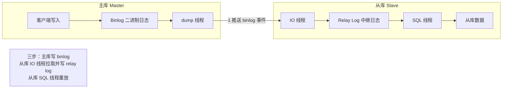
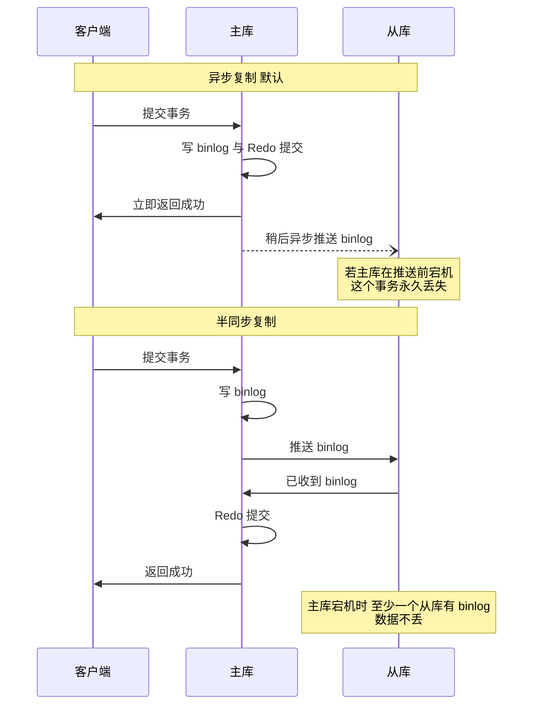
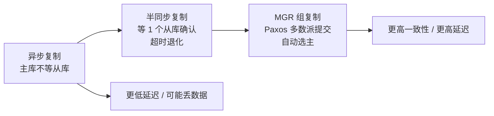

# 04 · MySQL 复制与高可用

> **一句话主线**：MySQL 的高可用建立在**复制**之上——**主库写 binlog → 从库拉取写 relay log → 从库重放**。但复制是**异步**的，所以产生了两个核心问题：**主从延迟**（读到旧数据）和**主库宕机时的数据丢失**。前者靠**并行复制 + 读写分离的路由策略**缓解，后者靠**半同步 / MGR（基于 Paxos 多数派）**解决。**理解了这两个问题，就理解了 MySQL 高可用架构的全部权衡。**
>
> **本模块定位**：`db/` 的**架构模块**。它是 [`00_MySQL_日志与内部2PC.md`](00_MySQL_日志与内部2PC.md)（binlog 是复制的源头）与 [`../distributed_consensus/05_分布式数据工程.md`](../distributed_consensus/05_分布式数据工程.md)（复制模型与一致性）的交汇点。

---

## 目录

- [一、主从复制的三线程模型](#一主从复制的三线程模型)
- [二、复制的三种模式](#二复制的三种模式)
- [三、主从延迟：原因与解决](#三主从延迟原因与解决)
- [四、半同步复制](#四半同步复制)
- [五、组复制（MGR）](#五组复制mgr)
- [六、读写分离与一致性](#六读写分离与一致性)
- [七、GTID 与故障切换](#七gtid-与故障切换)
- [本模块速记](#本模块速记考前-10-分钟)
- [面试官深挖追问](#面试官深挖追问)

---

## 一、主从复制的三线程模型

**图 4-1：主从复制完整链路**



| 步骤 | 谁在做 | 做什么 |
|------|-------|--------|
| **① 主库写 Binlog** | 主库 | 事务提交时（经两阶段提交，见 [`00`](00_MySQL_日志与内部2PC.md)）写入 binlog |
| **② 从库拉取 → Relay Log** | **从库的 IO 线程** + **主库的 dump 线程** | 从库 IO 线程连上主库，主库 dump 线程把 binlog 事件推给它；IO 线程**写入本地的 relay log（中继日志）** |
| **③ 从库重放** | **从库的 SQL 线程** | 读 relay log，**重放**这些事件到从库数据 |

> **为什么要有 relay log 这一层？** 因为「**拉取**」和「**重放**」是两个独立的过程，速度不同。有了 relay log，**IO 线程可以持续拉取（不受重放速度影响）**，SQL 线程慢慢重放。这也是**主从延迟**现象的物理来源——**relay log 里堆积了多少，就代表从库落后多少**。

**关键位点**：

| 位点 | 含义 |
|------|------|
| **`Master_Log_File` / `Read_Master_Log_Pos`** | IO 线程**读到**了主库 binlog 的哪个位置 |
| **`Relay_Log_File` / `Exec_Master_Log_Pos`** | SQL 线程**执行**到了 relay log 的哪个位置 |
| **`Seconds_Behind_Master`** | 从库落后主库多少秒（**⚠️ 不可靠**，见第三节） |

---

## 二、复制的三种模式

| 模式 | 机制 | 数据安全 | 主库写入延迟 | 典型场景 |
|------|------|---------|------------|---------|
| **异步复制**（默认） | 主库写完 binlog **立即返回**，不等从库 | ⚠️ **主库宕机可能丢数据**（未同步的事务永久丢失） | **最低** | 大多数互联网业务的默认配置 |
| **半同步复制**（semi-sync） | 主库等**至少一个从库确认收到 binlog** 才返回 | ✅ 主库宕机不丢（至少有一个从库有） | 中（等一个从库的网络往返） | 对数据安全有要求的场景 |
| **全同步复制** | 主库等**所有从库**都确认 | ✅ 最安全 | **最高**（等最慢的从库） | 极少用（从库一慢就阻塞写入） |

> **⚠️ 注意半同步的「退化」行为**：`rpl_semi_sync_master_timeout`（默认 **10 秒**）超时后，**半同步会自动退化为异步复制**——为了避免从库故障拖死主库。所以「开了半同步就一定不丢」也不准确：**如果从库全部超时，它还是会退化成异步**。这个细节是面试的加分点。

---

## 三、主从延迟：原因与解决

> **这是 MySQL 面试的**超高频题**——「你们遇到过主从延迟吗？怎么解决的？」几乎必问。

### 1. 为什么会有延迟

| 原因 | 说明 |
|------|------|
| **① 从库单线程重放**（历史主因） | 主库是**并发写入**（多线程），而从库早年的 **SQL 线程是单线程重放** → 主库能并发写，从库只能串行追 → **必然越追越慢** |
| **② 大事务** | 一个 `UPDATE` 影响百万行（或一个大 `DELETE`）→ 一次要重放很久，期间从库被卡住 |
| **③ 大表 DDL** | `ALTER TABLE` 在大表上执行几分钟到几小时，期间从库阻塞 |
| **④ 从库压力大** | 从库上跑了大量查询（读流量）→ 与 SQL 线程争抢资源 |
| **⑤ 网络延迟 / 带宽** | 跨机房、binlog 体积大（如 ROW 格式 + 大事务）导致传输慢 |
| **⑥ 从库配置差** | 从库机器规格比主库低（常见于「主库好机器、从库便宜机器」） |

### 2. 怎么解决

| 手段 | 说明 | 适用 |
|------|------|------|
| **① 并行复制（最核心）** | `slave_parallel_workers > 0` + `slave_parallel_type`。**MySQL 5.7+ 的 `LOGICAL_CLOCK`** 能基于「**同一时刻提交的事务可以并行重放**」来并行执行 | 主库写入并发度高的场景 |
| **② 拆分大事务** | 把 `UPDATE ... LIMIT 1000000` 拆成多批（如每批 1000 行 + sleep），**这是最有效且最该做的** | 所有场景 |
| **③ 避免大表 DDL** | 用 **`pt-online-schema-change`** 或 **`gh-ost`** 做在线 DDL（不阻塞主库，binlog 也小） | 需要改表结构时 |
| **④ 从库专用 + 提升规格** | 从库不跑其他业务；规格不低于主库 | 服务器资源允许时 |
| **⑤ MGR / 半同步** | 从架构上改善（但 MGR 的流控也会限制主库写入） | 见下文 |
| **⑥ 读写分离路由策略** | 见第六节——**用路由策略绕过延迟，而不是消除延迟** | 最实用 |

> **⚠️ 关于并行复制的关键限制**：**`LOGICAL_CLOCK` 的并行度取决于「主库同一时刻有多少事务能并发提交」**。如果**主库写入本身是串行的**（比如单线程跑批），那么从库**并行复制的并行度也上不去**（因为没有可并行的事务组）。所以「并行复制」并不是万能药——**根因还是「主库的写入并发度」**。

### 3. 怎么监控延迟

| 方法 | 说明 |
|------|------|
| **`SHOW SLAVE STATUS` 里的 `Seconds_Behind_Master`** | ⚠️ **不准确！** 它算的是「SQL 线程重放的时间戳 vs 主库 binlog 事件的时间戳」，**IO 线程卡住（网络断了）时它会显示 0 或 NULL**，看起来「没延迟」其实早就断了 |
| **`pt-heartbeat`（Percona Toolkit）** | ✅ **生产标准做法**。主库上定期往一张心跳表写时间戳，从库读出来对比当前时间 → **真实反映端到端延迟**（包含 IO 线程与 SQL 线程两段） |
| **对比位点** | `Master_Log_File/Read_Master_Log_Pos` 与 `Exec_Master_Log_Pos` 的差值 = 积压的 binlog 字节数 |

> **面试话术**：「我们**不直接信 `Seconds_Behind_Master`**——IO 线程断了它会显示 NULL 或 0，误导性很大。我们用的是 **`pt-heartbeat`**：主库每秒往心跳表写一行时间戳，从库读出来和当前时间比，这个差值是**真实端到端延迟**。另外我们监控 `Read_Master_Log_Pos` 和 `Exec_Master_Log_Pos` 的差值来看 relay log 积压。」

---

## 四、半同步复制

**核心机制**：主库提交时，**必须等至少一个从库回复「我已收到 binlog」**，才向客户端返回成功。

**图 4-2：异步 vs 半同步**



### 关键细节

| 要点 | 说明 |
|------|------|
| **`rpl_semi_sync_master_timeout`** | **默认 10 秒**。超时后**自动退化为异步复制**（避免从库故障拖死主库） |
| **「至少一个」的含义** | 是**其中一个**从库确认即可，不是全部。所以**仍然可能丢数据**：如果那个「确认过的从库」也挂了，而其他从库还没收到 → **数据丢失** |
| **退化的代价** | 退化成异步后，**主库宕机仍可能丢数据**——所以半同步只是「降低了丢失概率」，不是「绝对不丢」 |
| **MySQL 5.7+ 的增强** | `rpl_semi_sync_master_wait_point = AFTER_SYNC`（**默认**）——在**写 binlog 后、提交前**等待从库确认；旧版 `AFTER_COMMIT` 在提交后等，会导致其他会话能读到尚未同步的数据（**幻读式不一致**） |

> **面试标准答法**：「半同步是主库等**至少一个从库**确认收到 binlog 才返回。它比异步安全，但有三个要说清的点：① **只等一个从库**，所以那个从库如果也挂了仍可能丢；② **有 10 秒超时**（`rpl_semi_sync_master_timeout`），超时后会**自动退化为异步**，避免从库故障拖死主库；③ MySQL 5.7 起默认用 **`AFTER_SYNC`** 模式，在写 binlog 后、提交前等待，避免了 `AFTER_COMMIT` 模式下的『其他会话读到未同步数据』问题。」

---

## 五、组复制（MGR）

**MySQL Group Replication**——MySQL 5.7.17 引入，基于 **Paxos 协议**的**多数派**复制。

| 特性 | 说明 |
|------|------|
| **一致性** | 基于 **Paxos 多数派提交**（回顾 [`../distributed_consensus/01_共识算法.md`](../distributed_consensus/01_共识算法.md)）——事务需要**多数派节点**确认才提交 |
| **数据不丢** | 多数派提交 → **主节点宕机不丢数据**（只要多数派存活） |
| **自动故障转移** | 集群自动选举新主，**不需要 MHA / MMM 等外部工具** |
| **多主模式** | 支持 single-primary（单主）和 multi-primary（多主）。**多主模式需处理写冲突**（乐观锁检查，冲突则回滚） |
| **流控（Flow Control）** | ⚠️ 如果某个节点落后，MGR 会**限流整个集群**——保证不落后，**代价是整体变慢** |

**图 4-3：复制的演进（一致性 vs 延迟的权衡）**



> **权衡的本质**：这条演进线就是 [`../distributed_consensus/00_分布式基础理论.md`](../distributed_consensus/00_分布式基础理论.md) 里 **PACELC** 的教科书例子——**无分区时，在「延迟 L」与「一致性 C」之间选**：
> - **异步**：选 L（快，但弱一致）
> - **半同步**：中间档
> - **MGR**：选 C（多数派，但每次提交要多一轮网络往返）

> **MGR 的三个限制**（面试加分）：① **只支持 InnoDB**；② **所有表必须有主键**（否则无法做冲突检测）；③ **不支持 `SELECT ... FOR UPDATE` 之外的某些锁语义**（早期版本限制，新版本逐步放宽）。

---

## 六、读写分离与一致性

**读写分离**：主库只写，从库只读——**用从库扩充读能力**。但它引入了**一致性问题**：因为复制是异步的，**从库可能读到旧数据**。

### 1. 经典问题：读己之写失效

> 用户在**主库**写了自己的昵称，紧接着的**读请求走了从库**，而从库还没同步到 → **用户看不到自己刚改的昵称**。

### 2. 四种解决方案

| 方案 | 做法 | 优缺点 |
|------|------|-------|
| **① 写后强制走主库** | 写操作后的一段时间内（如 1 秒），该用户的读请求强制走主库 | 简单；但**「一段时间」不好定**，且主库压力大 |
| **② 会话内路由（推荐）** | 在**同一会话/同一请求**内，「**有写过就走主库**」——比如用 ThreadLocal 标记本次请求是否发生过写操作 | 精确；**不依赖时间猜测**。注意**跨请求**（用户下次访问）就失效了 |
| **③ 会话粘性到同一从库** | 把同一用户的读请求**固定路由到同一个从库** | 保证**单调读**（不会读到回退的数据），但仍可能读到旧值 |
| **④ 版本号 / GTID 校验** | 客户端记住自己写入的 GTID，读从库时**校验从库是否已执行到该 GTID**，没有则等待或转主库 | 最精确；但实现复杂，需要中间件支持 |

> **本质**：这四种方案都是 [`../distributed_consensus/00_分布式基础理论.md`](../distributed_consensus/00_分布式基础理论.md) 里的**「会话保证」**（read-your-writes / monotonic reads）在 MySQL 上的具体落地。

### 3. 中间件

| 中间件 | 特点 |
|--------|------|
| **ShardingSphere-JDBC** | 客户端模式，无额外部署；支持读写分离 + 分库分表（见 [`../distributed_consensus/05`](../distributed_consensus/05_分布式数据工程.md)） |
| **MyCat / ProxySQL** | 代理模式，支持异构语言 |
| **ShardingSphere-Proxy** | 代理模式 |

> ⚠️ **一个实践要点**：读写分离的**路由策略必须在业务层可感知**——比如「**主库写完后，该用户的后续读也要走主库**」这种逻辑，**ShardingSphere 的 `HintManager`** 或自研的注解可以做到。**纯靠中间件自动路由是不够的**，因为它不知道业务的「写后读」语义。

---

## 七、GTID 与故障切换

### 1. GTID 是什么

**GTID（Global Transaction Identifier）**——给**每个已提交事务**分配一个**全局唯一 ID**，格式：

```
source_id:transaction_id
例如：3E11FA47-71CA-11E1-9E33-C80AA9429562:23
```

| 价值 | 说明 |
|------|------|
| **不用记 binlog 文件名 + 位点** | 从库只需说「**我已经执行到哪些 GTID**」，主库就知道该从哪开始推 |
| **自动定位** | 主从切换后，**新主库能自动算出从库缺哪些事务**并补齐——**这是自动故障切换的基础** |
| **可校验** | 能直接查「某个事务有没有在这个从库上执行过」 |

**开启方式**：`gtid_mode=ON` + `enforce_gtid_consistency=ON`。

### 2. 故障切换的三种做法

| 方案 | 机制 | 特点 |
|------|------|------|
| **MHA（Master High Availability）** | 外部工具，监控主库、**选数据最新的从库**提升为主 | 老牌方案，**已停止维护** |
| **MGR** | 集群**内置**自动选主（基于 Paxos） | 现代推荐，**不需要外部工具** |
| **Orchestrator / 云 RDS 内置** | 第三方或云厂商的切换组件 | 云上最常用（阿里云 RDS、AWS RDS 都内置） |

**切换要做的三件事**：

1. **选新主库**——选**数据最新**（位点最靠后）的从库，用 GTID 补齐其他从库
2. **改路由**——客户端 / 中间件指向新主库
3. **防脑裂**——**旧主库如果还活着，必须先隔离**（切只读或直接下线），否则可能出现双写（这正是 [`../distributed_consensus/04_分布式组件选型.md`](../distributed_consensus/04_分布式组件选型.md) 讲的**脑裂与 Fencing**）

> ⚠️ **切换的最大风险是脑裂**：如果旧主库没被彻底隔离就切了新主，**两个主库可能同时被写入** → 数据分叉且无法自动合并。所以**生产上的切换流程必须包含「先确认旧主库不可写」这一步**（`SET GLOBAL read_only=ON` 或直接断网/下线）。

---

## 本模块速记（考前 10 分钟）

| # | 问题 | 关键词速答 |
|---|------|-----------|
| 1 | **主从复制三线程？** | **主库 dump 线程**（推 binlog）+ **从库 IO 线程**（拉取写 relay log）+ **从库 SQL 线程**（重放） |
| 2 | 复制三步是什么？ | ① 主库写 **binlog** → ② 从库 IO 线程拉取写 **relay log** → ③ 从库 SQL 线程**重放** |
| 3 | 为什么要有 relay log？ | 让「**拉取**」与「**重放**」解耦——IO 线程可全速拉取，SQL 线程慢慢重放。**relay log 的积压就是主从延迟** |
| 4 | 三种复制模式？ | **异步**（不等从库，可能丢，最快）、**半同步**（等 1 个从库，超时退化）、**全同步**（等全部，极少用） |
| 5 | ⚠️ 半同步的三个要点？ | ① 是「**至少一个**」从库，不是全部 → **仍可能丢**；② **`rpl_semi_sync_master_timeout` 默认 10 秒，超时自动退化为异步**；③ 5.7+ 默认 **`AFTER_SYNC`**（写 binlog 后、提交前等待） |
| 6 | **主从延迟的六大原因？** | ① **从库单线程重放**（历史主因）② **大事务** ③ **大表 DDL** ④ 从库压力大 ⑤ 网络/带宽 ⑥ 从库配置差 |
| 7 | **主从延迟怎么解决？** | **① 并行复制（`slave_parallel_workers` + `LOGICAL_CLOCK`）② 拆分大事务（最该做）③ `gh-ost`/`pt-osc` 做在线 DDL ④ 从库专用+升规格 ⑤ 读写分离路由** |
| 8 | ⚠️ 并行复制的限制？ | **并行度取决于「主库同时刻能并发提交多少事务」**。主库写入本身串行（单线程跑批）时，从库并行度也上不去 |
| 9 | ⚠️ **`Seconds_Behind_Master` 可靠吗？** | **不可靠！** IO 线程断了（网络故障）它会显示 **0 或 NULL**，看着「没延迟」其实早断了 |
| 10 | 怎么正确监控复制延迟？ | **`pt-heartbeat`**（主库写心跳时间戳，从库读出来比）→ **真实端到端延迟**。辅以 `Read_Master_Log_Pos` 与 `Exec_Master_Log_Pos` 的位点差 |
| 11 | **MGR 是什么？** | **组复制**，MySQL 5.7.17+，基于 **Paxos 多数派提交** → 主库宕机不丢 + **自动选主**（不需 MHA） |
| 12 | MGR 的代价？ | **流控（Flow Control）**——某节点落后就**限流整个集群**，保证不落后但整体变慢 |
| 13 | MGR 的三个限制？ | ① **只支持 InnoDB**；② **所有表必须有主键**（否则无法冲突检测）；③ 部分锁语义受限 |
| 14 | 复制演进的本质？ | **PACELC** 的教科书例子：**异步选延迟 → MGR 选一致性**。越往后一致性越强、延迟越高 |
| 15 | **读写分离引入什么问题？** | 复制是异步的 → **从库可能读到旧数据** → **「读己之写」失效**（自己刚改的看不到） |
| 16 | **读己之写怎么解决？** | ① **写后强制走主库**（简单但时间难定）② **会话内路由**（本请求有写过就走主库，推荐）③ **会话粘性到同一从库**（保证单调读）④ **GTID/版本号校验**（最精确） |
| 17 | 上面四种方案的本质？ | 都是 [`../distributed_consensus/00`](../distributed_consensus/00_分布式基础理论.md) 的**会话保证**（read-your-writes / monotonic reads）在 MySQL 的落地 |
| 18 | 读写分离中间件？ | **ShardingSphere-JDBC**（客户端，无额外部署）、ShardingSphere-Proxy / MyCat / ProxySQL（代理） |
| 19 | ⚠️ 读写分离的实践要点？ | **路由策略必须业务层可感知**（如「写完后该用户的读也走主库」）——**纯中间件自动路由不够**，它不知道业务的写后读语义 |
| 20 | **GTID 是什么？** | **全局事务 ID**（`source_id:transaction_id`）。让从库说「我执行到哪些 GTID」即可，**不用记 binlog 文件名+位点** |
| 21 | GTID 的价值？ | ① **自动定位**（切换时自动算差异补齐）② **自动故障切换的基础** ③ 可校验某事务是否已执行 |
| 22 | 开启 GTID？ | `gtid_mode=ON` + `enforce_gtid_consistency=ON` |
| 23 | 故障切换的三种做法？ | **MHA**（老牌，**已停止维护**）、**MGR**（内置自动选主，现代推荐）、**Orchestrator / 云 RDS 内置**（云上常用） |
| 24 | ⚠️ 切换最大的风险？ | **脑裂**——旧主库没隔离就切了新主 → **双写导致数据分叉**。所以切换流程**必须包含「先确认旧主不可写」**（`read_only=ON` 或下线） |

---

## 面试官深挖追问

1. **「你们遇到过主从延迟吗？怎么发现、怎么解决的？」**
   → 分三段答（**这题一定要有真实细节**）：
   > **① 怎么发现**：我们不只看 `Seconds_Behind_Master`（IO 线程断了它会显示 0/NULL，误导性太大），而是用 **`pt-heartbeat`** 做端到端延迟监控 + 监控 `Read_Master_Log_Pos` 与 `Exec_Master_Log_Pos` 的位点差。
   > **② 根因**：定位到是**大事务**——有一个批量更新任务一次 `UPDATE` 影响几十万行，导致从库 SQL 线程长时间卡住。
   > **③ 解决**：**拆大事务**（按主键分片、每批 1000 行 + sleep），同时开了**并行复制**（`slave_parallel_workers=8`，`slave_parallel_type=LOGICAL_CLOCK`）。另外在**路由层**加了「**写后读走主库**」——对一致性敏感的接口用 `HintManager` 强制走主。最后延迟从分钟级降到 **100ms 以内**。

2. **「半同步能保证数据不丢吗？」**
   → **不能保证，只能说「大幅降低丢失概率」**。三个理由：① 半同步只等**一个**从库确认——如果那个确认过的从库也挂了，而其他从库还没收到，**这个事务就丢了**；② 有 **10 秒超时**，超时后**自动退化成异步**——从库故障期间主库宕机仍会丢；③ 如果开了多线程复制，某些情况下「确认收到 binlog」与「重放完成」之间还有窗口。**要真正不丢，得用 MGR（Paxos 多数派）**，或者至少保证「半同步 + 至少两个从库 + 监控告警」。

3. **「GTID 和 binlog 位点复制相比，优势到底在哪？」**
   → **核心优势是「不用手工定位」**。传统位点复制必须精确记录「从哪个 binlog 文件、哪个位置开始」——**主从切换后，新主库的 binlog 文件名和位点是另一套**，人工算差异极其容易出错（这也是历史上切换事故高发的原因）。GTID 下每个事务有**全局唯一 ID**，从库只需说「我执行到 GTID 集合 X」，新主库**自动算出差异并补齐**。**所以 GTID 是「自动化故障切换」的前提**——没有 GTID，切换就得靠人工或工具去比对位点。

4. **「MGR 的流控（Flow Control）是好事还是坏事？」**
   → **是必要的保护，但有代价**。**好处**：防止某个节点落后太多导致「切换时数据丢失」或「集群不可用」——它保证所有节点的差异在一个可控窗口内。**代价**：**一个慢节点会拖慢整个集群**（主库被限流，写入变慢）。所以 MGR 对**网络质量和节点规格均衡性**要求很高——如果跨机房部署（一个节点远），流控会频繁触发，整体吞吐大跌。**这也是 MGR 主要用于同城/同机房场景的原因。**

5. **「读写分离之后，怎么保证用户看到自己的修改？」**
   → 分场景：① **同一个 HTTP 请求内**——用 **ThreadLocal 标记「本次请求是否发生过写操作」**，一旦写过，后续这个请求的所有读都走主库（ShardingSphere 的 `HintManager` 支持）；② **跨请求**（用户提交后重定向到详情页）——这个最难，因为请求已经换了。常见做法是**写完后把关键数据写入 Redis 缓存**（读缓存不读从库），或者**写完后设置一个短期的「强制主库」标记**（如 Redis key，TTL 1 秒）；③ **业务层规避**——比如「写完后**直接返回写入的数据**给前端」，不重新查库。**核心思路**：**要么让读绕过从库（走主库/走缓存），要么让业务不需要『写完立刻读』。**

6. **「为什么 MGR 要求所有表必须有主键？」**
   → 因为 MGR 的**冲突检测机制依赖主键**。MGR 在多主模式下，每个节点独立执行事务，**提交前要检查「这个事务修改的行有没有被其他节点并发修改」**——这个检查通过**行的标识（主键）**来做。如果表没有主键，就无法唯一定位一行 → **无法做冲突检测** → 可能产生数据不一致。所以 MGR 直接要求：**没有主键的表不允许写入**（或者直接拒绝加入集群）。**这也再次印证**：[`02_MySQL_索引与执行计划.md`](02_MySQL_索引与执行计划.md) 里说的「**生产规范要求每张表显式定义主键**」不只是性能问题，也是高可用架构的硬要求。

7. **「MySQL 主从复制能防脑裂吗？」**
   → **不能，默认配置下完全不能**。原因：① **从库默认也是可写的**（`read_only` 默认关，虽然 `super_read_only` 在 MGR 里会开），如果从库被误写就产生了分叉；② **切换工具本身不防脑裂**——MHA 这类工具在「旧主库网络分区但还活着」时可能误判为主库挂了，切了新主 → **两个主库同时写**。**防脑裂要做三件事**：① **从库设 `read_only=ON`**（+ `super_read_only`）；② **切换流程必须包含「先隔离旧主」**（强制只读或下线）；③ **用 Pincer/GTID 校验做仲裁**。这也正是 [`../distributed_consensus/04_分布式组件选型.md`](../distributed_consensus/04_分布式组件选型.md) 讲的「**多数派仲裁 + Fencing**」的问题——**MySQL 原生不带共识算法，所以防脑裂要靠外部机制补齐**（MGR 就是把这个能力内建了）。

8. **「如果让你设计一个 MySQL 高可用架构，你会怎么做？」**
   → 按「**场景 → 取舍**」回答：
   > **① 先定一致性要求**：
   > - **能接受少量丢失、追求性能** → **异步复制 + MHA/Orchestrator 切换 + `read_only` 从库**
   > - **不能丢数据** → **MGR（Paxos 多数派）** 或 **半同步 + 至少 2 从库**
   > **② 高可用要三层**：
   > - **机器层**：多可用区部署（避免单机房故障）
   > - **MySQL 层**：至少 1 主 2 从（多数派可存活）
   > - **应用层**：连接池支持**故障重连**、**读写分离路由**、**降级开关**
   > **③ 必须配套**：**GTID**（自动切换）、**`pt-heartbeat` 延迟监控**、**从库 `read_only`**、**定期演练切换**。
   > **④ 一句话总结**：「**一致性要求决定复制模式，可用性要求决定节点分布，切换自动化决定要不要 GTID+MGR。**」

---

## 参考资料

见 [`99_参考资料.md`](99_参考资料.md)。
