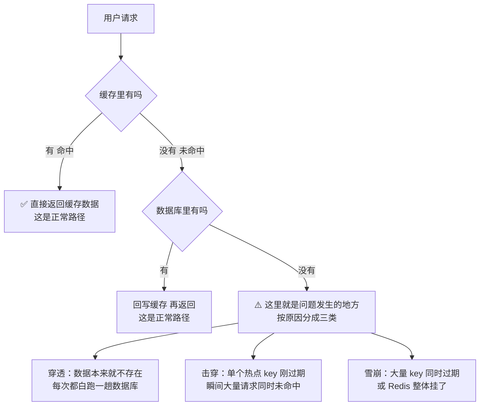
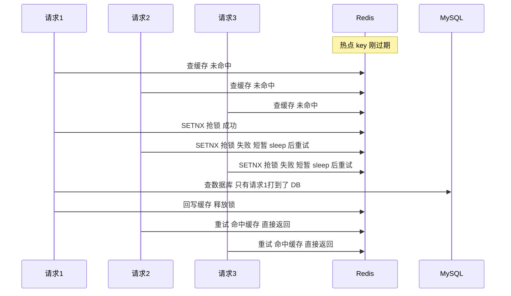
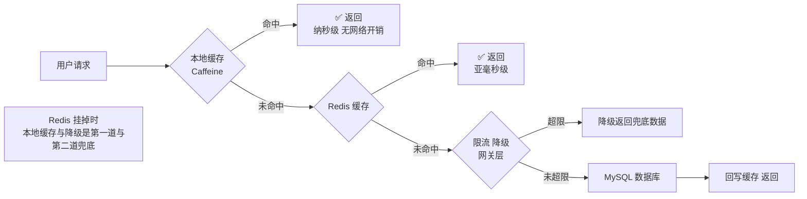

# 05 · Redis 缓存三大问题（穿透 / 击穿 / 雪崩）

> **一句话主线**：缓存失效导致请求全打到数据库，按**失效原因与影响范围**分成三类——**穿透**（查的**数据不存在**，缓存和库都没有）、**击穿**（**单个热点 key 突然过期**）、**雪崩**（**大量 key 同时过期**或**Redis 整体挂掉**）。**穿透要拦（布隆过滤器/空值缓存）、击穿要锁（互斥锁/永不过期）、雪崩要散（随机过期/多级缓存/限流降级）。**
>
> **本模块定位**：`db/` 的**缓存模块**。它是 [`06_Redis_分布式锁.md`](06_Redis_分布式锁.md)（击穿的互斥锁方案用的是分布式锁）、[`07_Redis_持久化与高可用.md`](07_Redis_持久化与高可用.md)（雪崩的集群方案）、[`08_Redis_布隆过滤器.md`](08_Redis_布隆过滤器.md)（穿透的核心解法）三者的入口。

---

## 目录

- [零、统一比喻与总览](#零统一比喻与总览)
- [一、缓存穿透](#一缓存穿透)
- [二、缓存击穿](#二缓存击穿)
- [三、缓存雪崩](#三缓存雪崩)
- [四、三者区别一张表](#四三者区别一张表面试必考)
- [本模块速记](#本模块速记考前-10-分钟)
- [面试官深挖追问](#面试官深挖追问)

---

## 零、统一比喻与总览

**统一比喻**：把 **Redis 缓存**想成**柜子**，**MySQL 数据库**想成**仓库**。正常流程是「先翻柜子，柜子里没有再去仓库拿，拿回来放进柜子」。

**图 5-1：正常查询流程与三种异常**

---

## 一、缓存穿透

### 1. 是什么

用户请求查询的数据，**缓存里没有，数据库里也没有**，请求**直接「穿透」缓存层**，全部打到数据库上。

如果是**恶意高频请求**（比如反复查 `id = -1`、`id = 999999` 这种无效数据），会**直接压垮数据库**。

### 2. 通俗理解

想从**柜子**（缓存）里找东西，柜子里没有，又跑去**仓库**（数据库）找，**仓库也没有**——白忙活一场。而且**很多人都这么白忙活**，仓库直接被忙炸。

> **关键特征**：**查的是「根本不存在」的数据**。所以「缓存不命中 → 回写缓存」这个正常流程**失效了**（因为查不到数据，没什么可缓存的）——这是穿透区别于其他两者的本质。

### 3. 解决方案（必答两个）

| 优先级 | 方案 | 做法 | 优点 | 缺点 |
|--------|------|------|------|------|
| **1** | **缓存空值** | 数据库查不到时，**把「空结果」也缓存起来**（如存特殊标记 `NULL_MARKER`），并设**短过期时间**（3~5 分钟） | 实现简单，后续同一无效请求**直接走缓存** | ① **占用缓存空间**（恶意攻击可用大量不同的 key 撑爆缓存）；② **有短暂的数据不一致窗口**（如果这条数据后来真的被创建了，5 分钟内读到的还是「不存在」） |
| **2** | **布隆过滤器** | 提前把数据库里**所有合法的 key** 存入布隆过滤器；请求先过过滤器，**非法 key 直接拦截，连缓存都不用查** | **空间效率极高**（不存真实数据）、拦截在**最前面**（不消耗缓存空间） | ① **有误判**（可能把存在的数据判为不存在 → 误拦，见 [`08`](08_Redis_布隆过滤器.md)）；② **不能删元素** → 数据删除后过滤器不会同步；③ 需要**预热 + 数据变更时维护** |

> **选型建议**：
> - **数据量小 / 变更频繁** → **缓存空值**（简单，但要防空间被撑爆）
> - **数据量大 / 相对稳定**（如商品库、用户 ID） → **布隆过滤器**（电商商品库的经典用法）
> - **两者可以叠加**：布隆过滤器做**第一道拦截**，缓存空值做**第二道兜底**

---

## 二、缓存击穿

### 1. 是什么

某个**高频访问的热点 key**（比如**秒杀商品**、首页热门数据），在缓存中**突然过期失效**的瞬间，**大量并发请求同时访问这个 key**——此时缓存没数据，**所有请求瞬间全部打到数据库**，数据库被这一波请求压垮。

> **关键词**：**单个热点 key**、**范围小**、**是单点问题**。

### 2. 通俗理解

柜子里的**爆款商品**（热点 key）**刚好卖完/下架**（缓存过期），此时正好一堆人来买这个爆款——柜子里没有，**所有人瞬间全冲去仓库**拿货，仓库瞬间被这波人挤爆。

### 3. 解决方案（必答三个）

| # | 方案 | 做法 | 优点 | 缺点 |
|---|------|------|------|------|
| **1** | **热点 key 永不过期** | 对核心热点数据**直接设置不过期**，从根源避免过期失效 | **最直接有效**，没有瞬时并发问题 | ① 数据更新要靠**主动刷新**（写时更新缓存）；② 如果热点判断错了，会**长期占用内存** |
| **2** | **互斥锁（推荐）** | 用 `SETNX` 加锁，缓存失效时**只有一个请求能拿到锁**去查数据库并回写缓存，**其他请求排队等待**（或短暂 sleep 后重试） | **保证数据库只被查一次**；实现成熟（就是分布式锁的应用） | ① **拿到锁的请求如果挂了**，其他请求要等超时 → 需要**锁超时**兜底；② **排队会带来延迟**（但比压垮数据库好） |
| **3** | **过期时间加随机值** | 给热点 key 的过期时间**加个随机数**（如原本 1 小时 → 50~70 分钟） | 避免多个热点 key 在同一时刻集体过期 | **只能缓解，不能根治单个热点 key 的过期瞬间**（随机化对「单个 key」没用） |

**图 5-2：互斥锁方案（击穿的核心解法）**

> ⚠️ **方案 3 的常见误解**：很多人把「过期时间加随机值」当成击穿的解法——**这是错的**。随机化解决的是「**大量 key 同时过期**」（那是**雪崩**），对「**单个热点 key 过期**」毫无帮助（一个 key 没有「同时」的问题）。

---

## 三、缓存雪崩

### 1. 是什么

两种情况：

| 情况 | 说明 |
|------|------|
| **① 大量缓存 key 在同一时间段集体过期** | 比如系统上线时**批量预热**缓存，全都设了同样的过期时间 → 一小时后集体失效 |
| **② Redis 缓存服务直接宕机** | 集群故障、断电、被 OOM Killer 杀掉 → **所有请求瞬间全部打到数据库** |

**后果**：数据库扛不住海量请求**直接崩溃**，甚至导致整个服务瘫痪。

> **关键词**：**范围大**、**批量问题**、**影响所有请求**。

### 2. 通俗理解

柜子里的东西**大批量同时卖完**（大量 key 集体过期），或者**整个柜子直接塌了**（Redis 宕机）——所有人都跑去仓库拿货，**仓库直接被踏平**。

### 3. 解决方案（必答四个，分两类）

#### 针对「大量 key 集中过期」

| # | 方案 | 做法 |
|---|------|------|
| **1** | **过期时间加随机值**（**最基础、必说**） | 所有 key 的过期时间都**加上随机数**，打散集中失效的时间点 |

#### 针对「Redis 服务宕机」（核心兜底）

| # | 方案 | 做法 | 说明 |
|---|------|------|------|
| **2** | **Redis 高可用集群** | 搭 **主从 + 哨兵** 或 **Redis Cluster**，一台挂了备机自动顶上 | 见 [`07_Redis_持久化与高可用.md`](07_Redis_持久化与高可用.md) |
| **3** | **多级缓存** | 增加**本地缓存**（JVM 内的 **Caffeine / Guava**）。Redis 挂了，请求**先读本地缓存**兜底 | 本地缓存**没有网络开销**（比 Redis 还快），但**容量小**且**多实例间不一致** |
| **4** | **限流 & 降级** | 网关层**限流**（限制每秒请求数）；对**非核心接口做降级**（返回兜底数据/默认值），**优先保证核心业务可用** | ⚠️ **必须提前准备好降级逻辑**，不能等出事才写 |

**图 5-3：多级缓存的兜底层级**

---

## 四、三者区别一张表（**面试必考**）

> 原笔记把这个对比讲了两遍（分散在两处），这里合并成**唯一一张表**。

| 维度 | **缓存穿透** | **缓存击穿** | **缓存雪崩** |
|------|-------------|-------------|-------------|
| **数据是否存在** | **根本不存在** | **存在**（是真实数据） | **大量数据存在** |
| **问题根源** | 查了**无效的 key**（缓存和库都没有） | **单个热点 key 突然过期** | **大量 key 同时过期** 或 **Redis 宕机** |
| **影响范围** | 取决于攻击频率（**可能很大**） | **单个 key**（点） | **全部 key**（面） |
| **数据库压力** | 持续压力（每次都要查库且查不到） | **瞬时尖峰**（一波并发全打进来） | **瞬时洪峰**（所有请求全打进来） |
| **本质** | **缓存「挡不住」无效请求** | **单个热点失效的并发冲击** | **击穿的「批量升级版」** |
| **核心解法** | **布隆过滤器** + 缓存空值 | **互斥锁** + 热点不过期 | **随机过期** + 集群高可用 + 多级缓存 + 限流降级 |
| **一句话** | **拦住不存在的** | **锁住单个过期的** | **散开批量的 + 兜住整体挂的** |

**记忆口诀**：

> **穿透查「无」、击穿查「热」、雪崩查「全」**
> **穿透要「拦」、击穿要「锁」、雪崩要「散」+「兜」**

---

## 本模块速记（考前 10 分钟）

| # | 问题 | 关键词速答 |
|---|------|-----------|
| 1 | **三者的统一比喻？** | **Redis = 柜子，MySQL = 仓库**。正常是「先翻柜子，没有去仓库拿，拿回来放柜子」 |
| 2 | **缓存穿透是什么？** | 查的数据**缓存和数据库都没有** → 请求**直接穿透**到数据库。恶意高频请求会压垮 DB |
| 3 | 穿透的**本质特征**？ | **查的是「根本不存在」的数据**——所以「回写缓存」这个正常流程失效了（没东西可缓存） |
| 4 | **穿透两个解法？** | ① **缓存空值**（把空结果也缓存，设短过期 3~5 分钟）② **布隆过滤器**（提前存合法 key，非法 key 直接拦） |
| 5 | 缓存空值的缺点？ | ① **占空间**（恶意攻击可用不同 key 撑爆缓存）② 有**短暂数据不一致窗口**（数据后来创建了，5 分钟内仍读「不存在」） |
| 6 | 布隆过滤器的缺点？ | ① **有误判**（可能误拦存在的）② **不能删元素** ③ 需要**预热与维护** |
| 7 | 穿透该选哪个方案？ | **数据量小/变更频繁 → 缓存空值**；**数据量大/相对稳定（商品库）→ 布隆过滤器**。**可叠加** |
| 8 | **缓存击穿是什么？** | **单个热点 key 突然过期**，瞬间大量并发请求同时未命中 → 全部打到 DB。⚠️ **是单点问题，范围小** |
| 9 | **击穿三个解法？** | ① **热点 key 永不过期**（最直接）② **互斥锁**（只有 1 个请求查库，其他等待）③ 过期时间加随机值 |
| 10 | ⚠️ 击穿的「随机过期」有用吗？ | **没用！** 随机化解决的是「**大量 key 同时过期**」（那是**雪崩**），对**单个热点 key** 无效（一个 key 没有「同时」问题） |
| 11 | 互斥锁方案的实现？ | `SETNX` 抢锁 → 拿到的去查库并回写缓存 → 其他请求 sleep 重试。⚠️ **必须有锁超时**（防止持锁者挂掉导致死等） |
| 12 | **缓存雪崩的两种情况？** | ① **大量 key 在同一时段集体过期** ② **Redis 服务直接宕机** |
| 13 | **雪崩四个解法？** | ① **过期时间加随机值**（最基础必说）② **Redis 高可用集群**（主从+哨兵 / Cluster）③ **多级缓存**（本地 Caffeine 兜底）④ **限流 & 降级** |
| 14 | 多级缓存的优势？ | **本地缓存（Caffeine）没有网络开销**，比 Redis 还快；Redis 挂时是第一道兜底。缺点：**容量小 + 多实例不一致** |
| 15 | 限流降级的注意点？ | ⚠️ **必须提前准备好降级逻辑**，不能等出事才写 |
| 16 | **一张表记三者？** | **穿透**：数据**不存在**，影响**可能很大**，解 **布隆+空值**；**击穿**：**单个热点**过期，**点**，解 **互斥锁+永不过期**；**雪崩**：**大量过期 / Redis 挂**，**面**，解 **随机+集群+多级+限流** |
| 17 | 三者共同点？ | 本质都是「**缓存失效导致数据库压力激增**」，只是**失效原因与影响范围不同** |
| 18 | **记忆口诀？** | **穿透查「无」、击穿查「热」、雪崩查「全」**；**穿透要「拦」、击穿要「锁」、雪崩要「散」+「兜」** |

---

## 面试官深挖追问

1. **「三个问题的区别，用一个场景串起来说？」**
   → **穿透**：「有人反复查 `id = -1`，这个商品**从来不存在**，每次都要穿透到数据库。」**击穿**：「**秒杀商品**的缓存突然过期，**几万个请求同时**冲进数据库。」**雪崩**：「系统上线时**批量预热了 10 万条缓存，全设了 1 小时过期**——1 小时后它们**同时失效**，数据库瞬间被压垮。」**它们的共同点是「缓存没挡住」，区别是**：**穿透是「查了不该查的」，击穿是「一个热的过期了」，雪崩是「一群的一起过期了 / 整个缓存没了」。**

2. **「布隆过滤器为什么能解决穿透？它的原理是什么？」**
   → 因为穿透的本质是「**查了一个数据库里不存在的 key**」。布隆过滤器把**所有存在的 key**都预先存进去，查询时**先用过滤器判断**：如果过滤器说「**不存在**」，那就**一定不存在**（**无漏判**）→ **直接返回，不查库**。这样**无效请求在入口就被拦截了**，根本走不到数据库。**完整的原理、误判率、最优哈希函数个数见 [`08_Redis_布隆过滤器.md`](08_Redis_布隆过滤器.md)。**

3. **「缓存空值方案，如果攻击者用大量不同的随机 key 攻击怎么办？」**
   → **这正是缓存空值的致命缺陷**——攻击者每换一个 key，就会**多缓存一条空记录**，**缓存空间会被迅速撑爆**（还可能触发内存淘汰，把**正常的热点数据挤出去**）。所以：① **空值必须设很短的过期时间**（如 30 秒～1 分钟）；② **必须在接入层做防护**——**限流**（限制单 IP 的 QPS）、**参数校验**（`id` 必须符合格式范围，如「必须是 1~1000000 的正整数」直接拒掉 `-1` 和 `999999999`）、**风控**（识别异常请求模式）；③ **用布隆过滤器替代或叠加**（布隆**不占缓存空间**）。**核心结论**：**缓存空值只是「数据库的减震器」，不能当安全机制用——真正的防护在接入层。**

4. **「击穿用互斥锁，如果拿到锁的那个请求挂了怎么办？」**
   → 这正是**互斥锁方案的关键风险**。解法有两层：① **锁必须有超时时间**（`SET lock NX EX 3`）——持锁者挂了，锁在 3 秒后自动释放，其他请求可以重试；② **等待的请求要有「超时 + 降级」**——不能无限等锁，等不到就返回兜底数据或直接报错，避免请求堆积把线程池打满。**更稳妥的做法**：拿到锁的请求**先把「正在重建」的标记写进缓存**（或返回「稍后重试」），让其他请求**快速失败**而不是阻塞排队——**用「快速失败」替代「排队等待」**在高并发下通常更好。

5. **「为什么说『热点 key 永不过期』不是银弹？」**
   → 三个问题：① **「永不过期」意味着数据永远不更新**——而热点数据往往**恰恰是最需要更新的**（如秒杀库存）；所以必须配合**「写时主动更新缓存」**（业务代码里在更新 DB 后同步更新/删除缓存）。② **热点是会变的**——今天的热点明天可能不是，如果判断错了，**过期策略就形同虚设**（数据永远陈旧）。③ **内存无法回收**——「永不过期」的 key 只能靠**主动删除**离开内存，如果业务忘了删，**内存会被慢慢吃光**。所以实践中「永不过期」更多是**配合逻辑过期**（value 里存一个 `expireTime` 字段，读到才发现过期，异步刷新）而不是字面意义的永不过期。

6. **「多级缓存（本地 + Redis）会带来什么新问题？」**
   → 三个：① **一致性更难**——本地缓存分布在**每个应用实例**里，Redis 更新后**要让所有实例的本地缓存失效**（需要**广播机制**，如 Redis Pub/Sub、MQ 广播、或短 TTL 兜底）；② **容量与命中率更难权衡**——本地缓存太小命中率低，太大占 JVM 堆内存（还可能引发 GC 问题）；③ **热点分布不均**——不同实例的本地缓存命中率可能差异很大（取决于请求路由）。**所以多级缓存主要用于「极热 + 变化少」的数据**（如配置、字典表），而不是所有数据都上多级。

7. **「限流和降级有什么区别？」**
   → **限流是「不让你进来」**（控制入口流量，超出的请求直接拒绝/排队）；**降级是「让你进来但给次品」**（功能层面对非核心链路关闭或返回兜底数据）。**两者的关系**：**限流是降级的前置手段**——先限流保证系统不被打垮，如果还扛不住再降级非核心功能，**优先保核心业务**（比如「商品详情能看，但推荐列表不返回」）。**关键实践**：降级开关要**可动态配置**（如通过 Nacos/Apollo 推送），并且**必须提前演练**——不能等故障时现场写代码。

8. **「如果 Redis 只是『变慢』（不是挂掉），会怎样？」**
   → **这比挂掉更危险**——因为**挂掉会快速失败（熔断）**，而**变慢会让请求全堆积在连接池/线程池上**，导致**应用整体不可用**（雪崩式扩散）。所以必须：① **给 Redis 操作设超时**（连接超时 + 读超时，通常几百毫秒）；② **配置熔断**（如 Sentinel 的慢调用比例熔断），**变慢到阈值就直接降级不再请求 Redis**；③ **监控 Redis 的 P99 延迟**（不只是可用性）。**这是「缓存失效」之外另一个必须准备的兜底场景。**

---

## 参考资料

见 [`99_参考资料.md`](99_参考资料.md)。
