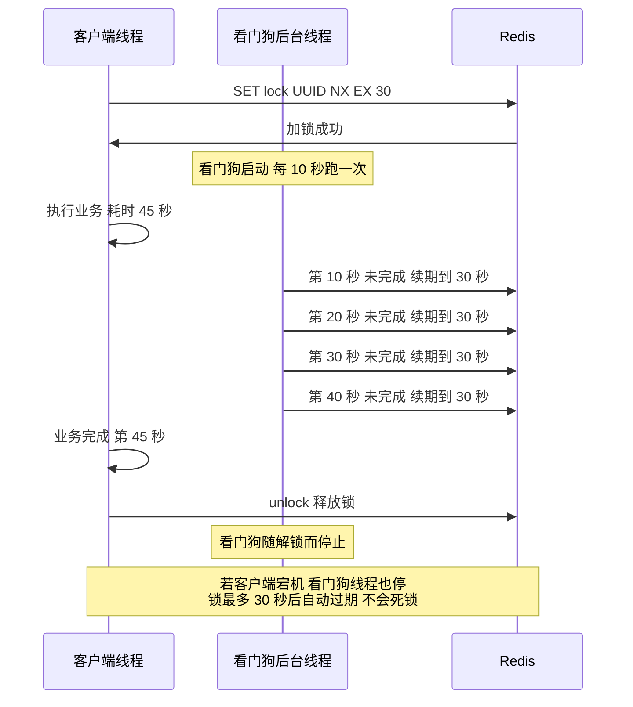
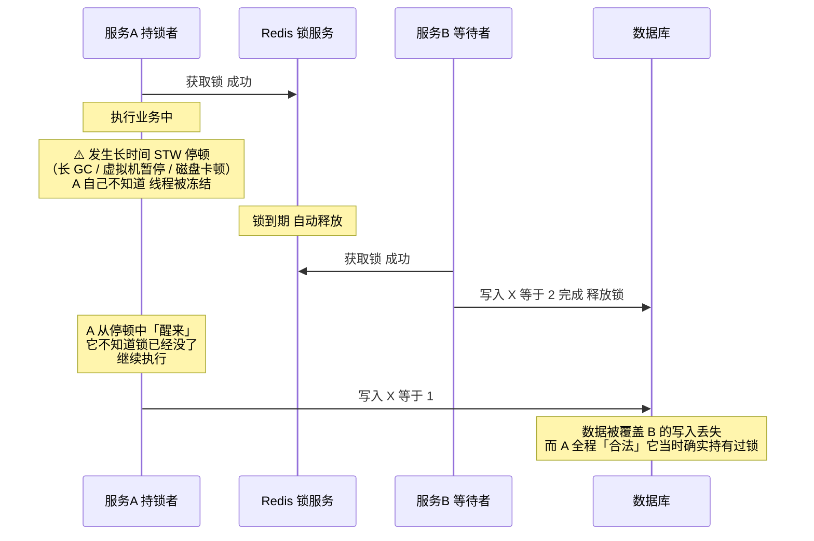

# 06 · Redis 分布式锁

> **一句话主线**：分布式锁要保证「**多台服务器操作同一份共享资源时，同一时间只有一个能操作**」。Redis 的实现从 `SETNX` 起，要依次解决**三个递进的问题**（锁无法释放 → 解错别人的锁 → 业务超时导致锁提前释放），最终收敛到 **`SET key value NX EX` + Lua 原子解锁 + Redisson 看门狗续期**。但**锁本身有个根本不掉的缺陷**——持锁者长时间停顿后「**失去锁却不自知**」，这需要用 **Fencing Token** 在数据层兜住。
>
> **本模块定位**：`db/` 的**分布式模块**。与 [`../distributed_consensus/04_分布式组件选型.md`](../distributed_consensus/04_分布式组件选型.md) 明确分工——**那边讲「选型与 CAP 取舍」，本模块讲「实现细节与踩坑」**。

---

## 目录

- [一、什么是分布式锁](#一什么是分布式锁)
- [二、Redis 实现：从基础版到生产版](#二redis-实现从基础版到生产版)
- [三、Redisson 与看门狗机制](#三redisson-与看门狗机制)
- [四、锁的根本缺陷：失去锁而不自知](#四锁的根本缺陷失去锁而不自知)
- [五、三大主流实现方案](#五三大主流实现方案)
- [六、三者对比与选型](#六三者对比与选型)
- [本模块速记](#本模块速记考前-10-分钟)
- [面试官深挖追问](#面试官深挖追问)

---

## 一、什么是分布式锁

### 1. 是什么

**分布式系统中的并发控制工具**，保证**多台服务器 / 多个服务实例**在操作「**同一份共享资源**」时，**同一时间只有一个服务能操作**，防止并发操作导致数据错乱。

**通俗理解**：多个人（多服务实例）抢**同一个厕所坑位**（共享资源），只有拿到**钥匙**（分布式锁）的人才能进去，其他人排队，出来后**归还钥匙**。

### 2. 使用场景

| 场景 | 说明 |
|------|------|
| **秒杀下单扣库存** | 防止超卖 |
| **订单支付状态更新** | 防止重复支付 |
| **分布式任务调度** | 保证同一任务只被一个实例执行（呼应简历里的 SchedulerX 场景） |
| **接口防重复提交** | 同一用户短时间内只能提交一次 |
| **缓存重建** | 热点 key 失效时只让一个请求去重建（见 [`05`](05_Redis_缓存三大问题.md) 的击穿） |

### 3. 为什么不用单机锁

**单机锁**（Java 的 `synchronized`、`Lock`）只对**同一台服务器**的线程有效。分布式系统中**多台服务器不在同一个 JVM**，单机锁**管不到**跨服务器的并发——**完全无效**。

### 4. 分布式锁的核心诉求

| 诉求 | 含义 |
|------|------|
| **独占性** | 一把锁同一时间只能一个人拿 |
| **防死锁** | 不能拿了锁不释放，卡死所有人 |
| **高可用** | 锁服务不能轻易挂掉 |
| **易用性** | 实现成本低 |

> ⚠️ **还要加一条（很多资料漏掉的）**：**能正确处理「锁失效」的边界情况**——这一点在第四节展开。

---

## 二、Redis 实现：从基础版到生产版

> 这一节是**层层递进的**——面试时按这个顺序讲，能体现你是「**踩过坑一步步优化过来的**」，而不是背结论。

### 基础实现：`SETNX`

```redis
SETNX lock:stock 1
```

`SETNX` 全称 **SET if Not Exists**：「当 key 不存在时才设置值，返回成功；key 已存在则设置失败」。

| 步骤 | 命令 |
|------|------|
| **加锁** | `SETNX lock:stock 1` → 返回 1 = 拿到锁，返回 0 = 没拿到 |
| **执行业务** | 扣库存、下单等 |
| **解锁** | `DEL lock:stock` |

### 问题 1：锁无法释放 → 死锁

**问题**：服务拿到锁后**突然宕机**，`DEL` 没执行 → 这个锁**一直存在**，其他服务**永远拿不到** → **死锁**。

**解决**：**加锁时同时设置过期时间**，用**原子命令**一步完成：

```redis
SET lock:stock 1 NX EX 30
```

- **`NX`** = 同 `SETNX`（仅当 key 不存在时创建）
- **`EX 30`** = 30 秒后自动过期

> ⚠️ **必须是这一条原子命令**。如果写成「先 `SETNX` 再 `EXPIRE`」，两步之间宕机就**又回到死锁**了（这正是早期 `SETNX` + `EXPIRE` 方案被淘汰的原因）。

### 问题 2：解错别人的锁

**问题**：加锁时**没有标识**，直接用 `DEL` 解锁——可能出现：

| 时刻 | 事件 |
|------|------|
| T1 | A 服务拿到锁，业务执行很慢 |
| T2 | 锁 30 秒到期**自动释放** |
| T3 | B 服务拿到锁，开始执行 |
| T4 | A 业务执行完，执行 `DEL` → **把 B 的锁删了** |
| T5 | C 服务拿到锁 → **和 B 并发执行** |

**解决**：**加锁时存入唯一标识**（如 UUID、服务 IP），**解锁前先判断是不是自己的锁**：

```redis
-- 加锁：value 用唯一标识
SET lock:stock <UUID> NX EX 30

-- 解锁：用 Lua 脚本保证「判断 + 删除」是原子操作
if redis.call('get', KEYS[1]) == ARGV[1] then
    return redis.call('del', KEYS[1])
else
    return 0
end
```

> ⚠️ **这是全篇最重要的一个实现细节**：`GET` + 判断 + `DEL` **必须用 Lua 脚本做成原子操作**。如果用「应用层先 `GET` 判断再 `DEL`」，两步之间别人可能刚好释放并重新加锁，**判断通过了但删的已经是别人的锁**——和问题 2 一模一样。

### 问题 3：业务执行时间 > 锁过期时间

**问题**：锁设了 30 秒过期，但业务需要 40 秒 → 锁**提前释放** → 其他服务拿到锁 → **同一资源被并发操作**。

**解决**：**锁续期（看门狗机制）**——见下一节。

### 生产级总结（一句话答全）

> **Redis 实现分布式锁必须满足三点：① 原子加锁 + 设置过期时间；② 唯一标识 + Lua 原子解锁（防误删）；③ 锁续命（防业务提前过期）。生产中直接用 Redisson，内置了全部功能。**

---

## 三、Redisson 与看门狗机制

**Redisson** 是 Redis 的 Java 客户端，把分布式锁的所有最佳实践封装成了一个 `RLock`。

```java
// 【示例】Redisson 分布式锁，按目标版本书写、未实测
RLock lock = redisson.getLock("lock:stock");
try {
    // 不加 leaseTime 参数 → 启用看门狗自动续期
    lock.lock();
    // 执行业务
} finally {
    lock.unlock();
}
```

### 看门狗（Watch Dog）机制

**原理**：加锁成功后，Redisson 启动一个**后台线程**，**每隔一段时间检查业务是否还在执行**，如果在就**自动续期**。

| 参数 | 默认值 | 说明 |
|------|--------|------|
| **`lockWatchdogTimeout`** | **30000 ms（30 秒）** | 锁的默认租约时间 |
| **续期间隔** | **`TTL / 3` = 10 秒** | 每隔 10 秒把锁的过期时间**重置回 30 秒** |

**图 6-1：看门狗续期时序**



> ⚠️ **一个必须知道的坑**：**只在「不传 `leaseTime`」时才启用看门狗**。
>
> ```java
> lock.lock();                    // ✅ 用看门狗自动续期
> lock.lock(10, TimeUnit.SECONDS); // ❌ 传了 leaseTime，看门狗不生效，10 秒后必释放
> ```
>
> 传入明确的 `leaseTime` 就表示「**我确信业务能在 10 秒内完成**」，Redisson 出于性能考虑**不再启动看门狗**。所以**如果你的业务可能超时，就不要传 `leaseTime`**。

---

## 四、锁的根本缺陷：失去锁而不自知

> **这一节是「分布式锁」的最高阶追问**，也是把 Redis 锁 / ZK 锁与 [`../distributed_consensus/04_分布式组件选型.md`](../distributed_consensus/04_分布式组件选型.md) 的 **Fencing Token** 串起来的关键。

### 1. 问题场景

**图 6-2：为什么「有锁」也不够**



### 2. 问题的本质

**A 并不知道自己已经失去了锁**。可能的原因：

| 原因 | 说明 |
|------|------|
| **长时间 GC 停顿（STW）** | JVM 完全冻结，看门狗线程**也停了**（它能续期吗？——**不能**，因为整个 JVM 都停了） |
| **被操作系统换出（swap）** | 进程被挂起 |
| **网络分区后恢复** | A 与 Redis 失联期间锁过期，恢复后 A 以为锁还在 |

> ⚠️ **关键认知**：**看门狗也救不了这个场景**。因为看门狗是一个**同进程的后台线程**——**STW 时整个 JVM 都停了，看门狗自然也无法续期**。等 JVM 恢复，锁早就过期了，而业务线程**继续从断点往下执行**。

**⚠️ 这不是 Redis 独有的问题**——**ZK 锁、etcd 锁、甚至数据库锁都有同样的问题**。锁只能保证「**同一时刻只有一个客户端认为自己持有锁**」，**不能保证「存储只接受当前持锁者的写入」**。

### 3. 解法：Fencing Token（栅栏令牌）

**核心思路**：给每次获锁分配一个**单调递增的编号（fencing token）**，并让**存储端也检查这个编号**。

**图 6-3：Fencing Token 如何挡住旧持锁者**

```mermaid
sequenceDiagram
    participant A as 服务A
    participant L as 锁服务<br/>分配单调递增 token
    participant B as 服务B
    participant DB as 存储层
    A->>L: 获取锁
    L->>A: 锁 加 token 等于 33
    Note over A: A 发生 STW 停顿
    Note over L: 锁超时释放
    B->>L: 获取锁
    L->>B: 锁 加 token 等于 34
    B->>DB: 写入 携带 token 34
    DB->>DB: 记下见过的最大 token 等于 34 接受
    Note over A: A 醒来 它还以为自己持锁
    A->>DB: 写入 携带 token 33
    DB->>A: ❌ 拒绝！33 小于已见过的 34
```



**三个关键前提**：

| 前提 | 说明 |
|------|------|
| **① token 必须单调递增** | 所以需要一个**能保证单调递增的组件**——**ZK 的有序节点**天然满足，**etcd 的 revision** 也满足；⚠️ **Redis 的 `INCR` 在单实例下满足，但主从切换后可能回退**（这正是 Redlock 争议的核心之一） |
| **② 存储端必须校验** | ⚠️ **只客户端校验 token 是没用的**，必须**服务端/存储端**检查 |
| **③ 实现载体** | 数据库的版本号列（`WHERE version < ?`）、Kafka 的 **epoch**、Raft 的 **term**、ZK 的 **zxid** —— **本质上都是 fencing token** |

> 💡 **一个重要洞察**：**Raft 的 Term、Kafka 的 Producer Epoch、ZK 的 zxid epoch、MySQL 的乐观锁版本号——全都是 Fencing Token 的实例**。Kafka 用它来「**隔离僵尸生产者**」，防的正是「一个以为自己是活跃生产者、但其实已被踢掉的旧实例还在发消息」。**发现这一点，你就把「共识算法」和「分布式锁」串起来了。**

### 4. 工程结论

> **分布式锁只用于「减少并发冲突」的性能优化，真正的正确性要靠「幂等 + 版本号 / fencing」在数据层兜住。**

| 手段 | 作用 | 层次 |
|------|------|------|
| **分布式锁** | **减少冲突**（让 99% 的并发不发生） | 性能优化 |
| **唯一约束 / 版本号 / 状态机** | **保证正确性**（即使锁失效也不产生脏数据） | **正确性保证** |
| **Fencing Token** | **挡住过期持锁者的写入** | 正确性保证（需存储层配合） |

---

## 五、三大主流实现方案

### 1. 方案一：基于数据库

#### 实现方式 A：主键 / 唯一索引（独占锁，最常用）

| 步骤 | 做法 |
|------|------|
| **建表** | `distributed_lock`，字段：`lock_key`（锁名）+ `create_time`，给 `lock_key` 加**唯一索引** |
| **加锁** | 往表里**插入一条记录**——插入成功 = 拿到锁；**唯一索引冲突** = 没拿到锁 |
| **解锁** | **删除这条记录** |

#### 实现方式 B：乐观锁（无阻塞，适合读多写少）

```sql
-- 给业务表加 version 字段
UPDATE goods SET stock = stock - 1, version = version + 1
WHERE id = 1 AND version = #{version};
```

更新成功 = 拿到锁并完成；影响行数为 0 = **冲突，重试**。（详见 [`01_MySQL_锁机制.md`](01_MySQL_锁机制.md) 的乐观锁一节）

#### 优点

| 优点 | 说明 |
|------|------|
| **零依赖** | 不用部署 Redis / ZK，项目连了数据库就能用 |
| **开发成本极低** | 全是增删改查，不用学新技术栈 |
| **易维护** | 逻辑简单直观 |

#### 缺点（**面试重点**）

| # | 缺点 | 说明 |
|---|------|------|
| **1** | **性能极差**【核心致命】 | 数据库是**磁盘 IO**，还要处理索引与事务，比 Redis 内存操作**慢 100 倍以上**。并发稍高（每秒几百请求）就会把数据库压垮 |
| **2** | **极易死锁** | 唯一索引方式下，服务宕机后「删除记录」没执行 → 这条 `lock_key` **永久占着**，后续所有服务都插不进去 → **永久死锁** |
| **3** | **单点故障** | 数据库宕机 → 整个锁服务瘫痪。即使主从，切换瞬间也可能锁数据不一致 |
| **4** | **功能单一** | 不支持**阻塞锁**（只能循环重试）、**公平锁**、**锁超时自动释放**（要自己写定时任务清理） |
| **5** | **锁竞争放大** | 频繁 insert/delete 锁表记录，可能导致**行锁升级为表锁**，连业务 SQL 也变慢 |

#### 优化（治标不治本）

① 给锁表加**过期时间字段** + 定时任务清理；② 数据库搭**主从 + 哨兵**；③ 读多写少用乐观锁，写多用唯一索引。

---

### 2. 方案二：基于 Redis（**互联网主流**）

#### 核心命令

```redis
SET lock_key <唯一标识> NX EX 30
```

| 参数 | 作用 |
|------|------|
| **`NX`** | 仅当 key 不存在时创建 → 保证**独占性** |
| **`EX 30`** | 30 秒过期 → **防死锁** |
| **唯一标识**（UUID / IP） | **防误删别人的锁** |

**解锁**：用 **Lua 脚本**做「判断 + 删除」的原子操作。生产中直接用 **Redisson**（见第三节）。

#### 优点

| # | 优点 | 说明 |
|---|------|------|
| **1** | **性能极致**【核心优势】 | **纯内存 IO**，每秒几万到几十万次锁请求，比数据库**快百倍不止**。秒杀、高并发下单首选 |
| **2** | **实现简单** | 核心就一条 `SET` 命令；生产用 Redisson 一行代码 |
| **3** | **天然防死锁** | 支持**过期自动释放**，服务宕机锁到期自动删除 |
| **4** | **功能丰富** | 支持**非阻塞锁、阻塞锁、可重入锁、公平锁** |
| **5** | **高可用易实现** | 主从 + 哨兵 / Cluster，一台挂了其他立刻顶上 |

#### 缺点

| # | 缺点 | 说明与解法 |
|---|------|-----------|
| **1** | **锁失效风险**【唯一核心缺点】 | Redis 主从是**异步复制**：主节点创建锁后**还没同步到从节点**就宕机 → 从节点升主后**没有这把锁** → 别的服务能重新加锁 → **一把锁被多人拿到**。<br>✅ 解法：① **业务上接受这个小概率风险**（大部分场景可接受）；② **Redlock**（见下）；③ **Redisson** 的兜底机制；④ **最根本：数据层幂等兜底** |
| **2** | **单机有单点** | 单机 Redis 性能最好但有单点风险；Cluster 性能略降 |
| **3** | **过期时间不好把控** | 业务超时 → 锁提前释放。<br>✅ 解法：**Redisson 看门狗**（见第三节） |

#### ⚠️ Redlock：正确理解与争议

**Redlock** 是 Redis 作者 Antirez 提出的**多节点锁算法**。**它需要独立部署 N 个（一般是 5 个）Redis 主节点**。

**⚠️ 最常见的一个错误说法**：「Redlock 要求**全部**节点都加锁成功。」——**这是错的**。

**Redlock 的准确算法**：

| 步骤 | 做法 |
|------|------|
| **①** | 记录当前时间 `T1` |
| **②** | 依次向**全部 N 个实例**发起加锁请求（`SET k v NX PX ttl`），**每个实例的超时时间要远小于 TTL**（防止死节点拖住整个流程） |
| **③** | 记录 `T2`，计算 `elapsed = T2 - T1` |
| **④** | **满足两个条件才算拿到锁**：<br>• **在多数派（`≥ N/2 + 1`）实例上加锁成功**（如 5 台中至少 3 台）<br>• **`elapsed < TTL`** |
| **⑤** | 拿到锁后，**有效工作时长 = `TTL − elapsed − 时钟漂移余量`** |
| **⑥** | 如果**没拿到**，**要在全部实例上发起释放**（包括那些「看起来失败」的——可能只是响应丢了但实际加上了），然后**随机延迟后重试** |

> **一句话**：**Redlock 是「多数派」，不是「全部」。**

**Redlock 的争议（Kleppmann vs Antirez，面试加分点）**：

| 观点 | 主张 |
|------|------|
| **Kleppmann（反对）** | ① Redlock **依赖各节点时钟不发生跳变**——而时钟跳变是真实存在的（NTP 校时、闰秒），一旦发生，**多数派判断可能失效**；② Redlock **无法提供 fencing token**，所以**无法防止第四节讲的「GC 停顿后旧持锁者写入」**；③ 所以他建议：**分布式锁要用「带 fencing token 的方案」，正确性靠数据层保证** |
| **Antirez（反驳）** | ① 时钟跳变可以通过「**不允许自动调时钟**」来规避；② 工程上「锁失效」的概率极低，配合业务幂等足够用；③ Redlock 的设计目标是「**降低出问题的概率**」，而不是「提供绝对保证」 |

> **面试怎么答**：**不要把 Redlock 说成万能解法**。标准答法是：「Redlock 用多数派降低单点失效风险，但它**依赖时钟、且不提供 fencing token**，所以**不能作为「正确性」保证**。Kleppmann 和 Antirez 有过公开辩论，我的结论是：**Redis 锁（含 Redlock）适合做性能优化，正确性要靠数据层的唯一约束/版本号/幂等来兜底**。」

---

### 3. 方案三：基于 ZooKeeper

#### 前置知识：ZK 的三个核心特性

| 特性 | 说明 |
|------|------|
| **树形目录结构** | 如 `/lock/stock`，可创建**持久节点**和**临时节点** |
| **临时节点（Ephemeral）** | 客户端与 ZK **断开连接后自动删除** |
| **有序节点（Sequential）** | 创建时 ZK **自动加递增序号**（如 `/lock/00000001`） |
| **Watcher 监听** | 可监听节点变化，节点被删除时立刻收到通知 |

#### 实现原理：排队拿锁

**核心思路**：所有服务都去「**排队**」，**谁的节点序号最小，谁就拿到锁**。

**步骤**：

1. **加锁**：所有服务在 `/lock` 下创建**临时有序子节点**
2. **判断**：查询 `/lock` 下的所有子节点，看**自己是不是序号最小的**
   - **是** → 拿到锁，执行业务
   - **不是** → **只监听自己的「前一个」节点**（不监听所有节点）
3. **等待**：前一个节点被删除后收到 Watcher 通知，**重新判断**自己是否变成最小
4. **解锁**：① 业务执行完主动删除节点；② 服务宕机 → 连接断开 → **临时节点自动删除**

> **为什么只监听前一个节点？** 因为「**最小的是谁**」只取决于「**我前面那个有没有走**」。监听前一个节点就够了——这也**天然避免了惊群效应**（如果所有人都监听「最小节点」，最小节点一删，所有人同时醒来抢，ZK 压力骤增）。

#### 优点

| # | 优点 | 说明 |
|---|------|------|
| **1** | **天然无死锁**【核心优势】 | 基于**临时节点**——不管服务正常结束、崩溃还是网络断开，只要连接没了，**临时节点自动删除，锁强制释放** |
| **2** | **天然公平锁 + 阻塞锁** | 基于**有序节点**，按请求顺序排队，**先到先得**；没拿到的通过 Watcher 等待，**不无脑循环重试** |
| **3** | **高可靠、写强一致** | ZK 是**高可用集群**（最少 3 节点），写操作经 **Leader + 多数派**提交，天生无反「主从异步复制」问题 |
| **4** | **支持高级特性** | 读写锁、分布式屏障、共享锁等（Curator 已封装） |

#### 缺点

| # | 缺点 | 说明与解法 |
|---|------|-----------|
| **1** | **性能比 Redis 差**【核心缺点】 | ZK 的锁操作要**磁盘持久化 + 集群多数派同步**。⚠️ **但要说准**：**ZK 锁实际是「毫秒级」（同机房约 1~10ms），与 Redis（约 0.1~1ms）是同一个量级，只是常数因子更大——不是「百毫秒级」**。百毫秒只在跨地域、Leader fsync 卡顿、高竞争时才出现。**极端高并发（秒杀）仍首选 Redis** |
| **2** | **实现相对复杂** | 要处理节点创建、Watcher 监听、排序、事件回调。⚠️ **Watcher 是一次性的**（触发后失效，必须重新注册），**重新注册的间隙可能漏事件**——所以要**处理重监听 + 全量拉取兜底** |
| **3** | **轻量场景「太重」** | 简单的并发控制用 ZK 是「杀鸡用牛刀」，要额外部署与运维 ZK 集群 |
| **4** | **有「羊群效应」风险** | 早期实现让所有服务监听同一节点 → 一释放全被唤醒。**现在用「监听前一个节点」已解决** |

#### 优化

① 用 **Curator** 框架（ZK 官方推荐的 Java 客户端，封装了锁、选举等）；② ZK 集群 3~5 节点即可。

> ⚠️ **两个必须说准的点（勘误）**：
>
> **① ZK 不是「同步到所有节点」，而是「多数派」。** ZK 的**写**是线性一致的——经 Leader 排序后提交到**多数派**（不是全部节点）。而 **ZK 的读默认不是线性一致的**：读请求由**任意 Server 从其本地内存直接回答**，**可能读到旧值**。要在 ZK 上实现 read-your-writes，必须先调 **`sync()`** 强制同步到 Leader。
>
> **② ZK 锁不是「绝对不会死锁」。** 它的「无死锁」是**活性**保证——会话结束时临时节点自动删除。但如果客户端**长时间 GC 停顿**，ZK 会认为**会话过期**并删除其临时节点，而客户端**醒来后仍以为自己持锁**继续写入——**这正是第四节讲的「失去锁而不自知」，ZK 锁同样存在**，需要 **Fencing Token**（ZK 的有序节点号天然就是单调递增的 token）来兜底。

---

## 六、三者对比与选型

### 1. 对比表

| 实现方案 | 核心优点 | 核心缺点 | 死锁风险 | 性能 | 实现难度 |
|---------|---------|---------|---------|------|---------|
| **数据库锁** | 零依赖、开发成本极低、逻辑简单 | 性能极差、易死锁、单点风险、功能单一 | **高**（宕机即永久占锁，需定时清理） | **最差**（磁盘 IO） | 最简单 |
| **Redis 锁** | **性能极致**、实现简单、功能丰富、轻量 | **小概率锁失效**（主从异步）、过期时间难把控 | **低**（有过期时间兜底，**但存在「失去锁而不自知」**） | **最好**（约 0.1~1ms） | 中等 |
| **ZK 锁** | **天然无死锁、公平阻塞、写强一致** | 性能比 Redis 差（**同量级，常数因子更大**）、实现复杂（**Watcher 一次性**）、偏重 | **无**（临时节点自动删，**但同样有「失去锁而不自知」**） | 中（约 1~10ms，**毫秒级**） | 中等偏上 |

> ⚠️ **注意表里「死锁风险」这一列**：它讲的是「**锁本身能否自动释放**」。但**三者都防不住「持锁者停顿后继续写入」**——那是**另一个问题**（需要 Fencing Token）。

### 2. 选型建议

**核心原则：没有最好的方案，只有最适合的方案。**

| 场景 | 选择 | 理由 |
|------|------|------|
| **90% 的互联网场景**（电商秒杀、库存扣减、订单创建、积分更新） | **Redis + Redisson** | 性能足够、实现简单、运维成本低；**小概率锁失效靠数据层幂等兜底** |
| **高一致性场景**（金融支付、账务结算、资金操作） | **ZK + Curator**（或 **etcd**） | 这类场景**数据一致性 > 性能**，绝不能出现并发数据错乱 |
| **极少场景**（项目体量极小、并发极低、无 Redis/ZK） | **数据库锁** | 兜底用；**但凡并发上来立刻换 Redis/ZK** |

**面试追问必杀句**：

> **高性能选 Redis，高可靠选 ZK，简单场景选数据库；但无论选哪个，正确性都要靠数据层的幂等 + 版本号兜底。**

---

## 本模块速记（考前 10 分钟）

| # | 问题 | 关键词速答 |
|---|------|-----------|
| 1 | 分布式锁要保证什么？ | **多台服务器操作同一共享资源时，同一时间只有一个能操作**。比喻：抢**厕所坑位**，只有拿钥匙的能进 |
| 2 | 为什么不用 `synchronized`？ | 单机锁**只对同一台服务器的线程有效**，分布式多实例**不在同一 JVM**，跨服务器完全无效 |
| 3 | **分布式锁四个核心诉求？** | **独占性、防死锁、高可用、易用性**（+ **能正确处理锁失效的边界**） |
| 4 | Redis 基础命令？ | `SETNX lock 1` → 拿锁则返回 1、没拿到返回 0；解锁 `DEL` |
| 5 | **问题1：锁无法释放** | 服务宕机 `DEL` 没执行 → **死锁**。解法：**原子命令 `SET lock v NX EX 30`**（⚠️ 不能拆成 `SETNX` + `EXPIRE` 两步） |
| 6 | **问题2：解错别人的锁** | A 的锁过期后 B 拿到，A 执行完 `DEL` **删了 B 的锁**。解法：**加唯一标识（UUID）+ Lua 脚本原子判断并删除** |
| 7 | ⚠️ 为什么解锁必须用 Lua？ | 「`GET` 判断 + `DEL`」**必须原子**。应用层分两步做，中间别人可能释放并重新加锁 → **判断通过但删的是别人的锁** |
| 8 | **问题3：业务超时** | 业务执行时间 > 锁过期时间 → 锁提前释放 → 并发。解法：**看门狗续期** |
| 9 | **看门狗的默认参数？** | **`lockWatchdogTimeout = 30 秒`**，**每 10 秒（TTL/3）续期一次**，重置回 30 秒 |
| 10 | ⚠️ 看门狗什么时候生效？ | **只在「不传 `leaseTime`」时生效**！`lock.lock(10, SECONDS)` 会**关闭看门狗** |
| 11 | **锁的根本缺陷是什么？** | ⚠️ **持锁者长时间 STW 停顿（长 GC）→ 锁过期被释放 → 它醒来后不知道，继续写入**，覆盖了新持锁者的数据 |
| 12 | ⚠️ 看门狗能救这个缺陷吗？ | **不能！** 看门狗是**同进程的后台线程**，**STW 时整个 JVM 都停了**，它也无法续期 |
| 13 | ⚠️ 这是 Redis 独有的问题吗？ | **不是！** **ZK 锁、etcd 锁、数据库锁都有同样问题**。锁只能保证「只有一个客户端**认为**自己持锁」 |
| 14 | **Fencing Token 怎么解决？** | 每次获锁分配**单调递增**编号；**存储端记录见过的最大编号，拒绝更小编号的写入** |
| 15 | Fencing Token 的三个前提？ | ① **token 单调递增**（ZK 有序节点 ✅、etcd revision ✅、**Redis INCR 主从切换可能回退 ⚠️**）② **存储端必须校验**（只客户端校验没用）③ **实现载体**：MySQL 版本号、Kafka epoch、Raft term、ZK zxid |
| 16 | **工程结论？** | **分布式锁只用于「减少冲突」的性能优化；真正的正确性靠「幂等 + 版本号 / fencing」在数据层保证** |
| 17 | 数据库锁的实现方式？ | ① **主键/唯一索引**（插入成功=拿锁，删除=解锁）② **乐观锁**（version） |
| 18 | 数据库锁的致命缺点？ | ① **性能极差**（磁盘 IO，慢百倍）② **极易死锁**（宕机后记录永久占着）③ 单点 ④ 功能单一（无阻塞/公平/自动过期）⑤ 锁竞争可能**行锁升级表锁** |
| 19 | Redis 锁的核心优势？ | **纯内存 IO，性能极致**（比数据库快百倍）；实现简单；过期自动释放防死锁；Redisson 支持可重入/公平/阻塞 |
| 20 | ⚠️ Redis 锁唯一的缺点？ | **锁失效**——**主从异步复制**，主节点挂了锁没同步过去 → 从节点升主后没这把锁 → **一把锁被多人拿到** |
| 21 | ⚠️ **Redlock 是「全部」还是「多数派」？** | ⚠️ **多数派（`≥ N/2+1`）**，不是全部！如 5 台中 3 台。算法：记 T1 → 向**全部 N 台**发加锁（**每台超时须 << TTL**）→ 算 elapsed → **多数派成功 且 elapsed < TTL** 才算拿到 → 有效时长 = TTL − elapsed − 时钟漂移。**失败要在全部实例上释放** |
| 22 | **Redlock 的争议？** | **Kleppmann 反对**：① 依赖**时钟不跳变**（NTP/闰秒会破坏）；② **不提供 fencing token**，防不住 GC 停顿。**Antirez 反驳**：① 可禁止自动调时钟；② 概率极低，配合幂等足够。**结论：Redlock 降低概率，但不提供绝对保证** |
| 23 | ZK 锁的核心特性？ | **树形结构 + 临时节点 + 有序节点 + Watcher** |
| 24 | ZK 锁的实现原理？ | 在 `/lock` 下创建**临时有序节点** → **判断自己是不是序号最小** → 不是则**只监听前一个节点** → 解锁靠删除或**会话断开自动删** |
| 25 | ⚠️ 为什么只监听前一个节点？ | 「最小的是谁」只取决于「我前面那个走没走」。**也天然避免了惊群效应** |
| 26 | ZK 锁的优点？ | ① **天然无死锁**（临时节点自动删）② **天然公平 + 阻塞**（有序节点排队）③ **写强一致**（多数派，无主从异步问题） |
| 27 | ⚠️ ZK 锁是「百毫秒级」吗？ | ⚠️ **不是！** ZK 锁是**毫秒级**（同机房约 1~10ms），**与 Redis 同一量级**，只是常数因子更大。百毫秒只在跨地域/fsync 卡顿/高竞争时出现 |
| 28 | ⚠️ ZK 是「同步到所有节点」吗？ | ⚠️ **不是！** 写经 **Leader + 多数派**提交（**不是全部节点**）；**读默认不是线性一致的**——任意 Server 本地作答，**可能读到旧值**，需 `sync()` 才 read-your-writes |
| 29 | ⚠️ ZK 锁「绝对不会死锁」吗？ | 「无死锁」是**活性**保证（会话结束自动删节点）。但**长 GC 停顿会让会话过期、锁被释放而客户端不知情** → **同样存在「失去锁而不自知」** |
| 30 | ZK 的 Watcher 有什么坑？ | **一次性**——触发后失效，必须**重新注册**；**重新注册的间隙可能漏事件**，需全量拉取兜底 |
| 31 | 三大方案怎么选？ | **90% 互联网场景 → Redis + Redisson**；**金融/资金等强一致 → ZK + Curator**（或 etcd）；**体量极小 → 数据库锁**（兜底） |
| 32 | **一句话必杀句？** | **高性能选 Redis，高可靠选 ZK，简单场景选数据库；但正确性都要靠数据层的幂等 + 版本号兜底** |

---

## 面试官深挖追问

1. **「Redis 分布式锁为什么会丢锁？怎么解决？」**
   → **两个原因**：① **主从异步复制**——主节点写入锁后还没同步到从节点就宕机，从节点升主后**没有这把锁**；② **业务执行时间超过锁过期时间**，锁被自动释放。**解决**：① 合理设置过期时间或用 **Redisson 看门狗**续期；② 高一致性场景用 **Redlock**（多数派）；③ **最根本的一条：数据层实现幂等**（唯一索引 / 版本号），**即使丢锁也不会产生脏数据**。**并主动补一句**：「其实丢锁无法完全避免——**GC 停顿导致失去锁而不自知是根本问题**，Raft 的 term、Kafka 的 epoch、ZK 的 zxid 本质上都是 **fencing token** 在解决同一件事。」

2. **「Redisson 的看门狗，如果 Redis 挂了会怎样？」**
   → 分两种：① **Redis 主从切换**——如果锁没同步到新主，看门狗续期会**失败**（找不到这个 key），Redisson 会抛异常，业务侧应捕获并**中止操作**（不能继续写）；② **Redis 完全不可用**——续期失败，业务应按「**获取锁失败**」处理（重试或降级）。**关键点**：**看门狗续期失败必须被当作「锁已失效」处理**——如果业务忽略了续期异常继续执行，就退回到了「失去锁而不自知」的老问题。

3. **「ZK 分布式锁的公平性怎么实现？」**
   → 基于**临时有序节点**。ZK 为每个加锁请求生成一个**有序**节点（如 `/lock/lock-000000001`），请求者**只监听自己的前一个节点**——前一个节点释放后自己才会获锁。因为顺序由 **ZK 的节点编号天然决定**，所以是**天然的公平锁**（先到先得）。**相比 Redis 的优势**：① **公平**（Redis 的 `SET NX` 是非公平争抢）；② **无惊群**（每个请求只监听前一个，而不是所有请求轮询同一个 key）。

4. **「你们项目用 Redis 锁还是 ZK 锁？为什么？」**
   → **必须结合自己项目说**。参考话术：「我们用 **Redis（Redisson）锁**，理由：① 项目**已经有 Redis 做缓存**，复用成本为零；② 我们的锁场景是**定时任务的单实例执行**（SchedulerX 之外的自研兜底）和**接口防重复提交**，**对极端情况下的锁失效是可容忍的**——因为最终的**业务写入有数据库唯一索引兜底**，即使锁失效也不会产生脏数据；③ Redis 的**微秒级延迟**对接口性能更友好。**如果场景换成库存扣减这种『锁失效就会超卖』的情况，我会选 ZK 或 etcd，或者更直接地——用数据库的 `UPDATE ... WHERE stock > 0` 原子扣减。**」

5. **「如果让你实现一个『防止缓存击穿』的互斥锁，你会怎么做？」**
   → 这是 Redis 锁的一个**轻量变体**，注意三点：① **锁要设短超时**（如 3 秒，因为只是为了让一个请求去重建缓存）；② **等锁的请求不能无限等**——要么**短暂 sleep 后重试**，要么**直接返回「稍后重试」**（高并发下「快速失败」通常比「排队」更好）；③ **拿到锁的请求重建完缓存后要释放锁**，且要放在 `finally` 里。**更进一步的优化**：**用「逻辑过期」替代「物理过期」**——value 里存一个 `expireTime`，读到「逻辑已过期」的请求返回旧值，同时**异步**去重建缓存。这样**所有请求都能立刻返回，没有等待**。

6. **「分布式锁能保证『同一时间只有一个线程执行』，那它为什么还会出问题？」**
   → 因为在分布式环境下，「**锁**」和「**执行**」之间存在**时间窗口**：
   > ① **锁有有效期** → 有效期到了锁自动释放，但**业务可能还在跑**；
   > ② **持锁者可能停顿**（长 GC / 网络分区）→ 它以为自己还持锁，**实际锁已被释放并被别人持有**；
   > ③ **网络延迟** → 释放锁的请求可能延迟到达。
   >
   > 所以**「分布式锁」只能保证「客户端认为自己在持锁」的一致性**，**不能保证「存储层只接受一个写入者」**。要真正保证，需要**存储层也参与判断**——这就是 **Fencing Token / 版本号 / 唯一约束** 的作用。**一句话**：**锁是「客户端之间」的协议，正确性必须由「存储层」来兜底。**

7. **「etcd 的分布式锁和 ZK 的有什么区别？」**
   → 都基于**共识算法**（etcd 用 **Raft**，ZK 用 **ZAB**），所以都是「写强一致、可作 fencing token 来源」。差别在：① **协议**——Raft 更简单、有多语言成熟实现与形式化验证；② **接口**——etcd 是 **gRPC/HTTP**，跨语言友好；ZK 是自定义 TCP 协议，需专用客户端；③ **Watch 机制**——**etcd 的 watch 支持从指定 `revision` 恢复，不会丢事件**；而 **ZK 的 Watcher 是一次性的**，重注册间隙可能漏事件；④ **租约**——etcd 用 **Lease** 实现锁的自动释放（比临时节点更显式）。**结论**：**云原生场景（K8s 生态）优先 etcd**，Hadoop/Dubbo 老生态仍用 ZK。

8. **「如果红锁（Redlock）需要 5 个独立的 Redis，那运维成本不是很高吗？」**
   → 是的，**这正是 Redlock 在实践中很少用的主要原因之一**。要**独立部署 5 个不互相复制的 Redis 主节点**（不能是主从，否则就失去了「独立」的意义），运维成本高、资源浪费大。**所以：**
   > - **大多数场景**：**单个 Redis 集群 + Redisson 锁 + 数据层幂等**——性价比最高；
   > - **确实需要强一致的场景**：直接上 **ZK / etcd**（它们本来就是为强一致设计的），而不是用 Redlock 硬凑；
   > - **Redlock 的定位**：更接近「**理论上更安全的 Redis 锁**」，而不是「工程上的默认选择」。

---

## 参考资料

见 [`99_参考资料.md`](99_参考资料.md)。
