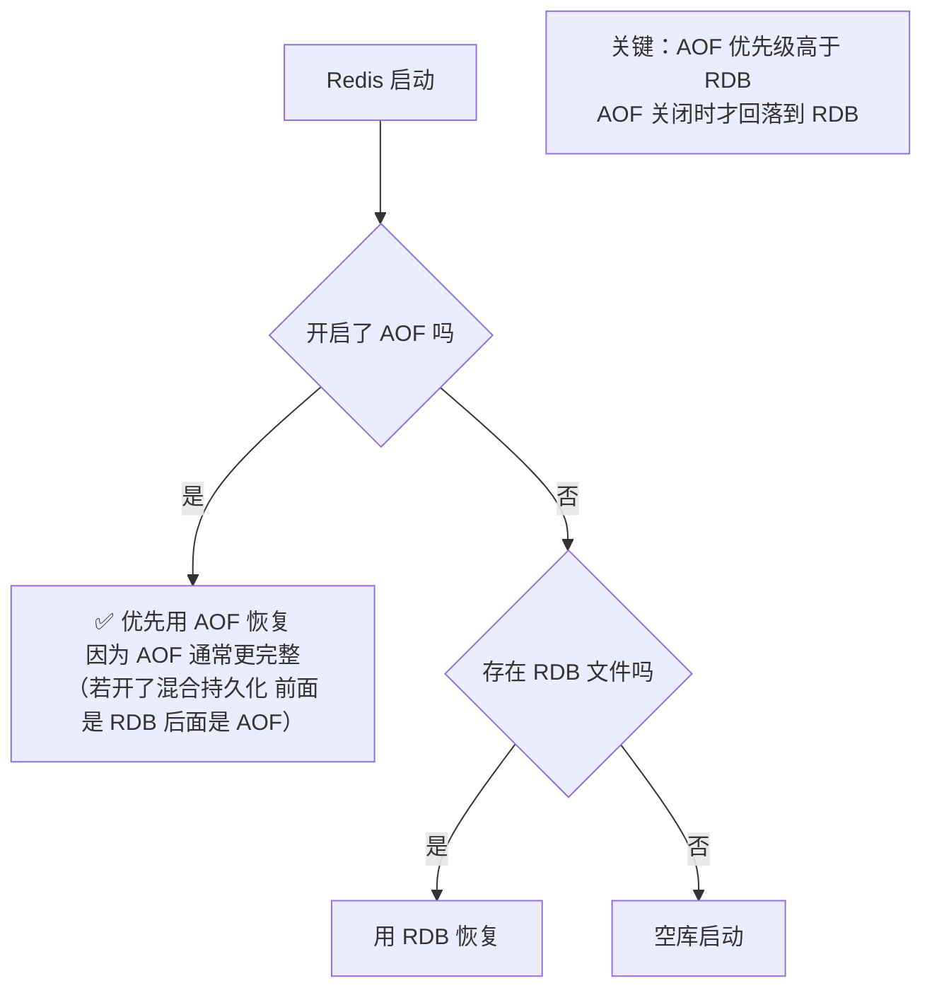
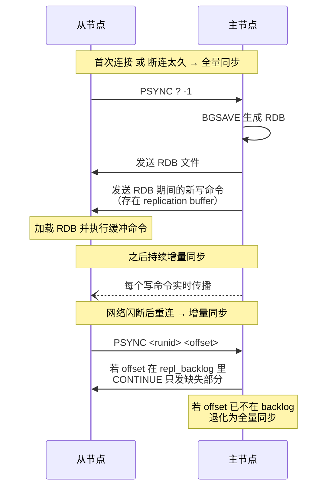
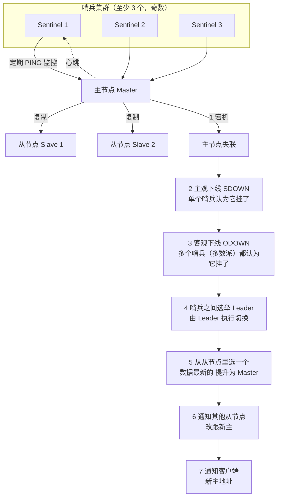
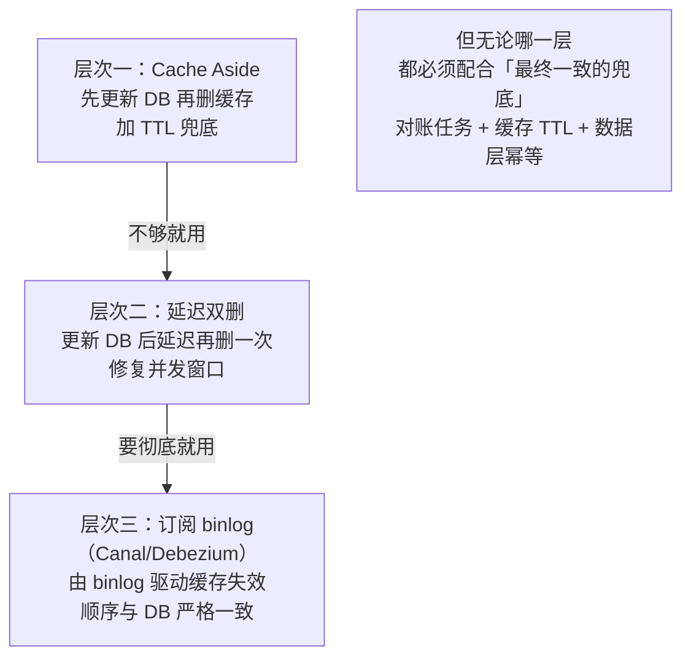

# 07 · Redis 持久化与高可用

> **一句话主线**：Redis 是**内存**数据库，所以它必须回答两个问题——**「数据怎么不丢」**（持久化：RDB 快照 + AOF 日志 + 混合持久化）和**「服务怎么不挂」**（高可用：主从复制 → 哨兵自动切换 → Cluster 分片）。而**内存有限**，所以还要回答**「写满了怎么办」**（过期策略 + 8 种内存淘汰策略）。最后，作为缓存它还必须回答**「缓存和数据库怎么保持一致」**——这是 Redis 面试出现频率最高的开放题之一。
>
> **本模块定位**：`db/` 的**Redis 进阶模块**。它补齐了 [`05_Redis_缓存三大问题.md`](05_Redis_缓存三大问题.md) 只讲「问题」没讲「基础设施」的空白，并与 [`../distributed_consensus/05_分布式数据工程.md`](../distributed_consensus/05_分布式数据工程.md) 的「Redis 三种分布式形态」互补——那边讲**宏观定位**，本模块讲 **Redis 特有细节**。

---

## 目录

- [一、持久化：RDB 与 AOF](#一持久化rdb-与-aof)
- [二、混合持久化与重启恢复优先级](#二混合持久化与重启恢复优先级)
- [三、过期策略与内存淘汰](#三过期策略与内存淘汰)
- [四、主从复制](#四主从复制)
- [五、哨兵（Sentinel）](#五哨兵sentinel)
- [六、Cluster 分片](#六cluster-分片)
- [七、大 key 与热 key](#七大-key-与热-key)
- [八、缓存与数据库一致性](#八缓存与数据库一致性)
- [本模块速记](#本模块速记考前-10-分钟)
- [面试官深挖追问](#面试官深挖追问)

---

## 一、持久化：RDB 与 AOF

Redis 提供**两种**持久化方式，**可以同时开启**。

### 1. RDB（Redis Database）——内存快照

**本质**：在某个时间点，把**内存中的全部数据**以**二进制快照**写入磁盘（`dump.rdb`）。

| 项 | 说明 |
|----|------|
| **触发方式** | ① **手动**：`SAVE`（**阻塞**主线程，生产禁用）/ `BGSAVE`（**fork 子进程**，推荐）；② **自动**：配置 `save <秒> <改动次数>`（如 `save 900 1` = 900 秒内至少 1 个 key 变化就触发） |
| **核心机制** | **`fork()` + 写时复制（COW）**——fork 出子进程来写快照，**主进程继续处理请求**；用 **COW** 保证子进程看到的是 fork 那一刻的**一致快照** |
| **优点** | ① **文件紧凑**（二进制压缩），**适合备份与灾难恢复**；② **恢复速度快**（直接加载二进制，比重放 AOF 快得多）；③ fork 后主进程几乎不阻塞 |
| **缺点** | ⚠️ **会丢数据**——两次快照之间的数据全部丢失（如 5 分钟一次快照，可能丢 5 分钟）；⚠️ **fork 有开销**——数据量大时 fork 本身会**阻塞毫秒到秒级**，且 COW 期间**内存可能翻倍**（写多的场景） |

> ⚠️ **COW 的内存陷阱**：fork 后如果主进程**大量写**，会触发大量页复制，**内存占用可能接近翻倍**。所以「内存用到 50% 以上 + 频繁 BGSAVE」的实例有 **OOM 风险**——这是生产上很常见的坑。

### 2. AOF（Append Only File）——命令日志

**本质**：把**所有写命令**以**追加**方式记录到文件，重启时**重放**这些命令来恢复数据。

| 项 | 说明 |
|----|------|
| **写入流程** | 命令先写入 **`aof_buf`（AOF 缓冲区）**，再按策略刷盘 |
| **`appendfsync` 三种策略** | **`always`**：每个命令都 fsync（**最安全，性能最差**）；**`everysec`**（**默认，推荐**）：每秒 fsync 一次（**最多丢 1 秒**）；**`no`**：交给操作系统决定（**性能最好，丢得多**） |
| **AOF 重写（rewrite）** | ⚠️ AOF 会**无限增长**（如 `INCR` 一万次就是一万条命令）→ 用 **`BGREWRITEAOF`** 从**当前内存状态**生成一份**最精简的命令集**（如一万次 `INCR` 压成一条 `SET`） |
| **优点** | ✅ **数据更安全**（`everysec` 最多丢 1 秒，`always` 几乎不丢）；✅ **文件是文本格式，可读可修复**（误删了 `FLUSHALL` 还能手动删掉那行救回来） |
| **缺点** | ⚠️ **文件体积大**；⚠️ **恢复慢**（要逐条重放命令，比 RDB 加载慢得多）；⚠️ `always` 性能损耗大 |

> 💡 **`appendfsync everysec` 的实现很巧**：它不是「每个命令都检查时间」，而是**主线程写 `aof_buf`，后台线程每秒 fsync 一次**——所以正常情况下主线程不被 fsync 阻塞。**代价是最多丢 1 秒数据。**

### 3. RDB vs AOF 对比

| 维度 | **RDB** | **AOF** |
|------|---------|---------|
| **本质** | **内存快照**（二进制） | **写命令日志**（追加） |
| **文件体积** | **小**（压缩） | **大** |
| **恢复速度** | **快**（直接加载） | **慢**（逐条重放） |
| **数据安全** | ⚠️ **差**（可能丢几分钟） | ✅ **好**（`everysec` 最多 1 秒） |
| **对性能影响** | fork 时有开销（COW 内存） | `always` 影响大，`everysec` 很小 |
| **可读性** | ❌ 二进制不可读 | ✅ 文本可读可修复 |
| **适用** | 备份、灾难恢复、允许丢少量数据 | 对数据安全要求高的场景 |

---

## 二、混合持久化与重启恢复优先级

### 1. 混合持久化（Redis 4.0+）

**问题**：RDB 恢复快但丢数据，AOF 安全但恢复慢——**能不能兼得？**

**方案**：**混合持久化**——`aof-use-rdb-preamble yes`（Redis 4.0 起默认开启）。

**机制**：AOF 重写时，**不再生成纯命令日志**，而是：

| 部分 | 内容 | 作用 |
|------|------|------|
| **前半段** | **RDB 格式的全量快照** | 恢复时**直接加载**（快） |
| **后半段** | **重写期间新增的写命令**（AOF 格式） | 补齐快照之后的变化（**不丢数据**） |

> **效果**：**恢复速度接近 RDB，数据安全接近 AOF**。这是目前**推荐的默认配置**。

### 2. 重启时的恢复优先级

**图 7-1：Redis 重启时的数据恢复顺序**



> ⚠️ **一个常见误区**：「两者都开就都不会丢」——**不完全对**。因为**恢复时只加载 AOF**（AOF 优先级更高），所以**AOF 的完整性决定最终数据**。如果 AOF 是 `everysec`，**仍可能丢最多 1 秒**。要真正不丢必须 `always`（但性能代价大）。

---

## 三、过期策略与内存淘汰

> **这是两个不同的东西，经常被混淆**：
> - **过期策略**：解决「**设置了 TTL 的 key 到点了怎么删**」
> - **内存淘汰**：解决「**内存写满了，该踢掉谁**」

### 1. 过期删除策略：惰性 + 定期

| 策略 | 做法 | 优缺点 |
|------|------|--------|
| **惰性删除（Lazy）** | **访问到这个 key 时才检查是否过期**，过期就删 | ✅ **对 CPU 最友好**（不主动扫描）；❌ **内存不及时释放**——一个过期 key 如果**再也没被访问**，就会**永远占着内存** |
| **定期删除（Active）** | **每秒 10 次**（`hz` 默认 10）**随机抽查**一部分设置了 TTL 的 key，删掉过期的 | ✅ 能回收「没人访问的过期 key」；❌ 抽查是**随机**的，**不能保证及时**（这也是为什么需要「内存淘汰」兜底） |

> **Redis 用的是「惰性 + 定期」的组合**——单靠任何一个都不够。

### 2. 内存淘汰策略（`maxmemory-policy`）

当内存达到 `maxmemory` 时，Redis 按策略淘汰 key。**共 8 种**：

| 分类 | 策略 | 说明 |
|------|------|------|
| **不淘汰** | **`noeviction`**（**默认**） | 内存满时**写入直接报错**（读还能用）。⚠️ **默认值在生产上通常不合适**——缓存场景应该淘汰而不是报错 |
| **所有 key 参与** | **`allkeys-lru`** | 淘汰**最久未使用**的。**最常用的缓存策略** |
| | **`allkeys-lfu`**（4.0+） | 淘汰**使用频率最低**的。比 LRU 更适合「有稳定热点」的场景 |
| | **`allkeys-random`** | 随机淘汰 |
| **只淘汰设了 TTL 的** | **`volatile-lru`** | 在**设置了过期时间**的 key 里淘汰 LRU |
| | **`volatile-lfu`** | 同上，按 LFU |
| | **`volatile-random`** | 同上，随机 |
| | **`volatile-ttl`** | 淘汰**剩余生存时间最短**的（马上要过期的先踢） |

**怎么选**：

| 场景 | 选择 |
|------|------|
| **纯缓存**（数据都能从 DB 重建） | **`allkeys-lru`**（或热点稳定时 `allkeys-lfu`） |
| **缓存 + 持久数据混用**（部分 key 不能丢） | **`volatile-lru`**（只淘汰设了 TTL 的） |
| **明确不能丢任何数据** | **`noeviction`** + 监控告警（内存满了就报警，人工扩容） |

> ⚠️ **LRU vs LFU 的实用区别**：`LRU` 容易被「**一次性的全表扫描**」污染（扫描过的冷数据把真热点挤出去）；**`LFU` 按访问频率**，能更好地保护真热点。**所以 Redis 4.0 引入了 LFU**。但 LFU 有个毛病：**老热点一旦不热了，频率计数降不下来**（Redis 用「**随时间衰减**」来缓解）。

---

## 四、主从复制

**图 7-2：主从复制的全量与增量**



| 机制 | 说明 |
|------|------|
| **全量同步（Full Resync）** | 主节点 `BGSAVE` 生成 RDB 发给从节点；**发送期间的新写命令存入 replication buffer**，RDB 发完后再发这些命令 |
| **增量同步（Partial Resync）** | 主节点维护 **`repl_backlog`（复制积压缓冲区，环形）**；从节点重连时报「我同步到 offset N」，如果 N **还在 backlog 里**，就只补发缺失部分 |
| **`repl_backlog_size`** | backlog 大小。⚠️ **太小会导致频繁全量同步**（offset 被覆盖了），**太大浪费内存**。经验值：`平均写入速率 × 断连容忍秒数` |
| **`runid`** | 主节点唯一标识。**主节点重启后 runid 变化** → 从节点必须全量同步 |

> 💡 **一个实用的调优点**：**`repl-backlog-size` 默认 1MB 偏小**。生产上建议按「**主节点写入速率 × 60 秒**」估算（例如 10MB/s 的写入就设 600MB），这样即使从节点断连一分钟也能增量续传，避免全量同步带来的主节点 fork + 网络风暴。

### ⚠️ 主从复制的关键风险：异步

**Redis 主从复制是异步的**（主节点写完立即返回，不等从节点）。这带来两个后果：

| 后果 | 说明 |
|------|------|
| **主节点宕机可能丢数据** | 未同步到从节点的写操作**永久丢失**（这也是 [`06_Redis_分布式锁.md`](06_Redis_分布式锁.md) 里「Redis 锁会失效」的根源） |
| **读从节点可能读到旧数据** | 复制滞后 → 与 MySQL 主从延迟同类问题（见 [`04_MySQL_复制与高可用.md`](04_MySQL_复制与高可用.md) 的读写分离） |

**缓解手段**：**`WAIT` 命令**（阻塞等待 N 个从节点确认）、**`min-replicas-to-write`**（从节点少于 N 个时拒绝写入）。但**都不能达到强一致**——要强一致还是得用 Redis Cluster + `WAIT`，或者干脆用「Redis 做缓存 + 数据库做权威」的架构。

---

## 五、哨兵（Sentinel）

**问题**：主从架构下，**主节点挂了需要人工切换**（改配置、重启从节点）——不可接受。

**哨兵（Sentinel）** 就是解决「**自动故障转移**」的组件。

**图 7-3：哨兵故障转移流程**



### 关键机制

| 机制 | 说明 |
|------|------|
| **主观下线（SDOWN）** | **单个**哨兵认为主节点挂了（PING 超时） |
| **客观下线（ODOWN）** | **多数哨兵**都认为挂了 → 才真正判定下线（**避免单个哨兵的误判**——这就是「多数派」思想） |
| **哨兵 Leader 选举** | 哨兵之间用 **Raft 算法**选出 Leader，由它执行故障转移（**避免多个哨兵同时切换**） |
| **选新主的标准** | ① 优先级 `replica-priority` 高的优先；② 复制 offset **最新**的优先（数据最全）；③ `runid` 最小的（兜底） |
| **客户端感知** | 客户端（或用 Jedis/Lettuce 的 Sentinel 模式）向**哨兵集群**问「当前主节点是谁」，而不是写死 IP |

### 哨兵的局限

| 局限 | 说明 |
|------|------|
| **切换有窗口期** | 秒级不可写（与 ZK 类似，见 [`06`](06_Redis_分布式锁.md)） |
| **只有 1 个主节点** | **没解决容量问题**——单机内存上限就是数据上限 |
| **异步复制没解决** | 切换时仍可能丢数据（新主可能是数据较旧的从节点） |

> **要解决容量问题，就要用 Cluster。**

---

## 六、Cluster 分片

**Redis Cluster** 同时解决**容量**（分片）和**高可用**（每个分片都有从节点）。

| 机制 | 说明 |
|------|------|
| **哈希槽（Hash Slot）** | **固定 16384 个槽**。`CRC16(key) % 16384` 决定 key 属于哪个槽；槽再分配给各主节点 |
| **为什么是 16384** | ① Redis 作者的解释：**心跳包要携带槽位图**，16384 bit = **2KB**，正好适合网络传输；节点数超过 1000 时 65536 的位图太大；② 16384 个槽在**几到几十个节点**的规模下分配足够均匀 |
| **节点数无关** | ⚠️ **槽数与节点数解耦**——扩容只是**把一部分槽迁给新节点**，不是重新哈希全部 key |
| **重定向（MOVED / ASK）** | 客户端访问了不属于该节点的 key → 节点返回 **`MOVED`**（永久重定向到正确的节点）或 **`ASK`**（迁移中的临时重定向）；**客户端要能处理这两种重定向** |
| **高可用** | 每个主节点可带从节点；主节点挂了，**集群内部用 Raft 类似的选举**提升从节点（不需要哨兵） |
| **`CLUSTER SLOTS` / `CLUSTER NODES`** | 客户端获取「槽 → 节点」映射并**缓存**；拓扑变化时靠重定向纠正 |

> ⚠️ **与「一致性哈希」的区别（面试易错点）**：**Redis Cluster 用的不是一致性哈希**，而是「**固定哈希槽**」。思路更接近 [`../distributed_consensus/05_分布式数据工程.md`](../distributed_consensus/05_分布式数据工程.md) 里讲的「**固定分区数 + 分区分配表**」——分区数与节点数解耦，扩缩容时以槽为单位迁移。**说「类似一致性哈希的分片方式」更稳妥，但严格说不是。**

### ⚠️ Cluster 的最大限制：跨槽操作

**同一个槽才能用多 key 命令**（`MGET`、`MSET`、事务、Lua 脚本）。

**解法：hash tag `{}`**——**只有 `{}` 里的内容参与哈希计算**：

```redis
-- 这两个 key 会落在同一个槽（因为只有 user:1 参与哈希）
SET {user:1}:name "Tom"
SET {user:1}:age 18

-- 现在可以跨 key 操作了
MGET {user:1}:name {user:1}:age
```

> **这是 Cluster 下做业务分组的标准手法**——把「需要一起操作的一批 key」用同一个 hash tag 圈起来。**面试中被问「Cluster 下怎么做多 key 操作」，答 hash tag 就是满分。**

---

## 七、大 key 与热 key

> **这是「真正上过生产」才会被问的问题**——Redis 的线上事故大多由这两个「怪物」引起。

### 1. 大 key（Big Key）

**定义**：单个 key 的 **value 过大**——经验阈值：`String > 10KB`，或**集合类（Hash/List/Set/ZSet）元素数 > 5000**。

| 危害 | 说明 |
|------|------|
| **阻塞主线程** | Redis 是**单线程**处理命令——操作大 key（如 `DEL` 一个百万元素的 Hash）会**阻塞整个实例**，其他请求全部卡住 |
| **网络阻塞** | 一次 `GET` 传输几十 MB → **带宽被打满**，其他请求延迟飙升 |
| **内存不均** | Cluster 下大 key 全落在同一个节点 → **数据倾斜**，该节点内存/CPU 打满 |
| **删除代价高** | `DEL` 大 key 是**同步**的 → 卡住主线程 |

**怎么发现**：

| 手段 | 说明 |
|------|------|
| **`redis-cli --bigkeys`** | 扫描并统计各类 key 的最大值。⚠️ **会遍历全部 key**，生产慎用（可加 `-i 0.1` 限速） |
| **`redis-cli --memkeys`** | 按**内存占用**排序（`--bigkeys` 只按元素个数） |
| **`MEMORY USAGE <key>`** | 查看单个 key 的内存占用 |
| **离线分析 RDB** | 用 **`rdb-tools`** 或 **`redis-rdb-cli`** 分析 `dump.rdb`，**不影响线上**（推荐） |

**怎么治理**：

| 手段 | 说明 |
|------|------|
| **拆分** | 大 Hash 拆成多个小 Hash（如按 `user_id % 100` 分片）；大 String 拆成多段 |
| **压缩** | value 用压缩算法（如 JSON 改 Protobuf、gzip） |
| **`UNLINK` 替代 `DEL`** | **`UNLINK` 是异步删除**——把 key 从 keyspace 摘掉后**丢给后台线程慢慢释放内存**，不阻塞主线程（Redis 4.0+）。**这是处理大 key 删除的标准做法** |
| **设计阶段避免** | 不要用「一个 key 存全量列表」的模型（如 `hot:products` 存所有商品） |

### 2. 热 key（Hot Key）

**定义**：**访问频率极高**的 key（如秒杀商品、明星微博、首页配置）。

| 危害 | 说明 |
|------|------|
| **单节点打满** | Cluster 下热 key 全打在一个节点 → 该节点 CPU 跑满，**整个集群的吞吐上限被它拖住** |
| **缓存击穿风险** | 热 key 一旦过期，瞬时并发全打到 DB（见 [`05`](05_Redis_缓存三大问题.md)） |

**怎么发现**：

| 手段 | 说明 |
|------|------|
| **`redis-cli --hotkeys`** | 基于 **LFU** 统计热点（⚠️ **需要 `maxmemory-policy` 是 LFU 系列**） |
| **`MONITOR` 命令** | ⚠️ **会严重损耗性能**，生产禁用 |
| **客户端埋点统计** | 在 Redis 客户端 SDK 层统计 key 访问次数（**推荐，最准**） |
| **Proxy 层统计** | 如果有 Proxy（如 Codis/自研），在 Proxy 层统计 |

**怎么治理**：

| 手段 | 说明 |
|------|------|
| **本地缓存（多级缓存）** | 把热 key 放**JVM 本地缓存（Caffeine）**——**完全不经过 Redis**，这是最有效的手段（见 [`05`](05_Redis_缓存三大问题.md) 的多级缓存） |
| **key 打散（加随机后缀）** | 把 `hot:product:1` 复制成 `hot:product:1:0` ~ `hot:product:1:9`，**读时随机选一个** → 把压力分散到多个节点。⚠️ **代价是数据有 10 份副本，更新要更新全部** |
| **读写分离** | 热 key 的读流量分到多个从节点 |

---

## 八、缓存与数据库一致性

> **这是 Redis 面试出现频率最高的开放题之一**——「你们怎么保证缓存和数据库的一致性？」

### 1. 先明确前提：这是一个「取舍」问题

> **缓存与数据库的强一致是不可能做到的**（除非用分布式锁把两者串起来，性能不可接受）。所以**目标不是「强一致」，而是「最终一致 + 不一致窗口尽量小 + 不产生脏数据」**。

### 2. 四种更新策略对比

| 策略 | 操作 | 问题 |
|------|------|------|
| **先更新 DB，再更新缓存** | `DB.update()` → `Cache.set()` | ⚠️ **并发下会写脏**：两个请求都更新 DB（B 后于 A），但缓存更新顺序可能反（B 先写缓存、A 后写）→ **缓存里是 A 的旧值**。而且如果更新缓存**失败**，缓存永久是旧值 |
| **先删缓存，再更新 DB** | `Cache.del()` → `DB.update()` | ⚠️ **并发下更危险**：请求 A 删缓存 → A 去更新 DB（还没完成）→ 请求 B 读缓存未命中 → B 读 DB 得到**旧值** → B 写回缓存 → A 才更新完 DB → **缓存里永久是旧值** |
| **先更新 DB，再删缓存（Cache Aside，推荐）** | `DB.update()` → `Cache.del()` | ✅ **业界最推荐**。虽然理论上有并发窗口（见下），但**概率极低**且**可以被兜底** |
| **延迟双删** | `Cache.del()` → `DB.update()` → `sleep(N)` → `Cache.del()` | 用来修复「先删缓存」方案的脏数据：**第二次删除把并发期间可能被写回的脏数据再删掉** |

### 3. 为什么推荐「先更新 DB，再删缓存」

**Cache Aside（旁路缓存）** 是 Facebook 论文推荐的方案。**它的并发窗口**：

> 请求 A：`DB.update(X=2)` → `Cache.del(X)`
> 请求 B：`Cache.read(X)` 未命中 → `DB.read(X)` **读到旧值 X=1** → `Cache.set(X=1)`
>
> 如果 B 的「读 DB → 写缓存」整个过程**恰好夹在 A 的「更新 DB」和「删缓存」之间**，就会把旧值写回缓存。

**为什么说「概率极低」**：

| 条件 | 说明 |
|------|------|
| ① 缓存**恰好**在读的那一刻失效 | 否则 B 根本不会去读 DB |
| ② B 的「读 DB + 写缓存」**必须晚于** A 的「更新 DB」 | 早于的话 B 读到旧值但 A 随后会删掉它 |
| ③ B 的「写缓存」**必须晚于** A 的「删缓存」 | 这是最关键的时序要求 |

**而且**：即使发生了，**缓存还有 TTL 兜底**——过期后会重新加载正确值。

> **面试话术**：「**先更新 DB 再删缓存**是业界推荐的做法。它理论上有并发窗口，但需要三个时序条件同时满足，概率极低，而且有 TTL 兜底。**更彻底的做法是「延迟双删」**——更新 DB 后再延迟一段时间（如 500ms）删一次缓存，把并发期间可能被写回的脏数据再清掉。**最彻底的方案是「订阅 binlog」**——用 Canal/Debezium 监听 MySQL binlog，**由 binlog 驱动缓存失效**，这样缓存删除的顺序与 DB 提交顺序严格一致，从根本上消除了时序问题。」

### 4. 三种方案的层次

**图 7-4：缓存一致性方案的三个层次**



### 5. 为什么是「删除」而不是「更新」缓存

| 原因 | 说明 |
|------|------|
| **① 避免并发写脏** | 「更新缓存」在并发下会因顺序错乱写脏（见上表）；**删除是幂等的**——删两次和删一次效果一样，**天然避免顺序问题** |
| **② 避免无用的计算** | 如果这个缓存值**写多读少**，每次更新都重算一遍缓存是浪费；**删除则「有读才重建」**（懒加载） |
| **③ 避免写放大** | 更新复杂缓存（如多个表的聚合结果）代价高，删除后按需重建更划算 |

> **⚠️ 唯一的例外**：如果缓存值的**计算代价极低**且**读非常频繁**，那更新缓存可能更好（避免一次缓存 miss 的穿透）。但这需要在**明确的并发控制**下进行。

---

## 本模块速记（考前 10 分钟）

| # | 问题 | 关键词速答 |
|---|------|-----------|
| 1 | **RDB 是什么？** | **内存快照**（二进制）。**优点**：文件小、**恢复快**、适合备份；**缺点**：⚠️ **会丢数据**（两次快照之间全丢） |
| 2 | RDB 的触发方式？ | 手动 `SAVE`（**阻塞主线程，生产禁用**）/ **`BGSAVE`（fork 子进程，推荐）**；自动 `save <秒> <改动次数>` |
| 3 | **RDB 的核心机制？** | **`fork()` + 写时复制（COW）**——主进程继续服务，子进程写快照。⚠️ **COW 期间大量写会让内存接近翻倍**（OOM 风险） |
| 4 | **AOF 是什么？** | **写命令追加日志**。**优点**：✅ 数据更安全、文本可读可修复；**缺点**：文件大、**恢复慢**（逐条重放） |
| 5 | **`appendfsync` 三种策略？** | **`always`**（每命令 fsync，最安全最慢）、**`everysec`（默认推荐，最多丢 1 秒）**、**`no`**（交给 OS，最快最不安全） |
| 6 | AOF 会无限增长吗？ | 会 → 用 **`BGREWRITEAOF`** 从当前内存状态生成最精简命令集（一万次 `INCR` 压成一条 `SET`） |
| 7 | RDB vs AOF 怎么选？ | **要快恢复/做备份 → RDB**；**要数据安全 → AOF**。**生产一般两个都开** |
| 8 | **混合持久化是什么？** | Redis **4.0+**，`aof-use-rdb-preamble yes`（默认开）。AOF 文件**前半段是 RDB 全量快照（恢复快）+ 后半段是增量命令（不丢数据）** |
| 9 | ⚠️ **重启时恢复优先级？** | **AOF 优先于 RDB**！**只有 AOF 关闭时才回落到 RDB** |
| 10 | **过期删除策略？** | **惰性删除**（访问时才检查，CPU 友好但**内存不及时释放**）+ **定期删除**（每秒 10 次随机抽查，不能保证及时） |
| 11 | **内存淘汰策略共几种？** | **8 种** |
| 12 | 默认淘汰策略？ | ⚠️ **`noeviction`**（内存满时写入**报错**）。**缓存场景通常应改成 `allkeys-lru`** |
| 13 | **纯缓存场景选哪个？** | **`allkeys-lru`**（有稳定热点时用 `allkeys-lfu`） |
| 14 | 缓存 + 持久数据混用？ | **`volatile-lru`**（只淘汰设了 TTL 的 key） |
| 15 | LRU 的问题？ | 容易被「**一次性全表扫描**」污染（冷数据把热点挤出去）→ Redis 4.0 引入 **LFU**（按访问频率，且带**时间衰减**） |
| 16 | **全量同步 vs 增量同步？** | **全量**：`BGSAVE` 生成 RDB 发给从节点 + 发送期间的写命令（存 replication buffer）；**增量**：靠 **`repl_backlog`（环形缓冲区）**，重连时只补缺失部分 |
| 17 | ⚠️ `repl-backlog-size` 怎么设？ | **默认 1MB 偏小**。按「**写入速率 × 60 秒**」估算。太小会导致**频繁全量同步**（主节点 fork + 网络风暴） |
| 18 | ⚠️ **Redis 主从是同步还是异步？** | **异步**！→ ① 主节点宕机可能**丢数据**；② 读从节点可能读到旧值。缓解：`WAIT` 命令、`min-replicas-to-write`（但**都达不到强一致**） |
| 19 | **哨兵解决什么问题？** | **主节点的自动故障转移**（不用人工切换） |
| 20 | 哨兵至少几个？ | **3 个（奇数）**——因为要用**多数派**判断客观下线 |
| 21 | **主观下线 vs 客观下线？** | **SDOWN**：**单个**哨兵认为挂了；**ODOWN**：**多数哨兵**都认为挂了 → 才真正判定下线 |
| 22 | 哨兵之间怎么协调？ | 用 **Raft 算法选 Leader**，由 Leader 执行故障转移（避免多个哨兵同时切） |
| 23 | 选新主的标准？ | ① `replica-priority` 高优先；② **复制 offset 最新**（数据最全）优先；③ runid 最小兜底 |
| 24 | 哨兵的三个局限？ | ① **切换有窗口期**（秒级不可写）② **只有 1 个主节点**（没解决容量）③ **异步复制没解决**（可能丢数据） |
| 25 | **Cluster 用什么分片？** | ⚠️ **固定 16384 个哈希槽**，`CRC16(key) % 16384`。**不是一致性哈希**（思路更接近「固定分区数 + 分配表」） |
| 26 | **为什么是 16384 个槽？** | 心跳包要携带**槽位图**——16384 bit = **2KB**，适合网络传输；节点超 1000 时 65536 的位图太大 |
| 27 | 槽数与节点数的关系？ | ⚠️ **解耦**！扩容只是**把部分槽迁给新节点**，不是重新哈希全部 key |
| 28 | `MOVED` 和 `ASK` 的区别？ | **`MOVED`** = 永久重定向（槽已归别人）；**`ASK`** = 迁移中的**临时**重定向 |
| 29 | ⚠️ **Cluster 最大限制？** | **跨槽不能多 key 操作**（`MGET`/事务/Lua 都要求同槽） |
| 30 | **怎么绕过跨槽限制？** | **hash tag `{}`**——**只有 `{}` 里的内容参与哈希**，如 `{user:1}:name` 与 `{user:1}:age` 必落同槽 |
| 31 | **大 key 的定义与危害？** | **`String > 10KB`** 或**集合元素 > 5000**。危害：**阻塞单线程主线程**、**打满网络带宽**、Cluster 下**数据倾斜**、`DEL` 卡主线程 |
| 32 | 大 key 怎么发现？ | **`redis-cli --bigkeys`**（按元素数）、**`--memkeys`**（按内存）、**`MEMORY USAGE <key>`**、**离线分析 RDB**（`rdb-tools`，不影响线上，推荐） |
| 33 | 大 key 怎么治理？ | ① **拆分**（大 Hash 按 id 取模拆分）② **压缩**（Protobuf/gzip）③ **`UNLINK` 替代 `DEL`**（**异步删除，不阻塞主线程**，4.0+） |
| 34 | **热 key 的危害？** | Cluster 下**单节点 CPU 打满**，拖住整个集群吞吐；且热 key 过期易**击穿** |
| 35 | 热 key 怎么发现？ | **`redis-cli --hotkeys`**（需 LFU 策略）、**客户端埋点统计（最准，推荐）**、Proxy 层统计。⚠️ `MONITOR` 生产禁用 |
| 36 | 热 key 怎么治理？ | ① **本地缓存（Caffeine）**——最有效，完全不经过 Redis ② **key 打散**（加随机后缀，代价是 10 份副本）③ 读写分离 |
| 37 | ⚠️ **缓存与 DB 能强一致吗？** | **不能**！目标是「**最终一致 + 不一致窗口尽量小 + 不产生脏数据**」 |
| 38 | 四种更新策略？ | ① 先更新 DB 再更新缓存（**并发写脏**）② 先删缓存再更新 DB（**更危险**）③ **先更新 DB 再删缓存（Cache Aside，推荐）** ④ **延迟双删** |
| 39 | **为什么推荐 Cache Aside？** | 并发窗口概率极低（需同时满足三个时序条件）+ **有 TTL 兜底** |
| 40 | **延迟双删怎么做？** | `Cache.del()` → `DB.update()` → `sleep(N)` → `Cache.del()`。**第二次删把并发期间写回的脏数据清掉** |
| 41 | **最彻底的方案？** | **订阅 binlog（Canal/Debezium）**——由 binlog 驱动缓存失效，**顺序与 DB 提交严格一致**，根本消除时序问题 |
| 42 | ⚠️ **为什么「删缓存」而不是「更新缓存」？** | ① **删除是幂等的**，天然避免并发顺序问题；② **避免无用计算**（写多读少时更新是浪费，删除是懒加载）；③ **避免写放大**（复杂聚合缓存重算代价高） |

---

## 面试官深挖追问

1. **「RDB 和 AOF 你会同时开吗？为什么？」**
   → **会，而且这是生产推荐配置**。理由：① **单开 RDB** 会丢几分钟数据；② **单开 AOF** 恢复太慢（大实例重放可能几十分钟），且 AOF 文件更大；③ **两个都开 + 混合持久化（`aof-use-rdb-preamble yes`）**能兼顾——**AOF 保证数据安全（默认 `everysec` 最多丢 1 秒），混合持久化让 AOF 的重写产物前半段是 RDB 格式从而恢复更快**。**注意**：恢复时**只加载 AOF**（AOF 优先级高于 RDB），所以**AOF 的完整性决定最终数据**。

2. **「`fork()` 做 BGSAVE 时，主进程真的不阻塞吗？」**
   → **不完全不阻塞**。`fork()` 本身要**复制页表**——数据量越大、页表越长，**阻塞时间越长**（几十 GB 的实例可能阻塞**几百毫秒到 1 秒**）。而且 fork 之后，**COW 导致的页复制是分散在后续写操作中的开销**。所以：① 大实例要**控制 BGSAVE 频率**；② 可以用**主从架构**把 BGSAVE 放到从节点做（从节点 fork 不影响主节点服务）；③ **监控 `latest_fork_usec`** 指标。**这是「Redis 单线程」之外另一个容易被忽略的延迟来源。**

3. **「`volatile-lru` 和 `allkeys-lru` 怎么选？」**
   → 关键看**业务是否在同一实例里混存了「不能丢的数据」**：
   > - **纯缓存实例** → **`allkeys-lru`**（所有 key 都可淘汰，淘汰范围最大、命中率最高）
   > - **缓存 + 持久数据混存**（比如同一个 Redis 里既做缓存，又存了「不能丢的会话/队列」） → **`volatile-lru`**（只淘汰设了 TTL 的）
   >
   > ⚠️ **但要提醒**：**`volatile-*` 系列有个陷阱**——如果**大部分 key 都没设 TTL**，可淘汰的候选集很小，**内存满了可能淘汰不出足够的空间**（甚至退化成类似 `noeviction` 的报错行为）。所以**架构上更推荐「缓存实例和数据实例物理隔离」，都用 `allkeys-lru`**。

4. **「为什么 Redis Cluster 是 16384 个槽而不是 65536？」**
   → Redis 作者 antirez 在 GitHub issue 里给过解释，两点：① **心跳包开销**——集群节点间的心跳（`PING`）要**携带槽位图**（bitmap）。16384 个槽 = **2KB**（16384/8）；65536 个槽 = **8KB**。心跳是**周期性广播**的，8KB 的心跳在节点多时会明显浪费带宽。② **集群规模**——Redis Cluster **设计上不建议超过 1000 个节点**，16384 个槽分给 1000 个节点仍有 16 个槽/节点，**足够均匀**。**所以 16384 是「心跳开销」与「分配均匀度」的折中。**

5. **「热 key 用『加随机后缀打散』有什么问题？」**
   → 三个代价：① **数据冗余**——一个逻辑 key 变成 N 份物理副本，**内存占用 × N**；② **更新复杂**——更新时要**更新全部 N 份**（否则读到不一致的值），这又引入了「更新的原子性」问题（要不要用 Lua 批量更新？）；③ **无法保证读到的都是最新值**——如果更新是异步的，**不同后缀的副本可能处于不同版本**。所以「打散」只适合**「读极多、写极少、且能接受短暂不一致」**的场景（如热门商品详情），**不适合库存这类强一致数据**。**更好的方案是「本地缓存」**——它没有冗余问题，且读性能更好。

6. **「你说缓存和数据库做不到强一致，那如果业务真的需要强一致怎么办？」**
   → 分三种情况：
   > **① 数据本身就该强一致**（如账户余额、库存） → **不要让缓存做权威**。做法：**缓存只做「读加速」，权威在数据库**；扣减类操作用**数据库的原子 SQL**（`UPDATE ... WHERE stock > 0`）或**分布式锁 + 数据库事务**保证；缓存只用于**查询展示**，且读时**以数据库为准做校验**（如读缓存后校验版本号）。
   > **② 用「读写都走数据库 + 缓存只用于非关键路径」** → 最简单的规避方式。
   > **③ 用「同一份数据的读写都路由到同一个节点」+ 强一致存储** → 如 TiDB（Raft 强一致）、或用数据库的 `SELECT ... FOR UPDATE`。
   > **一句话**：**缓存天生是「最终一致」的组件，不要试图用它做「强一致的权威存储」。** 需要强一致的场景，权威必须放在支持强一致的存储上（数据库 / ZK / etcd）。

7. **「Redis 单线程为什么还能这么快？多线程版本（6.0）改了什么？」**
   → **单线程快的原因**：① **纯内存操作**（无磁盘 IO）；② **避免锁竞争与上下文切换开销**（单线程天然无并发问题）；③ **IO 多路复用**（epoll）——一个线程处理海量连接；④ **高效的数据结构**（跳表、压缩列表、intset 等）。
   > **Redis 6.0 的多线程**：**只把「网络 IO 的读写与协议解析」放到多线程**（因为这部分在网络带宽大时是瓶颈），**命令执行仍然是单线程**——所以**所有数据结构的操作依然是单线程的、无锁的**。**这解释了「为什么 Redis 6.0 多线程后，你依然不能在大 key 上做慢操作」**——因为**命令执行阶段仍然会阻塞主线程**。Redis 7.0 进一步把部分场景的多线程用得更充分，但核心模型不变。

8. **「你们线上有没有出过 Redis 相关的事故？怎么排查的？」**
   → 参考结构（**要有真实细节**）：
   > **① 事故现象**：接口 P99 从 20ms 涨到 2s，Redis 监控显示 **`latency` 尖刺**。
   > **② 排查路径**：① `redis-cli --latency` / 慢日志（`slowlog get`）→ 发现某条命令耗时 800ms；② 定位到是一个 **`HGETALL` 大 key**（某 Hash 有 200 万字段）——**单线程被这条命令阻塞了**；③ 用 `redis-cli --bigkeys`（限速模式）确认了还有几个类似的大 key。
   > **③ 解决**：① **短期**——把那个 key 拆分成多个小 Hash（按 `biz_id % 100`），业务改读写逻辑；② **长期**——加了**大 key 巡检**（离线分析 RDB），在 CI 里加了**禁止 `HGETALL` 无界读取**的规范；③ 用 **`UNLINK`** 替换了所有 `DEL` 大 key 的地方。
   > **④ 复盘**：根因是**设计阶段把「一个 key 存全量列表」当成了常规模式**——这是大 key 最常见的来源。

---

## 参考资料

见 [`99_参考资料.md`](99_参考资料.md)。
