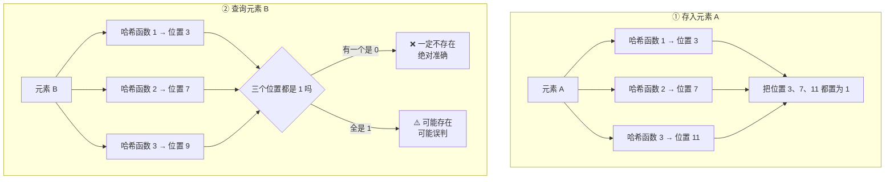
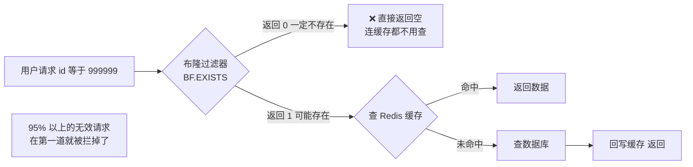

# 08 · Redis 布隆过滤器

> **一句话主线**：布隆过滤器是一个**用极少空间做「存在性判断」**的结构，核心特性是**「说不存在就一定不存在，说存在则可能误判」**——**无漏判、有误判**。它由**一个二进制数组 + 多个哈希函数**组成，最经典的用途是**解决缓存穿透**（见 [`05_Redis_缓存三大问题.md`](05_Redis_缓存三大问题.md)）。**代价是不能删除元素**，且**哈希函数个数存在最优值，加多了反而更差**。
>
> **本模块定位**：`db/` 的**数据结构模块**，与 [`05`](05_Redis_缓存三大问题.md) 的缓存穿透一节互为表里——`05` 讲「为什么要用」，本模块讲「怎么用、参数怎么调、有什么坑」。

---

## 目录

- [一、一句话说清是什么](#一一句话说清是什么)
- [二、原理（印章比喻）](#二原理印章比喻)
- [三、面试核心必背 3 个点](#三面试核心必背-3-个点)
- [四、⚠️ 降误判的正确做法（含常见错误）](#四️-降误判的正确做法含常见错误)
- [五、不能删除？三种支持删除的替代结构](#五不能删除三种支持删除的替代结构)
- [六、Redis 中怎么用](#六redis-中怎么用)
- [七、面试必考场景](#七面试必考场景)
- [本模块速记](#本模块速记考前-10-分钟)
- [面试官深挖追问](#面试官深挖追问)

---

## 一、一句话说清是什么

布隆过滤器是**超快、超省空间**的**存在性判断工具**，只干一件事：

> **判断一个元素「一定不存在 / 可能存在」。**

| 结论 | 可靠性 |
|------|--------|
| 布隆过滤器说「**不存在**」 | ✅ **一定不存在**（**绝对准确**） |
| 布隆过滤器说「**存在**」 | ⚠️ **可能存在**（**有误判**） |

---

## 二、原理（印章比喻）

**组成**：**一个很长的二进制数组**（只有 0 和 1，初始全 0）+ **多个不同的哈希函数**。

**图 8-1：布隆过滤器的插入与查询**



| 操作 | 做法 |
|------|------|
| **存元素** | 把元素丢给这几个哈希函数，算出几个数组下标，把对应位置**从 0 改成 1** |
| **查元素** | 再用同样的哈希算位置：<br>• **只要有一个位置是 0** → **元素一定不存在**（**绝对准**）<br>• **所有位置全是 1** → **元素可能存在**（**可能误判**） |

> **白话**：像用**多个印章盖白纸**——**只要有一个位置没盖到，就肯定没盖过**；**全盖到了，可能是你盖的，也可能是别人盖的**（这就是误判的来源）。

**误判为什么会产生？** 因为**多个元素共用同一批位置**——元素 A 把位置 3、7、11 置了 1；元素 B 恰好也算到 3、7、11（或这三个位置分别被不同元素置过 1）→ 查 B 时看到全是 1，**误以为 B 存在**。

---

## 三、面试核心必背 3 个点

### 1. 两大特性

| 特性 | 说明 |
|------|------|
| ✅ **无漏判（No False Negative）** | 不存在的元素，**一定**说「不存在」——这是它**可用于拦截**的前提 |
| ❌ **有误判（False Positive）** | **可能**把不存在的，误判成「存在」——这是它的**代价** |

> **为什么「无漏判」是必然的？** 因为存过的元素，**它的那几个位置一定是 1**（被自己置过了）。所以查它时**不可能出现 0**，**不可能说「不存在」**。

### 2. 优缺点

| | 内容 |
|---|------|
| **优点** | **极快**——`O(k)`（k 是哈希函数个数，与数据量无关，常数级）；**极省空间**——**不存真实数据**，只存 0/1（存 1 亿个元素可能只需几十 MB） |
| **缺点** | **不能直接删元素**——一个位置被**多个元素共用**，删 1 会**影响其他元素**（把别人的 1 擦成 0 → 别人被误判为「不存在」→ **破坏了「无漏判」**） |

> ⚠️ **「不能删除」是布隆过滤器最容易被忽略的限制**，也是它在**数据会删减**的业务里不好用的原因（如「黑名单要能移除」）。

### 3. 降误判方法

**核心指标**：设 `m` = 二进制数组位数，`n` = 存入的元素个数，`k` = 哈希函数个数。

> **误判率 ≈ `(1 − e^(−kn/m))^k`**

误判率由 **`m/n`（位/元素比）** 与 **`k`** 共同决定。

---

## 四、⚠️ 降误判的正确做法（含常见错误）

> ### 勘误：不能只「增加哈希函数个数」
>
> 常见说法是「加长二进制数组 + 增加哈希函数个数就能降误判」。**前半句对，后半句不完整**——**哈希函数个数存在最优值，超过它之后误判率反而上升**。

### 1. 误判率随 k 的变化

对**固定的 `m` 和 `n`**：

| k 的取值 | 误判率变化 |
|---------|-----------|
| `k < k*` | **随 k 增大而下降**（哈希越多，区分能力越强） |
| **`k = k*`** | ✅ **误判率最低**（此时约有一半的位被置 1） |
| `k > k*` | ⚠️ **随 k 增大而上升**（位被填满得太快，很快所有位置都是 1） |

**最优哈希函数个数**：

> **`k* = (m / n) × ln2 ≈ 0.693 × (m / n)`**

> **直觉理解**：哈希函数越多，一个元素会置越多的位 → 数组被填满得越快 → 当**几乎所有位都是 1** 时，查什么都返回「可能存在」→ **误判率趋近 100%**。所以**必须让「位填充率」保持在大约 50%**，这就是 `k*` 的含义。

### 2. 正确的调参步骤

| 步骤 | 做法 |
|------|------|
| **① 先估 n**（预期要存的元素个数） | 例如「预计 1 亿个商品 ID」 |
| **② 定误判率目标** | 例如 1%（`m/n` 大约需要 **9.6**），0.1% 需要约 **14.4** |
| **③ 算 m** | `m = n × (m/n)`，如 1 亿 × 9.6 ≈ **9.6 亿位 ≈ 115 MB** |
| **④ 算 k** | `k* = 0.693 × (m/n)`，如 `0.693 × 9.6 ≈ 6.7` → **取 7** |
| ⚠️ **⑤ 关键** | **要降误判，必须 m 和 k 一起调**——只加 k 不加 m 会让情况更糟 |

### 3. `m/n` 与误判率的对照（面试可直接引用）

| 位/元素（`m/n`） | 最优 k | 误判率（约） |
|----------------|-------|------------|
| 7 | 5 | ~1% |
| 9.6 | 7 | ~1% |
| **14.4** | **10** | **~0.1%** |
| 16 | 11 | ~0.05% |

> **一句话记**：**「误判率 1% 大约需要每个元素 10 个位」**——这个数量级能在面试中直接估算。

---

## 五、不能删除？三种支持删除的替代结构

| 结构 | 机制 | 代价 | 适用 |
|------|------|------|------|
| **计数布隆过滤器（Counting Bloom Filter）** | 每个位置**不再存 0/1，而是存一个计数器**——插入时 `+1`，删除时 `-1`（减到 0 才算真正清零）。**通常 4 位计数器就够** | **空间放大 4 倍**（或更多）；计数器溢出风险 | 需要删除、且能接受空间代价 |
| **Cuckoo Filter（布谷鸟过滤器）** | 用**布谷鸟哈希**存元素的**指纹**（fingerprint），支持**删除**，且**误判率通常比布隆更低** | 实现复杂；**插入可能失败**（需要踢出重定位，有装载率上限） | 现代替代方案，很多场景优于布隆 |
| **Redis 的 `SET` / 位图方案** | 直接用 Redis 的 Set（精确）或位图 | 空间大得多（Set 存完整元素） | 数据量小、需精确判断、需删除 |

> **面试话术**：「标准布隆过滤器**不能删除**——因为一个位可能被多个元素共用，清零会破坏别人的判断。如果需要删除，有两条路：① **计数布隆过滤器**（每个位置存 4 位计数器，插入 +1、删除 -1，代价是空间放大 4 倍）；② **布谷鸟过滤器**（存指纹，天然支持删除，误判率还更低）。**但如果业务只是『黑名单偶尔要移除』，更实用的做法是「定期全量重建布隆过滤器」**——比如每天凌晨用数据库最新数据重跑一次，中间用双 buffer 切换（新旧两个过滤器并存，新数据写入新过滤器，查询时查两个）。

---

## 六、Redis 中怎么用

**Redis 原生的布隆过滤器**由 **RedisBloom 模块**提供（需要单独安装该模块，官方 Docker 镜像 `redislabs/rebloom` 已内置）。

| 命令 | 作用 |
|------|------|
| **`BF.RESERVE key error_rate capacity`** | 创建过滤器。**只需给「误判率」和「预期容量」，Redis 自动算 `m` 和 `k`**——这是用模块的最大好处（不用自己算参数） |
| **`BF.ADD key item`** | 添加元素 |
| **`BF.EXISTS key item`** | 判断是否存在（返回 1 = 可能存在，0 = 一定不存在） |
| **`BF.MADD` / `BF.MEXISTS`** | 批量版本 |
| **`CF.ADD` / `CF.DEL`** | **布谷鸟过滤器**的命令（`CF.DEL` 支持删除） |

```bash
# 创建一个误判率 1%、容量 100 万的过滤器
BF.RESERVE goods:filter 0.01 1000000

# 预热：把数据库里所有合法商品 ID 加进去
BF.MADD goods:filter 1001 1002 1003 ...

# 查询：先过过滤器
BF.EXISTS goods:filter 999999   # 返回 0 → 一定不存在 → 直接返回空，不查缓存也不查库
```

> ⚠️ **如果不能用 RedisBloom 模块**（比如用的是云厂商的 Redis 限制模块），替代方案：
> - **自研 Bloom**（用 **Guava 的 `BloomFilter`** 放在应用内存里）——⚠️ **多实例部署时每个实例各有一份，数据不一致**（新加入的元素只在一个实例的过滤器里）；需要靠**定期全量重建 + 广播**同步
> - **用 Redis 的位图（Bitmap）自己实现**——`SETBIT` / `GETBIT`，但**哈希计算要自己做**，且**Lua 脚本保证多位置设置的原子性**

---

## 七、面试必考场景

### 1. 解决 Redis 缓存穿透（最经典）

**问题**：请求查数据库里**根本没有**的数据 → 全部打到 DB（见 [`05`](05_Redis_缓存三大问题.md)）。

**方案**：把**所有合法 key** 预先存入布隆过滤器；请求过来**先过过滤器**：



> **效果**：**绝大多数无效请求在第一道拦截**，数据库压力大幅下降。
>
> ⚠️ **但要记住它的代价**：① **有误判**（可能把存在的商品误判为不存在 → 用户查不到商品）——所以**误判率要设得足够低**（如 0.1%）；② **数据变更要维护过滤器**——新增商品要 `BF.ADD`，删除商品不能 `BF.DEL`（除非用布谷鸟过滤器），只能**定期全量重建**。

### 2. 其他场景

| 场景 | 说明 |
|------|------|
| **黑名单**（恶意 IP、垃圾邮件地址、垃圾手机号） | 判断「是否在黑名单」——注意**无漏判**意味着**不会放过已知的恶意请求**，误判意味着**可能误伤正常请求**（所以误判率要低） |
| **爬虫 URL 去重** | 判断「这个 URL 是否爬过」——误判的代价是**漏爬几个页面**（可接受），漏判会导致**重复爬取**（不可接受）——正好匹配布隆的特性 |
| **推荐系统去重** | 判断「这个内容是否已推荐给该用户」——误判代价是**少推荐一个** |
| **数据库防止全表扫** | 在查询前先用布隆过滤器判断「这个 key 值有没有可能存在」——没有就直接返回（如 **HBase / RocksDB 内部就用布隆过滤器加速 `Get` 查询**，避免无谓的磁盘查找） |
| **大文件去重 / 秒传** | 判断「这个文件的指纹是否已存在」 |

> 💡 **判断「该不该用布隆」的标准**：**问「误判的代价是什么」**。
> - 如果误判的代价是「**多查一次数据库 / 少推荐一个 / 偶尔查不到**」→ ✅ **适合用布隆**
> - 如果误判的代价是「**漏掉重要数据 / 产生业务错误**」→ ❌ **不适合**（如「判断用户是否已支付」就不能用布隆——误判会认为已支付而放行）

---

## 本模块速记（考前 10 分钟）

| # | 问题 | 关键词速答 |
|---|------|-----------|
| 1 | **布隆过滤器一句话是什么？** | 用**极少空间**做**存在性判断**的工具，只回答「**一定不存在 / 可能存在**」 |
| 2 | 组成是什么？ | **一个很长的二进制数组** + **多个哈希函数** |
| 3 | **存元素怎么做？** | 用多个哈希函数算出多个下标，把对应**位置从 0 置为 1** |
| 4 | **查元素怎么判断？** | 同样算位置：**有一个是 0 → 一定不存在**（绝对准）；**全是 1 → 可能存在**（可能误判） |
| 5 | 误判从哪来？ | **多个元素共用同一批位置**——A 置过的位，恰好让 B 也「全命中」 |
| 6 | **两大特性？** | ✅ **无漏判**（不存在的一定说不存在，这是拦截的前提）❌ **有误判**（可能把不存在的说成存在） |
| 7 | ⚠️ 为什么「无漏判」是必然的？ | 存过的元素，**它的位置一定是 1**，查它**不可能出现 0** |
| 8 | **优点？** | **极快**（`O(k)`，与数据量无关）、**极省空间**（不存真实数据，只存 0/1） |
| 9 | **最大缺点？** | **不能直接删元素**——一个位被多元素共用，清零会**破坏别人的「无漏判」** |
| 10 | **误判率公式？** | `(1 − e^(−kn/m))^k`。`m`=位数，`n`=元素数，`k`=哈希函数个数 |
| 11 | ⚠️ **「增加哈希函数个数」能降误判吗？** | ⚠️ **不完整！** 存在**最优值 `k*`**，**超过它误判率反而上升**（位被填满太快） |
| 12 | **最优哈希函数个数？** | **`k* = (m / n) × ln2 ≈ 0.693 × (m/n)`**，此时约有一半的位被置 1 |
| 13 | ⚠️ 为什么超过 k* 会更差？ | 哈希越多，每个元素置的位越多 → 数组**被填满越快** → 当几乎全是 1 时，**查什么都返回「可能存在」**，误判率趋近 100% |
| 14 | 降误判的正确做法？ | **必须 `m` 和 `k` 一起调**——先加长数组，再按 `k*` 设哈希函数个数 |
| 15 | **快速估算口诀？** | **「误判率 1% 大约需要每个元素 10 个位」**（`m/n ≈ 9.6` 时 `k*=7`，误判率约 1%）；0.1% 需要 `m/n ≈ 14.4`、`k=10` |
| 16 | **支持删除的替代结构？** | ① **计数布隆过滤器**（每个位置存 4 位计数器，插入 +1 删除 -1，**空间放大 4 倍**）② **布谷鸟过滤器（Cuckoo Filter）**（存指纹，**支持删除且误判率更低**） |
| 17 | 实用替代方案？ | **定期全量重建**（每天凌晨用最新数据重建，双 buffer 切换：新旧两个过滤器并存） |
| 18 | **Redis 怎么用布隆？** | **RedisBloom 模块**：`BF.RESERVE key error_rate capacity`（**只需给误判率和容量，自动算 m 和 k**）、`BF.ADD`、`BF.EXISTS`、`BF.MADD`、`BF.MEXISTS`；布谷鸟用 `CF.ADD` / **`CF.DEL`** |
| 19 | 不用模块怎么办？ | **Guava `BloomFilter`**（放应用内存，⚠️ **多实例各一份、数据不一致**，需定期重建+广播）；或 **Redis 位图 `SETBIT`/`GETBIT`** 自己实现 |
| 20 | **最经典场景？** | **解决缓存穿透**——所有合法 key 存入过滤器，请求先过过滤器，返回 0 直接拦截（连缓存都不用查） |
| 21 | ⚠️ 用布隆做穿透的代价？ | ① **有误判**（可能把存在的商品判为不存在 → 用户查不到）→ **误判率要设低（如 0.1%）**；② **增删要维护**（新增要 `BF.ADD`，删除只能靠**定期全量重建**） |
| 22 | 其他场景？ | **黑名单**（IP/邮件/手机号）、**爬虫 URL 去重**、**推荐去重**、**HBase/RocksDB 内部的 `Get` 加速**、**大文件秒传去重** |
| 23 | **判断该不该用布隆的标准？** | 问「**误判的代价是什么**」——代价是「多查一次库/少推一个/偶尔查不到」→ ✅ 适合；代价是「**漏掉重要数据/业务错误**」→ ❌ 不适合（**判断「是否已支付」不能用**） |
| 24 | **满分话术？** | 「布隆过滤器基于**二进制数组 + 哈希函数**，只保证**一定不存在**、不保证一定存在，**无漏判但有误判，不能删元素**；优点是**快、省空间**，最常用在**解决 Redis 缓存穿透**」 |

---

## 面试官深挖追问

1. **「布隆过滤器的误判率怎么控制？你会怎么设参数？」**
   → 三步：① **先估规模 `n`**（比如「未来一年 1 亿个商品」）；② **定误判率目标**（业务能接受多少误伤——商品查询建议 **0.1%**，黑名单可以放宽到 1%）；③ **算参数**：按 `m/n ≈ 9.6`（1%）或 `14.4`（0.1%）算总位数 `m`，再按 **`k* = 0.693 × (m/n)`** 取整得哈希函数个数。**1 亿商品 + 0.1% 误判率 → 约 14.4 亿位 ≈ 180MB，k 取 10。** ⚠️ **关键提醒**：**实际存的数量不能超过预估的 `n`**——一旦超了，误判率会**急剧上升**（因为 `m/n` 变小了）。所以要么**留足余量（如按 2 倍预估）**，要么**监控元素数接近上限时告警重建**。用 `BF.RESERVE` 时 Redis 会自动按参数算出内部结构，但仍要注意容量上限。

2. **「为什么布隆过滤器不能删元素？如果业务需要删怎么办？」**
   → **不能删的原因**：一个位置可能被**多个元素共同置为 1**。如果你把它清成 0，那么**其他依赖这个位置的元素就会被误判为「不存在」**——这**破坏了「无漏判」这个核心保证**，而「无漏判」正是布隆能用来做拦截的前提。**需要删的三条路**：① **计数布隆过滤器**——每个位置存一个计数器（通常 4 位），插入 `+1`、删除 `-1`，减到 0 才真正清零。代价是**空间放大 4 倍**，且有**计数器溢出**风险（需要容量上限）；② **布谷鸟过滤器**——存元素的**指纹**而非位，天然支持删除，**误判率还通常更低**，代价是实现更复杂、有**装载率上限**；③ **定期全量重建**（最工程化）——**双 buffer**：维护新旧两个过滤器，查询时查两个，新数据只写新过滤器，定时切换。适合「删除不频繁」的场景。

3. **「布隆过滤器说『可能存在』时，你怎么知道是真存在还是误判？」**
   → **布隆过滤器本身无法区分**——这就是它的本质限制：它**只提供「可能存在」这个模糊结论**。所以工程上的做法是：**把布隆过滤器当作「前置过滤器」而不是「权威判断」**。布隆说「不存在」→ **可以放心直接返回**（因为无漏判）；布隆说「可能存在」→ **回落到真正的数据源去确认**（查缓存 / 查数据库）。**这正是它在缓存穿透场景的用法**——**它挡掉的是「确定不存在」的那一大批请求**（通常占无效请求的 99%+），剩下的少量误判请求放行到缓存/DB 也无所谓。

4. **「如果布隆过滤器和数据库数据不同步了会怎样？」**
   → 分两种情况，**危害完全不同**：
   > - **布隆过滤器「少了」新数据**（如新上架的商品还没 `BF.ADD`）→ ⚠️ **严重！** 因为查这个商品时，布隆会说「**不存在**」，而根据「无漏判」的语义，**调用方会直接返回空** → **正常商品查不到**（用户投诉）。
   > - **布隆过滤器「多了」已删除的数据**（如商品下架了但还在过滤器里）→ ✅ **无害**。布隆说「可能存在」→ 请求继续走到缓存/DB → 查不到 → 返回空（和不用布隆的效果一样，只是多了一次查询）。
   >
   > **所以关键结论**：**「删除」可以容忍不同步，「新增」不能！** 这决定了维护策略：**新增商品必须立即 `BF.ADD`**（可以放在下单/上架流程里，或用 binlog 订阅消费）；**删除商品可以不处理**，靠定期重建收敛。**很多生产事故都是「新增忘了同步过滤器」导致的。**

5. **「布隆过滤器和 Hash 表有什么区别？为什么不用 Hash 表？」**
   → 核心区别是**空间与精确性的取舍**：

   | | **Hash 表（如 Redis Set）** | **布隆过滤器** |
   |---|---|---|
   | **判断结果** | ✅ **精确** | ⚠️ **有误判** |
   | **空间** | 要存**完整元素**（1 亿个 ID 可能要几 GB） | 只存**位**（1 亿个可能只需 100~200MB） |
   | **能否删除** | ✅ 能 | ❌ 不能（标准版） |
   | **能否枚举元素** | ✅ 能 | ❌ **完全不能**（信息已不可逆） |

   **所以**：数据量小、需要精确、需要删除 → **用 Hash 表/Set**；数据量大（上亿）、只需要「大概率判断」、能容忍误判 → **用布隆过滤器**。**在缓存穿透场景，正是因为「合法 key 可能有上亿个，用 Set 存太占内存」，才选择布隆过滤器。**

6. **「HBase / RocksDB 里为什么也用布隆过滤器？」**
   → 因为它们要解决**「避免无谓的磁盘查找」**的问题。以 **HBase 的 `Get`** 为例：查询一个 RowKey，如果不知道它在不在某个 HFile 里，就得**逐个 HFile 去扫**（甚至读索引块）——这是**大量磁盘 IO**。**在每个 HFile 里放一个布隆过滤器** 后，查询时先问「这个 RowKey 可能在**这个** HFile 里吗」——**返回「不存在」就跳过整个文件**（**省掉了所有的磁盘 IO**）。因为布隆是**内存中的位数组**，判断几乎零成本。**这就是「布隆是空间换时间」的另一种体现**——用少量内存**换掉大量磁盘 IO**。⚠️ 注意这里的方向：**因为 RowKey 一旦写入就不会删（HFile 不可变），所以「不能删除」这个缺点在这里完全不是问题**——**这是布隆在存储引擎里能大放异彩的额外原因。**

---

## 参考资料

见 [`99_参考资料.md`](99_参考资料.md)。
