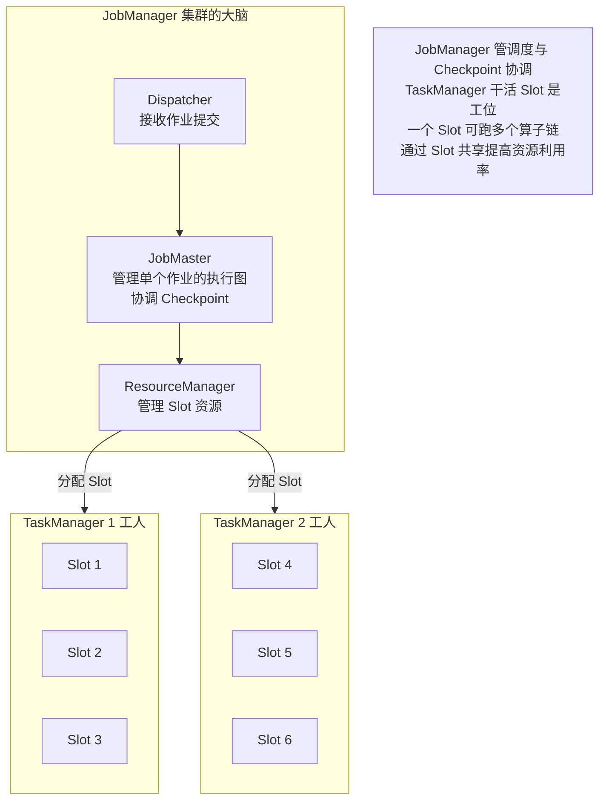
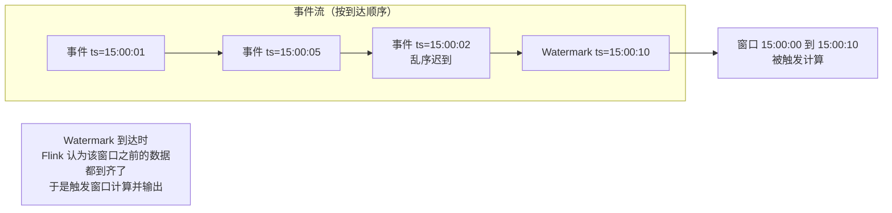
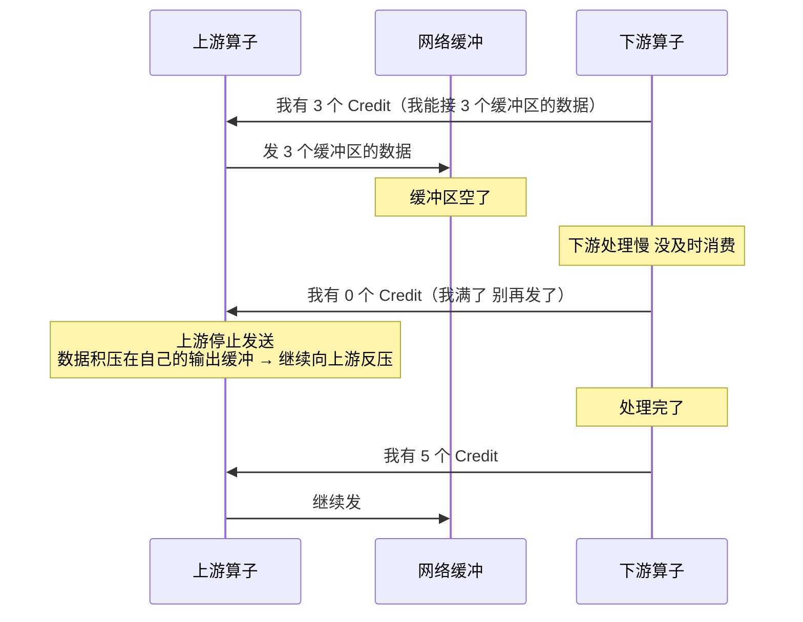
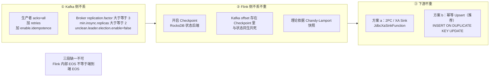

# 09 · Kafka 与 Flink

> **一句话主线**：**Flink 消费 Kafka 做实时计算**是当下最主流的实时链路（也是本人简历的核心方向）。这条链路的可靠性靠三件事拼起来——**Kafka 侧不丢（`acks=all` + ISR）、Flink 侧不丢不重（Checkpoint 存 offset，理论依据是 Chandy-Lamport）、下游不重（幂等 upsert 或 2PC sink）**。三者缺一不可，**「Flink 内部 Exactly-Once」不等于「端到端 Exactly-Once」**——这是本模块最容易被问倒的地方。
>
> **本模块定位**：`db/` 的**实时计算模块**。⚠️ **Kafka 的深度内容（ISR 与提交条件、三大经典问题、事务消息、MQ 对比）已在 [`../distributed_consensus/03_分布式消息队列.md`](../distributed_consensus/03_分布式消息队列.md) 权威覆盖**，本模块的 Kafka 部分**只做索引 + 保留「结合 Flink 才知道」的要点**，重点放在 **Flink 特有机制**与**端到端一致性**。

---

## 目录

- [零、Kafka 部分：请先看权威位置](#零kafka-部分请先看权威位置)
- [一、Flink 是什么：与 Spark Streaming 的区别](#一flink-是什么与-spark-streaming-的区别)
- [二、Flink 核心架构](#二flink-核心架构)
- [三、时间语义与 Watermark](#三时间语义与-watermark)
- [四、窗口](#四窗口)
- [五、状态与状态后端](#五状态与状态后端)
- [六、Checkpoint 与 Savepoint](#六checkpoint-与-savepoint)
- [七、反压（Backpressure）](#七反压backpressure)
- [八、Kafka + Flink 端到端 Exactly-Once](#八kafka--flink-端到端-exactly-once)
- [九、项目话术模板](#九项目话术模板)
- [本模块速记](#本模块速记考前-10-分钟)
- [面试官深挖追问](#面试官深挖追问)

---

## 零、Kafka 部分：请先看权威位置

⚠️ **Kafka 的以下内容本仓库已有权威版本，本模块不再重复**：

| 主题 | 权威位置 |
|------|---------|
| Kafka 架构（Broker / Topic / Partition / Replica / ISR） | [`../distributed_consensus/03`](../distributed_consensus/03_分布式消息队列.md) 第二节 |
| **消息提交条件（ISR 全部，不是多数派）** | 同上 |
| 消息丢失 / 重复消费 / 顺序消费 三大经典问题 | 同上 第三节 |
| 事务消息、延时消息、死信队列、消息回溯 | 同上 第四~七节 |
| Kafka vs RocketMQ / RabbitMQ / Pulsar | 同上 第一节 |

### 「结合 Flink 才知道」的 Kafka 要点（本模块独有）

| 要点 | 说明 |
|------|------|
| **Flink 把 Kafka offset 存在自己的 Checkpoint 里** | 不依赖 Kafka 的 offset 提交机制。**Checkpoint 才是故障恢复的真相来源**（详见第八节） |
| **Kafka 生产者「幂等」≠「事务」** | ⚠️ 见下文勘误 |
| **端到端 EOS 依赖 Kafka 的事务能力** | Kafka Sink 能提供 2PC，这是 Kafka→Kafka 链路能端到端 EOS 的原因 |
| **`min.insync.replicas` 是写入准入闸门，不是提交条件** | ⚠️ 见下文勘误 |

### ⚠️ 勘误 1：Kafka 生产者「幂等」不能等同于「事务」

> ❌ **原笔记的错误表述**：「Kafka 生产者：开启**事务**（`enable.idempotence=true`）」
>
> **这混淆了两个不同的东西。**

| 能力 | 配置 | 提供什么 | 边界 |
|------|------|---------|------|
| **幂等生产者** | **`enable.idempotence=true`** | Broker 用 **PID（Producer ID）+ 每个分区单调递增的 sequence number** 去重，**防止重试导致的重复** | ⚠️ **作用域是「单分区、单生产者会话」**——生产者重启会拿到**新 PID**，就失去保护了 |
| **事务** | **`transactional.id`** + `initTransactions()` / `beginTransaction()` / `commitTransaction()` | ① **跨分区原子写**；② **原子提交消费位点**（read-process-write EOS）；③ **僵尸生产者隔离**（用 epoch 踢掉旧会话） | ⚠️ **事务边界止于 Kafka 集群**——`produce` 之后如果再同步写一次数据库，**那个数据库写入不在事务范围内** |

> **一句话记**：**`enable.idempotence` 是「防重试重复」，`transactional.id` 才是「事务」。** 而且**开启事务会自动开启幂等**（反之不成立）。
>
> **补充**：Kafka **3.0 起**，当 `acks=all`（默认已是）时，**幂等生产者默认就开着**——所以很多情况下你「没配 `enable.idempotence` 也已经有了幂等」。

### ⚠️ 勘误 2：`min.insync.replicas` 不是提交条件

> ❌ **原笔记的表述**：「Broker：设置 `min.insync.replicas`（ISR 最少要有 2 个副本，防止 Leader 独苗挂了丢数据）」
>
> **措辞不完整**。准确说法：

| 概念 | 准确含义 |
|------|---------|
| **Kafka 的提交条件** | **ISR 中的「全部」副本都同步**（**不是多数派**） |
| **HW（高水位）** | `ISR 中所有副本 LEO 的最小值`，消费者只能读到 HW 之前 |
| **`min.insync.replicas`** | ⚠️ **不是提交条件**，而是**写入准入闸门**——当 ISR 大小**小于**该值时，带 `acks=all` 的写入会被**拒绝**（`NotEnoughReplicasException`） |

> 完整解释见 [`../distributed_consensus/03`](../distributed_consensus/03_分布式消息队列.md) 第二节。**生产标准配方**：`replication.factor=3` + `min.insync.replicas=2` + `acks=all` + `unclean.leader.election.enable=false`。

---

## 一、Flink 是什么：与 Spark Streaming 的区别

**Flink 是一个分布式实时流处理框架**，能处理**无界流**（一直来的实时数据，如用户行为）和**有界流**（批数据，如历史订单）——也就是「**流批一体**」。

| 维度 | **Flink** | **Spark Streaming** |
|------|----------|-------------------|
| **处理模型** | **真正的流处理**——一条一条处理，**延迟毫秒级** | **微批处理**——把流切成小批次（如 1 秒一批），**延迟秒级** |
| **状态管理** | **内置完善的有状态计算**（能记住之前的计算结果，如累计用户点击数） | 状态管理较弱（本质是 RDD 的 map/filter） |
| **容错** | **Checkpoint**（基于 Chandy-Lamport 快照），恢复快且状态可增量 | **RDD 血统（lineage）重算**，恢复慢 |
| **时间语义** | **原生支持 EventTime + Watermark**，处理乱序能力强 | 支持较弱 |
| **流批一体** | **同一套 API 处理流和批**（DataStream / Table API） | 批用 Spark SQL/DataFrame，流派生自批 |

> **面试一句话**：「**Flink 是真流（毫秒级），Spark Streaming 是微批（秒级）**。更本质的差别在**状态与容错**——Flink 用 Checkpoint 做**增量状态快照**，恢复时只补最后一次快照之后的数据；Spark Streaming 用 RDD 血统**重算**，链路越长恢复越慢。另外 Flink 的 **EventTime + Watermark** 对乱序数据的处理是它做实时风控/指标的关键能力。」

---

## 二、Flink 核心架构

**图 9-1：Flink 集群架构与 Slot**

| 组件 | 角色 | 职责 |
|------|------|------|
| **JobManager（JM）** | **大脑** | 接收任务、生成执行计划、分配任务、**协调 Checkpoint**、容错恢复。生产上要**做高可用**（多个 JM + ZooKeeper/K8s 选主） |
| **TaskManager（TM）** | **工人** | 执行具体的计算任务。每个 TM 有**多个 Slot**（工位），一个 Slot 可以跑一条**算子链** |
| **Slot** | **工位** | Flink 的资源调度单位。⚠️ **Slot 只隔离内存，不隔离 CPU**——所以同一个 TM 上的多个 Slot **共享 CPU** |

### ⚠️ 并行度与 Slot 的关系（易错点）

| 概念 | 含义 |
|------|------|
| **并行度（Parallelism）** | **一个算子被拆成几个并行子任务** |
| **Slot 数** | 一个 TM 上能跑几个子任务 |
| **关系** | **一个作业需要的 Slot 总数 = 算子的最大并行度**（不是各算子并行度之和！因为**算子链**会共享 Slot） |
| **算子链（Operator Chaining）** | Flink 默认把**能串起来的算子合并成一个任务**（如 `map → filter → map`），**放在同一个线程里执行**——减少线程切换与序列化开销。⚠️ **但这也意味着 `keyBy` 之类的操作会打断链条** |

> **⚠️ 「Slot 共享（Slot Sharing）」**：Flink **默认允许不同算子的子任务共享同一个 Slot**。例如 `source(并行度2) → map(并行度2) → sink(并行度2)`，在 Slot 共享下**只需要 2 个 Slot**（而不是 6 个）——每个 Slot 里跑一整套 `source+map+sink` 的子任务。
>
> **好处**：① **资源利用率高**；② **负载更均衡**（一个 Slot 里既有 CPU 密集的算子也有 IO 密集的算子）。
> **坏处**：**一个 Slot 里的任务互相影响**——如果某个算子特别耗 CPU，会拖慢同 Slot 的其他算子。
> **可以通过 `slotSharingGroup` 把不同算子分到不同组**来隔离。

---

## 三、时间语义与 Watermark

> **这是 Flink 区别于其他流处理框架的核心能力**，也是实时计算面试的重点。

### 1. 三种时间语义

| 时间语义 | 含义 | 特点 |
|---------|------|------|
| **EventTime**（事件时间） | **事件实际发生的时间**（由数据里携带的时间戳决定） | ✅ **最符合业务语义**（统计「8 点到 9 点的订单」就该按事件发生时间）；⚠️ **会有乱序**（数据到达顺序 ≠ 发生顺序） |
| **IngestionTime**（摄入时间） | 数据**进入 Flink Source 的时间** | 介于两者之间，很少用 |
| **ProcessingTime**（处理时间） | 数据**被算子处理时的机器时间** | ✅ **最简单、延迟最低**；❌ **不确定**（同一条数据重跑结果可能不同） |

> **怎么选**：**要结果准确 → EventTime**；**只要低延迟、能接受近似 → ProcessingTime**。**实时风控/指标统计通常用 EventTime**（因为要按业务时间统计，且数据会有延迟到达）。

### 2. Watermark：处理乱序的机制

**问题**：用 EventTime 做窗口时，**怎么知道「某个时间窗口的数据都到齐了」**？——**不能无限等**（数据可能永久丢失）。

**Watermark** 就是这个「**进度指示器**」：**一个时间戳 `T` 的 Watermark 表示「我不会再收到时间戳 ≤ T 的数据了」**（或者说「我认为 T 之前的数据都到了」）。

**图 9-2：Watermark 与窗口触发**

| 机制 | 说明 |
|------|------|
| **水位线生成** | 由 Source 或专门的算子生成，**周期性地向下游发送**（`pipeline.auto-watermark-interval`，默认 200ms） |
| **`forBoundedOutOfOrderness`** | **允许乱序的时长**（如设 5 秒 → Watermark = 当前最大事件时间 − 5 秒）。**设得越大越能容忍迟到，但延迟也越大** |
| **窗口触发条件** | 当 **Watermark ≥ 窗口结束时间**时，窗口触发计算 |
| **迟到数据的处理** | ① **`allowedLateness`**——允许窗口关闭后再等一段时间，迟到的数据仍会被处理（**会触发窗口的二次计算/更新输出**）；② **`sideOutputLateData`**——超过允许延迟的数据**输出到侧流**，避免丢失 |

> **面试标准答法**：「Watermark 是处理**乱序**的核心机制——它本质上是一个**进度指示器**，表示『我认为某个时间点之前的数据都到了』。Flink 用 **`forBoundedOutOfOrderness(Duration.ofSeconds(5))`** 设置允许的乱序时长，Watermark = 当前最大事件时间 − 5 秒。当 Watermark 超过窗口结束时间时就触发窗口计算。**对于超过允许延迟的数据**，可以用 `allowedLateness` 让窗口多等一会儿（触发二次计算更新结果），或者用 `sideOutputLateData` 输出到侧流做兜底——我们的风控场景就是因为不能丢数据，所以两条都用了。」

> ⚠️ **一个常见的坑**：**开了 `allowedLateness` 后，下游必须能处理「同一个 key 的更新」**——因为窗口会二次触发并**再次输出**。所以下游存储通常要用 **upsert（`INSERT ... ON DUPLICATE KEY UPDATE`）**而不是 append，否则会出现重复数据。

---

## 四、窗口

**窗口是 Flink 处理无界流的核心**——**把无限的流切成有限的「块」来计算**，就像公交车「按时间段发车」。

| 窗口类型 | 划分方式 | 例子 | 特点 |
|---------|---------|------|------|
| **滚动窗口（Tumbling）** | **固定大小、不重叠** | 「每 5 分钟统计一次订单量」 | 每个事件**只属于一个窗口**；最简单 |
| **滑动窗口（Sliding）** | **固定大小、有重叠** | 「每 1 分钟统计**最近** 5 分钟的订单量」（窗口大小 5 分钟，滑动步长 1 分钟） | 一个事件**属于多个窗口**；计算量更大 |
| **会话窗口（Session）** | **按「活跃间隔」划分** | 「用户 30 分钟没操作就算会话结束」 | 窗口**大小不固定**；适合统计单个用户的行为（如一次购物的总金额） |
| **全局窗口（Global）** | 所有数据放一个窗口 | 需要配合自定义 `Trigger` | 很少单独用 |

> **窗口的正确心智模型**：**窗口只是「对数据分组的一种约定」，真正决定输出时机的是「Watermark + Trigger」**。所以面试中如果被问「窗口什么时候输出」，答案不是「窗口结束时」，而是「**Watermark 越过窗口结束时间时**」。

---

## 五、状态与状态后端

**有状态计算**是 Flink 的核心能力——「能记住之前的计算结果」（如累计用户的点击次数）。

### 1. 两种状态

| 状态类型 | 作用范围 | 例子 |
|---------|---------|------|
| **Keyed State**（键控状态） | **按 key 隔离**（每个 key 一份状态） | 「每个用户的累计点击次数」 |
| **Operator State**（算子状态） | **算子实例级**（不按 key 分） | Kafka Source 的 **offset** 就存在这里 |

### 2. 两种状态后端

| 状态后端 | 存储位置 | 优点 | 缺点 | 适用 |
|---------|---------|------|------|------|
| **`HashMapStateBackend`** | **JVM 堆内存** | **读写极快**（纯内存） | ⚠️ **受限于 TM 堆内存**，状态大了会 **GC 压力大甚至 OOM**；Checkpoint 要**全量**做 | **小状态**（几 GB 以内） |
| **`EmbeddedRocksDBStateBackend`** | **本地磁盘（RocksDB）** | ✅ **支持超大状态**（TB 级，超内存）；✅ **支持增量 Checkpoint**（只上传变化的 SST 文件） | 读写要**序列化**，比堆内慢（但仍在本地磁盘，比网络快） | **大状态**（几十 GB ~ TB），**生产上长窗口聚合/大 key 场景的标配** |

> **面试怎么答**：「我们用的是 **RocksDB 状态后端 + 增量 Checkpoint**。原因是我们的实时指标计算**状态比较大**（要维护很多账户的滑动窗口累加值），用 `HashMapStateBackend` 的话 TM 堆内存吃不下，GC 也会很严重。RocksDB 把状态放在**本地磁盘**，内存只做 cache，所以能支撑超大状态；而且它支持**增量 Checkpoint**——每次只上传变化的 SST 文件，Checkpoint 体积和时间都大幅降低。」

> ⚠️ **RocksDB 状态后端的注意点**：① **本地磁盘要快**（SSD，且要有足够空间）；② **状态访问是反序列化后的对象**——所以**不要频繁访问超大 key 的状态**（会成为瓶颈）；③ **Checkpoint 时是全量上传第一次，之后才是增量**（第一次很重要，可能很慢）。

---

## 六、Checkpoint 与 Savepoint

**两者都用来「保存状态」，但用途完全不同**——这是高频面试题。

| 维度 | **Checkpoint** | **Savepoint** |
|------|---------------|--------------|
| **触发方式** | **自动**（JobManager 周期性触发，如每 1 分钟） | **手动**（调 API / 命令行触发） |
| **生命周期** | **自动删除**（默认只保留最近几次） | **手动删除**（长期保留） |
| **用途** | **容错恢复**——任务挂了，从最近的 Checkpoint 自动恢复 | **计划内操作**——**版本升级、集群迁移、停机维护、改并行度** |
| **轻量程度** | 轻量（**支持增量**——RocksDB 只传变化的 SST） | 重量级（通常**全量**，格式更稳定） |
| **格式稳定性** | 可随版本变化 | **格式向后兼容**（跨版本可用） |
| **有没有 watermark / offset** | 有（含 Kafka offset） | 有 |

> **一句话区分**：**Checkpoint 是「自动的系统存档」（崩了自动读档），Savepoint 是「手动的手动存盘」（用于主动升级/迁移）**。

### ⚠️ 勘误 3：端到端 EOS ≠ 下游支持「MySQL 事务」

> ❌ **原笔记的错误表述**：端到端精确一次 = Kafka 生产者精确一次 + Flink 精确一次 + 「下游存储：支持**事务**（比如 **MySQL 事务**、HBase 的幂等写入、Kafka 事务）」
>
> **「MySQL 事务」这一项不成立。**

**为什么？** 普通的 JDBC `commit()` **无法与 Flink 的 Checkpoint 组成原子提交**。Flink 的 Checkpoint 是**异步的、全局的**（跨越所有算子），而 JDBC 事务是**单个连接上的本地事务**——**两者之间没有协调机制**。可能出现：

- 数据已写入 MySQL 并 commit，但 **Checkpoint 失败** → Flink 回滚重放 → **数据重复写入**
- Checkpoint 成功，但数据**还没写 MySQL** 就宕机 → 恢复后从 Checkpoint 重放 → **靠重放补上**（这个方向是安全的）

**真正的解法只有两条**：

| 方案 | 机制 | 优缺点 |
|------|------|--------|
| **(a) 2PC / XA** | 用 **`JdbcXaSinkFunction`** 或 **`JdbcSink.exactlyOnceSink()`**（Flink 1.13+；Sink V2 时代用 `ExactlyOnce` + XA）。**Checkpoint 时先 prepare 事务，Checkpoint 完成后再 commit** | ✅ 真正的端到端 EOS；⚠️ **XA 事务会长期持有锁**（从 prepare 到 commit 跨一个 Checkpoint 周期），有**僵尸事务**风险；⚠️ MySQL 一个连接**不允许同时开多个 XA 事务**，需要连接池配合 |
| **(b) 幂等写入 / Upsert**（**生产更推荐**） | 用 `INSERT ... ON DUPLICATE KEY UPDATE`（或 HBase/ClickHouse 的 upsert），**同一主键重复写入只是覆盖** | ✅ **实现简单、无长事务**；✅ Flink 官方也把「幂等写」描述为「**effectively exactly-once**」；⚠️ 需要**业务有天然主键** |

> **⚠️ 一个必须记住的结论**：**Flink 的「内部 Exactly-Once」在 sink 既不支持事务也不幂等时，会退化为 At-Least-Once。**
>
> **为什么 Kafka→Kafka 能端到端 EOS？** 因为 **Kafka Sink 内置了 2PC**（`TwoPhaseCommitSinkFunction`，用 Kafka 事务实现）。而 **MySQL Sink 没有**——所以要么上 XA，要么用幂等 upsert。**这道题是「Flink 端到端一致性」的胜负手**，答不出就会显得只是背了「Checkpoint + 2PC」这两个词。

### Checkpoint 的对齐（Alignment）

**这是 Chandy-Lamport 算法在 Flink 的落地**（理论见 [`../distributed_consensus/05_分布式数据工程.md`](../distributed_consensus/05_分布式数据工程.md) 第十节）。

| 概念 | 说明 |
|------|------|
| **Barrier（屏障）** | Flink 版的 Chandy-Lamport **Marker**——插入数据流中随数据流动，JobManager 周期性注入 |
| **Barrier 对齐** | **多输入的算子**要**等所有输入通道的 Barrier 都到齐**，才能做快照并继续处理 |
| **对齐的代价** | ⚠️ **对齐期间「已收到 Barrier 的通道」的数据必须被缓冲住不能处理** → 缓冲区满了就**向上游反压** → **一个慢通道会拖慢整个作业的 Checkpoint** |

**两种模式**：

| 模式 | 是否对齐 | 特点 |
|------|---------|------|
| **Exactly-Once（对齐）** | ✅ 对齐 | 一致性最强；但**反压时对齐会阻塞**，Checkpoint 容易超时失败 |
| **Unaligned Checkpoint（不对齐）** | ❌ 不对齐（Barrier 直接插队越过缓冲数据） | **更快、不受反压影响**；⚠️ 但**在途数据也要被快照**（Checkpoint 体积变大），且**会有重复数据**（需要下游幂等） |

> **面试话术**（结合简历）：「我们踩过一个坑：**反压严重时 Barrier 对齐会拖慢 Checkpoint**——因为要等慢通道，导致 Checkpoint 超时甚至失败。当时的解法是**增大并行度消除热点 key**（数据倾斜是根因）+ **调大 Checkpoint 超时**。**Unaligned Checkpoint** 是另一个选择，但它会让 Checkpoint 变大且引入重复数据，需要下游幂等配合，所以我们没有切。」

---

## 七、反压（Backpressure）

**反压就是「下游处理速度跟不上上游生产速度」**——像堵车，上游数据堵在算子里。

### 1. 机制：基于 Credit 的流量控制（Flink 1.5+）

**图 9-3：Credit 机制**

| 要点 | 说明 |
|------|------|
| **Credit 机制** | 下游**主动告诉上游「我还能接多少」**（credit = 可用缓冲区数）。上游**只发 credit 允许的量**——这是**主动的流量控制**，取代了 Flink 1.5 之前「靠 TCP 反压」的被动方式 |
| **反压的传导** | 下游 credit 用尽 → 上游停止发送 → 上游自己的输出缓冲也满 → **继续向它的上游反压** → **一路传到 Source** |
| **站在 Source 的表现** | 如果 Source 是 Kafka，反压会导致 **Kafka 消费速率下降**（表现出来就是**消费 lag 增长**） |
| **反压不一定是坏事** | ⚠️ **适度的反压是健康的**——它说明系统在满负荷运行而不是丢数据。**只有「持续反压 + 处理能力上不去」才是问题** |

### 2. 排查与解决

**排查步骤**（看 Flink Web UI）：

| 步骤 | 做什么 |
|------|--------|
| **① 看反压指标** | Flink UI 的 **BackPressure** 页签——**红色 = 严重反压**，定位到**哪个算子**出现反压（通常是反压的**源头下游**，即那个慢算子） |
| **② 判断根因** | 三种典型：**计算逻辑太重**（同步 IO、大对象、复杂正则）、**下游存储慢**（写 MySQL/HBase 慢）、**数据倾斜**（某个 key 数据量远超其他） |
| **③ 用 Metrics 佐证** | 看算子的 `busyTime` / `backPressuredTime` / `idleTime`——**busy 高说明是计算瓶颈，backPressured 高说明是下游瓶颈** |

**解决方法**：

| 手段 | 针对根因 |
|------|---------|
| **提高并行度** | 计算瓶颈（⚠️ 但不能超过分区数，否则 Kafka Source 会有空闲） |
| **优化算子逻辑** | 计算瓶颈——**把同步 IO 改成异步 IO**（`AsyncDataStream`）、避免大对象、拆分复杂算子 |
| **优化下游存储** | 下游瓶颈——**批量写入**（攒批 `batchSize`）、加索引、用连接池、换更快的存储 |
| **解决数据倾斜** | 倾斜——**加盐打散热点 key**（如 `key + 随机后缀`）、两阶段聚合（先局部聚合再全局聚合） |
| **限流** | Source 侧限流，避免压垮整个任务（⚠️ 治标） |
| **调整缓冲** | 调大 `taskmanager.network.memory`（⚠️ 治标，只是延缓） |

> **⚠️ 反压最常见的根因是「数据倾斜」**——因为 Flink 按 key 分区，热点 key 会把一个并行子任务打满，而其他子任务空闲。**所以看到反压，第一件事是看并行子任务的负载是否均匀。**

---

## 八、Kafka + Flink 端到端 Exactly-Once

> **这是本模块最重要的一节**，也是简历上「实时链路不丢不重」的答案。

### 1. Flink 怎么管理 Kafka offset

| 要点 | 说明 |
|------|------|
| **offset 存在哪** | **存在 Flink 的 Checkpoint / Savepoint 里**，**不依赖 Kafka 自身的 offset 提交** |
| **为什么更好** | 因为 **offset 与算子状态在同一个 Checkpoint 里** → **两者严格一致**。故障恢复时，**状态与 offset 一起回滚到同一时刻**，不会出现「状态回滚了但 offset 没回滚」的不一致 |
| **默认行为** | **Flink 1.14+ 的统一 `KafkaSource`** 中，**Checkpoint 是故障恢复的唯一真相来源**；提交到 Kafka 的 offset 只用于**监控/进度展示** |
| **相关配置** | `commit.offsets.on.checkpoint`（默认 `true`）：**只在 Checkpoint 成功后才提交 offset 到 Kafka**。⚠️ 注意：**从 Flink 1.15 起，如果没开 Checkpoint，默认不再提交 offset 到 Kafka**（避免误以为有容错） |

**图 9-4：端到端 Exactly-Once 的三段拼图**

### 2. 端到端 EOS 的完整条件

| 环节 | 条件 |
|------|------|
| **① 数据源** | 支持**重放**（Kafka 可以重置 offset 重新拉取） |
| **② Flink 内部** | 开启 **Checkpoint**（Exactly-Once 模式）+ 状态后端配置正确 |
| **③ 下游 Sink** | **支持事务（2PC/XA）** 或 **幂等写入**——⚠️ **普通 JDBC 事务不够**（见勘误 3） |
| **④ 消费端/Sink 端幂等** | 即使前面都做到了，**下游存储最好仍有幂等兜底**（唯一键/upsert） |

### 3. 两阶段提交 Sink 的工作流程

**Flink 的 2PC Sink**（如 Kafka Sink、XA Sink）与 Checkpoint 配合：

| 阶段 | 做什么 |
|------|--------|
| **① Checkpoint 触发** | JobManager 注入 Barrier；Sink 收到 Barrier 后，**开启一个事务并写入数据**（数据在事务里，**对外不可见**） |
| **② 预提交（Pre-commit）** | Sink 完成当前事务的写入，但**不提交**，等 Checkpoint 完成 |
| **③ Checkpoint 完成通知** | JobManager 通知所有算子「Checkpoint 成功了」→ Sink **正式 commit 事务**（数据对外可见） |
| **④ 失败处理** | 如果 Checkpoint 失败 → Sink **回滚（abort）事务** → 从上一个 Checkpoint 恢复重放 |

> **关键洞察**：**「offset 的提交」与「Sink 事务的 commit」被绑在同一个 Checkpoint 上** → 两者要么都生效、要么都不生效 → **端到端 Exactly-Once**。这就是 Chandy-Lamport 快照 + 2PC 的组合。

---

## 九、项目话术模板

> **⚠️ 这是必问题，一定要结合自己的项目说。** 下面是模板（请替换成你的真实场景——本人简历是 **期权风控 / 实时计算**方向，用 Kafka 收集行情与交易事件 → Flink 计算实时指标 → 写入 Hologres/ADB）。

### 模板：用 Kafka + Flink 做了什么、遇到什么问题、怎么解决

> **① 场景**：「我用 **Kafka** 收集上游的**实时交易事件与行情数据**，用 **Flink** 消费做**实时风控指标计算**——比如统计每个账户的实时持仓集中度、单位时间内的委托频率、异常交易模式。计算结果写入 **Hologres/ADB** 供风控规则引擎消费。」
>
> **② 遇到的问题 + 解决**（选两三个说）：
>
> | 问题 | 根因 | 解决 |
> |------|------|------|
> | **数据重复计算** | 任务重启后**从 Kafka 的已提交 offset 恢复**，而 offset 与状态不同步 → 重放了部分数据 | ① 把 offset 管理**切到 Checkpoint 模式**（offset 与状态同生共死）；② 下游用 **幂等 upsert**（按 `账户ID + 指标窗口` 为主键的 `ON DUPLICATE KEY UPDATE`）；③ 结果只影响一小段窗口，**重算结果相同** |
> | **反压严重** | 某个热门账户的**数据倾斜**（一个 key 的数据量远超其他）→ 单个并行子任务被打满 | ① **加盐打散**（key 加随机后缀，两阶段聚合）；② 提高并行度；③ 下游改**批量写入** |
> | **Checkpoint 超时** | **Barrier 对齐**在反压时被慢通道阻塞 | ① 先解决**数据倾斜**（根因）；② 调大 Checkpoint 超时与间隔；③ 评估过 **Unaligned Checkpoint**，因会引入重复数据而未采用 |
> | **状态太大导致 GC 严重** | 用了堆内状态后端，状态几十 GB | 切到 **RocksDB 状态后端 + 增量 Checkpoint** |
>
> **③ 效果**：「最终做到数据**不丢不重**，指标延迟从原来的 **T+1 批处理**降到**秒级**，Checkpoint 稳定在 30 秒内完成。」

### 回答技巧

| 技巧 | 说明 |
|------|------|
| **先讲场景，再讲技术** | 别一上来就说「Flink 有 Checkpoint」，而是说「**为了做到实时风控，我们需要秒级的指标计算**，所以选了 Flink」 |
| **多用比喻** | Topic = 快递站，分区 = 货架，消费者 = 快递员；JM = 厂长，TM = 工人，Slot = 工位 |
| **讲清「问题和解决」** | 面试官最想听的是**你实际遇到的坑**，而不是背概念。**没有坑的故事听起来就像没做过** |
| **主动提边界** | ⚠️ **主动说「Flink 内部 EOS ≠ 端到端 EOS，下游我们用的是幂等 upsert」**——这句话能立刻把回答拉高一个档次 |
| **避坑话术** | 遇到真不会的点，不要硬编：「**这个点我项目中没直接用到，但了解核心逻辑是 XX**」——**先划清边界，再讲你确实知道的部分** |

**应急三招（考前速记）**：

1. **比喻救场**：Topic = 快递站，分区 = 货架，消费者 = 快递员；JM = 厂长，TM = 工人，Slot = 工位
2. **项目绑定**：任何技术问题，最后补一句「**我在项目中用 XX 解决了 XX 问题**」
3. **避坑话术**：不会的就说「这个点我项目中没直接用到，但了解核心逻辑是 XX」

---

## 本模块速记（考前 10 分钟）

| # | 问题 | 关键词速答 |
|---|------|-----------|
| 1 | Flink vs Spark Streaming？ | **Flink 真流（毫秒级）**；**Spark Streaming 微批（秒级）**。本质差别在**状态与容错**：Flink 用 **Checkpoint 增量快照**（恢复快），Spark 用 **RDD 血统重算**（恢复慢） |
| 2 | Flink 的核心优势？ | **真流处理 + 完善的有状态计算 + EventTime/Watermark + 流批一体** |
| 3 | **JobManager 做什么？** | **大脑**：接收任务、生成执行计划、分配任务、**协调 Checkpoint**、容错恢复。生产要**做 HA** |
| 4 | **TaskManager / Slot？** | **工人 / 工位**。⚠️ **Slot 只隔离内存，不隔离 CPU** |
| 5 | 作业需要多少 Slot？ | **= 算子的最大并行度**（**不是各算子并行度之和**，因为**算子链**共享 Slot） |
| 6 | **算子链（Operator Chaining）？** | 把**能串起来的算子合并成一个任务**在同一线程执行 → **减少线程切换与序列化开销**。⚠️ `keyBy` 之类会**打断链条** |
| 7 | **Slot 共享是什么？** | **不同算子的子任务共享同一个 Slot** → 只需「最大并行度」个 Slot。**好处**：资源利用率高、负载均衡；**坏处**：同 Slot 任务互相影响（可用 `slotSharingGroup` 隔离） |
| 8 | **三种时间语义？** | **EventTime**（事件实际发生，**最准但会乱序**）、**IngestionTime**（进入 Source）、**ProcessingTime**（处理时机器时间，**最简单最低延迟但不确定**） |
| 9 | **Watermark 是什么？** | **进度指示器**——时间戳 `T` 的 Watermark 表示「我不会再收到时间戳 ≤ T 的数据了」 |
| 10 | Watermark 怎么设？ | `forBoundedOutOfOrderness(5s)` → **Watermark = 当前最大事件时间 − 5 秒**。**设得越大越容忍迟到，但延迟越大** |
| 11 | 窗口什么时候触发？ | ⚠️ **Watermark ≥ 窗口结束时间时触发**（不是「窗口结束时」） |
| 12 | 迟到数据怎么办？ | ① **`allowedLateness`**（窗口多等一会儿，**会二次触发输出**，⚠️ 下游必须能 upsert）② **`sideOutputLateData`**（输出到侧流兜底） |
| 13 | **三种窗口？** | **滚动**（固定不重叠，「每 5 分钟」）、**滑动**（固定有重叠，「每 1 分钟统计最近 5 分钟」）、**会话**（按活跃间隔，大小不固定） |
| 14 | **两种状态？** | **Keyed State**（按 key 隔离）、**Operator State**（算子实例级，**Kafka offset 就存这里**） |
| 15 | **两种状态后端？** | **`HashMapStateBackend`**（JVM 堆内存，**快但受堆限制、GC 压力大**，适合小状态）；**`EmbeddedRocksDBStateBackend`**（**本地磁盘，支持 TB 级状态 + 增量 Checkpoint**，生产大状态标配） |
| 16 | **Checkpoint vs Savepoint？** | **Checkpoint 自动、自动删除、轻量（支持增量），用于容错恢复**；**Savepoint 手动、手动删除、重量级（全量），用于版本升级/迁移/改并行度** |
| 17 | **Flink 怎么管理 Kafka offset？** | **存在 Checkpoint 里**，**不依赖 Kafka 的 offset 提交**。这样**offset 与状态同生共死**，恢复时一起回滚到同一时刻 |
| 18 | ⚠️ **幂等生产者 vs 事务？** | ⚠️ **`enable.idempotence=true` 只是幂等生产者**（PID+序列号，**只防单分区单会话的重试重复**）；**事务需要 `transactional.id`** + `initTransactions/begin/commitTransaction`，提供跨分区原子写 + 原子提交 offset + **僵尸生产者隔离** |
| 19 | ⚠️ **`min.insync.replicas` 是提交条件吗？** | ⚠️ **不是！** 它是**写入准入闸门**。**Kafka 的提交条件是 ISR「全部」副本同步**（**不是多数派**） |
| 20 | ⚠️ **端到端 EOS 的四个条件？** | ① **数据源可重放**（Kafka）；② **Flink 开 Checkpoint**；③ **Sink 支持事务（2PC/XA）或幂等写入**；④ 下游最好仍有**幂等兜底** |
| 21 | ⚠️ **「下游支持 MySQL 事务」够吗？** | ⚠️ **不够！** 普通 JDBC `commit()` **无法与 Checkpoint 组成原子提交**。要么用 **XA Sink**（`JdbcXaSinkFunction`），要么用**幂等 upsert**（`ON DUPLICATE KEY UPDATE`，**生产更推荐**） |
| 22 | ⚠️ **Flink 内部 EOS = 端到端 EOS 吗？** | ⚠️ **不等于！** 如果 sink **既不支持事务也不幂等**，**Flink 内部 EOS 会退化为 At-Least-Once** |
| 23 | 为什么 Kafka→Kafka 能端到端 EOS？ | 因为 **Kafka Sink 内置 2PC**（`TwoPhaseCommitSinkFunction`，用 Kafka 事务实现）。**MySQL Sink 没有**，所以要 XA 或幂等 upsert |
| 24 | **2PC Sink 的四步？** | ① **Checkpoint 触发** → Sink 开事务写数据（**对外不可见**）；② **预提交**；③ **Checkpoint 成功** → **正式 commit**；④ **Checkpoint 失败** → **abort 回滚**，从上一个 Checkpoint 重放 |
| 25 | **Checkpoint 对齐是什么？** | Flink 版的 **Chandy-Lamport**：**Barrier（屏障）** 随数据流动；**多输入算子要等所有通道的 Barrier 到齐**才做快照 |
| 26 | **对齐的代价？** | ⚠️ 对齐期间**已收到 Barrier 的通道的数据要缓冲住** → 缓冲满就**向上游反压** → **慢通道拖慢整个 Checkpoint** |
| 27 | **Unaligned Checkpoint？** | 不对齐，**Barrier 直接插队越过缓冲数据** → **更快、不受反压影响**；⚠️ 但**在途数据也要快照**（Checkpoint 变大）+ **会有重复数据**（需下游幂等） |
| 28 | **反压是什么？** | **下游处理速度跟不上上游生产速度**，数据堵在算子里。像**堵车** |
| 29 | **Credit 机制（Flink 1.5+）？** | **下游主动告诉上游「我还能接多少」（credit = 可用缓冲区数）**，上游只发 credit 允许的量。**取代了旧的 TCP 反压** |
| 30 | 反压怎么传导？ | credit 用尽 → 上游停发 → 上游输出缓冲满 → **继续向更上游反压** → 一路到 Source（Kafka 消费 lag 增长） |
| 31 | ⚠️ 反压一定是坏事吗？ | **不一定**——**适度反压是健康的**（说明满负荷而非丢数据）。**只有「持续反压 + 处理能力上不去」才是问题** |
| 32 | **反压怎么排查？** | Flink UI 的 **BackPressure 页签**（红色 = 严重）定位慢算子；看 **`busyTime`**（高 = **计算瓶颈**）vs **`backPressuredTime`**（高 = **下游瓶颈**） |
| 33 | **反压怎么解决？** | 计算瓶颈 → **提并行度 + 优化算子逻辑（异步 IO）**；下游瓶颈 → **批量写入 + 优化存储**；**最常见根因是数据倾斜 → 加盐打散 / 两阶段聚合** |
| 34 | ⚠️ 看到反压第一件事做什么？ | **看各并行子任务的负载是否均匀**——因为最常见的根因是**数据倾斜**（热点 key 打满一个子任务，其他空闲） |

---

## 面试官深挖追问

1. **「Flink 的 Exactly-Once 是怎么实现的？」**
   → **要分两层答**：
   > **① Flink 内部**：靠 **Checkpoint**（理论是 **Chandy-Lamport 分布式快照**）——JobManager 周期性注入 **Barrier**，算子收到后把状态快照并上传，多输入算子做 **Barrier 对齐**。恢复时所有算子一起回滚到同一个快照点，**状态与 Kafka offset 严格一致**（因为 offset 存在 Checkpoint 里）。
   > **② 端到端**：Flink 内部 EOS + **Sink 支持 2PC**（Checkpoint 触发时开事务、预提交，Checkpoint 成功后才 commit）+ **数据源可重放**。**⚠️ 关键提醒**：如果 Sink 只是普通 JDBC 事务，**做不到端到端 EOS**——要么用 XA Sink，要么用幂等 upsert。**Kafka→Kafka 能 EOS 是因为 Kafka Sink 内置 2PC，换到 MySQL 就没了。**

2. **「Checkpoint 和 Savepoint 你会怎么用？」**
   > **Checkpoint** 是**自动的系统存档**——配好间隔（如 60 秒）和超时，任务挂了自动从最近的 Checkpoint 恢复，**不需要人工干预**。它支持增量（RocksDB 只传变化的 SST），所以很轻。
   > **Savepoint** 是**手动的手动存盘**——我在做这些操作前一定会先打一个：**① 代码升级**（业务逻辑改了但要保留状态）；**② 改并行度**（扩缩容）；**③ 集群迁移**（换机房/升级 Flink 版本）。它能保证**状态跨版本兼容**。
   > **一句话**：**Checkpoint 保命，Savepoint 搬家。**

3. **「反压和 Checkpoint 超时有什么关系？」**
   → **强关联**。因为 **Exactly-Once 的 Checkpoint 需要 Barrier 对齐**——多输入算子要**等其他所有通道的 Barrier**。如果某个通道反压很严重（数据积压），**Barrier 就卡在那条通道上**，算子会**一直缓冲其他通道的数据等它** → ① 缓冲区满 → **向上游反压**（放大问题）；② **Checkpoint 耗时超过 `checkpointTimeout`** → **Checkpoint 失败**。
   > **解法**：**先解决反压的根因**（通常是数据倾斜），而不是单纯调大超时。如果确实需要降低 Checkpoint 对反压的敏感性，可以评估 **Unaligned Checkpoint**——代价是 Checkpoint 变大且引入重复数据。

4. **「你说用 RocksDB 状态后端，那读状态会反序列化，性能不是问题吗？」**
   → 这是**真实的权衡**。RocksDB 状态后端的每次状态访问都要**反序列化**（`byte[] → 对象`），比堆内直接持有对象慢。所以：① **只在状态大到堆放不下时才用 RocksDB**（小状态用 `HashMapStateBackend` 更快）；② **要避免「每次事件都访问超大状态」**——比如「每个订单都要遍历一个百万级的 list」，这种设计本身就是问题，应该改成**聚合值**（存累计值而不是明细）；③ RocksDB 的**读性能靠 Block Cache**——所以给 TM 留足内存做 Cache 很关键；④ 用 **增量 Checkpoint** 抵消它的启动开销。**一句话**：**RocksDB 是「用一点读性能换超大状态承载能力」，如果你的状态本来就小，别用它。**

5. **「如果 Kafka 的某个分区没数据，Flink 的 Watermark 会怎样？」**
   → 这是 **Watermark 的经典陷阱**——**Watermark 取的是「所有输入通道的最小值」**（保证不漏数据），所以**如果某个分区一直没有数据，它的 Watermark 就永远不会推进** → **整个作业的 Watermark 被卡住** → **所有窗口都不触发**（数据越积越多，最后反压）。**解法**：① **`withIdleness()`**——给 Source 设置「空闲超时」，如果一个分区超过一段时间没数据，就**把它标记为空闲并排除在 Watermark 计算之外**；② 或者**上游保证所有分区都有心跳数据**。**这是实时链路「跑着跑着不输出了」的经典原因**，面试中能主动提这一点非常加分。

6. **「Flink 的数据倾斜怎么解决？」**
   → 分三步：① **先确认是不是倾斜**——看 Flink UI 里各并行子任务的 `numRecordsIn` / `busyTime`，如果**差异超过几倍**就是倾斜。② **定位倾斜的 key**——开 Metrics 或用侧输出统计 key 的分布。③ **解决手段**：
   > - **两阶段聚合（最通用）**：第一层给 key **加随机后缀**（如 `key-0` ~ `key-9`）做**局部聚合**；第二层**去掉后缀**做**全局聚合**。这能把「一个热点 key」的打散到 10 个并行子任务。
   > - **预聚合**：如果业务允许，在写入 Kafka 前先做一次聚合，减少进入 Flink 的数据量。
   > - **拆分热点 key**：如果某个 key 确实是超级热点（如「全市场行情」），考虑**单独为一个业务场景开一个作业**，或者**在 key 设计上加上维度**（如 `key + 交易所`）。
   > - **rebalance / rescale**：如果倾斜来自上游分区不均，可以在 Source 后加 `rebalance()` 打散（⚠️ 会丢顺序性）。

7. **「Flink 消费 Kafka 时，如果 Kafka 的分区数变了会怎样？」**
   → 分两种情况：① **作业未重启时增加分区**——**Flink 不会自动感知**（Source 的并行度在作业启动时就固定了），所以**新增的分区不会被消费**，会造成**数据丢失**（表现为 lag 持续增长）。**正确做法是重启作业**（从 Savepoint 恢复，并调整并行度）。② **作业重启时分区已变**——Flink 会重新分配；但如果**并行度 > 分区数**，会有子任务空闲（浪费）——这也是「**Flink 并行度不应超过 Kafka 分区数**」的原因。**面试要点**：**「Kafka 分区数变动需要重启 Flink 作业并重设并行度」** 是很有价值的实践经验。

8. **「你们的实时链路怎么保证不丢不重？请完整说一遍。」**
   → **这是简历级别的必问题**，按三段落答：
   > **① Kafka 侧不丢**：生产端 `acks=all` + `retries` + `enable.idempotence=true`；Broker 侧 `replication.factor=3` + `min.insync.replicas=2` + `unclean.leader.election.enable=false`。
   > **② Flink 侧不丢不重**：开 **Checkpoint（Exactly-Once）+ RocksDB 状态后端**，**Kafka offset 存在 Checkpoint 里**（与状态同生共死），故障恢复时一起回滚。
   > **③ 写存储侧不重**：**如果存储是 Kafka**，用 **2PC Sink** 实现端到端 EOS；**如果存储是 Hologres/ADB 这类**，Kafka 事务帮不上忙，**必须用幂等写入**——我们的做法是**按「账户 ID + 指标窗口」作为主键做 Upsert**，重复写入同一主键只是覆盖，不产生重复数据。**再加上允许延迟的窗口会二次触发，所以下游本身就设计成 upsert**。
   > **一句话总结**：**Flink 只能保证「Flink 内部」的 Exactly-Once；跨到外部存储必须靠幂等写入或 2PC，没有银弹。**

---

## 参考资料

见 [`99_参考资料.md`](99_参考资料.md)。
