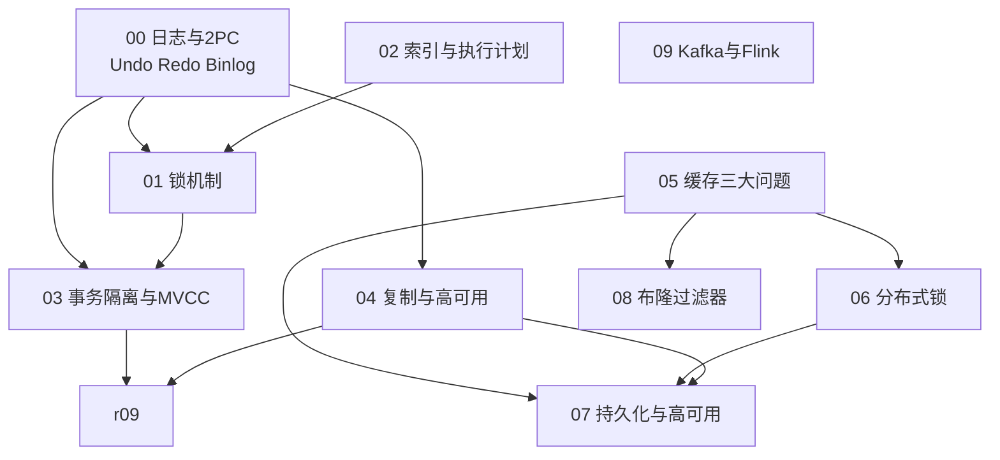

# MySQL · Redis · Kafka/Flink 学习笔记

> **本目录定位**：Stellaris 知识库的**存储层**。三个目录合起来构成完整的后端知识面：
>
> | 目录 | 层次 | 覆盖 |
> |------|------|------|
> | [`../java_interview/`](../java_interview/) | **应用层 / 框架层** | JVM、并发、集合、Spring、云原生、场景设计 |
> | **`db/`（本目录）** | **存储层** | MySQL（日志/锁/索引/事务/复制）、Redis（缓存/锁/持久化）、Kafka+Flink（实时链路） |
> | [`../distributed_consensus/`](../distributed_consensus/) | **分布式理论层** | CAP/BASE、共识算法、分布式事务、消息队列、组件选型、数据工程 |
>
> **目标读者**：本人备考 **Java 高级开发**（9 年经验，**期权风控 / 实时计算**方向）。

---

## 一、目录结构与阅读顺序

```
db/
├── README.md
│
├── 00_MySQL_日志与内部2PC.md      ← Undo/Redo/Binlog + 内部两阶段提交 + 崩溃恢复
├── 01_MySQL_锁机制.md            ← S/X/意向锁/记录锁/间隙锁/临键锁 + 悲观锁/乐观锁
├── 02_MySQL_索引与执行计划.md     ← B+树/回表/覆盖索引/最左前缀/ICP/EXPLAIN/慢查询
├── 03_MySQL_事务隔离与MVCC.md     ← 隔离级别/版本链/Read View/RR vs RC
├── 04_MySQL_复制与高可用.md       ← 主从复制/主从延迟/半同步/MGR/读写分离
│
├── 05_Redis_缓存三大问题.md       ← 穿透/击穿/雪崩
├── 06_Redis_分布式锁.md          ← SETNX→Redisson/三大实现方案/Fencing Token
├── 07_Redis_持久化与高可用.md     ← RDB/AOF/淘汰策略/主从哨兵Cluster/大key/缓存一致性
├── 08_Redis_布隆过滤器.md        ← 原理/误判率/最优k/支持删除的替代结构
│
├── 09_Kafka与Flink.md           ← Flink 架构/Watermark/状态/Checkpoint/反压/端到端EOS
└── 99_参考资料.md
```

**依赖关系**：



> **三条主线**：
> - **MySQL 线**：`00`（日志地基）→ `01`/`02`/`03`（锁 / 索引 / 事务，三者互相交织）→ `04`（架构）
> - **Redis 线**：`05`（问题）→ `06`/`07`/`08`（解法与基础设施）
> - **实时线**：`09`（Kafka + Flink 端到端，对应简历核心方向）

### 三条主线的钥匙

| 模块 | 一句话抓住它 |
|------|------------|
| `00` | **Undo 后悔药、Redo 安全锁、Binlog 同步桥、两阶段提交是粘合剂** |
| `01` | **隔离级别决定锁的范围，索引决定锁的位置；且只有「当前读」才加锁** |
| `02` | **回表是一切性能问题的钥匙；避免回表就用覆盖索引** |
| `03` | **RR 与 RC 的唯一本质差别是 Read View 的生成时机** |
| `04` | **异步复制 → 主从延迟与丢数据；半同步/MGR 是在「延迟 vs 一致」之间选** |
| `05` | **穿透查「无」、击穿查「热」、雪崩查「全」** |
| `06` | **锁是「客户端之间」的协议，正确性必须由「存储层」兜底（Fencing Token）** |
| `07` | **RDB 保快、AOF 保安全、混合持久化兼得；缓存与 DB 只能最终一致** |
| `08` | **无漏判、有误判、不能删；哈希函数超过最优个数反而更差** |
| `09` | **Flink 内部 EOS ≠ 端到端 EOS；下游必须幂等或 2PC** |

---

## 二、按剩余时间选阅读路线

### 路线 A：还有 3 天以上（学透）

| 阶段 | 做什么 | 用哪些文件 |
|------|--------|-----------|
| 第 1 天 | **MySQL 地基**：日志与 2PC（含双 1 配置）、锁机制（含死锁排查） | `00` / `01` 全文 |
| 第 2 天 | **MySQL 进阶**：索引与执行计划、事务隔离与 MVCC、复制与高可用 | `02` / `03` / `04` 全文 |
| 第 3 天 | **Redis + 实时**：缓存三大问题、分布式锁、持久化、布隆过滤器、Kafka+Flink | `05`~`09` 全文 |
| 第 4 天 | **回炉**：只看各模块末尾的「本模块速记」+「面试官深挖追问」，自问自答 | 全部速记表 |

### 路线 B：只有 1~2 天（保高频）

**按面试出现频率排序，只看这五块**：

1. **`06_Redis_分布式锁.md`** —— SETNX 三个递进问题、Redisson 看门狗、**Fencing Token**（这块答得好，档次立刻不同）
2. **`05_Redis_缓存三大问题.md`** —— 三者区别一张表（**必考**）
3. **`03_MySQL_事务隔离与MVCC.md`** —— **RR vs RC 的唯一本质差别**、RR 防幻读的正确表述
4. **`01_MySQL_锁机制.md`** —— 意向锁干什么用、三种行级锁范围、加锁四条原则
5. **`09_Kafka与Flink.md`** —— **端到端 EOS 的四个条件**（⚠️ 一定要说清「MySQL 事务不够」）

### 路线 C：只剩一晚上

**按顺序背这四张表**：

1. `03` 的【本模块速记】（22 条）—— **重点是第 15、18、19、20 条**
2. `06` 的【本模块速记】（32 条）—— **重点是第 11、14、21、28、29 条**
3. `05` 的【本模块速记】（18 条）—— **重点是第 16、18 条**
4. `09` 的【本模块速记】（34 条）—— **重点是第 17、18、20、21、22 条**

---

## 三、⚠️ 本次重构的 10 处勘误（**优先看这一节**）

原目录的 4 个文件存在**会在面试现场翻车的事实错误**，本次已全部核实并修正。**如果你是来复习的，这 10 条比任何新知识都优先**——因为它们是「自信地说错」，被追问必然露馅。

| # | 原错误表述 | 正确表述 | 详见 |
|---|-----------|---------|------|
| **E1** | Redlock「**全部**加成功才算拿到锁」 | ⚠️ **错**。Redlock 是**多数派（`≥ N/2+1`）**，如 5 台中 3 台。且要满足 **`elapsed < TTL`**；**失败时要在全部实例上释放**再随机延迟重试 | [`06`](06_Redis_分布式锁.md) 第五节 |
| **E2** | ZK 锁是「**百毫秒级**」 | ⚠️ **错**。ZK 锁是**毫秒级**（同机房约 1~10ms），**与 Redis（约 0.1~1ms）同一量级**，只是常数因子更大——**不是 100×** | [`06`](06_Redis_分布式锁.md) 第五节 |
| **E3** | ZK「强一致，创建释放**会同步到所有节点**」 | ⚠️ **错**。ZK **写**是线性一致，经 **Leader + 多数派**提交（**不是「所有节点」**）；**读默认不是线性一致的**——任意 Server 本地作答，**可能读到旧值**，需 **`sync()`** | [`06`](06_Redis_分布式锁.md) 第五节 |
| **E4** | ZK 锁「**绝对不会**出现死锁」 | ⚠️ **不准确**。「无死锁」是**活性**保证（会话结束→临时节点自动删）；但**长 GC 停顿会让会话过期、锁被释放而客户端不知情**，醒来继续写 → 经典的 **fencing token** 问题 | [`06`](06_Redis_分布式锁.md) 第四节 |
| **E5** | 「Kafka 生产者开启**事务**（`enable.idempotence=true`）」 | ⚠️ **混淆了幂等与事务**。`enable.idempotence=true` 只是**幂等生产者**（PID+序列号，**只防单分区单会话的重试重复**）；**事务**需要 **`transactional.id`** + `initTransactions/beginTransaction/commitTransaction` | [`09`](09_Kafka与Flink.md) 第零节 |
| **E6** | 端到端 EOS 只要「下游存储支持 **MySQL 事务**」 | ⚠️ **不成立**。普通 JDBC `commit()` **无法与 Flink Checkpoint 组成原子提交**。需要 **(a) 2PC/XA**（`JdbcXaSinkFunction`）**或 (b) 幂等 upsert**（**生产更推荐**）。**否则 Flink 内部 EOS 会退化为 At-Least-Once** | [`09`](09_Kafka与Flink.md) 第六节 |
| **E7** | 降误判：「加长数组 + **增加哈希函数个数**」 | ⚠️ **不完整**。误判率在 **`k* = (m/n)·ln2`** 处最小，**超过最优 k 后误判率反而上升**（位被填满太快），必须 **`m` 和 `k` 一起调** | [`08`](08_Redis_布隆过滤器.md) 第四节 |
| **E8** | 「Broker：设 `min.insync.replicas`（ISR 最少 2 个副本…）」措辞不完整 | ⚠️ 它**不是提交条件**，是**写入准入闸门**；**Kafka 的提交条件是 ISR「全部」副本同步**（**不是多数派**） | [`09`](09_Kafka与Flink.md) 第零节 |
| **E9** | 「**RR 用 Next-Key Lock 防幻读**，RC 用 Record Lock」 | ⚠️ **不完整**。RR 下**快照读（普通 `SELECT`）靠 MVCC 快照防幻读**（**完全不加锁**），**当前读才靠 Next-Key Lock**。另：**RC 下间隙锁基本被禁用**，所以 **RC 的当前读可能幻读** | [`03`](03_MySQL_事务隔离与MVCC.md) 第七节 |
| **E10** | AUTO-INC 表只列三种模式，**未给默认值** | 补：**MySQL 5.7 默认 1（consecutive），8.0 改为 2（interleaved）**（因转向 ROW 复制）；模式 2 **不保证语句内连续**且**对 STATEMENT 复制不安全** | [`01`](01_MySQL_锁机制.md) 第六节 |

### 本次修掉的格式损坏（比勘误更严重）

`mysql数据库锁.md` 的 SQL 代码块有 **23 处空格丢失**，**代码根本不可执行**：

| 损坏形式 | 出现 |
|---------|------|
| `STARTTRANSACTION;` | 应为 `START TRANSACTION;` |
| `SELECT ... WHEREid = 1FORUPDATE;` | 应为 `WHERE id = 1 FOR UPDATE;` |
| `CREATETABLE products (` | 应为 `CREATE TABLE products (` |
| `version INT DEFAULT1` | 应为 `DEFAULT 1` |
| `SELECTid, name, ...` | 应为 `SELECT id, name, ...` |
| `ANDversion = #{version}` | 应为 `AND version = #{version}` |
| `returnfalse;` | 应为 `return false;` |

**另外修掉的**：

| 问题 | 位置 | 处理 |
|------|------|------|
| **14 行 LLM 思考过程残留**（「已完成思考」+ 内心独白） | `redis.md:129-143` | 整段删除 |
| **4 处 `\*\*` 转义残留** | `mysql数据库锁.md` | 修正为正常加粗 |
| **`<span leaf="">` HTML 垃圾** | `mysql数据库锁.md:267` | 改为行内代码 |
| **错误标题**——「乐观锁」章节下挂着「悲观锁示例」 | `mysql数据库锁.md:350` | 改为「乐观锁示例」 |
| **7 张微信外链图**（`mmbiz.qpic.cn`，易失效、带水印、需联网） | `mysql数据库锁.md` | 删除，改用 **Mermaid 重画** |
| **双编号体系**（`一/二/三/四` + 另一套 `一/二/三`） | `redis.md` | 合并为**单套编号** |
| **3 条 bullet 粘连成一行** | `mysql数据库锁.md` 加锁规则 | 拆开 |

> **一句话教训**：**这些东西一旦发出去，别人照着敲 SQL 会直接报错，或者照着背会在面试里说错。** 本次重构把**全部参数与版本号**都核对了来源（见 [`99_参考资料.md`](99_参考资料.md) 的勘误依据表）。

---

## 四、本次补充的新知识（原目录完全缺失）

| 模块 | 新增内容 | 为什么重要 |
|------|---------|-----------|
| `00` | **`innodb_flush_log_at_trx_commit` / `sync_binlog` / 双 1 配置**、**组提交**、**binlog 三种格式与 8.0 默认 ROW**、**Checkpoint** | 「怎么保证不丢数据」是必问，答不到刷盘参数是不完整的 |
| `01` | **死锁**（产生条件、检测、避免六手段）、**锁排查工具**（`data_locks` / `INNODB_TRX`）、**快照读 vs 当前读**、**`REC_NOT_GAP` 解读** | 「线上遇到锁等待怎么查」是把「背过」和「干过」分开的问题 |
| `02` | **全新**：B+ 树为什么是它、聚簇 vs 二级索引、**回表与覆盖索引**、**延迟关联**、最左前缀、**索引下推（ICP）**、索引失效六场景、**EXPLAIN 三看**、慢查询定位 | MySQL 性能优化的全部核心，原目录完全空白 |
| `03` | **全新**：ACID 与日志的对应、四种隔离级别、**undo 版本链**、**Read View 四字段与可见性判断**、**RR vs RC 的快照时机**、当前读+快照读混合的经典案例 | MVCC 是 MySQL 面试的必考深水区 |
| `04` | **全新**：三线程复制模型、三种复制模式、**主从延迟六原因与解决**、**`pt-heartbeat`**、半同步、**MGR**、读写分离一致性、**GTID 与故障切换** | 主从延迟是「上过生产」的必问点 |
| `05` | 三者对比**合并为唯一一张表**（原笔记讲了两遍） | 消重 |
| `06` | **Fencing Token**、**「失去锁而不自知」的完整场景**、**Redlock 的正确算法与 Kleppmann/Antirez 之争**、watchdog 与 `leaseTime` 的关系 | 把「锁」与「共识算法」串起来的最高阶追问 |
| `07` | **全新**：RDB/AOF/混合持久化与**恢复优先级**、过期与**8 种淘汰策略**、**LRU vs LFU**、主从复制与 `repl-backlog`、哨兵、Cluster **16384 槽与 hash tag**、**大 key / 热 key** 的发现与治理、**缓存与 DB 一致性四方案** | 缓存一致性是 Redis 最高频的开放题 |
| `08` | **最优哈希函数个数 `k*` 与误判率公式**、**计数布隆 / 布谷鸟过滤器**、RedisBloom 命令、HBase/RocksDB 中的应用 | 修正 E7 的同时把「参数怎么调」补齐 |
| `09` | **Watermark 与 EventTime**、**两种状态后端**、**Slot 共享与算子链**、**credit 反压机制**、**Checkpoint 对齐 vs Unaligned**、**端到端 EOS 的完整条件** | 直接对应简历的实时计算方向 |

---

## 五、模块边界与交叉引用

本仓库存在内容重叠，这里**明确每个主题的权威位置**：

| 主题 | **权威位置** | 其他位置如何处理 |
|------|-------------|----------------|
| **MySQL 内部两阶段提交**（Redo/Binlog） | [`00_MySQL_日志与内部2PC.md`](00_MySQL_日志与内部2PC.md) | [`../distributed_consensus/02`](../distributed_consensus/02_分布式事务.md) 做**术语消歧**（那边是 XA 的分布式 2PC） |
| **MySQL 锁体系** | [`01_MySQL_锁机制.md`](01_MySQL_锁机制.md) | `db/02` 讲索引时只提「索引决定锁的范围」 |
| **MySQL 索引与执行计划** | [`02_MySQL_索引与执行计划.md`](02_MySQL_索引与执行计划.md) | — |
| **MySQL 隔离级别与 MVCC** | [`03_MySQL_事务隔离与MVCC.md`](03_MySQL_事务隔离与MVCC.md) | `01` 只讲「加锁的读」，`03` 讲「不加锁的读」 |
| **MySQL 复制与高可用** | [`04_MySQL_复制与高可用.md`](04_MySQL_复制与高可用.md) | `../distributed_consensus/05` 的复制模型只讲**通用理论** |
| **Redis 缓存三问题** | [`05_Redis_缓存三大问题.md`](05_Redis_缓存三大问题.md) | — |
| **Redis 分布式锁** | [`06_Redis_分布式锁.md`](06_Redis_分布式锁.md) | [`../distributed_consensus/04`](../distributed_consensus/04_分布式组件选型.md) 只讲**选型与 CAP 取舍**（不重复实现细节） |
| **Redis 持久化 / 高可用 / 缓存一致性** | [`07_Redis_持久化与高可用.md`](07_Redis_持久化与高可用.md) | `../distributed_consensus/05` 只讲「Redis 三种分布式形态」的**宏观定位** |
| **布隆过滤器** | [`08_Redis_布隆过滤器.md`](08_Redis_布隆过滤器.md) | `db/05` 的穿透一节只讲「为什么用它」 |
| **Kafka 原理**（ISR/提交条件/三大经典问题/事务消息/MQ 对比） | [`../distributed_consensus/03_分布式消息队列.md`](../distributed_consensus/03_分布式消息队列.md) | `db/09` **只做索引 + 保留「结合 Flink 才知道」的要点** |
| **Flink** | [`09_Kafka与Flink.md`](09_Kafka与Flink.md) | `../distributed_consensus/05` 只讲 **Chandy-Lamport 快照的理论** |
| **CAP / BASE / 一致性模型 / 会话保证** | [`../distributed_consensus/00`](../distributed_consensus/00_分布式基础理论.md) | `db/04` 的读写分离一致性引用它 |
| **分库分表 / 分布式 ID / 幂等** | [`../distributed_consensus/05`](../distributed_consensus/05_分布式数据工程.md) | `db/02` 只在深分页时提「延迟关联」的同源思路 |
| **JVM / 并发 / Spring / K8s** | [`../java_interview/`](../java_interview/) | 本目录不涉及 |

> **⚠️ 本次重构范围**：**只整理了 `db/` 目录**，**未修改** `distributed_consensus/`、`java_interview/`、`心得.md`。
>
> 因此 `心得.md`（早期草稿，含 Redis 分布式锁内容）中**仍存在与本目录重复的内容**。如需进一步清理，可以单独发起。

---

## 六、图表索引

全库共 **32 张 Mermaid 图**（其中 **30 张**标注了编号图题，其余为无需编号的流程 / 时序图），都内嵌在正文对应位置，上方有 `**图 X-Y：标题**` 图题。

> 📌 **本次重构把原文件的 7 张微信外链图全部删除并改用 Mermaid 重画**——外链图易失效、带水印、需联网，且无法在 GitHub/IDE 中可靠渲染。

| 模块 | 图 | 最值得看的（面试白板高频） |
|------|----|--------------------------|
| `00` | 图 0-1 三大日志架构位置、图 0-2 内部两阶段提交时序、图 0-3 崩溃恢复判定、图 0-4 组提交对比 | **图 0-2 + 图 0-3**（两阶段提交与崩溃恢复是必画） |
| `01` | 图 1-1 S/X 锁并发行为、图 1-2 意向锁要解决的问题、图 1-3 三种行级锁范围 | **图 1-3**（记录/间隙/临键的范围对比，必画） |
| `02` | 图 2-1 B+ 树结构、图 2-2 聚簇索引与二级索引 | **图 2-2**（回表与覆盖索引） |
| `03` | 图 3-1 undo 版本链、图 3-2 Read View 可见性判断、图 3-3 RR 与 RC 快照时机 | **图 3-2 + 图 3-3**（MVCC 的核心） |
| `04` | 图 4-1 主从复制链路、图 4-2 异步 vs 半同步、图 4-3 复制演进 | **图 4-1** |
| `05` | 图 5-1 正常查询与三种异常、图 5-2 击穿互斥锁、图 5-3 多级缓存层级 | **图 5-1**（一张图讲清三者） |
| `06` | 图 6-1 看门狗续期时序、图 6-2 为什么有锁也不够、图 6-3 Fencing Token | **图 6-2 + 图 6-3**（能画出来说明你懂分布式锁的深层缺陷） |
| `07` | 图 7-1 重启恢复优先级、图 7-2 全量 vs 增量同步、图 7-3 哨兵故障转移、图 7-4 缓存一致性三层次 | **图 7-3**、**图 7-4** |
| `08` | 图 8-1 布隆过滤器插入与查询 | **图 8-1**（印章比喻图解） |
| `09` | 图 9-1 Flink 集群架构与 Slot、图 9-2 Watermark 与窗口触发、图 9-3 Credit 反压、图 9-4 端到端 EOS 三段拼图 | **图 9-4**（对应简历的实时链路，三面必问） |

### ⚠️ 你的编辑器能渲染 Mermaid 吗？

| 环境 | 支持情况 |
|------|---------|
| **GitHub / GitLab** | ✅ 原生支持 |
| **VS Code** | ✅ 装 `Markdown Preview Mermaid Support` 扩展 |
| **Typora / Obsidian** | ✅ 原生支持 |
| **IntelliJ IDEA / WebStorm** | ✅ 内置 Markdown 插件（确认已启用 Mermaid） |
| **记事本 / 纯文本 / 终端** | ❌ 会显示成 `flowchart TD ...` 代码块 |

**建议先在 VS Code 或 Typora 里打开 `01_MySQL_锁机制.md` 确认能看到图**。看不到图的话告诉我，我可以改写成 ASCII 图或导出成 PNG/SVG。

### 图的可靠性

**32 张图已全部用 Mermaid 官方解析器（`mermaid.parse()`，`mermaid@11`）逐张校验通过**，无语法错误、无未闭合围栏。校验方式：用 jsdom 提供 DOM 环境后，提取全部 ```` ```mermaid ```` 代码块 → 交给 `mermaid.parse()` 解析。

图里的技术事实**取自对应模块的正文**（正文的事实另有来源核对，见 [`99_参考资料.md`](99_参考资料.md)）。

---

## 七、建议使用方式

### 1. 结合简历的答题思路

本目录的目标岗位是 **Java 高级开发（9 年经验，期权风控 / 实时计算方向）**，所以**最高价值的回答方式是把理论与你的真实项目串起来**：

| 面试官问 | 你的回答主线 | 用哪些模块 |
|---------|------------|-----------|
| 「你们实时链路怎么保证不丢不重？」 | Kafka 侧（`acks=all`+ISR）→ Flink 侧（Checkpoint 存 offset）→ 存储侧（**幂等 Upsert 或 2PC Sink**） | **`09`** + `../distributed_consensus/05` |
| 「遇到过反压吗？怎么排查的？」 | UI 反压指标 → **看子任务负载是否均匀（数据倾斜是头号根因）** → 加盐打散 / 提并行度 / 批量写入 | **`09`** |
| 「MySQL 慢查询怎么优化？」 | `pt-query-digest` 找总耗时高的 → **`EXPLAIN` 三看** → 加/改索引（覆盖索引、最左前缀） → 改写 SQL → 归档/分表 | **`02`** |
| 「遇到过锁等待 / 死锁吗？」 | `data_locks` + `data_lock_waits` 定位 → 找阻塞源 SQL → **根因通常是没走索引或大事务** → 加索引 / 拆事务 / 降隔离级别 | **`01`** |
| 「Redis 分布式锁有什么坑？」 | SETNX 三个递进问题 → Redisson 看门狗 → **主动提 GC 停顿导致的锁失效与 Fencing Token** | **`06`** + `../distributed_consensus/04` |
| 「缓存和数据库一致性怎么保证？」 | Cache Aside（先更 DB 再删缓存）→ 延迟双删 → **最彻底是订阅 binlog** | **`07`** |
| 「主从延迟怎么处理？」 | `pt-heartbeat` 监控 → 拆大事务 + 并行复制 → 路由层「写后读走主库」 | **`04`** |

### 2. 自测与模拟

- **抽题自测**：只看每个模块末尾「本模块速记」的**问题列**，自己讲完再看答案。
- **评分标准**：答出速记表里的关键词 = 不丢分；能讲出「面试官深挖追问」里的内容 = 高分；能**主动提出**勘误表里的正确说法 = 拉开差距。
- **追问压力测试**：每篇末尾的「面试官深挖追问」就是二面的弹药，逐条自问自答。

### 3. 考前 10 分钟

按顺序只看：

1. **本文件的第三节（10 处勘误）** —— 确保不会当场说错
2. 各模块的【**本模块速记**】
3. `06` 速记的 **11/14/21/28/29** 条、`03` 的 **15/18/19/20** 条、`09` 的 **20/21/22** 条

---

## 八、复习收尾清单

考前过一遍，能做到就可以上考场了：

- [ ] **`00`** 能说出三大日志各管什么、**两阶段提交三步**、**崩溃恢复的判据（看 Binlog 有没有 XID）**、**双 1 配置是什么**
- [ ] **`01`** 能说清**意向锁解决什么问题**、三种行级锁的范围、**加锁四条基本原则**、**为什么「无索引的 `FOR UPDATE` 等于锁全表」**
- [ ] **`01`** 能答出**死锁怎么避免**（按固定顺序加锁）与**怎么排查**（`data_lock_waits`）
- [ ] **`02`** 能讲清**回表**与**覆盖索引**，能说出**索引失效六场景**（尤其**隐式类型转换**），能用 **`EXPLAIN` 三看**分析一条慢 SQL
- [ ] **`03`** ⚠️ 能准确说出 **RR 与 RC 的唯一本质差别是 Read View 的生成时机**
- [ ] **`03`** ⚠️ 能给出 **RR 防幻读的准确表述**（快照读靠 MVCC、当前读靠 Next-Key Lock）
- [ ] **`04`** 能说出**主从复制三线程**、**主从延迟的原因与解决**、**为什么不信 `Seconds_Behind_Master`**
- [ ] **`05`** ⚠️ 能用**一张表**讲清穿透 / 击穿 / 雪崩的区别与解法
- [ ] **`06`** ⚠️ 能说出 **Redlock 是多数派不是全部**、**ZK 锁是毫秒级不是百毫秒级**
- [ ] **`06`** ⚠️ 能讲清**分布式锁的根本缺陷**（GC 停顿导致失去锁而不自知）与 **Fencing Token** 的解法
- [ ] **`07`** 能说清 **RDB vs AOF**、**重启恢复优先级（AOF 优先）**、**LRU vs LFU**、**Cluster 16384 槽与 hash tag**
- [ ] **`07`** 能完整说出**缓存与 DB 一致性的四方案**（含为什么删缓存而不是更新缓存）
- [ ] **`08`** ⚠️ 能说出 **最优哈希函数个数 `k* = (m/n)·ln2`**，以及**超过它误判率反而上升**
- [ ] **`09`** ⚠️ 能说出**端到端 EOS 的四个条件**，并明确「**下游支持 MySQL 事务是不够的**」
- [ ] **`09`** 能把 **Flink Checkpoint 对应到 Chandy-Lamport**，能说清 **Barrier 对齐与反压的关系**
- [ ] 每个模块都能答出至少 **3 个「面试官深挖追问」**
