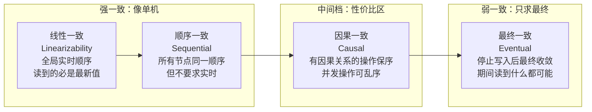
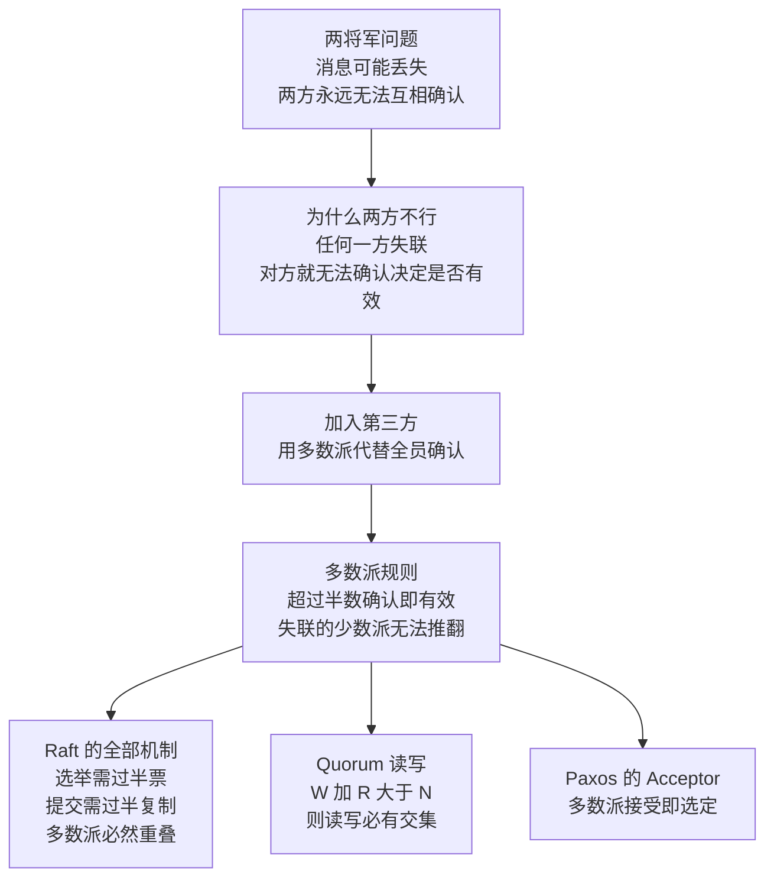
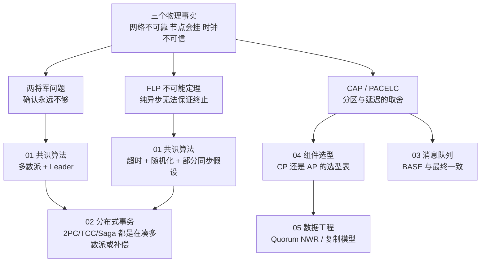

# 00 · 分布式基础理论

> **一句话主线**：分布式系统的所有技术难题，都源于三件事——**网络不可靠**（消息会丢、会延迟、会乱序）、**节点会挂**（而且你不知道它是挂了还是慢了）、**时钟不可信**（每台机器的钟都不一样）。由此引出三组理论：**两将军问题**说明「为什么确认次数再多也不够」→ **FLP** 说明「纯异步下确定性共识不可能保证终止」→ **CAP/PACELC** 说明「分区时的取舍」。这三组理论不是学术摆设，它们解释了后面每一个工程方案的**存在理由**。
>
> **本模块定位**：整个 `distributed_consensus/` 的**地基**。看完这章再读 `01_共识算法.md`、`02_分布式事务.md`，会发现所有方案都是在给这里的问题「交作业」。

---

## 目录

- [一、CAP 定理：流行的「三选二」是错的](#一cap-定理流行的三选二是错的)
- [二、PACELC：CAP 管不到的那 99% 时间](#二pacelccap-管不到的那-99-时间)
- [三、BASE 理论：AP 路线的实践总结](#三base-理论ap-路线的实践总结)
- [四、一致性模型谱系：从线性一致到最终一致](#四一致性模型谱系从线性一致到最终一致)
- [五、FLP 不可能定理：共识为什么这么难](#五flp-不可能定理共识为什么这么难)
- [六、两将军问题：为什么「再确认一次」永远不够](#六两将军问题为什么再确认一次永远不够)
- [七、理论地图：本章内容如何被后面的模块使用](#七理论地图本章内容如何被后面的模块使用)

---

## 一、CAP 定理：流行的「三选二」是错的

### 1. 先纠正一个几乎所有人都在背的错

网上流传最广的说法是：「CAP 定理说分布式系统**最多只能同时满足三点中的两点**，所以必须在 C 和 A 之间选一个。」

**这个说法是错的。** Brewer 本人在 CAP 提出 12 年后（2012 年 *"CAP Twelve Years Later: How the 'Rules' Have Changed"*）亲自澄清了这一点。错在哪儿：

| 流行误读 | 实际情况 |
|---------|---------|
| C、A、P 是三个平等的选项，砍掉一个 | **P 根本不是选项**。网络分区是物理事实（交换机故障、光缆被挖断、机房断网），你无法「选择不支持分区」 |
| 必须永久性地放弃 C 或 A | C/A 的取舍**只在分区发生的那段时间内**存在。分区恢复后，系统**可以同时**做到一致且可用 |
| 系统要么是 CP 要么是 AP | 很多系统**分区时**选 C，**正常时**追求延迟与一致兼顾（见下一节的 PACELC）；同一系统不同模块甚至可以有不同选择（Nacos 就是例子） |

**准确表述**：

> 当一个分布式系统**发生网络分区**时，它必须在**一致性（C）**和**可用性（A）**之间做出取舍——因为分区两侧的节点无法通信，你要么拒绝服务以保持数据一致（选 C），要么继续服务但可能返回不一致的数据（选 A）。**没有分区时，C 和 A 可以同时成立。**

**为什么分区时必然二选一？** 假设 5 个节点被切成 3+2 两半。客户端往 2 那一侧写了个 `X=2`，往 3 那一侧写了个 `X=1`。此时：

- 想让所有请求都返回**最新**数据（C）→ 必须等两侧通信恢复、达成一致 → 2 那一侧**必须拒绝服务**（牺牲 A）
- 想让所有请求都**有响应**（A）→ 两侧各自返回自己看到的值 → 返回的数据**不一致**（牺牲 C）

两边不可通信，就没有第三条路。

### 2. 三个字母到底在说什么

| 字母 | 含义 | 容易误解的点 |
|------|------|-------------|
| **C**onsistency | **线性一致性**（linearizability）：所有节点看到同一份最新数据，且读到的顺序与写入的全局顺序一致 | ⚠️ CAP 里的 C 特指**线性一致性**，不是「最终一致」也不是数据库 ACID 里的 C。ACID 的 C 指「约束不被破坏」，是另一回事 |
| **A**vailability | **每个到达非故障节点的请求都能在有限时间内返回非错响应** | ⚠️ 不是「系统 7×24 不宕机」。超时、拒答都算不可用；但返回「旧数据」**算**可用 |
| **P**artition tolerance | 系统在**任意数量**消息丢失（节点间失联）时仍能继续运行 | ⚠️ 不是「没有分区」，而是「分区发生了也不整体崩掉」。由于分区无法避免，P 是**必选项** |

> **一句话记住**：CAP 不是「三选二」，而是「**P 强制拿下，然后在分区期间 C 和 A 二选一**」。

### 3. CP 与 AP 的典型代表

| 选型 | 分区时的行为 | 典型系统 | 适合场景 |
|------|-------------|---------|---------|
| **CP** | 拒绝服务保一致。多数派一侧继续服务，少数派一侧**停止写入**（甚至停止读） | ZooKeeper、etcd、Consul（写路径）、HBase、TiDB、Nacos 配置中心 | 银行转账、库存扣减、选主、配置管理——**数据错了比不可用更严重** |
| **AP** | 继续服务但可能返回旧数据，分区恢复后再合并 | Eureka、Cassandra、DynamoDB、Riak、Nacos 服务发现 | 新闻流、点赞数、朋友圈、商品推荐——**刷不出来比看到旧数据更严重** |

> **记忆技巧**：
> - **CP 像银行柜台**：系统升级时直接挂个牌「暂停服务」，绝不允许两个柜台报出不同的余额。
> - **AP 像便利店**：灯亮着就能买东西，货架上的价签可能还没更新，但你能买到东西。

### 4. 面试问答

**问：讲一下你对 CAP 定理的理解。**

> **答**：CAP 说的是，分布式系统在**发生网络分区**时，必须在一致性和可用性之间取舍。这里要强调两点，很多人的理解是偏的：
>
> 第一，**P 不是可选项**。分区是网络这个物理系统的属性，不是设计决策，所以「三选二」的说法不准确。真正的选择只发生在分区**期间**，是在 C 和 A 之间。
>
> 第二，**无分区时 C 和 A 可以同时满足**。Brewer 在 2012 年专门写文章澄清了这点，并强调延迟（Latency）也是这个权衡的一部分，这就引出了 PACELC。
>
> 落到工程上，选 CP 还是 AP 取决于**业务对「数据错」和「服务不可用」哪个更敏感**。比如银行的转账和账户余额是 CP，宁可暂停服务也不能出现两个柜台报不同余额；而服务注册发现、点赞数、推荐列表一般是 AP，短暂不一致无所谓但不能刷不出来。这也是 Nacos 把服务发现做成 AP、配置中心做成 CP 的原因——同一套组件，按数据类型给出不同的取舍。

---

## 二、PACELC：CAP 管不到的那 99% 时间

CAP 有个尴尬的地方：**它只描述分区期间的行为，而分区是罕见事件**。系统 99% 的时间都在正常运行，那这段时间在权衡什么？

**PACELC**（Abadi, 2012）补上了这一半：

> **P**artition 时，在 **A** 和 **C** 之间选；**E**lse（无分区时），在 **L**（Latency，延迟）和 **C** （Consistency）之间选。

| 系统 | 分区时 | 平时 | 分类 | 说明 |
|------|--------|------|------|------|
| **DynamoDB / Cassandra** | 选 A（继续服务） | 选 L（低延迟） | **PA/EL** | 写只需落到部分副本即可返回，延迟低；读可能看到旧数据 |
| **BigTable / HBase** | 选 C（停止服务） | 选 L（低延迟） | **PC/EL** | 分区时少数派不可用；平时读走单副本很快 |
| **VoltDB / 传统单机数据库** | 选 C | 选 C | **PC/EC** | 强一致优先，牺牲延迟 |
| **PNUTS（Yahoo）** | 选 A | 选 C | **PA/EC** | 分区时可用；平时为保证一致愿意多花延迟 |

> **为什么要知道 PACELC？**
> 因为它解释了**为什么强一致系统天生慢**：想保证线性一致，一次写往往需要跨节点多数派确认（至少一个网络往返，几十毫秒）；而 AP 系统写本地就返回（微秒～毫秒）。面试里被问「为什么不用强一致方案」时，答案往往不是「分区」，而是「**平时就要付延迟代价**」。

---

## 三、BASE 理论：AP 路线的实践总结

**BASE** 是对 CAP 中 AP 方案的工程化延伸，核心是**放弃强一致性，换取可用性和性能**，代价是接受「最终一致」。

| 要素 | 全称 | 含义 | 通俗理解 |
|------|------|------|---------|
| **BA** | Basically Available | **基本可用**：允许损失部分可用性——响应变慢、降级返回兜底数据、限流排队，但不整体不可用 | 「双十一照样能用，只是稍微慢一点、部分功能降级」 |
| **S** | Soft state | **软状态**：允许数据存在**中间状态**，且这个中间态不影响系统整体可用性 | 「转账显示『处理中』，这个状态可以存在几秒钟」 |
| **E** | Eventually consistent | **最终一致**：经过一段时间（没有新写入干扰后），所有副本最终会收敛到一致 | 「朋友圈点赞数晚几秒才对，但最终会一致」 |

### BASE vs ACID

| 维度 | ACID（单机事务） | BASE（分布式实践） |
|------|-----------------|-------------------|
| 一致性 | **强一致**，事务结束即一致 | **最终一致**，允许中间态 |
| 可用性 | 为了隔离性可能阻塞、回滚 | 优先保证基本可用，尽量不阻塞 |
| 适用 | 单库、金额、库存等强约束场景 | 跨服务、高并发、可用性优先场景 |
| 典型 | MySQL 单库事务 | 缓存异步同步、消息队列最终一致、DNS |

### 典型场景：电商下单扣库存

1. 用户下单 → 先扣 **Redis** 缓存中的库存并**立即返回成功**（**基本可用**：响应快，不阻塞）
2. 同时发一条消息到 MQ，异步同步到 **MySQL**（**软状态**：Redis 与 MySQL 短暂不一致，存在中间态）
3. 消息消费成功 → MySQL 库存扣减完成 → 两边数据一致（**最终一致**）

整个过程系统**始终可用**。代价是：如果 MySQL 扣减最终失败，需要**补偿逻辑**把 Redis 的库存加回去——这就是 `02_分布式事务.md` 里各种方案要解决的问题。

---

## 四、一致性模型谱系：从线性一致到最终一致

「一致性」是一个**光谱**，不是二值。CAP 里的 C 只指最严格的那一端（线性一致）。实际系统大量使用中间档位，因为**越强的一致性 = 越高的协调成本 = 越高的延迟**。

**图 0-1：一致性模型谱系（越靠左越强、越贵）**

| 模型 | 保证 | 反例说明 | 典型系统 |
|------|------|---------|---------|
| **线性一致**（强一致）| 存在一个全局的实时顺序，每个读都能读到**此前已完成**的写；等价于「系统像只有一份数据」 | 你写下 `X=1` 且收到成功应答，之后任何节点读 `X` **必须**是 1 | etcd、ZooKeeper（写路径）、单机数据库 |
| **顺序一致** | 所有节点看到**同一个**操作顺序，但该顺序不要求与真实时间一致 | 大家看到的顺序都是 A→B，但可能是先看到 B 后看到 A（只要所有人一致） | 部分多核内存模型 |
| **因果一致** | **有因果关系**的操作保持顺序；**并发**操作允许不同节点看到不同顺序 | 「评论」和「回复评论」是因果的，必须保序；两条无关的评论可以乱序 | MongoDB（因果会话）、部分分布式数据库 |
| **最终一致** | 停止写入后，经过一段不确定的时间，所有副本收敛 | 期间可能读到旧值、甚至读到回退的值 | Cassandra、DynamoDB、DNS、Redis 主从异步复制 |

### 4.1 会话保证：最终一致的「补丁」

纯最终一致用起来太难受（读到旧值、数据「倒退」）。工程上常用**以会话为单位**的弱保证来加固：

| 保证 | 含义 | 实现思路 |
|------|------|---------|
| **Read-your-writes**（读己之写） | 你写完，你自己一定能读到刚写的值 | 写后一段时间内强制读主库；或把版本号带在会话里 |
| **Monotonic reads**（单调读） | 你不会读到「回退」的值——这次读到 v2，下次不会读到 v1 | 把用户会话**粘在同一个副本**上 |
| **Monotonic writes**（单调写） | 同一客户端的写操作按顺序生效 | 同一会话固定路由到同一分区 |
| **Writes-follow-reads** | 读到 v2 之后的写，基于 v2 而非 v1 | 写请求带上读到的版本号 |

> **面试话术**：被问「你们系统怎么处理主从延迟」，不要只说「最终一致」。要说：「我们做的是**会话级保证**——用户写完自己的资料立刻读，走主库（read-your-writes）；浏览列表类请求走从库，但把同一用户的请求粘在同一从库上，保证不会出现数据回退（monotonic reads）。」

### 4.2 成本直觉

| 一致性档位 | 一次写需要协调几个节点 | 大致延迟量级 | 备注 |
|-----------|---------------------|-------------|------|
| 线性一致 | 多数派（`N/2+1`） | 一次网络往返（同机房 ~1ms，跨机房 ~50ms+） | 还要考虑 Leader 单点瓶颈 |
| 因果一致 | 依赖链上的节点 | 通常小于多数派 | 需要维护依赖元数据（如向量时钟） |
| 最终一致 | 1（本地写即可） | 微秒级 | 后台异步传播 |

---

## 五、FLP 不可能定理：共识为什么这么难

**FLP**（Fischer–Lynch–Paterson, JACM 1985）是分布式领域最著名的**不可能性结论**，面试中问出来能直接区分「背过书」和「想过」。

### 1. 精确表述

> 在一个**完全异步**的、**确定性**的消息传递系统中，即使只有**一个**节点可能崩溃（`f=1`），也**不存在**一个协议能保证**总是终止**地解决共识问题。

证明思路（不需要会证，但要能说）：通过构造一个「二价配置」（bivalent configuration，即从该配置出发，最终结果既可能是 0 也可能是 1），然后证明**总存在一个消息的延迟投递能保持二价性**——也就是说，敌手可以通过无限期地迟延某条消息，让系统永远无法做出决定。

### 2. ⚠️ 它没有说什么（这才是最容易答错的）

| 常见误读 | 实际情况 |
|---------|---------|
| 「FLP 证明了分布式共识不可能实现」 | **错**。它说的是**不保证终止**，不是说不能达成共识。那些不终止的执行路径**概率为零** |
| 「所以共识算法都是假的理论上都是错的」 | **错**。Raft/Paxos 在**部分同步**模型（最终会有一个稳定的网络时段）下是**正确且能终止**的 |
| 「必须有节点真的挂掉才会触发」 | **错**。FLP 的证明甚至不需要故障发生——**仅靠消息延迟**就能让一个无故障的运行不终止 |
| 「FLP 是 CAP 的推论」 | **错**。两者**正交**。FLP 讲的是异步模型下的**终止性**，CAP 讲的是分区期间的**一致性与可用性取舍** |

### 3. 工程上如何绕过

| 绕过方式 | 原理 | 代表 |
|---------|------|------|
| **引入部分同步假设** | 假设网络最终会稳定、消息延迟有上界，用**超时**作为「怀疑」依据（宁可误判也要推进） | Raft、Paxos（Paxos 的 liveness 依赖一个稳定的 Leader） |
| **引入随机化** | 用随机化打破对称性，让不终止的概率趋于 0 | Raft 的**随机选举超时**就是朴素的随机化 |
| **引入故障检测器** | 用「最终完美故障检测器」提供 Omega 选主，解决共识 | 实践中即「心跳 + 超时」 |

> **一句话**：FLP 告诉我们「**别想着设计一个理论上永远能做出决定的异步共识协议**」，所以 Raft 才必须依赖超时——**超时不是 bug，是绕开 FLP 的必要代价**。这直接解释了为什么 Raft 里要有随机选举超时（否则可能永远 split vote）。

### 4. 面试问答

**问：听说过 FLP 不可能定理吗？它对 Raft 有什么影响？**

> **答**：FLP 说的是，在**完全异步、确定性**的系统里，只要有一个节点可能崩溃，就不存在能**保证终止**的共识协议。
>
> 但有三点要说清楚：第一，它讲的是「不保证终止」，不是「不能达成共识」，那些不终止的执行概率为零；第二，它只适用于纯异步模型，Raft 实际工作在**部分同步**模型下，假设网络最终会稳定；第三，它甚至不需要真的发生故障，光靠消息延迟就能构造出不终止的运行。
>
> 具体到 Raft，FLP 的影响体现在它**必须依赖超时**——选举超时、心跳超时。超时本质上是一种「不完美的故障检测器」，可能在网络只是慢的时候误判 Leader 挂了。同时 Raft 用**随机化的选举超时**（150~300ms）来打破对称性，避免多个 candidate 反复 split vote 导致永久不终止。所以可以说：**超时是 Raft 为绕开 FLP 付出的代价**。

---

## 六、两将军问题：为什么「再确认一次」永远不够

这是理解共识必要性的**最直观入口**，也是 FLP 的通俗前身。

### 1. 问题

两支军队（A、B）分列山谷两侧，中间是敌军。**只有同时进攻才能取胜**，任何一方单独进攻都会失败。两军靠**信使**通信，但信使可能被截获（消息可能丢失）。

将军 A 派信使告诉 B：「明早 8 点进攻。」

问题：**A 能确认 B 会进攻吗？**

- B 收到后回信「收到」——但 A 不知道这条回信是否送达
- A 再回信「我收到你的确认了」——但 B 不知道这条是否送达
- ……**无限递归，永远无法达成 100% 确认**

**结论**：在**消息可能丢失**的异步信道上，**有限次**的消息交换**不可能**让双方对某个决定达成确定性的一致。

### 2. 与共识问题的关系

| 两将军问题 | 分布式共识 |
|-----------|-----------|
| 2 个参与者 | N 个参与者（`N ≥ 3`） |
| 消息可能丢失 | 消息可能丢失 / 延迟 / 乱序 |
| 「不能通过有限次通信达成确定一致」 | 「不能保证终止」（FLP） |
| **无解**（在纯异步模型下） | **有解**，但需要额外假设 |

**关键转折**：两将军问题之所以无解，是因为**只有两方，任何一方挂掉都会导致对方无法确认**。当参与者增加到 3 个以上，就可以用**多数派**来绕过——

> 只要**超过半数**的节点确认了，剩下的节点即使全部失联，也不影响这个决定的有效性（因为它们加起来也不够半数，无法推翻）。

**这就是「多数派机制」的由来**：它不是工程上的凑合，而是从两将军问题里「逃出来」的唯一出口。`01_共识算法.md` 中 Raft 的选举限制、日志提交、多数派重叠，本质上都是这条原理的展开。

**图 0-2：从两将军问题到多数派**

---

## 七、理论地图：本章内容如何被后面的模块使用

**图 0-3：分布式理论 → 工程方案的映射**

### 本章与后续模块的对应关系

| 本章结论 | 后续模块 |
|---------|---------|
| 多数派是绕开两将军问题的出口 | `01_共识算法.md`（Raft 选举/提交/重叠、Paxos 多数派接受即选定）、`05_分布式数据工程.md`（Quorum `W+R>N`） |
| FLP 迫使命名依赖超时与随机化 | `01_共识算法.md`（随机选举超时、PreVote、ReadIndex 的租约） |
| CAP 的取舍只发生在分区期间 | `04_分布式组件选型.md`（Nacos/Eureka/ZK/etcd 的选型表）、`05_分布式数据工程.md`（复制模型） |
| PACELC 说明平时也要权衡延迟与一致 | `05_分布式数据工程.md`（同步复制 vs 异步复制、半同步） |
| BASE 与最终一致 | `02_分布式事务.md`（Saga、本地消息表）、`03_分布式消息队列.md`（可靠消息最终一致性） |
| 一致性模型谱系与会话保证 | `05_分布式数据工程.md`（逻辑时钟、向量时钟、复制滞后） |

---

## 本模块速记（考前 5 分钟）

| # | 问题 | 关键词速答 |
|---|------|-----------|
| 1 | CAP 的准确表述？ | **不是三选二**。P 是必选项（物理事实）；C/A 的取舍**只在分区期间**；无分区时二者可兼得。Brewer 2012 年已澄清 |
| 2 | CAP 里的 C 指什么？ | **线性一致性**（linearizability），不是 ACID 的 C（约束），也不是最终一致 |
| 3 | 什么是 PACELC？ | **P**artition→选 **A**/**C**；**E**lse→选 **L**（延迟）/**C**（一致）。补上 CAP 不管的常态权衡，解释了「强一致为什么慢」 |
| 4 | BASE 三要素？ | **B**asically Available 基本可用 / **S**oft state 软状态 / **E**ventually consistent 最终一致 |
| 5 | 一致性模型谱系？ | 线性一致 → 顺序一致 → 因果一致 → 最终一致；越强越贵。CAP 的 C 只指最严格那端 |
| 6 | 会话保证有哪些？ | read-your-writes（读己之写）、monotonic reads（不回退）、monotonic writes、writes-follow-reads |
| 7 | FLP 精确表述？ | **完全异步 + 确定性 + 一个节点可能崩溃 → 不存在保证终止的共识协议** |
| 8 | FLP 没说什么？ | ①没说共识不可能，只说不保证终止（概率为零）；②不需真的故障，延迟即可；③只适用纯异步/确定性；④与 CAP 正交 |
| 9 | Raft 怎么绕开 FLP？ | **部分同步假设 + 超时（不完美故障检测器）+ 随机化选举超时**。超时不是 bug，是代价 |
| 10 | 两将军问题结论？ | 消息可能丢失时，**有限次**通信无法让两方达成确定一致。**无解** |
| 11 | 怎么绕开两将军？ | 增加参与者到 `N≥3`，用**多数派**替代全员确认——失联的少数派无法推翻决定 |
| 12 | 多数派的最小数量？ | `⌊N/2⌋ + 1`。即 3 节点容 1 挂、5 节点容 2 挂、7 节点容 3 挂。**任意两个多数派必然至少重叠一个节点** |

---

## 面试官深挖追问

1. **「你说 CAP 不是三选二，那 Brewer 具体怎么说的？」**
   → 2012 年 *CAP Twelve Years Later*。要点：① P 不是选项；② 分区期间才有 C/A 取舍，分区结束系统可恢复一致；③ C 和 A 不是二值，可以「部分一致、部分可用」；④ 延迟是这个权衡的一部分（引出 PACELC）。

2. **「CAP 里的 C 和 ACID 里的 C 有什么区别？」**
   → CAP 的 C = 线性一致性（多副本对外像单副本，读写有全局实时顺序）；ACID 的 C = 一致性约束（如外键、唯一索引不被破坏），是**事务前后不变量**。二者只是碰巧都叫 Consistency。

3. **「如果让你设计一个系统，你怎么定 CP 还是 AP？」**
   → 不看技术看业务：问「**数据错了会怎样**」和「**服务挂了会怎样**」。钱、库存、配额 → CP；内容、推荐、状态展示 → AP。并且可以**按数据类型拆分**（Nacos 就是服务发现 AP + 配置中心 CP），不必整个系统一刀切。

4. **「最终一致里的『一段时间』是多长？怎么保证？」**
   → 工程上「最终」没有上界保证，只有概率保证。所以要靠：① **异步复制 + 重试**（消息队列）；② **对账/反熵**（定时比对，如 Merkle 树，见 `05`）；③ **会话保证**兜住用户体验；④ **幂等 + 补偿**兜住失败。不要承诺「几秒内一致」，要承诺「最终会一致且可对账」。

5. **「为什么 Raft 用随机超时而不是固定超时？」**
   → 固定超时会让多个 follower 同时超时、同时竞选、同时 split vote，可能反复不终止——这正是 FLP 说的「无法保证终止」的体现。随机化（150~300ms）让它们在概率上错开，使「一轮选出 Leader」的概率极高。

6. **「多数派机制有什么代价？」**
   → ① **节点数要奇数**（偶数不增加容错还得更多票）；② **可用性受限于多数派**：5 节点挂 3 个就整体不可写（只剩 2 个不足 3 票）；③ **跨机房部署时延迟高**：多数派确认至少要跨一个机房往返；④ **写放大**：一次写要落多个节点。

---

## 参考资料

见 [`99_参考资料.md`](99_参考资料.md)。
