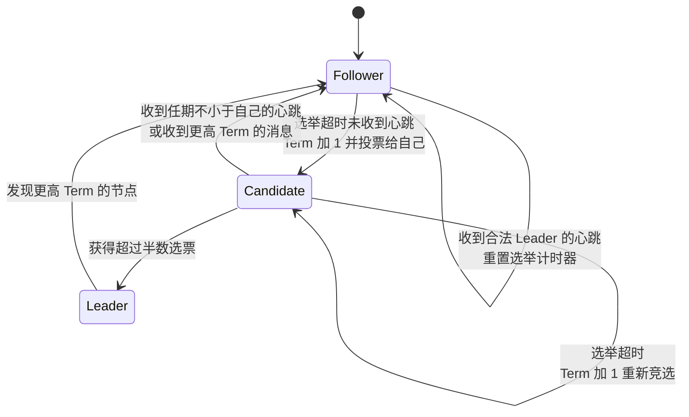
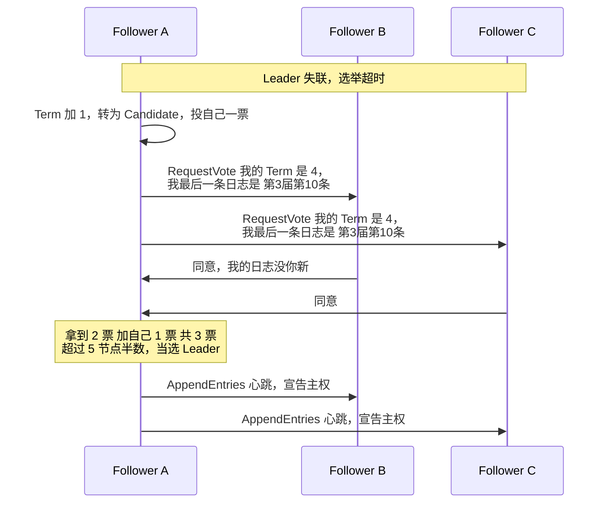
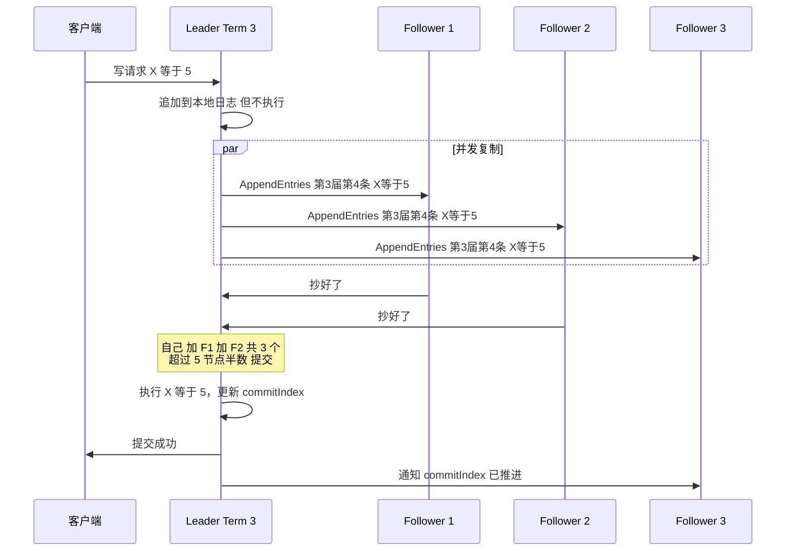
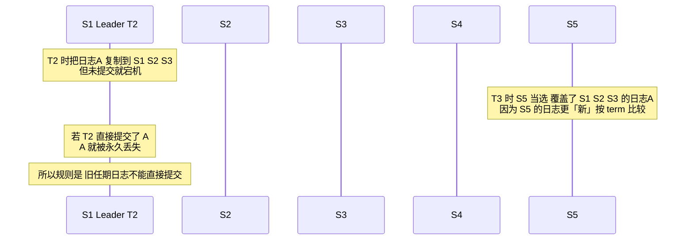
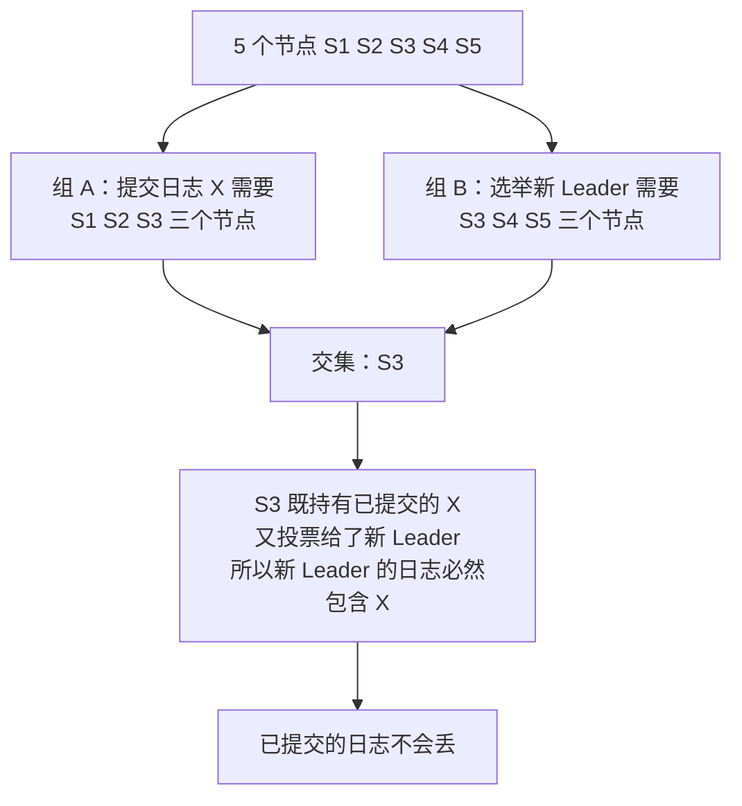
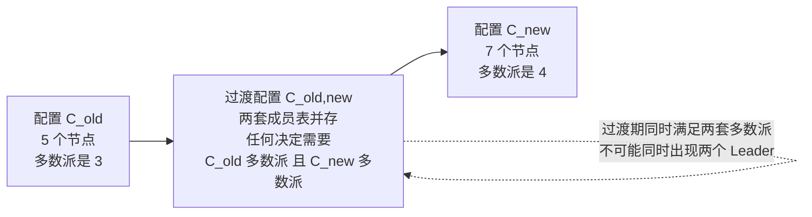
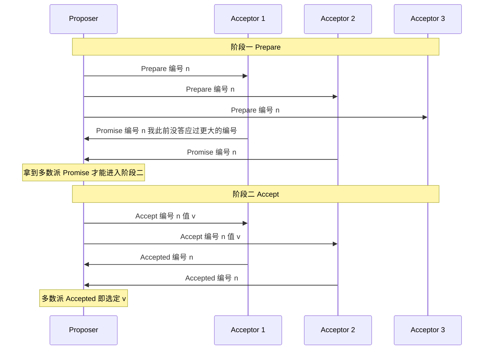
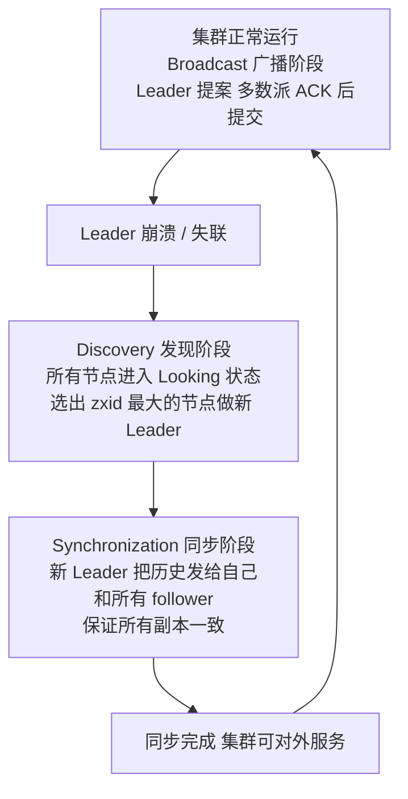
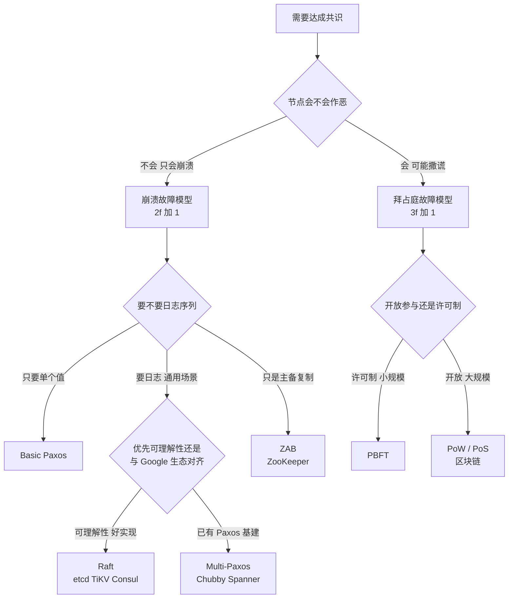

# 01 · 共识算法（Raft / Paxos / ZAB / BFT）

> **一句话主线**：共识算法要解决的是「**多个节点如何就同一件事达成一致，且一旦达成就不再反悔**」。它必须绕开两个理论障碍（见 `00_分布式基础理论.md`）：两将军问题（确认永远不够）→ 用**多数派**绕过；FLP 不可能定理（纯异步无法保证终止）→ 用**超时 + 随机化 + 部分同步假设**绕过。**Raft 是工程上最易理解与实现的答案**（强 Leader 化），Paxos 是理论原型，ZAB 是 ZooKeeper 的定制版，PBFT 处理的是更严格的「节点会作恶」场景。
>
> **本模块定位**：`distributed_consensus/` 的**核心**。它是 `02_分布式事务.md`（Seata 的全局锁）、`04_分布式组件选型.md`（etcd/ZK/Nacos 的 CP 底座）、`03_分布式消息队列.md`（Kafka 的 KRaft 元数据）共同的地基。
>
> ⚠️ **重要前提**：Raft/Paxos/ZAB 容忍的是**崩溃故障**（Crash Fault，节点挂了但不撒谎）。如果节点可能**作恶撒谎**（拜占庭故障），需要 PBFT 一类算法，见[第六节](#六拜占庭容错从崩溃故障到作恶节点)。

---

## 目录

- [一、Raft 速览：把共识拆成三个子问题](#一raft-速览把共识拆成三个子问题)
- [二、核心概念：Term（任期）](#二核心概念term任期)
- [三、Leader Election（领导选举）](#三leader-election领导选举)
- [四、Log Replication（日志复制）](#四log-replication日志复制)
- [五、Safety（安全性）](#五safety安全性)
- [六、拜占庭容错：从崩溃故障到作恶节点](#六拜占庭容错从崩溃故障到作恶节点)
- [七、Raft 工程增强：从论文到生产可用](#七raft-工程增强从论文到生产可用)
- [八、成员变更（Membership Change）](#八成员变更membership-change)
- [九、Paxos：共识的理论原型](#九paxos共识的理论原型)
- [十、ZAB：ZooKeeper 的共识协议](#十zabzookeeper-的共识协议)
- [十一、共识算法族谱对比](#十一共识算法族谱对比)
- [本模块速记（考前 10 分钟）](#本模块速记考前-10-分钟)
- [面试官深挖追问](#面试官深挖追问)

---

## 一、Raft 速览：把共识拆成三个子问题

> **一句话说清 Raft 是干什么的**：想象你有一个银行账户，数据存在 5 台机器上。某天你转了 100 块钱——如何保证这 5 台机器都「同意」这笔转账发生了，而且记录的顺序一模一样？Raft 就是解决这个问题的。
>
> Raft 把集群里的节点分成三种角色，像一个小团队：
>
> - **follower（跟随者/小弟）**：所有节点启动时都是小弟，等着听老大的指挥。如果老大「失联」太久，小弟就会站出来竞选。
> - **candidate（候选人）**：站出来竞选老大的人。他会对其他人喊「投我一票！」，如果拿到超过半数票，就升级为老大。
> - **leader（领导者/老大）**：只有老大能拍板做决定。所有写操作（比如你转 100 块）必须经过老大。
>
> 一个典型的 Raft 集群有 **5 个节点**，可以容忍最多 **2 个节点挂掉**（因为 3 > 5/2，还能凑够多数派）。

**核心思路**：**先选出一个老大，所有决策由老大发起，老大把指令复制给小弟，超过半数小弟确认后正式生效。**

基于这个思路，Raft 算法分解成三个子问题：

| 子问题 | 要解决什么 |
|--------|-----------|
| **Leader Election（领导选举）** | 老大挂了怎么办？选出新老大，不能有两个老大同时存在 |
| **Log Replication（日志复制）** | 老大的指令如何可靠地同步给所有小弟？ |
| **Safety（安全性）** | 如何保证「一旦一个决定生效了，永远不会被推翻」？ |

**图 1-1：Raft 的三种角色与状态转换**



### Raft 动画演示

> 地址：<http://thesecretlivesofdata.com/raft/>
>
> 动画主要包含三部分：
>
> - 第一部分介绍简单版的领导者选举和日志复制的过程
> - 第二部分介绍详细版的领导者选举和日志复制的过程
> - 第三部分介绍如果遇到网络分区（脑裂），raft 算法是如何恢复网络一致的

---

## 二、核心概念：Term（任期）

> 可以把 Term 理解为 **「总统的第几届任期」**。比如「第 3 任总统」就是一个 term=3。
>
> 每次选举（选新老大），Term 编号就 +1。每个节点都记录着自己当前是第几届。通信时必须带上这个编号，用来判断信息是否过时：
>
> - 收到一个比自己任期号还小的消息？说明对方是「前朝遗老」，直接不理。
> - 收到一个比自己任期号还大的消息？说明自己已经过气了，立刻让位变回小弟。
>
> Term 就像一个不断前进的时钟，保证了整个集群在时间维度上不会「时光倒流」，是 Raft 安全性的基石。

### Term 的两条精确规则

**规则一：Term 单调递增，且只有「竞选」才 +1。**

节点自己的 Term 只在**发起选举**时 +1。收到别人的更高 Term 时，**直接采纳**对方的 Term（不 +1），并退回 follower。

**规则二：同一 Term 内最多只有一个 Leader。**

这是多数派投票保证的——一个 candidate 必须拿到超过半数的票才能当选；而同一个 Term 内，每个节点**只投一票**（先到先得），所以两个 candidate 不可能同时拿到过半数。

> **为什么 Term 能解决「脑裂」？** 分区两侧可能各选出一个 Leader，但**其中一方的 Term 必然更小**。当分区恢复、双方通信时，Term 小的 Leader 会收到更大 Term 的消息，立刻**自动退位**——不需要任何人干预。

---

## 三、Leader Election（领导选举）

> **触发机制**：老大每隔一段时间给所有小弟发一个「心跳」（AppendEntries RPC，里面没有数据只有「我还活着」的信号）。小弟们就安心等着。如果一个小弟等了好久（选举超时）还没收到心跳，他就会想：「老大是不是挂了？我来当！」

### 1. 为什么超时要随机？

每个小弟的「等待时间」是**随机抽的**（典型 150ms~300ms 之间）。这很关键——如果大家都等一样久，就会同时跳出来喊「选我！」，结果票数分散谁也选不上（**split vote**）。随机化让大多数情况只有一个人先喊，顺利当选。

> **这正是绕开 FLP 的随机化手段**：FLP 说纯确定性协议无法保证终止，随机化让「不终止」的概率趋近于 0，但严格来说**不消除**（理论上仍可能连续多次 split vote，只是概率极低）。

### 2. 竞选过程



竞选步骤：

1. 小弟把自己的 Term 编号 +1（新一届任期开始），转为 candidate，**投自己一票**
2. 对所有人喊「投我一票！」（并发发送 RequestVote RPC）
3. 出现三种结果之一：
   - ✅ **拿到超过半数票** → 当选老大，立刻开始发心跳，宣告主权
   - ❌ **收到新老大的心跳**（Term ≥ 自己的）→ 哦，已经有人当上了，退回小弟
   - ⏳ **超时了没人赢** → 等一段**随机**时间，Term +1 重新竞选

### 3. 选举的精确约束：谁能当选？

投票者**不是随便投的**。它必须比较 candidate 的日志新旧：

> **投票规则**：如果 candidate 的日志**不如**投票者自己的新，就**拒绝**投票。如果两者一样新或 candidate 更新，才可以投。

「更新」的判定是一个**字典序比较**：

```
先比最后一条日志的 term，term 大的更新；
term 相同，再比最后一条日志的 index，index 大的更新。
```

即 `(lastLogTerm, lastLogIndex)` 的字典序大者胜。

> ⚠️ **注意先比 term 再比 index**，这个顺序不能反。一条「第 2 届的第 100 条」日志**没有**「第 3 届的第 1 条」新——因为第 3 届 Leader 是在第 2 届的基础上选出来的，它一定见过并认可第 2 届已提交的内容。这个规则是[选举限制](#1-选举限制不能让掉队的当老大)的实现基础。

---

## 四、Log Replication（日志复制）

> 老大选出来后，就开始干活了。流程很简单：
>
> 1. 客户端说「我要存 X=5」，这个请求直接发给老大
> 2. 老大先把这个指令**记在自己的小本本上**（追加成一个 log entry），但还不执行
> 3. 老大把这个新条目**群发给所有小弟**（AppendEntries RPC），说「大家抄一下」
> 4. 当**超过半数的小弟回复「抄好了」**，老大就宣布这条指令正式生效，执行它
> 5. 老大告诉客户端「搞定了！」，同时通知所有小弟「执行！」
>
> **如果有小弟掉队怎么办？** 老大会不停地重发，直到每个小弟都追上来。这保证了最终所有节点数据一致。

**图 1-2：日志复制与提交**



### 1. 日志的结构与连续性检查

每条日志条目包含三个要素：

| 字段 | 含义 |
|------|------|
| **index** | 日志序号（从 1 递增，全局连续） |
| **term** | 这条日志是第几届 Leader 追加的 |
| **command** | 实际的操作内容（如 `X=5`） |

`AppendEntries` RPC 会携带一个关键的**一致性检查**（Consistency Check）：

| 参数 | 含义 |
|------|------|
| `prevLogIndex` | 新日志的前一条的 index |
| `prevLogTerm` | 新日志的前一条的 term |
| `entries[]` | 要追加的日志内容 |
| `leaderCommit` | Leader 已知的已提交位置（commitIndex） |

**Follower 的处理逻辑**：如果自己 `prevLogIndex` 处的日志 term 与 `prevLogTerm` **不匹配**，就**拒绝**，返回 false。Leader 收到拒绝后把 `prevLogIndex` 往前退一格重试，直到找到匹配点，再从这个点开始覆盖 follower 的后续日志。

> **为什么要这个检查？** 这就是 Raft 的**日志匹配特性（Log Matching Property）**：
>
> > 如果两个日志在某个 index 上的 term 相同，那么这个 index 及其之前的所有条目**完全相同**。
>
> 这条性质是从「Leader 在一个 Term 内只在一个 index 上追加一条日志」+「AppendEntries 带前一条的 index/term 做校验」归纳出来的。它保证了**日志不会出现交错的分叉**，也让「多数派重叠」的安全性证明成立。

> ⚠️ **易错点**：Follower 遇到 term 冲突时是**覆盖**（truncate + append），不是报错也不是合并。Raft 里**只有 Leader 的日志是权威的**，follower 上未提交的冲突日志会被丢弃。

### 2. 什么时候算「已提交」（committed）？

**提交条件**：一条日志被复制到了**超过半数**的节点上（含 Leader 自己）。

**commitIndex 的推进**：Leader 维护 `commitIndex` = 已知被多数派确认的最高 index。**只有 `commitIndex` 之前的日志才会被应用到状态机**（即真正执行）。

> ⚠️ **重要**：日志「被复制到多数派」和「被提交」是两个不同时刻。一条日志可能已经躺在多数节点的磁盘上，但因为 Leader 还没确认完而被**回滚**（见[提交规则](#2-提交规则老大不提交自己的作业就不能帮前任交作业)）。

### 3. 两个核心通信协议

**RequestVote（拉票请求）** —— 竞选时用：

| 参数 | 作用 |
|------|------|
| `term` | candidate 的任期号 |
| `candidateId` | 谁在拉票 |
| `lastLogIndex` / `lastLogTerm` | **让投票者判断竞选人是否「最新版本」**（见选举限制） |

**AppendEntries（追加条目）** —— Leader 同步日志**和**发心跳都用这个：

| 用途 | 说明 |
|------|------|
| 复制日志 | `entries[]` 非空 |
| 心跳 | `entries[]` 为空，只是一句「我还活着」（**心跳也是 AppendEntries，不需要单独协议**） |

> **面试加分点**：被问「心跳用什么消息发」，答「心跳就是**空的 AppendEntries**」——这个细节能体现真的读过实现。

---

## 五、Safety（安全性）

> Raft 要保证一个底线：**一旦某个操作「生效了」，它就永远不会被推翻。** 不管之后怎么换老大，这个操作都稳如泰山。Raft 通过下面三个机制来保证。

### 1. 选举限制——不能让「掉队的」当老大

> 竞选老大时，candidate 必须展示自己「最新一条日志是什么」。投票的小弟会比较：「你的日志比我新吗？不比我新就不投你。」
>
> **类比**：一场会议里，刚睡醒进来的人不能当主持人——他连之前讨论了什么都不知道，会推翻已做出的决定。只有全程参与了会议（日志足够新）的人才有资格主持。

**精确规则**：投票者 V 投给 candidate C，当且仅当 C 的日志**至少和 V 一样新**，即：

```
C.lastLogTerm > V.lastLogTerm
  或（C.lastLogTerm == V.lastLogTerm 且 C.lastLogIndex >= V.lastLogIndex）
```

**这条规则保证了什么？** 让「持有已提交日志的节点」在选举中占优，从而新 Leader **必然包含所有已提交的日志**——这就是「已提交不会被推翻」的第一道防线。

### 2. 提交规则——老大不提交自己的「作业」，就不能帮前任「交作业」

> 这是一个很巧妙的设计。核心规则：**老大只能直接提交自己任期内的日志条目。** 对于上任老大遗留的、已经复制到多数节点但没来得及提交的日志，必须等自己这届的第一条日志被复制和提交时，「顺带」一起提交。
>
> **为什么要这样？用一个故事说明：**
>
> 1. 第 2 届老大把日志 A 复制到了 3 个节点（超过半数），还没来得及提交就宕机了
> 2. 第 3 届新老大上台，他可能根本没收到日志 A
> 3. 如果第 2 届老大在宕机前就提交了 A，那第 3 届老大无法感知 A 的存在，可能用别的内容覆盖 A → **已提交的数据丢了！**
> 4. 但按照 Raft 的规则：第 2 届老大**不能直接提交 A**（A 是旧任期的），必须先提交一条自己本届的日志才能「连坐」提交 A。既然他还没提交自己的日志就挂了，那 A 在法律上从未生效，第 3 届老大覆盖 A 就不算丢数据
>
> **一句话记**：想帮前任交作业？先把自己的作业交了再说。

**论文 §5.4.2 的精确表述**：

> 一条日志条目被提交，当且仅当它**存储于多数派节点上**，**且该 Leader 当前任期内至少有一条日志也存储于多数派上**。一旦当前任期的某条日志被提交，那么它**之前的所有日志**都因日志匹配特性而**间接提交**。

这个反例出自 Raft 论文的 **Figure 8**，是安全性证明中最关键的一处：



**工程实现：no-op entry（空日志）**

论文只说了「不能直接提交旧任期日志」，但没说**怎么让旧日志尽快提交**。如果集群一直没新写入，那些旧日志就会一直悬着（虽然不影响安全性，但会延迟应用）。

**解法**：新 Leader 当选后**立即追加一条自己任期的空日志**（no-op），并立刻复制到多数派。这条空日志提交后，它之前的所有日志就**连带提交**了。

> 这是 etcd / TiKV 等实现的标准做法。面试中提一句「新 Leader 上任会先写一条 no-op 来推进 commitIndex」，是明显的加分项。

### 3. 多数派重叠——为什么这么设计就能保证安全？

> 核心原理一句话：**任意两个「超过半数」的群体，至少有一个共同成员。**
>
> 举例：5 个人，超过半数 = 至少 3 人。你随便挑 3 个人（组 A），我再随便挑 3 个人（组 B），这俩组**必然至少有 1 个人是重合的**。

**图 1-3：多数派必然重叠**



把这个原理套到 Raft 里：

- 一条日志要生效 → 需要被**某个多数派**（设为组 A）复制
- 一个人要当老大 → 需要**另一个多数派**（设为组 B）投他票
- 组 A 和组 B 必然有一个**共同节点** → 这个人既持有已生效的日志，又投了新老大的票
- 新老大向这个人同步日志时，就一定能拿到这条已生效的日志 → **不会丢**

> **再补一层**：光有重叠还不够，还得保证「新 Leader 一定会向这个重叠节点同步」。这靠两点：① **选举限制**保证新 Leader 的日志不比重叠节点旧；② **日志匹配特性**保证一旦某 index 匹配，之后必须一致。三条规则合起来，才能证明「已提交日志不丢」。

---

## 六、拜占庭容错：从崩溃故障到作恶节点

前面所有算法都建立在一个隐含假设上：**故障节点会「沉默」，但不会「撒谎」**。

| 故障模型 | 节点行为 | 所需算法 | 节点数要求 |
|---------|---------|---------|-----------|
| **Crash Fault（崩溃故障）** | 挂掉、网断、超时——**不作恶，只是不回应** | Raft / Paxos / ZAB | `2f+1`（多数派），容忍 `f` 个故障 |
| **Byzantine Fault（拜占庭故障）** | 可能**发送矛盾的消息**、伪造签名、故意误导——**主动作恶** | PBFT / 区块链共识 | `3f+1`，容忍 `f` 个作恶节点 |

**为什么拜占庭要 3f+1 而不是 2f+1？**

因为现在你面对的不仅是「有节点没回复」，还有「有节点**在说谎**」。要区分「撒谎的节点」和「诚实的节点」，你必须让**诚实节点数量严格多于作恶节点**：

```
总节点 N = f 个作恶 + (N - f) 个诚实
需要诚实节点能形成多数派：(N - f) > f  →  N > 2f  →  N ≥ 2f + 1
```

但这还不够——因为作恶节点可以**同时"假装"支持两个不同的值**（equivocation），所以要把作恶节点的「双重投票」影响力算进去，最终得到：

```
N ≥ 3f + 1
```

即：**容忍 1 个作恶节点需要至少 4 个节点；容忍 2 个需要至少 7 个**——成本比崩溃故障高得多。

### 1. PBFT（Practical Byzantine Fault Tolerance）

PBFT（Castro & Liskov, 1999）是第一个实用的拜占庭容错算法，**三阶段**流程：

| 阶段 | 做什么 |
|------|--------|
| **Pre-prepare** | 主节点（Primary）给请求编号，广播给所有副本 |
| **Prepare** | 各副本收到后广播自己的确认，收到 `2f` 个（含自己）后进入下一阶段 |
| **Commit** | 各副本广播提交意向，收到 `2f+1` 个后**执行**请求 |

**PBFT 的代价**：消息复杂度 `O(N²)`（每个节点都要广播给所有其他节点），所以节点数限制在几十个——这也是它没能大规模用于公链的原因。

### 2. 与其他 BFT 方案的关系

| 方案 | 机制 | 适用 |
|------|------|------|
| **PBFT** | 三阶段投票，`O(N²)` 消息，确定性最终性 | 联盟链、小规模许可网络 |
| **PoW（比特币）** | 算力竞争，最长链规则，**概率性**最终性 | 公链，开放参与 |
| **PoS / Raft-BFT 混合** | 权益加权投票 | 各类联盟链、企业链 |
| **Tendermint / HotStuff** | 改进的 BFT，`O(N)` 消息 | 现代公链/联盟链 |

> **面试要点**：被问「Raft 能不能防恶意节点」，答案是**不能**——Raft 的多数派投票假设「节点要么诚实要么沉默」。一个作恶节点可以在同一 Term 给两个 candidate 都投票，直接破坏「一个 Term 最多一个 Leader」的保证。金融联盟链场景才需要 PBFT 类算法。

> **另一处易错点**：拜占庭容错与「拜占庭将军问题」是同一回事。它和 `00` 里的「两将军问题」**不同**——两将军问题里双方都是**诚实的**，只是信道不可靠；拜占庭将军问题里**有叛徒在主动欺骗**。

---

## 七、Raft 工程增强：从论文到生产可用

论文里的 Raft 是「能正确运行的 Raft」，但**不能直接上生产**。etcd、TiKV、Consul 等实现在论文基础上加了一批工程增强，面试中问「Raft 有什么坑/优化」就靠这一节。

### 1. PreVote（预投票）：防止「干扰性选举」

**问题场景**：一个节点因网络分区被隔离了一段时间，期间集群已经选举了好几轮。这个**掉队节点的 Term 远远落后**……

**等等，是落后还是领先？** 这里是关键：被隔离的节点如果在此期间**反复竞选失败**，它的 Term 会**不断自增**（每次超时竞选都 +1）。等网络恢复，它带着一个**极高的 Term** 回来，发一条 RequestVote 或心跳。

按 Raft 原规则：所有节点看到更高 Term → **立刻退位**，稳定的 Leader 被无谓地推翻，集群白跑一轮选举，造成**服务抖动**。

**PreVote 的解法**：在**真正**发起选举前，先做一次**不改变任何状态的试探性投票**（预投票）。

| 阶段 | 行为 |
|------|------|
| **预投票** | candidate 用 **当前 Term + 1** 询问大家「**如果**我竞选，你投我吗？」——**不更新自己的 Term，对方也不更新** |
| 只有预投票**超过半数成功** | 才真正进入选举流程（Term + 1，正式 RequestVote） |
| 预投票失败 | 说明集群里有健康的 Leader，**放弃竞选**，且自己的 Term **没有被打乱** |

> **效果**：掉队节点回来后，预投票会失败（因为其他节点会告诉它「我最近收到过心跳」），于是它**安静地降级为 follower**，不会带着高 Term 冲击集群。这是 etcd 默认开启的优化。

### 2. Snapshot（快照）与日志压缩

**问题**：日志会**无限增长**。一年下来日志可能几十 GB，节点重启时要重放全部日志才能恢复状态（可能几小时），而且新加入的节点要接收全部历史日志。

**解法**：**日志压缩** —— 定期把状态机在某个 index 处的**完整状态**存成一个快照，然后**丢弃该 index 之前的日志**。

| 概念 | 说明 |
|------|------|
| **Snapshot** | 记录「截至 index=T 的完整状态」+ 「最后包含的 index/term」 |
| **阈值触发** | 通常按日志条数触发（如 etcd 默认每 10000 条做一次） |
| **InstallSnapshot RPC** | 当 Leader 发现某个 follower 需要的日志**已经被压缩掉了**，就改为**直接发送整个快照** |
| **Cost** | 快照本身很大（要传全量状态），所以会**分块传输** |

> **面试话术**：被问「Raft 日志会不会无限增长」，答「不会，靠**快照 + 日志压缩**。快照记录某 index 处的完整状态，之后就可以丢弃该 index 之前的日志。如果 follower 落后到 Leader 已经没有它需要的日志了，Leader 会改用 **InstallSnapshot** 直接推全量快照。」这就是 etcd 里 `--snapshot-count` 参数的作用。

### 3. 只读请求的优化：ReadIndex 与 Lease Read

**问题**：Raft 的 Leader 处理**读请求**时，能直接读本地状态机吗？

**不能直接读！** 因为 Leader 可能已经**过期**了——它自己还不知道集群已经选了新 Leader（比如它被分区隔离在少数派一侧）。此时它本地数据是旧的，直接读会**脏读**。

**但走一遍完整日志复制又太慢**（读操作也要写日志？不可接受）。

**两种优化**：

| 方案 | 做法 | 成本 |
|------|------|------|
| **ReadIndex** | Leader 记录当前 `commitIndex`，然后**向多数派发一轮心跳确认自己仍是 Leader**，确认通过后等本地状态机 apply 到该 index，再返回读结果 | 一次心跳往返（不做磁盘写、不追加日志） |
| **Lease Read** | Leader 在选举超时时间内「**租约**」有效——只要它还在租期内且没收到更高 Term，就认定自己仍是 Leader，直接读 | **零网络往返**（但依赖时钟，时钟漂移会影响安全性） |

> ⚠️ **注意**：Lease Read 依赖「选举超时 > 时钟漂移上界」这个假设。所以生产上一般把选举超时设得比时钟漂移大一个数量级。**这也再次说明：物理时钟不可信是分布式系统的根本约束**（见 `05_分布式数据工程.md` 的逻辑时钟一节）。

### 4. Learner（学习者）：安全地扩容

**问题**：往集群加一个新节点，它日志是空的。如果直接把它加成 **voter**：

- 它要花很长时间同步日志（可能几小时）
- 期间它的日志远落后于集群
- 而它**有投票权**了——它的选票会拖累「多数派」的质量，甚至可能导致集群可用性下降

**解法**：**Learner（非投票成员 / 只读副本）**

1. 新节点先以 **Learner** 身份加入：**接收日志，但不参与投票、不计入多数派**
2. 等它日志**追平**（lag 在阈值内）
3. 再通过成员变更**提升为 Voter**

> 这是 etcd `member add --learner` 和 TiKV 的标准做法。类似地，跨机房部署时常用 Learner 做「异地只读副本」，不参与投票以避免跨机房延迟拖慢写入。

### 5. 流水线复制与批量

| 优化 | 说明 |
|------|------|
| **Pipelining** | 不等上一条 AppendEntries 的应答就发下一条（类似 TCP 窗口），大幅提升吞吐 |
| **Batching** | 把多条日志打包进一个 AppendEntries，减少 RPC 次数 |

> 这两个是**性能**优化，不影响安全性。etcd 默认没开 pipeline（为了保证简单性与可预测延迟），TiKV 开了。

---

## 八、成员变更（Membership Change）

> 线上运行着 5 台机器，老板说「再加 2 台」。直接改配置有风险——老集群认 5 台机器里的多数派（3 票通过），新集群认 7 台机器里的多数派（4 票通过），中间可能同时出现两个老大（脑裂）。

### 1. 方案一：Joint Consensus（联合共识）

Raft 论文给出的**通用方案**，可以理解为「过渡期双董事会制」：



- **过渡期**（`C_old,new`）：重大决定需要**老董事会和新董事会都通过**，老的那帮人做不了单方面决定，新的也做不了
- **过渡完成**（`C_new`）：老董事会解散，新董事会接盘

**为什么安全？** 因为过渡配置的多数派**同时满足**新旧两套 Majority 的要求，所以无论哪个时刻，**最多只有一个 Leader**。

### 2. 方案二：单节点变更（Single-Server Change）

**做法**：**一次只增删一个节点**。

**为什么安全？** 因为「一次只动一台」时，**新旧配置的多数派必然重叠**——直觉上：从 5 台变 6 台，旧多数派是 3/5，新多数派是 4/6，任何 3 个旧节点和任何 4 个新节点必然有交集。

| 对比 | Joint Consensus | 单节点变更 |
|------|----------------|-----------|
| 复杂度 | 高（要引入中间配置状态，状态机更复杂） | 低（每次都是普通配置，只是逐个换） |
| 变更速度 | 一次可以加减多个节点 | 必须一个一个来 |
| 风险 | 实现复杂，容易出 bug | 每次变更都可能短暂影响可用性（少一个节点就少一份冗余） |
| 论文地位 | 论文主推的**通用**方案 | 论文中提到的**简化**方案 |

### 3. 生产实现：etcd 两者都做了

| 接口 | 对应方案 | 使用场景 |
|------|---------|---------|
| **`ConfChange`（V1）** | **单节点变更** | 历史上 `etcdctl member add/remove` 走的就是这条 |
| **`ConfChangeV2`** | **Joint Consensus** | 支持任意成员变更；`EnterJoint` / `LeaveJoint` / `AutoLeave` 控制过渡；变更涉及**多个节点**时自动选用 |

### 4. 三个必须知道的坑

| 坑 | 说明 |
|----|------|
| **配置变更在「日志追加」时就生效，不是「提交」时** | 因为节点一旦在日志里看到新配置，就必须立即按新配置行动（否则新配置的多数派可能永远凑不齐，形成死锁）。这个细节很容易被忽略 |
| **同一时间只允许一个配置变更未完成** | 简单协议下，在上一变更提交前**不得发起新变更**（否则多个中间配置叠加会破坏多数派重叠） |
| **新节点要先当 Learner** | 直接加 Voter 会因为「它的日志远落后」而拖累可用性（见上一节 Learner） |

---

## 九、Paxos：共识的理论原型

> **为什么必须知道 Paxos？** ① 面试高频，且问法通常是「Raft 和 Paxos 什么关系」；② 它是**理解 Raft 为什么长这样**的唯一途径。Raft 作者 Ongaro 的博士论文里明确说：*「Raft 是 Multi-Paxos 的一个更强 Leader 化的变体」*。
>
> **一句话理解 Paxos**：Paxos 是**第一个**被证明正确的共识算法，但它极其难懂（Lamport 自己都写了个「Paxos Made Simple」来补救），且原始论文**只解决了「对单个值达成共识」**，没解决「一串值的日志」。

### 1. Basic Paxos：解决「对一个值达成一致」

**三个角色**（实际实现中一个节点可以同时扮演多个角色）：

| 角色 | 职责 |
|------|------|
| **Proposer（提议者）** | 提出一个值 `v`，推动大家接受 |
| **Acceptor（接受者）** | 对提议**投票**。**多数派接受 = 这个值被选定** |
| **Learner（学习者）** | 学习被选定的值（本身不参与投票） |

**两阶段流程**：

**图 1-4：Basic Paxos 两阶段**



| 阶段 | Proposer 做什么 | Acceptor 做什么 |
|------|----------------|----------------|
| **Prepare** | 用一个**全局唯一的递增编号 n** 发 Prepare | 如果 `n` 比自己见过的所有编号都大：**承诺**不再接受任何编号小于 n 的提议，并把**自己已接受过的最大编号提议**返回 |
| **Accept** | 收到**多数派** Promise 后，发 Accept(n, v)。**关键**：如果任何 Promise 带回了已接受的值，**必须采用其中编号最大的那个值**（不能用自己的 v） | 如果 `n` 仍是自己见过的最大编号：接受该提议，否则拒绝 |

> ❗ **最核心的一行**：**「多数派 Acceptor 接受了一个值 → 这个值就被选定，且不可更改」**。这是 Paxos 安全性的全部来源，也正好对应 `00` 里说的「多数派是绕开两将军问题的出口」。

**「必须采用编号最大的已接受值」这条规则是干嘛的？**

它保证了：**一旦某个值被选定，后续的 Proposer 只能提出那个值（或更靠后的、基于它的值），不会提出一个矛盾的新值**。这是 Paxos 安全性的关键机制——很多人背了两阶段但答不出这点，是明显的区分点。

### 2. Paxos 的两个著名缺陷

| 缺陷 | 说明 | Raft 怎么解决 |
|------|------|--------------|
| **活锁（Livelock）** | 两个 Proposer 交替用更高编号抢先，互相打断，谁都通不过（**注意：这不违反安全性，只是不终止**——正是 FLP 的体现） | **强 Leader**：只有 Leader 能提提议，从根上消除竞争 |
| **只解决单个值** | 原始 Paxos 对「一个值」达成共识；但真实系统需要**一串有序的日志** | **Multi-Paxos**：选一个 Leader 长期担任 Proposer，**跳过阶段一**，只做 Accept |

### 3. Multi-Paxos 与 Raft 的对应关系

| 概念 | Multi-Paxos | Raft |
|------|-------------|------|
| 领导者 | 弱 Leader（只是「优化的 Proposer」，可被替换） | **强 Leader**（唯一，有 Term，有选举机制） |
| 日志空洞 | 允许多个提议并行，可能产生**空洞**，需要额外机制填补 | **不允许空洞**（AppendEntries 强制连续） |
| 日志修复 | 需要专门的「填补空洞」流程 | `prevLogIndex/prevLogTerm` 一致性检查，**自动回退重试** |
| 成员变更 | 论文未定义 | 明确定义（Joint Consensus / 单节点变更） |
| 可理解性 | 难——连 Lamport 都要专门写文章澄清 | **设计目标就是可理解性**，有完整论文 + 形式化验证（Coq/TLA+） |

> **面试标准答法**：「Raft 本质上可以看作**强化了 Leader 角色的 Multi-Paxos**。它把 Paxos 里那些『可选优化』（选 Leader 跳过 Phase 1）变成了**强制要求**，并且补齐了 Paxos 论文没定义的**日志连续性、成员变更、日志压缩**。所以 Raft 更容易理解、更容易实现——Ongaro 的博士论文把『可理解性』作为第一设计目标。」

### 4. 为什么 Paxos 还要学？

- **Chubby（Google 的锁服务）用的是 Paxos**，它是 GFS/BigTable 的基础
- **Spanner 用 Paxos**（每个分片一组 Paxos）
- **很多人**在面试里被追问「Paxos 和 Raft 的区别」——能答出「Multi-Paxos 允许日志空洞，Raft 强制连续」这一条，就明显高于平均水准

---

## 十、ZAB：ZooKeeper 的共识协议

**ZAB（ZooKeeper Atomic Broadcast）** 是 ZooKeeper 自己设计的、**专门为「主备复制」**定制的共识协议。它不是通用的共识算法，而是**为 ZooKeeper 的树形数据结构 + Watcher 机制量身定做的**。

### 1. 三个阶段的循环

ZAB 把协议分成**三个阶段**（前两个只在 Leader 换届时执行）：

| 阶段 | 何时执行 | 做什么 |
|------|---------|--------|
| **发现（Discovery）** | **仅 Leader 选举后** | 新 Leader 收集各 follower 的 `zxid`，选出**数据最新**的作为自己的初始状态 |
| **同步（Synchronization）** | **仅 Leader 选举后** | 新 Leader 把自己的历史**发给所有 follower** 补齐差异——让所有副本与自己一致 |
| **广播（Broadcast）** | **正常运行时** | 类 Raft 的日志复制：Leader 提案 → 多数派投票 → 提交 |

**图 1-5：ZAB 的两阶段模型**



### 2. zxid：ZooKeeper 的「事务 ID」

| 特性 | 说明 |
|------|------|
| **结构** | 64 位，**高 32 位是 epoch（Leader 届数，相当于 Raft 的 Term），低 32 位是计数器** |
| **单调递增** | 全局单调递增，**所有操作都带 zxid**，是 ZooKeeper 的全局顺序来源 |
| **与 Raft 的 Term 对应关系** | epoch ↔ Raft 的 term（防止旧 Leader 干扰）；counter ↔ Raft 的 log index（同届内的顺序） |

> **zxid 的设计很聪明**：把「届数」和「序号」打包成一个数值，这样**比较 zxid 的大小就等价于比较 `(term, index)` 的字典序**（正是 Raft 选举限制用的那个比较）。所以 ZooKeeper 只需要一个整数就能完成「谁的数据更新」这个判断。

### 3. ZAB vs Raft：同与不同

| 维度 | ZAB | Raft |
|------|-----|------|
| **相同** | 都是强 Leader 制、都靠多数派提交、都用「届数 + 序号」（epoch/zxid ↔ term/index） | 同左 |
| **相同** | 都保证「已提交的不会被推翻」 | 同左 |
| **不同：设计目标** | **专为主备复制**定制（ZK 只需要「主写备读」），不是通用共识 | **通用共识算法**，设计目标还有「可理解性」 |
| **不同：选举后行为** | **必须**先做 Discovery + Synchronization 两阶段同步，否则不提供服务 | 新 Leader 直接追加 no-op 推进 commitIndex 即可 |
| **不同：日志修复** | 无「日志回溯/冲突覆盖」机制——它通过**选举出 zxid 最大的节点**来保证不丢数据 | 有完整的 `prevLogIndex/prevLogTerm` 校验 + 回退重试 |
| **不同：读路径** | **读默认走任意 follower，可能读到旧数据**（非线性的），需要 `sync()` 才能 read-your-writes | Leader 通过 ReadIndex / Lease Read 提供线性一致的读 |
| **不同：协议形式** | 自定义 TCP 协议（Jute 序列化） | 基于 RPC（gRPC/HTTP），跨语言友好 |

> ⚠️ **最容易答错的一点**（勘误）：**ZooKeeper 不是「纯 CP」那么简单**——它的**写**路径确实要多数派（CP），但**读**路径默认由任意副本直接返回，**可以读到旧数据**，并不满足线性一致。要在 ZK 上实现 read-your-writes，得先 `sync()` 强制同步到 Leader。所以更准确的说法是：「**ZK 的写是强一致的，读是顺序一致的（可读旧值）**」。
>
> 这也是 etcd（用 Raft，读可配置为线性一致）在 K8s 生态中取代 ZK 的原因之一。

---

## 十一、共识算法族谱对比

| 算法 | 故障模型 | 节点数要求 | 阶段/角色 | Leader | 日志空洞 | 读一致性 | 典型系统 |
|------|---------|-----------|----------|--------|---------|---------|---------|
| **Basic Paxos** | Crash | `2f+1` | Proposer / Acceptor / Learner，两阶段 | 无（弱） | 是 | — | 教学、Chubby 内核 |
| **Multi-Paxos** | Crash | `2f+1` | 同上，Leader 跳过 Phase 1 | 有（可替换） | **是** | — | Chubby、Spanner、Megastore |
| **Raft** | Crash | `2f+1` | Follower / Candidate / Leader | **强**（有 Term） | **否**（强制连续） | 线性一致（ReadIndex / Lease Read） | etcd、Consul、TiKV、Kafka KRaft、Nacos 配置中心 |
| **ZAB** | Crash | `2f+1` | Leader / Follower / Observer | **强** | 否 | **读可旧**（需 `sync()`） | ZooKeeper |
| **PBFT** | **Byzantine** | **`3f+1`** | Primary / Replica，三阶段 | 有 | 否 | 线性一致 | 联盟链、Hyperledger |
| **Tendermint / HotStuff** | **Byzantine** | **`3f+1`** | 三阶段，`O(N)` 消息 | 有 | 否 | 线性一致 | Cosmos、现代公链 |

**图 1-6：共识算法选型决策**



### 选型口诀

> - **崩溃故障 + 要日志 + 新项目** → **Raft**（etcd/TiKV/Consul 都是它）
> - **崩溃故障 + 已有 Google 基建** → **Multi-Paxos**（Chubby/Spanner）
> - **只是给 ZK 用** → **ZAB**
> - **节点会作恶 + 许可制** → **PBFT**
> - **节点会作恶 + 开放** → **PoW/PoS**

---

## 本模块速记（考前 10 分钟）

| # | 问题 | 关键词速答 |
|---|------|-----------|
| 1 | Raft 三种角色？ | Follower / Candidate / Leader。**只有 Leader 接受写请求** |
| 2 | Raft 三个子问题？ | Leader Election（选举）、Log Replication（复制）、Safety（安全性） |
| 3 | Term 是什么？ | 「第几届任期」，单调递增。收到更小 Term **不理**，收到更大 Term **立刻退位**。同一 Term 最多一个 Leader |
| 4 | 为什么选举超时要随机？ | 防止同时竞选导致 **split vote**（票数分散谁都不够半数）。这是**绕开 FLP 的随机化手段** |
| 5 | 选举超时典型值？ | 150~300ms（心跳间隔通常 ~100ms，要远小于选举超时） |
| 6 | 谁能当选？ | 日志**至少和投票者一样新**：先比 `lastLogTerm`，相同再比 `lastLogIndex`——**顺序不能反** |
| 7 | 日志提交条件？ | 被复制到**多数派**（`⌊N/2⌋+1`，含 Leader 自己） |
| 8 | 心跳用什么消息？ | **空的 AppendEntries**，不是单独协议 |
| 9 | 日志匹配特性？ | 两个日志在同一 index 上 term 相同 → 该 index 及之前**完全一致**。靠 `prevLogIndex/prevLogTerm` 校验 |
| 10 | Follower 遇到日志冲突？ | **覆盖**（truncate + append），Raft 里**只有 Leader 日志权威** |
| 11 | 为什么旧任期日志不能直接提交？ | 论文 §5.4.2 / **Figure 8**：Leader 可能没收到旧任期日志，直接提交会导致**新 Leader 覆盖它**。必须先提交自己任期的一条，才能「连坐」提交 |
| 12 | 新 Leader 怎么加速旧日志提交？ | 追加一条本任期 **no-op 空日志**，提交后连带提交之前的 |
| 13 | 多数派重叠为什么安全？ | 任意两个多数派**必有交集** → 交集节点既持有已提交日志又投票给新 Leader → 新 Leader 必然包含它 |
| 14 | 多数派最小数量？ | 3 容 1、5 容 2、7 容 3。公式 `⌊N/2⌋+1` |
| 15 | PreVote 解决什么？ | 被隔离节点带回**高 Term** 冲垮稳定 Leader（干扰性选举）。预投票**不改状态**，失败就安静降级 |
| 16 | Snapshot 解决什么？ | 日志无限增长 + 节点重启重放太慢。定期存状态快照，**丢弃之前日志**；落后太多用 **InstallSnapshot** 推全量 |
| 17 | Raft 读为什么要优化？ | Leader 可能已过期（自己不知道），直接读会**脏读**。方案：**ReadIndex**（一次心跳确认）或 **Lease Read**（租约内零往返，依赖时钟） |
| 18 | Learner 是什么？ | **非投票成员**：接收日志但不投票、不计入多数派。追平后再升 Voter，避免扩容拖累可用性 |
| 19 | 成员变更两种方案？ | **Joint Consensus**（`C_old,new` 双多数派过渡，论文通用方案）vs **单节点变更**（一次动一台，新旧多数派必重叠）。**etcd 两个都实现了**：`ConfChange` V1 = 单节点，`ConfChangeV2` = Joint |
| 20 | 成员变更最坑的点？ | 配置变更在**日志追加时就生效**（不是提交时）；**同一时间只允许一个变更未完成** |
| 21 | Basic Paxos 三角色？ | **Proposer**（提议）、**Acceptor**（投票，**多数派接受即选定**）、**Learner**（学习） |
| 22 | Paxos 两阶段？ | **Prepare**（承诺不再接受更小号）→ **Accept**。核心规则：**若 Promise 带回已接受的值，必须采用编号最大的那个** |
| 23 | Paxos 的缺陷？ | ①**活锁**（两个 Proposer 互相抢更高编号）；②**只解决单值**。Raft 用**强 Leader** 解决活锁 |
| 24 | Multi-Paxos vs Raft？ | Raft ≈ **强 Leader 化的 Multi-Paxos**。关键差异：Multi-Paxos **允许日志空洞**，Raft **强制连续** + 补齐了成员变更与日志压缩 |
| 25 | ZAB 三阶段？ | **Discovery**（收集 zxid 选最新者）→ **Synchronization**（补齐差异）→ **Broadcast**（日志复制）。前两个只在换届时执行 |
| 26 | zxid 结构？ | 64 位 = **高 32 位 epoch**（约等于 Term）+ **低 32 位 counter**（约等于 index）。比较 zxid = 比较 `(term, index)` |
| 27 | ZAB vs Raft 最大差异？ | ZAB 换届后**必须**执行 Discovery + Sync 才对外服务；Raft 新 Leader 直接写 **no-op** 推进 commitIndex。且 **ZK 读默认可读到旧值**（需 `sync()`） |
| 28 | Raft 能防恶意节点吗？ | **不能**。Raft/Paxos/ZAB 只容忍**崩溃故障**（沉默），不容忍**拜占庭故障**（撒谎） |
| 29 | 拜占庭为什么 3f+1？ | 要区分「撒谎」和「诚实」需诚实节点严格多数，且作恶节点可**双重投票**（equivocation）→ `N ≥ 3f+1` |
| 30 | PBFT 三阶段？ | **Pre-prepare** → **Prepare**（收到 `2f` 个）→ **Commit**（收到 `2f+1` 个后执行）。消息复杂度 **`O(N²)`** |

---

## 面试官深挖追问

1. **「Raft 选主的时候，如果两个 candidate 的日志一样新，票投给谁？」**
   → 都可以。规则是「**至少**和投票者一样新」，一样新就满足条件。真正的约束是同一个 Term 内每个节点**只投一票**（先到先得），所以两个 candidate 不会都拿到过半数。

2. **「为什么 Raft 的心跳是单向的（Leader→Follower），而选举是双向的？」**
   → 心跳的目的是让 follower **重置选举计时器**，只需接收；follower 不需要回应心跳的「内容」，但要回应「收到了」以便 Leader 更新 `matchIndex/nextIndex`（这才能判断谁落后、推进 commitIndex）。所以实际上心跳**也有响应**，只是响应不携带日志。

3. **「Raft 集群从 5 台扩到 7 台，为什么不能说扩就扩？」**
   → 因为多数派定义会变（3/5 → 4/7），直接切换的那一刻可能出现「两个多数派并存」。必须走 Joint Consensus 或逐台变更，保证任意时刻最多一个 Leader。

4. **「网络分区后，少数派那一侧的节点会怎样？」**
   → 它会**不断发起选举，Term 不断自增**，但永远拿不到多数派票（凑不够），所以**永远选不出 Leader**，无法提供写入。这正是 CP 的表现——**牺牲可用性保一致**。等分区恢复，它带着高 Term 回来，会**触发一次不必要的选举**——这就是 **PreVote** 要解决的问题。

5. **「Raft 怎么处理『日志里有空洞』？」**
   → **Raft 里不存在空洞**。AppendEntries 通过 `prevLogIndex/prevLogTerm` 强制连续追加，follower 匹配不上就拒绝，Leader 回退重试直到找到匹配点再覆盖。而 **Multi-Paxos 允许空洞**（多个提案可并行），需要专门的空洞填补机制——这是两者最本质的实现差异之一。

6. **「etcd 的选举超时默认是多少？为什么这么设？」**
   → etcd 的参数是 `--election-timeout`，**默认 1000ms**（`--heartbeat-interval` 默认 100ms，两者是 10 倍关系）。设成 1 秒是因为：① 要远大于心跳间隔（10 倍），避免网络抖动误判；② 要大于时钟漂移上界（Lease Read 依赖）；③ 又要足够小，保证故障时能快速恢复。**这是个「可用性 vs 稳定性」的权衡**——调小恢复快但容易误判，调大稳定但故障恢复慢。这两个参数在 Nacos 的 JRaft 里对应 `nacos.core.protocol.raft.data.election_timeout_ms`，是同一套道理。

7. **「为什么说 Raft 读请求也要走网络，不能直接读本地？」**
   → 因为 Leader 可能已经**过期而不自知**（被分区隔离在少数派一侧，但还没收到更高 Term）。它本地数据是旧的，直接读会返回**脏数据**。ReadIndex 会先向多数派确认「我仍是 Leader」，再等状态机 apply 到该 index 后才返回。**Lease Read** 是零往返的近似方案，代价是依赖时钟。

8. **「Paxos 的活锁怎么理解？它算不算 Paxos 的 bug？」**
   → **不算 bug**。Paxos 保证的是**安全性**（不会选出两个不同的值），但不保证**活性**（一定能选出值）——这正是 FLP 不可能定理的体现，Paxos 没有违反它。工程上通过选 Leader 消除竞争（Multi-Paxos），本质是引入「部分同步假设」。

9. **「ZooKeeper 的读为什么不是强一致的？这会不会导致问题？」**
   → 因为 ZK 的读请求由**任意 follower 直接响应**，不经过 Leader 确认，所以可能读到旧值。这在「读多写少、且能容忍短暂旧值」的场景（如配置读取）完全没问题；但如果你需要 read-your-writes（比如「写完配置立刻读出来校验」），必须先调用 **`sync()`** 强制同步到 Leader 再读。

10. **「如果集群要跨三个机房部署 Raft，会有什么问题？」**
    → ① **延迟**：多数派确认至少要跨机房一次往返，写入延迟从同机房 ~1ms 涨到跨机房 ~50ms；② **可用性悖论**：三机房部署时，如果按「每机房一台」，挂掉两个机房（2/3 节点）就整体不可写；所以常见做法是**在主要机房放 2 台**（2+2+1），保证单机房故障不影响多数派；③ **时钟漂移**更大，Lease Read 的租约要设得更保守。
