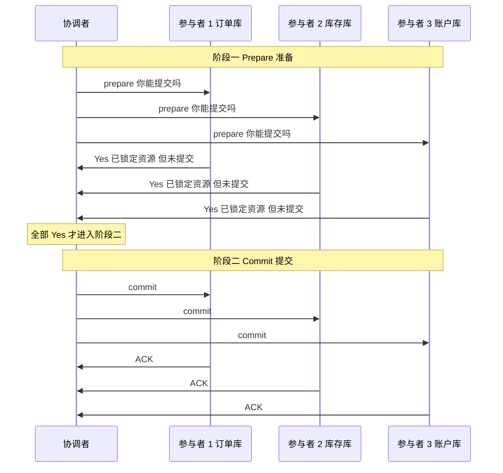
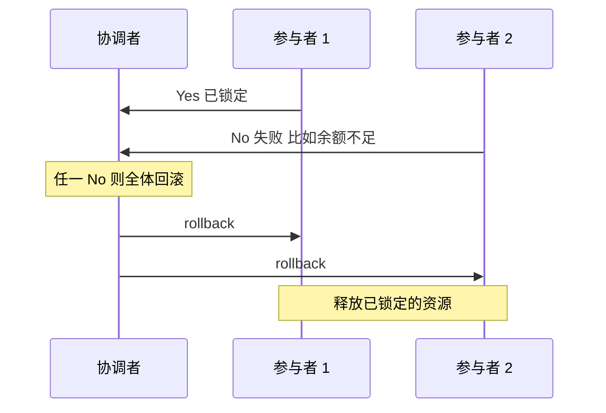
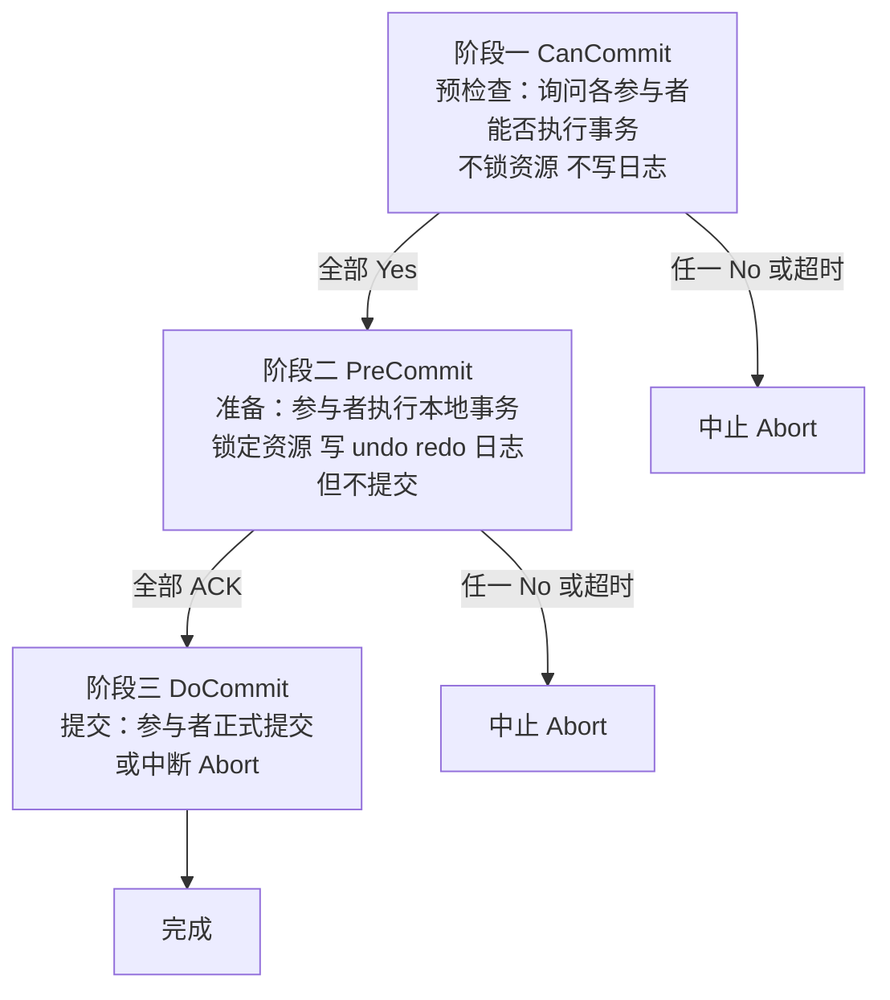
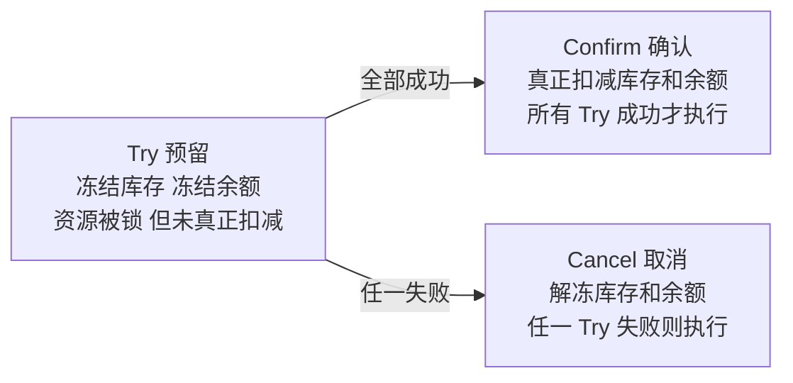
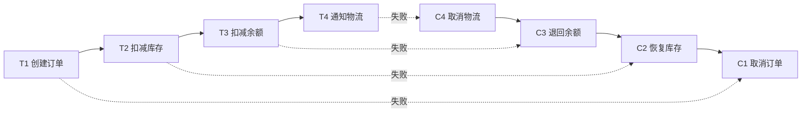
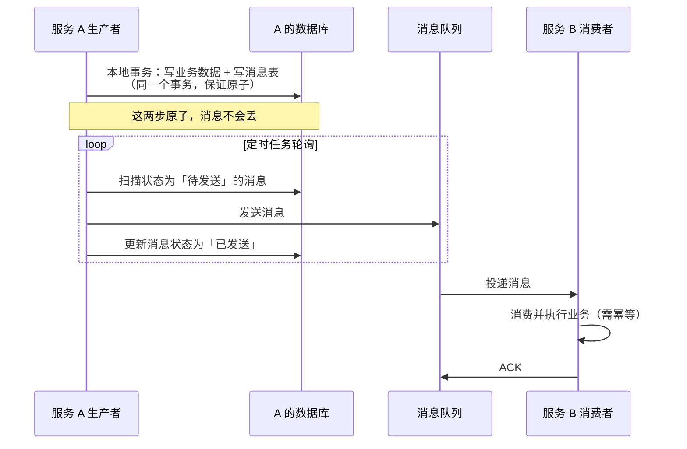
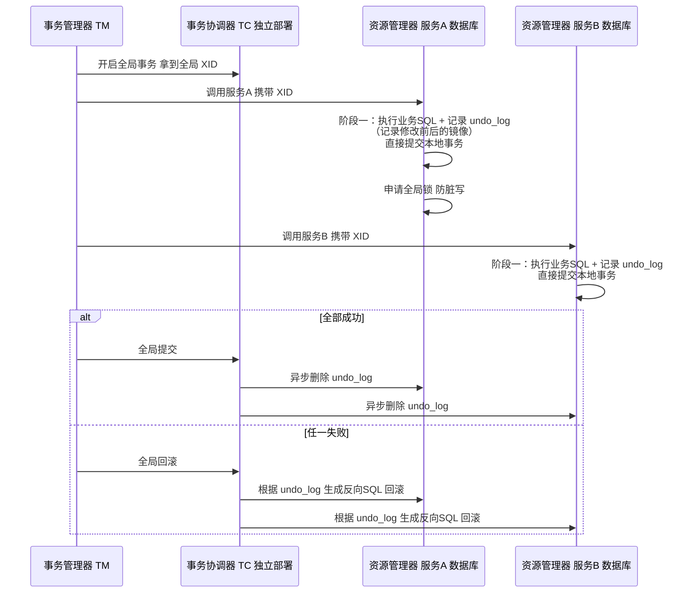
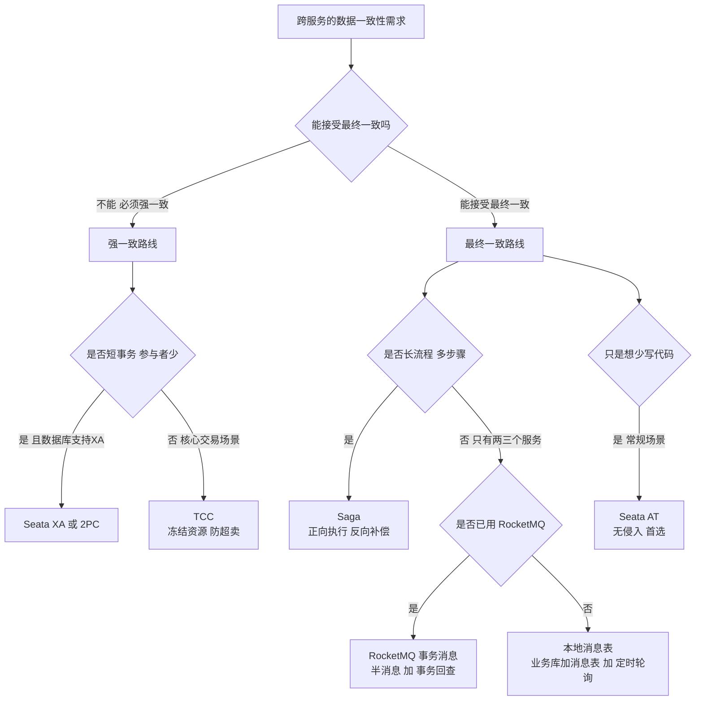

# 02 · 分布式事务

> **一句话主线**：分布式事务要解决的是「**一个业务操作跨了多个服务/多个数据库，怎么保证要么全成功、要么全不生效**」。它比单机事务难的根本原因是——**没有全局的锁和日志**。所以所有方案都在做两件事之一：要么**引入一个协调者去凑多数派**（2PC/3PC/Seata AT），要么**放弃原子性、改用补偿换最终一致**（TCC/Saga/本地消息表）。**选型的本质是：业务能接受「锁住资源等」还是「先做后补」**。
>
> **本模块定位**：`distributed_consensus/` 的**高频面试模块**，也是 `03_分布式消息队列.md`（事务消息是「可靠消息最终一致性」的实现载体）的直接上游。理论基础见 `00_分布式基础理论.md` 的 BASE 与最终一致。

---

## 目录

- [零、先分清两个「两阶段提交」（术语消歧）](#零先分清两个两阶段提交术语消歧)
- [一、2PC 两阶段提交](#一2pc-两阶段提交)
- [二、3PC 三阶段提交](#二3pc-三阶段提交)
- [三、TCC](#三tcc)
- [四、Saga](#四saga)
- [五、本地消息表与可靠消息最终一致性](#五本地消息表与可靠消息最终一致性)
- [六、Seata：四种模式](#六seata四种模式)
- [七、统一选型决策表](#七统一选型决策表)
- [本模块速记（考前 10 分钟）](#本模块速记考前-10-分钟)
- [面试官深挖追问](#面试官深挖追问)

---

## 零、先分清两个「两阶段提交」（术语消歧）

⚠️ **这是一处极易混淆的点**，面试中说出来是明显的加分项。

「两阶段提交」这个词在本仓库里出现了**两次**，但指的是**两件完全不同的事**：

| | **MySQL 内部的「两阶段提交」** | **分布式事务的 2PC** |
|---|---|---|
| **英文** | Two-Phase Commit（指 Redo Log 与 Binlog 的一致性） | Two-Phase Commit（XA 协议） |
| **要解决什么** | **单个 MySQL 实例内部**，Redo Log（存储引擎层）与 Binlog（Server 层）如何原子写入，保证崩溃恢复 + 主从复制一致 | **跨多个数据库/服务**，如何让 N 个参与者一起提交或一起回滚 |
| **参与方** | Redo Log、Binlog（同一实例内） | 协调者 + 多个资源管理器（不同实例/不同中间件） |
| **两个阶段** | Prepare（写 Redo，标记 prepare）→ Commit（写 Binlog，提交 Redo） | Prepare（各参与者锁定资源、准备）→ Commit/Rollback（协调者统一发令） |
| **详细位置** | [`db/00_MySQL_日志与内部2PC.md`](../db/00_MySQL_日志与内部2PC.md) | 本模块第一节 |
| **有协调者吗** | 无（是**同一个进程内的两个日志文件**的顺序约定） | **有**（独立的协调者组件） |

> **一句话区分**：MySQL 的「两阶段提交」是**一个进程内两个日志文件**的对齐；分布式 2PC 是**多个进程之间**的对齐。前者不涉及网络与协调者，后者才是真正的分布式协议。
>
> 面试时如果面试官说「讲讲两阶段提交」，**先反问一句**「您是指 MySQL 内部 Redo/Binlog 的两阶段提交，还是 XA 的分布式 2PC？」——这个问题本身就能体现你分得清。

---

## 一、2PC 两阶段提交

### 1. 通俗原理

把分布式事务比作 **「公司团建订餐」**

- **角色**：协调者 = 行政小姐姐；参与者 = 各个部门
- **阶段 1：准备阶段**
  行政挨个问部门：「周五团建吃火锅，你们部门能去不？」
  每个部门确认后回复「能去」，行政就让火锅店**预留好座位**（对应：参与者执行本地操作，锁定资源，不最终提交）。
- **阶段 2：提交阶段**
  只有**所有部门都回复能去**，行政才会给火锅店说「确定下单」（对应：协调者发提交指令，参与者最终提交事务）；
  只要有一个部门说「去不了」，行政就会取消预订（对应：协调者发回滚指令，参与者释放资源）。

**图 2-1：2PC 流程（成功路径）**

### 2. 核心特点

- 强一致性，像「必须所有人同意才能定」，简单直接
- **优点**：实现简单、数据库原生支持（XA 规范）、强一致
- **缺点**：见下节——这是面试真正要答的部分

### 3. 四个缺陷（面试必须答全）

| 缺陷 | 具体表现 | 后果 |
|------|---------|------|
| **① 同步阻塞** | 参与者在 Prepare 之后、收到 Commit/Rollback 之前，**一直持有资源锁**（数据库行锁/表锁） | 整个事务期间**资源被独占**，并发能力急剧下降。这是 2PC 性能差的主因 |
| **② 协调者单点故障** | 协调者在发完 Prepare、还没发 Commit 时宕机 | 所有参与者**卡在 Prepare 状态**，锁不释放，直到协调者恢复。极端情况需要**人工介入** |
| **③ 参与者单点故障** | 某参与者在 Prepare 后宕机 | 协调者收不到应答，可能一直等待（或超时后**不确定**该提交还是回滚） |
| **④ 分区下的「不确定态」（最严重）** | 协调者发出 Commit 后网络分区，只有部分参与者收到 | 已提交的参与者提交了、未收到的**还锁着**。整个系统进入一个**部分提交**的状态，且**任何一方都不知道全局该是什么结果** |

> **⚠️ 第 ④ 点才是 2PC 真正的死穴**：它破坏了 2PC 号称的「原子性」。协调者一旦决策并发出 Commit，就**无法撤销**——如果此时有参与者收不到，它只能**无限重试直到送达**（否则数据永久不一致）。这被称为「**阻塞式原子提交**」的根本局限。
>
> **更准确的术语**：2PC 在**无故障**时提供原子性；在**协调者故障**时提供的是「**原子性 or 阻塞**」——牺牲可用性来保住原子性。这正是 CAP 里 CP 的体现（见 `00_分布式基础理论.md`）。

> **面试加分**：可以补一句「所以 2PC 适合**短事务**（锁持有时间短）、**参与者少**（减少失败概率）、**同机房**（网络可靠）的场景，比如单体应用拆库不拆表的过渡期。跨微服务的**长事务**绝对不能用 2PC。」

---

## 二、3PC 三阶段提交

### 1. 通俗原理

是 2PC 的「升级版团建订餐」，解决 2PC 的**卡死问题**

- 新增 **「预检查阶段」** + **「超时机制」**
  行政先问部门：「周五有空不？」（预检查，**不用锁定火锅店座位**），确认大部分人有空，再进入准备阶段（让火锅店留座）；
  就算行政小姐姐中途失联，超过时间，部门会自动默认「活动取消」，不会一直占着座位（对应：超时自动终止，避免资源长期锁定）。

**图 2-2：3PC 三阶段**

3PC 相对 2PC 的两点改动：

| 改动 | 作用 |
|------|------|
| **拆出 CanCommit 阶段** | 把「能不能做」和「准备好做」分开，避免**过早锁资源** |
| **引入超时机制** | 参与者在 **PreCommit 后**等待 DoCommit 超时，会**自动提交**（而不是一直等）。协调者等待参与者也超时则中止 |

### 2. 澄清一个常见误解（重要）

网上很多资料说「3PC 解决了 2PC 的阻塞问题、能在分区下保证一致」——**这不准确**。

| 说法 | 实际情况 |
|------|---------|
| 「3PC 解决了 2PC 的单点阻塞」 | **部分解决**。超时机制确实降低了参与者无限等待的概率，但**并没有消除阻塞**——PreCommit 阶段仍然锁资源 |
| 「3PC 在分区下能保证一致性」 | **不能**。3PC 反而引入了新问题：参与者超时后会**自动提交**，如果此时协调者其实决定的是「中止」，就会出现**部分提交**，一致性被破坏 |
| 「3PC 是 2PC 的完美升级」 | **不是**。3PC 用「一致性」换「阻塞减少」。实际工程中**几乎没有生产系统用 3PC**——它是一个**理论改进**，工业界的答案是 **Paxos/Raft**（见 `01_共识算法.md`） |

> **面试标准答法**：「3PC 通过拆分阶段和引入超时，减少了 2PC 的同步阻塞，但它**没有解决分区下的一致性问题**——恰恰相反，参与者超时自动提交可能造成部分提交。所以 3PC 在工业界基本不用。真正解决这类问题的是**共识算法**，比如用 Raft 把『协调者的决策』本身做成一个强一致的复制日志。」
>
> 这一句「工业界不用 3PC，用 Raft」能把答案档次直接拉高。

---

## 三、TCC

### 1. 通俗原理

把分布式事务比作 **「网购下单付款」**

- **角色**：Try = 下单；Confirm = 付款；Cancel = 取消订单
- **Try 阶段：预留资源**
  你选好商品下单，系统会**冻结库存**（别人买不了）+ **冻结你的账户余额**（钱不会直接扣），只占住资源，不完成交易。
- **Confirm 阶段：确认提交**
  你付款成功后，系统才会**真正扣减库存** + **扣减余额**，完成交易（只有所有服务的 Try 都成功，才执行 Confirm）。
- **Cancel 阶段：取消回滚**
  你取消订单，系统会**释放冻结的库存** + **解冻余额**，恢复到下单前的状态（只要有一个服务 Try 失败，就执行 Cancel）。

**图 2-3：TCC 三阶段**

### 2. 核心特点

- **全程不阻塞**（因为不持有数据库锁，用的是业务层的「冻结」状态），性能高，像「先占坑再付款」
- **强一致**（业务层自己保证），灵活性高
- **缺点**：需要业务代码写 **3 套逻辑**（Try/Confirm/Cancel），侵入性强，开发与维护成本高

### 3. ⚠️ 三大实战陷阱（面试高分区）

这是 TCC **最容易被追问**、也是**实际项目最容易踩坑**的地方。很多候选人能背出 Try/Confirm/Cancel，但答不出这三个。

| 陷阱 | 产生原因 | 后果 | 解决方案 |
|------|---------|------|---------|
| **① 空回滚** | Try **根本没执行**（比如网络超时，请求没到），但事务协调器以为失败了，发出了 **Cancel** | 一个从未冻结过的资源被「解冻」→ **凭空多出资源**（库存变多、余额变大） | Cancel 里**先判断 Try 是否执行过**（查事务控制表）。**没执行过就空返回**，不做任何解冻 |
| **② 悬挂** | Try 因为网络延迟**后到**，而 Cancel **已经先执行完了** | Cancel 解冻完了，Try 才把资源冻上 → 资源**永久冻结**（再也没人来解了） | Try 执行前**先检查事务状态**：如果发现已经 Cancel 过，就**直接拒绝执行 Try**（不允许回滚后的事务再预留） |
| **③ 幂等** | 网络重试导致 Confirm/Cancel 被**重复调用** | 库存被扣两次、余额被解两次 | Confirm/Cancel 必须**幂等**：用事务 ID 去重，重复调用直接返回成功 |

> **一句话记**：
> - **空回滚** = 「没冻过，却来解冻」→ Cancel 要**判空**
> - **悬挂** = 「解冻完了，才来冻结」→ Try 要**判重**
> - **幂等** = 「同一指令来了两次」→ 都要**去重**
>
> **工程标准做法**：维护一张**事务控制表**（`tcc_transaction`），字段含 `全局事务ID`、`分支事务ID`、`状态`（TRYING / CONFIRMED / CANCELLED）。Try、Confirm、Cancel 三个方法**进入时都先查这张表并加行锁**，根据状态决定「执行 / 拒绝 / 直接返回」。这样三个陷阱一次性全解决。

> **面试话术**：「TCC 光会写三个方法不够，**关键在于处理空回滚、悬挂和幂等**。我们的做法是建一张事务控制表，Try/Confirm/Cancel 进来都先按 `全局事务ID + 分支ID` 查状态并加行锁——Cancel 发现没 Try 过就空返回（防空回滚），Try 发现已经 Cancel 过就直接拒绝（防悬挂），三者都用状态机保证幂等。」

### 4. TCC 与 2PC 的本质区别

| 维度 | 2PC | TCC |
|------|-----|-----|
| **锁定层次** | **数据库层**（行锁，不可控） | **业务层**（业务自己定义「冻结」状态） |
| **阻塞** | 同步阻塞，锁持有到全局提交 | **不阻塞数据库**（用的是业务状态，不是数据库锁） |
| **粒度** | 数据库粒度，无法定制 | **业务粒度**，可以只冻一部分、可以设超时 |
| **侵入性** | 低（数据库/框架自动） | **高**（手写三套逻辑） |
| **一致性** | 强一致 | 强一致（业务保证） |
| **适用** | 短事务、少量参与者 | 核心交易（支付、库存） |

---

## 四、Saga

### 1. 通俗原理

把分布式事务比作 **「旅游报团流程」**

- 整个旅游流程拆成多个**独立小步骤**（本地事务）：报名 → 付定金 → 订机票 → 订酒店
- 每个步骤都对应一个**反向补偿步骤**：
  - 订酒店失败 → 退机票 → 退定金 → 取消报名
  - 订机票失败 → 退定金 → 取消报名
- 执行逻辑：**按顺序执行正向步骤**，哪一步失败，就**从哪一步往回执行补偿步骤**

**图 2-4：Saga 正向执行与反向补偿**

### 2. 核心特点

- **不用锁资源**，像「一步错，回头改」，适合**长流程业务**
- 每个本地事务**立即提交**，不阻塞资源
- **缺点**：中间状态可能不一致（比如机票订好了，酒店没订好，会有短暂的「机票已订」状态），**最终**才会一致
- **缺点**：**补偿不是回滚**——补偿操作必须由业务自己实现，且未必能完全还原（比如「发出去的短信」无法补偿）

### 3. 两种实现方式（面试加分）

| 方式 | 机制 | 优点 | 缺点 |
|------|------|------|------|
| **编排（Orchestration）** | 有一个**中心协调器**（状态机引擎）负责按顺序调用各服务、决定何时补偿 | **逻辑集中、易理解、易监控**、流程可视化；编排器可以持久化状态 | 协调器是中心，需保证其高可用；服务与编排器耦合 |
| **协同（Choreography）** | **没有中心**，各服务通过**发布/订阅事件**互相触发，每个服务自己监听事件并决定是否补偿 | 松耦合、无单点、易扩展 | **流程分散在各方，难以理解和排查**；容易形成循环依赖 |

> **面试话术**：「Saga 有两种落地方式。**编排式**是中心化的，有一个状态机引擎（比如 Seata SAGA、Camunda 或自研）负责驱动整个流程，好处是**流程可视、易排查**，我们项目用的是这种；**协同式**是去中心化的，每个服务监听事件自行决定下一步，松耦合但**链路难追踪**。长流程、参与方多的业务一般选编排。」

### 4. Saga 与 TCC 的关键区别

| 维度 | TCC | Saga |
|------|-----|------|
| **有无预留** | 有（Try 阶段冻结资源） | **无**（直接执行，失败再补偿） |
| **一致性** | 强一致（资源被冻结，不会超卖） | **最终一致**（中间可能有超卖/中间态） |
| **隔离性** | 较好（冻结相当于软锁） | **弱**（无隔离，中间态对外可见） |
| **适用** | 短而关键的事务（支付、库存） | **长流程**（订单→支付→物流→发货） |
| **补偿代价** | 低（解冻即可） | 高（要设计业务补偿） |

> **一句话区分**：**TCC 是「先冻结再干活」，Saga 是「先干活，错了再擦掉」**。前者防超卖，后者适合长流程。

---

## 五、本地消息表与可靠消息最终一致性

### 1. 通俗原理

把分布式事务比作 **「外卖点餐送餐」**

- **商家操作（本地事务）**：你下单后，商家同时做两件事（在一个本地事务里）
  1. 生成订单（执行业务操作）；
  2. 写一张纸条（本地消息表）：「给 XX 小区送一份麻辣烫」。
     → 这两件事要么都成功，要么都失败，**保证消息不会丢**。
- **骑手送餐（消息投递）**：商家定时看纸条，把纸条交给骑手（定时任务扫描消息表，发消息到 MQ）；如果骑手没送到，就再派一个骑手（**重试机制**）。
- **你收餐（消息消费）**：你收到麻辣烫，告诉商家「收到了」（下游服务消费消息，执行业务）；商家划掉纸条（更新消息状态为「已完成」）。

**图 2-5：本地消息表流程**

### 2. 核心特点

- **不用改核心业务代码**（业务操作和消息写入在同一个本地事务里），像「留纸条备忘」，简单易落地
- **缺点**：有延迟（下单到送餐有时间差），是**最终一致性**
- **缺点**：需要**定时轮询**（有额外开销与延迟）；消息表与业务库耦合（同库有容量压力）
- **关键前提**：消费端必须**幂等**（因为消息可能重复投递）——见 `05_分布式数据工程.md`

### 3. 演进版：可靠消息最终一致性（RocketMQ 事务消息）

**本地消息表**是把消息存进**自己的库**；**RocketMQ 事务消息**是把「消息暂存」这件事交给 **MQ 自己**（半消息），省掉了本地消息表。详见 [`03_分布式消息队列.md`](03_分布式消息队列.md) 的事务消息一节。

| 对比 | 本地消息表 | RocketMQ 事务消息 |
|------|-----------|------------------|
| 消息暂存在哪 | **业务库**（自己建表） | **MQ**（半消息） |
| 额外依赖 | 定时任务轮询 | MQ 的事务回查机制 |
| 侵入性 | 低（但要多一张表 + 一个定时任务） | 低（发半消息 → 执行本地事务 → 提交/回滚） |
| 适用 | 中小系统、任意 MQ | 已使用 RocketMQ 的系统 |

---

## 六、Seata：四种模式

**Seata** 是阿里开源的分布式事务框架，是目前**国内企业的主流选型**。它把多种模式封装成一个统一框架（一个全局事务 ID `XID` 贯穿全链路，通过 `undo_log` 表与 TC 协调）。

### 1. 四种模式对比

| 模式 | 实现方式 | 一致性 | 侵入性 | 适用场景 |
|------|---------|--------|--------|---------|
| **AT**（Auto Transaction） | **自动**生成反向 SQL 回滚（基于 `undo_log`） | 最终一致（读已提交级别的近似） | **低**（无业务侵入，加个注解即可） | **大部分分布式事务场景**（国内主流） |
| **TCC** | 手写 Try/Confirm/Cancel 三个方法 | 强一致 | **高** | 金融/电商核心（支付、库存） |
| **SAGA** | 状态机 + 补偿服务 | 最终一致 | 中 | 跨多服务的**长事务** |
| **XA** | 基于数据库原生 XA 协议 | 强一致 | 低 | 强一致要求 + 支持 XA 的数据库 |

### 2. Seata AT 模式原理（必问）

**图 2-6：Seata AT 两阶段**

**两阶段**：

1. **第一阶段（本地事务 + 直接提交）**：各分支服务执行业务 SQL，**并记录 `undo_log`**（同时记录**修改前**和**修改后**的数据镜像），然后**直接提交本地事务**（不像 2PC 那样锁着不提交！）。同时向 TC **申请全局锁**，防止其他全局事务修改同一行（**防脏写**）。
2. **第二阶段（全局提交/回滚）**：
   - **全局成功** → TC 通知各 RM **异步删除 `undo_log`**（极快）
   - **全局失败** → TC 通知各 RM，RM **根据 `undo_log` 里的「修改前镜像」生成反向 SQL** 回滚

> **AT 的精髓**：第一阶段就**提交了本地事务**（不像 2PC 那样占着锁等），所以**不长时间持锁**、性能远好于 2PC。代价是：**中间态对其它事务可见**（虽然靠**全局锁**挡住了会脏写的事务），且回滚靠「反向 SQL」是**补偿**而非真回滚。

> **必问追问：AT 模式怎么防脏写？**
> → 靠**全局锁**。第一阶段提交前，RM 要向 TC 申请该数据行的**全局锁**；如果这一行已被**另一个未完成的全局事务**持有全局锁，则申请失败、当前事务重试或回滚。全局锁与数据库的本地锁是两个层次——本地锁在本地事务提交后就释放了，**全局锁会一直持有到全局事务结束**，这正是 AT 能「提前提交本地事务却不脏写」的原因。

> **必问追问：AT 模式的读隔离级别？**
> → 默认是**读未提交（Read Uncommitted）** 级别的近似——因为第一阶段就提交了本地事务，其它事务（不带 XID 的普通查询）能读到**未提交的全局事务**的中间数据。要读已提交，需要用 `SELECT ... FOR UPDATE`（会被全局锁挡住，等全局事务结束）。**这一点必须在面试中主动说**，是明显的加分项。

### 3. Seata TCC 模式

与手写 TCC 一样（Try/Confirm/Cancel），但 Seata 帮你做了：
- **事务控制表**与**幂等、空回滚、悬挂**的框架级处理（`@TwoPhaseBusinessAction`）
- 全局事务的**协调与重试**

> 所以面试里可以说：「如果项目已经引入 Seata，TCC 可以不用自己维护事务控制表——Seata 的 TCC 模式已经内建了防悬挂和防空回滚的机制，你只要实现三个方法。」这比纯背 TCC 原理更贴近实战。

### 4. 四种模式怎么选

| 你的场景 | 选 |
|---------|-----|
| 大部分常规场景，想少写代码 | **AT**（首选，无侵入） |
| 核心资金/库存，要强一致，能接受开发成本 | **TCC** |
| 跨多服务的长流程（订单→支付→物流→发货） | **SAGA** |
| 数据库支持 XA 且需要强一致 | **XA** |

---

## 七、统一选型决策表

**图 2-7：分布式事务选型决策树**

### 综合对比表

| 方案 | 核心思想 | 一致性 | 隔离性 | 侵入性 | 阻塞 | 优点 | 缺点 | 适用场景 |
|------|---------|--------|--------|--------|------|------|------|---------|
| **2PC** | 协调者先问「准备好了吗」，全票通过再「一起提交」 | 强一致 | 好 | 低 | **严重** | 强一致、数据库原生支持 | 同步阻塞、协调者单点、分区下不确定态 | 传统数据库跨库短事务 |
| **3PC** | 2PC 加预检查与超时 | 强一致（理论） | 好 | 低 | 减轻 | 减少阻塞 | **分区下可能不一致**、实现复杂、**工业界基本不用** | 理论参考 |
| **TCC** | 业务层：预留（Try）→ 确认（Confirm）→ 释放（Cancel） | 强一致 | 较好（软锁） | **高** | 无 | 性能好、不占数据库锁、粒度可控 | 三套逻辑、需处理空回滚/悬挂/幂等 | 资金交易、库存扣减 |
| **Saga** | 长事务拆成多个本地事务，失败时反向补偿 | 最终一致 | **弱** | 中 | 无 | 异步、高并发友好、适合长流程 | 无隔离、补偿非回滚、中间态可见 | 下单流程、跨服务编排 |
| **本地消息表** | 业务操作与消息写在同一本地事务 | 最终一致 | 弱 | 低 | 无 | 不依赖特定 MQ、简单易落地 | 有延迟、需定时轮询、表与业务库耦合 | 中小系统、跨服务异步 |
| **RocketMQ 事务消息** | 半消息 + 事务回查 | 最终一致 | 弱 | 低 | 无 | 无侵入、异步、MQ 兜底回查 | 依赖 RocketMQ | 电商下单、支付、库存 |
| **Seata AT** | 本地事务 + `undo_log` 反向补偿 + 全局锁 | 最终一致（读未提交近似） | 中（全局锁防脏写） | **低** | 无 | **无业务侵入**、自动化、开发效率高 | 依赖 Seata 部署、中间态可见 | 90% 的常规分布式事务场景 |

> **记忆技巧**：
> - 2PC 像「**全班表决**」——所有人举手才下课，有一个人没举手全班等着
> - 3PC 像「**先问有空没，再问去不去**」——多问一轮减少卡死，但没根治
> - TCC 像「**订酒店先冻结额度再扣款**」——先占坑，成了再付，不成就放
> - Saga 像「**流水线上的回滚工序**」——一步错，倒着把前面的都撤了
> - 本地消息表像「**留纸条备忘**」——先记账再办事，办完划掉
> - Seata AT 像「**自动存档 + 一键读档**」——不用你写回滚逻辑，框架帮你 undo

---

## 本模块速记（考前 10 分钟）

| # | 问题 | 关键词速答 |
|---|------|-----------|
| 1 | MySQL 内部「两阶段提交」vs 分布式 2PC？ | MySQL 的是 **Redo Log 与 Binlog** 在一个实例内的对齐（**无协调者、无网络**）；2PC 是**跨多个数据库/服务**的 XA 协议（**有协调者**）。详见 [`db/00_MySQL_日志与内部2PC.md`](../db/00_MySQL_日志与内部2PC.md) |
| 2 | 2PC 两个阶段？ | **Prepare**（各参与者执行并锁定资源，不提交）→ **Commit/Rollback**（协调者统一发令） |
| 3 | 2PC 四个缺陷？ | ①**同步阻塞**（锁持有到全局结束）②**协调者单点**③**参与者单点**④**分区下不确定态**（部分提交，无法撤销） |
| 4 | 2PC 的适用边界？ | 短事务、参与者少、同机房。**跨微服务长事务绝对不能用** |
| 5 | 3PC 改了什么？ | 拆出 **CanCommit**（预检查，不锁资源）+ 引入**超时**（参与者 PreCommit 后等 DoCommit 超时会**自动提交**） |
| 6 | 3PC 能保证分区下一致吗？ | **不能**。超时自动提交可能造成**部分提交**，一致性反而被破坏。**工业界基本不用 3PC**，答案是 Raft |
| 7 | TCC 三阶段？ | **Try** 预留资源（冻结）→ **Confirm** 确认（真正扣减）→ **Cancel** 取消（解冻） |
| 8 | TCC 三大陷阱？ | **空回滚**（没 Try 却来 Cancel → Cancel 要**判空**）、**悬挂**（Cancel 完 Try 才到 → Try 要**判重**）、**幂等**（重复调用 → 用事务 ID**去重**） |
| 9 | TCC 防三大陷阱的标准做法？ | 维护**事务控制表**，三个方法进入都先按 `全局事务ID + 分支ID` **查状态并加行锁** |
| 10 | TCC vs 2PC 的本质区别？ | 2PC 锁的是**数据库层**（行锁，不可控）；TCC 锁的是**业务层**（业务自定义冻结状态，不阻塞数据库） |
| 11 | Saga 的核心思想？ | 长事务拆成多个**本地事务立即提交**，失败时**反向执行补偿**（C1←C2←C3…） |
| 12 | Saga 两种实现？ | **编排（Orchestration）**=中心状态机，流程可视易排查；**协同（Choreography）**=事件驱动无中心，松耦合但链路难追踪 |
| 13 | Saga 的最大缺点？ | **无隔离性**（中间态对外可见，可能超卖）；且**补偿 ≠ 回滚**（发出去的短信无法补偿） |
| 14 | TCC 与 Saga 一句话区分？ | **TCC 先冻结再干活**（防超卖）；**Saga 先干活，错了再擦掉**（适合长流程） |
| 15 | 本地消息表怎么做？ | 业务操作与消息写入**同一个本地事务**（保证不丢）→ **定时任务轮询**消息表发 MQ → 消费端**幂等**处理 |
| 16 | 本地消息表的缺点？ | 有延迟（最终一致）、需定时轮询、消息表与业务库**耦合** |
| 17 | RocketMQ 事务消息怎么替代本地消息表？ | 用**半消息**代替「本地消息表」，用**事务回查**代替「定时轮询」。详见 `03` |
| 18 | Seata 四种模式？ | **AT**（无侵入，`undo_log` 反向 SQL，**首选**）、**TCC**、**SAGA**、**XA** |
| 19 | Seata AT 两阶段？ | ①**执行业务 SQL + 记 `undo_log` + 直接提交本地事务**（不锁着等！）+ 申请**全局锁**；②全局成功则**异步删 `undo_log`**，失败则**用 `undo_log` 生成反向 SQL 回滚** |
| 20 | AT 怎么防脏写？ | **全局锁**。本地锁在本地事务提交后就释放，**全局锁持有到全局事务结束**——这是「提前提交却不脏写」的关键 |
| 21 | AT 的隔离级别？ | 默认是**读未提交**的近似（本地事务已提交，普通查询能读到中间态）。要读已提交得用 `SELECT ... FOR UPDATE`（会被全局锁挡住） |
| 22 | 选型一句话？ | 常规场景选 **Seata AT**；核心资金/库存选 **TCC**；长流程选 **Saga**；中小系统/异步选 **本地消息表或 RocketMQ 事务消息** |

---

## 面试官深挖追问

1. **「2PC 的 Prepare 阶段到底锁的是什么？」**
   → 锁的是**本地数据库的资源**（XA 协议下由数据库实现，通常是行锁/表锁）。参与者执行了业务操作但**不提交**，所以这些锁**一直持有到收到 Commit/Rollback 为止**。这就是「同步阻塞」的来源——不是网络阻塞，是**数据库资源被锁着**。

2. **「协调者宕机后，参与者怎么办？」**
   → 参与者在 Prepare 后处于**不确定态**，只能**一直等待**（或超时后询问其他参与者/协调者）。这是个**阻塞式**协议——2PC 牺牲可用性保原子性。3PC 想用「超时自动提交」解决，但这引入了新的不一致风险。**根本解法是把协调者的决策本身做成一个 Raft 复制的日志**（比如 Seata 的 TC 集群、或直接用 Raft 做协调者）。

3. **「为什么 3PC 在工业界几乎没人用？」**
   → 三点：① 它**没有解决分区下的一致性问题**（超时自动提交会造成部分提交）；② 它的额外阶段（CanCommit）**增加了网络开销**；③ 它的目标（缓解阻塞）已经被**更好的方案**取代——要么用 TCC/Saga 放弃强一致，要么用 Raft 做协调者。所以 3PC 主要存在于教材里。

4. **「TCC 的『悬挂』能举个具体例子吗？」**
   → 能。全局事务的 Try 请求因为网络延迟卡在链路上，协调器等超时认为失败了，于是发起 Cancel 并把资源解冻（此时资源本来就是没冻的，靠**判空**空返回）。**Cancel 完成后**，那个迟到的 Try 请求才到达 —— 它**不知道已经被 Cancel 了**，把资源冻上了。从此这笔资源**永久冻结**，再没有任何机制会来解它。**解法**：Try 执行前先查事务状态表，发现状态已是 CANCELLED 就**直接拒绝**（不执行冻结）。

5. **「Seata AT 说『无业务侵入』，那它靠什么生成反向 SQL？」**
   → 靠 **`undo_log` 表**。RM 在执行每条业务 SQL 前，会**查询该行修改前的数据**（beforeImage），执行后再查**修改后的数据**（afterImage），两个镜像都存进 `undo_log`。回滚时，用 beforeImage **生成反向 SQL**（比如 `UPDATE` 的原值回写、`INSERT` 转 `DELETE`）。**前提**：业务表必须有**主键**（否则无法定位行），这也是 AT 模式的限制之一。

6. **「如果 AT 模式回滚时，数据已经被别人改了怎么办？」**
   → 这正是**全局锁**要解决的问题。全局锁保证「**同一行数据不会被两个未完成的全局事务同时修改**」。回滚时 RM 会先校验当前数据是否与 `afterImage` 一致（说明中间没被人改过），若不一致则说明发生了脏写，会抛异常并**告警人工介入**。所以 AT 靠「全局锁 + 回滚前校验」双保险。

7. **「Saga 的补偿操作失败了怎么办？」**
   → 必须**重试直到成功**（补偿操作要设计成**幂等**且**最终可成功**）。如果补偿本身永久失败（比如下游服务下线），就需要**人工介入 + 对账**。所以 Saga 的补偿设计原则是：① 补偿必须幂等；② 补偿要尽量「必然能成功」（比如「恢复库存」比「退款」更容易成功）；③ 有兜底的对账任务。

8. **「订单超时未支付自动取消，这算分布式事务吗？该用什么方案？」**
   → 算**最终一致**场景。典型做法是**本地消息表 / RocketMQ 延时消息**：下单时用**延时消息**在 30 分钟后触发「检查支付状态」，未支付则执行「取消订单 + 恢复库存」。这不是分布式事务中的「跨服务原子操作」，而是**基于延时的补偿**。用延时消息而不是轮询全表，能避免扫表压力（见 `03_分布式消息队列.md` 延时消息一节）。

9. **「你们项目实际用的是哪种？为什么？」**
   → **这是最关键的一题**，一定要结合自己的项目说。参考话术：「我们期权风控系统里，**跨服务的最终一致**用的是 **RocketMQ 事务消息**——比如风控规则变更后要同步到多个下游，用半消息保证『本地记录变更 + 通知下游』的原子性；**同一份数据在多个库**的场景（比如订单与账户）用的是 **Seata AT**，因为它无侵入，加个 `@GlobalTransactional` 就行。**没有用 TCC**，因为 TCC 需要三套逻辑，开发成本高，而我们这个场景对短暂中间态是可接受的。」

---

## 参考资料

见 [`99_参考资料.md`](99_参考资料.md)。
