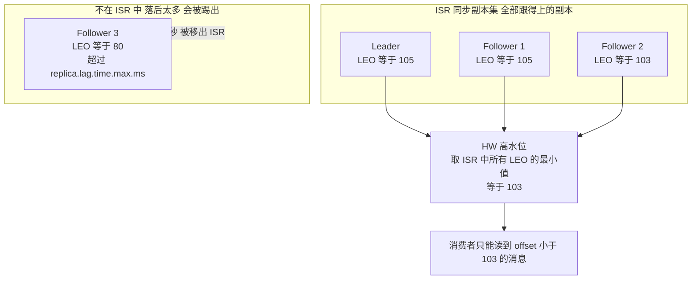
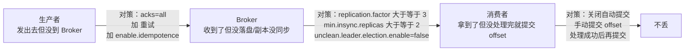
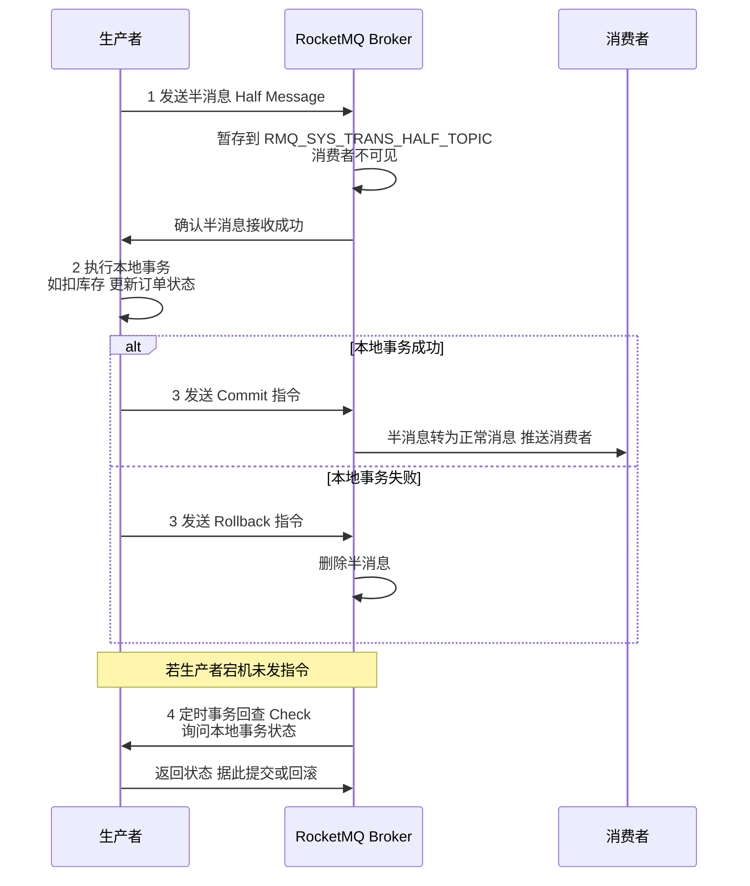
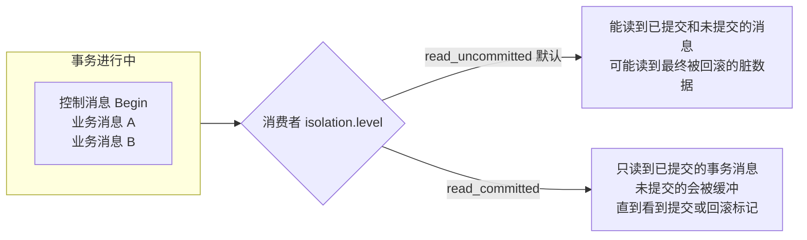
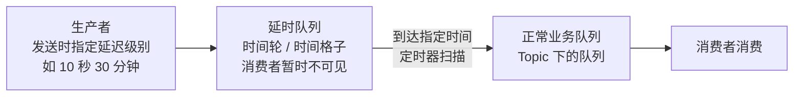
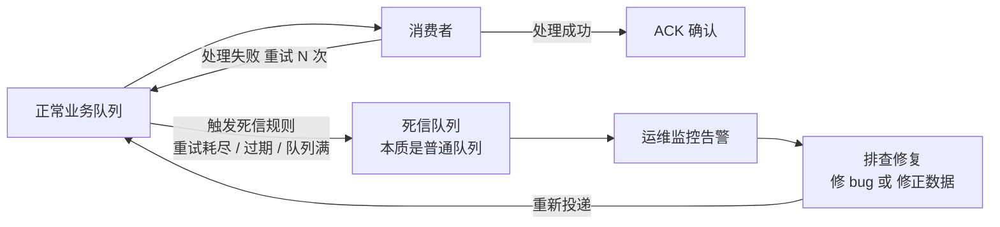
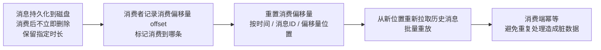

# 03 · 分布式消息队列

> **一句话主线**：消息队列在分布式系统里干三件事——**解耦**（生产者不关心谁消费）、**削峰**（把瞬时洪峰变成平滑流）、**异步**（让主链路快速返回）。但要真正用好它，必须回答四个问题：**消息会不会丢**（可靠性）、**会不会重复**（幂等）、**会不会乱序**（顺序性）、**发消息和本地事务怎么保持一致**（事务消息）。前三个问题按「**生产者 → Broker → 消费者**」三段拆解，第四个问题正是 `02_分布式事务.md` 的「可靠消息最终一致性」。
>
> **本模块定位**：`distributed_consensus/` 的**工程落地模块**。**Kafka 是重中之重**（面试被问比例最高），RocketMQ 是国内电商/金融主流，两者的对比必须能讲。

---

## 目录

- [一、主流 MQ 全景对比](#一主流-mq-全景对比)
- [二、Kafka 核心原理](#二kafka-核心原理)
- [三、消息队列三大经典问题](#三消息队列三大经典问题)
- [四、四大特性之一：事务消息](#四四大特性之一事务消息)
- [五、四大特性之二：延时消息](#五四大特性之二延时消息)
- [六、四大特性之三：死信队列](#六四大特性之三死信队列)
- [七、四大特性之四：消息回溯](#七四大特性之四消息回溯)
- [八、主流 MQ 对四大特性的支持情况](#八主流-mq-对四大特性的支持情况)
- [本模块速记（考前 10 分钟）](#本模块速记考前-10-分钟)
- [面试官深挖追问](#面试官深挖追问)

---

## 一、主流 MQ 全景对比

**核心定位**：解决分布式架构中**系统解耦、流量削峰、异步通信、数据同步**问题，是分布式组件的「通信枢纽」。

**核心设计**：所有消息队列都基于**生产者-消费者模型**，核心差异在**协议、存储、副本机制、吞吐量、功能特性**。面试中常围绕「吞吐量 / 可靠性 / 功能」对比选型。

| 组件 | 开源方 | 核心定位 | 核心协议 / 架构 | 存储机制 | 核心特性 | 性能 / 吞吐量 | 典型场景 |
|------|--------|---------|---------------|---------|---------|-------------|---------|
| **Kafka** | Apache | 高吞吐、大数据消息队列 | TCP 自定义协议，分区 + 副本；**早期依赖 ZK，2.8+ 可用 KRaft 自管理** | 磁盘顺序写（持久化） | 高吞吐、高可用、日志型存储、流处理集成、**原生事务** | 极高（10 万级 TPS） | 大数据、日志采集、流处理（Flink/Spark） |
| **RocketMQ** | 阿里（Apache） | 企业级消息队列 | TCP 自定义协议，主从 + 集群 | 磁盘顺序写 | 事务消息、延时消息、死信队列、消息回溯、高可靠 | 高（万级～10 万级 TPS） | 电商、金融、企业级分布式架构（**国内主流**） |
| **RabbitMQ** | RabbitMQ 团队 | 轻量、功能丰富的消息队列 | **AMQP**（高级消息队列协议），主从 | 内存 + 磁盘 | 丰富的交换机 / 队列模式、轻量、跨语言友好 | 中（万级 TPS） | 中小系统、轻量异步、即时通信 |
| **Pulsar** | Apache | 云原生多租户消息队列 | TCP 自定义协议，**存储/计算分离** | 分层存储（BookKeeper） | 多租户、高吞吐、低延迟、流批一体 | 极高（媲美 Kafka） | 云原生、多租户、流批一体架构 |

### 1. Kafka vs RocketMQ（国内企业最常问）

两者都是高吞吐、持久化的消息队列，核心差异在**企业级功能**和**生态**：

| 维度 | Kafka | RocketMQ |
|------|-------|----------|
| **优势** | 高吞吐 + 大数据生态（与 Flink/Spark 深度整合） | 企业级功能完善（**原生**支持事务消息、延时消息、死信队列、消息回溯） |
| **劣势** | 运维复杂（分区/副本管理繁琐）；核心 Broker **无原生延时消息、无原生死信队列** | 大数据生态不如 Kafka（国内有 Flink-RocketMQ 连接器可补） |
| **选型** | 大数据 / 流处理 / 日志采集 → **Kafka** | 电商 / 金融 / 企业级分布式架构 → **RocketMQ** |

> ⚠️ **注意措辞**（常见错误）：Kafka 的劣势是「**无原生延时消息、无原生死信队列**」，**不是**「无原生事务消息」——Kafka 自 0.11 起**有**原生事务（见[事务消息一节](#四四大特性之一事务消息)）。把这两者混为一谈是面试常见的翻车点。

### 2. RabbitMQ vs 前两者

RabbitMQ 的核心优势是**轻量 + 功能丰富 + 跨语言**，基于 AMQP 协议，支持**直连 / 扇出 / 主题 / 头**四种交换机，适合中小系统的轻量异步场景。

**缺点**：**吞吐量低**（基于 Erlang 开发，二次开发成本高）；持久化性能一般；不适合高吞吐的大数据 / 电商秒杀场景。

### 3. Pulsar vs Kafka

Pulsar 是云原生时代的「新一代 Kafka」，采用**计算 / 存储分离**的分层架构（Broker 无状态，存储交给 BookKeeper），比 Kafka **更易扩展、多租户支持更好**。

目前问题是**生态不如 Kafka 成熟**，国内企业落地较少，面试中**了解即可**。

---

## 二、Kafka 核心原理

> **这一节是面试重中之重**，Kafka 几乎必问。

### 1. 核心架构

| 概念 | 说明 |
|------|------|
| **Broker** | 一个 Kafka 服务节点；一个集群有多个 Broker |
| **Topic** | 逻辑上的消息分类（如 `order-created`） |
| **Partition（分区）** | Topic 的物理分片，**并行与顺序的基本单位**。一个 Topic 分成多个分区，分布在不同 Broker 上 |
| **Replica（副本）** | 每个分区有多个副本（`replication.factor`），一主多从。**Leader 负责读写，Follower 只同步** |
| **ISR（In-Sync Replicas）** | **同步副本集**：与 Leader 保持同步的副本集合（**含 Leader 自己**）。**不是所有副本，是跟得上的那部分** |
| **Consumer Group** | 消费者组。组内**一个分区只能被一个消费者消费**；组间可并行消费同一 Topic |
| **Offset** | 消费位点，标记消费者消费到哪条消息 |

### 2. 高吞吐的四个原因（必背）

| 原因 | 原理 |
|------|------|
| **磁盘顺序写** | 消息是**追加**写入的，顺序写比随机写快 1~2 个数量级（机械盘尤其明显） |
| **零拷贝（Zero-Copy）** | 用 `sendfile` 系统调用让数据**从页缓存直接送到网卡**，省掉「内核态→用户态→内核态」两次拷贝 |
| **批量发送 + 压缩** | 生产者攒批（`batch.size`、`linger.ms`）、Broker 端以**批次**为单位存储与传输、支持 lz4/zstd 压缩 |
| **分区并行** | 一个 Topic 多个分区可分布在多台 Broker 上，**读写并行**；消费者组内多个消费者并行消费 |

> **补充**：还有 **Page Cache**（读写都走操作系统页缓存，不直接落盘）与**稀疏索引**（用 `.index` 文件做二分查找，避免全文件扫描）。

### 3. ⚠️ 高可用机制：ISR 与提交条件（**面试高频陷阱**）

> **这是最容易答错的一点，务必记准。**

| 问题 | 正确答案 |
|------|---------|
| **消息什么时候算「已提交」（committed）？** | **当它被复制到 ISR 中的「全部」副本时**——不是多数派！ |
| **HW（High Watermark，高水位）怎么算？** | `HW = ISR 中所有副本 LEO（Log End Offset）的「最小值」`。**消费者只能读到 HW 之前的消息** |
| **`min.insync.replicas` 是干什么的？** | **它不是提交条件**，而是**写入准入闸门**：当 ISR 大小 **小于** 该值时，带 `acks=all` 的写入会被**拒绝**（`NotEnoughReplicasException`） |

> ❌ **常见错误**：「ISR 内**过半**副本同步成功则消息提交」——**错**。Kafka **不用多数派机制**（这是它和 Raft 最大的差别）。Kafka 用的是**全 ISR 复制**：ISR 里所有副本都跟上了，消息才算提交。
>
> 为什么会这样设计？因为 Kafka 的 ISR 本身是**动态收缩**的——跟不上的副本会被踢出 ISR，所以「ISR 全体」隐含了「当前跟得上的那些副本」，不需要再叠加多数派。

**图 3-1：Kafka 的 ISR、LEO 与 HW**

**ISR 的动态性**：

| 行为 | 触发条件 |
|------|---------|
| **收缩** | Follower 停止拉取，或落后超过 `replica.lag.time.max.ms`（默认 **30 秒**）→ 被移出 ISR |
| **扩张** | 被移出的 Follower 追上 Leader 后 → 重新加入 ISR |

**Leader 选举与 `unclean.leader.election.enable`**：

| 配置 | 行为 | 代价 |
|------|------|------|
| **`false`（默认，自 0.11）** | 从 **ISR 中**选新 Leader，保证已提交数据不丢 | 如果 ISR 全挂了，分区**保持不可用**（牺牲可用性） |
| **`true`** | 允许**非 ISR** 副本被选为 Leader（unclean election） | 换来可用性，但**可能永久丢数据，且 HW 会回退** |

> **面试标准答法**：「Kafka 的高可用靠**副本 + ISR**。ISR 是与 Leader 保持同步的副本集合。**消息的提交条件是 ISR 中「全部」副本都同步了，不是多数派**——这是 Kafka 和 Raft 最大的不同，因为 ISR 本身会被动态裁剪，跟不上的副本先被踢出去，所以『ISR 全体』已经隐含了『当前可用的副本』。HW 取 ISR 中所有 LEO 的最小值，消费者只能读到 HW 之前的消息。
>
> 另外，`min.insync.replicas` 常被误解——**它不是提交条件，而是写入准入闸门**：ISR 小于它时，带 `acks=all` 的写入会直接被拒绝。所以生产上的标准配方是 **`replication.factor=3` + `min.insync.replicas=2` + `acks=all` + `unclean.leader.election.enable=false`**，这个组合能容忍 1 个 Broker 故障且不丢数据。」

> **注意反过来的一面**：`min.insync.replicas=2` 时，如果挂掉 2 个 Broker（ISR 只剩 1 个），**写入会被阻塞**。这是可用性的代价，需要按业务权衡。

> **另一个细节**：Leader 选举和 ISR 维护是**控制面**操作（由 ZK 或 KRaft 控制器负责），**不在生产/消费的数据路径上**——所以元数据组件出问题不会直接阻塞消息收发，但可能导致选主变慢。

### 4. 消费机制

| 规则 | 说明 |
|------|------|
| **组内一个分区只被一个消费者消费** | 保证**分区内顺序**，也决定了**消费者数量超过分区数时会有消费者空闲** |
| **组间可并行** | 不同消费者组可以各自完整消费同一个 Topic（广播语义靠多个组实现） |
| **Offset 提交** | 自动提交（`enable.auto.commit=true`，可能丢/重复）vs **手动提交**（可靠，推荐） |
| **Rebalance** | 消费者增减时重新分配分区。频繁 Rebalance 会导致消费停顿，是**生产常见问题** |

---

## 三、消息队列三大经典问题

> **这是 MQ 面试的必考组合**，必须按「**生产者 + Broker + 消费者**」三个环节分析解决方案（下面的解法以 Kafka 为例，但也有通用性）。

### 1. 消息丢失

**图 3-2：消息丢失的三个环节与对策**

| 环节 | 会怎么丢 | 对策 |
|------|---------|------|
| **生产者** | 消息发出但网络中断 / Broker 没收到 | ① `acks=all`（等 ISR 全部确认）；② **重试**（`retries`）；③ **`enable.idempotence=true`**（防止重试造成重复） |
| **Broker** | 消息在页缓存还没落盘就宕机；或副本没同步就选主 | ① `replication.factor ≥ 3`；② `min.insync.replicas ≥ 2`；③ `unclean.leader.election.enable=false`；④ 必要时刷盘（牺牲性能） |
| **消费者** | 先提交 offset 再处理，处理中途挂了 | **关闭自动提交**，改为**处理成功后再手动提交 offset** |

> **一句话记**：**生产端 `acks=all`，Broker 端副本够多，消费端手动提交。**

### 2. 重复消费

**本质**：网络波动导致的重试、offset 提交异常、Rebalance 导致的重复投递。

> ⚠️ **关键认知**：**消息队列只能做到 At-Least-Once（至少一次）**，无法在通用场景下做到 Exactly-Once 投递。所以「重复」是**必然**的，必须在**消费端做幂等**。

| 幂等方案 | 实现 | 适用 |
|---------|------|------|
| **唯一索引 / 去重表** | 用消息 ID 或业务唯一键建唯一索引，重复插入报错即忽略 | **最常用**，关系型数据库场景 |
| **Redis `SETNX`** | `SETNX msgId 1 EX 86400`，返回 false 说明已处理 | 高并发、允许最终清理 |
| **状态机 / 版本号** | 只允许「状态 A → 状态 B」的合法流转，重复执行无效 | 订单状态流转 |
| **乐观锁** | `UPDATE ... WHERE version = ?` | 更新类操作 |
| **Redis 记录消息 ID**（消费前） | 消费前先判重 | 注意**幂等表要设过期时间**，否则无限增长 |

> **必答一句**：「**消息队列保证的是 At-Least-Once，所以重复消费是必然的，解决方案是在消费端实现幂等**——我们项目用的是『业务唯一键 + 数据库唯一索引』，配合 Redis 做前置判重。」

### 3. 顺序消费

| 层次 | 保证 |
|------|------|
| **Kafka** | **一个分区内的消息是有序的**（追加写 + 单分区单消费者）；**跨分区不保证顺序** |
| **RocketMQ** | **一个队列（Queue）内有序**；可用 `MessageQueueSelector` 把同一业务键（如订单 ID）路由到同一队列 |
| **全局有序** | 只能把 Topic 设为**单分区** → 牺牲并行度与吞吐 |

**保序的三步**：

1. **生产者**：按顺序发送（并设置 `max.in.flight.requests.per.connection=1`，或开 `enable.idempotence` 保证乱序重试也不乱）
2. **路由**：把需要保序的消息**路由到同一个分区/队列**（按业务键哈希，如按 `orderId`）
3. **消费者**：**单线程**消费该分区（或分区内再按业务键做内存队列 + 多线程处理）

> **权衡**：**顺序性 = 牺牲吞吐**。所以业界一般不用全局有序，而是「**按业务键局部有序**」——比如同一个订单的操作要保序，不同订单之间不需要。

---

## 四、四大特性之一：事务消息

### 1. 是什么

解决**生产者端**本地业务操作与发送消息之间**强一致性**的 MQ 特性，核心是通过「**半消息 + 事务回查**」保证两者原子性（要么都成，要么都败）。

### 2. 解决什么问题

杜绝分布式场景下「**本地业务执行成功、消息没发出去**」或「**本地业务执行失败、消息却发出去了**」的脏数据问题。

**典型场景**：电商下单扣库存与发下单消息的一致性——不能让「库存扣了但下游不知道」，也不能让「下游收到通知但库存没扣」。

### 3. 实现原理

**图 3-3：事务消息流程（RocketMQ）**

1. 生产者先发送**半消息**（Half Message）：MQ **只暂存，不推送给消费者**，消费者不可见
2. MQ 确认半消息接收成功后，生产者**执行本地核心业务**（如扣库存、更新订单状态）
3. 业务执行完成后，生产者给 MQ 发「**确认提交 / 回滚**」指令：
   - **提交** → MQ 将半消息转为正常消息推送给消费者
   - **回滚** → MQ 直接删除半消息
4. **若生产者宕机**（没发指令），MQ 会**定时事务回查**生产者的本地事务状态，根据最终结果决定提交 / 回滚，**避免消息悬置**

### 4. ⚠️ Kafka 的原生事务（**重要勘误与补充**）

> ❌ **常见错误**：「Kafka 事务消息无原生支持」——**这是错的**。
>
> Kafka 自 **0.11.0.0**（**2017-06-28**，**KIP-98**）起就**原生支持**幂等生产者与事务。

| 能力 | 说明 |
|------|------|
| **`enable.idempotence=true`** | 幂等生产者。Broker 用 **PID（Producer ID）+ 每个分区单调递增的 sequence number** 去重，防止**重试导致的重复** |
| **`transactional.id`** | 事务。跨**多个生产者会话**提供可靠性——通过 **epoch 隔离「僵尸生产者」**（旧会话被踢出），并可**跨多个分区原子写** + **原子提交消费位点**（read-process-write EOS） |
| **依赖组件** | 需要 `__transaction_state` 内部 Topic（默认 3 副本） |
| **消费者侧** | `isolation.level=read_committed` 才只看已提交的事务消息（**默认是 `read_uncommitted`**） |

**图 3-4：Kafka 事务的隔离级别**

> **`isolation.level` 为什么重要？** 因为事务消息在**提交前**就已经写进分区了，如果不做隔离，普通消费者会**读到可能被回滚的脏数据**。`read_committed` 让消费者**缓冲未提交的事务消息**，直到看到该事务的**提交/回滚控制消息**才决定是否投递。这也是「事务消息」在 MQ 侧的完整闭环——**光有生产者事务不够，消费端也要配合**。

> **注意区分「三个层次」**：
>
> | 层次 | Kafka 是否原生支持 | 说明 |
> |------|------------------|------|
> | **生产者幂等** | ✅ 原生（`enable.idempotence`） | 防重试造成的重复 |
> | **生产者事务**（跨分区原子写） | ✅ 原生（`transactional.id`） | 相当于 RocketMQ 的事务消息 |
> | **端到端 Exactly-Once** | ⚠️ **仅限「Kafka → 处理 → Kafka」** | 靠「事务 + `read_committed` + 原子提交 offset」。**写到外部系统（DB/API）无法与 Kafka 提交组成原子操作**，仍需靠下游幂等 |

### 5. 项目使用场景

电商下单 / 支付、金融转账、库存扣减、物流状态同步等**要求数据强一致**的金融 / 电商核心业务。

> **项目话术示例**：「在我们风控项目里，用 RocketMQ 事务消息解决了『**规则变更记录** 与 **通知下游生效**』的一致性问题——先发半消息，再写本地规则变更记录，成功才提交半消息。这样避免了『本地改了但下游没收到』导致的风控规则不同步。」

---

## 五、四大特性之二：延时消息

### 1. 是什么

实现**分布式定时发送**的 MQ 特性，支持消息发送后，按指定时间延迟推送给消费者，**替代传统的本地定时任务**。

### 2. 解决什么问题

解决分布式系统中「**本地定时任务分散在各个服务、难以统一管理、易重复执行、集群部署时存在定时冲突**」的痛点——把分布式定时逻辑统一交给 MQ 管理。

> **对比本地定时任务（如 Spring `@Scheduled`）**：
> - 单机部署：没问题
> - **集群部署**：多个实例会**同时触发**（除非引入分布式锁/选主，增加复杂度）
> - 任务分散在各服务里，**监控与治理困难**

### 3. 实现原理（以 RocketMQ 为例）

**图 3-5：延时消息的流转**

1. 生产者发送消息时指定**延迟级别**（如 10 秒、30 分钟）
2. MQ 将延时消息放入**专属延迟队列 / 时间格子**中，消费者暂时无法获取
3. 当达到指定延迟时间，MQ 自动将消息从延迟队列**移至正常业务队列**，推送给消费者

> **RocketMQ 的延迟级别**：4.x 是**固定的 18 个级别**（`1s 5s 10s 30s 1m 2m 3m 4m 5m 6m 7m 8m 9m 10m 20m 30m 1h 2h`），**不支持任意时间**；5.x 起支持**任意时刻**。这是常被追问的细节。
>
> **时间轮（TimeWheel）**：Kafka 的延时实现（`timingwheel`）和 Netty 都用这个结构——用环形数组 + 槽位链表，把「定时」变成 **`O(1)` 的槽位插入**，避免遍历所有消息。

### 4. 补充面试点

延时消息**非绝对精准**（误差几秒到分钟级），适合非精准定时场景；若需**毫秒级精准定时**，需搭配 **XXL-Job** 等专门的定时任务框架。

### 5. 项目使用场景

订单 30 分钟未支付自动关闭、外卖 / 打车超时派单提醒、注册 24 小时未激活发短信、发货后 7 天自动确认收货等**分布式定时需求**。

> **项目话术示例**：「项目中用 RocketMQ 延时消息实现了『**订单超时未支付关闭**』。原来用的是 `@Scheduled`，但服务多实例部署时会**重复执行**，加分布式锁又增加了复杂度。改用延时消息后，定时逻辑统一交给 MQ，且**天然只投递一次**（配合消费端幂等），运维也简单了。」

---

## 六、四大特性之三：死信队列

### 1. 是什么

MQ 中专门用于**存储处理失败 / 无效消息**的专用队列。核心是通过「**规则触发**」将正常队列的无效消息自动转移，实现**消息容错**。

> ⚠️ **不是一种特殊队列**——死信队列**本质就是普通队列**，只是用途约定为「存放死信」。可以把它理解为一个「**隔离区**」。

### 2. 解决什么问题

| 问题 | 说明 |
|------|------|
| **阻塞正常队列** | 无效消息反复重试，消费者被卡住，无法处理正常消息 |
| **便于排查** | 集中管理所有处理失败的消息，方便开发/运维定位问题 |
| **防止丢失** | 无效消息不会凭空消失（否则数据不一致且无从追查） |
| **业务容错** | 个别消息处理失败**不影响整个服务运行** |

**图 3-6：死信队列流转**

### 3. 三个核心触发规则（**面试必背**）

| # | 规则 | 说明 |
|---|------|------|
| **1** | **消费者重试 N 次仍失败** | 如 RocketMQ 默认重试 16 次、RabbitMQ 默认 3 次 |
| **2** | **消息在队列中超过过期时间** | 长时间无人消费，消息失效 |
| **3** | **队列达到最大容量** | 新消息无法入队，直接成为死信 |

### 4. 实现原理

1. 给正常业务队列**配置死信触发规则**（上面 3 条）
2. 当消息触发规则时，MQ 自动将其从正常队列**转移至专属死信队列**
3. 运维通过**监控死信队列**发现问题，排查修复后（改 bug、修正数据），将死信消息**重新发回正常队列**，让消费者再次处理

### 5. 各 MQ 的差异（易错点）

| MQ | 死信队列支持 |
|----|-------------|
| **RabbitMQ** | ✅ **原生**：通过 `x-dead-letter-exchange` 参数配置，是最经典的实现 |
| **RocketMQ** | ✅ **原生**：`%DLQ%<ConsumerGroup>` 自动创建 |
| **Kafka** | ❌ **核心 Broker 无原生死信队列**。DLQ 是 **Kafka Connect** 的特性（`errors.deadletterqueue.topic.name`）；Kafka Streams 里是一种**约定**（`.DLT` 命名），不是 Broker 原语 |

> ❌ **常见错误**：「Kafka 原生死信队列」——**错**。Kafka 需要**自己实现**：消费失败时把消息转发到一个约定的「重试 Topic」或「DLQ Topic」，并通过重试计数控制。这一点在对比表里经常被写错。

### 6. 项目使用场景

所有需要**消息容错**的核心业务，如支付消息处理、订单状态同步、物流轨迹推送、外卖派单等。

> **项目话术示例**：「我们所有核心业务队列都配置了死信队列。之前排查过支付消息的死信问题，定位到是第三方支付接口超时导致——修复后把死信消息重发，快速恢复了数据。**关键是要有死信队列的监控告警**，否则消息进了死信没人知道，等于丢了。」

---

## 七、四大特性之四：消息回溯

### 1. 是什么

让消费者**重置消费位置**，重新消费 MQ 中**历史持久化消息**的特性。核心是「**消息持久化 + 偏移量重置**」，实现历史消息的**批量重放**。

### 2. 解决什么问题

解决消费者端**消息漏处理、错处理**的问题，同时满足**数据对账、故障恢复后的补数据**需求，避免人工手动修复数据。

### 3. 实现原理

**图 3-7：消息回溯**

1. MQ 将所有消息**持久化到磁盘**（即使已被消费，消息也**不会立即删除**，保留指定时长）
2. 消费者消费消息时，记录**消费偏移量**
3. 需要回溯时，通过 MQ 控制台 / API **重置消费偏移量**（可按时间、消息 ID、偏移量位置重置）
4. 消费者从新的偏移量位置开始，**重新拉取历史消息并处理**

### 4. 补充面试点

**消息回溯 ≠ 单条消息重发**：

| | 单条重发 | 消息回溯 |
|---|---------|---------|
| 粒度 | 个别失败消息 | **批量**（某时间段 / 某批次） |
| 场景 | 死信重投、手动补一条 | 漏处理一段时间的消息、bug 导致数据错误需重算 |
| 机制 | 重新发送该消息 | **重置消费位点**，从头/从某时间点重放 |

### 5. 项目使用场景

1. 消费者服务宕机 / 集群故障，恢复后**漏处理**消息，需要补消费
2. 业务代码 bug 导致已处理的消息**数据出错**，需要重新消费修正
3. 电商月末 / 季末**数据对账**，需要重新消费指定时间段的订单 / 支付消息
4. 大数据**离线计算**，需要拉取 MQ 历史消息作为数据源

> ⚠️ **前提与风险**：回溯会**批量重放**，所以消费端**必须幂等**（否则重放会造成重复扣款、重复下单）。同时要注意**消息保留时长**（Kafka 的 `retention.ms`、RocketMQ 的 `fileReservedTime`）——超期的消息已经被删了，回溯不到。

> **项目话术示例**：「上个月消费者服务因网络故障漏处理了 2 小时的订单消息。我们用 RocketMQ 的**消息回溯**功能，**按时间重置消费位置**，快速补完了数据——因为消费逻辑本身是幂等的（用订单号做唯一键），所以重放不会造成重复处理。」

---

## 八、主流 MQ 对四大特性的支持情况

> **必背表**，面试中常作为「四大特性」讲完后的追问。

| 特性 | **RocketMQ** | **Kafka** | **RabbitMQ** |
|------|-------------|-----------|--------------|
| **事务消息** | ✅ **原生**（半消息 + 事务回查） | ✅ **原生**（0.11+，`transactional.id` + KIP-98；**不是"不支持"**） | ⚠️ AMQP 原生事务 + 确认机制，但**性能差，实际很少用** |
| **延时消息** | ✅ **原生**（4.x 固定 18 级别，5.x 任意时刻） | ❌ **无原生**。需自建「延时 Topic + 定时转发」，或用时间轮自实现 | ⚠️ 需安装 **`rabbitmq_delayed_message_exchange` 插件** |
| **死信队列** | ✅ **原生**（`%DLQ%<ConsumerGroup>`） | ❌ **核心 Broker 无原生**。DLQ 是 **Kafka Connect** 特性 / Streams 约定 | ✅ **原生**（`x-dead-letter-exchange`） |
| **消息回溯** | ✅ 原生（按时间/位点重置） | ✅ **原生**（`--reset-offsets` / 组位点重置，是它的强项） | ⚠️ 弱支持。需靠镜像队列 / 日志，不是核心能力 |

**一句话总结**：

> - **RocketMQ**：四大特性**全部原生支持**——专为电商/金融设计，功能最全面，**国内企业主流**
> - **Kafka**：**回溯与事务原生**，**延时与死信需自建**——大数据/流处理强，企业级功能需补
> - **RabbitMQ**：**死信原生**，延时需插件，回溯弱——轻量灵活，适合中小系统

### 为什么需要这些特性？（总结性问题）

> 分布式系统中，网络、服务、数据库都可能出现故障，普通的消息发送 / 消费**无法保证可靠性**。这四个特性从**生产者一致性（事务）、分布式定时（延时）、消息容错（死信）、消费者数据恢复（回溯）**四个维度，全方位保障了 MQ 消息传递的可靠性，最终保证分布式系统的整体稳定性。

---

## 本模块速记（考前 10 分钟）

| # | 问题 | 关键词速答 |
|---|------|-----------|
| 1 | MQ 三大作用？ | **解耦、削峰、异步** |
| 2 | Kafka 高吞吐四原因？ | **磁盘顺序写、零拷贝（sendfile）、批量+压缩、分区并行**（补充：PageCache、稀疏索引） |
| 3 | **Kafka 消息提交条件？** | ⚠️ **ISR 中「全部」副本同步成功**——**不是多数派！** Kafka 不用多数派机制 |
| 4 | HW 高水位怎么算？ | `ISR 中所有副本 LEO 的最小值`。**消费者只能读 HW 之前的消息** |
| 5 | `min.insync.replicas` 是什么？ | ⚠️ **不是提交条件**，是**写入准入闸门**：ISR < 该值时 `acks=all` 的写入被拒（`NotEnoughReplicasException`） |
| 6 | ISR 何时收缩/扩张？ | 落后超过 `replica.lag.time.max.ms`（默认 **30s**）→ 移出；追平 → 重新加入 |
| 7 | 不丢数据标准配方？ | `replication.factor=3` + `min.insync.replicas=2` + `acks=all` + `unclean.leader.election.enable=false` |
| 8 | `unclean.leader.election.enable`？ | 默认 **false**：只从 ISR 选主（保数据，ISR 全挂则分区不可用）。置 true 允许非 ISR 上位，**换可用性但可能永久丢数据** |
| 9 | 消费者组规则？ | **组内一个分区只被一个消费者消费**（保分区内顺序）；组间可并行。**消费者数 > 分区数时有消费者空闲** |
| 10 | 消息丢失三环节对策？ | 生产端 `acks=all`+重试+幂等；Broker 端副本≥3/`min.insync.replicas`≥2；消费端**关闭自动提交，处理成功后手动提交** |
| 11 | 重复消费怎么解决？ | MQ 只能保证 **At-Least-Once**，重复是必然的 → **消费端幂等**（唯一索引/去重表、Redis SETNX、状态机、乐观锁） |
| 12 | 顺序消费怎么保证？ | Kafka **分区内有序**（跨分区不保证）。三步：生产者保序发送 → **按业务键路由到同一分区** → 单线程消费该分区。**全局有序只能单分区，牺牲吞吐** |
| 13 | **Kafka 有原生事务吗？** | ⚠️ **有！** 0.11.0.0（2017-06-28，**KIP-98**）：`enable.idempotence`（幂等）+ `transactional.id`（事务，**epoch 隔离僵尸生产者**）。**说"没有"是错的** |
| 14 | Kafka 什么时候没有原生支持？ | **延时消息**、**死信队列**（DLQ 是 Kafka Connect 特性）、**核心 Broker 无这两者** |
| 15 | `isolation.level` 干什么？ | `read_committed` 只读已提交的事务消息（**默认 `read_uncommitted`**）。因为事务消息提交前就已写入分区，不隔离会读到**可能回滚的脏数据** |
| 16 | Kafka EOS 的边界？ | 端到端 Exactly-Once **仅限「Kafka→处理→Kafka」**。写外部系统（DB/API）无法与 Kafka 提交组成原子操作，**仍需下游幂等** |
| 17 | RocketMQ 事务消息原理？ | **半消息**（消费者不可见）→ 执行本地事务 → 提交/回滚 → 生产者宕机则 **MQ 定时事务回查**（防悬置） |
| 18 | 事务消息 vs 本地消息表？ | 本地消息表把消息存**业务库** + 定时轮询；事务消息把消息暂存 **MQ**（半消息）+ **事务回查**。后者无侵入 |
| 19 | 延时消息原理？ | 指定延迟级别 → 放入**延时队列/时间轮** → 到点移至**正常队列** → 推送消费者。RocketMQ 4.x 是**固定 18 个级别**，5.x 支持任意时刻 |
| 20 | 延时消息 vs 本地定时任务？ | 本地 `@Scheduled` 在**集群部署下会重复执行**，加分布式锁又复杂。延时消息**统一交给 MQ**，天然只投递一次 |
| 21 | 死信队列三个触发规则？ | ①**重试 N 次仍失败** ②**消息过期** ③**队列满** |
| 22 | 哪些 MQ 有原生死信队列？ | **RabbitMQ ✅**（`x-dead-letter-exchange`）、**RocketMQ ✅**（`%DLQ%<Group>`）、**Kafka ❌**（核心 Broker 无，属 Kafka Connect） |
| 23 | 消息回溯原理？ | 消息**持久化**（消费后不立即删）→ 记录 **offset** → **重置位点** → 批量重放。**消费端必须幂等** |
| 24 | 回溯 ≠ 单条重发？ | 单条重发是**个别消息**；回溯是**批量重置位点重放某时间段** |
| 25 | 四大特性支持总表？ | **RocketMQ 全原生**；**Kafka 原生回溯+事务**，延时/死信需自建；**RabbitMQ 原生死信**，延时需插件，事务弱 |
| 26 | Kafka vs RocketMQ 选型？ | 大数据/流处理 → **Kafka**；电商/金融/企业级 → **RocketMQ**（国内主流） |

---

## 面试官深挖追问

1. **「Kafka 为什么不用多数派，而用全 ISR？」**
   → 因为 **Kafka 的 ISR 是动态的**——跟不上的副本会被**主动踢出** ISR，所以「ISR 全体」本身就等于「当前跟得上的副本」，不需要再叠加多数派判断。而且全 ISR 提交的**延迟更低**（不用等最多数派里的最慢者，只需等 ISR 里的成员）。代价是：ISR 收缩得越厉害，提交条件越松（可能只等 1 个副本），所以必须靠 `min.insync.replicas` 兜住底线。

2. **「`acks` 的三个取值分别是什么？」**
   → `acks=0`：发出去就返回，不等确认（**最可能丢**，吞吐最高）；`acks=1`：等 Leader 写入本地日志就返回（Leader 挂则丢）；`acks=all`（= `-1`）：等 **ISR 全部**副本同步才返回（**最可靠**，是生产标配）。

3. **「`max.in.flight.requests.per.connection` 和顺序有什么关系？」**
   → 它控制**单个连接上未确认请求的最大数**。若 >1 且发生重试，**后面批次可能先到**，导致乱序。所以：要么设为 **1**（严格保序但慢），要么开 **`enable.idempotence=true`**（Kafka 靠 sequence number 保证重试也不乱序）。**开了幂等就不用设 1 了**——这是个实用细节。

4. **「Rebalance 为什么会造成消息重复或消费停顿？」**
   → Rebalance 会把分区**重新分配**给组内消费者。旧消费者被剥夺分区前已经处理了一部分但**还没提交 offset**，新消费者接手后会**从上次提交的位点重新消费** → **重复**。且 Rebalance 期间整个组**暂停消费**（Stop-The-World）。**减少 Rebalance 的手段**：调大 `session.timeout.ms`/`max.poll.interval.ms`、避免消费逻辑处理过慢、用**静态成员（`group.instance.id`）**避免重启触发 Rebalance。

5. **「事务消息的半消息，如果生产者一直不回查应答，MQ 怎么办？」**
   → RocketMQ 有**回查次数上限**（默认 15 次）。超过后**默认回滚**（丢弃半消息）。所以生产者的**回查接口必须实现且可靠**——如果回查接口一直抛异常或返回未知状态，事务会被判为回滚，可能造成「本地事务成功但消息丢了」。所以生产上要**监控事务回查失败率**。

6. **「你们怎么保证消息不丢？」**
   → **三个环节都要管**：① **生产端** `acks=all` + `retries` + `enable.idempotence=true`；② **Broker 端** `replication.factor=3` + `min.insync.replicas=2` + `unclean.leader.election.enable=false`；③ **消费端**关闭自动提交，**业务处理成功后**才手动提交 offset。再叠加**死信队列 + 监控告警**兜住处理失败的消息，以及**消费端幂等**兜住重复。

7. **「如果让你在 Kafka 里实现延时消息，你会怎么做？」**
   → 两种主流方案：① **多级延时 Topic**——按延迟档位建多个 Topic，用定时任务把到期消息转发到业务 Topic（RocketMQ 4.x 的思路）；② **时间轮**——内存里维护环形槽位，到期后投递（Kafka 内部延迟操作就这么做，Netty 也用）。**核心难点**：延时消息要**持久化**（否则 Broker 重启丢失）+ **分散在多节点时的一致性**。所以如果不是硬需求，**直接用 RocketMQ 更省事**。

8. **「消息队列积压了怎么处理？」**
   → **先定位原因**（消费者处理慢？流量突增？消费者宕机？），再分级处理：① **紧急扩容消费者**（注意消费者数不超过分区数，否则无效）；② **新建临时 Topic + 更多分区**，把积压消息转过去并行消费；③ **降级消费逻辑**（临时跳过非核心处理，只落库）；④ 如果消息可丢弃（如日志类），**重置位点跳过**。**根因优化**：批量消费（`max.poll.records`）、异步化下游、加缓存。

9. **「Kafka 的 KRaft 是什么？为什么要去掉 ZooKeeper？」**
   → KRaft（Kafka Raft）是 Kafka 2.8 引入、3.3 起生产可用的**自管理元数据模式**——用 **Raft 共识**（见 `01_共识算法.md`）替代 ZooKeeper 来管理集群元数据（Topic/分区/副本状态）。**动机**：① 运维简化（少一套 ZK 集群）；② **元数据规模上限**（ZK 在十万级分区时成为瓶颈）；③ **选主更快**（控制器故障切换从分钟级降到秒级）；④ 元数据也是日志，可统一一致性与恢复路径。这是「共识算法落地到消息队列」的直接例子。

---

## 参考资料

见 [`99_参考资料.md`](99_参考资料.md)。
