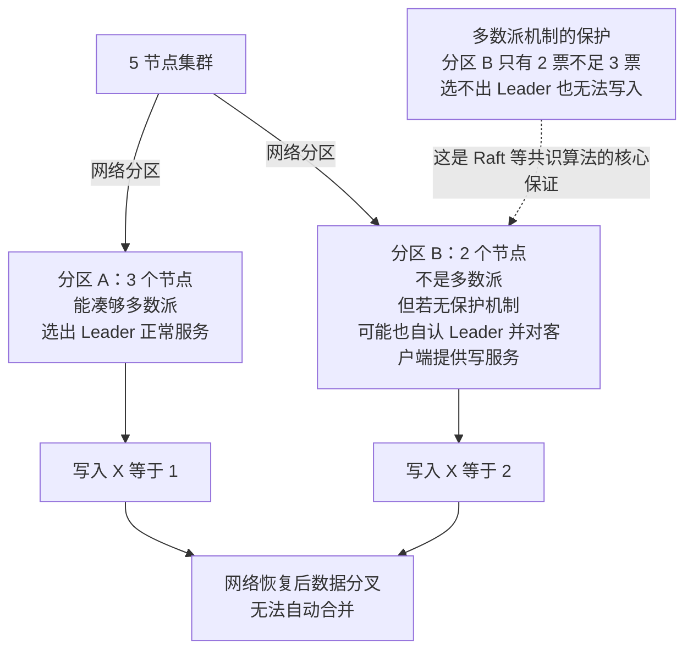
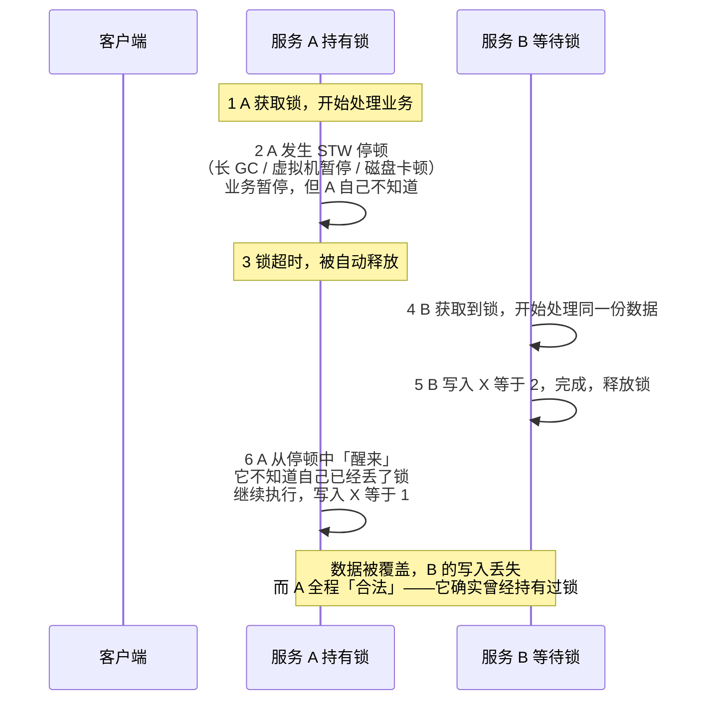
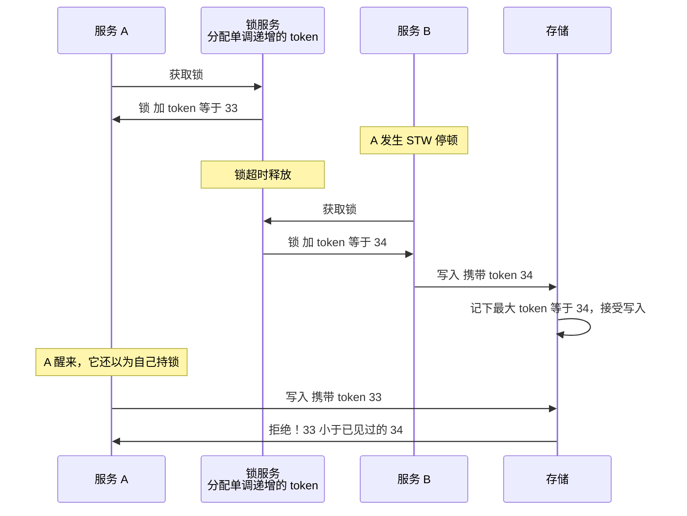
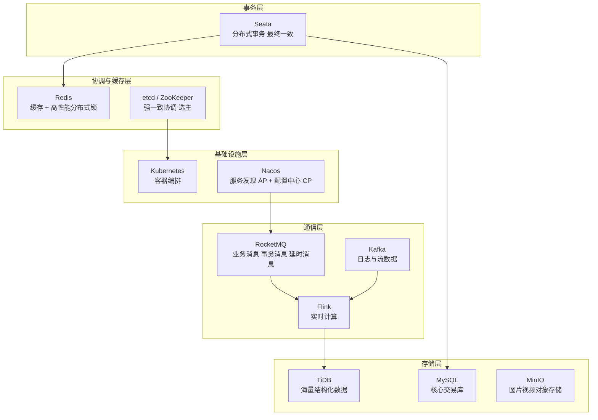

# 04 · 分布式组件选型

> **一句话主线**：分布式组件按**业务场景**分五大类——**服务注册与配置、消息队列、分布式协调/锁、分布式存储、分布式事务**。每一类的选型本质都是**「在 CAP / PACELC 下做取舍」**（见 `00_分布式基础理论.md`），所以面试中所有「区别 / 选型」问题，都可以**先定 CP/AP，再讲特性与场景**。
>
> **本模块定位**：`distributed_consensus/` 的**选型总览**。只讲「**选型与 CAP 取舍**」，不重复具体实现细节——那些在平行模块里：消息队列 → [`03_分布式消息队列.md`](03_分布式消息队列.md)，分布式事务 → [`02_分布式事务.md`](02_分布式事务.md)，共识算法（这些 CP 组件的底座）→ [`01_共识算法.md`](01_共识算法.md)。

---

## 目录

- [零、本模块的边界（去重声明）](#零本模块的边界去重声明)
- [一、服务注册与配置中心](#一服务注册与配置中心)
- [二、分布式协调与锁](#二分布式协调与锁)
- [三、分布式存储](#三分布式存储)
- [四、脑裂与 Fencing：为什么「有锁」还不够](#四脑裂与-fencing为什么有锁还不够)
- [五、通用答题框架与生态关联](#五通用答题框架与生态关联)
- [本模块速记（考前 10 分钟）](#本模块速记考前-10-分钟)
- [面试官深挖追问](#面试官深挖追问)

---

## 零、本模块的边界（去重声明）

本仓库存在内容重叠，这里明确**每个主题的权威位置**，避免「一份笔记三个说法」：

| 主题 | 权威位置 | 本模块处理方式 |
|------|---------|---------------|
| **消息队列**（Kafka/RocketMQ/RabbitMQ/Pulsar 详细原理与对比） | [`03_分布式消息队列.md`](03_分布式消息队列.md) | 仅在本模块的生态图中出现 |
| **分布式事务**（2PC/TCC/Saga/Seata 原理） | [`02_分布式事务.md`](02_分布式事务.md) | 仅出现于生态图 |
| **共识算法**（Raft/Paxos/ZAB 原理） | [`01_共识算法.md`](01_共识算法.md) | 本模块只讲「**哪些组件用了它**」 |
| **分布式锁的完整实现细节**（SETNX + Lua、Watch Dog 续期、Redlock 争议） | [`../db/06_Redis_分布式锁.md`](../db/06_Redis_分布式锁.md) | 本模块只讲「**ZK/Redis/etcd 三种实现的选型与 CAP 取舍**」 |
| **CAP / BASE / 一致性模型** | [`00_分布式基础理论.md`](00_分布式基础理论.md) | 直接引用，不重复展开 |
| **一致性哈希、分库分表、分布式 ID、幂等** | [`05_分布式数据工程.md`](05_分布式数据工程.md) | 不在本模块 |

---

## 一、服务注册与配置中心

**核心定位**：解决微服务架构中**服务发现（注册 / 寻址）**和**配置统一管理（动态推送 / 热更新）**问题，是微服务的「大脑」。

**主流组件**：Nacos、Eureka、Consul、etcd、Zookeeper（ZK）

**补充**：ZK/etcd 原本是分布式协调组件，因具备键值存储 + 监听机制，被**兼作**配置中心 / 简易注册中心；Nacos 是一站式组件，直接整合了「注册中心 + 配置中心」能力，也是目前**国内企业的主流选型**。

### 1. 核心组件参数表（面试核心记忆）

| 组件 | 开源方 | 核心定位 | 核心协议 / 架构 | CAP 选型 | 关键特性 | 典型生态 / 场景 |
|------|--------|---------|---------------|---------|---------|---------------|
| **Nacos** | 阿里 | 一站式注册 + 配置中心 | **双协议**：Distro（AP）+ JRaft（CP） | **按数据类型分流**（见下方勘误） | 动态配置、健康检查、权重路由、一站式 | Spring Cloud Alibaba（国内主流）、Dubbo |
| **Eureka** | Netflix | 纯注册中心 | 无强一致协议，客户端**周期拉取** | AP | 自我保护机制、节点对等、轻量 | Spring Cloud Netflix（**已停更**） |
| **Consul** | HashiCorp | 注册 + 配置 + 服务网格 | Raft（写）+ gRPC/HTTP | **写恒为 CP；读一致性按查询切换** | 原生健康检查、多数据中心、服务网格 | Spring Cloud Consul、K8s 生态 |
| **etcd** | CoreOS（CNCF） | 分布式键值存储（配置 / 注册） | **Raft**，gRPC/HTTP | CP（读可配线性一致） | 高可用、轻量、强一致、**watch 机制** | **K8s 核心**、云原生 |
| **Zookeeper** | Apache | 分布式协调（兼作配置/注册） | **ZAB**，自定义 TCP 协议 | 写 CP；**读可返回旧值** | 树形节点、Watcher 监听、强一致（写） | Hadoop 生态、Dubbo（早期） |

### 2. ⚠️ 勘误：Nacos 的 AP/CP 到底怎么回事

> ❌ **网上流传的错误说法**：「Nacos 通过 `nacos.core.protocol.distro.compatibility.enable=true` 切换 AP/CP 模式。」
>
> **该配置项根本不存在**——它不在 Nacos 的 `application.properties`、`DistroConfig` 或 `DistroConstants` 中。这是被编造出来的配置项，面试中说出来会直接暴露「没真的用过」。

**准确的理解**：Nacos 的 AP/CP **不是全局开关**，而是**按数据类型自动分流、两套协议在同一集群内并存**：

| 数据类型 | 使用的协议 | 一致性 | 说明 |
|---------|-----------|--------|------|
| **临时实例**（`ephemeral=true`，**默认**） | **Distro**（Nacos 自研） | **AP** | 内存存储、异步广播、最终一致。每个实例由一个「负责的服务端」处理并通过 **异步广播 + 定期校验** 扩散 |
| **持久实例**（`ephemeral=false`） | **JRaft**（SOFAJRaft） | **CP** | 走 Raft 多数派提交，强一致 |
| **配置中心（Config Service）整个模块** | **JRaft** | **CP** | **与实例类型无关**，配置读写的 CP 是硬性的 |

> **所以正确的说法是**：「Nacos 的**服务发现**默认用 **Distro 协议（AP）**，**配置中心**用 **Raft（CP）**；而且服务发现里**临时实例走 AP、持久实例走 CP**。**同一集群两套协议并存、按数据类型分流**，不存在一个全局开关。」
>
> 如果面试官追问「那能不能强制服务发现走 CP」——可以，但那是**运行时 API 开关**而非配置文件：
> `PUT /nacos/v1/ns/operator/switches?entry=serverMode&value=CP`（默认 `AP`）。
> 真实的配置项形如 `nacos.core.protocol.distro.data.sync.delayMs`、`nacos.core.protocol.distro.data.verify.intervalMs`（Distro 侧）与 `nacos.core.protocol.raft.data.election_timeout_ms`（Raft 侧）。

### 3. 同类别核心对比

#### （1）Nacos vs Eureka + ZK（为什么 Nacos 能替代两者）

Eureka 是**纯 AP 注册中心**，ZK 是**写 CP 的协调组件（兼职配置中心）**，而 Nacos 实现了 **「Eureka 的 AP 注册能力 + ZK 的 CP 配置能力」**，一站式解决：

| 对比 | Nacos 的优势 |
|------|-------------|
| **比 Eureka** | 支持 CP 模式、有配置中心能力、健康检查更完善（Eureka **仅心跳**；Nacos 支持 TCP/HTTP/脚本） |
| **比 ZK** | 支持 AP 模式（服务发现更可用）、动态配置热更新、**轻量**（ZK 需部署集群，Nacos 单节点即可用） |
| **核心优势** | **按数据类型分流 AP/CP**——服务发现走 AP（高可用），配置中心走 CP（强一致） |

#### （2）etcd vs ZK（K8s 为什么选 etcd 而非 ZK）

两者写路径都是强一致，但 etcd 更适配**云原生 / K8s**：

| 维度 | etcd | ZK |
|------|------|-----|
| **协议** | **Raft**（简单、易实现、有形式化验证、有多语言实现） | **ZAB**（专为 ZK 设计，较复杂） |
| **接口** | **HTTP / gRPC**，跨语言友好 | 自定义 TCP 协议（Jute 序列化），需专用客户端 |
| **读一致性** | 可配置为**线性一致读**（ReadIndex） | **默认可读到旧值**，要 `sync()` 才 read-your-writes |
| **Watch** | 支持**范围 watch + 历史版本**（`revision`），可靠不易丢事件 | Watcher **一次性**，触发后要重新注册，易漏事件 |
| **轻量性** | 部署 / 运维简单，资源占用低 | 需 JVM，部署较重 |
| **生态** | CNCF 项目，K8s 深度整合 | Apache，Hadoop 生态为主 |

> **「Watcher 一次性」是 ZK 一个真实且常被追问的坑**：ZK 的 Watcher 触发后就失效，客户端必须重新注册。如果在**重新注册的间隙**数据又变了，这个事件就**丢了**。所以 ZK 上做配置监听，必须「处理完事件立即重新注册」，并且要**周期性地全量拉取兜底**。etcd 的 watch 支持从指定 `revision` 开始，不会有这个空窗。

#### （3）Consul vs Nacos

| | Consul | Nacos |
|---|--------|-------|
| **优势** | **多数据中心 + 服务网格（Connect）**，适合跨国/跨地域架构 | **一站式 + 国内生态 + 易用性**，部署和二次开发成本低 |
| **适合** | 跨地域的大型分布式架构、已用 Consul 生态 | 国内中小微企业、基于 Spring Cloud Alibaba / Dubbo 的架构 |

#### （4）⚠️ 勘误：Consul 的「可配 AP」是不准确的

> ❌ **常见错误**：「Consul 默认 CP，可以配置成 AP。」
>
> Consul **没有全局的 AP 模式**。**写**永远走 Raft Leader + 多数派（CP）；**读**的一致性是通过**每次查询的参数**来选的：

| 读模式 | 行为 | 代价 |
|--------|------|------|
| **`default`** | HTTP API 默认。绝大多数情况强一致；**仅在 Leader 选举的短暂窗口内**可能返回旧值 | 无 |
| **`consistent`** | 强制与 Leader 做一次多数派往返 | 多一次网络往返，延迟更高 |
| **`stale`** | **任意 Server 都能回答**，不需要 Leader，无 Leader 也能读 | 可能读到旧数据（通常 50ms 内追上，但**没有上界保证**） |
| **`cached`** | 部分端点支持，读缓存 | 有陈旧窗口 |

> **准确的说法**：「Consul 的**写恒为 CP**；**读的一致性是一个按请求可选的档位**（`stale` 提供类 AP 的可用性）。这不是把集群改成 AP，而是**每个读请求自己选择要不要容忍旧数据**。」——这个区分在面试中很加分，因为它体现你理解「CAP 的取舍粒度可以细到单个请求」。

#### （5）⚠️ 勘误：Eureka 不是「短轮询」

> ❌ **常见错误**：「Eureka 用 HTTP 短轮询。」
>
> 不准确。Eureka 是**客户端周期性拉取**（pull），参数如下：

| 参数 | 默认值 | 作用 |
|------|--------|------|
| `lease-renewal-interval-in-seconds` | **30s** | 客户端**心跳**间隔（push，与拉取是两回事） |
| `lease-expiration-duration-in-seconds` | **90s** | 服务端**租约过期**时间 |
| `registry-fetch-interval-seconds` | **30s** | 客户端**拉取注册表**间隔 |
| `eviction-interval-timer-in-ms` | **60s** | 服务端**驱逐扫描**间隔 |
| `renewal-percent-threshold` | **0.85** | **自我保护模式**阈值 |

**两个必须知道的推论**：

1. **新注册最长可能 ~90s 才全局可见**（30s 拉取间隔 + 90s 租约窗口的叠加），这就是「Eureka 服务发现慢」的根源
2. **自我保护模式**：如果续约率跌破 **85%**，服务端**停止驱逐实例**——这是为了防止「网络分区导致大批实例被误判为死亡而全部摘除」（宁可保留可能已死的实例，也不要把健康实例误杀）

> **准确的说法**：「Eureka 是**客户端周期性拉取**（默认 30s）+ **心跳上报**（默认 30s）+ **租约 90s 过期** + **60s 驱逐扫描**，并有**自我保护模式**。所以它**不是『短轮询』**，新实例可见性最长约 90s，分区时也不会立即摘除实例——这是它选 AP 的具体体现。」

### 4. 面试高频提问 & 应答框架

**问题 1：微服务注册中心选型，Nacos、Eureka、Consul 怎么选？**

> **答**：先看 CAP 需求（**服务发现优先 AP**），再看生态和场景：
> - ① 国内生态 + Spring Cloud Alibaba / Dubbo → **Nacos**
> - ② 跨地域多数据中心 → **Consul**
> - ③ 轻量易用但无新需求 → **Eureka**（注意提醒 **Eureka 2.x 已停更**，1.x 仍在维护但不再演进）

**问题 2：Nacos 的 AP/CP 怎么理解？分别适用于什么场景？**

> **答**：**不是全局开关，而是按数据类型分流**。**临时实例（默认）走 Distro 的 AP 模式**——微服务寻址优先高可用，允许短暂的节点列表不一致；**持久实例和整个配置中心走 JRaft 的 CP 模式**——核心配置（如数据库密码、开关）必须强一致，不能出现「A 节点读到新配置、B 节点读到旧配置」。**同一集群两套协议并存**。
>
> ⚠️ 补充：**不要去背那些编造的配置项**。如果面试官问具体配置，如实说「AP/CP 是按数据类型自动分流的，服务发现侧可以运行时切换 serverMode，具体参数我会查官方文档」。

**问题 3：ZK 做注册中心有什么缺点？**

> **答**：
> ① **纯 CP，Leader 选举期间写不可用**，会影响服务注册；
> ② **节点是树形结构，设计相对复杂**，且**写操作要集群多数派**，不适合高频服务注册（性能低于 AP 方案）；
> ③ **Watcher 是一次性的**——触发后要重新注册，**重新注册的间隙可能漏事件**，需要全量拉取兜底；
> ④ **读默认可返回旧值**（非线性一致），需要 `sync()` 才能 read-your-writes；
> ⑤ **无原生服务健康检查**（Nacos/Eureka/Consul 都有），需二次开发（Dubbo 早期是靠客户端自己实现的）。

**问题 4：为什么 K8s 用 etcd 而不是 ZooKeeper？**

> **答**：三点：
> ① **协议更简单可靠**：Raft 相比 ZAB 有更多语言的成熟实现、有形式化验证，运维心智负担小；
> ② **API 更现代**：etcd 是 gRPC/HTTP，跨语言；ZK 是自定义 TCP 协议，生态封闭；
> ③ **Watch 更可靠**：etcd 的 watch 支持从指定 revision 恢复，**不会丢事件**；ZK 的 Watcher 一次性，有漏事件风险。
> 补充：etcd 本身就是 CNCF 项目，与 K8s 天然同源。

---

## 二、分布式协调与锁

**核心定位**：解决分布式架构中**分布式锁、主从选举、分布式屏障、配置同步**等一致性问题，是分布式系统的「协调器」。

**主流组件**：Zookeeper（ZK）、Redis/Redisson、etcd

**补充**：**Curator** 是 ZK 的 Java 客户端（封装了分布式锁、选举等功能），**Redisson** 是 Redis 的 Java 客户端（封装了分布式锁、集合等分布式功能）——面试中常与核心组件一起考。

> 📖 **分布式锁的完整实现细节**（SETNX + Lua 原子解锁、Watch Dog 续期、Redlock 及其争议）见 [`../db/06_Redis_分布式锁.md`](../db/06_Redis_分布式锁.md)。本节只讲**选型与 CAP 取舍**。

### 1. 核心组件参数表

| 组件 | 核心定位 | 分布式锁实现方式 | CAP 选型 | 锁特性 | 性能 | 典型场景 |
|------|---------|----------------|---------|--------|------|---------|
| **ZK / Curator** | 强一致分布式协调 | **临时有序节点 + Watcher** | 写 CP（读可旧） | 可重入、阻塞、公平锁、**无锁丢失** | 中（毫秒级） | 数据一致性要求高的锁、主从选举 |
| **Redis / Redisson** | 高性能分布式协调 | `SET NX EX`（原生）；Redisson 封装（可重入 / 红锁 / Watch Dog） | **AP**（主从异步，最终一致） | 可重入、非阻塞、公平锁 / 红锁、**可能锁丢失** | **极高**（微秒级） | 高并发、一致性要求不高的锁、限流 |
| **etcd** | 云原生分布式协调 | 基于 **Raft** 的 CAS 操作 + **租约（Lease）** | CP | 强一致、可重入、无锁丢失、支持 watch | 中 | K8s 集群协调、云原生分布式锁 |

### 2. 核心对比：ZK 分布式锁 vs Redis 分布式锁（面试必问）

这是分布式锁的**两大主流实现**，核心差异在 **CAP 选型**，直接决定锁的特性和场景。

| 维度 | ZK / Curator 分布式锁 | Redis / Redisson 分布式锁 |
|------|---------------------|------------------------|
| **核心原理** | **临时有序节点**：创建节点成功则获锁，失败则**监听前一个节点**（阻塞），节点宕机则临时节点**自动删除**（释放锁） | **`SET NX EX`**：`NX` = 仅当 key 不存在时创建；`EX` = 设过期时间避免宕机丢锁。Redisson 封装了**红锁**（多节点加锁过半成功） |
| **锁丢失风险** | **无**（临时节点随会话销毁，且 ZK 写是强一致） | **有**（主从**异步复制**，主节点宕机可能导致从节点上没有锁；过期时间设置不合理也会丢锁） |
| **性能** | 中（毫秒级，需与 ZK 集群交互） | **极高**（微秒级，纯内存操作） |
| **锁特性** | 原生支持**阻塞、公平锁、可重入** | 原生**非阻塞**（`SET NX` 立即返回）；Redisson 封装后支持阻塞、公平锁、红锁、可重入 |
| **运维成本** | 高（需部署 ZK 集群，维护 Leader 选举） | **低**（Redis 已作为缓存部署，**复用即可**） |

**选型逻辑（面试应答框架）**：

| 选 | 场景 |
|----|------|
| **ZK** | **数据一致性要求高、不追求极致性能**：订单库存扣减、分布式事务、主从选举（**锁丢失会导致数据不一致**） |
| **Redis** | **高并发、允许极短暂锁失效**：秒杀限流、接口防刷、缓存更新（**性能优先，且下游有幂等兜底**） |
| **etcd** | 云原生 / K8s 生态下的分布式协调，替代 ZK |

### 3. 面试高频提问

**问题 1：Redis 分布式锁为什么会丢锁？怎么解决？**

> **答**：丢锁原因有两个：
> ① **主从异步同步**——主节点写入锁后还没同步到从节点就宕机，从节点升主后**没有这把锁**；
> ② **业务执行时间超过锁的过期时间**——锁被自动释放，别的线程拿到锁。
>
> **解决方案**：
> ① 用 Redisson 的**红锁**（多个独立 Redis 节点加锁，过半成功才获锁）；
> ② **合理设置过期时间**，或开启**锁续期**（Redisson 的 **Watch Dog** 机制，业务执行中定时刷新过期时间，默认每 10s 续一次、锁 30s 过期）；
> ③ **最根本的一条**：消费端 / 业务侧实现**幂等性**——即使丢锁也不会重复执行业务造成脏数据。
>
> ⚠️ **加分点**：可以提一句「红锁本身也有争议——**Martin Kleppmann 和 Redlock 作者 Antirez 有过公开辩论**，Kleppmann 指出红锁依赖各节点时钟不发生跳变，且**无法提供 fencing token**，所以在 GC 停顿等场景下仍不安全。结论是：**Redis 锁更适合做『性能优化』而非『正确性保证』**，正确性要靠幂等兜底。」（详见下一节 Fencing）

**问题 2：ZK 分布式锁的公平性怎么实现？**

> **答**：基于**临时有序节点**。ZK 会为每个加锁请求生成一个**有序**节点（如 `/lock/lock-000000001`），请求者**只监听自己的前一个节点**。前一个节点释放（会话结束或被删除）后，当前请求者才会获锁。因为顺序由 ZK 的**节点编号**天然决定，所以是**天然的公平锁**（先到先得）。
>
> **相比 Redis 的优势**：① **公平**（Redis 的 `SET NX` 是非公平的争抢）；② **不会有惊群效应**（每个请求只监听前一个节点，而不是所有请求都监听同一个 key）——Redis 用 `SET NX` + 轮询重试会有惊群和空转。

**问题 3：为什么不用数据库做分布式锁？**

> **答**：
> ① **性能低**——数据库行锁是磁盘操作，不适合高并发；
> ② **可靠性差**——数据库宕机则锁不可用，主从部署的同步又复杂；
> ③ **功能弱**——无原生的过期自动释放、阻塞等待，需二次开发（比如靠 `INSERT` 唯一索引 + 定时清理过期记录）；
> ④ **容易死锁**——如果持有锁的事务因为宕机没提交，锁会一直挂着（虽然连接断开时会释放，但需要依赖连接超时，不够及时）。

---

## 三、分布式存储

**核心定位**：解决分布式架构中**海量数据存储、高可用、高扩展**问题，区别于单机数据库 / 文件系统。

**主流组件**：HDFS、Ceph、MinIO、TiDB

**分类**：分为**分布式文件/对象存储**（存储文件/对象）与**分布式数据库**（存储结构化数据）。

| 组件 | 类型 | 开源方 | 核心定位 | 核心架构 | 关键特性 | 典型场景 |
|------|------|--------|---------|---------|---------|---------|
| **HDFS** | 分布式文件存储 | Apache | 大数据文件存储 | 主从（NameNode + DataNode） | 大容量、高吞吐、**一次写入多次读取** | 大数据、日志存储、Hadoop 生态 |
| **MinIO** | 分布式对象存储 | MinIO | 轻量对象存储 | 分布式集群（**纠删码**） | 轻量、高可用、**兼容 S3 协议** | 图片 / 视频存储、云原生对象存储 |
| **Ceph** | 分布式统一存储 | Red Hat | 块 / 文件 / 对象**统一**存储 | **无中心**（Mon + OSD + MDS） | 统一存储、高扩展、高可用 | 企业级海量存储、云平台 |
| **TiDB** | 分布式关系型数据库 | PingCAP | 分布式 NewSQL | **计算/存储分离**（TiDB + TiKV，TiKV 用 **Raft**） | 兼容 MySQL、水平扩展、**强一致** | 海量结构化数据、高并发 OLTP |

### 面试高频考点

| 组件 | 核心优势 | 说明 |
|------|---------|------|
| **TiDB** | **兼容 MySQL + 水平扩展 + 强一致** | 解决传统 MySQL 单机瓶颈。底层 TiKV 用 **Raft**（见 `01`）保证强一致，PD 负责调度分片。适合电商、金融的海量结构数据 |
| **MinIO** | **轻量 + 兼容 S3 协议** | 部署简单，适合中小企业图片/视频等对象存储，可替代阿里云 OSS / 腾讯云 COS（避免云厂商锁定） |
| **HDFS** | **一次写入多次读取** | **不适合随机写**。适合大数据日志采集、数据仓库。小文件多时 NameNode 内存压力大（每个文件元数据约占 150B） |
| **Ceph** | **块 / 文件 / 对象三合一** | 无中心架构（无单点），靠 CRUSH 算法计算数据位置。运维复杂，适合有专职存储团队的企业 |

---

## 四、脑裂与 Fencing：为什么「有锁」还不够

> **这一节是「分布式锁」的进阶追问**，也是把 `01_共识算法.md` 与 `04` 串起来的关键。面试中能讲清楚，档次明显不同。

### 1. 什么是脑裂（Split-Brain）

**脑裂**：由于网络分区，集群**分裂成两个互相看不见的部分**，两边**各自认为自己是合法的**（各自选出 Leader、各自提供服务）。

**后果**：两边**同时写入**，数据分叉。等网络恢复，**无法自动合并**——这是分布式系统最严重的事故之一。

**图 4-1：脑裂**

**多数派机制本身就能防脑裂**：5 节点里，分区 B 只有 2 个节点，凑不够 3 票，**永远选不出 Leader**——所以只有多数派一侧能服务，**天然避免脑裂**。这是 Raft/Paxos/ZAB 这类算法的核心保证（见 `01` 的[多数派重叠](01_共识算法.md#3-多数派重叠为什么这么设计就能保证安全)）。

> **但很多系统并没有共识算法**——比如 **Redis 主从 + 哨兵**、**MySQL 主从 + MHA**。这些系统靠「**心跳超时 + 投票**」来选主，就可能出现下面的问题。

### 2. ⚠️ 核心问题：锁无法防止「已停顿的旧 Leader」写入

**这是分布式锁最微妙、最容易被忽略的缺陷。** 用一个场景说明：

**图 4-2：为什么「有锁」还不够**

**问题的本质**：**A 并不知道自己已经失去了锁**。它可能：

- 经历了长时间 **GC 停顿（Stop-The-World）**
- 被操作系统**换出（swap）**
- 网络分区导致它与 Redis 失联，但**恢复后它以为锁还在**

等 A 醒过来，它**照样往存储里写**——而存储**无法判断**这个写入来自「合法的持锁者」还是「过期的僵尸」。

**注意**：这不是 Redis 的锅——**ZK 锁、etcd 锁都有同样的问题**。锁本身只能保证「同一时刻只有一个客户端认为自己持有锁」，**不能保证「存储只接受当前持锁者的写入」**。

### 3. 解法：Fencing Token（栅栏令牌）

**核心思路**：给每次获锁分配一个**单调递增的编号（fencing token）**，并让**存储端也检查这个编号**。

**关键**：存储端**记录见过的最大 token**，任何携带**更小 token** 的写入一律拒绝。这样，即使 A 从停顿中醒来，它的写入也会被**存储层挡住**。

| 要点 | 说明 |
|------|------|
| **token 必须单调递增** | 所以需要一个**能保证单调递增的组件**——ZK 的**有序节点**天然满足；etcd 的 **revision** 也满足；Redis 的 `INCR` 在单实例下满足，但**主从切换后可能回退**（这正是 Redlock 争议的核心之一） |
| **存储端必须校验** | 这是最容易被忽略的一半。**只有客户端校验 token 是没用的**，必须**服务端/存储端**检查 |
| **实现载体** | 数据库的版本号列（`WHERE version < ?`）、HDFS 的 `namenode` epoch、Kafka 的 **epoch**、Raft 的 **term** —— **它们本质上都是 fencing token** |

> 💡 **重要洞察**：**Raft 的 Term、Kafka 的 Producer Epoch、ZooKeeper 的 zxid epoch、HDFS 的 epoch 全都是 fencing token 的实例**。Kafka 用 `transactional.id` + epoch 来「**隔离僵尸生产者（zombie producer）**」，防的正是这个场景——一个以为自己是活跃生产者、但其实已经被踢掉的旧实例还在发消息。**发现这一点，你就把「共识算法」和「工程实践」串起来了。**

### 4. 其他防护手段

| 手段 | 说明 | 局限 |
|------|------|------|
| **Lease（租约）** | 锁带**租期**，到期自动失效。客户端在租期内必须续约 | 依赖**时钟**——如果客户端时钟慢，它可能以为租约还在而实际已失效。所以租期要**显著大于**时钟漂移上界 |
| **STONITH** | "**Shoot The Other Node In The Head**"——把可能还活着的旧主**强制断电**（通过 IPMI/PDU），确保它**绝对无法再写** | 需要硬件支持；会导致该节点彻底下线 |
| **幂等 + 版本号** | 业务层用乐观锁（`WHERE version = ?`）——**旧 Leader 的写入会因为版本号过期而失败** | 本质就是 fencing token 的应用 |
| **多数派仲裁** | 用 Raft/Paxos 让「谁是 Leader」本身需要多数派确认，**少数派一侧无法服务** | 需要引入共识算法（成本高） |
| **避免长时间 GC 停顿** | 调优 JVM（用 ZGC/Shenandoah 降低停顿），从源头减少停顿时间 | 只能降低概率，不能消除 |

> **面试标准答法**：「分布式锁有个常被忽略的缺陷——**持锁者可能因为长时间 GC 停顿而『失去锁却不自知』，醒来后继续写入，覆盖掉新持锁者的数据**。锁本身防不住这个，因为存储无法判断写入来自谁。
>
> 标准解法是 **fencing token**：每次获锁分配一个**单调递增**的编号，**存储端记录见过的最大编号，拒绝更小编号的写入**。这样旧持锁者的写入会被存储层挡掉。**Raft 的 Term、Kafka 的 epoch、ZK 的 zxid、事务的乐观锁版本号，本质上都是 fencing token 的具体形态。**
>
> 所以工程上的结论是：**分布式锁只用于『减少并发冲突』的性能优化，真正的正确性要靠幂等 + 版本号 / fencing 在数据层兜住**。」

---

## 五、通用答题框架与生态关联

### 1. 通用问题（跨品类，必问）

**问题 1：谈谈你对 CAP 和 BASE 的理解，分布式组件的设计如何体现？**

> **答**：
> ① **CAP**：分区**期间**必须在一致性和可用性之间取舍（**不是「三选二」**，P 是必选项）——所有分布式组件都在 CP/AP 间做选择（ZK/etcd 是 CP，Eureka 是 AP）；
> ② **BASE**：CAP 的延伸——**基本可用、软状态、最终一致**，是分布式系统的实际设计准则（消息队列的最终一致、微服务的最终一致）；
> ③ **更完整的框架是 PACELC**——分区时选 C/A，**无分区时选延迟 L 还是一致性 C**。这解释了「强一致为什么天生慢」。
>
> 详细见 [`00_分布式基础理论.md`](00_分布式基础理论.md)。

**问题 2：分布式组件的高可用怎么实现？**

> **答**：核心手段有三个：
> ① **集群部署**——主从 / 副本 / 分区，消除单点；
> ② **故障自动切换**——**Leader 选举**（Raft/ZAB）、Sentinel 哨兵模式、K8s 的探针 + 重启；
> ③ **数据持久化 / 副本同步**——Kafka 的 ISR、Redis 主从复制、MySQL binlog 复制。
>
> 补充第四条：**客户端侧的容错**——重试、熔断、降级、限流（避免一个组件故障引发雪崩）。

**问题 3：如何设计一个高可用的分布式架构？（综合题）**

> **答**：按「**分层设计**」梳理：
> ① **服务层**——Nacos（服务发现走 AP、配置走 CP）做注册与配置；
> ② **通信层**——RocketMQ/Kafka 做消息队列，解耦 + 削峰；
> ③ **协调层**——Redis 做高性能分布式锁（配合幂等兜底），etcd/ZK 做需要强一致的协调与选主；
> ④ **存储层**——TiDB 做分布式数据库，MinIO 做对象存储，Redis 做缓存；
> ⑤ **事务层**——Seata AT 做常规分布式事务，核心资金场景用 TCC；
> ⑥ **整体**——所有组件**集群部署** + **故障监控告警** + **自动扩容** + **全链路压测**。

### 2. 应答技巧（面试提分）

1. **所有区别 / 选型问题，先定 CAP/PACELC**——这是分布式组件的设计核心。先点明 CP/AP 选择，再讲特性与场景，逻辑立刻清晰。
2. **结合实际项目**——不要只背理论。比如「我在项目中用 **Nacos** 做注册中心，因为基于 **Spring Cloud Alibaba**，且需要**动态配置热更新**，替代了原来的 Eureka + ZK」。
3. **抓核心、弃细节**——不需要背组件的所有配置。记住**核心定位、协议、CAP、关键特性、典型场景**即可，比如 Kafka 只需记住「**高吞吐、磁盘顺序写、ISR（全 ISR 提交而非多数派）、大数据生态**」。
4. **⚠️ 不要编造配置项**——这是本仓库原有笔记的真实问题（见本模块第一节的「勘误：Nacos 的 AP/CP 到底怎么回事」）。**宁可说「具体参数我需要查文档」，也不要编一个看起来很像的配置名。** 面试官如果恰好用过这个组件，一句话就能问穿。

### 3. 分布式组件生态关联图

**基于 Spring Cloud Alibaba 的微服务架构**（国内企业主流）：

**用一句话串起来**：

> 「基于 Spring Cloud Alibaba 的微服务架构中，用 **Nacos** 做一站式注册/配置中心（**服务发现 AP + 配置 CP**），用 **RocketMQ** 做消息队列解耦削峰，用 **Kafka + Flink** 做实时流计算，用 **Redis** 做缓存 + 高性能分布式锁（配合幂等兜底），用 **etcd/ZK** 做需要强一致的协调与选主，用 **Seata** 做分布式事务，用 **TiDB** 做海量结构化数据存储，用 **MinIO** 做对象存储。**这套架构覆盖了大部分面试中的组件场景，记住这个关联，应对综合题会轻松很多。**」

> 💡 **结合本人简历的改法**（期权风控 / 实时计算方向）：「我们风控系统是 **Kafka（行情与交易事件）→ Flink（实时指标计算）→ Hologres/ADB（结果存储）** 的链路，**Apollo** 做配置中心（因为团队统一用 Apollo，而 Nacos 的 CP 模式配中心能力与它重合），**SchedulerX** 做分布式定时调度（替代本地的 `@Scheduled`，避免集群重复执行），中间数据一致性用 **RocketMQ 事务消息**保证。」——**把通用组件换成你真实用过的，比背诵参考架构有说服力得多。**

---

## 本模块速记（考前 10 分钟）

| # | 问题 | 关键词速答 |
|---|------|-----------|
| 1 | 注册中心五大组件？ | Nacos、Eureka、Consul、etcd、ZK |
| 2 | **Nacos 的 AP/CP 怎么工作？** | ⚠️ **不是全局开关**，是按数据类型**分流**：临时实例（默认）→ **Distro 的 AP**；持久实例 + **整个配置中心** → **JRaft 的 CP**。**同一集群两套协议并存** |
| 3 | Nacos 切 CP 的真实方式？ | **运行时 API**：`PUT /nacos/v1/ns/operator/switches?entry=serverMode&value=CP`（默认 AP）。**不是配置文件** |
| 4 | Nacos 的真实配置项长什么样？ | Distro 侧：`nacos.core.protocol.distro.data.sync.delayMs`；Raft 侧：`nacos.core.protocol.raft.data.election_timeout_ms`。⚠️ **不要背编造的配置项** |
| 5 | Nacos vs Eureka + ZK？ | Nacos = **Eureka 的 AP 注册能力 + ZK 的 CP 配置能力**，一站式；健康检查更全（TCP/HTTP/脚本） |
| 6 | **Consul 是 CP 还是 AP？** | ⚠️ **写恒为 CP**（Raft 多数派）；**读是每次查询的档位**：`default`/`consistent`/`stale`/`cached`。**`stale` 提供类 AP 可用性，但不是「把集群配成 AP」** |
| 7 | **Eureka 是短轮询吗？** | ⚠️ **不是**。是**周期性拉取**：心跳 30s、拉注册表 30s、**租约 90s 过期**、**60s 驱逐扫描**；有**自我保护模式**（续约率 < 85% **停止驱逐**）。**新注册最长 ~90s 可见** |
| 8 | Eureka 自我保护模式干什么？ | 续约率跌破 **85%** 时**停止驱逐实例**——防止网络分区导致**大批健康实例被误杀** |
| 9 | etcd 为什么取代 ZK 进 K8s？ | ① **Raft** 比 ZAB 简单可靠（多语言实现 + 形式化验证）；② **gRPC/HTTP** 跨语言；③ **watch 支持 revision，不丢事件**（ZK Watcher **一次性**，有漏事件风险） |
| 10 | ZK 的 Watcher 有什么坑？ | **一次性**——触发后失效，必须重新注册；**重新注册的间隙可能漏事件**。需全量拉取兜底 |
| 11 | **ZK 是「纯 CP」吗？** | ⚠️ **写是 CP，读不是线性一致**——任意副本可返回**旧值**，需 **`sync()`** 才能 read-your-writes |
| 12 | ZK 做注册中心的缺点？ | ① Leader 选举期间写不可用；② 树形结构 + 多数派写，**性能低**；③ **Watcher 一次性**；④ **读可旧**；⑤ **无原生健康检查** |
| 13 | 分布式锁三大实现？ | **ZK**（临时有序节点，无锁丢失，毫秒级，CP）、**Redis**（`SET NX EX`，**可能丢锁**，微秒级，AP）、**etcd**（Raft CAS + Lease，CP）。完整细节见 [`../db/06_Redis_分布式锁.md`](../db/06_Redis_分布式锁.md) |
| 14 | ZK 锁 vs Redis 锁怎么选？ | 一致性要求高（库存、事务、选主）→ **ZK**；高并发允许短失效（限流、防刷）→ **Redis**（**要有幂等兜底**） |
| 15 | ZK 锁的公平性怎么来的？ | **临时有序节点** + **只监听前一个节点** → **天然公平锁**，且**无惊群效应** |
| 16 | Redis 丢锁的两个原因？ | ① **主从异步复制**（主挂从升，锁没同步过去）；② **业务超过过期时间**。解法：**红锁 / Watch Dog 续期 / 幂等兜底** |
| 17 | 为什么不用数据库做分布式锁？ | ① 磁盘操作**性能低**；② 主从同步复杂、**可靠性差**；③ **无原生过期释放与阻塞**，需二次开发 |
| 18 | **什么是脑裂？** | 网络分区导致集群分成两半、**各自认为自己是合法的**（各选 Leader 各服务），网络恢复后**数据分叉无法合并** |
| 19 | 共识算法怎么防脑裂？ | **多数派**：少数派一侧凑不够票，**永远选不出 Leader**，无法服务 |
| 20 | **分布式锁的致命缺陷是什么？** | ⚠️ **持锁者可能因长时间 GC 停顿「失去锁却不自知」，醒来后继续写入，覆盖新持锁者的数据**。锁防不住，因为**存储无法判断写入来自谁** |
| 21 | **Fencing Token 怎么解决？** | 每次获锁分配**单调递增**编号；**存储端记录见过的最大编号，拒绝更小编号的写入**。旧持锁者的写入被存储层挡掉 |
| 22 | Fencing Token 的现实例子？ | **Raft 的 Term、Kafka 的 Producer Epoch（隔离僵尸生产者）、ZK 的 zxid epoch、HDFS 的 epoch、乐观锁版本号**——本质都是 fencing token |
| 23 | Fencing 的关键前提？ | ① token 必须**单调递增**（ZK 有序节点/etcd revision 满足，**Redis INCR 主从切换可能回退**）；② **必须由存储端校验**（只客户端校验没用） |
| 24 | 其他脑裂防护？ | **Lease 租约**（依赖时钟，租期要 >> 时钟漂移）、**STONITH**（强制断电旧主）、**多数派仲裁**、**减少 GC 停顿**（ZGC） |
| 25 | 分布式存储四大组件？ | **HDFS**（大数据文件，一次写多次读）、**MinIO**（对象存储，兼容 S3）、**Ceph**（块/文件/对象三合一，无中心）、**TiDB**（分布式 NewSQL，兼容 MySQL + 强一致） |
| 26 | TiDB 为什么能强一致？ | 底层 **TiKV 用 Raft** 保证多副本强一致，PD 负责分片调度；计算/存储分离便于扩展 |
| 27 | 组件选型的通用答法？ | **先定 CAP/PACELC → 再讲特性与场景 → 最后结合自己项目**。⚠️ **不要编造配置项** |

---

## 面试官深挖追问

1. **「你说 Nacos 的 AP/CP 不是全局开关，那如果面试官坚持说有这个配置项呢？」**
   → 可以这样应对：「**至少在我用过的 2.x 版本里，AP/CP 是按数据类型自动分流的**——临时实例走 Distro（AP），持久实例和配置中心走 JRaft（CP）。如果您说的是服务发现侧的运行时切换，那是 `PUT /nacos/v1/ns/operator/switches?entry=serverMode&value=CP` 这个 Operator API，不是 `application.properties` 里的项。**如果确实存在我没见过的配置项，我很乐意回去查证。**」——**姿态放低、但把已知事实说清楚**，比硬扛或附和都更专业。

2. **「Eureka 的自我保护模式，是好事还是坏事？」**
   → **看场景**。它的设计初衷是好的：防止网络抖动导致**大批健康实例被误判为死亡而全部摘除**，引发级联故障（以为服务挂了 → 摘除 → 请求打向剩余实例 → 雪崩）。**副作用**是：如果实例**真的**挂了，Eureka 会**保留它一段时间**，导致调用方拿到已死的实例、请求失败。所以实践中要配合**客户端侧的容错**（Ribbon/Feign 的重试、熔断），不能只依赖注册中心的摘除。

3. **「ZK 的 Watcher 是一次性的，这个设计是缺陷还是有意为之？」**
   → **有意为之**，是**简化服务端压力**的取舍。如果 Watcher 持久化，服务端要为每个客户端维护所有监听关系，且客户端处理慢会影响服务端。一次性 Watcher 让服务端**触发后立即释放**，内存开销可控。代价交给客户端：**必须处理完立即重新注册，并用全量拉取兜底**。etcd 的 watch 用**流式订阅 + revision** 解决了这个问题，代价是服务端要维护更多的连接状态。

4. **「GC 停顿导致的锁失效，有没有更根本的解法？」**
   → 三层递进：① **降低停顿**——用 ZGC/Shenandoah（亚毫秒级停顿），把窗口压到极小，但**不能消除**；② **fencing token**——在数据层拦住旧持锁者的写入，这是**正确性保证**；③ **幂等 + 版本号**——即使写入漏过去了，业务层用乐观锁也能发现冲突。**根本结论**：分布式系统中的时间假设（「我的锁还没过期」）**永远不可靠**，必须在**数据层**用单调递增的标记做最终仲裁。这也是 `00_分布式基础理论.md` 里「物理时钟不可信」的直接推论。

5. **「为什么 Kafka 需要 Producer Epoch，而不用别的机制解决僵尸生产者？」**
   → 因为**僵尸生产者**的问题和「旧持锁者写入」是同一个问题：一个生产者以为自己的事务还活跃，但其实 Broker 已经因为**新会话用同一个 `transactional.id` 注册**而**把它踢掉了（fenced）**。此时旧生产者发来的消息**必须被拒绝**，否则会**污染新事务**。**Epoch（每个 `transactional.id` 每次注册递增的版本号）就是 fencing token**——Broker 拒绝携带**旧 epoch** 的请求。这样，即使旧生产者从停顿中醒来继续发送，它的请求也会被挡掉。**和分布式锁的 fencing token 是同一个模式。**

6. **「STONITH 和 fencing token 有什么区别？各适合什么场景？」**
   → **STONITH 是「物理消灭」**（断电/断网旧主），好处是**绝对彻底**（旧主物理上不可能再写），代价是旧节点**彻底下线**（如果它其实是健康的、只是网络抖动，就白白损失了一个节点），且需要**带外管理硬件**（IPMI/PDU）。**Fencing token 是「逻辑拒绝」**（存储端拒绝过期标记的写入），代价是**要求存储端配合**（要改数据模型或存储组件），但**不需要杀掉旧节点**。**实践**：能改存储就用 fencing（如 ZK 的 zxid、Kafka 的 epoch）；改不了存储、又需要绝对保证（比如共享存储场景）就用 STONITH。两者也可以**叠加**。

7. **「你们项目里用 Redis 锁还是 ZK 锁？为什么？」**
   → **必须结合自己项目说**。参考话术：「我们用 **Redis（Redisson）锁**，因为：① 项目**已经有 Redis 做缓存**，复用成本为零；② 我们的锁场景是**接口防重复提交**和**定时任务的单实例执行**，**对极端情况下的锁失效是可容忍的**——因为最终的业务写入**有数据库唯一索引兜底**，即使锁失效也不会产生脏数据；③ Redis 的**微秒级延迟**对接口性能更友好。**如果场景换成库存扣减这种『锁失效就会超卖』的情况，我会选 ZK 或 etcd 锁，或者更直接——用数据库的乐观锁/悲观锁。**」

---

## 参考资料

见 [`99_参考资料.md`](99_参考资料.md)。
