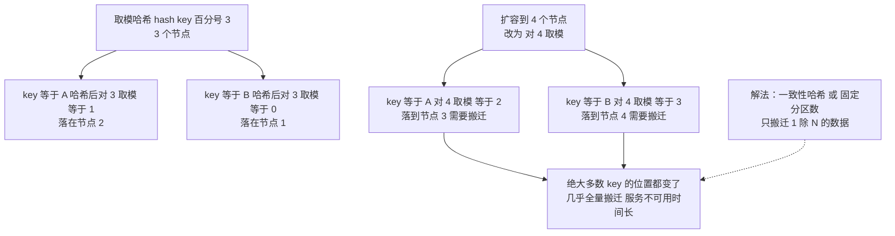
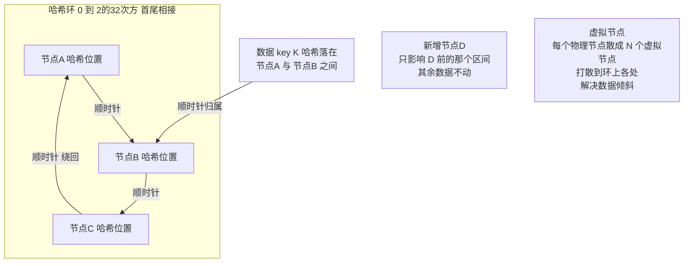
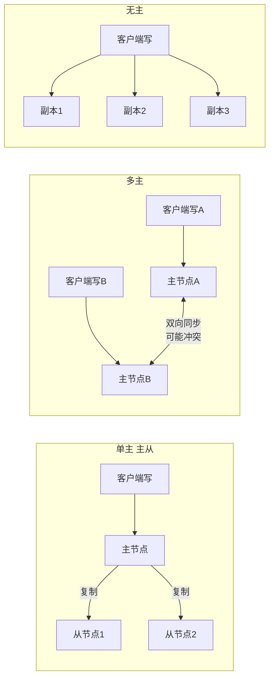
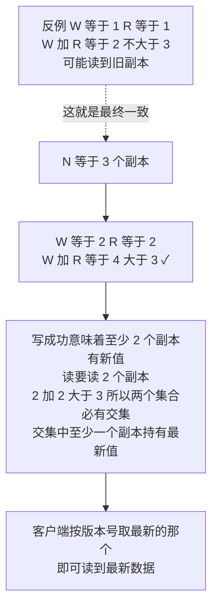
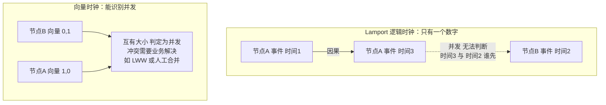
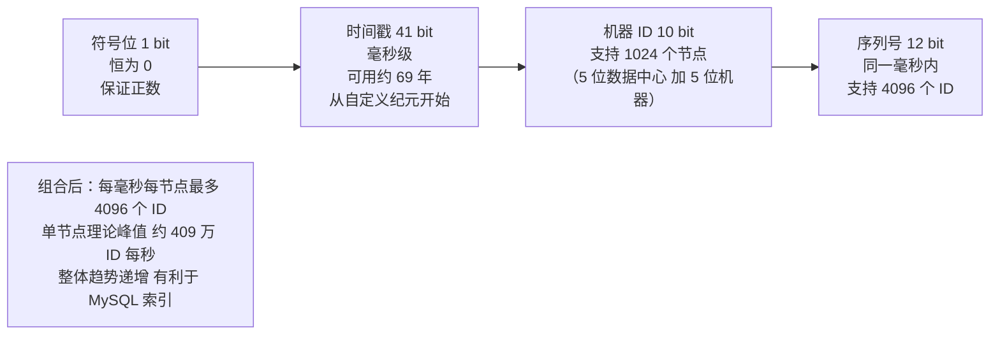
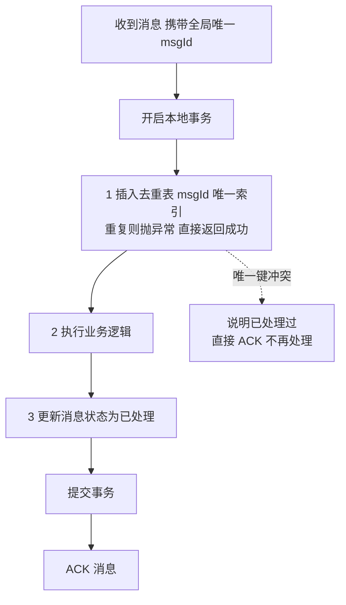
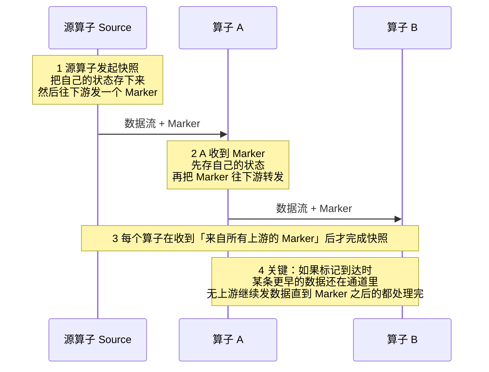

# 05 · 分布式数据工程

> **一句话主线**：前面四个模块讲的是「**怎么让多个节点对同一件事达成一致**」（共识与协调），本模块讲的是「**数据本身怎么在多个节点上分布、复制、定序**」——也就是**数据面（Data Plane）**的问题。四条主线：**怎么分**（分区与一致性哈希）、**怎么复制**（主从/多主/无主 + Quorum）、**怎么定序**（逻辑时钟与向量时钟）、**怎么在分布式下做到不重不漏**（幂等、分布式 ID、分布式快照）。
>
> **本模块定位**：`distributed_consensus/` 的**数据面**，与 `01_共识算法.md`（控制面）互补。对本人简历的**实时计算方向**（Kafka → Flink → 存储）尤其重要——Chandy-Lamport 快照就是 Flink Checkpoint 的理论基础。

---

## 目录

- [一、数据分区：数据怎么分到多台机器上](#一数据分区数据怎么分到多台机器上)
- [二、一致性哈希：分区扩容的优雅解法](#二一致性哈希分区扩容的优雅解法)
- [三、复制模型：主从、多主与无主](#三复制模型主从多主与无主)
- [四、Quorum 与 NWR：无主复制的一致性配方](#四quorum-与-nwr无主复制的一致性配方)
- [五、Gossip 与 SWIM：去中心化的成员管理](#五gossip-与-swim去中心化的成员管理)
- [六、分库分表：单机瓶颈的工程解法](#六分库分表单机瓶颈的工程解法)
- [七、逻辑时钟与向量时钟：分布式系统怎么定序](#七逻辑时钟与向量时钟分布式系统怎么定序)
- [八、分布式 ID](#八分布式-id)
- [九、幂等设计](#九幂等设计)
- [十、Chandy-Lamport 分布式快照](#十chandy-lamport-分布式快照)
- [本模块速记（考前 10 分钟）](#本模块速记考前-10-分钟)
- [面试官深挖追问](#面试官深挖追问)

---

## 一、数据分区：数据怎么分到多台机器上

**为什么必须分区？** 单机磁盘、内存、CPU 都有上限。数据量超过单机能力时，必须**切开**分布到多台机器上。

### 1. 三种分区策略

| 策略 | 做法 | 优点 | 缺点 | 典型系统 |
|------|------|------|------|---------|
| **范围分区（Range）** | 按 key 的**区间**切（如 `A-M` / `N-Z`，或按时间） | **支持范围查询**（`WHERE id BETWEEN 1 AND 100` 只查一个分区）；顺序读友好 | **容易热点**——按时间分区时，最新的分区永远在被写（如按天分区的日志表） | HBase、TiDB、MongoDB、MySQL 分区表 |
| **哈希分区（Hash）** | 对 key 取哈希再取模（`hash(key) % N`） | **数据分布均匀**，不容易热点 | **范围查询要扫描所有分区**；**扩容时几乎全量搬迁** | Redis Cluster、Cassandra、Memcached |
| **一致性哈希（Consistent Hash）** | 见下一节 | 扩容时**只搬迁少量数据** | 实现复杂；需要虚拟节点防倾斜 | Cassandra、DynamoDB、Riak |

> **怎么选？** 记住一条：**「要不要范围查询」决定选范围还是哈希**。
> - 主键自增的订单表要按时间查询 → **范围分区**
> - 用户会话、缓存这类只按 key 点查 → **哈希分区**
> - 需要**动态扩缩容**且能接受实现复杂度 → **一致性哈希**

### 2. 二级索引的分区难题（进阶）

如果按 `user_id` 分区，但你想按 `email` 查询，怎么办？三种方案：

| 方案 | 做法 | 代价 |
|------|------|------|
| **本地索引（Local Index）** | 每个分区**各自**维护自己的 `email` 索引 | 按 `email` 查要**广播到所有分区**，再合并结果（scatter/gather） |
| **全局索引（Global Index）** | 单独维护一个按 `email` 分区的索引表，索引项里存 `user_id` | 写要**更新两个分区**（一致性变复杂），读快（直接定位） |
| **不建索引，改用其他存储** | 把按 `email` 的查询交给 ES 等专门系统 | 引入额外组件与数据同步问题 |

> **面试要点**：这个问题是「**分库分表之后，非分片键查询怎么办**」的通用形式。答案是：① **冗余数据**（把要查的字段冗余一份到合适的分区键上）；② **建立映射表/基因法**（把分片键的基因编码进新 ID，见分布式 ID 一节）；③ **走 ES / 数仓**做多维查询。

### 3. 分区再平衡（Rebalancing）

当**节点增减**或**数据量倾斜**时，需要把数据从一台机器搬到另一台。

| 策略 | 做法 | 优点 | 缺点 |
|------|------|------|------|
| **固定分区数（推荐）** | 预先创建**远多于节点数**的分区（如 20 个节点配 1000 个分区），再**把分区整体分配给节点** | 分区总数不变，**搬迁以分区为单位**，简单可靠。节点增减只是「重新分配分区」 | 需要预先规划分区数（但分区数可以远大于节点数，留足余量） |
| **动态分区** | 分区按数据量**自动分裂/合并**（如 HBase 的 region split） | 自适应，不需要预规划 | 实现复杂；分裂有开销 |
| **按节点数分区** | `hash % N`，N 变了就重算 | 实现最简单 | **扩容时几乎全量搬迁**（`N` 从 3 变 4，几乎所有的 key 都要换位置）——**这是最糟的方案** |

**图 5-1：为什么「按节点数取模」扩容是灾难**



> **关键结论**：**永远不要用 `hash % N`（N = 节点数）做分片**。要么用**固定分区数 + 分区分配表**（Kafka 的分区、Redis Cluster 的 16384 槽位就是这种），要么用**一致性哈希**。

---

## 二、一致性哈希：分区扩容的优雅解法

### 1. 核心思想

把「哈希空间」想象成一个**环**（0 ~ 2³²-1 首尾相接）：

1. 把**节点**也哈希到环上
2. 数据 key 哈希后落到环上某点
3. **顺时针找到的第一个节点**就是它的归属

**图 5-2：一致性哈希环与虚拟节点**



**扩容时的好处**：

| | 取模哈希 | 一致性哈希 |
|---|---------|-----------|
| 加一个新节点 | **几乎所有 key 都要搬**（`N` 变 `N+1`） | **只搬「新节点逆时针到上一个节点」之间的数据**，约 `1/(N+1)` |

### 2. ⚠️ 但基础版一致性哈希有两个坑

| 坑 | 问题 | 解法 |
|----|------|------|
| **① 数据倾斜** | 节点在环上**分布不均匀**（随机的），可能某个节点负责了环上一大段弧 → **负载严重不均** | **虚拟节点（Virtual Nodes）** |
| **② 节点异构** | 性能强的机器应该承担更多数据，但基础版每台机器只占环上一个点 | **虚拟节点**（按机器性能分配不同数量的虚拟节点） |

### 3. 虚拟节点（Virtual Nodes）是必须的

**做法**：每个**物理节点**在环上映射为**多个虚拟节点**（如 `NodeA#1`、`NodeA#2`……`NodeA#150`），每个虚拟节点独立哈希到环上。

| 效果 | 说明 |
|------|------|
| **数据均衡** | 虚拟节点数越多（如每台 100~200 个），每个物理节点承担的数据越接近均匀 |
| **支持异构** | 性能强的机器分配**更多虚拟节点**（如 300 个），弱的分 50 个 |
| **节点故障时负载分散** | 一个物理节点挂了，它承载的**多个虚拟节点**的数据会分散给**多个**后续节点，而不是全部压给下一个物理节点 |

> **面试话术**：「一致性哈希解决的是『扩容时数据搬迁量』的问题，但**基础版会因为节点在环上分布不均导致数据倾斜**，所以生产实现**必须加虚拟节点**——每个物理节点映射成 100~200 个虚拟节点散在环上。**Cassandra、Riak、DynamoDB 都是这么做的**。」

### 4. ⚠️ 澄清一个常见混淆：Redis Cluster 用的不是一致性哈希

> ❌ **常见错误**：「Redis Cluster 采用一致性哈希分片。」
>
> **严格来说不准确**。Redis Cluster 用的是 **哈希槽（Hash Slot）**：

| | 一致性哈希 | Redis Cluster 的哈希槽 |
|---|-----------|---------------------|
| 机制 | key → 环 → 顺时针找节点 | `CRC16(key) % 16384` → **槽** → 槽由节点负责 |
| 分区数 | 与节点数相关（含虚拟节点） | **固定 16384 个槽**，与节点数无关 |
| 扩容 | 新节点插入环，搬迁相邻一段 | **把一部分槽从旧节点迁移到新节点**（如 1000 个槽） |
| 客户端 | 需要感知环 | 需要缓存 **槽 → 节点**的映射（`CLUSTER SLOTS`） |

> **准确的说法**：「Redis Cluster 用的是 **16384 个哈希槽**，`CRC16(key) % 16384` 决定槽，槽再由节点负责。**它的思路和『固定分区数』是一致的**——分区数固定、与节点数解耦，扩缩容时以槽为单位迁移，比一致性哈希更好实现、也更容易让客户端缓存路由表。**但严格说它不是一致性哈希**，说『类似一致性哈希的分片方式』更稳妥。」

---

## 三、复制模型：主从、多主与无主

**为什么必须复制？** ① **高可用**——一台挂了数据还在；② **读扩展**——读请求分散到多个副本；③ **就近访问**——副本放到离用户近的地方。

### 1. 三种复制模型

| 模型 | 做法 | 优点 | 缺点 | 典型系统 |
|------|------|------|------|---------|
| **单主（Single-Leader / 主从）** | **只有一个节点接受写**，其他副本从它同步 | **简单**、**不会写冲突**（只有一个写入口）、易实现强一致 | 主节点是**写瓶颈**；主挂要**故障转移**（有切换窗口） | MySQL 主从、Redis 主从、Kafka（每个分区一个 Leader）、ZK |
| **多主（Multi-Leader）** | **多个节点都能接受写**，互相同步 | 写**就近**、可用性高（任一个活着都能写） | **写冲突**必须解决（最后写入胜出 LWW / 版本向量 / 自定义合并）；实现复杂 | 多机房双活、CouchDB、部分 MySQL 多主 |
| **无主（Leaderless）** | **没有主节点**，客户端**直接写多个副本**，读也读多个副本 | 无单点、可用性最高 | **一致性靠 Quorum 配方**（`W+R>N`）；读可能读到旧值，要**版本号判新旧** | Cassandra、DynamoDB、Riak |

**图 5-3：三种复制模型的写路径**



### 2. 同步、异步与半同步

以**单主**模型为例，同步方式决定了**一致性与延迟的权衡**（这就是 PACELC 里「无分区时在 L 与 C 之间选」的具体化）：

| 方式 | 做法 | 一致性 | 延迟 | 风险 |
|------|------|--------|------|------|
| **同步复制** | 主节点**等所有从节点确认**才返回成功 | 强（从节点一定有）| **高**（等最慢的从节点） | 任一从节点慢/挂 → **写被阻塞** |
| **半同步复制** | 主节点等**至少一个**从节点确认就返回 | 较强 | 中 | 常见的工程折中（MySQL 半同步、Kafka `acks=all` + ISR 也类似思路） |
| **异步复制** | 主节点写完**立即返回**，后台再同步 | **弱（最终一致）** | **低** | 主节点挂 → **未同步的数据丢失** |

> **⚠️ 异步复制导致的问题（面试高频）**：
> ① **数据丢失**——主节点返回成功但宕机，未同步的写入永久丢失；
> ② **读到旧数据**——从节点落后（**复制滞后 replication lag**）；
> ③ **读己之写失效**——用户写完立刻读，因为读走从节点而读不到自己刚写的（解法见 `00_分布式基础理论.md` 的**会话保证**）。

> **MySQL 的具体实现**（详见 [`../db/00_MySQL_日志与内部2PC.md`](../db/00_MySQL_日志与内部2PC.md)）：异步复制 → 半同步复制（`semi-sync`，等至少一个从库收到 binlog）→ **组复制（MGR，基于 Paxos 的多数派）**。**越往后一致性越强、延迟越高**——这条演进线正是「延迟 vs 一致」权衡的教科书例子。

### 3. Redis 的三种分布式形态（对应三类不同问题）

Redis 是「用同一套复制与分区机制，解决三个不同层次问题」的典型案例，**面试中被问「Redis 分布式」时的标准答法就是按这三层说**：

| 形态 | 解决什么问题 | 机制 | 对应本模块的概念 |
|------|-------------|------|----------------|
| **主从复制（Replication）** | **读高可用 + 数据备份**；分担读压力 | 主节点负责写，从节点异步复制；从节点可接受读（**注意复制滞后**） | [异步复制](#2-同步异步与半同步) |
| **哨兵（Sentinel）** | **主节点的自动故障转移**（高可用） | 哨兵集群监控主节点；主观下线 + **多数派哨兵确认客观下线** → 选举新主 → 通知客户端 | 与共识算法的「选主」同源（见 `01_共识算法.md`） |
| **集群（Cluster）** | **海量数据存储 + 高并发写**（伸缩性） | **16384 个哈希槽**分片到多个主节点，每个主节点再带从节点 | [哈希分区](#一数据分区数据怎么分到多台机器上) |

> ⚠️ **三个必须知道的坑**：
> ① **主从是异步复制** → 主节点挂掉可能**丢数据**（锁丢失也源于此，见 `04` 的 Fencing 一节）；
> ② **哨兵切换有窗口期**（秒级），期间写入不可用，且**客户端要能感知新主**（需要 `Sentinel` 驱动的客户端）；
> ③ **Cluster 不支持跨槽的多 key 操作**（`MGET`、事务、Lua 脚本涉及的 key 必须**在同一个槽**）——可用 **hash tag `{}`** 强制同槽（如 `{user:1}:name` 和 `{user:1}:age` 会落在同一槽）。
>
> 📖 **完整的分布式锁实现见 [`../db/06_Redis_分布式锁.md`](../db/06_Redis_分布式锁.md)；缓存穿透/击穿/雪崩见 [`../db/05_Redis_缓存三大问题.md`](../db/05_Redis_缓存三大问题.md)；布隆过滤器见 [`../db/08_Redis_布隆过滤器.md`](../db/08_Redis_布隆过滤器.md)。**

---

## 四、Quorum 与 NWR：无主复制的一致性配方

无主复制（Dynamo 风格）没有主节点，那怎么保证读到最新数据？答案是 **Quorum 配方**。

### 1. NWR 模型

| 符号 | 含义 |
|------|------|
| **N** | 副本总数 |
| **W** | 一次**写**必须成功写入的副本数 |
| **R** | 一次**读**必须读取的副本数 |

**核心公式**：

> **`W + R > N`** → **读和写必然有重叠的副本**，所以读到的数据里**至少有一份是最新的**。

**图 5-4：W + R > N 为什么成立**



### 2. 常见配置与含义

| 配置 | W | R | 效果 |
|------|---|---|------|
| **`W = N`（全写）** | N | 1 | 写很慢（等所有副本），但**读极快且一定最新** |
| **`R = N`（全读）** | 1 | N | 写极快，读很慢（要读所有副本比对） |
| **`W = R = N/2 + 1`（多数派）** | 多数派 | 多数派 | **均衡**，容忍少数派故障，是常见配置 |
| **`W = 1, R = 1`** | 1 | 1 | **最快但最弱**（纯最终一致），可能读到旧值 |

> **注意**：`W + R > N` 保证的是**「至少能读到一份最新值」**，不是「所有读都返回最新值」——前提是客户端会**按版本号/时间戳挑选最新的那份**。所以无主复制里，**每个值都要带版本号（或向量时钟）**，否则无法判断哪份更新。
>
> ⚠️ **另一个关键前提**：Quorum **不保证线性一致**！它只保证「读到包含最新值的集合」。要真正的强一致还需要**读修复（read repair）**、**写冲突解决**等配合。所以 DynamoDB/Cassandra 提供的仍然是**可调一致性（tunable consistency）**，不是线性一致。

### 3. 无主复制的三个配套机制

| 机制 | 作用 |
|------|------|
| **读修复（Read Repair）** | 客户端读到多个副本时，发现某副本是旧值，**顺手把最新值写回该副本**——利用「读」来修复不一致 |
| **暗示移交（Hinted Handoff）** | 写的时候某个副本暂时不可达，**代理节点先把写记下来**（加个「提示」），等该副本恢复后再**转交**给它 |
| **反熵（Anti-Entropy）** | 后台进程**定期比对**副本间的差异并同步，用于修复「暗示移交」也没覆盖到的长期不一致 |

> **反熵怎么高效比对？** 用 **Merkle 树（哈希树）**：把每个分区的数据按 key 区间建成树，**自底向上计算哈希**。比对时**先比根哈希**——相同则整个分区一致（一次比对搞定）；不同则**逐层往下找**，只定位到有差异的那几个叶子节点。这样把「比对 N 条数据」降到「比对 `log N` 层哈希」。**这是 Dynamo 论文的核心优化之一。**

---

## 五、Gossip 与 SWIM：去中心化的成员管理

**问题**：一个去中心化的集群（如 Cassandra、Consul、Redis Cluster），**没有中心节点**，那每个节点怎么知道「集群里现在有哪些节点、谁活着谁挂了」？

**答案**：**Gossip（流言）协议**——像传八卦一样，每个节点**周期性地随机挑几个节点**交换自己知道的信息。

| 特性 | 说明 |
|------|------|
| **传播方式** | 每轮随机选 `k` 个节点交换信息；收到信息的节点下一轮再传给其他节点 |
| **收敛速度** | **`O(log N)` 轮**就能让全集群知道一条新信息（指数级扩散，非常快） |
| **容错** | 不依赖任何中心节点，**消息丢失也不影响最终收敛** |
| **代价** | ① 有**冗余通信**（同一条信息被多次传播）；② **最终一致**，不是瞬间一致 |

### SWIM：Gossip 的增强版故障检测

**SWIM（Scalable Weakly-consistent Infection-style Membership）** 在 Gossip 基础上增加了**故障检测**：

| 机制 | 做法 |
|------|------|
| **Ping** | 节点 A 定期 ping 随机选中的节点 B |
| **间接 Ping（Ping-Request）** | 如果 B 没直接回应，A 会**请其他 `k` 个节点帮忙去 ping B**——避免 A 和 B 之间的**单向网络问题**导致误判 |
| **Suspect（可疑）** | 间接 ping 也失败 → 标记 B 为「可疑」（不是直接判死） |
| **Alive/Dead 广播** | 用 Gossip 把状态变化扩散出去；如果 B 后来又回应了，可以恢复为 Alive |

> **为什么需要「可疑」这个中间态？** 因为**直接判死风险太大**——如果只是暂时的网络抖动，误判会导致数据迁移、请求路由错误。设一个「可疑」缓冲期，让节点有机会自证清白。
>
> **应用**：**Consul 用 SWIM** 做成员管理（配合 Serf 库）；**Cassandra 用 Gossip** 传播节点状态、拓扑和 schema 版本。

---

## 六、分库分表：单机瓶颈的工程解法

> **这一节是原 `分布式概念.md`（已并入本目录）内容的归位与扩充**——它是「数据分区」在**关系型数据库**上的具体落地。

### 1. 为什么要分

单机 MySQL 的三个瓶颈：

| 瓶颈 | 表现 |
|------|------|
| **存储容量** | 单表数据量超过千万级后，索引层级变深、DDL 变慢、备份恢复慢 |
| **写入性能** | 单机磁盘 IOPS 与 CPU 有上限，写入 QPS 到瓶颈 |
| **连接数** | 单实例连接数有限，高并发下连接池排队 |

### 2. 垂直切分 vs 水平切分

| 类型 | 做法 | 解决的问题 | 代价 |
|------|------|-----------|------|
| **垂直分库（按业务）** | 按业务域拆成不同库（订单库、用户库、商品库） | **业务解耦**、单库压力下降 | 跨库 JOIN 消失，要改成**服务调用或数据冗余**；分布式事务出现（见 `02`） |
| **垂直分表（按列）** | 把大字段/不常查的列拆到另一张表（如订单主表 + 订单详情表） | **减少单行大小**，提升热数据查询效率 | 查全量要 JOIN |
| **水平分表（按行）** | 同一张表按分片键**拆到多张结构相同的表**（`order_0`、`order_1`…） | **解决单表数据量** | **要解决路由、扩容、跨分片查询、分布式 ID** |

> **工程上最常见的是「水平分表」**，因为它直接解决「单表数据量」这个最硬的瓶颈。

### 3. 水平分表要解决的四个问题（面试重点）

| 问题 | 说明 | 解法 |
|------|------|------|
| **① 分片键选谁** | 决定数据怎么分布 | 选**查询最常用**且**分布均匀**的字段：如订单表按 `user_id`（能覆盖「查我的订单」这个最高频查询）而不是 `order_id`（会导致「查我的订单」要扫所有分片） |
| **② 路由（数据在哪）** | 怎么知道某条数据在哪个分片 | **分片键取模** / **范围** / **一致性哈希**；或**基因法**（把分片键的基因编码进新生成的 ID，这样按 ID 也能直接路由） |
| **③ 扩容** | 加机器时数据怎么搬 | ⚠️ **绝不能 `% N`（N = 分片数）**——扩容会全量搬迁。用**固定分片数**（如预先分 1024 片，映射到物理库）或**一致性哈希** |
| **④ 跨分片查询** | 非分片键查询、聚合、分页、排序 | ① **广播查询 + 内存归并**（`scatter/gather`）；② **冗余表**（把要查的字段冗余到合适的分片键）；③ **走 ES / 数仓**做多维分析 |

> **⚠️ 分页是分库分表的经典难点**：`LIMIT 10000, 20` 在单机上是「跳过 10000 条取 20 条」，但在分片下**每个分片都要取前 10020 条**再归并排序——**越翻到后面越慢**。常见解法：① **禁止深分页**（只允许翻前 N 页）；② 用**游标/时间戳**代替 `offset`（`WHERE id > last_id LIMIT 20`，即 keyset 分页）；③ 把分页结果**缓存**起来。

### 4. 中间件选型

| 中间件 | 定位 | 特点 |
|--------|------|------|
| **ShardingSphere** | Apache 顶级项目 | **功能全**（分库分表 + 读写分离 + 数据加密 + 分布式事务）；有 **JDBC 版**（客户端，无额外部署）和 **Proxy 版**（独立代理，支持异构语言）。**国内主流** |
| **MyCat** | 老牌代理中间件 | 基于 Proxy 模式，**社区活跃度下降**，新项目不建议 |
| **Vitess** | YouTube 开源 | 面向 **K8s 云原生**，MySQL 生态，**海外主流**（PlanetScale 基于它） |

> **面试话术**：「分库分表我倾向用 **ShardingSphere 的 JDBC 版**——它作为 jar 包引入，**不需要额外部署代理**，对应用是透明的；配置好分片规则后，应用代码像操作单库一样。选它而不是 Proxy 版是因为我们的应用是 Java 单体多模块，JDBC 版**没有额外的网络跳转**，性能更好，也不用运维一套代理集群。」

---

## 七、逻辑时钟与向量时钟：分布式系统怎么定序

> **这一节解决的是最根本的问题**：分布式系统里**没有全局时钟**，那怎么判断「事件 A 发生在事件 B 之前」？这是前面所有「顺序」「一致」概念的地基。

### 1. 为什么物理时钟不可信

| 问题 | 说明 |
|------|------|
| **时钟漂移（Clock Drift）** | 石英晶振有误差，两台机器的钟会**逐渐偏离**（每天可能差几十毫秒） |
| **时钟回拨（Clock Skew Backward）** | NTP 校时可能让时钟**倒退**；闰秒、虚拟机迁移也会 |
| **不能比较跨机器的时间戳** | 机器 A 说「我的时间是 10:00:00.000」，机器 B 说「我的时间是 10:00:00.001」——**你无法确定哪个事件真的先发生**（B 的钟可能快了 5 秒） |

> **结论**：**物理时钟只能给出「大致顺序」，不能用于「判定因果」**。所以分布式系统需要**逻辑时钟**。

### 2. Lamport 逻辑时钟

**核心思想**：不关心「真实时间」，只关心「**因果关系**」。

| 规则 | 说明 |
|------|------|
| **① 本地事件** | 每次发生本地事件，计数器 `+1` |
| **② 发送消息** | 发送前计数器 `+1`，把当前值**随消息带上** |
| **③ 接收消息** | 接收时，`自己 = max(自己, 消息里的值) + 1` |

**能保证什么**：

> **若「A 因果先于 B」（A happens-before B），则 `C(A) < C(B)`。**

**❌ 不能保证什么（关键！）**：

> **反过来不成立**——`C(A) < C(B)` **不能推出** A 因果先于 B。两个**并发**（无因果关系）的事件，可能会有 `C(A) < C(B)`，但你**无法区分**它是「真的有因果」还是「凑巧数字小」。

> **类比**：Lamport 时钟只给出一个**偏序**（partial order），把并发的信息**丢掉了**。就像两个不认识的人各自记日记，日记的页码大小不代表谁的事情真的更早。

### 3. 向量时钟（Vector Clock）：能判断「并发」

**做法**：每个节点维护一个**向量**（数组），记录「我知道的每个节点的计数器」：

| 规则 | 说明 |
|------|------|
| **① 本地事件** | 自己的那一维 `+1` |
| **② 发送消息** | 带上**整个向量** |
| **③ 接收消息** | 逐维取 `max`，然后自己那一维 `+1` |

**判断规则**（设向量 `V1`、`V2）：

| 条件 | 结论 |
|------|------|
| `V1` 每一维都 `≤ V2`，且至少一维 `<` | **V1 因果先于 V2** |
| `V2` 每一维都 `≤ V1`，且至少一维 `<` | **V2 因果先于 V1** |
| **两个向量互有大小**（`V1` 某维大、`V2` 另一维大） | **并发！存在冲突** |

**图 5-5：Lamport 时钟 vs 向量时钟**



> **为什么需要判断并发？** 因为**多主复制 / 无主复制**里，两个副本可能各自接受了一个写，然后同步时**冲突**了。此时必须判断「是先后关系（后者覆盖前者）还是**并发关系（真冲突，需要合并）**」——**向量时钟正是做这个判断的工具**。Cassandra、Riak 用它检测冲突；然后用 **LWW（Last-Write-Wins，按时间戳取最新）** 或 **CRDT** 或**返回给业务让用户合并**来消解。

### 4. HLC（混合逻辑时钟）

**问题**：向量时钟**太占空间**——`N` 个节点就要 `N` 维，100 个节点就是 100 个整数。

**HLC（Hybrid Logical Clock）** 的折中：**用一个 64 位整数**，同时兼顾物理时间与逻辑因果：

| 部分 | 内容 |
|------|------|
| 高 48 位 | **物理时间**（毫秒），保证「大致反映真实时间」 |
| 低 16 位 | **逻辑计数器**，用于同一毫秒内的因果排序与**时钟回拨时保持单调** |

**好处**：① **空间小**（一个整数，可存进数据库）；② **近似物理时间**，可以对用户展示「大致发生时间」；③ **保持单调性**——即使物理时钟回拨，HLC 也不会倒退。

> **应用**：**CockroachDB 用 HLC** 做事务时间戳；**MongoDB** 的混合逻辑时钟也类似。**TiDB 的 TSO** 是另一种做法（中心化的时间戳分配器，保证全局单调）。

### 5. 三者的选择

| 时钟 | 空间 | 能判并发 | 近似物理时间 | 适用 |
|------|------|---------|------------|------|
| **Lamport** | `1` | ❌ | ❌ | 只需要因果偏序（如日志排序） |
| **向量时钟** | `N` | ✅ | ❌ | 需要**检测冲突**（多主/无主复制） |
| **HLC** | `1` | ❌ | ✅ | 需要**单调时间戳 + 可读性**（分布式数据库事务） |

---

## 八、分布式 ID

**为什么需要？** 单库自增 ID 在分库分表后**不再唯一**（每个分片都从 1 开始）。所以需要一个**全局唯一**的 ID 生成方案。

### 1. 五种方案对比

| 方案 | 实现 | 优点 | 缺点 | 适用 |
|------|------|------|------|------|
| **UUID** | 本地生成（`UUID.randomUUID()`） | **完全去中心化**、无网络开销、性能极高 | **36 字符太长**；**无序**（作为主键会导致 B+ 树页分裂、插入性能差）；**不可读** | 不要求有序的场景（如链路追踪 traceId） |
| **数据库自增 + 步长** | `AUTO_INCREMENT`，不同分片设不同**起始值与步长** | 简单、**有序** | 扩容困难（步长固定，加机器要改配置）；依赖数据库 | 小规模分片 |
| **号段模式（Segment）** | 从数据库**批量取一段 ID** 缓存在内存，用完再取（`Leaf-segment`） | **有序**、**性能高**（一次取 1000 个）、数据库压力小 | ID 有**跳变**；数据库是单点（需高可用） | **美团 Leaf、百度 UidGenerator**，**国内主流** |
| **Redis `INCR`** | 用 Redis 的原子自增 | 性能高、有序 | **依赖 Redis 可用性**；持久化配置不当会**丢 ID 或重复**；需集群 | 中小规模 |
| **雪花算法（Snowflake）** | **本地生成 64 位**（时间戳 + 机器 ID + 序列号） | **完全去中心化**、**趋势递增**、**高性能**（单机 400 万/秒）、ID 短 | ⚠️ **依赖机器时钟**——**时钟回拨会产生重复 ID** | 绝大多数高并发场景 |

### 2. 雪花算法的 64 位分配（必背）

**图 5-6：Snowflake 的 64 位结构**



| 字段 | 位数 | 作用 |
|------|------|------|
| **符号位** | 1 | 恒为 0，保证 ID 是**正数**（避免 Java 中的负数问题） |
| **时间戳** | 41 | **毫秒级**，从**自定义纪元**（epoch）开始算。`2^41` 毫秒 ≈ **69 年** |
| **机器 ID** | 10 | 一般拆成 `5 位数据中心 + 5 位工作机器`，支持 **1024 个节点** |
| **序列号** | 12 | **同一毫秒内**的自增序号，每毫秒支持 **4096 个 ID** |

> **为什么「趋势递增」很重要？** 因为 MySQL 的 InnoDB 用 **B+ 树**做主键索引——**有序主键是顺序追加**（页分裂少、插入快），**无序主键会导致频繁的页分裂与随机 IO**。所以**不要用 UUID 做主键**（这是面试常考的点）。雪花 ID 按时间递增，**基本有序**，兼顾了「分布式唯一」与「插入性能」。

### 3. ⚠️ 时钟回拨：雪花算法唯一的死穴

**问题**：如果机器时钟**回拨**（NTP 校时、闰秒、虚拟机迁移），那么「当前时间戳」可能**小于上一毫秒**，导致**生成重复 ID**。

| 处理方案 | 做法 | 代价 |
|---------|------|------|
| **① 等待（最简单）** | 发现回拨后**睡眠**到上次的时间戳之后，再继续生成 | 回拨大时**阻塞时间长**（回拨 1 秒就睡 1 秒）；可用「小回拨等待（如 <5ms）、大回拨抛异常」 |
| **② 报错/告警** | 直接**抛异常**，让上游重试或降级 | 需要业务能处理异常 |
| **③ 借用未来的时间戳** | 用「上次的时间戳 + 1」继续发号，**把偏差累积下来** | 需要额外记录偏移量，逻辑复杂 |
| **④ 备用位（推荐）** | 把 `12 位序列号`中的一部分**当作「回拨计数器」**——回拨时序列号从别的位置开始，避免重复（**百度 UidGenerator** 的做法） | 牺牲部分并发能力 |
| **⑤ 不依赖时钟** | 改用**号段模式**（Leaf-segment），ID 由数据库分配 | 失去「本地生成」的优势，依赖数据库 |

> **面试标准答法**：「雪花算法的**唯一死穴是时钟回拨**——因为它依赖机器时钟单调递增，回拨会导致重复 ID。**处理方法分三档**：① **小回拨**（几毫秒内）就**短暂等待**；② **大回拨**就**抛异常或告警**，让上游降级；③ 更彻底的方案是把序列号位**改造为回拨计数器**（百度 UidGenerator 的做法），或者干脆**不依赖时钟**——改用**号段模式**（美团 Leaf）。
>
> **实践建议**：如果团队没有成熟的时钟治理（NTP 监控、禁闰秒），**用号段模式（Leaf）比雪花更稳**——它虽然依赖数据库，但 ID 严格有序、没有时钟问题。」

### 4. 基因法：解决「用雪花 ID 后没法按分片键路由」

**问题**：分片键是 `user_id`，但生成的订单 ID 是雪花 ID。按 `user_id` 查能路由，但**按 `order_id` 查就不知道去哪个分片**了。

**基因法**：把 `user_id` 的**哈希基因**编码进订单 ID 的低位：

```
订单ID = 雪花ID(高位) | (user_id 的哈希 取低 N 位)
```

这样，**从 `order_id` 的低 N 位就能反推分片**，不用再查 `user_id`。

> **面试话术**：「分库分表后有个经典问题：**用非分片键查询无法路由**。我们的解法是**基因法**——生成订单 ID 时，把 `user_id` 的哈希值取低几位**拼进 ID 的低位**。这样无论用 `user_id` 还是 `order_id`，都能算出同一个分片。」

---

## 九、幂等设计

**为什么幂等是分布式系统的第一性原理？**

因为分布式系统里**「重复」是必然的**：

| 重复来源 | 说明 |
|---------|------|
| **网络重试** | 请求超时后重发，但原请求其实已经成功 |
| **MQ 重复投递** | MQ 只能保证 **At-Least-Once**（见 `03_分布式消息队列.md`） |
| **用户重复点击** | 用户手抖点两次「支付」 |
| **分布式锁失效** | 锁因为 GC 停顿/主从切换而失效，两个实例同时处理（见 `04_分布式组件选型.md` 的 Fencing） |
| **定时任务重复触发** | 集群部署下多个实例同时执行 |

> **核心认知**：**你无法阻止「重复」，只能让「重复执行不产生额外副作用」**——这就是幂等。

### 1. 六种幂等方案

| 方案 | 实现 | 适用 | 注意 |
|------|------|------|------|
| **① 数据库唯一索引** | 建 `UNIQUE KEY (业务唯一键)`，重复插入抛异常，捕获后当成功处理 | **最常用、最可靠** | 需要业务有**天然唯一键**（订单号、流水号） |
| **② 去重表 / 幂等表** | 单独一张表记录「已处理的消息 ID」，处理前先插入（唯一索引），插入失败说明已处理 | MQ 消费幂等 | ⚠️ **必须设过期清理**（否则表无限增长）；可与业务在**同一个事务**里 |
| **③ Redis `SETNX`** | `SETNX key 1 EX 86400`，返回 false 说明已处理 | 高并发前置判重 | ⚠️ Redis 不可靠（可能丢），**只能作为前置快速拦截**，不能作为唯一保证 |
| **④ 状态机** | 只允许合法的状态流转（`待支付 → 已支付`），`已支付 → 已支付` 直接返回 | 订单、工单等**有状态**的业务 | 要用**乐观锁或 `WHERE status = 旧状态`** 保证并发安全 |
| **⑤ 乐观锁 / 版本号** | `UPDATE ... SET x=? , version=version+1 WHERE id=? AND version=?` | 更新类操作 | 影响行数为 0 说明版本不匹配，重试或返回 |
| **⑥ Token 机制** | 页面加载时发一个一次性 token，提交时校验并删除 | **防重复提交**（前端场景） | Token 要**一次性**（`DEL` 或 `GETDEL`） |

### 2. 组合使用才是工程实践

> **真实项目里从来不是「选一种」，而是分层组合**：
>
> | 层次 | 手段 | 作用 |
> |------|------|------|
> | **接入层** | Token / 前端按钮防抖 | 挡住**用户手抖**（90% 的重复） |
> | **中间层** | Redis `SETNX` | **快速拦截**重复请求（低延迟，但不可靠） |
> | **存储层** | **唯一索引 / 状态机 + 乐观锁** | **最终保证**（可靠，即使前面都失效） |
>
> **关键原则**：**可靠性必须落在存储层**。Redis 只是性能优化，不能作为正确性保证——因为 Redis 自己就可能丢数据。

### 3. 幂等与「消息队列」的配合

以 MQ 消费为例，标准的幂等消费模式：



> **要点**：**去重表的插入和业务逻辑在同一个事务里**——这样「标记已处理」和「业务生效」是原子的，不会出现「标记了但业务失败」（消息永久丢失）或「业务成功但没标记」（下次重复处理）。

---

## 十、Chandy-Lamport 分布式快照

> **这一节直接关联本人简历的实时计算方向**——**Flink 的 Checkpoint 就是 Chandy-Lamport 算法在流处理上的工程实现**。

### 1. 问题：没有全局时钟，怎么给「整个系统」拍一张一致的照片？

**场景**：一个 Flink 作业有多个算子（并行实例）分布在不同机器上，每个都在处理数据。如果要做 Checkpoint（保存状态以便故障恢复），问题来了：

> **怎么保证「各个算子的状态快照」是相互一致的？**

如果用「停掉所有算子，各自存状态，再恢复」——**那是 Stop-The-World，不可接受**（流处理要求持续运行）。

如果用「各算子各自找时间存」——**不一致**。因为算子 A 在时间 T 存了状态，但此时它发给算子 B 的数据可能**已经在路上**；B 在 T+ε 存状态时，可能**已经收到了**那条数据（也可能没有）。这样恢复时就会出现**重复处理**或**丢失数据**。

### 2. Chandy-Lamport 的解法：Marker 注入

**核心思想**：**用一个特殊的「标记（Marker）」在数据流里传播，把「快照」这个概念沿着数据流切开。**

**图 5-7：Chandy-Lamport 快照**



**规则**：

| 步骤 | 做法 |
|------|------|
| **① 注入** | 某个算子（或协调者）**发起快照**，先**保存自己的状态**，然后**向下游发送一个 Marker** |
| **② 传播** | 收到 Marker 的算子：**先保存自己的状态**，然后把 Marker **继续转发给下游** |
| **③ 对齐** | 一个算子有**多个上游**时，必须**等收到所有上游的 Marker**才算完成本次快照 |
| **④ 保持一致** | 在没有收到所有 Marker 之前，**来自已发 Marker 上游的后续数据会被缓冲**（不处理），保证「快照点」在逻辑上是一个瞬间 |

> **关键洞察**：Marker 的作用是**画一条虚线**，把数据流切成「快照前」和「快照后」。所有算子保存的状态，都对应**同一条虚线**——所以是**一致的**。

### 3. Flink 的工程实现：Barrier 与对齐

Flink 把这个算法落地为 **Checkpoint Barrier**：

| Chandy-Lamport 概念 | Flink 的对应 |
|--------------------|-------------|
| **Marker** | **Barrier（屏障）**——插入数据流中，随数据一起流动 |
| **算子状态** | Operator State（每个算子的状态） |
| **等待所有上游** | **Barrier 对齐（Barrier Alignment）**——等所有输入通道的 Barrier 都到齐 |
| **发起快照** | **JobManager** 周期性触发 Checkpoint（如每 10 秒） |
| **快照存储** | 状态后端（**RocksDB / HashMap**）+ 持久化到 HDFS/S3 |

**Flink 的两种模式**：

| 模式 | 是否对齐 | 特点 |
|------|---------|------|
| **Exactly-Once（对齐）** | ✅ 对齐 Barrier | 一致性最强，但对齐期间会**阻塞**（等慢的通道），**反压时影响大** |
| **At-Least-Once（不对齐）** | ❌ 不对齐（**Unaligned Checkpoint**） | 更快、不受反压影响，但会有**重复数据**（需要下游幂等） |

> **面试话术（结合简历）**：「我们 Flink 作业用的是 **RocksDB 状态后端 + Exactly-Once 的 Checkpoint**。它的理论依据是 **Chandy-Lamport 分布式快照算法**——JobManager 周期性往数据流里注入 **Barrier**，算子收到 Barrier 时把状态快照到 RocksDB 并上传 HDFS，同时向下游转发 Barrier，多输入算子会做 **Barrier 对齐**。
>
> 我们踩过一个坑：**反压严重时，Barrier 对齐会拖慢 Checkpoint**（因为要等慢通道），导致 Checkpoint 超时甚至失败。后来通过**增大并行度消除热点**和**调大 Checkpoint 超时**缓解了。**Unaligned Checkpoint** 是另一个解法，但它引入重复数据，需要下游幂等配合。」

> **另一处关联**：**Flink 与 Kafka 的端到端 Exactly-Once** 就是「**Chandy-Lamport 快照 + 两阶段提交**」的组合——Checkpoint 保存了 Kafka 的 **offset**，而写入下游时用 **2PC**（见 `02_分布式事务.md`）保证「offset 提交」与「下游数据写入」原子。这也解释了为什么 `db/09_Kafka与Flink.md` 里说「offset 存在 Flink Checkpoint 里，而不是 Kafka 里」。

---

## 本模块速记（考前 10 分钟）

| # | 问题 | 关键词速答 |
|---|------|-----------|
| 1 | 三种分区策略？ | **范围**（支持范围查询，易热点）、**哈希**（分布均匀，范围查询要扫全部）、**一致性哈希**（扩容搬迁少） |
| 2 | 怎么选分区策略？ | **「要不要范围查询」决定**：要 → 范围；只按 key 点查 → 哈希；需动态扩缩容 → 一致性哈希 |
| 3 | 二级索引分区的两种方案？ | **本地索引**（每个分区各自维护，查询要**广播合并**）、**全局索引**（单独按索引字段分区，写要更新两处） |
| 4 | ⚠️ 为什么不能用 `hash % N`（N=节点数）分片？ | **扩容时几乎所有 key 都要搬迁**（`N` 变 `N+1`）。要用**固定分区数 + 分配表**或**一致性哈希** |
| 5 | 一致性哈希的核心思想？ | 哈希成**环**，key **顺时针找第一个节点**。扩容只搬「新节点逆时针到前一节点」之间的数据（约 `1/(N+1)`） |
| 6 | 基础一致性哈希的两个坑？ | ① **数据倾斜**（节点在环上分布不均）② **节点异构**（无法按性能分配）。**解法：虚拟节点** |
| 7 | 虚拟节点是什么？ | 每个物理节点映射为**多个虚拟节点**（100~200 个）散在环上 → **数据均衡** + **支持异构** + 故障时负载**分散到多个节点** |
| 8 | ⚠️ Redis Cluster 用一致性哈希吗？ | **严格说不准确**。它用 **16384 个哈希槽**（`CRC16(key) % 16384`），槽与节点数**解耦**，思路更像「固定分区数」。说「类似一致性哈希」更稳妥 |
| 9 | 三种复制模型？ | **单主**（只有一个写入口，简单无冲突，主是写瓶颈）、**多主**（就近写，**有写冲突**）、**无主**（客户端写多副本，靠 **Quorum** 保一致） |
| 10 | 同步/半同步/异步复制？ | 同步（强一致，**延迟高**，等最慢的）、半同步（等**至少一个**，工程折中）、异步（**低延迟**，主挂**丢数据** + 读到旧值） |
| 11 | 异步复制的三个问题？ | ① 主挂**丢数据**；② **复制滞后**读到旧值；③ **读己之写失效**（解法：会话保证） |
| 12 | MySQL 复制的演进？ | 异步 → 半同步 → **组复制（MGR，基于 Paxos 多数派）**。越往后越一致、越慢（详见 [`../db/00_MySQL_日志与内部2PC.md`](../db/00_MySQL_日志与内部2PC.md)） |
| 13 | **NWR 模型是什么？** | `N`=副本数，`W`=写成功副本数，`R`=读副本数。**`W + R > N` → 读写必有重叠 → 至少读到一份最新值** |
| 14 | 常见 Quorum 配置？ | 多数派 `W = R = N/2+1`（均衡）；`W=N, R=1`（写慢读快）；`W=1, R=1`（**最快最弱，纯最终一致**） |
| 15 | ⚠️ Quorum 等于线性一致吗？ | **不等于**。只保证「读到包含最新值的**集合**」，还需客户端按**版本号**挑选 + **读修复**。所以 Cassandra 是**可调一致性**，不是线性一致 |
| 16 | 无主复制的三个配套机制？ | **读修复**（读时顺手修复旧副本）、**暗示移交**（副本不可达时代理记录，恢复后转交）、**反熵**（后台定期比对同步） |
| 17 | 反熵怎么高效比对？ | **Merkle 树**：自底向上算哈希，**先比根哈希**，不同才往下找差异叶子 → 把比 N 条降到比 `log N` 层 |
| 18 | Gossip 协议？ | 每轮随机选几个节点交换信息，像传八卦。**`O(log N)` 轮收敛**，无中心、消息丢失也能收敛；代价是冗余通信、最终一致 |
| 19 | SWIM 增强了什么？ | **故障检测**：Ping → **间接 Ping（请别的节点帮忙 ping）** → 标 **Suspect（可疑）** → 广播 Alive/Dead。**「可疑」中间态避免误判** |
| 20 | 哪些系统用 Gossip/SWIM？ | **Consul 用 SWIM**（Serf 库）做成员管理；**Cassandra 用 Gossip** 传播节点状态与 schema |
| 21 | 垂直切分 vs 水平切分？ | **垂直**（按业务分库 / 按列分表，解决**业务解耦与单行过大**）；**水平**（按行分表，解决**单表数据量**） |
| 22 | 水平分表要解决四个问题？ | ① **分片键选谁**（选查询最常用且均匀的，如按 `user_id`）② **路由**③ **扩容**（绝不用 `% N`）④ **跨分片查询** |
| 23 | ⚠️ 分库分表的深分页难题？ | `LIMIT 10000, 20` 在分片下**每个分片都要取前 10020 条**再归并。解法：**禁止深分页** / **游标分页（`WHERE id > last_id`）** / 缓存 |
| 24 | 分库分表中间件？ | **ShardingSphere**（JDBC 版无额外部署，Proxy 版支持异构语言，**国内主流**）、MyCat（社区活跃度下降）、Vitess（K8s 云原生） |
| 25 | ⚠️ 为什么物理时钟不可信？ | **时钟漂移**（晶振误差累积）+ **时钟回拨**（NTP 校时、闰秒、VM 迁移）→ **跨机器的时间戳无法判定因果** |
| 26 | Lamport 逻辑时钟？ | 本地 `+1`；发送带值；接收 `max(自己, 收到)+1`。**保证：因果先 → 计数小**。**⚠️ 反过来不成立，无法判断并发** |
| 27 | 向量时钟？ | 每维记录各节点计数；**逐维取 max + 自己那一维 +1**。**互有大小 → 判定为并发（冲突）**。空间代价 `O(N)` |
| 28 | 向量时钟用来干什么？ | 在**多主/无主复制**里**检测写冲突**（区分「先后」与「并发」），然后用 **LWW / CRDT / 人工合并**消解 |
| 29 | HLC 是什么？ | **混合逻辑时钟**：高 48 位**物理时间**（可读）+ 低 16 位**逻辑计数**（保单调）。空间只占 1 个整数。**CockroachDB 用它做事务时间戳** |
| 30 | ⚠️ 为什么不用 UUID 做主键？ | **无序** → B+ 树**频繁页分裂**、随机 IO、插入性能差；且 36 字符**太长**占索引空间。适合做 traceId，不适合做主键 |
| 31 | 雪花算法 64 位怎么分？ | **1 符号位**（恒 0）+ **41 位时间戳**（毫秒，≈69 年）+ **10 位机器 ID**（5 数据中心 + 5 机器，1024 节点）+ **12 位序列号**（同毫秒 4096 个）。单机约 **409 万 ID/秒** |
| 32 | ⚠️ 雪花算法的死穴？ | **时钟回拨** → 生成**重复 ID**。处理：小回拨**等待** / 大回拨**抛异常** / **序列号改造成回拨计数器**（UidGenerator）/ 改用**号段模式**（Leaf） |
| 33 | 号段模式（Leaf-segment）？ | 从数据库**批量取一段 ID** 缓存在内存，用完再取。**有序、性能高、DB 压力小**；缺点是 ID 有**跳变**。**国内主流** |
| 34 | 基因法解决什么？ | 分片键是 `user_id` 但用 `order_id` 查询无法路由 → **把 `user_id` 的哈希基因编码进 ID 低位**，两种键都能算出同一分片 |
| 35 | 为什么幂等是第一性原理？ | 因为**重复是必然的**：网络重试、MQ 的 **At-Least-Once**、用户重复点击、**锁失效**、定时任务重复触发 |
| 36 | 六种幂等方案？ | ①**唯一索引**（最常用）②**去重表**（MQ 消费）③**Redis SETNX**（前置拦截）④**状态机**⑤**乐观锁版本号**⑥**一次性 Token**（防重提交） |
| 37 | 幂等的工程实践原则？ | **分层组合**：接入层 Token 防手抖 → Redis 快速拦截 → **存储层唯一索引/状态机做最终保证**。**可靠性必须落在存储层**（Redis 自己也会丢） |
| 38 | MQ 幂等消费怎么做？ | **去重表（唯一索引 msgId）的插入与业务逻辑在同一事务**，避免「标记了但业务失败」（丢消息）或「业务成功但没标记」（重复处理） |
| 39 | Chandy-Lamport 解决什么？ | 无全局时钟下，**给分布式系统拍一张一致的全局状态快照**，且**不用 Stop-The-World** |
| 40 | Chandy-Lamport 的机制？ | **注入 Marker** → 收到 Marker 的算子**先存状态再往下游转发** → 多上游算子**等所有 Marker 到齐**完成快照 |
| 41 | Flink 怎么实现它？ | **Checkpoint Barrier**（= Marker）+ **Barrier 对齐** + JobManager 周期触发 + 状态后端持久化到 HDFS/S3 |
| 42 | Flink 对齐 vs 非对齐？ | **对齐（Exactly-Once）** 一致性最强，但反压时**阻塞慢通道**、Checkpoint 易超时；**非对齐（At-Least-Once）** 更快但**有重复数据**，需下游幂等 |
| 43 | Flink+Kafka 端到端 Exactly-Once？ | **Chandy-Lamport 快照（存 offset 到 Checkpoint）+ 两阶段提交（写下游）** 的组合。所以 offset 存在 **Flink Checkpoint** 而非 Kafka 里 |

---

## 面试官深挖追问

1. **「一致性哈希的虚拟节点，一般设多少个？」**
   → 没有标准答案，取决于**集群规模与均衡度要求**。经验值：**每个物理节点 100~200 个虚拟节点**时，负载偏差通常能控制在 5~10% 以内。虚拟节点越多越均衡，但**路由表越大**（客户端要缓存所有虚拟节点 → 物理节点的映射），内存开销上升。**Cassandra 默认 `num_tokens=256`**，是个有参考价值的数字。

2. **「`W + R > N` 能保证强一致吗？为什么 Cassandra 常被说成最终一致？」**
   → **不能保证线性一致**。`W + R > N` 只保证「读到的副本集合里**至少有一份是最新的**」，但还需要：① 客户端**按版本号挑选最新值**；② 处理**并发写冲突**（向量时钟/LWW）；③ **读修复**才会把旧副本修好。而且 Cassandra 默认配置往往是 `R=1`（图快），此时连「读到最新」都不保证。所以它提供的是**可调一致性（tunable consistency）**——你可以把 `R`/`W` 调成 QUORUM 来获得更强保证，但仍不是线性一致。

3. **「为什么说『读己之写』在异步复制下会失效？怎么解决？」**
   → 用户写数据走**主库**，但紧接着的读请求走了**从库**，而从库**复制滞后**还没收到那条数据 → 用户看不到自己刚写的内容。**解法分三层**：① **写后一段时间内强制读主库**（简单但主库压力大，且「一段时间」不好定）；② **会话粘性**——把同一用户的读请求固定路由到**同一个从库**，并在这条连接上保证「写到读过的主库那次之后就切回从库」；③ **带上版本号**——客户端记住自己写入的版本 `v`，读从库时如果版本 `< v` 就等或转主库。**本质是把「会话」当作一致性的边界**（见 `00` 的会话保证）。

4. **「向量时钟在节点数很多时会爆炸，生产上怎么办？」**
   → 确实会——`N` 个节点就是 `N` 维向量，1000 个节点就没法用了。**工程上的处理**：① **限制向量长度**——只保留**最近活跃**的 K 个节点维度，老化的维度裁剪掉（代价是可能误判）；② **改用 HLC**——放弃「判断并发」的能力，换 `O(1)` 空间与单调时间戳（CockroachDB 的选择）；③ **改用 CRDT**——设计**可交换的合并语义**，让副本**不冲突**（自动收敛），从根本上不需要冲突检测。**Riak 的 dotted version vector** 就是一种压缩实现。

5. **「你们的实时链路（Kafka → Flink → 存储）怎么保证端到端不丢不重？」**
   → **分三段说**（这个问题直接对应简历）：
   > **① Kafka 侧不丢**：生产端 `acks=all` + `retries` + `enable.idempotence=true`；Broker 侧 `replication.factor=3` + `min.insync.replicas=2` + `unclean.leader.election.enable=false`。
   > **② Flink 侧不丢不重**：开 **Checkpoint（Exactly-Once）+ RocksDB 状态后端**，Checkpoint 里保存 Kafka 的 **offset**。故障恢复时从最近一次 Checkpoint 的 offset 重放，状态也回滚到同一时刻——**这就是 Chandy-Lamport 保证的状态与 offset 一致**。
   > **③ 写存储侧不重**：**如果存储是 Kafka**，用 **2PC Sink** 实现端到端 Exactly-Once（Flink 的事务 Sink，offset 提交与数据写入原子）；**如果存储是 HBase/ClickHouse 等**，Kafka 事务帮不上忙，**必须在存储侧用幂等写入**——我们的做法是用**业务主键 + Upsert（`REPLACE INTO` / `INSERT ... ON DUPLICATE KEY UPDATE`）**，重复写入同一主键只是覆盖，不产生重复数据。
   >
   > **一句话总结**：**Flink 只能保证「Flink 内部」的 Exactly-Once，跨到外部存储必须靠幂等写入或 2PC，没有银弹。**

6. **「分库分表之后，如果分片键选错了会很惨，怎么避免？」**
   → **分片键的三条选择标准**：① **能覆盖最高频的查询**（否则大量查询要广播）；② **分布均匀**（避免热点，比如按「机构 ID」分片，但大机构占 80% 流量就会热点）；③ **尽量单调可控**（便于扩容）。**避坑手段**：① **先做业务调研**——列出 Top 10 查询，看哪个字段能覆盖最多；② **用基因法**把辅助键编码进主键，让多个查询维度都能路由；③ **预留冗余表**——对确实覆盖不到的查询，把数据同步一份到另一套分片规则的表（或者 ES）；④ **能不分就不分**——先试**读写分离、加索引、归档冷数据、升级硬件**，分库分表是最后手段（引入的复杂度是长期的）。

7. **「Chandy-Lamport 在 Flink 里，Barrier 对齐为什么会造成反压？」**
   → 因为**对齐要求算子等所有输入通道的 Barrier 到齐才继续**。如果一个通道（比如某个 Kafka 分区）特别慢，Barrier 卡在那里，那么**已经收到 Barrier 的那些通道的数据就必须被缓冲住不能处理**——缓冲区很快被填满，于是**向上游反压**（上游也写不进来了）。结果：**一个慢分区会拖慢整个作业的 Checkpoint，甚至导致 Checkpoint 超时失败**。这也解释了 Flink 里为什么**数据倾斜是头号敌人**——解决方式是**增大并行度、加盐打散热点 key、或用 Unaligned Checkpoint**。

8. **「幂等表的过期时间怎么定？」**
   → 取决于**业务的最长重试窗口**：如果消息最多重试 24 小时（含人工重投），幂等表至少要保留 **24 小时以上**，通常留 **3~7 天**留足余量。**注意**：如果过期时间太短，一条延迟很久的消息重投就会**绕过判重**（因为记录已删）→ 造成重复。**折中方案**：① 长期数据**归档到冷表**再删除；② 或者**不用「消息 ID 判重」，改用「业务状态机」**——比如订单已经是「已支付」状态，重复消息自然不生效，**不依赖过期时间**。**后者更稳**，是更推荐的做法。

---

## 参考资料

见 [`99_参考资料.md`](99_参考资料.md)。
