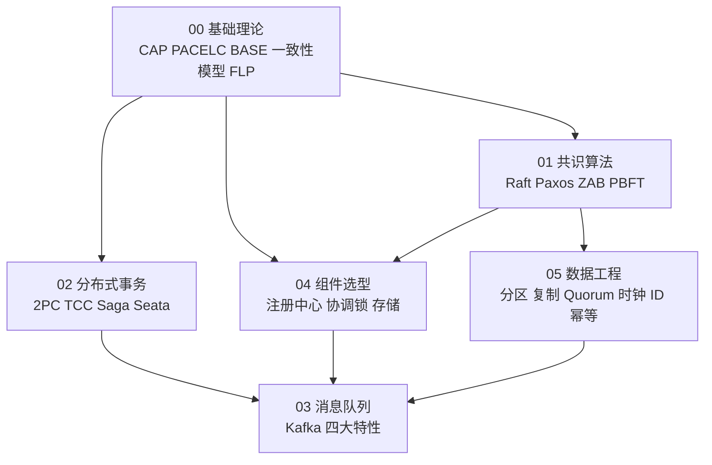

# 分布式共识与分布式系统 · 学习笔记

> **本目录定位**：Stellaris 知识库的**分布式理论层**。三个目录合起来构成完整的后端知识面：
>
> | 目录 | 层次 | 覆盖 |
> |------|------|------|
> | [`../java_interview/`](../java_interview/) | **应用层 / 框架层** | JVM、并发、集合、Spring、云原生、场景设计 |
> | [`../db/`](../db/) | **存储层** | MySQL（日志/锁/复制）、Redis（缓存/分布式锁）、Kafka+Flink |
> | **`distributed_consensus/`（本目录）** | **分布式理论层** | CAP/BASE、共识算法、分布式事务、消息队列、组件选型、数据工程 |
>
> **目标读者**：本人备考 **Java 高级开发**（9 年经验，**期权风控 / 实时计算**方向）。

---

## 一、目录结构与阅读顺序

```
distributed_consensus/
├── README.md                  ← 本文件（索引 + 阅读路线 + 模块边界）
├── 00_分布式基础理论.md        ← 地基：CAP/PACELC/BASE/一致性模型/FLP/两将军
├── 01_共识算法.md              ← 核心：Raft（含工程增强）+ Paxos + ZAB + PBFT
├── 02_分布式事务.md            ← 高频：2PC/3PC/TCC/Saga/本地消息表/Seata
├── 03_分布式消息队列.md        ← 高频：Kafka 深入 + 四大特性 + MQ 对比
├── 04_分布式组件选型.md        ← 选型：注册中心/协调锁/存储 + 脑裂与 Fencing
├── 05_分布式数据工程.md        ← 数据面：分区/复制/Quorum/时钟/分布式ID/幂等/快照
└── 99_参考资料.md              ← 全部参考资料 + 勘误依据
```

**依赖关系**（建议按箭头方向读）：



> **一句话理解各模块的分工**：
> - **`00`** 回答「**为什么这件事这么难**」（理论障碍）
> - **`01`** 回答「**怎么让多个节点达成一致**」（控制面 / 共识）
> - **`02`** 回答「**跨服务的数据一致性怎么做**」（事务）
> - **`03`** 回答「**服务之间怎么可靠地通信**」（消息）
> - **`04`** 回答「**该选哪个组件**」（选型）
> - **`05`** 回答「**数据怎么分布、复制、定序**」（数据面）

### 五大核心问题 → 本目录模块索引

所有分布式系统都在解决下面几类经典问题。**把学习围绕它们展开，就不会迷路**：

| 核心问题 | 要解决什么 | 关键技术 / 方案 | 详见 |
|---------|-----------|---------------|------|
| **分布式共识** | 多个节点如何就一个决定达成一致？ | Raft、Paxos、ZAB、PBFT | [`01`](01_共识算法.md) |
| **数据分布** | 海量数据如何分到多台机器上？ | 分库分表、**一致性哈希**、哈希槽 | [`05`](05_分布式数据工程.md) |
| **容错与高可用** | 如何避免单点故障？ | 主从复制（MySQL/Redis）、故障转移（Sentinel）、多副本 + ISR | [`05`](05_分布式数据工程.md)、[`04`](04_分布式组件选型.md) |
| **伸缩性** | 如何平滑地扩缩容？ | 无状态设计、数据分片、分区再平衡、服务发现 | [`05`](05_分布式数据工程.md)、[`04`](04_分布式组件选型.md) |
| **分布式事务** | 如何保证跨数据库的操作一致性？ | 2PC、3PC、TCC、Saga、本地消息表、Seata | [`02`](02_分布式事务.md) |
| **可靠通信** | 消息如何不丢、不重、不乱序？ | Kafka/RocketMQ 的可靠性配置、幂等消费、事务消息 | [`03`](03_分布式消息队列.md) |

> **核心原则**：**所有「区别 / 选型」问题，都可以围绕「在 CAP / PACELC 下做取舍」展开**（见 [`00`](00_分布式基础理论.md)）。

---

## 二、按剩余时间选阅读路线

### 路线 A：还有 3 天以上（学透）

| 阶段 | 做什么 | 用哪些文件 |
|------|--------|-----------|
| 第 1 天 | **打地基**：CAP 的正确表述、一致性模型谱系、FLP、两将军问题。这部分决定了后面所有回答的深度 | `00` 全文 |
| 第 2 天 | **啃共识**：Raft 全文 + 工程增强（PreVote/Snapshot/ReadIndex/Learner/no-op），再快速过 Paxos 与 ZAB 的对比 | `01` 全文 |
| 第 3 天 | **高频模块**：分布式事务 + 消息队列。这两块是面试出现频率最高的 | `02` / `03` 全文 |
| 第 4 天 | **选型与数据面**：组件选型对比表 + 脑裂与 Fencing；数据工程里挑与简历相关的（Chandy-Lamport / 幂等 / 分布式 ID） | `04` / `05` |
| 第 5 天 | **回炉**：只看每个模块末尾的「**本模块速记**」+「**面试官深挖追问**」，自问自答 | 全部速记表 |

### 路线 B：只有 1~2 天（保高频）

**只看这四块**（面试出现频率排序）：

1. **`02_分布式事务.md`** —— 2PC 缺陷、TCC 三大陷阱、Seata AT 两阶段、选型决策树
2. **`03_分布式消息队列.md`** —— **Kafka 的 ISR 与提交条件（⚠️ 最容易答错）**、三大经典问题、事务消息
3. **`01_共识算法.md`** —— Raft 的选举/复制/安全性三支柱、多数派重叠
4. **`00_分布式基础理论.md`** —— CAP 的正确表述 + 一致性模型谱系

### 路线 C：只剩一晚上

**按顺序背这三张表**：

1. `00` 的【本模块速记】（12 条）
2. `03` 的【本模块速记】（26 条）—— **重中之重是第 3、4、5、13 条**
3. `02` 的【本模块速记】（22 条）—— **重点是第 8、9、19、20 条**

---

## 三、⚠️ 本次重构的 8 处勘误（**优先看这一节**）

原目录的 5 个文件存在**会在面试现场翻车的事实错误**，本次已全部核实并修正。**如果你是来复习的，这 8 条比任何新知识都优先**——因为它们是「自信地说错」，被追问必然露馅。

| # | 原错误表述 | 正确表述 | 详见 |
|---|-----------|---------|------|
| **E1** | 「**ISR 内过半副本**同步成功则消息提交」 | Kafka **不用多数派**。提交条件 = **ISR 的「全部」副本**都已同步；`HW = ISR 中各副本 LEO 的最小值`。`min.insync.replicas` **不是提交条件，是写入准入闸门** | [`03`](03_分布式消息队列.md) 第二节 |
| **E2** | 「Kafka **事务消息无原生支持**」 | **错**。Kafka 自 **0.11.0.0（2017-06-28，KIP-98）** 起原生支持幂等 + 事务（`transactional.id` 用 epoch 隔离僵尸生产者）。**Kafka 真正没有的是「原生延时消息」和「原生死信队列」** | [`03`](03_分布式消息队列.md) 第四节 |
| **E3** | 「通过 `nacos.core.protocol.distro.compatibility.enable=true` 切换 AP/CP」 | ⚠️ **该配置项不存在（编造）**。Nacos 的 AP/CP **不是全局开关**，而是**按数据类型分流**：临时实例 → Distro（AP）；持久实例 + 整个配置中心 → JRaft（CP） | [`04`](04_分布式组件选型.md) 第一节 |
| **E4** | 「CAP：一个分布式系统**最多只能同时满足三点中的两点**」 | **流行误读**。**P 不是选项**（网络分区是物理事实）；C/A 的取舍**只在分区发生期间**；**无分区时二者可兼得**。Brewer 2012 年已亲自澄清 | [`00`](00_分布式基础理论.md) 第一节 |
| **E5** | Consul「默 CP，**可配 AP**」；ZK「**纯 CP**」 | **Consul**：写恒为 CP；**读一致性是每次查询的档位**（`default`/`consistent`/`stale`），不是把集群配成 AP。**ZK**：写是 CP，但**读默认可返回旧值**（非线性的），需 `sync()` | [`04`](04_分布式组件选型.md) 第一节 |
| **E6** | Eureka「HTTP **短轮询**」 | **不准确**。是**周期性拉取**：心跳 30s、拉注册表 30s、租约 **90s** 过期、**60s** 驱逐扫描，且有**自我保护模式**（续约率 < **85%** 时**停止驱逐**）。**新注册最长 ~90s 才全局可见** | [`04`](04_分布式组件选型.md) 第一节 |
| **E7** | 「Leader 宕机后从 ISR 中选举新 Leader」（未提 unclean） | 补全：默认 `unclean.leader.election.enable=false` —— 无 ISR 副本时分区**保持不可用**而非丢数据；置 `true` 则**换可用性但可能永久丢数据** | [`03`](03_分布式消息队列.md) 第二节 |
| **E8** | Raft 提交规则表述正确但缺实现细节 | 补 **no-op entry**：新 Leader 上任先追加一条**本任期空日志**，提交后「连坐」提交旧任期日志。论文 §5.4.2 的精确规则 | [`01`](01_共识算法.md) 第五节 |

**另外修掉的格式问题**：`分布式组件.md` 开头的 `本次讲解将…`（AI 粘贴残留）、`\*\*` 转义残留、`分布式概念.md` 缺失的「第二阶段」标题、各文件标题层级不统一。

> **一句话教训**：**宁可说「具体参数我需要查文档」，也不要编一个看起来很像的配置名。** 面试官只要真用过那个组件，一句话就能问穿。这也是本次重构把「参数与版本号」全部核对来源的原因。

---

## 四、本次补充的新知识（原目录完全缺失）

| 模块 | 新增内容 | 为什么重要 |
|------|---------|-----------|
| `01` | **Paxos 详解**（原目录只提了名字）、**ZAB 三阶段**（原仅表格一行）、**PBFT 与拜占庭容错** | 「Raft 和 Paxos 什么关系」是高频追问；拜占庭能答出 **`3f+1`** 与「Raft 不防作恶」明显高于平均 |
| `01` | **Raft 工程增强**：PreVote、Snapshot、ReadIndex/Lease Read、Learner、no-op、成员变更两条路线 | 论文版 Raft 不能直接上生产。问「Raft 有什么坑/优化」就靠这节 |
| `00` | **FLP 不可能定理**、**两将军问题**、**一致性模型谱系**、**PACELC**、**会话保证** | 这些是「背过书」和「想过」的分水岭 |
| `04` | **脑裂与 Fencing Token**、**GC 停顿导致的锁失效** | 分布式锁最微妙、最容易被忽略的缺陷。能把 Raft 的 Term / Kafka 的 epoch 与 fencing token 串起来，档次明显不同 |
| `05` | **一致性哈希 + 虚拟节点**、**复制模型**、**Quorum NWR**、**Gossip/SWIM**、**逻辑时钟与向量时钟**、**HLC** | 数据面的基础，原目录完全空白 |
| `05` | **分布式 ID**（雪花/时钟回拨/号段/基因法）、**幂等设计六方案** | 分库分表后必然遇到的问题 |
| `05` | **Chandy-Lamport 分布式快照** | **直接关联你的 Flink 实时计算方向**——Flink Checkpoint 的理论基础 |
| `05` | **分库分表**（含深分页难题） | 从原 `分布式概念.md` 归位并大幅扩充 |
| `03` | **`isolation.level` 与事务的隔离** | 事务消息在消费端的完整闭环，「光有生产者事务不够」 |
| `02` | **TCC 三大陷阱**（空回滚/悬挂/幂等）、**Saga 编排 vs 协同**、**Seata 四模式**、**术语消歧** | TCC 三大陷阱是 TCC 相关追问的必答点 |

---

## 五、模块边界与交叉引用

本仓库存在内容重叠，这里**明确每个主题的权威位置**，避免「一份笔记三个说法」：

| 主题 | **权威位置** | 其他位置如何处理 |
|------|-------------|----------------|
| 共识算法（Raft/Paxos/ZAB/BFT） | [`01_共识算法.md`](01_共识算法.md) | `04` 只讲「哪些组件用了它」 |
| 分布式事务（2PC/TCC/Saga/Seata） | [`02_分布式事务.md`](02_分布式事务.md) | `04` 只在生态图中出现 |
| 消息队列（Kafka/RocketMQ 原理与对比） | [`03_分布式消息队列.md`](03_分布式消息队列.md) | `04` 只在生态图中出现 |
| 分布式锁的**完整实现**（SETNX+Lua、Watch Dog、Redlock 争议） | [`../db/06_Redis_分布式锁.md`](../db/06_Redis_分布式锁.md) | `04` 只讲**选型与 CAP 取舍** |
| MySQL 内部「两阶段提交」（Redo/Binlog） | [`../db/00_MySQL_日志与内部2PC.md`](../db/00_MySQL_日志与内部2PC.md) | `02` 做**术语消歧**并交叉引用 |
| MySQL 锁体系（记录锁/间隙锁/临键锁） | [`../db/01_MySQL_锁机制.md`](../db/01_MySQL_锁机制.md) | 本目录不涉及 |
| Kafka 分区/副本/ISR 的**实操细节** | [`../db/09_Kafka与Flink.md`](../db/09_Kafka与Flink.md) | `03` 讲**原理与面试答法** |
| Flink Checkpoint 的**工程配置** | [`../db/09_Kafka与Flink.md`](../db/09_Kafka与Flink.md) | `05` 讲**理论依据**（Chandy-Lamport） |
| 雪花算法 / 接口幂等的**代码级方案** | [`../java_interview/06_基础与场景设计_详解.md`](../java_interview/06_基础与场景设计_详解.md) | `05` 讲**原理与选型** |
| JVM / 并发 / Spring / K8s | [`../java_interview/`](../java_interview/) | 本目录不涉及 |

> **⚠️ 关于本目录的重构**：`distributed_consensus/` 已完成重构（5 个平铺文件 → 8 个编号文件 + README）。`db/` 目录已于 **2026-10-13** 完成同样的重构（4 个平铺文件 → 10 个编号模块 + README + 参考资料），所以上面这些交叉引用**都指向了 `db/` 的新编号文件**。
>
> 只有 `心得.md`（早期草稿，含 Redis 分布式锁内容）中**仍存在与本目录重复的内容**。如需进一步清理，可以单独发起。

---

## 六、图表索引

全库共 **40 张 Mermaid 图**（其中 **32 张**标注了编号图题，其余为无需编号的流程 / 时序图），都内嵌在正文对应位置，上方有 `**图 X-Y：标题**` 图题。

| 模块 | 图 | 最值得看的（面试白板高频） |
|------|----|--------------------------|
| `00` | 图 0-1 一致性模型谱系、图 0-2 从两将军到多数派、图 0-3 理论→方案映射 | **图 0-1**（能讲清谱系，比背「最终一致」强得多） |
| `01` | 图 1-1 Raft 状态机、图 1-2 日志复制、图 1-3 多数派重叠、图 1-4 Paxos 两阶段、图 1-5 ZAB 两阶段、图 1-6 选型决策 | **图 1-1 + 图 1-3**（Raft 必画）、**图 1-4**（Paxos 必画） |
| `02` | 图 2-1 2PC、图 2-2 3PC、图 2-3 TCC、图 2-4 Saga 补偿、图 2-5 本地消息表、图 2-6 Seata AT、图 2-7 选型决策树 | **图 2-6**（Seata AT 两阶段）、**图 2-7**（选型决策树，能画出来就是加分） |
| `03` | 图 3-1 ISR/LEO/HW、图 3-2 消息丢失三环节、图 3-3 事务消息、图 3-4 隔离级别、图 3-5 延时消息、图 3-6 死信队列、图 3-7 消息回溯 | **图 3-1**（⚠️ 纠正 ISR 提交条件的关键图）、**图 3-2** |
| `04` | 图 4-1 脑裂、图 4-2 锁失效与 Fencing | **图 4-2**（能画出来，说明你懂分布式锁的深层缺陷） |
| `05` | 图 5-1 取模扩容灾难、图 5-2 一致性哈希环、图 5-3 三种复制模型、图 5-4 W+R>N、图 5-5 逻辑/向量时钟、图 5-6 雪花 64 位、图 5-7 Chandy-Lamport | **图 5-2**、**图 5-6**、**图 5-7**（对应你的 Flink 方向） |

### ⚠️ 你的编辑器能渲染 Mermaid 吗？

| 环境 | 支持情况 |
|------|---------|
| **GitHub / GitLab** | ✅ 原生支持 |
| **VS Code** | ✅ 装 `Markdown Preview Mermaid Support` 扩展 |
| **Typora / Obsidian** | ✅ 原生支持 |
| **IntelliJ IDEA / WebStorm** | ✅ 内置 Markdown 插件（确认已启用 Mermaid） |
| **记事本 / 纯文本 / 终端** | ❌ 会显示成 `flowchart TD ...` 代码块 |

**建议先在 VS Code 或 Typora 里打开 `01_共识算法.md` 确认能看到图**，再决定要不要往下读。看不到图的话告诉我，我可以改写成 ASCII 图或导出成 PNG/SVG。

### 图的可靠性

**40 张图已全部用 Mermaid 官方解析器（`mermaid.parse()`，`mermaid@11`）逐张校验通过**，无语法错误、无未闭合围栏。校验方式：用 jsdom 提供 DOM 环境后，提取全部 ```` ```mermaid ```` 代码块 → 交给 `mermaid.parse()` 解析 → **40/40 通过**。

图里的技术事实**取自对应模块的正文**（而正文的事实另有来源核对，见 [`99_参考资料.md`](99_参考资料.md)）。少数跨模块引用（如 `04` 引用 `01` 的多数派重叠）已在图题或正文中说明。

---

## 七、建议使用方式

### 1. 结合简历的答题思路

本目录的目标岗位是 **Java 高级开发（9 年经验，期权风控 / 实时计算方向）**，所以**最高价值的回答方式是把理论与你的真实项目串起来**：

| 面试官问 | 你的回答主线 | 用哪些模块 |
|---------|------------|-----------|
| 「你们实时链路怎么保证不丢不重？」 | Kafka 侧（`acks=all`+ISR）→ Flink 侧（Checkpoint 存 offset）→ 存储侧（幂等 Upsert 或 2PC Sink） | **`03` + `05`**（Chandy-Lamport） |
| 「服务之间数据一致性怎么保证？」 | 按场景分：跨服务最终一致用 RocketMQ 事务消息；同数据多库用 Seata AT；核心资金用 TCC | **`02`** |
| 「用过哪些分布式组件？怎么选型？」 | 先定 CAP/PACELC → 再讲特性场景 → 最后结合项目实际（Apollo/SchedulerX/Nacos） | **`04` + `00`** |
| 「分布式锁你们怎么用的？有什么坑？」 | Redis（Redisson）+ 幂等兜底；**主动提 GC 停顿导致的锁失效与 Fencing Token** | **`04` + `05`** |
| 「消息队列为什么这么设计？」 | 从两将军问题 → 多数派 → Raft → Kafka 的 KRaft | **`00` + `01` + `03`** |

> 💡 **把 `04` 最后一节的「结合简历的改法」当成模板**——把通用组件替换成你真实用过的（**Kafka + Flink + Hologres/ADB + SchedulerX + Apollo**），比背诵参考架构有说服力得多。

### 2. 自测与模拟

- **抽题自测**：只看每个模块末尾「**本模块速记**」的**问题列**，自己讲完再看答案。
- **评分标准**：答出速记表里的关键词 = 不丢分；能讲出**「面试官深挖追问」**里的内容 = 高分；能**主动提出**勘误表里的正确说法 = 拉开差距。
- **追问压力测试**：每篇末尾的「面试官深挖追问」就是二面的弹药，逐条自问自答。

### 3. 考前 10 分钟

按顺序只看：

1. **本文件的第三节（8 处勘误）** —— 确保不会当场说错
2. 各模块的【**本模块速记**】
3. `03` 的速记第 **3/4/5/13** 条与 `02` 的速记第 **8/9/19/20** 条

---

## 八、复习收尾清单

考前过一遍，能做到就可以上考场了：

- [ ] **`00`** 能说清 CAP **不是三选二**（P 不是选项，C/A 只在分区期间取舍），能说出 FLP 的精确表述**与它没有说什么**
- [ ] **`01`** 能在白板上画出 Raft 状态机与多数派重叠，能说清**旧任期日志为什么不能直接提交**（Figure 8）与 **no-op entry**，能说出 PreVote 解决什么问题
- [ ] **`01`** 能说出 **Raft ≈ 强 Leader 化的 Multi-Paxos**，以及 Multi-Paxos **允许日志空洞**而 Raft 强制连续
- [ ] **`02`** 能答全 **2PC 的四个缺陷**、**TCC 的三大陷阱**（空回滚/悬挂/幂等）、**Seata AT 的两阶段与全局锁**
- [ ] **`03`** ⚠️ 能准确说出 **Kafka 的提交条件是「ISR 全部副本」而非多数派**，以及 `min.insync.replicas` 的真实作用
- [ ] **`03`** ⚠️ **知道 Kafka 有原生事务**（0.11/KIP-98），而**真正缺的是延时消息与死信队列**
- [ ] **`04`** ⚠️ 能说清 **Nacos 的 AP/CP 是按数据类型分流**（没有全局开关），**Consul 的读一致性是查询档位**，**Eureka 是周期拉取不是短轮询**
- [ ] **`04`** 能讲清**分布式锁的致命缺陷**（GC 停顿导致失去锁而不自知）与 **Fencing Token** 的解法
- [ ] **`05`** 能说清 **`W + R > N` 为什么成立**，以及**它不等于线性一致**
- [ ] **`05`** 能说出**雪花算法的 64 位分配**与**时钟回拨的三种处理**
- [ ] **`05`** 能把 **Flink Checkpoint 对应到 Chandy-Lamport**，并说清 **Barrier 对齐与反压的关系**
- [ ] 每个模块都能答出至少 **3 个「面试官深挖追问」**
