# 01 · JVM 精炼版（15 题）

> **模块主线**：JVM 不是"背八股"，而是一条**内存生命周期流水线**——类怎么进来（类加载）、对象怎么生出（分配与布局）、垃圾怎么判死（可达性+引用）、死物怎么清走（GC 算法与收集器）、代码怎么变快（JIT+逃逸分析）、出事怎么定位（工具链排查）。面试官问 JVM，本质是问：「你的服务在生产上抖过一次，你知不知道去哪里看、看什么、改哪个参数。」
>
> **本文件用途**：详解的压缩版，保留全部技术事实、参数、版本与推理链，只压表述。配套：`01_JVM_详解.md`（学透）、`01_JVM_速记.md`（考前 10 分钟）。

---

## 题 1：JVM 运行时数据区有哪些？哪些会 OOM？

- **题干**：「你简历写了熟悉 JVM，那我先问个基础的：JVM 运行时数据区有哪几块？分别存什么？哪些是线程私有的？哪些会 OOM？」

**骨架答案**
- **线程私有**：**程序计数器**（记录当前线程执行的字节码行号，native 方法时为 undefined；**JVM 规范里唯一不会抛 OOM 的区域**）。
  - **虚拟机栈**（生命周期同线程，每个方法调用压入一个**栈帧** = 局部变量表 / 操作数栈 / 动态链接 / 方法返回地址，大小由 `-Xss` 控制，栈深超限 → `StackOverflowError`，扩展时申请不到内存 → `OutOfMemoryError`）。
  - **本地方法栈**（为 native 方法服务，HotSpot 里与虚拟机栈合二为一）。
- **堆**：线程共享、GC 主战场；新生代（Eden + 2 个 Survivor）+ 老年代；`-Xms` 初始、`-Xmx` 最大；**OOM: Java heap space 就从这里来**。
- **方法区 / 元空间**：线程共享，存类元信息、运行时常量池、静态变量、JIT 编译后代码；**JDK 8 前 HotSpot 用"永久代"实现，受 `-XX:MaxPermSize` 限制、在堆内；JDK 8 起改为"元空间"，移出堆、使用本地内存**，受 `-XX:MaxMetaspaceSize` 限制 → 典型 OOM 是 `OutOfMemoryError: Metaspace`。
- **直接内存**：不属于运行时数据区但被频繁使用（NIO `ByteBuffer.allocateDirect`）；受 `-XX:MaxDirectMemorySize` 限制（默认与 `-Xmx` 相当，视版本而定），**不受 `-Xmx` 约束** → OOM: Direct buffer memory。
- 由 `Cleaner`（基于虚引用）在 Full GC 时释放。堆内与堆外是两个独立账本。

**图 1-1：JVM 运行时数据区结构总览**

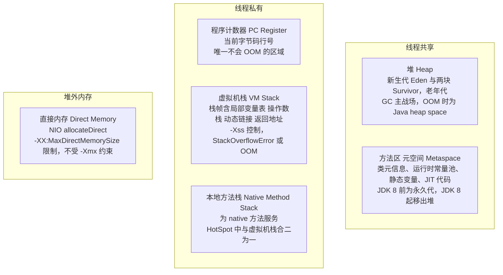

**为什么 / 取舍**
- **"私有 vs 共享"决定并发边界**：栈私有 → 局部变量天然线程安全；堆/元空间共享 → 对象和静态变量才需要同步保护（面试官问这句是在为并发题铺垫）。
- **"堆内 vs 堆外"决定排查的问题域**：元空间、直接内存在堆外，`jmap -heap` 看堆很健康、进程却可能被 OOMKilled，不分堆内外就会一直在堆里找、方向全错；**"设不设上限"则是安全性与灵活性的权衡**——元空间不设上限可避免早期"永久代溢出"但泄漏无界，设上限是把不确定性换成一个可预测的失败，故障可监控、可告警。

**企业实际处理**
- 生产**必开** `-XX:+HeapDumpOnOutOfMemoryError -XX:HeapDumpPath=/opt/dump`，OOM 现场自动落盘，否则重启后证据全丢。
- JDK 8+ 统一用元空间并配 `-XX:MetaspaceSize=256m -XX:MaxMetaspaceSize=512m`，**必须设上限**，否则元空间泄漏会吃光容器内存（CGLIB / 动态代理 / 热部署高发）。
- 容器里**显式设 `-Xmx`，不依赖默认值**，并给直接内存留预算（Netty / NIO 场景）。

**易错 / 加分**
- ⚠️ 别漏掉"**PC 寄存器不会 OOM**"这个反常识点；运行时常量池在 **JDK 7 从方法区搬到堆**（`StringTable` 在堆里，`intern()` 行为随之变化），JDK 8 后"永久代"概念已不存在。
- 💡 字符串常量池 / `String.intern()`：**JDK 6 复制字符串进永久代，JDK 7+ 存引用**，影响"常量池能放多少"。

---

## 题 2：一个 new 出来的对象，在内存里到底长什么样？

- **题干**：「平时写 `new Object()` 很自然。我问细一点：一个对象从 `new` 指令到你能用，中间经历了什么？它在内存里占多少字节、由哪几部分组成？」

**骨架答案**
- **五步创建**：① **类加载检查**（常量池定位符号引用，未加载/解析/初始化则触发类加载）→ ② **分配内存** → ③ **零值初始化**（内存全部置零，字段不赋初值也能用，与准备阶段给静态变量设零值是同一逻辑）→ ④ **设置对象头**（写 Mark Word 与 Klass Pointer）→ ⑤ **执行 `<init>`**（构造方法，此时才做成员变量显式赋值与父类构造）。
- **分配方式取决于堆是否规整**：**指针碰撞**（Bump the Pointer）用于规整的堆（Serial/ParNew 等带整理的收集器）；**空闲列表**（Free List）用于有碎片的堆（CMS）。
- **并发安全两种解法**：① **CAS + 失败重试**；② **TLAB**——每线程在 Eden 预分配一小块私有区域，默认开启（`-XX:+UseTLAB`）、默认占 Eden 的 **1%**（`-XX:TLABWasteTargetPercent`），用完再申请，耗尽后仍会在 Eden 用 CAS 分配。
- **对象头（64 位 HotSpot，开启压缩指针）**：**Mark Word 8 字节**（哈希码 / GC 分代年龄 4 bit → 故 `MaxTenuringThreshold` 最大 15 / **锁标志位**）；**Klass Pointer** 压缩时 **4 字节**、否则 8 字节；**数组长度**仅数组对象有、4 字节。
- 故普通对象头 = 8+4 = **12 字节**，数组对象头 = 8+4+4 = **16 字节**。
- **实例数据**按 JVM 策略排列（long/double 优先、同宽度放一起、父类字段在前）；**对齐填充**使对象总大小必须是 **8 字节的整数倍**。
- **指针压缩**：`-XX:+UseCompressedOops`，**JDK 6u23 起 64 位默认开启**；原理是对象按 8 字节对齐、地址低 3 位恒为 0，故 32 位可表示 2^32 × 8 = **32GB 地址空间**；**堆超过 32GB 压缩指针自动失效**（Klass Pointer 由 `-XX:+UseCompressedClassPointers` 单独控制）。

**图 1-2：对象创建过程**

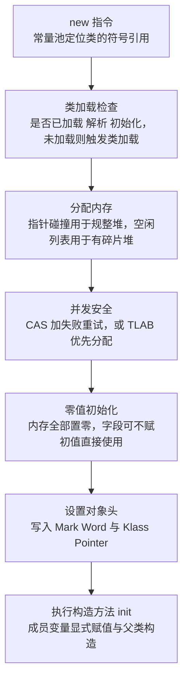

**图 1-3：对象内存布局与指针压缩前后对比**

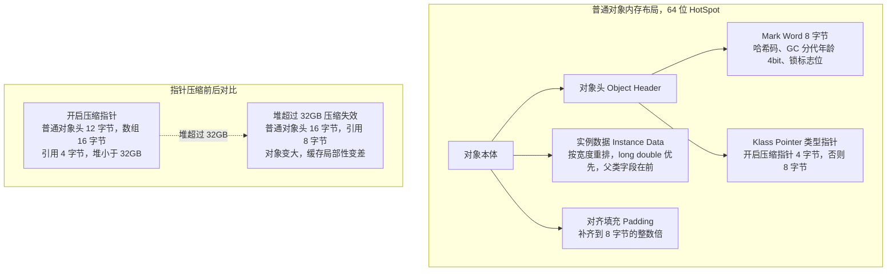

**为什么 / 取舍**
- **32GB 是"物理对齐换地址空间"的算术结果，不是拍脑袋**：理解 8 字节对齐 → 低 3 位可省 → 32 位表示 32GB 这条链，才能在追问"能不能开到 64GB"时答"能，但每个引用从 4 字节变 8 字节，同样对象多占 20%+，得不偿失"。
- **TLAB 是"用空间换吞吐"**：带来少量内部碎片（1% 浪费），换来无锁分配，高并发下收益远大于损耗；**对象头则是"并发状态的载体"**——Mark Word 同时塞了哈希码、GC 年龄和锁状态，这解释了为什么 `hashCode()` 调用后再加锁会导致锁升级不可逆（哈希码与偏向锁标志位争用同一个 bit）。

**企业实际处理**
- 单机堆一般不超 **31~32GB**（保留压缩指针），超过就做分片/多实例，而不是单堆硬撑；高频短命对象靠 **TLAB** 降低 CAS 竞争（默认行为），不要无脑 `-XX:-UseTLAB`。
- 大对象超过 `-XX:PretenureSizeThreshold` 直接进老年代，**该参数只对 Serial/ParNew 有效**，对 Parallel Scavenge 和 G1 无效（G1 用 Humongous Region 处理）。
- 实际布局用 JOL 验证——`ClassLayout.parseInstance(obj).toPrintable()` 看 `Instance size` 与 header 12 bytes（📦 按 JDK 17 书写、未实测，依赖 `org.openjdk.jol:jol-core`）。

**易错 / 加分**
- ⚠️ `-XX:+UseCompressedOops` 在堆 < 32GB 时**默认自动开启**，手写它多数是多余的；`OrderEvent{long+int+String}` 在压缩指针下 12(头)+8+4+4 = 28 → 补齐 **32 字节**（未压缩则 16+8+4+8 = 36 → **40 字节**）。
- 💡 Mark Word 复用：无锁低 3 位 `001`、偏向锁 `101`，轻量级锁指向栈中 Lock Record，重量级锁指向 ObjectMonitor——把对象布局与并发锁打通，是高级岗加分点。

---

## 题 3：怎么判断一个对象可以回收？GC Roots 有哪些？

- **题干**：「怎么判断一个对象死了？为什么不用引用计数？GC Roots 具体是哪些东西？四种引用你平时用哪种？」

**骨架答案**
- **不用引用计数**：无法解决**循环引用**（A↔B 计数都不为 0 却整体不可达），且计数增减有性能开销；主流 JVM 用**可达性分析**——从 **GC Roots** 出发沿引用链遍历，不可达判为可回收，注意这是**逻辑上的"不可达"，不是立刻回收**。
- **GC Roots 有哪些**（能完整说出来的是少数）：① **虚拟机栈局部变量表引用的对象（最多、最关键）**。
  - ② **方法区静态变量**引用的对象。
  - ③ **方法区常量**引用的对象（字符串常量池等）。
  - ④ **本地方法栈 JNI 引用**的对象。
  - ⑤ **同步锁（synchronized）持有的对象**。
  - ⑥ JVM 内部引用（基本类型的 Class 对象、常驻异常对象如 NPE、系统类加载器）。
  - ⑦ 被 GC Root 引用的其他对象（递归可达）。
- **四种引用**：**强引用**——只要可达 OOM 也不回收，普通对象。
  - **软引用 `SoftReference`**——内存不足时回收，内存敏感缓存。
  - **弱引用 `WeakReference`**——下次 GC 必回收，`ThreadLocal` / `WeakHashMap` / 规范化映射。
  - **虚引用 `PhantomReference`**——无法通过它取到对象、只为回收通知，用于直接内存 `Cleaner`、资源释放。
- **对象"真正死亡"要两步**：不可达后**第一次标记**，判断是否需执行 `finalize()`（未覆盖或已执行过则直接回收）；需要则放入 **F-Queue** 由低优先级 Finalizer 线程执行，`finalize()` 中重建引用可"自救"，但**自救只能成功一次**（`finalize()` 最多被调用一次）。
- `finalize()` **JDK 9 起标记 `@Deprecated`，JDK 18 起标记 `forRemoval`**。

**图 1-4：可达性分析与 GC Roots**

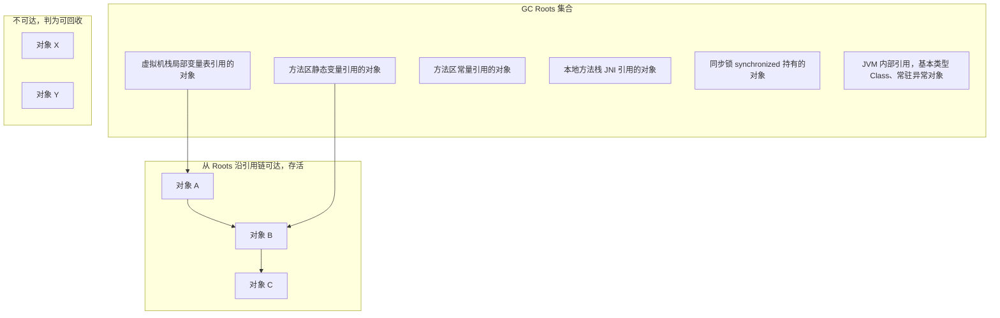

**图 1-5：四种引用强度与回收时机**

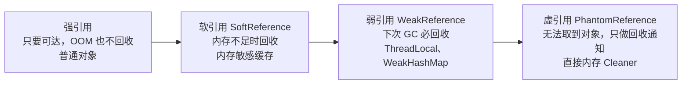

**为什么 / 取舍**
- **可达性分析的代价是"每次 GC 都要从 Roots 遍历"**：这决定了 STW 时长与**活跃对象数量**成正比（而非与堆大小成正比）——这是理解 G1/ZGC 为何能低延迟的前提。
- **弱引用是"给 GC 一个抓手"**：`ThreadLocalMap` 把 key 设为弱引用，是为了 `ThreadLocal` 本身不被引用时能清掉 entry 的 key，避免 key 永久泄漏；但 **value 是强引用，所以仍须手动 `remove()`**——这个"半边弱引用"的设计意图是多数人答不出的深度点。
- 而 **finalize 的"复活"机制让回收变成两阶段**，GC 复杂度上升且行为不可控，所以现代 Java 用 `Cleaner`（虚引用 + 引用队列）取代它。

**企业实际处理**
- **生产代码不写 `finalize()`**：执行时机不确定、可能拖慢 GC、甚至让对象"复活"，是纯负债；资源释放一律用 `try-with-resources` / `AutoCloseable`。
- **`ThreadLocal` 用完必须 `remove()`**：线程池里线程长期存活，key 弱引用、value 强引用，key 被回收后 value 变成"key 为 null 的残留"，不 remove 就是**典型内存泄漏**；本地缓存用 `SoftReference` 要有心理准备——它可能在**任意一次 GC** 时被清空，别放关键业务数据。

**易错 / 加分**
- ⚠️ `System.gc()` 只是**建议**不是命令（可被 `-XX:+DisableExplicitGC` 屏蔽，但这也会屏蔽 `DirectByteBuffer` 依赖的显式 GC 回收路径，需配合 `MaxDirectMemorySize` 使用）。
- 💡 **`-XX:+ClassUnloadingWithConcurrentMark`**（G1 默认开启类卸载）与"元空间泄漏"的关系：动态生成类（CGLIB / 反射代理 / 热部署）让元空间持续增长，只能靠卸载类回收；`WeakHashMap` 的 key 被回收后会触发 expunge 清理，是弱引用最常见的框架级用法。

---

## 题 4：GC 算法和分代回收是怎么回事？对象什么时候晋升老年代？

- **题干**：「GC 有哪几种基础算法？为什么分代？对象什么时候从新生代进老年代？」

**骨架答案**
- **三种基础算法**：**标记-清除**——标记存活、清除垃圾，**缺点产生内存碎片**、两阶段效率都不高；**复制**——存活对象复制到另一块空间、整块清空，**适合存活率低的区域**（新生代），代价是**需要预留一半空间**作周转；**标记-整理**——标记后把存活对象向一端移动，**无碎片**，但移动成本高、需要 STW。
- **分代两条假说**：**弱分代假说**——绝大多数对象朝生夕灭；**强分代假说**——熬过越多次 GC 的对象越难死。故新生代用**复制算法**（存活少、复制便宜），老年代用**标记-清除或标记-整理**（存活多、复制贵）。
- **堆结构**：新生代 = **Eden : Survivor0 : Survivor1 = 8 : 1 : 1**（`-XX:SurvivorRatio=8`，**默认 8**）；老年代与新生代比例由 `-XX:NewRatio` 控制（**默认 2**，即老:新 = 2:1，新生代占堆 1/3）。
- **一次 Minor GC 流程**：对象优先在 Eden 分配 → Eden 满触发 Minor GC → 存活对象复制到 Survivor（`-XX:+UseTLAB` 下是 S0）→ 年龄 +1 → 下次 GC 时 Eden + S0 存活对象复制到 S1、年龄再 +1，两块 Survivor 交替使用（**任何时刻只有一块有效**）。
- **晋升老年代的四个条件**：① **年龄达阈值** `-XX:MaxTenuringThreshold`，**默认 15**（**CMS 默认 6**，因为它无碎片整理，让对象尽早进老年代减少新生代拷贝）。
  - ② **动态年龄判定**——Survivor 中**相同年龄的所有对象大小之和 > Survivor 空间一半**，则**年龄 ≥ 该年龄**的对象直接晋升（不等到 15，常被忽略）。
  - ③ **大对象直接进入老年代**——超过 `-XX:PretenureSizeThreshold`（默认 0 即不启用，且**只对 Serial/ParNew 有效**），G1 里改用 **Humongous Region** 存超过 Region 一半的大对象。
  - ④ **Survivor 空间不足 / 分配担保**——Minor GC 前若老年代最大可用连续空间 < 新生代所有对象总大小，或 Survivor 装不下，通过**分配担保**把对象直接放进老年代（老年代空间不够且无法扩展才触发 Full GC）。
- **Full GC 触发条件**（JDK 8 + Parallel/Parallel Old 场景）：老年代空间不足 / 元空间达 `MetaspaceSize` 阈值 / 调用 `System.gc()` / Minor GC 前担保失败 / CMS 的 Concurrent Mode Failure。

**图 1-6：堆内存分代结构与对象晋升路径**

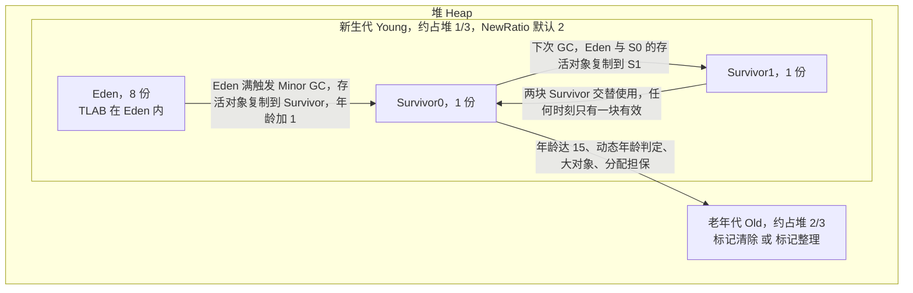

**为什么 / 取舍**
- **分代是"用统计规律换效率"**：它把"每次 GC 都要扫全堆"降级成"多数 GC 只扫新生代"，前提是对象生命周期确实有规律（大部分朝生夕灭）。
- **动态年龄判定是"防止 Survivor 溢出"的兜底**：一批同龄对象加起来超过 Survivor 一半，说明它们大概率是同一批长生命周期对象（如启动时加载的缓存），继续在 Survivor 反复复制只是浪费，直接晋升更划算。
- **分配担保把风险从新生代转移到老年代**：先假设老年代能接住，接不住才算总账（Full GC）——一个"乐观分配"设计，代价是偶尔一次昂贵的 Full GC。

**企业实际处理**
- **`-Xmn` / `-XX:NewRatio` 不要乱调**：低延迟服务（如实时预警）倾向**加大新生代**让短命对象死在新生代、减少晋升，从源头减少 Full GC。
- **禁止业务代码调 `System.gc()`**：日志框架、部分中间件客户端、`ByteBuffer` 直接内存回收路径都可能触发，生产常加 `-XX:+ExplicitGCInvokesConcurrent`（配合 CMS/G1，把 `System.gc()` 变成并发 GC 而非 Full STW）。
- **晋升年龄不要随便改小**——会让对象过早进老年代、加速老年代膨胀、增加 Full GC 频率，是新手最常见的反向操作。

**易错 / 加分**
- ⚠️ **G1 没有物理连续的新生代/老年代**，Region 是逻辑划分，所以 **`-Xmn` 在 G1 下不生效**（需用 `-XX:G1NewSizePercent` / `-XX:G1MaxNewSizePercent`），高频陷阱。
- 💡 说清 **Survivor 两块区交替使用**的机制，很多人只记 8:1:1 却说不清为什么是两块。

---

## 题 5：双亲委派是什么？哪些场景要打破它？

- **题干**：「类加载的过程说一下吧。双亲委派是什么？为什么 JDBC 这种要打破双亲委派？」

**骨架答案**
- **类加载五个阶段**：**加载 → 验证 → 准备 → 解析 → 初始化**（之后才是使用和卸载）。**准备阶段**为静态变量分配内存并设为**零值**（`static int a = 10` 此时 a 是 0），但 `static final` 常量在准备阶段就赋真实值（因 `ConstantValue` 属性）。
- **解析**把常量池的符号引用替换为直接引用（支持懒解析）；**初始化**执行 `<clinit>()`（静态代码块 + 静态变量赋值，**父类先于子类**），触发条件是主动引用：`new`、访问静态字段/方法、反射、初始化子类、`main` 类、`MethodHandle` 等。
- **双亲委派层次与目的**：**Bootstrap（启动类，加载 `<JAVA_HOME>/lib`）→ Platform/Extension（扩展类，JDK 9 后叫 Platform ClassLoader）→ Application/System（应用类，`classpath`）→ 自定义 ClassLoader**。
- 逻辑是 `loadClass` 时**先委托父加载器**，父加载器加载不了（不在其搜索路径）才自己加载——**注意双亲委派是 `loadClass` 方法的实现，不是 JVM 规范强制，是推荐做法**。
- 目的是① **安全性**（防止用户自写 `java.lang.String` 覆盖核心类）② **唯一性**（同一个类只被加载一次，避免类冲突）。
- **打破场景一 · SPI**：`java.sql.Driver` 在核心模块由 Bootstrap 加载，实现类 `com.mysql.jdbc.Driver` 在 `classpath` 由 Application 加载，**父加载器无法看到子加载器的类**。
- 于是引入**线程上下文类加载器**（`Thread.currentThread().getContextClassLoader()`），用"父委托子"的反向行为完成加载（`ServiceLoader.load(Class)` 即此机制，JDBC、JNDI 都属此类）。
- **打破场景二 · Tomcat 的 WebAppClassLoader**：为满足**应用隔离**（不同 webapp 用不同版本 Jar）与**热部署**（reload 时丢弃整个类加载器），**先自己加载**（`WebappClassLoaderBase.loadClass` 优先本地），只有 JRE 核心类、`javax.servlet` 等共享类才交给父加载器，是**"自己优先"**的打破方式。
- **场景三 · 热部署 / OSGi / 模块化**：热部署本质是**每次 reload 用新的 ClassLoader 加载全部类**，旧的不可达后被 GC；OSGi 用更复杂的网状委托实现模块级隔离。
- **场景四 · JDK 9 模块化（JPMS）**：扩展类加载器改名为 **Platform ClassLoader**、**`BootClassPath` 参数被移除（`-Xbootclasspath` 不再可用**，改用 `--upgrade-module-path` / `--patch-module`），且 `loadClass` 在模块内默认不再走双亲委派——这是"平台自身也改了委派规则"的版本注记，面试提一句能体现你关注 JDK 演进。

**图 1-7：双亲委派模型**

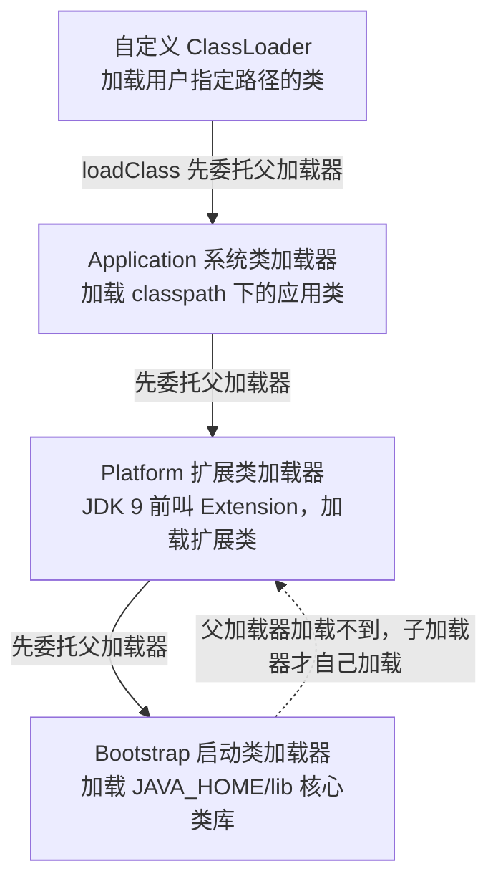

**图 1-8：打破双亲委派的三种场景**

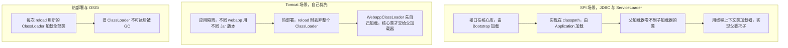

**为什么 / 取舍**
- **SPI 的需求本质是"接口在核心库、实现在业务侧"**：双亲委派的单向委托天然做不到"父加载器加载子加载器的类"，只能靠线程上下文类加载器这条"旁路"——这解释了为什么 `ServiceLoader` 一定要在当前线程设置上下文类加载器。
- **类加载器隔离是"用内存换隔离性"**：每个 ClassLoader 有独立的类元空间，隔离越彻底、元空间占用越大、类卸载越难（Tomcat reload 泄漏、DevTools 元空间膨胀都是这个取舍的代价）。
- **而打破双亲委派必须有充分理由**——默认模型保证安全性和类唯一性，一旦打破，"同一个类名被加载成两个不同 Class 对象"就会出现（`instanceof` 判定失败、`ClassCastException`），是很多类冲突故障的根源。

**企业实际处理**
- **JDBC 4.0+ 用 SPI 自动注册驱动**，`Class.forName("com.mysql.cj.jdbc.Driver")` 可省略（老项目保留是为兼容与显式保证）。
- **热部署 / `spring-boot-devtools` 在容器里禁用**：会造成类加载器泄漏（旧 ClassLoader 被 ThreadLocal/静态变量间接引用无法 GC），表现是**元空间持续涨、最终 Metaspace OOM**；**自定义 ClassLoader 做类隔离**（多版本 Jar 共存、插件系统）是高级岗"框架能力"的常见考察。

**易错 / 加分**
- ⚠️ **`Class.forName` 与 `ClassLoader.loadClass` 的区别**：前者默认会初始化（`initialize=true`），后者只加载不初始化。
- 💡 **JDK 9 后的模块化（JPMS）**：`rt.jar` 被拆成模块、扩展类加载器改名 Platform ClassLoader、`-Xbootclasspath` 被移除。
- 打破双亲委派的**两种姿势**是重写 `loadClass`（改变委托逻辑）或重写 `findClass`（只加搜索路径、不破坏委托），实战写法是 `loadClass` 里先 `findLoadedClass`、再 `findClass` 自己优先加载，`ClassNotFoundException` 时才 `super.loadClass` 委托父加载器（📦 按 JDK 17 书写、未实测）。

---

## 题 6：GC 收集器这么多，你怎么选？

- **题干**：「Serial、ParNew、Parallel、CMS、G1、ZGC 你都了解吗？你们线上服务用的哪个？为什么选它？」

**骨架答案**
- **收集器全景（按演进顺序）**：
  - **Serial**（新生代，复制，单线程 STW，简单高效，Client 模式默认，`-XX:+UseSerialGC`，仍可用）。
  - **ParNew**（新生代，复制，多线程 STW，Serial 的多线程版，**主要配合 CMS**，`-XX:+UseParNewGC`，**JDK 9 起逐步废弃**）。
  - **Parallel Scavenge**（新生代，复制，多线程 STW，**吞吐量优先**、可自适应调节，`-XX:+UseParallelGC`，**JDK 8 默认**）。
  - **Parallel Old**（老年代，标记-整理，多线程 STW，配合 Parallel Scavenge）。
  - **Serial Old**（老年代，标记-整理，单线程 STW，**CMS 的兜底**，G1 兜底也用）。
  - **CMS**（老年代，标记-清除，**并发**，低延迟、四阶段、**有碎片**，`-XX:+UseConcMarkSweepGC`，**JDK 9 废弃、JDK 14 移除**）。
  - **G1**（整堆，复制+标记-整理，并发，Region 化、**可预测停顿**，`-XX:+UseG1GC`，**JDK 9+ 默认**）。
  - **ZGC**（整堆，染色指针+读屏障，并发，**超低延迟（<10ms，JDK 16 后亚毫秒）**，`-XX:+UseZGC`，JDK 11 实验、**JDK 15 转正**、**JDK 21 分代**）。
  - **Shenandoah**（整堆，转发指针+读屏障，并发，低延迟，RedHat 出品，`-XX:+UseShenandoahGC`，**JDK 12 进入主线**）。
  - **Epsilon**（**只分配不回收**，`-XX:+UseEpsilonGC`，性能测试用，JDK 11+）。
- **两个核心指标与 CMS 四阶段**：**吞吐量 = 用户代码时间 / (用户代码时间 + GC 时间)**，适合批处理/离线计算；**停顿时间**为单次 STW 时长，适合交互式/实时服务，两者通常**此消彼长**。
- CMS 四阶段 = **初始标记**（STW，仅标记 GC Roots 直接关联对象，**很快**）→ **并发标记**（与用户线程并发，耗时最长，做可达性遍历）→ **重新标记**（STW，修正并发期间用户线程导致的变动，用**增量更新**，**比初始标记长但比并发标记短**）→ **并发清除**（与用户线程并发清除垃圾）。
- **CMS 三大缺点**：① **对 CPU 敏感**（并发阶段占线程，需调 `-XX:ParallelGCThreads`、`-XX:ConcGCThreads`）。
  - ② **浮动垃圾**（并发清除期间新产生的垃圾只能下次处理，导致 Concurrent Mode Failure → 退化为 Serial Old 全 STW）。
  - ③ **内存碎片**（标记-清除后遗症，需 `-XX:+UseCMSCompactAtFullCollection` 或 `-XX:CMSFullGCsBeforeCompaction` 定期整理）。
- **选型决策**：**JDK 8 时代**——吞吐优先（离线/批处理）→ Parallel；低延迟（Web/实时）→ CMS（注意碎片与 CMF）；堆小且单核 → Serial。
  - **JDK 9+**——默认 G1；堆 ≤ 6GB 且延迟不敏感时 G1 未必优于 Parallel；延迟敏感 → G1（调 `MaxGCPauseMillis`）或 ZGC。
  - **超大堆（几十 GB）+ 极低延迟** → ZGC（注意其 CPU 开销与吞吐低于 G1，且 **JDK 16 前不支持压缩指针/类卸载**等限制，视版本而定）。

**图 1-9：垃圾收集器演进与适用场景对比**

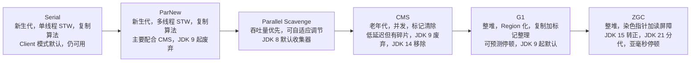

**图 1-10：CMS 四阶段与两大失败模式**

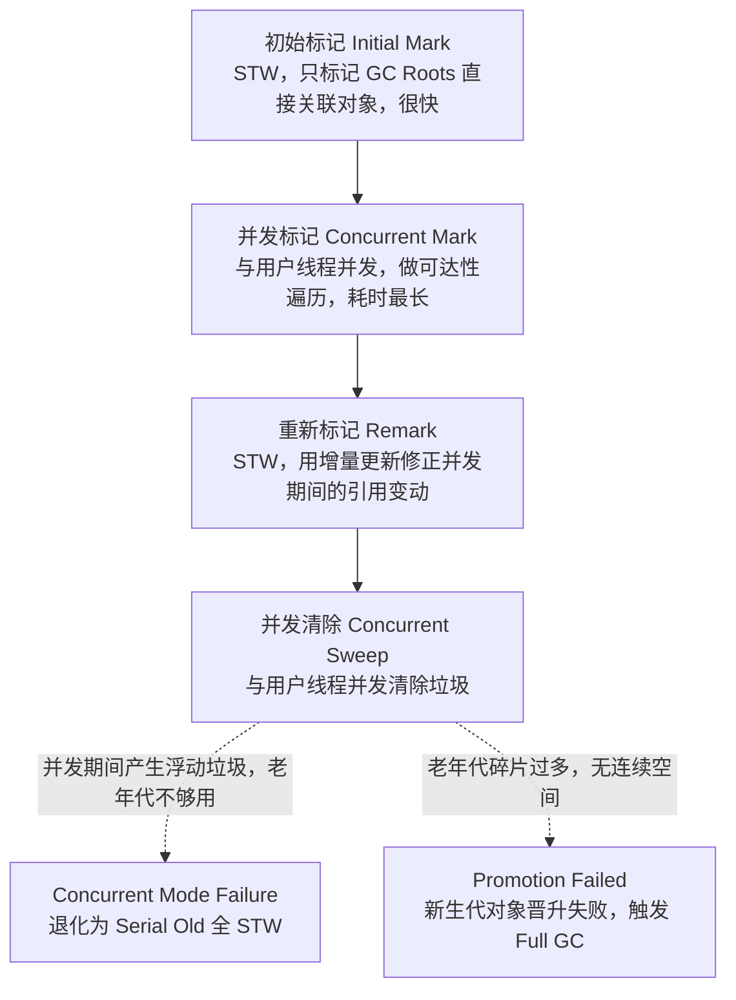

**为什么 / 取舍**
- **选型是"延迟、吞吐、内存开销"三角取舍，没有全能选手**：G1 用 Remembered Set 维护跨 Region 引用（内存开销 + 写屏障成本）换可预测停顿；ZGC 用染色指针 + 读屏障（每次读都要检查，吞吐下降）换亚毫秒停顿——能讲清"为了低延迟牺牲了什么"才是真懂。
- **版本演进的现实约束比理论重要**：CMS 在 JDK 14 移除、G1 从 JDK 9 起默认，知识若停留在"CMS 是低延迟最佳选择"，面试官会判断你脱离一线。
- **而且默认值未必适合你**——G1 默认 `MaxGCPauseMillis=200ms`，对毫秒级 SLA 太宽松必须主动调，Parallel 的 `MaxGCPauseMillis` 无效（它用 `GCTimeRatio`），参数体系完全不同。

**企业实际处理**
- **JDK 8 老系统的实时预警服务**若仍用 CMS，必须配 `-XX:CMSInitiatingOccupancyFraction=70 -XX:+UseCMSInitiatingOccupancyOnly` 并加 `-XX:+ExplicitGCInvokesConcurrent`；但 **CMS 在 JDK 14 已移除，新项目不能选**。
- **JDK 9+ 项目默认 G1 + `-XX:MaxGCPauseMillis=200`**（默认 200ms），低延迟场景可压到 50ms 但牺牲吞吐。
- **JDK 17 低延迟 SLA 首选 G1，极端场景评估 ZGC**，**JDK 21 已支持分代 ZGC（`-XX:+ZGenerational`）**，大幅改善 ZGC 的吞吐短板；上线前**用压测复现目标 QPS 下的 GC 表现**，不靠猜。

**易错 / 加分**
- ⚠️ **G1 与 CMS 的本质区别**：CMS 回收整块老年代，G1 回收收益最高的若干 Region（Garbage First 的来历）。
- 💡 **ZGC 的染色指针**把 GC 状态存在 64 位指针高位，所以 **ZGC 不支持压缩指针**（JDK 16 前），这是它与 G1 的架构级差异；**Shenandoah vs ZGC** 的"读屏障 vs 转发指针"差异，且 Shenandoah JDK 12 才进主线、各发行版支持不同（视发行版而定）。

```bash
# 📦 按 JDK 17 书写、未实测：三套典型启动参数
# A 延迟敏感 G1（目标 100ms 停顿）
java -Xms4g -Xmx4g -XX:+UseG1GC -XX:MaxGCPauseMillis=100 -XX:G1HeapRegionSize=8m \
     -XX:InitiatingHeapOccupancyPercent=35 -XX:ParallelGCThreads=8 -XX:ConcGCThreads=2 \
     -XX:+HeapDumpOnOutOfMemoryError -XX:HeapDumpPath=/opt/dump \
     -Xlog:gc*:file=/opt/logs/gc.log:time,uptime,level,tags:filecount=10,filesize=100m -jar risk-warning.jar
# B 吞吐优先 Parallel：-XX:+UseParallelGC -XX:GCTimeRatio=99 -XX:+UseAdaptiveSizePolicy -XX:ParallelGCThreads=16
# C 超低延迟（注意吞吐下降）：-XX:+UseZGC -XX:+ZGenerational -XX:+AlwaysPreTouch
```

---

## 题 7：G1 的 Region 和"可预测停顿"是怎么回事？

- **题干**：「说说 G1 吧。Region 是什么？它凭什么能"可预测停顿"？Mixed GC 回收哪些 Region？」

**骨架答案**
- **Region 化布局**：把堆划分为**约 2048 个大小相等的 Region**（`-XX:G1HeapRegionSize`，取值 **1MB~32MB 且为 2 的幂**，默认约 `堆大小 / 2048` 向上取整）；**每个 Region 物理上不连续，但逻辑上被标记为 Eden / Survivor / Old / Humongous**。
- **Humongous Region** 存放**超过单个 Region 一半大小**的大对象，可连续占用多个 Region——这是 G1 特有的大对象处理方式（替代了 `PretenureSizeThreshold`，后者在 G1 下无效）。
- **可预测停顿（停顿预测模型）**：G1 维护每个 Region 的**回收收益**（能回收多少垃圾）与**回收成本**（存活对象多少、复制耗时）。
- 每次 Young/Mixed GC 在 `-XX:MaxGCPauseMillis`（**默认 200ms**）约束下，**优先选择回收收益最高的 Region**（Garbage First 的由来），按收益/成本排序、在时间预算内回收尽可能多的 Region。
- 用户给定目标停顿 → G1 动态调整**新生代 Region 数量**（`-XX:G1NewSizePercent` / `-XX:G1MaxNewSizePercent`，默认 5%~60%）来逼近目标。
- **三种回收类型**：
  - **Young GC**（STW，回收**所有 Eden Region**，存活对象复制到 Survivor 或 Old 晋升）。
  - **Mixed GC**（回收**所有 Young Region + 部分 Old Region**，按收益排序、在停顿目标内，**不是回收整个老年代**）。
  - **Full GC**（当 Mixed GC 赶不上垃圾产生速度时兜底，**JDK 10 前用 Serial Old 单线程全 STW，JDK 10 起改为并行（JEP 307）**，是 G1 最不希望发生的）。
- **关键技术**：**SATB（原始快照）**——并发标记时以开始时的对象图快照为基准，用**写前屏障**记录被覆盖的旧引用避免漏标（漏标几乎不发生，代价是产生**浮动垃圾**）。
  - **RSet（记忆集）**——每个 Region 记录"**谁引用了我**"（跨 Region 引用）避免全堆扫描，配合 **Card Table** 实现、写屏障维护。
  - **TAMS（Top At Mark Start）**——并发标记期间新分配的对象视为存活，避免误回收。
  - **`-XX:InitiatingHeapOccupancyPercent`（IHOP）**——触发并发标记周期的阈值，**默认 45%**（老年代占整堆比例），设太高来不及回收导致 Full GC，设太低频繁并发标记浪费 CPU。
- **G1 三个缺陷**：RSet 占用额外内存（可达堆的 5%~10%，视跨引用复杂度而定）、写屏障开销（每次引用赋值都要维护 RSet）、大对象（Humongous）跨 Region 分配容易引发碎片和 Full GC。

**图 1-11：G1 的 Region 布局与回收流程**

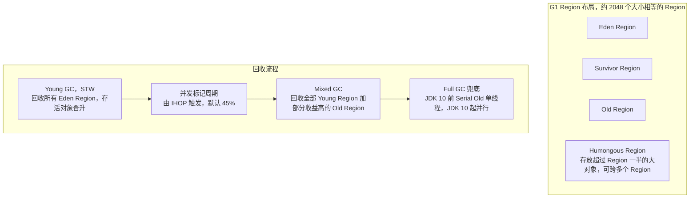

**为什么 / 取舍**
- **"可预测"来自"可选择"**：G1 把"一次扫全堆"变成"每次挑一部分 Region 扫"，才能把停顿时间当约束条件去求解；Parallel 是老年代满了就全部整理，停顿与存活对象数成正比、不可控。
- **SATB 用"浮动垃圾"换"不漏标"**：原始快照保留并发期间已死但被引用的对象（少回收一些），换来无需重新标记扫描整个新生代（CMS 的 Remark 要重扫新生代，STW 更长）。
- 这是 G1 与 CMS 在漏标策略上的根本权衡：**G1 用 SATB，CMS 用增量更新**；**IHOP 则是"提前量"参数**——并发标记需要时间，等老年代满了才标记必然来不及（期间用户线程还在填垃圾），所以必须提前到 45% 左右启动。

**企业实际处理**
- **必调 `-XX:MaxGCPauseMillis`**（默认 200ms）：实时预警服务可设 50~100ms，但接受吞吐下降与可能的 Full GC 风险。
- **显式设 IHOP**（如 35%~45%），并观察 `-Xlog:gc*` 中是否有 `to-space exhausted` 或 `Full GC`，出现说明 Mixed GC 跟不上，要**降低 IHOP** 或**加大堆**。
- **避免大对象**：批量查询结果、大 JSON、`byte[]` 全量缓存要控制单次大小（如 8MB Region 就别造 5MB+ 的对象），否则走 Humongous 路径拖累 GC（📦 按 JDK 17 书写、未实测：`-Xms4g -Xmx4g -XX:+UseG1GC -XX:MaxGCPauseMillis=100 -XX:G1HeapRegionSize=8m` 时 Humongous 阈值 = 4m）。
- 同时**打开 `-XX:+ParallelRefProcEnabled`** 加速引用处理（Reference 处理是 STW 阶段耗时大头之一）。

**易错 / 加分**
- ⚠️ **`-XX:G1HeapRegionSize` 不是越大越好**：Region 太大 → Humongous 阈值高、大对象少但回收粒度粗、停顿大；Region 太小 → Humongous 判定敏感、大对象频发。
- 💡 **G1 的 Full GC 在 JDK 10 前后实现不同**（Serial Old → 并行，JEP 307），能说出 JEP 号是极强细节分；G1 也有卡表（Card Table），但它是辅助 RSet 的，与 CMS 卡表用途（跨代引用）不完全等同。

---

## 题 8：GC 日志你会看吗？预警任务频繁 Full GC 怎么调？

- **题干**：「你说做过 JVM 调优。那给你一份 GC 日志，你能读出什么？我们的实时预警任务最近频繁 Full GC，延迟抖到秒级，你怎么调？」

**骨架答案**
- **日志参数（版本差异必须说清）**：**JDK 8 及之前**用 `-XX:+PrintGCDetails -XX:+PrintGCDateStamps -XX:+PrintGCTimeStamps -Xloggc:/path/gc.log`。
  - **JDK 9 及之后（统一日志框架 JEP 158）**用 `-Xlog:gc*:file=/path/gc.log:time,uptime,level,tags:filecount=10,filesize=100m`；**旧参数在 JDK 9+ 已失效或被替换**，是版本敏感的坑。
- **一份 G1 GC 日志要读出的信息**：**GC 类型**（`Pause Young (Normal)` / `Pause Young (Concurrent Start)` / `Pause Young (Mixed)` / `Pause Full`）。
  - **触发原因**（`Allocation Failure`、`Metadata GC Threshold`、`To-space Exhausted`、`Humongous Allocation`、`System.gc()`）——**这一项最关键，直接指向根因**。
  - **堆前后变化**（`Eden: 512M(512M)->0B`、`Survivor`、`Old: 1024M(1024M)->980M`，看**GC 后老年代是否下降**）。
  - **停顿时间**（`35.213ms`）。
  - **耗时分布**（`Ext Root Scanning`、`Update Remembered Set`、`Object Copy`、`Ref Proc`，定位停顿大头）。
- **"频繁 Full GC"按触发原因分流**：`Metadata GC Threshold` → 元空间不够/泄漏（动态类、热部署、CGLIB）→ 调 `-XX:MetaspaceSize` 或排查类加载器泄漏。
  - `System.gc()` → 有代码/框架显式调用 → 加 `-XX:+ExplicitGCInvokesConcurrent` + 用 `jstack` 或 Arthas `stack` 定位调用点。
  - `Allocation Failure` + 老年代降不下去 → 真泄漏或晋升过快。
  - `To-space Exhausted`（G1）→ 晋升速度超过回收速度 → 加大堆/降低 IHOP/查大对象。
- **看老年代是否"降不下去"**：每次 Full GC 后 Old 几乎不降（如 980M → 970M）→ 对象**被长期引用**，直指内存泄漏，转题 11 流程（`jmap -histo` / dump + MAT）。
- 能降回 100M 左右 → **晋升太快**（对象生命周期或 Survivor 太小），处理方式是①加大新生代（`-XX:NewRatio` 调小或 G1 调 `G1MaxNewSizePercent`）、②检查是否有**大对象直接进老年代**、③检查是否有**缓存无上限**（`HashMap` 当缓存、`Caffeine`/`Guava` 未设 `maximumSize`）。

**图 1-12：频繁 Full GC 定位决策树**

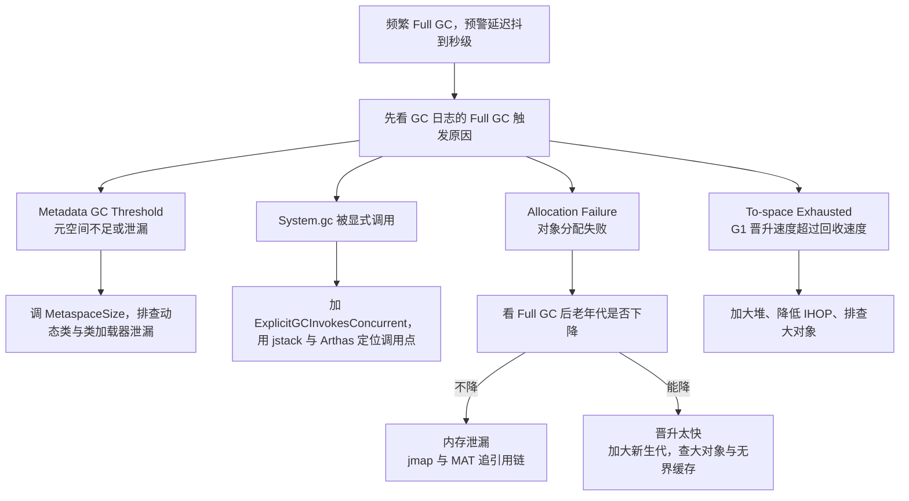

**为什么 / 取舍**
- **"GC 日志的触发原因"比"GC 次数"信息量大得多**：`Metadata GC Threshold` 与 `Allocation Failure` 指向完全不同的修复动作；不看原因就调 `-Xmx`，是典型的"看病不诊断直接开药"。
- **"Full GC 后老年代降不降"是区分泄漏和晋升过快的唯一低成本判据**：降不下去 = 引用还在 = 泄漏；降得下去 = 对象能死但死得太晚 = 晋升/分代配置问题，这一个观察就能砍掉一半排查方向；而**调参永远是"最后手段"**——参数只能改变对象分配的统计分布，改不了"你每分钟 new 出 2GB 短命垃圾"这个事实，改代码的收益是数量级的，调参是百分之几十的。

**企业实际处理**
- **线上开启 GC 日志滚动**（`-Xlog:gc*:file=/opt/logs/gc.log:time,uptime,level,tags:filecount=10,filesize=100m`）并接入监控（Prometheus + `jmx_exporter` 采 `jvm_gc_pause_seconds`），让停顿有指标、有告警。
- **预警任务处理逻辑**把"一次性全量加载规则/全量数据"改成**分批 + 流式**避免瞬时大对象，把无界缓存改成有界 + 过期。
- **调参顺序**：先改代码（减少对象、避免大对象、收敛缓存），再调参数（加大新生代、降 IHOP、`MaxGCPauseMillis`），最后才考虑换收集器（G1 → ZGC）——**先代码后参数是铁律**；**验证**则靠压测复现目标 QPS，对比调优前后 Full GC 次数与 P99 停顿，写入调优报告。

**易错 / 加分**
- ⚠️ **Safepoint**：GC 停顿 ≠ 全部停顿，`Time to Safepoint` 也是 STW 的一部分；长循环里没有安全点会导致 safepoint 超时——这是"GC 日志看不出问题但服务就是卡"的隐藏原因（`-XX:+PrintGCApplicationStoppedTime` / JDK 9+ `-Xlog:safepoint`）。
- 💡 **`GC overhead limit exceeded`**：GC 占用超 98% 时间、回收不到 2% 堆，JVM 主动抛 OOM 以免徒劳，可被 `-XX:-UseGCOverheadLimit` 关闭（一般不该关）。
- **分析工具** GCeasy / GCViewer / `gceasy.io` 上传日志自动出报告，"GCeasy 做趋势分析 + 人工核对触发原因"比纯手工更可信。

```text
# 📦 按 JDK 17 书写、未实测：-Xlog:gc* 输出的典型片段（示意）
[2.345s][info][gc] GC(37) Pause Young (Normal) (Metadata GC Threshold)
    Eden: 512M(512M)->0B(512M) Survivor: 0B(0B)->64M(64M) Old: 340M(1024M)->420M(1024M)  12.345ms
# 解读：触发原因是 Metadata GC Threshold -> 元空间达阈值；老年代没释放多少且元空间在涨 -> 先查动态类/热部署
[5.678s][info][gc] GC(45) Pause Full (Metadata GC Threshold) 1024M->1010M(2048M) 812.456ms
# 解读：Full GC 后老年代 1024M -> 1010M 几乎没降 -> 强引用未释放，转内存泄漏排查；STW 812ms 对秒级/毫秒级预警是致命的
```

---

## 题 9：JIT 和逃逸分析，代码为什么"越跑越快"？

- **题干**：「同一段代码，为什么跑久了会变快？JIT 是怎么知道哪些是热点代码的？逃逸分析到底优化了什么？」

**骨架答案**
- **Java 是"半编译半解释"**：`javac` 编译成字节码，JVM 执行时**解释器逐条解释**，同时 **JIT 编译器**把热点字节码编译成本地机器码——**解释器保证启动速度，JIT 保证峰值性能**，两者互补。
- **热点探测**靠**方法调用计数器**（阈值 `-XX:CompileThreshold`，**C1 默认 1500，C2 默认 10000，视版本与分层编译配置而定**）和**回边计数器**（记录循环体回跳次数，用于触发**栈上替换 OSR，On-Stack Replacement**——方法还没跑完、循环体已经很热，直接替换正在执行的循环）。
- **分层编译**：**JDK 8 起默认开启**（`-XX:+TieredCompilation`），分 5 层——**Level 0** 解释执行；**Level 1** C1 编译无 profiling、启动快；**Level 2** C1 带基础 profiling；**Level 3** C1 带完整 profiling（采集分支/类型信息供 C2）。
- **Level 4** C2 编译、激进优化、峰值性能最高。逻辑是"**先用 C1 快速拿到中等性能，再用 C2 慢慢优化到峰值**"。
- **逃逸分析**（`-XX:+DoEscapeAnalysis`，**默认开启**）：判定对象作用域——只在方法内使用（不逃逸）或只在当前线程使用（线程不逃逸）就能优化。
- **优化一：标量替换**（`-XX:+EliminateAllocations`）——把聚合对象"拆散"成基本类型标量，直接放在栈帧/寄存器，**对象根本不在堆上分配**。
- **优化二：锁消除**（`-XX:+EliminateLocks`）——若同步块对象不会逃逸到其他线程，锁就是多余的，直接消除（典型场景：`StringBuffer`、`Vector` 在方法内局部使用）。
- **优化三：同步省略 / 方法内联**——方法体内联是最重要的优化，逃逸分析的信息还能帮助内联后的进一步优化。
- **可关闭但生产不要关**：`-XX:-DoEscapeAnalysis`（关逃逸分析）、`-XX:-EliminateAllocations`（关标量替换）都能生效，但默认开启是经过验证的最优配置。
- `-XX:ReservedCodeCacheSize`（默认约 240MB，视版本而定）控制 Code Cache（方法区的一部分）大小，满了会停止 JIT（`CodeCache is full. Compiler has been disabled`）导致性能骤降，可用 `-Xlog:codecache` 观察（视版本而定）。

**为什么 / 取舍**
- **profiling 是"用运行时信息做激进优化"的前提**：C2 敢做内联、去虚化、锁消除，都是因为观察到"这里实际只走这一个分支/只有这一个类型"——这也是 JIT 能在某些场景超越静态编译（如 C++ 静态优化）的原因：**它能看到运行时的真实分布**。
- **标量替换是"逃逸分析 + 编译优化"的组合拳，不是 JVM 内存布局**：HotSpot **并没有实现真正意义上的"栈上分配"**，业界常说的"栈上分配"实际就是标量替换的效果——理解成"对象被拆没了"，追问时才不会答错。
- **而 Code Cache 满导致性能悬崖是真实故障**——长时间运行 + 大量动态代理/反射的服务会被编译产物填满，表现为"运行几小时后突然变慢"，排查时容易误判为 GC 问题。

**企业实际处理**
- **JIT 编译线程会吃 CPU**：服务刚启动时 CPU 冲高是正常现象（C1/C2 编译），配合容器 CPU limit 太低可能触发 `-XX:CICompilerCount` 相关问题，启动阶段要给足 CPU。
- **`-XX:+PrintCompilation` / `-XX:+PrintInlining`** 用于排查"某方法为什么没被优化"，但**生产慎开**（日志量大、影响性能）；**"预热"是真实需求**——压测和灰度都要先跑够请求量让 JIT 完成，否则测出来的是解释执行/低层编译的假数据。

**易错 / 加分**
- ⚠️ 明确指出 **HotSpot 没有真正的栈上分配（on-stack allocation）**，本质是标量替换——能纠偏是强信号。
- 💡 **去虚化（Devirtualization）**：C2 观察到某接口实际只有一种实现时，把接口调用直接内联成具体方法调用；**OSR 的意义**是方法还没返回但循环已经很热，不用等方法执行完就能触发编译、直接替换栈帧继续跑。

---

## 题 10：线上 CPU 100%，你怎么一步步定位？

- **题干**：「你们服务的机器 CPU 突然冲到 100%，监控报警了。你上机之后怎么查？一步一步说。」

**骨架答案**
- **五步定位**：① `top` 按 CPU 排序（`P`）找到高 CPU 的 Java 进程 PID。
  - ② `top -Hp <pid>` 找到 CPU 最高的线程 TID。
  - ③ `printf '%x\n' <tid>` 把线程 ID 转十六进制（jstack 输出里的 `nid` 是十六进制）。
  - ④ `jstack <pid> | grep -A 30 'nid=0x<hex>'` 抓线程栈看方法，**一次采样可能不准，要间隔 10 秒连续抓 3 次**，观察是否稳定卡在同一处。
  - ⑤ 区分"业务线程 100%"还是"GC 线程 100%"——`jstack` 里大量 `GC task thread` / `G1 Young RemSet Sampling` 占用高就是 **GC 打满 CPU**，转 GC 排查（题 8/13），业务线程在跑死循环/正则/序列化则是代码问题。
- **常见根因清单**：**死循环/无限 while**（循环条件依赖外部变量、并发下未更新）。
  - **频繁 GC**（对象创建速率过高，`ParallelGCThreads` 个 GC 线程打满 CPU）。
  - **频繁 Full GC**（STW + 大量存活对象遍历）。
  - **正则回溯（Catastrophic Backtracking）**（复杂、带嵌套量词的正则匹配长字符串，CPU 指数级飙升，线上最阴险的 CPU 杀手之一）。
  - **锁竞争/上下文切换**（不是 CPU 跑满，而是 `top` 的 `sy` 系统态高，`pidstat -w` 看上下文切换）。
  - **频繁序列化/反序列化大对象**（JSON 大报文）。
  - **哈希冲突**（`HashMap` 退化、`ConcurrentHashMap` 自旋）。
  - **线程数过多**（`unable to create new native thread` 前后的大量调度）。
- **工具链**：`top -Hp` + `jstack` 是基础；**Arthas `thread -n 3 -i 1000` 一步到位**（直接列 CPU 最高的 3 个线程堆栈，`-i` 是采样间隔）；`async-profiler` 生成**火焰图**定位热点方法最直观。

**图 1-13：CPU 100% 排查决策树**

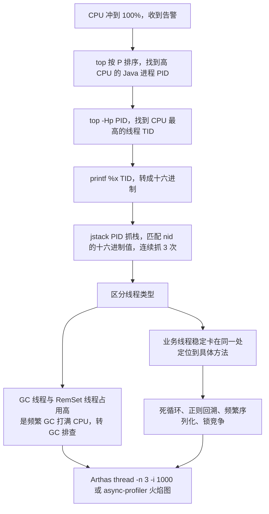

**为什么 / 取舍**
- **"进程 → 线程 → 代码"是唯一能收敛的路径**：CPU 是进程级指标，真正占 CPU 的是线程，只有把线程栈和业务代码对上，才能从"机器慢"落到"这一行代码有问题"，跳步（如直接看日志）会绕远路。
- **"多抓几次"是排除采样的偶然性**：一次 `jstack` 可能刚好抓到线程在安全点/IO 等待，连续采样才能确认"是否稳定卡在这里"，否则容易误判；**而"区分 GC 线程和业务线程"决定排查方向**——GC 导致的 CPU 高要调堆/查泄漏，业务代码导致的要改代码，方向错了所有努力都是浪费。

**企业实际处理**
- **先止血再定位**：生产上优先 `kill -15`（优雅关闭）或摘流量 + 重启，**同时 `jstack` 连抓 3 次**留证据，事后复盘；切忌盲目重启丢失现场。
- **接入 APM / Arthas**：生产常驻 Arthas（或 `arthas-boot` 临时挂载），OOM/CPU 问题可在线诊断；链路追踪 + 日志监控用于佐证"我不只看机器，还看调用链"；**持久化证据**——`jstack` 输出重定向到文件、`top -Hp` 快照、火焰图，作为复盘材料。

**易错 / 加分**
- ⚠️ **`sy` 高（系统态）vs `us` 高（用户态）**：`us` 高是计算密集/GC，`sy` 高是系统调用多/上下文切换频繁/锁竞争；`vmstat 1` 看 `cs`（上下文切换）、`in`（中断）。
- 💡 **Safepoint 导致"没 CPU 却卡住"**：`-Xlog:safepoint`（JDK 9+）看 `Time to Safepoint`，长循环无 safepoint 会拖长 STW。
- **火焰图（`async-profiler` + `flamegraph.pl`）** 是定位热点方法的终极武器，能采样 CPU/内存/锁三个维度，比 `jstack`（只有瞬时快照）更精确。

```bash
# 📦 按 JDK 17 书写、未实测：CPU 打满的定位四步（Linux）
top -Hp $(pgrep -f CpuHighDemo)                             # 1. 找高 CPU 线程 TID
printf '%x\n' <TID>                                         # 2. 转十六进制
jstack $(pgrep -f CpuHighDemo) | grep -A 30 'nid=0x<hex>'   # 3. 抓栈
# 4. 连续抓 3 次，确认稳定在同一处 -> 定位到 CpuHighDemo.spin（无 sleep 的 while(true) 死循环）
thread -n 3 -i 1000                                         # Arthas 一条命令到位
```

---

## 题 11：内存泄漏和 OOM 怎么排查？

- **题干**：「服务跑几天就 OOM 重启一次，怎么查？你手上有什么工具？Heap Dump 怎么分析？」

**骨架答案**
- **先分清 OOM 类型**（语义完全不同）：`Java heap space` → 堆内存不足（泄漏或大对象/峰值）。
  - `GC overhead limit exceeded` → GC 占比超 98%、回收不足 2%，JVM 主动抛。
  - `Metaspace` → 元空间溢出（动态类、热部署、CGLIB 代理）。
  - `Direct buffer memory` → 直接内存不足（Netty、NIO）。
  - `unable to create native thread` → 线程数超限（`-Xss` 太大、线程泄漏、系统 ulimit）。
  - `Requested array size exceeds VM limit` → 数组长度超过 `Integer.MAX_VALUE` 附近限制。
- **Heap Dump 获取方式**：**事前配置（最重要）** `-XX:+HeapDumpOnOutOfMemoryError -XX:HeapDumpPath=/opt/dump`，OOM 时自动落盘。
  - **事后手动** `jmap -dump:live,format=b,file=/opt/dump/heap.hprof <pid>`（`live` 只 dump 存活对象、更小更快；**`jmap -dump` 会 STW**，大堆停几秒到几十秒，生产慎用/低峰使用）。
  - **Arthas** `heapdump /opt/dump/heap.hprof`。
  - **`jcmd <pid> GC.heap_dump /opt/dump/heap.hprof`**（JDK 7+ 推荐，比 `jmap` 更稳）。
- **MAT 分析流程**：**Leak Suspects**（自动分析出占内存最大的对象及其引用链，**最先看**）
  - → **Histogram**（按类统计对象数量与占用，看哪个类实例异常多，如 `char[]`、`HashMap$Node`、自定义 DTO）
  - → **Dominator Tree**（按"谁独占内存最多"排序，比 Histogram 更精准定位大对象持有者）
  - → **Path to GC Roots（排除弱引用/软引用）**（看对象**为什么没被回收**，引用链往上追，通常能追到某个静态集合、ThreadLocal、监听器、连接池）。
- **常见泄漏模式**：**静态集合无界增长**（`static Map`/`static List` 当缓存，只 put 不 remove）。
  - **ThreadLocal 未 remove**（线程池场景）。
  - **连接/流未关闭**（`Connection`、`InputStream` 未在 finally/try-with-resources 关闭）。
  - **监听器/回调未注销**（`addListener` 后未 `removeListener`，注册中心/MQ 客户端高发）。
  - **缓存框架无上限**（`Caffeine`/`Guava Cache` 未设 `maximumSize` + `expireAfterWrite`）。
  - **`ClassLoader` 泄漏**（热部署、动态代理类不断生成 → 元空间泄漏）。
  - **大对象缓存**（把整张表/全量指标一次性加载进内存）。
  - **`equals`/`hashCode` 实现不当**（`HashMap` 中对象无法被正确查询，只能增不能删）。
- **快速判断"泄漏还是峰值不足"**：用 `jstat -gc <pid> 1000 10` 观察——**每次 Full GC 后老年代都不下降**是泄漏，下降但很快又涨满是峰值不足（加大堆或优化分配）。

**图 1-14：OOM 与内存泄漏排查决策树**

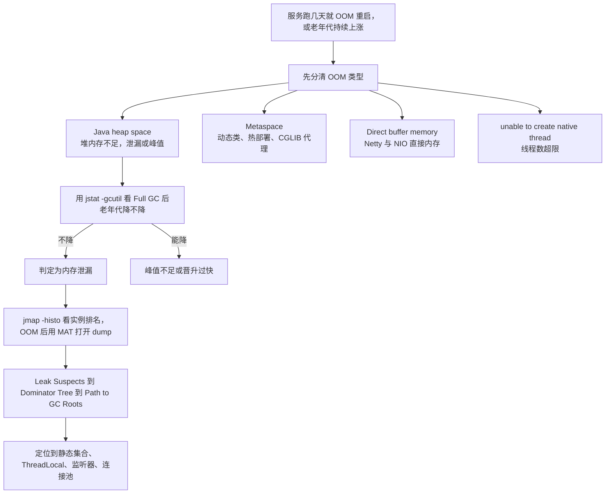

**为什么 / 取舍**
- **OOM 类型是最省事的"免费诊断信息"**：`Metaspace` 与 `Java heap space` 的修复路径完全不同，读到类型就能砍掉一半排查工作；很多人只记"OOM"一个词，白白浪费这条线索。
- **"Path to GC Roots"才是泄漏排查的杀手锏**：Histogram 只告诉你"什么对象多"，Dominator Tree / Path to GC Roots 才告诉你"**为什么它死不掉**"——泄漏的本质不是对象大，而是**引用链没断**。
- **而"堆转储要花 STW 代价"决定工具选择时机**——`jmap -dump` 会暂停整个应用、意味着一次真实的可用性抖动，所以必须低峰执行、优先靠事前的 `HeapDumpOnOutOfMemoryError`。

**企业实际处理**
- **生产必开 `HeapDumpOnOutOfMemoryError`**，并把 dump 目录挂载到宿主机/对象存储（容器重启不丢）。
- dump 文件可能几个 GB，**必须压缩传输**（`gzip`），MAT 分析时给足内存（`MemoryAnalyzer.ini` 里 `-Xmx` 要大于 dump 大小）。
- 排查顺序是 `jstat -gcutil` 看趋势 → `jmap -histo:live <pid> | head -30` 看实例排名（**注意 `-histo:live` 会触发一次 Full GC 且 STW**，慎用）→ 需要细节再 dump + MAT。
- **修复后必须回归验证**——同样压测流量跑若干小时，看老年代曲线是否平稳。
- **堆外泄漏另有一套工具**：`jcmd <pid> VM.native_memory summary`（需 `-XX:NativeMemoryTracking=summary`，有 5%~10% 性能开销）、`pmap -x <pid>`、`gdb` dump 分析——**直接内存泄漏用 `jmap` 完全看不出来**。
- 另外 **`OutOfMemoryError` 可以被 `catch`**（`Throwable` 子类），但**捕获后往往无法恢复**，正确做法是记录现场 + 优雅退出，靠 K8s `restartPolicy` 重启。

**易错 / 加分**
- ⚠️ **`-histo:live` vs `-histo`**：前者触发 Full GC 只统计存活对象（准确但 STW），后者直接统计（快但包含待回收对象）。
- 💡 在 OOM 前先用 `jstat` 建立"老年代增长速率"基线，比 OOM 后翻 dump 更快锁定"是泄漏还是峰值不足"。

---

## 题 12：容器里 JVM 堆没满却被 OOMKilled，怎么回事？

- **题干**：「你们服务 Docker 化之后，有个 Pod 老是重启，`kubectl describe` 显示 `OOMKilled`，但你看 JVM 堆监控才用了 50%。这是怎么回事？怎么解决？」

**骨架答案**
- **先分清两个 OOM**：**JVM OOM** 是 `OutOfMemoryError`，由 JVM 自己抛、堆内不足。
- **容器 OOMKilled** 是**由 Linux cgroup 内存超限后内核 OOM Killer 杀进程**，进程退出码 **137**（128 + SIGKILL(9)），**不是 JVM 报的错**，JVM 甚至来不及打印任何日志——这是理解本题的关键分水岭。
- **为什么发生：JVM 内存占用 ≠ 堆占用**。总内存包括**堆（`-Xmx`）**、**元空间 + Code Cache**（JIT 机器码）、**线程栈**（`-Xss` × 线程数）、**直接内存**（Netty/NIO）、**GC 自身的辅助结构**（如 G1 的 RSet/卡表，可达堆的 10%）、**JVM 自身开销**（内部数据结构、JNI、JIT 编译缓冲）。
- 经验上**总内存 ≈ 堆 × 1.3 ~ 1.5**（视应用而定）。
- **JDK 8 早期版本的坑（核心考点）**：**JDK 8u131 之前，JVM 不感知 cgroup 限制**，默认堆按**宿主机物理内存**计算（默认最大堆 = 物理内存的 1/4）；容器 limit 设 2GB、宿主机 64GB → JVM 默认堆能开到 16GB，**远超容器 limit，必然被 OOMKilled**。
- **解决方案**：**JDK 8u131 ~ 8u190（实验性）** 用 `-XX:+UnlockExperimentalVMOptions -XX:+UseCGroupMemoryLimitForHeap`。
  - **JDK 8u191+ / JDK 10+** 用 `-XX:+UseContainerSupport`（**默认开启**，8u191 回移到 JDK 8），JVM 自动读 cgroup 限制，默认最大堆 = **容器 limit 的 1/4**（`-XX:MaxRAMPercentage`，**默认 25%**）。
  - **推荐做法**是显式指定 `-XX:MaxRAMPercentage=70.0 -XX:InitialRAMPercentage=70.0`（或直接写死 `-Xmx`），**把 `-Xmx` 设为容器 limit 的 60%~75%**，剩下 25%~40% 留给堆外；同时用 `-XX:MaxDirectMemorySize` 给直接内存设上限。
  - **K8s 侧** `resources.limits.memory` 与 `requests.memory` 设合理值，**limit 不能等于 `-Xmx`**（最常见的错误配置）。

**为什么 / 取舍**
- **cgroup 和 JVM 是两套独立的内存记账**：Linux cgroup 只管进程的 RSS/working set，不管这块内存是堆、栈还是直接内存；JVM 的堆参数只约束堆，堆外它管不着——理解"两套账本"才能解释为什么堆 healthy 但进程被杀。
- **`-Xmx` 与 limit 相等是"零容错配置"**：堆内存加上任何一点堆外开销（JIT 编译、GC 结构、线程栈）都会越过 limit；给堆外留余量不是浪费，是把不可预测的 OOMKilled 换成可预测的内存余量。
- **而且 JDK 版本决定"要不要手动配"**——8u191/10 之后 `UseContainerSupport` 默认开，很多人还在抄 8u131 时代的 `UseCGroupMemoryLimitForHeap`（**该参数在 JDK 11+ 已被移除，写了会直接启动失败**），版本知识直接影响配置正确性。

**企业实际处理**
- **容器 JVM 参数模板**：`-XX:+UseContainerSupport` / `-XX:MaxRAMPercentage=70.0` / `-XX:InitialRAMPercentage=70.0` / `-XX:MaxMetaspaceSize=256m`
- / `-XX:MaxDirectMemorySize=256m` / `-XX:+HeapDumpOnOutOfMemoryError` / `-XX:HeapDumpPath=/opt/dump`，通过 `JAVA_TOOL_OPTIONS` 环境变量注入（改参数不用重新打镜像）。
- **同一镜像跑多环境时按环境给不同堆占比**（实测常用配比）：dev `-XX:MaxRAMPercentage=50.0`、test `65.0`、prod `70.0`，各自都配 `-XX:MaxMetaspaceSize=256m`。
- NIO / Netty 场景另加 `-XX:MaxDirectMemorySize=256m`，规格小的环境可收到 `-XX:MaxDirectMemorySize=64m`（此时直接内存很快会抛 `OutOfMemoryError: Direct buffer memory`，正好可用来复现"堆没满却被杀了"）。
- **K8s `resources.limits.memory: 2Gi` 时 `-Xmx` 设 1.4G 左右**，留 600M 给堆外 + 系统，**不要设 2Gi**。
- **调整 `restartPolicy` 和探针**——`livenessProbe` 别太激进（启动慢的服务容易被误杀，且和 OOMKilled 混在一起难以区分）。
- **监控要区分指标**：Pod 的 `container_memory_working_set_bytes`（含堆外）vs JVM 的 `jvm_memory_used_bytes`（只有堆内），**只看后者会漏掉堆外**——这是"堆才 50%"却仍被杀的直接原因；同时**给 dump 目录挂 emptyDir/PVC**，容器被杀后 dump 还在。
- 排查用 `kubectl describe pod <pod> | grep -A 5 'Last State'`（看 `Reason: OOMKilled` / `Exit Code: 137`）+ `kubectl top pod`。
- 进容器用 `java -XX:+PrintFlagsFinal -version | grep -Ei 'MaxHeapSize|MaxRAMPercentage|UseContainerSupport'` 确认容器感知是否生效。

**易错 / 加分**
- ⚠️ **exit code 137 = 128 + 9（SIGKILL）**，且 **OOMKilled 时 JVM 来不及打 Heap Dump**（内核直接 kill），排查要靠 cgroup 内存曲线而不是 JVM 日志。
- 💡 **`-XX:+AlwaysPreTouch`** 在容器里的作用与代价：启动时就把堆内存全部 commit，避免运行中缺页导致的内存爬升，但启动变慢、且会立刻占满 `MaxRAMPercentage` 声明的内存（对 limit 敏感的容器要谨慎）。
- **CPU limit 也会影响 JVM**——JDK 10+ 的 `UseContainerSupport` 也感知 cgroup 的 CPU 配额来设置 `ParallelGCThreads` 和 `CICompilerCount`，CPU limit 低会导致 GC 线程数少、JIT 编译慢，都可能是"Pod 性能差"的间接原因。

```yaml
# 📦 按 JDK 17 通用镜像书写、未实测；核心是 limit 与 MaxRAMPercentage 的配比
resources:
  requests: { memory: "1536Mi", cpu: "1000m" }
  limits:   { memory: "2Gi",     cpu: "2000m" }   # 容器内存上限
env:
  - name: JAVA_TOOL_OPTIONS
    value: >-
      -XX:+UseContainerSupport -XX:MaxRAMPercentage=70.0 -XX:InitialRAMPercentage=70.0
      -XX:MaxMetaspaceSize=256m -XX:MaxDirectMemorySize=256m
      -XX:+UseG1GC -XX:MaxGCPauseMillis=100 -XX:+HeapDumpOnOutOfMemoryError -XX:HeapDumpPath=/opt/dump
```

---

## 题 13：频繁 Full GC 怎么定位根因？

- **题干**：「你的期权风控实时预警，规则计算要求秒级甚至毫秒级。如果这时候频繁 Full GC，STW 把延迟打爆了，你怎么定位、怎么解决？」

**骨架答案**
- **先量化现状**（不看数据不谈调优）：`jstat -gcutil <pid> 1000 10` 看 **FGC 次数增长速率**、**FGCT（Full GC 总耗时）**、**O（老年代使用率）**。
- `-Xlog:gc*`（JDK 9+）或 `-XX:+PrintGCDetails`（JDK 8）看 Full GC 的**触发原因**；监控侧看 `jvm_gc_pause_seconds` 的 **P99 停顿**与 GC 频率趋势。
- **按触发原因分三条主线**（见题 8 决策树）：**主线 A 对象泄漏**（Full GC 后老年代不降）→ `jmap`/MAT 找引用链、修代码。
  - **主线 B 对象晋升过快 / 老年代容量不足**（Full GC 后能降但很快又满）→ 调新生代大小、查大对象、查缓存上限。
  - **主线 C 元空间/显式 GC/并发失败** → 查动态类、查 `System.gc()` 调用点、G1 看 `To-space Exhausted`。
- **针对"实时预警 + 毫秒级 SLA"的业务级专项优化**：**消灭 Full GC 而不是减少它**（Full GC 是秒级 STW 的元凶，毫秒级 SLA 下必须压到 0，手段依次是**修代码（减少长命对象/大对象）→ 加大堆 + 加大新生代（让短命对象死在新生代）→ 换收集器（G1 调 `MaxGCPauseMillis`）→ 极端场景上 ZGC**）。
  - **预警规则计算的对象治理**（规则全量加载改**按需/分片加载**，计算中间结果别用大 `Map` 常驻，指标聚合用**流式/滑动窗口**如 Caffeine + 有界队列替代全量快照）。
  - **把"计算"从"存储"里分离**（大对象如历史 K 线、全量订单快照放堆外/Redis/ADB，JVM 堆里只放热数据——**堆是用来做计算的，不是用来做存储的**）。
  - **削峰**（预警任务用**有界队列 + 批量处理**，避免瞬时洪峰推高对象创建速率；队列要有界，`ThreadPoolExecutor` 有界队列 + 拒绝策略，无界队列本身就是内存泄漏源）。
- **验证闭环**：压测环境复现目标 QPS、注入相同数据量，对比调优前后的 Full GC 次数、STW 最大值、P99 延迟。**没有前后对比数据的调优等于没做**。

**为什么 / 取舍**
- **Full GC 的 STW 时长与"存活对象数量"成正比，不是与堆大小成正比**：堆越大、存活对象越多，Full GC 越慢；所以"加大堆"能降低 Full GC 频率但让单次更痛——这是低延迟服务最反直觉的权衡，也是为什么要**优先消灭 Full GC 而不是稀释它**。
- **低延迟场景下 P99 比平均值重要**：一次 800ms 的 Full GC 会把 P99 直接打到秒级，平均值毫无意义，调优目标要定成"**最大停顿**"指标（`MaxGCPauseMillis` 就是为这个设计的）；**而对象治理的收益远大于参数调整**——把"每轮计算 new 出 100 万个临时对象"改成"复用对象池/流式聚合"，垃圾产生速率直接降一个数量级，这是参数永远做不到的。

**企业实际处理**
- **JDK 8 + CMS 的老预警服务**：配 `-XX:CMSInitiatingOccupancyFraction=70 -XX:+UseCMSInitiatingOccupancyOnly` + `-XX:+ExplicitGCInvokesConcurrent`，但**根本上应升级到 JDK 17 + G1/ZGC**（CMS 已在 JDK 14 移除）。
- **JDK 17 + G1**：`-XX:MaxGCPauseMillis=50` + `-XX:InitiatingHeapOccupancyPercent=35` + 加大堆（如 8G），观察 `To-space Exhausted` 是否消失。
- **超低延迟**则评估 ZGC（`-XX:+UseZGC`）或 **JDK 21 分代 ZGC**，STW 可控在 1ms 级（代价是吞吐下降、CPU 开销增加）。
- **预警延迟 SLA 的最后保险**是把"规则计算"和"结果落库/发通知"解耦（异步），让 GC 抖动不影响关键路径的最小延迟，同时预警规则缓存用 Caffeine 的 `maximumSize(100_000)` + `expireAfterWrite(5min)` 替代无界 `static HashMap`（📦 按 JDK 17 书写、未实测）。

**易错 / 加分**
- ⚠️ **`-XX:+DisableExplicitGC` 的副作用**：屏蔽所有 `System.gc()`（含 NIO 依赖的显式回收路径），可能导致**直接内存泄漏**；正确姿势是 `-XX:+ExplicitGCInvokesConcurrent`。
- 💡 **"对象池"是双刃剑**：`ThreadLocal` 复用缓冲区、Netty `ByteBuf` 池化能显著降 GC，但**池化对象被泄漏（忘记归还）会变成新的内存泄漏**。

---

## 题 14：JVM 调优参数你是怎么写进生产环境的？

- **题干**：「你说做过压测调优。那你们生产的 JVM 参数是怎么定的？是抄的还是算的？改参数的流程是什么？」

**骨架答案**
- **核心参数体系**：`-Xms`/`-Xmx`（堆初始/最大，设成**相等**避免动态扩容抖动）。
  - `-Xmn`/`-XX:NewRatio`（新生代大小，NewRatio 默认 2，**G1 下 `-Xmn` 不生效**）。
  - `-XX:SurvivorRatio`（Eden:Survivor，默认 8 即 8:1:1）。
  - `-Xss`（单线程栈大小，默认 512KB~1MB 视平台/版本，线程多时是内存大头）。
  - `-XX:MaxTenuringThreshold`（晋升年龄，默认 15，CMS 默认 6）。
  - `-XX:MetaspaceSize`（元空间首次 GC 阈值，约 21MB 视版本）与 `-XX:MaxMetaspaceSize`（**必须设**，如 256m，JDK 8+ 替代 PermSize）。
  - `-XX:MaxDirectMemorySize`（按需如 256m，NIO/Netty 必设）。
  - `-XX:MaxGCPauseMillis`（G1 目标停顿默认 200ms）与 `-XX:InitiatingHeapOccupancyPercent`（G1 并发标记触发默认 45%）。
  - `-XX:ParallelGCThreads`（按 CPU 核数，容器下受 CPU limit 影响）。
  - `-XX:MaxRAMPercentage`（容器最大堆占比默认 25%，JDK 10+ / 8u191+）。
  - `-XX:+HeapDumpOnOutOfMemoryError`（**生产必开**）。
  - `-XX:+ExplicitGCInvokesConcurrent`（`System.gc()` 并发化，配合 CMS/G1）。
  - `-XX:+AlwaysPreTouch`（启动时 commit 全部堆，启动慢但运行稳，视场景）。
- **调优方法论四步**：**第 1 步 定目标**（吞吐型看吞吐量，延迟型看 P99/最大停顿，目标不同参数方向相反）
  - → **第 2 步 压测基线**（用真实流量模型而非 `ab` 打静态页，压出 GC 频率、停顿分布、老年代增长速率、TPS、P99）
  - → **第 3 步 单变量调整 + 复测**（**一次只改一个参数**、记录前后对比；优先改代码，其次改堆/新生代，最后才动收集器）
  - → **第 4 步 灰度上线 + 持续监控**（先在一组机器跑，观察 24h+ 再全量）。
- **参数写在哪**：**不要硬编码在 Dockerfile 的 `ENTRYPOINT` 里**（改参数要重新构建镜像）。
- **推荐用环境变量 `JAVA_TOOL_OPTIONS` / `_JAVA_OPTIONS`**（容器化最佳实践，改参数不用重新打镜像），或用 `JAVA_OPTS` 由启动脚本注入。
- **配合 Apollo 之类的配置中心**——部分业务参数（线程池大小、队列长度）可动态调整，但**纯 JVM 参数（堆大小、收集器）需要重启生效**，不能指望配置中心动态改 `-Xmx`（`jinfo -flag` 只能改 manageable 的 flag，且生产慎用）。
- **Jenkins 流水线里固化为参数文件**，把 JVM 参数做成模板变量，不同环境（dev/test/prod）注入不同值。

**图 1-15：JVM 调优参数与目标映射关系**

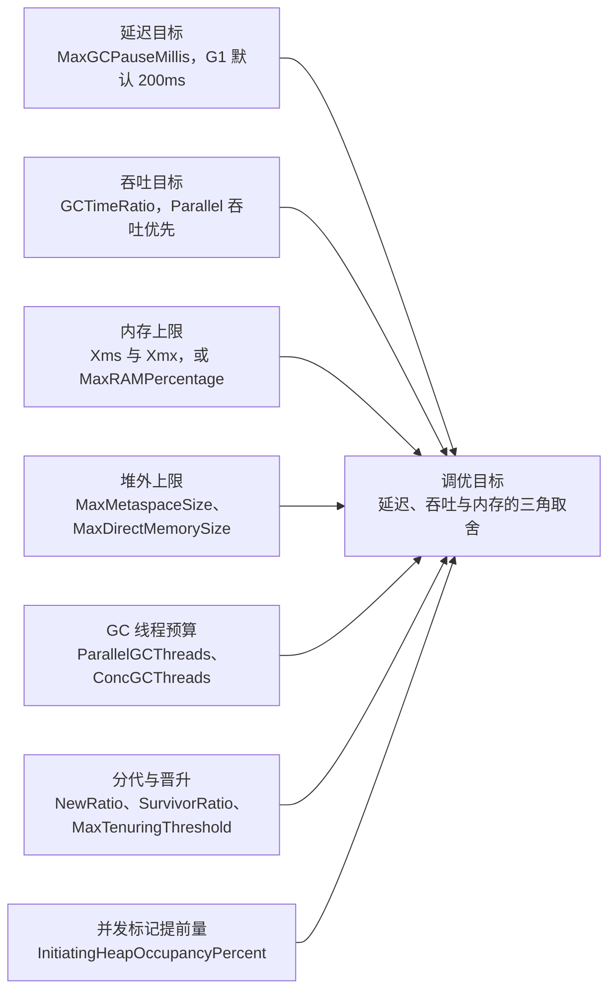

**为什么 / 取舍**
- **调优是"约束求解"不是"参数堆砌"**：`-Xmx` 定资源上限、`MaxGCPauseMillis` 定延迟目标、`ParallelGCThreads` 定 CPU 预算，它们互相约束（想低延迟就得多花 CPU 和内存）；不理解约束关系，就会配出"堆很大、新生代很小、停顿目标 50ms、GC 线程只给 2 个"这种自相矛盾的参数。
- **"一次只改一个变量"是实验设计的基本原则**：JVM 参数相互影响（改 `NewRatio` 会改变 `MaxTenuringThreshold` 的实际效果），同时改多个无法归因，调优就变成了"玄学"；**参数外置（环境变量/配置）是工程效率问题**——镜像里硬编码参数意味着每次调优都要走一次完整 CI/CD，不该被"改个堆大小"重新浪费一遍。

**企业实际处理**
- **建立"参数基线 + 变更记录"**：每个服务的 JVM 参数、GC 收集器、堆大小写进文档/配置仓库，改动有记录、有复测报告；**"改参数"要走评审**——JVM 参数影响可用性不能随手改，容器里改了 `-Xmx` 要同步校核 K8s limit；**上生产前先在压测环境跑满目标流量**，验证 GC 停顿、Full GC 次数、OOM 兜底都符合预期。
- **监控告警配套**：GC 停顿 P99、Full GC 次数（>0 就该告警）、堆使用率、元空间使用率，缺一不可。
- 在线核对生效参数用 `jcmd <pid> VM.flags -all | grep -Ei 'MaxHeapSize|NewRatio|G1HeapRegionSize'` 或 `java -XX:+PrintFlagsFinal -version | grep -E 'MaxHeapSize|MaxRAMPercentage'`（📦 按 JDK 17 书写、未实测）。

**易错 / 加分**
- ⚠️ **`jinfo -flag` 只能改 manageable 的 flag**（如诊断参数），**堆大小、收集器选择不能在运行时改**，必须重启——这是"配置中心改 JVM 参数"的常见误解。
- 💡 **`-Xms=-Xmx` 为什么是常规做法**：避免堆动态扩缩容带来的抖动和一次额外的 Full GC，配合 `AlwaysPreTouch` 能提前落实内存、运行更稳，反面是容器里设 `AlwaysPreTouch` 会立刻占满声明内存，需权衡；**参数调优的收益排序是 代码优化 >> 堆/新生代布局 >> 收集器选型 >> 细节参数**。

---

## 题 15：一个 Java 对象占多少字节？容量怎么算？

- **题干**：「最后一个：如果一个对象大概占多少内存，你怎么算？如果我要缓存 100 万个这种对象，堆要开多大？」

**骨架答案**
- **计算规则（64 位 HotSpot，开启压缩指针）**：**对象头**——普通对象 **12 字节**（Mark Word 8 + Klass Pointer 4），数组对象 **16 字节**（多 4 字节长度）；关闭压缩指针则分别是 16 / 20 → 补齐后 16 / 24。
  - **字段大小**——`boolean`/`byte` 1，`char`/`short` 2，`int`/`float` 4，`long`/`double` 8，**引用类型 4（压缩指针下）/ 8（未压缩）**。
  - **对齐填充**——对象总大小必须是 **8 的倍数**；数组元素之间不补齐，但数组整体长度要补齐。
- **字段重排（Field Reordering）**：JVM 会**按宽度重排字段**（long/double 优先、同宽度放一起、父类字段在前）以减少 padding，**所以不能简单按代码书写顺序累加**；要精确知道用 JOL（`ClassLayout.parseInstance(obj).toPrintable()`）。
- **举例计算（压缩指针下）**：`class OrderEvent { long orderId; int status; String symbol; }` → 对象头 12 + long 8 + int 4 + 引用 4 = **28**，对齐到 8 的倍数 → **32 字节**；关闭压缩指针：16 + 8 + 4 + 8 = 36 → 对齐 → **40 字节**。
- **容量规划示例（缓存 100 万个 `OrderEvent`）**：对象本体 100 万 × 32B = **32MB**。
- 但 `symbol` 引用指向的 `String` 才是大头——一个 `String` = String 对象（12 头 + `byte[]` 引用 4 + `int hash` 4 = 20 → 24B）+ `byte[]` 数组（16 头 + 内容 + 对齐），一个 10 字符的 String 约 16 + 10 = 26 → **32B**。
- 若 `symbol` 各不相同（无法复用常量池），总内存 ≈ 100 万 × (32 + 24 + 32) ≈ **88MB**（加上容器/Map 结构开销还要更多）。
- **结论：算对象大小不能只看类本身，必须递归算引用链**——这也是"缓存大对象"容易 OOM 的原因。
- **容器/集合的开销（最容易漏算）**：`HashMap` 每个 `Node` 约 **32B**（对象头 12 + hash 4 + key 引用 4 + value 引用 4 + next 引用 4 = 28 → 32），**还要加上数组 `table` 本身**，装 100 万个 entry 光 Node 就 32MB。
- `ArrayList` 底层数组有**容量冗余**（扩容 1.5 倍），实际占用可能比元素多 50%；经验值：**用 `HashMap` 缓存对象，实际内存 ≈ 对象大小 × 2 ~ 3 倍**。

**为什么 / 取舍**
- **"对象大小"是缓存容量、GC 压力、容器内存三者之间的换算桥梁**：不算清对象大小，要么缓存设得过大把堆撑爆，要么设得过小命中率低——面试官问这个，是想验证你能不能把"内存"这个模糊概念变成可计算的数字。
- **"引用链递归"是容量估算最容易翻车的地方**：一个 `List<User>` 看起来只占"元素个数 × 引用大小"，实际每个 `User` 及其 `String` 字段都是独立对象——**知道要递归算，比算对具体数字更重要**。
- **而对齐填充规则决定了"字段顺序也能影响内存"，但最终还是要用 JOL 实测**——把 `int` 和 `long` 交错声明会多出 padding，JVM 的字段重排已帮你优化（不同 JVM 实现策略可能不同，视实现而定），所以别靠推理。

**企业实际处理**
- **不要手算，用 JOL 验证**：`ClassLayout.parseInstance()` 算单个对象本体（`instanceSize()`）。
- `GraphLayout.parseInstance()`（`totalSize()` / `toFootprint()`）可算整个对象图含引用链，避免手算漏项（📦 按 JDK 17 书写、未实测，依赖 `org.openjdk.jol:jol-core`）。
- **容量规划留 1.5~2 倍余量**：因为存在对象头、对齐、集合结构，以及内存碎片和 GC 存活集合的影响。
- **缓存必设上限**（`maximumSize` + `expireAfterWrite`），并用 JOL 算清单个 entry 的字节数反推 `maximumSize`，而不是拍脑袋设 100 万。
- **大对象（如全量快照）不要放堆**——放 Redis / ADB / 本地文件，堆里只留索引和热数据。

**易错 / 加分**
- ⚠️ **`-XX:+UseCompressedOops` 关闭后对象头从 12 → 16 字节**，引用从 4 → 8，**同一个类在 32GB 以上堆里可能大 30%~50%**——这是"堆不是越大越好"的量化结论。
- 💡 **数组元素的特殊处理**：`int[1000]` = 16（头）+ 4000 = 4016 → 对齐 → **4016**（已是 8 的倍数）；`long[1000]` = 16 + 8000 = 8016 → **8016**，数组不用管元素间填充。
- **`String` 的内部结构随版本变化**——**JDK 9 起底层从 `char[]` 改为 `byte[]` + `coder`（Compact Strings，JEP 254）**，拉丁字符场景内存直接减半，直接影响容量估算结果。

---

## 一句话主线

> **JVM = 内存流水线 + 故障处置能力**：类从双亲委派进来，对象在 TLAB 里生出（头 12 字节、指针压缩、8 字节对齐），靠 GC Roots + 四种引用判死活，靠分代 + 收集器（JDK 8 默认 Parallel、JDK 9+ 默认 G1、超低延迟上 ZGC）清走，靠 JIT + 逃逸分析变快。
>
> 面试真正考的是**出事时你会不会查**：CPU 100% 走 `top -Hp → jstack/Arthas`，OOM 走 `jstat → jmap/MAT → Path to GC Roots`，容器 OOMKilled 先分清是 cgroup 杀进程（exit 137）还是 JVM OOM。
>
> 调优永远**先改代码、再调堆、后换收集器**，并且**堆不是越大越好（32GB 压缩指针边界）、limit 不等于 `-Xmx`**。

## 面试官深挖追问

1. **「为什么不用引用计数？」** → 循环引用无法回收 + 计数增减开销，主流 JVM 用可达性分析。
2. **「GC Roots 里"虚拟机栈中引用的对象"具体指什么？」** → 栈帧局部变量表中存放的引用类型变量所指向的对象，这是最大的一类 Root。
3. **「软引用和弱引用在缓存里怎么选？」** → 软引用（内存不足才回收）适合可回源的缓存；弱引用（下次 GC 必收）适合规范化映射/ThreadLocal，做业务缓存命中率不可控。
4. **「为什么堆开到 32GB 以上反而更慢？」** → 压缩指针失效，引用从 4B 变 8B，对象变大、缓存局部性变差，可用内存反而下降。
5. **「CMS 的并发标记为什么不会漏标？G1 为什么用 SATB？」** → CMS 用增量更新（记录新引用），G1 用原始快照 SATB（记录被覆盖的旧引用）；SATB 的代价是浮动垃圾，收益是避免重新扫描新生代。
6. **「G1 的 `-Xmn` 为什么没用？」** → G1 的 Region 是逻辑分代，没有物理连续的新生代，需用 `-XX:G1NewSizePercent` / `-XX:G1MaxNewSizePercent`。
7. **「ServiceLoader 为什么能加载到 classpath 下的实现类？」** → 用线程上下文类加载器（`Thread.currentThread().getContextClassLoader()`），以"父请求子"的方式打破双亲委派。
8. **「Tomcat 为什么要打破双亲委派？」** → 应用隔离（不同 webapp 不同 Jar 版本）和热部署（reload 时整个 ClassLoader 丢弃）。
9. **「JIT 的逃逸分析真的会把对象分配在栈上吗？」** → HotSpot 没有真正的栈上分配，是标量替换把对象拆散成标量放栈帧/寄存器。
10. **「CPU 100% 时 `jstack` 抓不到热点方法怎么办？」** → 用 Arthas `thread -n` 或 async-profiler 火焰图采样，`jstack` 只是瞬时快照，可能错过。
11. **「OOMKilled 时为什么没有 Heap Dump？」** → 那是内核 OOM Killer 发 SIGKILL 杀进程（exit 137），JVM 完全来不及响应，只能靠 cgroup 内存曲线排查。
12. **「配置中心能动态改 `-Xmx` 吗？」** → 不能。`jinfo -flag` 只支持 manageable 的 flag，堆大小/收集器选择必须重启生效。
13. **「元空间会 OOM 吗？什么场景？」** → 会。动态生成类（CGLIB、反射代理、热部署、脚本引擎）持续加载类而不卸载，Metaspace 持续增长直到 `MaxMetaspaceSize`。
14. **「Safepoint 是什么？和 GC 停顿有什么关系？」** → GC 需要所有线程到安全点才能开始，`Time to Safepoint` 也算 STW；长循环无 safepoint 会拖长停顿，`-Xlog:safepoint` 可观测。
