# 01 · JVM（15 题）

> **模块主线**：JVM 不是"背八股"，而是一条**内存生命周期流水线**——类怎么进来（类加载）、对象怎么生出（分配与布局）、垃圾怎么判死（可达性+引用）、死物怎么清走（GC 算法与收集器）、代码怎么变快（JIT+逃逸分析）、出事怎么定位（工具链排查）。面试官问 JVM，本质是问：「你的服务在生产上抖过一次，你知不知道去哪里看、看什么、改哪个参数。」

## 模块导览

> **背景**：JVM 是简历上"熟悉 JVM"四个字背后的兑现考验。招聘方真正想筛的是两件事：一是你能不能在**没有监控面板、只有一台机器**的情况下，用 `top/jstat/jstack/jmap/Arthas` 把 CPU 100%、OOM、频繁 Full GC 定位到具体代码行；二是你调参时是"抄别人参数"还是"知道每个参数的收益、代价和适用版本"。9 年后端在大流量、容器化、低延迟场景（你的期权风控实时预警就是典型）下，JVM 掌握的深度直接对应故障恢复速度。

**学完这 15 题，你能获得什么：**
- 能画出 JVM 内存全景图，并说清"哪些区域会 OOM、哪些不会、为什么"
- 能说清对象从 `new` 到回收的完整路径，包括 TLAB、指针压缩、晋升规则这些"细节分水岭"
- 能横向对比 Serial → ZGC 各收集器的算法、停顿模型、适用版本与选型依据
- 能独立完成 CPU 100% / OOM / 内存泄漏 / 频繁 Full GC 四类线上故障的排查闭环
- 能把 JVM 参数落到容器/K8s 环境（cgroup 感知），避免 OOMKilled 这类"看起来像 OOM 其实不是"的坑
- 能估算对象内存占用，做容量规划与压测推演

**覆盖技术点速查：**

| 分层 | 技术点 |
|------|--------|
| 基础 | 运行时数据区（堆/虚拟机栈/本地方法栈/方法区/元空间/程序计数器/直接内存）、对象创建过程、对象内存布局、指针压缩、TLAB、可达性分析、GC Roots、四种引用、GC 算法、分代回收与对象晋升 |
| 进阶 | 类加载机制与双亲委派、打破双亲委派的场景（SPI/Tomcat/热部署）、GC 收集器全景（Serial/ParNew/Parallel/CMS/G1/ZGC）、G1 Region 与停顿预测模型、GC 日志解读与调优参数、JIT 即时编译、逃逸分析（栈上分配/标量替换/锁消除） |
| 高阶 | CPU 100% 排查、内存泄漏与 OOM 排查、容器内 JVM 与 cgroup 感知 / OOMKilled、频繁 Full GC 定位、调优参数落地与压测推演、Java 对象内存大小估算与容量规划 |

**复习指引**：
- **一面（基础面）**：重点在内存结构、对象生命周期、GC 判定与算法，答清楚边界即可，别展开调优。
- **二面（实战面）**：重点在收集器选型、GC 日志、JIT、线上排查流程，面试官会追问"你真的动过手吗"，务必带上工具链细节。
- **三面（架构/Leader 面）**：重点在容器化调参、容量规划、延迟 SLA 下的 GC 取舍，会结合你的期权风控预警场景问"毫秒级延迟怎么保证不被 STW 打断"。
- **关联模块**：多线程/并发（volatile、synchronized 与锁膨胀都在**对象头 Mark Word** 里，和本模块对象布局强耦合）；MySQL（大对象与缓冲区会间接影响堆内存）；Flink（TaskManager 的 JVM 内存模型、GC 造成反压抖动）；容器/K8s（cgroup 与堆内存关系）。

**本模块目录（15 题）：**
1. [题 1：JVM 运行时数据区有哪些？哪些会 OOM？](#q1)
2. [题 2：一个 new 出来的对象，在内存里到底长什么样？](#q2)
3. [题 3：怎么判断一个对象可以回收？GC Roots 有哪些？](#q3)
4. [题 4：GC 算法和分代回收是怎么回事？对象什么时候晋升老年代？](#q4)
5. [题 5：双亲委派是什么？哪些场景要打破它？](#q5)
6. [题 6：GC 收集器这么多，你怎么选？](#q6)
7. [题 7：G1 的 Region 和"可预测停顿"是怎么回事？](#q7)
8. [题 8：GC 日志你会看吗？预警任务频繁 Full GC 怎么调？](#q8)
9. [题 9：JIT 和逃逸分析，代码为什么"越跑越快"？](#q9)
10. [题 10：线上 CPU 100%，你怎么一步步定位？](#q10)
11. [题 11：内存泄漏和 OOM 怎么排查？](#q11)
12. [题 12：容器里 JVM 堆没满却被 OOMKilled，怎么回事？](#q12)
13. [题 13：频繁 Full GC 怎么定位根因？](#q13)
14. [题 14：JVM 调优参数你是怎么写进生产环境的？](#q14)
15. [题 15：一个 Java 对象占多少字节？容量怎么算？](#q15)

**本模块图表索引：**

- **图 1-1**：JVM 运行时数据区结构总览 —— 题 1
- **图 1-2**：对象创建过程 —— 题 2
- **图 1-3**：对象内存布局与指针压缩前后对比 —— 题 2
- **图 1-4**：可达性分析与 GC Roots —— 题 3
- **图 1-5**：四种引用强度与回收时机 —— 题 3
- **图 1-6**：堆内存分代结构与对象晋升路径 —— 题 4
- **图 1-7**：双亲委派模型 —— 题 5
- **图 1-8**：打破双亲委派的三种场景 —— 题 5
- **图 1-9**：垃圾收集器演进与适用场景对比 —— 题 6
- **图 1-10**：CMS 四阶段与两大失败模式 —— 题 6
- **图 1-11**：G1 的 Region 布局与回收流程 —— 题 7
- **图 1-12**：频繁 Full GC 定位决策树 —— 题 8
- **图 1-13**：CPU 100% 排查决策树 —— 题 10
- **图 1-14**：OOM 与内存泄漏排查决策树 —— 题 11
- **图 1-15**：JVM 调优参数与目标映射关系 —— 题 14

## 基础考察题（5 道）

### <a id="q1"></a>题 1：JVM 运行时数据区有哪些？哪些会 OOM？

- **题干**：「你简历写了熟悉 JVM，那我先问个基础的：JVM 运行时数据区有哪几块？分别存什么？哪些是线程私有的？哪些会 OOM？」
- **考察点**：内存结构全景 + 线程共享/私有边界 + OOM 边界理解。

**标准答案**：
1. **程序计数器（PC Register）**：线程私有，记录当前线程正在执行的字节码行号（native 方法时为 undefined）。**是唯一一个 JVM 规范里不会抛 OOM 的区域**。
2. **虚拟机栈（VM Stack）**：线程私有，生命周期与线程相同。每个方法调用压入一个**栈帧**（局部变量表 / 操作数栈 / 动态链接 / 方法返回地址）。大小由 `-Xss` 控制。异常有两种：请求栈深度超限 → `StackOverflowError`；扩展时申请不到内存 → `OutOfMemoryError`。
3. **本地方法栈（Native Method Stack）**：线程私有，为 native 方法服务，HotSpot 里与虚拟机栈合二为一。
4. **堆（Heap）**：线程共享，GC 主战场。分新生代（Eden + 2 个 Survivor）和老年代。`-Xms` 初始、`-Xmx` 最大，**OOM: Java heap space 就从这里来**。
5. **方法区 / 元空间（Metaspace）**：线程共享，存类元信息、运行时常量池、静态变量、JIT 编译后代码。**JDK 8 之前 HotSpot 用"永久代"实现，受 `-XX:MaxPermSize` 限制、在堆内**；**JDK 8 起改为"元空间"，移出堆、使用本地内存（Native Memory）**，受 `-XX:MaxMetaspaceSize` 限制。典型 OOM 是 `OutOfMemoryError: Metaspace`。
6. **直接内存（Direct Memory）**：不属于运行时数据区，但被频繁使用（NIO `ByteBuffer.allocateDirect`）。受 `-XX:MaxDirectMemorySize` 限制（默认与 `-Xmx` 相当，视版本而定），不受 `-Xmx` 约束，OOM 时抛 `OutOfMemoryError: Direct buffer memory`。它由 `Cleaner`（基于虚引用）在 Full GC 时释放。

**图 1-1：JVM 运行时数据区结构总览**

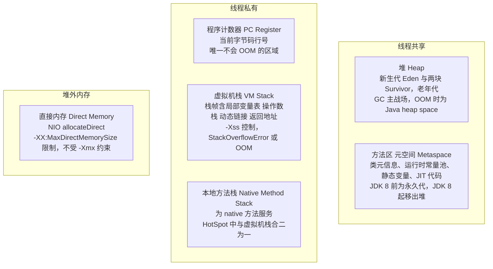

**企业实际处理**：
- 生产环境**必开** `-XX:+HeapDumpOnOutOfMemoryError -XX:HeapDumpPath=/opt/dump`，让 OOM 现场自动落盘，否则重启后证据全丢。
- JDK 8+ 统一用元空间，配置 `-XX:MetaspaceSize=256m -XX:MaxMetaspaceSize=512m`，**必须设上限**，否则元空间泄漏会吃光容器内存（CGLIB/动态代理/热部署场景高发）。
- 容器里**显式设 `-Xmx`，不要依赖默认值**；同时给直接内存留预算（Netty、NIO 场景）。

**为什么这样做**：
- **因为"私有 vs 共享"决定了并发问题的边界**：栈私有所以局部变量天然线程安全，堆/元空间共享所以对象和静态变量才需要同步保护。面试官问这句，其实是在为后面的并发题铺垫。
- **因为"堆内 vs 堆外"决定了你排查的问题域**：元空间和直接内存在堆外，`jmap -heap` 看到的堆很健康，进程却可能被 OOMKilled。不区分堆内外，遇到容器 OOMKilled 会一直在堆里找原因，方向全错。
- **因为"设不设上限"是安全性与灵活性的权衡**：元空间不设上限可以避免早期"永久代溢出"，但会让泄漏无界；设上限是把不确定性换成一个可预测的失败，故障可监控、可告警。

**企业级代码示例**（📦 按 JDK 17 书写、未实测）：演示直接内存与堆内存是两个独立账本

```java
import java.nio.ByteBuffer;
import java.util.ArrayList;
import java.util.List;

public class MemoryRegionDemo {
    public static void main(String[] args) {
        // 1) 堆内对象：受 -Xmx 约束，数组本体在堆上
        List<byte[]> heapHold = new ArrayList<>();

        // 2) 直接内存：不受 -Xmx 约束，受 -XX:MaxDirectMemorySize 约束
        //    使用 -XX:MaxDirectMemorySize=64m 运行时，这里很快就会抛
        //    OutOfMemoryError: Direct buffer memory
        List<ByteBuffer> directHold = new ArrayList<>();
        for (int i = 0; i < 100; i++) {
            ByteBuffer buf = ByteBuffer.allocateDirect(4 * 1024 * 1024); // 4MB / 次
            directHold.add(buf);
            if (i % 10 == 0) {
                System.out.println("直接内存已分配约 " + (i + 1) * 4 + "MB");
            }
        }
    }
}
```

**面试加分项**：
- 主动提**运行时常量池**在 JDK 7 从方法区搬到堆（`intern()` 的行为变化，`StringTable` 在堆里），JDK 8 后"永久代"概念已不存在。
- 提一句**字符串常量池**和 `String.intern()` 在 JDK 7+ 的行为差异（JDK 6 复制字符串进永久代，JDK 7+ 存引用），并说明这影响的是"常量池能放多少"。
- 说出 **PC 寄存器不会 OOM** 这个"反常识"点，能立刻区分你和其他人。

---

### <a id="q2"></a>题 2：一个 new 出来的对象，在内存里到底长什么样？

- **题干**：「平时写 `new Object()` 很自然。我问细一点：一个对象从 `new` 指令到你能用，中间经历了什么？它在内存里占多少字节、由哪几部分组成？」
- **考察点**：对象创建完整流程 + 内存布局 + 指针压缩 + TLAB。

**标准答案**：
1. **类加载检查**：`new` 指令先在常量池定位类的符号引用，检查该类是否已加载/解析/初始化，没有则触发类加载。
2. **分配内存**：在堆里划分一块内存。划分方式取决于堆是否规整——**指针碰撞（Bump the Pointer）** 用于规整的堆（Serial/ParNew 等带整理的收集器），**空闲列表（Free List）** 用于有碎片的堆（CMS）。并发安全通过两种方式解决：① **CAS + 失败重试** ② **TLAB（Thread Local Allocation Buffer）**，每个线程在 Eden 里预分配一小块私有区域，默认开启（`-XX:+UseTLAB`），默认占 Eden 的 1%（`-XX:TLABWasteTargetPercent`），用完再申请新的。
3. **零值初始化**：把对象内存全部置零，保证字段不赋初值也能直接使用（这也是**准备阶段**给静态变量设零值的同一个逻辑）。
4. **设置对象头**：写入 Mark Word 和类型指针。
5. **执行 `<init>`**：执行构造方法，此时才做成员变量的显式赋值和父类构造。

**图 1-2：对象创建过程**

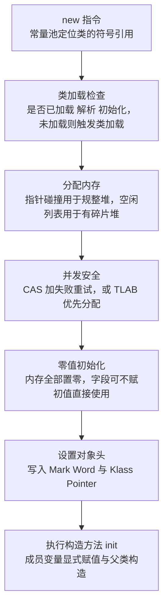

**对象内存布局**（64 位 HotSpot，开启压缩指针）：
- **对象头（Object Header）**：
  - **Mark Word**：8 字节。存哈希码、GC 分代年龄（4 bit，所以 `MaxTenuringThreshold` 最大 15）、**锁标志位**（无锁/偏向锁/轻量级锁/重量级锁，和并发模块直接衔接）。
  - **Klass Pointer（类型指针）**：指向方法区类元数据。开启压缩指针时 **4 字节**，否则 8 字节。
  - **数组长度**：仅数组对象有，4 字节。
  - 所以：普通对象头 = 8 + 4 = **12 字节**（压缩指针下）；数组对象头 = 8 + 4 + 4 = **16 字节**。
- **实例数据（Instance Data）**：按照 JVM 分配策略排列（long/double 优先，相同宽度字段放在一起，父类字段在前），会被插入 padding 以对齐。
- **对齐填充（Padding）**：对象总大小必须是 **8 字节的整数倍**，不足则补齐。

**指针压缩（Compressed Oops）**：
- `-XX:+UseCompressedOops`，**JDK 6u23 起 64 位默认开启**。原理：对象按 8 字节对齐，地址低 3 位恒为 0，所以用 32 位可以表示 2^32 × 8 = **32GB 的地址空间**。
- **堆超过 32GB 时压缩指针自动失效**（Klass Pointer 压缩由 `-XX:+UseCompressedClassPointers` 单独控制）。
- 这是"**堆不是越大越好**"的经典论据：堆开到 33GB，实际可用内存反而不如 31GB，且引用占 8 字节导致缓存局部性变差。

**图 1-3：对象内存布局与指针压缩前后对比**

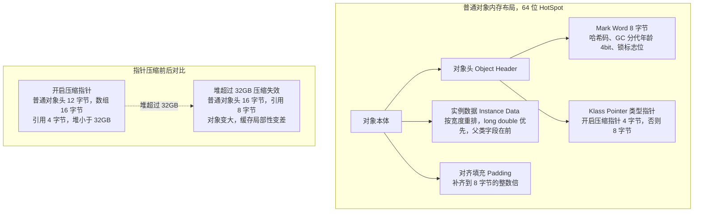

**企业实际处理**：
- 单机堆一般不超 **31~32GB**（保留压缩指针），超过就做分片/多实例，而不是单堆硬撑。
- 高频创建短命对象用 **TLAB** 降低 CAS 竞争，这是默认行为，但要避免 `-XX:-UseTLAB` 的无脑关闭。
- 大对象（超过 `-XX:PretenureSizeThreshold`）直接进老年代，**注意这个参数只对 Serial/ParNew 有效**，对 Parallel Scavenge 和 G1 无效（G1 用 Humongous Region 处理）。

**为什么这样做**：
- **因为 32GB 是"物理对齐换地址空间"的算术结果，不是拍脑袋定的**：理解 8 字节对齐 → 低 3 位可省 → 32 位表示 32GB 这条推导链，才能解释为什么边界是这个数，也才能在面试官追问"能不能开到 64GB"时回答"能，但每个引用从 4 字节变 8 字节，同样的对象多占 20%+，得不偿失"。
- **因为 TLAB 是"用空间换吞吐"的取舍**：TLAB 会带来少量内部碎片（`TLABWasteTargetPercent`，即 1% 的浪费），但换来无锁分配，在高并发下收益远大于损耗。
- **因为对象头是"并发状态的载体"**：Mark Word 里同时塞了哈希码、GC 年龄和锁状态，这解释了为什么 `hashCode()` 调用后再加锁会导致锁升级不可逆（哈希码和偏向锁标志位争用同一个 bit）。

**企业级代码示例**（📦 按 JDK 17 书写、未实测，需引入 JOL 依赖 `org.openjdk.jol:jol-core`）：用 JOL 打印对象真实布局

```java
import org.openjdk.jol.info.ClassLayout;
import org.openjdk.jol.vm.VM;

// 类 1：8 字节对齐后，压缩指针下 12(头) + 8(long) + 4(int) + 4(ref) = 28 -> 补齐 32
class OrderEvent {
    long orderId;      // 8
    int status;        // 4
    String symbol;     // 4 (压缩指针)
}

public class LayoutDemo {
    public static void main(String[] args) {
        System.out.println("JVM 是否开启压缩指针: " + VM.current().details());
        OrderEvent e = new OrderEvent();
        System.out.println(ClassLayout.parseInstance(e).toPrintable());
        // 关注输出里的 "Instance size: 32 bytes" 与 header 的 12 bytes
    }
}
```

**面试加分项**：
- 主动说 **Mark Word 的复用**：无锁时低 3 位是 `001`，偏向锁是 `101`，轻量级锁指向栈中 Lock Record，重量级锁指向 ObjectMonitor——把对象布局和并发锁打通，是高级岗位的加分点。
- 提一句 **`-XX:+UseCompressedOops` 在堆 < 32GB 时默认自动开启，无需手写**，很多人写这个参数是多余的。
- 说清 **TLAB 耗尽后仍会在 Eden 用 CAS 分配**，TLAB 不是万能钥匙。

---

### <a id="q3"></a>题 3：怎么判断一个对象可以回收？GC Roots 有哪些？

- **题干**：「怎么判断一个对象死了？为什么不用引用计数？GC Roots 具体是哪些东西？四种引用你平时用哪种？」
- **考察点**：可达性分析 + GC Roots 枚举 + 四种引用 + finalize 语义。

**标准答案**：
1. **不用引用计数**：引用计数无法解决**循环引用**（A 引用 B、B 引用 A，计数都不为 0，但整体不可达），且计数增减有性能开销。主流 JVM 用**可达性分析（Reachability Analysis）**。
2. **可达性分析**：从一组称为 **GC Roots** 的对象出发，沿引用链向下遍历，不可达的对象判为可回收。注意这是**逻辑上的"不可达"，不是立刻回收**。
3. **GC Roots 有哪些**（能完整说出来的是少数）：
   - 虚拟机栈中局部变量表引用的对象（**最多、最关键的一类**）
   - 方法区中**静态变量**引用的对象
   - 方法区中**常量**引用的对象（字符串常量池等）
   - **本地方法栈中 JNI 引用**的对象
   - **同步锁（synchronized）持有的对象**
   - JVM 内部的引用：基本类型的 Class 对象、常驻异常对象（如 NPE）、系统类加载器
   - 被 GC Root 引用的其他对象（递归可达）

**图 1-4：可达性分析与 GC Roots**

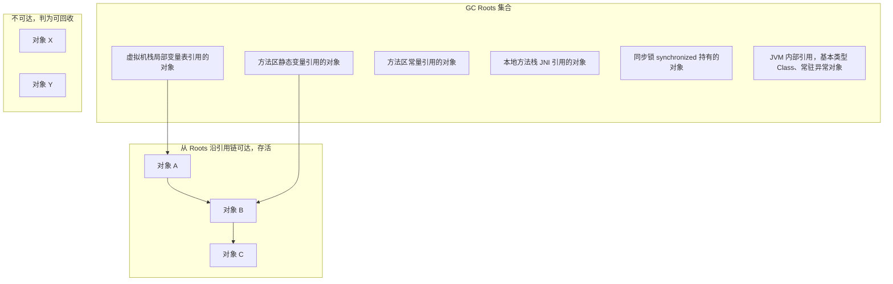

4. **四种引用**：
   | 引用类型 | 回收时机 | 典型用途 |
   |---|---|---|
   | 强引用（默认） | 只要可达，**OOM 也不回收** | 普通对象 |
   | 软引用 `SoftReference` | **内存不足**时回收 | 内存敏感缓存（图片/热点数据） |
   | 弱引用 `WeakReference` | **下次 GC 必回收** | `ThreadLocal`、`WeakHashMap`、规范化映射 |
   | 虚引用 `PhantomReference` | 任何时候都可能被回收，**无法通过它取对象**，只为回收通知 | 直接内存 `Cleaner`、资源释放 |

**图 1-5：四种引用强度与回收时机**

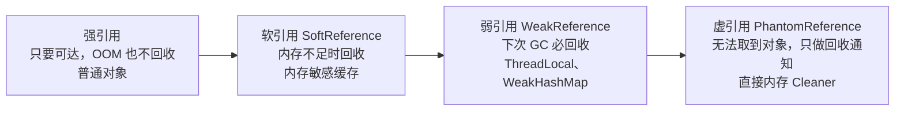

5. **对象"真正死亡"要两步**：可达性分析不可达后，**第一次标记**；判断是否需要执行 `finalize()`（未覆盖或已执行过则直接回收）；若需要则放入 **F-Queue**，由低优先级 Finalizer 线程执行，`finalize()` 中若重新建立引用则可"自救"。**对象自救只能成功一次**，因为 `finalize()` 最多被调用一次。`finalize()` 在 **JDK 9 起被标记 `@Deprecated`**，JDK 18 起标记为 `forRemoval`。

**企业实际处理**：
- **生产代码不写 `finalize()`**，资源释放一律用 `try-with-resources` / `AutoCloseable`。`finalize` 执行时机不确定、可能拖慢 GC、甚至导致对象"复活"，是纯负债。
- **`ThreadLocal` 用完必须 `remove()`**：线程池里线程长期存活，`ThreadLocalMap` 的 key 是弱引用、value 是强引用，key 被回收后 value 变成"key 为 null 的残留",不 remove 就是**典型内存泄漏**（这是你监测服务里极易踩的坑）。
- 本地缓存用 `SoftReference` 要有心理准备：它可能在**任意一次 GC** 时被清空，别把关键业务数据放进去。

**为什么这样做**：
- **因为可达性分析的代价是"每次 GC 都要从 Roots 遍历"**，这决定了 GC 的暂停时间与活跃对象数量成正比，而不是与堆大小成正比——这是理解 G1/ZGC 为什么能做到低延迟的前提。
- **因为弱引用是"给 GC 一个抓手"的设计**：`ThreadLocalMap` 把 key 设为弱引用，是为了在 `ThreadLocal` 对象本身不被引用时，能把 entry 的 key 清掉，避免 key 永久泄漏；但 value 是强引用，所以**仍然需要手动 remove**，这个"半边弱引用"的设计意图是很多人答不出来的深度点。
- **因为 finalize 的"复活"机制让回收变成两阶段**，GC 复杂度上升且行为不可控，所以现代 Java 用 `Cleaner`（虚引用 + 引用队列）取代它。

**企业级代码示例**（📦 按 JDK 17 书写、未实测）：演示软引用缓存与 ThreadLocal 泄漏

```java
import java.lang.ref.SoftReference;
import java.util.concurrent.ExecutorService;
import java.util.concurrent.Executors;

public class ReferenceDemo {

    // 软引用做缓存：内存吃紧时会被 GC 清掉，读取前要判空并回源
    static class SoftCache<K, V> {
        private final SoftReference<V> ref;
        private final K key;
        SoftCache(K key, V value) { this.key = key; this.ref = new SoftReference<>(value); }
        V get() { return ref.get(); }   // 可能返回 null，调用方必须回源
    }

    // 反面教材：ThreadLocal 不 remove，线程池复用线程导致 value 泄漏
    static final ThreadLocal<byte[]> LEAKY = ThreadLocal.withInitial(() -> new byte[1024 * 1024]);

    public static void main(String[] args) throws Exception {
        ExecutorService pool = Executors.newFixedThreadPool(4);
        for (int i = 0; i < 100; i++) {
            pool.submit(() -> {
                LEAKY.get();      // 分配 1MB
                // 正确做法： LEAKY.remove();
            });
        }
        pool.shutdown();
        Thread.sleep(2000);
        System.gc();
        System.out.println("若未 remove，ThreadLocalMap 中会残留 key=null 的强引用 value");
    }
}
```

**面试加分项**：
- 提 **`-XX:+ClassUnloadingWithConcurrentMark`**（G1 默认开启类卸载）与"元空间泄漏"的关系：动态生成类（CGLIB/反射代理/热部署）会让元空间持续增长，只能靠卸载类回收。
- 说清 **`WeakHashMap` 的 key 被回收后会触发 expunge 清理**，这是弱引用最常见的框架级用法。
- 强调 **`System.gc()` 只是建议，不是命令**（可被 `-XX:+DisableExplicitGC` 屏蔽，但注意这也会屏蔽 `DirectByteBuffer` 依赖的显式 GC 回收路径，需配合 `MaxDirectMemorySize` 使用）。

---

### <a id="q4"></a>题 4：GC 算法和分代回收是怎么回事？对象什么时候晋升老年代？

- **题干**：「GC 有哪几种基础算法？为什么分代？对象什么时候从新生代进老年代？」
- **考察点**：三大算法 + 分代假说 + 晋升规则 + 分配担保。

**标准答案**：
1. **三种基础算法**：
   - **标记-清除（Mark-Sweep）**：标记存活、清除垃圾。**缺点：产生内存碎片**，且标记与清除效率都不高。
   - **复制（Copying）**：把存活对象复制到另一块空间，整块清空。**适合存活率低的区域**（新生代）。代价是**需要预留一半空间**作周转。
   - **标记-整理（Mark-Compact）**：标记后把存活对象向一端移动，**无碎片**，但移动对象成本高，需要 STW。
2. **分代收集理论的两条假说**：① **弱分代假说**——绝大多数对象都是朝生夕灭；② **强分代假说**——熬过越多次 GC 的对象越难死。所以新生代用**复制算法**（存活少、复制便宜），老年代用**标记-清除 或 标记-整理**（存活多、复制贵）。
3. **堆的分代结构**：新生代 = **Eden : Survivor0 : Survivor1 = 8 : 1 : 1**（由 `-XX:SurvivorRatio=8` 控制，**默认值 8**）。老年代与新生代比例由 `-XX:NewRatio` 控制（**默认 2**，即老年代:新生代 = 2:1，新生代占堆 1/3）。
4. **一次 Minor GC 的流程**：对象优先在 Eden 分配 → Eden 满触发 Minor GC → 存活对象复制到 Survivor（`-XX:+UseTLAB` 下是 S0）→ 年龄 +1 → 下次再 GC，Eden + S0 存活对象复制到 S1，年龄再 +1，两块 Survivor 交替使用（**任何时刻只有一块 Survivor 有效**）。
5. **对象晋升老年代的条件**（四个，缺一不可地理解）：
   - **年龄达到阈值** `-XX:MaxTenuringThreshold`，**默认 15**（CMS 默认 6，因为 CMS 无碎片整理，让对象尽早进老年代减少新生代拷贝）。
   - **动态年龄判定**：Survivor 中**相同年龄的所有对象大小之和 > Survivor 空间的一半**，则**年龄 ≥ 该年龄**的对象直接晋升（不等到 15）。这条经常被忽略。
   - **大对象直接进入老年代**：超过 `-XX:PretenureSizeThreshold`（默认 0，即不启用，且**只对 Serial/ParNew 有效**）。G1 里用 **Humongous Region** 存超过 Region 一半的大对象。
   - **Survivor 空间不足 / 分配担保**：Minor GC 前若老年代最大可用连续空间 < 新生代所有对象总大小，或者 Survivor 装不下，则通过**分配担保**把对象直接放进老年代（老年代空间不够且无法扩展时才触发 Full GC）。
6. **Full GC 触发条件**（JDK 8 + Parallel/Parallel Old 场景）：老年代空间不足 / 元空间达到 `MetaspaceSize` 阈值 / 调用 `System.gc()` / Minor GC 前担保失败 / CMS 的 Concurrent Mode Failure。

**图 1-6：堆内存分代结构与对象晋升路径**

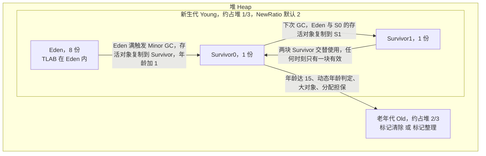

**企业实际处理**：
- **`-Xmn` / `-XX:NewRatio` 不要乱调**。低延迟服务（你的实时预警）倾向**加大新生代**让短命对象死在新生代，减少晋升，从源头减少 Full GC。
- **禁止业务代码调 `System.gc()`**。日志框架、部分中间件客户端、`ByteBuffer` 直接内存回收路径可能触发它，生产上常加 `-XX:+ExplicitGCInvokesConcurrent`（配合 CMS/G1，把 `System.gc()` 变成一次并发 GC 而不是 Full STW）。
- **晋升年龄不要随便改小**：改小会让对象过早进老年代，加速老年代膨胀、增加 Full GC 频率，是新手调参最常见的反向操作。

**为什么这样做**：
- **因为分代是"用统计规律换效率"**：如果对象生命周期没有规律（大部分朝生夕灭），分代就失去意义。理解这条假说，才能在面试官问"分代到底解决什么问题"时答到点子上——它把"每次 GC 都要扫全堆"降级成"多数 GC 只扫新生代"。
- **因为动态年龄判定是"防止 Survivor 溢出"的兜底**：如果一批同龄对象加起来超过 Survivor 一半，说明它们大概率是同一批长生命周期对象（比如启动时加载的缓存），继续在 Survivor 里反复复制只是浪费，直接晋升更划算。
- **因为分配担保把风险从"新生代"转移到"老年代"**：先假设老年代能接住，接不住才算总账（Full GC）。这是一个"乐观分配"的设计，代价是偶尔一次昂贵的 Full GC。

**企业级代码示例**（📦 按 JDK 17 书写、未实测）：构造不同存活时长的对象，观察晋升

```java
import java.util.ArrayList;
import java.util.List;

public class PromotionDemo {
    private static final List<byte[]> OLD_GEN_HOLD = new ArrayList<>(); // 长命对象，会晋升

    public static void main(String[] args) throws Exception {
        // 运行参数示例：
        // -Xms256m -Xmx256m -Xmn128m -XX:SurvivorRatio=8
        // -XX:MaxTenuringThreshold=15 -XX:+PrintGCDetails -Xloggc:gc.log
        for (int i = 0; i < 1000; i++) {
            byte[] shortLived = new byte[512 * 1024]; // 512KB，Minor GC 后即死
            if (i % 20 == 0) {
                OLD_GEN_HOLD.add(new byte[512 * 1024]); // 被静态集合长期持有 -> 晋升老年代
            }
            if (i % 100 == 0) {
                System.gc(); // 仅为演示触发 GC，生产代码禁止
            }
        }
        System.out.println("老年代持有对象数量: " + OLD_GEN_HOLD.size());
    }
}
```

**面试加分项**：
- 主动点出 **CMS 的 `MaxTenuringThreshold` 默认是 6**，解释原因（无整理，减少新生代复制次数），这是"知道默认值还能解释为什么"的深度分。
- 说清 **Survivor 的两块区交替使用**机制，很多人只记 8:1:1 却说不清为什么是两块。
- 提 **G1 没有物理意义上的连续新生代/老年代**，Region 是逻辑划分，所以 `-Xmn` 在 G1 下**不生效**（需用 `-XX:G1NewSizePercent` / `-XX:G1MaxNewSizePercent`），这是一个高频陷阱。

---

### <a id="q5"></a>题 5：双亲委派是什么？哪些场景要打破它？

- **题干**：「类加载的过程说一下吧。双亲委派是什么？为什么 JDBC 这种要打破双亲委派？」
- **考察点**：类加载流程 + 双亲委派模型 + 打破场景（SPI/Tomcat/热部署）。

**标准答案**：
1. **类加载的五个阶段**：**加载 → 验证 → 准备 → 解析 → 初始化**（之后才是使用和卸载）。
   - **准备阶段**：为静态变量分配内存并设为**零值**（`static int a = 10` 在准备阶段 a 是 0）；但 `static final` 常量在准备阶段就直接赋为真实值（因为 `ConstantValue` 属性）。
   - **解析**：把常量池的符号引用替换为直接引用（可延迟到首次使用时，JVM 支持懒解析）。
   - **初始化**：执行 `<clinit>()`，即静态代码块和静态变量赋值，**父类先于子类**。触发条件（主动引用）：`new`、访问静态字段/方法、反射、初始化子类、`main` 类、`MethodHandle` 等。
2. **双亲委派模型**：类加载器层次为 **Bootstrap（启动类，加载 `<JAVA_HOME>/lib`）→ Platform/Extension（扩展类，JDK 9 后叫 Platform ClassLoader）→ Application/System（应用类，`classpath`）→ 自定义 ClassLoader**。
   - 逻辑：`loadClass` 时**先委托父加载器**，父加载器加载不了（不在自己的搜索路径）才自己加载。**注意：双亲委派是 `loadClass` 方法的实现，不是 JVM 规范强制，是推荐做法。**
   - 目的：① **安全性**——防止用户自写 `java.lang.String` 覆盖核心类（父加载器先加载，子加载器不会重复加载）；② **唯一性**——同一个类只被加载一次，避免类冲突。

**图 1-7：双亲委派模型**

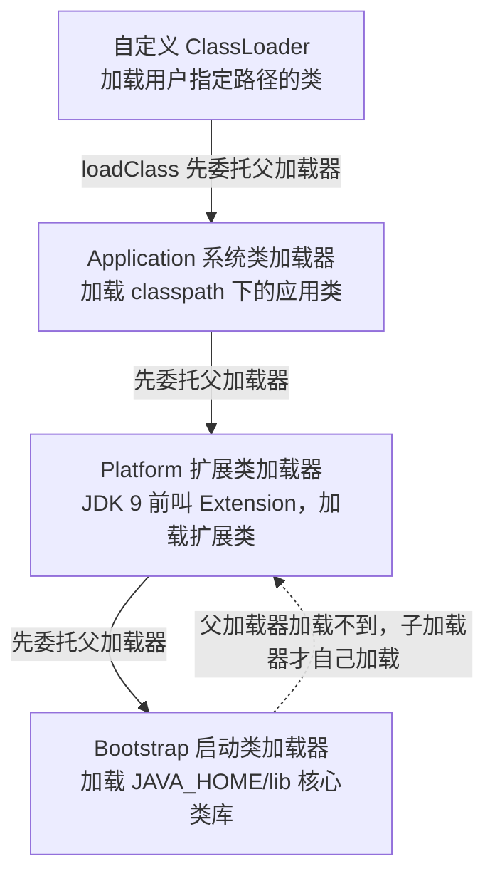

3. **打破双亲委派的三种典型场景**：
   - **SPI（Service Provider Interface）机制**：`java.sql.Driver` 在 `rt.jar`/核心模块里由 Bootstrap 加载，但它的实现类（`com.mysql.jdbc.Driver`）在 `classpath` 由 Application 加载。**父加载器无法看到子加载器的类**，于是引入**线程上下文类加载器（`Thread.currentThread().getContextClassLoader()`）**，用"父委托子"的反向行为完成加载（`ServiceLoader.load(Class)` 就是这套机制）。`JDBC`、`JNDI` 都属此类。
   - **Tomcat 的 WebAppClassLoader**：为满足**应用隔离**（不同 webapp 用不同版本的 Jar）和**热部署**（reload 时丢弃整个类加载器），Tomcat **先自己加载**（`WebappClassLoaderBase.loadClass` 优先本地），只有 JRE 核心类、`javax.servlet` 等共享类才交给父加载器。这是**"自己优先"**的打破方式。
   - **热部署 / OSGi / 模块化**：热部署的本质是**每次 reload 用新的 ClassLoader 加载全部类**，旧的 ClassLoader 不可达后被 GC；OSGi 用更复杂的网状委托实现模块级隔离。

**图 1-8：打破双亲委派的三种场景**

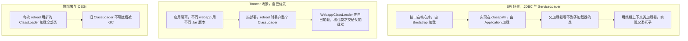

**企业实际处理**：
- **JDBC 4.0+ 用 SPI 自动注册驱动**，`Class.forName("com.mysql.cj.jdbc.Driver")` 其实可以省略（但很多老项目还保留，因为要兼容和显式保证）。
- **热部署/`spring-boot-devtools` 在容器里禁用**，因为会带来类加载器泄漏（旧 ClassLoader 被 ThreadLocal/静态变量间接引用，无法 GC），表现就是**元空间持续涨、最终 `Metaspace OOM`**。
- **通过自定义 ClassLoader 做类隔离**（如多版本 Jar 共存、插件系统），是高级岗位"框架能力"的常见考察。

**为什么这样做**：
- **因为 SPI 的需求本质是"接口在核心库、实现在业务侧"**，双亲委派的单向委托天然做不到"父加载器加载子加载器的类"，只能靠线程上下文类加载器这条"旁路"。理解这点，才能解释为什么 `ServiceLoader` 一定要在当前线程设置上下文类加载器。
- **因为类加载器隔离是"用内存换隔离性"的取舍**：每个 ClassLoader 都有独立的类元空间，隔离越彻底、元空间占用越大、类卸载越难。Tomcat 的 reload 泄漏、Spring Boot DevTools 的元空间膨胀，都是这个取舍的代价。
- **因为打破双亲委派必须有充分理由**：默认模型保证了安全性和类唯一性，一旦打破，"同一个类名被加载成两个不同 Class 对象"的问题就会出现（`instanceof` 判定失败、`ClassCastException`），这是很多类冲突故障的根源。

**企业级代码示例**（📦 按 JDK 17 书写、未实测）：自定义 ClassLoader 打破双亲委派（"自己优先"）

```java
import java.io.IOException;
import java.nio.file.Files;
import java.nio.file.Path;

public class MyClassLoader extends ClassLoader {

    private final Path classDir;

    public MyClassLoader(Path classDir) {
        // 父加载器传 null -> 用 Bootstrap 作为父，便于观察隔离效果
        super(null);
        this.classDir = classDir;
    }

    @Override
    protected Class<?> loadClass(String name, boolean resolve) throws ClassNotFoundException {
        synchronized (getClassLoadingLock(name)) {
            Class<?> loaded = findLoadedClass(name);
            if (loaded == null) {
                // 打破双亲委派：先自己加载，加载不到才委托父加载器
                try {
                    loaded = findClass(name);
                } catch (ClassNotFoundException e) {
                    loaded = super.loadClass(name, false);
                }
            }
            if (resolve) {
                resolveClass(loaded);
            }
            return loaded;
        }
    }

    @Override
    protected Class<?> findClass(String name) throws ClassNotFoundException {
        try {
            byte[] bytes = Files.readAllBytes(classDir.resolve(name.replace('.', '/') + ".class"));
            return defineClass(name, bytes, 0, bytes.length);
        } catch (IOException e) {
            throw new ClassNotFoundException(name, e);
        }
    }

    public static void main(String[] args) throws Exception {
        MyClassLoader loader = new MyClassLoader(Path.of("./target/classes"));
        Class<?> clazz = loader.loadClass("com.example.PluginImpl");
        System.out.println("加载器: " + clazz.getClassLoader());
        Object o = clazz.getDeclaredConstructor().newInstance();
        System.out.println("实例: " + o.getClass() + " / " + o.getClass().getClassLoader());
    }
}
```

**面试加分项**：
- 说清 **`Class.forName` 与 `ClassLoader.loadClass` 的区别**：前者默认会初始化（`initialize=true`），后者只加载不初始化。
- 提 **JDK 9 后的模块化（JPMS）**：`rt.jar` 被拆成模块，扩展类加载器改名 Platform ClassLoader，`BootClassPath` 参数被移除（`-Xbootclasspath` 不再可用）。这表明你能跟上版本演进。
- 主动说 **自定义 ClassLoader 打破双亲委派的两种姿势**：重写 `loadClass`（改变委托逻辑）或重写 `findClass`（只加搜索路径，不破坏委托），说清二者区别能凸显功力。

## 进阶实战题（5 道）

### <a id="q6"></a>题 6：GC 收集器这么多，你怎么选？

- **题干**：「Serial、ParNew、Parallel、CMS、G1、ZGC 你都了解吗？你们线上服务用的哪个？为什么选它？」
- **考察点**：收集器演进脉络 + 算法/停顿/吞吐特性 + 版本适配 + 选型决策。

**标准答案**：
1. **收集器全景**（按演进顺序）：

   | 收集器 | 作用区域 | 算法 | 线程/并发 | 特点 | 开启参数 | 版本状态 |
   |---|---|---|---|---|---|---|
   | **Serial** | 新生代 | 复制 | 单线程 STW | 简单高效，Client 模式默认 | `-XX:+UseSerialGC` | 仍可用 |
   | **ParNew** | 新生代 | 复制 | 多线程 STW | Serial 的多线程版，**主要配合 CMS** | `-XX:+UseParNewGC`（配合 CMS 自动启用） | JDK 9 起逐步废弃 |
   | **Parallel Scavenge** | 新生代 | 复制 | 多线程 STW | **吞吐量优先**，可自适应调节 | `-XX:+UseParallelGC` | **JDK 8 默认** |
   | **Parallel Old** | 老年代 | 标记-整理 | 多线程 STW | 配合 Parallel Scavenge | 随 Parallel 启用 | 仍可用 |
   | **Serial Old** | 老年代 | 标记-整理 | 单线程 STW | CMS 的**兜底**（Concurrent Mode Failure 时） | `-XX:+UseSerialOldGC`（G1 兜底也用） | 仍可用 |
   | **CMS** | 老年代 | 标记-清除 | **并发** | **低延迟**，四阶段，**有碎片** | `-XX:+UseConcMarkSweepGC` | **JDK 9 废弃，JDK 14 移除** |
   | **G1** | 整堆 | 复制+标记-整理 | 并发 | Region 化，**可预测停顿** | `-XX:+UseG1GC` | **JDK 9+ 默认** |
   | **ZGC** | 整堆 | 染色指针+读屏障 | 并发 | **超低延迟（<10ms，JDK16 后亚毫秒）** | `-XX:+UseZGC` | JDK 11 实验，**JDK 15 转正**，JDK 21 分代 |
   | **Shenandoah** | 整堆 | 转发指针+读屏障 | 并发 | 低延迟，RedHat 出品 | `-XX:+UseShenandoahGC` | JDK 12 进入主线 |
   | **Epsilon** | - | 不回收 | - | **只分配不回收**，性能测试用 | `-XX:+UseEpsilonGC` | JDK 11+ |

**图 1-9：垃圾收集器演进与适用场景对比**

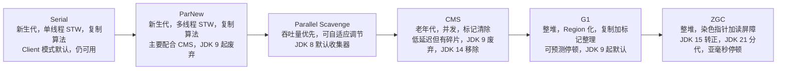

2. **两个核心指标**：
   - **吞吐量（Throughput）= 用户代码时间 / (用户代码时间 + GC 时间)**：适合批处理、离线计算。
   - **停顿时间（Latency）**：单次 STW 时长，适合交互式、实时服务。
   - **取舍**：吞吐量优先（Parallel）和延迟优先（CMS/G1/ZGC）通常是**此消彼长**，不能兼得。
3. **CMS 四阶段**（高频考点）：
   - **初始标记（Initial Mark）**：STW，仅标记 GC Roots 直接关联的对象，**很快**。
   - **并发标记（Concurrent Mark）**：**与用户线程并发**，耗时最长，做可达性遍历。
   - **重新标记（Remark）**：STW，修正并发标记期间因用户线程运行导致的变动（**增量更新**），**比初始标记长但比并发标记短**。
   - **并发清除（Concurrent Sweep）**：与用户线程并发清除垃圾。
   - CMS 三大缺点：① **对 CPU 敏感**（并发阶段占用线程，`-XX:ParallelGCThreads`、`-XX:ConcGCThreads` 需调）；② **浮动垃圾**（并发清除期间用户线程新产生的垃圾只能下次处理，导致 Concurrent Mode Failure → 退化为 Serial Old 全 STW）；③ **内存碎片**（标记-清除的后遗症，需定期 `-XX:+UseCMSCompactAtFullCollection` 或 `-XX:CMSFullGCsBeforeCompaction`）。

**图 1-10：CMS 四阶段与两大失败模式**

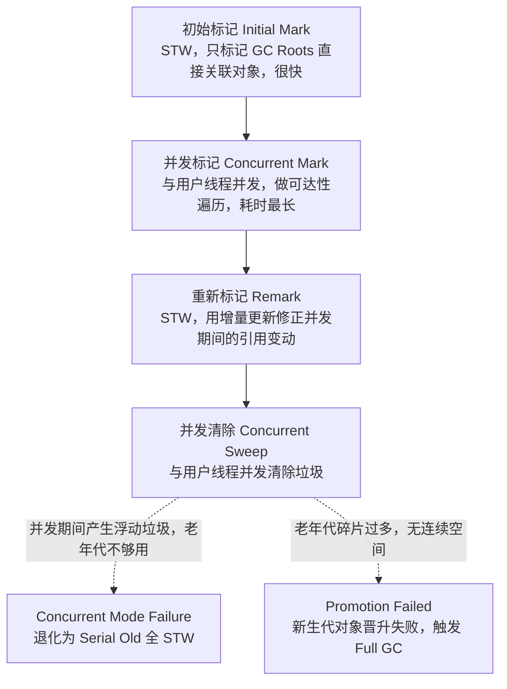

4. **选型决策**：
   - **JDK 8 时代**：吞吐优先（离线/批处理）→ Parallel；低延迟（Web/实时）→ CMS（注意碎片和 CMF）；堆小且单核 → Serial。
   - **JDK 9+**：默认 G1，堆 ≤ 6GB 且延迟不敏感的场景 G1 未必优于 Parallel；延迟敏感 → G1（调 `MaxGCPauseMillis`）或 ZGC。
   - **超大堆（几十 GB）+ 极低延迟** → ZGC（但要注意 ZGC 的 CPU 开销和吞吐会低于 G1，且**JDK 16 前不支持压缩指针/不支持类卸载**等限制，视版本而定）。

**企业实际处理**：
- **JDK 8 老系统的实时预警服务**若仍用 CMS，必须配 `-XX:CMSInitiatingOccupancyFraction=70 -XX:+UseCMSInitiatingOccupancyOnly`，并加 `-XX:+ExplicitGCInvokesConcurrent`。注意 **CMS 在 JDK 14 已被移除**，新项目不能选它。
- **JDK 9+ 项目默认 G1，配合 `-XX:MaxGCPauseMillis=200`**（默认 200ms），低延迟场景可压到 50ms 但会牺牲吞吐。
- **JDK 17 项目 + 低延迟 SLA（你简历里的毫秒级预警）→ 首选 G1，极端场景评估 ZGC**。JDK 21 已支持**分代 ZGC**（`-XX:+ZGenerational`），大幅改善 ZGC 的吞吐短板。
- 上线前**用压测复现目标 QPS 下的 GC 表现**（你自己简历里的压测调优能力正好用在这），而不是靠猜。

**为什么这样做**：
- **因为收集器选型是"延迟、吞吐、内存开销"三角取舍，没有全能选手**：G1 用 Remembered Set 维护跨 Region 引用（内存开销 + 写屏障成本）换取可预测停顿；ZGC 用染色指针 + 读屏障（读屏障让每次读都要检查，吞吐下降）换取亚毫秒停顿。能讲清"为了低延迟牺牲了什么"，才是真懂。
- **因为版本演进的现实约束比理论重要**：CMS 在 JDK 14 移除、G1 从 JDK 9 起默认，如果你的知识停留在"CMS 是低延迟最佳选择"，面试官会判断你脱离一线。
- **因为"默认值未必适合你"**：G1 默认 `MaxGCPauseMillis=200ms`，对毫秒级 SLA 的服务太宽松，必须主动调；Parallel 默认 `MaxGCPauseMillis` 无效（它用 `GCTimeRatio`），参数体系完全不同。

**企业级代码示例**（📦 按 JDK 17 书写、未实测）：对比 G1 与 Parallel 的启动参数

```bash
# 场景 A：JDK 17 实时预警服务（延迟敏感），G1 + 目标 100ms 停顿
java -Xms4g -Xmx4g \
     -XX:+UseG1GC \
     -XX:MaxGCPauseMillis=100 \
     -XX:G1HeapRegionSize=8m \
     -XX:InitiatingHeapOccupancyPercent=35 \
     -XX:ParallelGCThreads=8 -XX:ConcGCThreads=2 \
     -XX:+HeapDumpOnOutOfMemoryError -XX:HeapDumpPath=/opt/dump \
     -Xlog:gc*:file=/opt/logs/gc.log:time,uptime,level,tags:filecount=10,filesize=100m \
     -jar risk-warning.jar

# 场景 B：JDK 17 离线指标报告批处理（吞吐优先），Parallel
java -Xms8g -Xmx8g \
     -XX:+UseParallelGC \
     -XX:GCTimeRatio=99 \
     -XX:+UseAdaptiveSizePolicy \
     -XX:ParallelGCThreads=16 \
     -XX:+HeapDumpOnOutOfMemoryError \
     -jar metric-report.jar

# 场景 C：JDK 21 超低延迟（评估 ZGC，注意吞吐下降）
java -Xms16g -Xmx16g -XX:+UseZGC -XX:+ZGenerational -XX:+AlwaysPreTouch -jar gateway.jar
```

**面试加分项**：
- 说清 **G1 与 CMS 的本质区别**：CMS 是"回收整块老年代"，G1 是"回收收益最高的若干 Region"（Garbage First 的来历），这是横向对比的关键。
- 提 **ZGC 的染色指针（Colored Pointers）**：把 GC 状态存在 64 位指针的高位里，所以**ZGC 不支持压缩指针**（JDK 16 前指针本身就要占满 64 位），这是它和 G1 的架构级差异。
- 主动说 **Shenandoah vs ZGC 的"读屏障 vs 转发指针"** 差异，以及 Shenandoah 在 JDK 12 才进入主线、OpenJDK 各发行版支持情况不同（视发行版而定），体现你了解生态而非只背 OpenJDK。

---

### <a id="q7"></a>题 7：G1 的 Region 和"可预测停顿"是怎么回事？

- **题干**：「说说 G1 吧。Region 是什么？它凭什么能"可预测停顿"？Mixed GC 回收哪些 Region？」
- **考察点**：G1 内存布局 + 停顿预测模型 + 回收类型 + SATB/RSet。

**标准答案**：
1. **Region 化布局**：G1 把堆划分为**约 2048 个大小相等的 Region**（`-XX:G1HeapRegionSize`，取值 **1MB~32MB 且为 2 的幂**，默认约 `堆大小 / 2048` 向上取整）。**每个 Region 在物理上不连续，但逻辑上被标记为 Eden / Survivor / Old / Humongous**。
   - **Humongous Region**：存放**超过单个 Region 一半大小**的大对象，可能连续占用多个 Region。这是 G1 特有的"大对象"处理方式（替代了 `PretenureSizeThreshold`，后者在 G1 下无效）。
2. **可预测停顿的做法（停顿预测模型）**：
   - G1 维护每个 Region 的**回收收益**（能回收多少垃圾）和**回收成本**（存活对象多少、复制耗时）。
   - 每次 Young GC / Mixed GC 时，在 `-XX:MaxGCPauseMillis`（**默认 200ms**）约束下，**优先选择回收收益最高的 Region**（Garbage First 的由来），按收益/成本排序，在时间预算内回收尽可能多的 Region。
   - 用户给定目标停顿 → G1 动态调整**新生代 Region 数量**（`-XX:G1NewSizePercent` / `-XX:G1MaxNewSizePercent`，默认 5%~60%）来逼近目标。
3. **三种回收类型**：
   - **Young GC**：STW，回收**所有 Eden Region**，存活对象复制到 Survivor 或 Old（晋升）。
   - **Mixed GC**：回收**所有 Young Region + 部分 Old Region**（按收益排序、在停顿目标内）。**不是回收整个老年代**。
   - **Full GC**：当 Mixed GC 赶不上垃圾产生速度时兜底，**JDK 10 前用 Serial Old 单线程全 STW，JDK 10 起改为并行**（JEP 307），Full GC 是 G1 最不希望发生的，是调优要避免的。

**图 1-11：G1 的 Region 布局与回收流程**

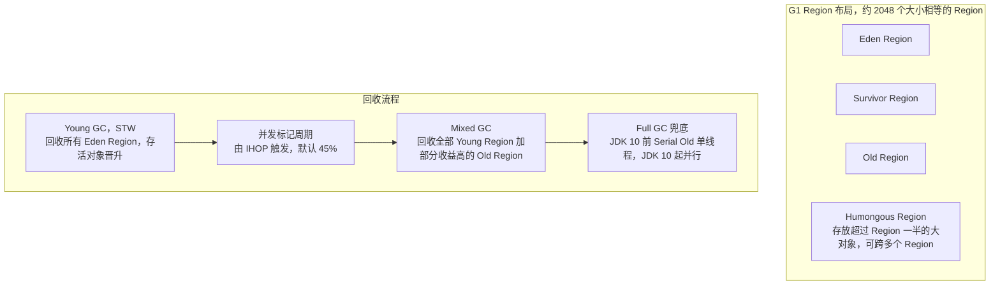

4. **关键技术**：
   - **SATB（Snapshot At The Beginning，原始快照）**：并发标记时，**以标记开始时对象图的快照为基准**，用**写前屏障（Pre-Write Barrier）**记录被覆盖的旧引用，避免漏标（"漏标"在 SATB 下几乎不会发生，代价是产生**浮动垃圾**）。
   - **RSet（Remembered Set，记忆集）**：每个 Region 记录"**谁引用了我**"（跨 Region 引用），避免全堆扫描。配合 **Card Table（卡表）** 实现，写屏障维护。
   - **TAMS（Top At Mark Start）**：并发标记期间新分配的对象视为存活，避免误回收。
   - **`-XX:InitiatingHeapOccupancyPercent`（IHOP）**：触发并发标记周期的阈值，**默认 45%**（老年代占整堆比例）。设太高会来不及回收导致 Full GC，设太低会频繁并发标记浪费 CPU。
5. **G1 三个缺陷**：① **RSet 占用额外内存**（可达堆的 5%~10%，视跨引用复杂度而定）；② **写屏障开销**（每次引用赋值都要维护 RSet）；③ **大对象（Humongous）分配跨 Region，容易引发碎片和 Full GC**。

**企业实际处理**：
- **必调 `-XX:MaxGCPauseMillis`**（默认 200ms）：实时预警服务可设 50~100ms，但要接受吞吐下降和可能的 Full GC 风险。
- **`IHOP` 显式设置**（如 35%~45%），并观察 `-Xlog:gc*` 中是否有 `to-space exhausted` 或 `Full GC` 关键字，一旦出现说明 Mixed GC 跟不上，要**降低 IHOP** 或**加大堆**。
- **避免大对象**：批量查询结果、大 JSON、`byte[]` 全量缓存要控制单次大小（比如限制在 Region 一半以下，如 8MB Region 就别造 5MB+ 的对象），否则会走 Humongous 路径，拖累 GC。
- **打开 `-XX:+ParallelRefProcEnabled`** 加速引用处理（Reference 处理是 STW 阶段耗时大头之一）。

**为什么这样做**：
- **因为"可预测"来自"可选择"**：G1 把"一次扫全堆"变成"每次挑一部分 Region 扫"，才能真正把停顿时间当成约束条件去求解。相比之下 Parallel 是老年代满了就得全部整理，停顿与存活对象数成正比、不可控。
- **因为 SATB 用"浮动垃圾"换"不漏标"**：原始快照会保留并发标记期间已死但被引用的对象，导致本轮 GC 少回收一些（浮动垃圾），换来的是无需重新标记扫描整个新生代（CMS 的 Remark 要重新扫描新生代，STW 更长）。这是 G1 和 CMS 在"漏标处理策略"上的根本权衡：**G1 用 SATB（增量更新 vs 原始快照的取舍），CMS 用增量更新**。
- **因为 IHOP 是"提前量"参数**：并发标记需要时间，等到老年代满了才开始标记必然来不及（期间用户线程还在填垃圾），所以必须提前到 45% 左右启动。这个"提前多少"就是 IHOP 的物理意义。

**企业级代码示例**（📦 按 JDK 17 书写、未实测）：观测 Mixed GC 与 Humongous 分配

```java
import java.util.ArrayList;
import java.util.List;

public class G1HumongousDemo {
    public static void main(String[] args) throws Exception {
        // 运行参数：-Xms4g -Xmx4g -XX:+UseG1GC -XX:MaxGCPauseMillis=100
        //           -XX:+UnlockDiagnosticVMOptions -XX:G1HeapRegionSize=8m
        //           -Xlog:gc*:file=gc.log:time,uptime,level,tags
        // G1HeapRegionSize=8m 时，Humongous 阈值 = 4m
        List<byte[]> hold = new ArrayList<>();
        for (int i = 0; i < 500; i++) {
            // 4MB+ 的数组会走 Humongous Region，观察 gc.log 中的 humongous 关键字
            hold.add(new byte[5 * 1024 * 1024]);
            if (i % 50 == 0) {
                System.out.println("已分配大对象: " + (i + 1));
            }
            Thread.sleep(5);
        }
    }
}
```

**面试加分项**：
- 说清 **G1 的 Full GC 在 JDK 10 前后实现不同**（Serial Old → 并行），能说出具体 JEP 号（JEP 307）是极强的细节分。
- 提 **`-XX:G1HeapRegionSize` 不是越大越好**：Region 太大 → Humongous 阈值高，大对象少但大 Region 回收粒度粗、停顿大；Region 太小 → Humongous 判定敏感，大对象频发。这是"参数有最优区间"的活例子。
- 主动说 **G1 也有卡表（Card Table）**，但它是用来辅助 RSet 的，和 CMS 的卡表用途（跨代引用）不完全等同，能区分说明你没有混淆概念。

---

### <a id="q8"></a>题 8：GC 日志你会看吗？预警任务频繁 Full GC 怎么调？

- **题干**：「你说做过 JVM 调优。那给你一份 GC 日志，你能读出什么？我们的实时预警任务最近频繁 Full GC，延迟抖到秒级，你怎么调？」
- **考察点**：GC 日志格式与关键字段 + 调优思路 + 真实场景诊断。

**标准答案**：
1. **日志参数（版本差异必须说清）**：
   - **JDK 8 及之前**：`-XX:+PrintGCDetails -XX:+PrintGCDateStamps -XX:+PrintGCTimeStamps -Xloggc:/path/gc.log`。
   - **JDK 9 及之后（统一日志框架 JEP 158）**：`-Xlog:gc*:file=/path/gc.log:time,uptime,level,tags:filecount=10,filesize=100m`。**旧参数在 JDK 9+ 已失效或被替换**，这是版本敏感的坑。
2. **一份 G1 GC 日志要读出的信息**：
   - **GC 类型**：`Pause Young (Normal)` / `Pause Young (Concurrent Start)` / `Pause Young (Mixed)` / `Pause Full`。
   - **触发原因**：`Allocation Failure`（分配失败）、`Metadata GC Threshold`（元空间阈值）、`To-space Exhausted`、`Humongous Allocation`、`System.gc()`。**这一项最关键，直接指向根因**。
   - **堆前后变化**：`Eden: 512M(512M)->0B`、`Survivor`、`Old: 1024M(1024M)->980M`。看**GC 后老年代是否下降**——如果不降，说明对象仍在被引用（泄漏）或晋升太快。
   - **停顿时间**：`Pause Young ... 35.213ms`。
   - **耗时分布**：`Ext Root Scanning`、`Update Remembered Set`、`Object Copy`、`Ref Proc`，能定位停顿大头在哪。
3. **"频繁 Full GC" 的诊断树**：
   - **看 Full GC 触发原因**：
     - `Metadata GC Threshold` → 元空间不够/泄漏（动态类、热部署、CGLIB）→ 调 `-XX:MetaspaceSize` 或排查类加载器泄漏。
     - `System.gc()` → 有代码/框架显式调用 → 加 `-XX:+ExplicitGCInvokesConcurrent` + 排查调用点（`jstack` 或 Arthas `stack` 定位）。
     - `Allocation Failure` + 老年代降不下去 → 真泄漏或晋升过快。
     - `To-space Exhausted`（G1）→ 晋升速度超过回收速度 → 加大堆/降低 IHOP/查大对象。
   - **看老年代是否"降不下去"**：若每次 Full GC 后 Old 几乎不降（如 980M → 970M），说明对象**被长期引用**——直指内存泄漏，转 Q11 的排查流程（`jmap -histo` / dump + MAT）。若 Old 每次能降回 100M 左右，说明是**晋升太快**（对象生命周期设定或 Survivor 太小），调新生代大小/晋升阈值。
   - **对象晋升过快**的处理：① 加大新生代（`-XX:NewRatio` 调小或 G1 调 `G1MaxNewSizePercent`）；② 检查是否有**大对象直接进老年代**；③ 检查是否有**缓存无上限**（`HashMap` 当缓存、`Caffeine`/`Guava` 未设 `maximumSize`）。

**图 1-12：频繁 Full GC 定位决策树**

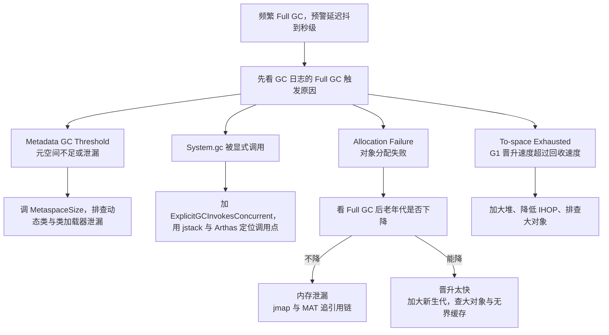

4. **针对你的场景（实时预警，秒级延迟抖动）**：目标是把 Full GC 消灭掉，让 STW 降到毫秒级可接受范围。

**企业实际处理**：
- **线上开启 GC 日志滚动**：`-Xlog:gc*:file=/opt/logs/gc.log:time,uptime,level,tags:filecount=10,filesize=100m`，并接入监控（Prometheus + `jmx_exporter` 采 `jvm_gc_pause_seconds`），让 GC 停顿有指标、有告警。
- **预警任务的处理逻辑**：把"一次性全量加载规则/全量数据"改成**分批 + 流式**，避免瞬时大对象；把无界缓存改成有界 + 过期。
- **调参顺序**：先改代码（减少对象、避免大对象、收敛缓存），再调参数（加大新生代、降 IHOP、`MaxGCPauseMillis`），最后才考虑换收集器（G1 → ZGC）。**先代码后参数**是铁律。
- **验证**：压测复现目标 QPS，对比调优前后 GC 日志的 Full GC 次数与 P99 停顿，写入调优报告。

**为什么这样做**：
- **因为"GC 日志的触发原因"比"GC 次数"信息量大得多**：`Metadata GC Threshold` 和 `Allocation Failure` 指向完全不同的修复动作。不看原因就调 `-Xmx`，是典型的"看病不诊断直接开药"。
- **因为"Full GC 后老年代降不降"是区分泄漏和晋升过快的唯一低成本判据**：降不下去 = 引用还在 = 泄漏；降得下去 = 对象能死但死得太晚 = 晋升/分代配置问题。这一个观察就能把排查方向砍掉一半。
- **因为调参永远是"最后手段"**：参数只能改变对象分配的统计分布，改不了"你每分钟 new 出 2GB 短命垃圾"这个事实。改代码的收益是数量级的，调参的收益是百分之几十的。

**企业级代码示例**（📦 按 JDK 17 书写、未实测）：一段典型的 G1 Full GC 日志片段与解读标注

```text
# -Xlog:gc* 输出的典型片段（示意，非实测）
[2.345s][info][gc] GC(37) Pause Young (Normal) (Metadata GC Threshold)
    Eden: 512M(512M)->0B(512M) Survivor: 0B(0B)->64M(64M) Old: 340M(1024M)->420M(1024M)
    12.345ms
# 解读：触发原因是 "Metadata GC Threshold" -> 元空间达到阈值
#       用户代码在 37 次 GC 内没释放多少老年代，且元空间在涨 -> 先查动态类/热部署

[5.678s][info][gc] GC(45) Pause Full (Metadata GC Threshold) 1024M->1010M(2048M) 812.456ms
# 解读：Full GC 后老年代 1024M -> 1010M，几乎没降 -> 强引用未释放，转内存泄漏排查
#       STW 812ms，对秒级/毫秒级预警是致命的
```

**面试加分项**：
- 主动提 **`-XX:+PrintGCApplicationStoppedTime`**（JDK 8）/ 统一日志下的 `safepoint` 相关输出：GC 停顿 ≠ 全部停顿，**Safepoint 进入时间**（`Time to Safepoint`）也是 STW 的一部分，长循环里没有安全点会导致 safepoint 超时，这是"GC 日志看不出问题但服务就是卡"的隐藏原因。
- 说清 **`GC overhead limit exceeded`** 的含义（GC 占用超 98% 时间、回收不到 2% 堆，JVM 主动抛 OOM 以免徒劳），并说明可被 `-XX:-UseGCOverheadLimit` 关闭（但一般不该关）。
- 提 **GC 日志分析工具**：GCeasy / GCViewer / `gceasy.io` 上传日志自动出报告，面试时说"我用 GCeasy 做趋势分析 + 人工核对触发原因"比纯手工更可信。

---

### <a id="q9"></a>题 9：JIT 和逃逸分析，代码为什么"越跑越快"？

- **题干**：「同一段代码，为什么跑久了会变快？JIT 是怎么知道哪些是热点代码的？逃逸分析到底优化了什么？」
- **考察点**：解释器/编译器协作 + 热点探测 + 分层编译 + 逃逸分析三件套。

**标准答案**：
1. **Java 是"半编译半解释"**：`javac` 编译成字节码，JVM 执行时**解释器逐条解释**，同时**JIT 编译器**把热点字节码编译成本地机器码。**解释器保证启动速度，JIT 保证峰值性能**，两者互补。
2. **热点探测（Hot Spot Detection）**：
   - **方法调用计数器**：记录方法被调用次数。阈值 `-XX:CompileThreshold`（**C1 默认 1500，C2 默认 10000，视版本与分层编译配置而定**）。
   - **回边计数器**：记录循环体回跳次数，用于触发**栈上替换（OSR，On-Stack Replacement）**——方法还没跑完，循环体已经很热，直接替换正在执行的循环。
3. **分层编译（Tiered Compilation）**：**JDK 8 起默认开启**（`-XX:+TieredCompilation`），分 5 层：
   - **Level 0**：解释执行。
   - **Level 1**：C1 编译，无 profiling，启动快。
   - **Level 2**：C1 编译，带基础 profiling。
   - **Level 3**：C1 编译，带完整 profiling（采集分支/类型信息供 C2 用）。
   - **Level 4**：C2 编译，激进优化，峰值性能最高。
   - 逻辑是"**先用 C1 快速拿到中等性能，再用 C2 慢慢优化到峰值**"，兼顾启动和峰值。
4. **逃逸分析（Escape Analysis）**，`-XX:+DoEscapeAnalysis`（**默认开启**）：
   - **判定对象的作用域**：如果对象只在方法内部使用（不逃逸），或只在当前线程使用（线程不逃逸），就能做优化。
   - **优化一：标量替换（Scalar Replacement）**，`-XX:+EliminateAllocations`。把聚合对象"拆散"成基本类型标量，直接放在栈帧/寄存器，**对象根本不在堆上分配**。→ 注意：**HotSpot 并没有实现真正意义上的"栈上分配"，业界常说"栈上分配"实际就是标量替换的效果**，这个细节能体现深度。
   - **优化二：锁消除（Lock Elimination）**，`-XX:+EliminateLocks`。若同步块的对象不会逃逸到其他线程，锁就是多余的，直接消除。典型场景：`StringBuffer`、`Vector` 在方法内局部使用，实际上无并发竞争。
   - **优化三：同步省略 / 方法内联（Inlining）**：方法体内联是最重要的优化，逃逸分析提供的信息还能帮助内联后的进一步优化。
5. **可以关闭**：`-XX:-DoEscapeAnalysis`（关逃逸分析）、`-XX:-EliminateAllocations`（关标量替换）。**生产环境不要关**，默认开启是经过验证的最优配置。

**企业实际处理**：
- **JIT 编译线程会吃 CPU**：服务刚启动时 CPU 冲高是正常现象（C1/C2 编译），如果配合容器 CPU limit 太低，可能触发 `-XX:CICompilerCount` 相关的问题。启动阶段给足 CPU。
- **`-XX:+PrintCompilation` / `-XX:+PrintInlining`** 用于排查"某方法为什么没被优化"，但**生产慎开**（日志量大、影响性能）。
- **"预热"是真实需求**：压测和灰度都要先跑够请求量让 JIT 完成，否则测出来的是解释执行/低层编译的假数据（这点直接戳中简历里的"压测调优"）。
- **`-XX:ReservedCodeCacheSize`**（默认约 240MB，视版本而定）：JIT 编译的机器码放在 Code Cache（方法区的一部分）。Code Cache 满了会停止 JIT（`CodeCache is full. Compiler has been disabled`），性能骤降，可通过 `-Xlog:codecache` 观察（视版本而定）。

**为什么这样做**：
- **因为 profiling 是"用运行时信息做激进优化"的前提**：C2 敢做内联、去虚化、锁消除，都是因为它在运行中观察到了"这里实际只走这一个分支/只有这一个类型"。这也是 JIT 能超越静态编译（如 C++ 静态优化）在某些场景的原因——**它能看到运行时的真实分布**。
- **因为标量替换是"逃逸分析 + 编译优化"的组合拳，不是 JVM 内存布局**：理解它不是"对象分到栈上"（HotSpot 没这么干），而是"对象被拆没了"，才不会在面试官追问"栈上分配怎么实现"时答错。
- **因为 Code Cache 满导致性能悬崖是真实故障**：长时间运行 + 大量动态代理/反射的服务，Code Cache 会被大量编译产物填满，表现为"运行几小时后突然变慢"，排查时容易误判为 GC 问题。

**企业级代码示例**（📦 按 JDK 17 书写、未实测）：观察逃逸分析与锁消除

```java
public class EscapeAnalysisDemo {

    static class Point {
        int x;
        int y;
        Point(int x, int y) { this.x = x; this.y = y; }
    }

    // 场景 1：Point 不逃逸 -> 逃逸分析后可能被标量替换，不在堆上分配
    static int sumNoEscape(int n) {
        int sum = 0;
        for (int i = 0; i < n; i++) {
            Point p = new Point(i, i + 1);   // 生命周期完全在方法内
            sum += p.x + p.y;
        }
        return sum;
    }

    // 场景 2：Point 逃逸（作为返回值逃出方法）-> 必须在堆上分配
    static Point createEscape(int x, int y) {
        return new Point(x, y);
    }

    // 场景 3：锁消除 —— buffer 是局部变量、不逃逸，synchronized 会被消除
    static String concatLockEliminated(String a, String b) {
        StringBuffer sb = new StringBuffer();
        sb.append(a);
        sb.append(b);
        return sb.toString();
    }

    public static void main(String[] args) {
        long t1 = System.nanoTime();
        long r1 = 0;
        for (int i = 0; i < 10_000_000; i++) {
            r1 += sumNoEscape(10);
        }
        System.out.println("不逃逸耗时(ns): " + (System.nanoTime() - t1) + " 结果=" + r1);
        // 运行参数对比：
        //   开启逃逸分析（默认）：-XX:+DoEscapeAnalysis
        //   关闭逃逸分析：        -XX:-DoEscapeAnalysis -XX:-EliminateAllocations
    }
}
```

**面试加分项**：
- 明确指出 **HotSpot 没有实现真正的栈上分配（on-stack allocation）**，"栈上分配"是面试口语，本质是标量替换，能纠偏是强信号。
- 提 **去虚化（Devirtualization）**：C2 观察到某接口实际只有一种实现时，把接口调用直接内联成具体方法调用，这是 JIT 的另一大利器。
- 说清 **OSR 的意义**：方法还没返回但循环已经很热，不用等方法执行完就能触发编译，直接替换栈帧继续跑，这是"长循环场景 JIT 也能快速生效"的原因。

## 高阶架构题（5 道）

### <a id="q10"></a>题 10：线上 CPU 100%，你怎么一步步定位？

- **题干**：「你们服务的机器 CPU 突然冲到 100%，监控报警了。你上机之后怎么查？一步一步说。」
- **考察点**：排查方法论 + 工具链 + 常见根因识别。

**标准答案**：
1. **第一步：确认是哪个进程**。`top` → 按 CPU 排序（`P`），找到高 CPU 的 Java 进程 PID。
2. **第二步：确认是哪个线程**。`top -Hp <pid>` → 找到 CPU 最高的线程 TID。
3. **第三步：线程 ID 转十六进制**。`printf '%x\n' <tid>`（jstack 输出里的 `nid` 是十六进制）。
4. **第四步：抓线程栈定位代码**。`jstack <pid> | grep -A 30 'nid=0x<hex>'`，看这个线程正在执行什么方法。**一次采样可能不准，要间隔 10 秒连续抓 3 次**，观察是否稳定卡在同一处。
5. **第五步：区分"业务线程 100%"还是"GC 线程 100%"**：
   - `jstack` 里如果有大量 `GC task thread` / `G1 Young RemSet Sampling` 占用高 → **是 GC 打满 CPU**，转 GC 排查（Q8/Q13）。
   - 业务线程在跑死循环/正则/序列化 → 是代码问题。
6. **常见根因清单**：
   - **死循环 / 无限 while**（尤其循环条件依赖外部变量、并发下未更新）。
   - **频繁 GC**：对象创建速率过高，GC 线程（`ParallelGCThreads` 个）打满 CPU。
   - **频繁 Full GC**：STW + 大量存活对象遍历。
   - **正则回溯（Catastrophic Backtracking）**：一个复杂的、带嵌套量词的正则匹配长字符串，CPU 指数级飙升（**线上最阴险的 CPU 杀手之一**）。
   - **锁竞争 / 上下文切换**：不是 CPU 跑满，而是 `top` 的 `sy`（系统态）高，`pidstat -w` 看上下文切换。
   - **频繁序列化/反序列化大对象**（JSON 大报文）。
   - **哈希冲突**：`HashMap` 退化、`ConcurrentHashMap` 自旋。
   - **线程数过多**（`unable to create new native thread` 前后的大量调度）。
7. **工具链推荐**：`top -Hp` + `jstack` 是基础；**Arthas `thread -n 3 -i 1000` 一步到位**（直接列 CPU 最高的 3 个线程的堆栈，`-i` 是采样间隔）；`async-profiler` 生成**火焰图**定位热点方法最直观。

**图 1-13：CPU 100% 排查决策树**

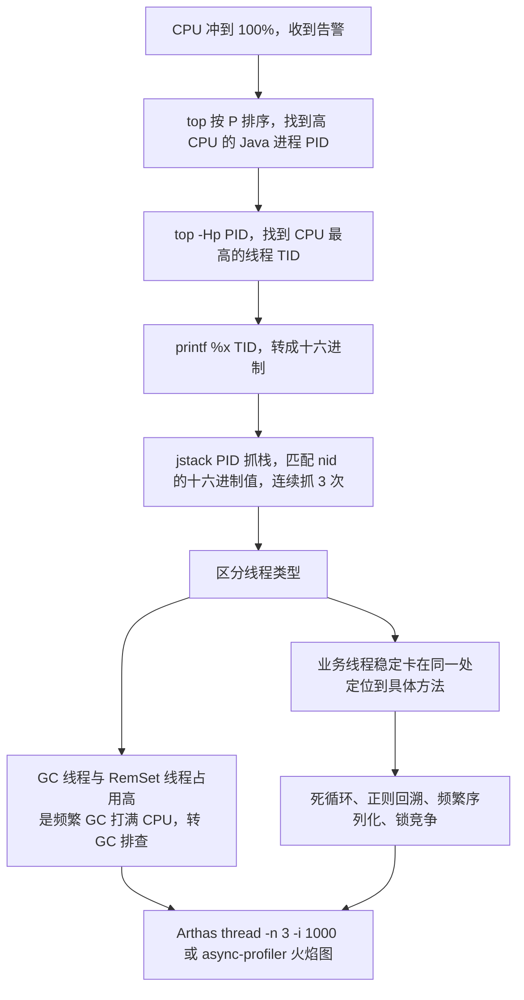

**企业实际处理**：
- **先止血再定位**：生产上优先 `kill -15`（优雅关闭）或摘流量 + 重启，**同时 `jstack` 连抓 3 次**留证据，事后复盘。切忌盲目重启丢失现场。
- **接入 APM / Arthas**：生产常驻 Arthas（或用 `arthas-boot` 临时挂载），OOM/CPU 问题可在线诊断。你简历里的**链路追踪 + 日志监控**正好用于佐证"我不只看机器，还看调用链"。
- **持久化证据**：`jstack` 输出重定向到文件、`top -Hp` 快照、火焰图，作为复盘材料。

**为什么这样做**：
- **因为"进程 → 线程 → 代码"是唯一能收敛的路径**：CPU 是进程级指标，真正占 CPU 的是线程，只有把线程栈和业务代码对上，才能从"机器慢"落到"这一行代码有问题"。跳步（比如直接看日志）会绕远路。
- **因为"多抓几次"是排除采样的偶然性**：一次 `jstack` 可能刚好抓到线程在安全点/IO 等待，连续采样能确认"是否稳定卡在这里"，否则容易误判。
- **因为"区分 GC 线程和业务线程"决定了排查方向**：GC 导致的 CPU 高要去调堆/查泄漏，业务代码导致的 CPU 高要改代码，方向错了所有努力都是浪费。

**企业级代码示例**（📦 按 JDK 17 书写、未实测）：一段真实可复现的 CPU 打满 + 定位命令

```java
public class CpuHighDemo {
    // 反面教材：无 sleep 的死循环，会把单核 CPU 打满
    static void spin() {
        long i = 0;
        while (true) {
            i = i * 31 + 1;
            if (i == Long.MIN_VALUE) System.out.println("never"); // 永不成立的出口
        }
    }

    public static void main(String[] args) {
        new Thread(CpuHighDemo::spin, "busy-thread-1").start();
        new Thread(CpuHighDemo::spin, "busy-thread-2").start();
    }
}
```

```bash
# 定位四步（Linux）
top -Hp $(pgrep -f CpuHighDemo)            # 1. 找高 CPU 线程 TID
printf '%x\n' <TID>                        # 2. 转十六进制
jstack $(pgrep -f CpuHighDemo) | grep -A 30 'nid=0x<hex>'   # 3. 抓栈
# 4. 连续抓 3 次，确认稳定在同一处 -> 定位到 CpuHighDemo.spin

# Arthas 一条命令到位
thread -n 3 -i 1000
```

**面试加分项**：
- 主动说 **`sy` 高（系统态）vs `us` 高（用户态）** 的区分：`us` 高是计算密集/GC，`sy` 高是系统调用多/上下文切换频繁/锁竞争。`vmstat 1` 看 `cs`（上下文切换）、`in`（中断）。
- 提 **Safepoint 导致"没 CPU 却卡住"**：`-Xlog:safepoint`（JDK 9+）看 `Time to Safepoint`，长循环无 safepoint 会拖长 STW。
- 说 **火焰图（`async-profiler` + `flamegraph.pl`）** 是定位热点方法的终极武器，能采样 CPU/内存/锁三个维度，比 `jstack` 更精确（`jstack` 只能看瞬时快照）。

---

### <a id="q11"></a>题 11：内存泄漏和 OOM 怎么排查？

- **题干**：「服务跑几天就 OOM 重启一次，怎么查？你手上有什么工具？Heap Dump 怎么分析？」
- **考察点**：OOM 类型识别 + Dump 获取 + MAT 分析 + 常见泄漏模式。

**标准答案**：
1. **先分清 OOM 类型**（不同 OOM 语义完全不同，方向不能错）：
   - `java.lang.OutOfMemoryError: Java heap space` → 堆内存不足（泄漏或大对象/峰值）。
   - `java.lang.OutOfMemoryError: GC overhead limit exceeded` → GC 占比超 98%、回收不足 2%，JVM 主动抛（本质是堆问题，但用户代码可能没崩逻辑）。
   - `java.lang.OutOfMemoryError: Metaspace` → 元空间溢出（动态类、热部署、CGLIB 代理）。
   - `java.lang.OutOfMemoryError: Direct buffer memory` → 直接内存不足（Netty、NIO）。
   - `java.lang.OutOfMemoryError: unable to create native thread` → 线程数超限（`-Xss` 太大、线程泄漏、系统 ulimit）。
   - `java.lang.OutOfMemoryError: Requested array size exceeds VM limit` → 数组长度超过 `Integer.MAX_VALUE` 附近限制。
2. **Heap Dump 获取方式**：
   - **事前配置（最重要）**：`-XX:+HeapDumpOnOutOfMemoryError -XX:HeapDumpPath=/opt/dump`，OOM 时自动落盘。
   - **事后手动**：`jmap -dump:live,format=b,file=/opt/dump/heap.hprof <pid>`（`live` 只 dump 存活对象，更小更快）。注意 **`jmap -dump` 会 STW**，大堆会停几秒到几十秒，生产慎用/低峰使用。
   - **Arthas**：`heapdump /opt/dump/heap.hprof`。
   - **`jcmd <pid> GC.heap_dump /opt/dump/heap.hprof`**（JDK 7+ 推荐，比 `jmap` 更稳）。
3. **MAT（Memory Analyzer Tool）分析流程**：
   - **Leak Suspects（泄漏嫌疑报告）**：自动分析出占内存最大的对象及其引用链，**最先看这个**。
   - **Histogram（直方图）**：按类统计对象数量和占用，看哪个类的实例异常多（如 `char[]`、`HashMap$Node`、自定义 DTO）。
   - **Dominator Tree（支配树）**：按"谁独占的内存最多"排序，比 Histogram 更精准地定位大对象持有者。
   - **Path to GC Roots（排除弱引用/软引用）**：看这个对象**为什么没被回收**——引用链一路往上追，通常能追到某个静态集合、ThreadLocal、监听器、连接池。
4. **常见泄漏模式**（背熟，排查时直接对照）：
   - **静态集合无界增长**：`static Map` / `static List` 当缓存，只 put 不 remove。
   - **ThreadLocal 未 remove**（线程池场景，见 Q3）。
   - **连接/流未关闭**：`Connection`、`InputStream` 未在 finally/try-with-resources 关闭。
   - **监听器/回调未注销**：`addListener` 后未 `removeListener`，注册中心/MQ 客户端高发。
   - **缓存框架无上限**：`Caffeine`/`Guava Cache` 未设 `maximumSize` + `expireAfterWrite`。
   - **`ClassLoader` 泄漏**：热部署、动态代理类不断生成（元空间泄漏）。
   - **大对象缓存**：把整张表/全量指标一次性加载进内存。
   - **`equals`/`hashCode` 实现不当**：`HashMap` 中对象无法被正确查询，只能增不能删。
5. **快速判断"是泄漏还是峰值不足"**：用 `jstat -gc <pid> 1000 10` 观察 —— 若**每次 Full GC 后老年代都不下降**，是泄漏；若下降但很快又涨满，是峰值不足（加大堆或优化分配）。

**图 1-14：OOM 与内存泄漏排查决策树**

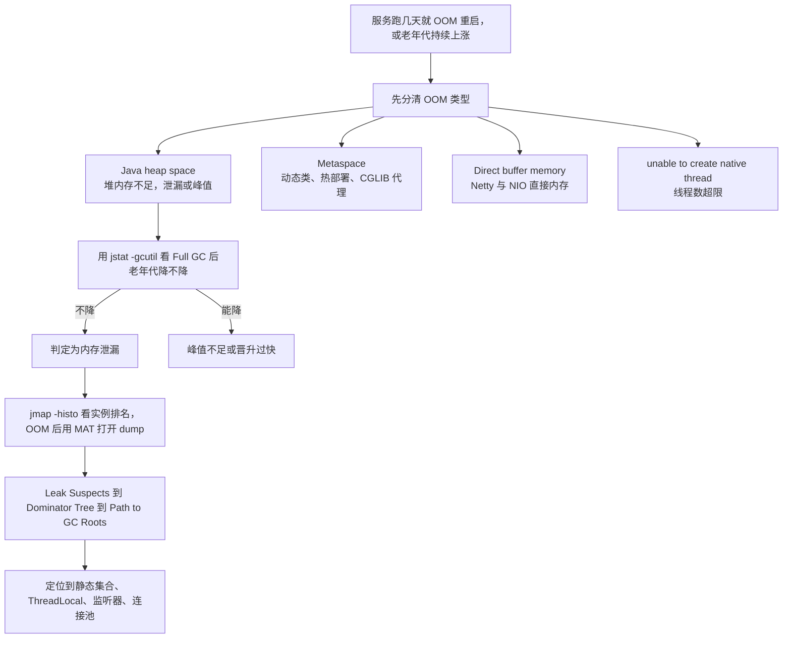

**企业实际处理**：
- **生产必开 `HeapDumpOnOutOfMemoryError`**，并把 dump 目录挂载到宿主机/对象存储（容器重启不丢）。
- **dump 文件可能几个 GB，必须压缩传输**（`gzip`），MAT 分析时给足内存（`MAT` 自身的 `MemoryAnalyzer.ini` 里 `-Xmx` 要大于 dump 大小）。
- **排查顺序**：`jstat` 看趋势 → `jmap -histo:live <pid> | head -30` 快速看排名（**注意 `-histo:live` 会触发一次 Full GC 且 STW**，慎用）→ 需要细节再 dump + MAT。
- **修复后必须回归验证**：同样的压测流量跑若干小时，看老年代曲线是否平稳。

**为什么这样做**：
- **因为 OOM 类型是最省事的"免费诊断信息"**：`Metaspace` 和 `Java heap space` 的修复路径完全不同，读到类型就能砍掉一半排查工作。很多人只记"OOM"一个词，白白浪费这条线索。
- **因为"Path to GC Roots"才是泄漏排查的杀手锏**：Histogram 只告诉你"什么对象多"，Dominator Tree/Path to GC Roots 才告诉你"**为什么它死不掉**"。泄漏的本质不是对象大，而是**引用链没断**。
- **因为"堆转储要花 STW 代价"决定了工具选择时机**：`jmap -dump` 会暂停整个应用，在生产上意味着一次真实的可用性抖动，所以必须低峰执行、优先靠事前的 `HeapDumpOnOutOfMemoryError`。

**企业级代码示例**（📦 按 JDK 17 书写、未实测）：一个典型的静态集合泄漏 + 定位命令

```java
import java.util.HashMap;
import java.util.Map;

public class LeakDemo {
    // 泄漏根源：静态 Map 当缓存，只增不减，且 key 是业务对象
    private static final Map<String, byte[]> CACHE = new HashMap<>();

    // 模拟"监听器未注销"导致的引用堆积：注册中心/配置中心回调常见
    private static final java.util.List<Object> LISTENERS = new java.util.ArrayList<>();

    public static void main(String[] args) throws Exception {
        // 运行参数：-Xms64m -Xmx64m -XX:+HeapDumpOnOutOfMemoryError
        //           -XX:HeapDumpPath=/opt/dump -Xlog:gc*
        long n = 0;
        while (true) {
            String key = "rule-" + (n % 1_000_000);   // key 不断变化，旧 key 永远留着
            CACHE.put(key, new byte[1024 * 512]);      // 每次 512KB，很快 OOM
            LISTENERS.add(new Object());               // 只注册不注销
            if (++n % 100 == 0) {
                System.out.println("已写入 " + n + " 条, cacheSize=" + CACHE.size());
            }
            Thread.sleep(1);
        }
    }
}
```

```bash
# 定位命令序列
jstat -gcutil $(pgrep -f LeakDemo) 1000 10      # 1. 看 Full GC 后 O 列是否下降
jmap -histo:live $(pgrep -f LeakDemo) | head -30 # 2. 看哪些类实例数异常（注意 STW）
# 3. OOM 后拿 /opt/dump/*.hprof 用 MAT 打开 -> Leak Suspects -> Path to GC Roots
# 4. 修复：CACHE 换成带 maximumSize/expireAfterWrite 的 Caffeine
```

**面试加分项**：
- 说清 **`-histo:live` 与 `-histo` 的区别**：前者触发 Full GC 只统计存活对象（准确但 STW），后者直接统计（快但包含待回收对象）。
- 提 **堆外内存泄漏的排查手段**：`jcmd <pid> VM.native_memory summary`（需 `-XX:NativeMemoryTracking=summary`，有 5%~10% 性能开销）、`pmap -x <pid>`、`gdb` dump 分析，因为**直接内存泄漏用 `jmap` 完全看不出来**。
- 主动说 **`OutOfMemoryError` 是可以被 `catch` 的**（`Throwable` 子类），但**捕获后往往无法恢复**，正确做法是记录现场 + 优雅退出，靠 K8s `restartPolicy` 重启。

---

### <a id="q12"></a>题 12：容器里 JVM 堆没满却被 OOMKilled，怎么回事？

- **题干**：「你们服务 Docker 化之后，有个 Pod 老是重启，`kubectl describe` 显示 `OOMKilled`，但你看 JVM 堆监控才用了 50%。这是怎么回事？怎么解决？」
- **考察点**：容器资源可见性（cgroup）+ JVM 堆外内存 + K8s 内存 limit 与堆参数的协同。

**标准答案**：
1. **先分清两个 OOM**：
   - **JVM OOM**：`OutOfMemoryError`，由 JVM 自己抛，堆内不足。
   - **容器 OOMKilled**：**由 Linux cgroup 内存超限后内核的 OOM Killer 杀进程**，进程退出码 **137**（128 + SIGKILL(9)）。**这不是 JVM 报的错**，JVM 甚至来不及打印任何日志。这是理解本题的关键分水岭。
2. **为什么会发生**：**JVM 的内存占用 ≠ 堆占用**。一个 Java 进程的总内存包括：
   - **堆（`-Xmx`）**
   - **元空间（Metaspace）** + **Code Cache**（JIT 机器码）
   - **线程栈**（`-Xss` × 线程数，线程多时很可观）
   - **直接内存（Direct Memory）**（Netty/NIO）
   - **GC 自身的辅助结构**（如 G1 的 RSet/卡表，可达堆的 10%）
   - **JVM 自身开销**（JVM 内部数据结构、JNI、JIT 编译缓冲）
   - 经验上**总内存 ≈ 堆 × 1.3 ~ 1.5**（视应用而定）。
3. **JDK 8 早期版本的坑（核心考点）**：**JDK 8u131 之前，JVM 不感知 cgroup 限制**，默认堆按**宿主机物理内存**计算（默认最大堆 = 物理内存的 1/4）。容器 limit 设 2GB，宿主机 64GB → JVM 默认堆能开到 16GB，**远超容器 limit，必然被 OOMKilled**。
4. **解决方案**：
   - **JDK 8u131 ~ 8u190（实验性）**：`-XX:+UnlockExperimentalVMOptions -XX:+UseCGroupMemoryLimitForHeap`。
   - **JDK 8u191+ / JDK 10+**：`-XX:+UseContainerSupport` **默认开启**（8u191 回移到 JDK 8），JVM 自动读取 cgroup 限制，默认最大堆 = **容器 limit 的 1/4**（`-XX:MaxRAMPercentage`，**默认 25%**）。
   - **推荐做法**：显式指定 `-XX:MaxRAMPercentage=70.0 -XX:InitialRAMPercentage=70.0`（或直接写死 `-Xmx`），**把 `-Xmx` 设为容器 limit 的 60%~75%**，剩下 25%~40% 留给堆外。
   - **同时用 `-XX:MaxDirectMemorySize`** 给直接内存设上限，避免堆外无界增长。
   - **K8s 侧**：`resources.limits.memory` 和 `requests.memory` 设合理值，**limit 不能等于 `-Xmx`**（这是最常见的错误配置）。

**企业实际处理**：
- **容器 JVM 参数模板**（基于你的 Docker + Jenkins 流水线场景）：
  ```
  -XX:+UseContainerSupport
  -XX:MaxRAMPercentage=70.0
  -XX:InitialRAMPercentage=70.0
  -XX:MaxMetaspaceSize=256m
  -XX:MaxDirectMemorySize=256m
  -XX:+HeapDumpOnOutOfMemoryError
  -XX:HeapDumpPath=/opt/dump
  ```
- **K8s `resources.limits.memory: 2Gi` 时，`-Xmx` 设 1.4G 左右**，留 600M 给堆外 + 系统。**不要设 2Gi**。
- **调整 `restartPolicy` 和探针**：`livenessProbe` 别太激进（启动慢的服务容易被误杀，和 OOMKilled 混在一起难以区分）。
- **监控要区分指标**：Pod 的 `container_memory_working_set_bytes`（含堆外）vs JVM 的 `jvm_memory_used_bytes`（只有堆内）。**只看后者会漏掉堆外**——这是本题监控"堆才 50%"却仍被杀的直接原因。
- **给 dump 目录挂 emptyDir/PVC**，容器被杀后 dump 还在，否则证据随容器一起消失。

**为什么这样做**：
- **因为 cgroup 和 JVM 是两套独立的内存记账**：Linux cgroup 只管进程的 RSS/working set，不管这块内存是堆、是栈还是直接内存。JVM 的堆参数只约束堆，堆外它管不着。理解"两套账本"才能解释为什么堆healthy但进程被杀。
- **因为 `-Xmx` 与 limit 相等是"零容错配置"**：堆内存加上任何一点堆外开销（JIT 编译、GC 结构、线程栈）都会越过 limit。给堆外留余量不是浪费，是把不可预测的 OOMKilled 换成可预测的内存余量。
- **因为 JDK 版本决定了"要不要手动配"**：8u191/10 之后 `UseContainerSupport` 默认开，很多人还在抄 8u131 时代的 `UseCGroupMemoryLimitForHeap`（这个参数在 JDK 11+ 已被移除，写了会直接启动失败），版本知识直接影响配置正确性。

**企业级代码示例**（📦 按 JDK 17 书写、未实测）：K8s Deployment 的 JVM 容器配置

```yaml
# 📦 按 JDK 17 通用镜像书写、未实测；核心是 limit 与 MaxRAMPercentage 的配比
apiVersion: apps/v1
kind: Deployment
metadata:
  name: risk-warning-service
spec:
  template:
    spec:
      containers:
        - name: app
          image: registry/risk-warning:1.0.0
          resources:
            requests:
              memory: "1536Mi"
              cpu: "1000m"
            limits:
              memory: "2Gi"        # 容器内存上限
              cpu: "2000m"
          env:
            - name: JAVA_TOOL_OPTIONS
              value: >-
                -XX:+UseContainerSupport
                -XX:MaxRAMPercentage=70.0
                -XX:InitialRAMPercentage=70.0
                -XX:MaxMetaspaceSize=256m
                -XX:MaxDirectMemorySize=256m
                -XX:+UseG1GC
                -XX:MaxGCPauseMillis=100
                -XX:+HeapDumpOnOutOfMemoryError
                -XX:HeapDumpPath=/opt/dump
          volumeMounts:
            - name: dump
              mountPath: /opt/dump
      volumes:
        - name: dump
          emptyDir: { }
```

```bash
# 排查 OOMKilled 的命令
kubectl describe pod <pod> | grep -A 5 'Last State'   # 看 Reason: OOMKilled / Exit Code: 137
kubectl top pod <pod>                                  # 看实际内存使用
# 进容器看 JVM 实际参数（容器感知是否生效）
java -XX:+PrintFlagsFinal -version 2>/dev/null | grep -Ei 'MaxHeapSize|MaxRAMPercentage|UseContainerSupport'
```

**面试加分项**：
- 主动说 **exit code 137 = 128 + 9（SIGKILL）**，且 **OOMKilled 时 JVM 来不及打 Heap Dump**（内核直接 kill），所以排查要靠 cgroup 内存曲线而不是 JVM 日志。
- 提 **`-XX:+AlwaysPreTouch`** 在容器里的作用与代价：启动时就把堆内存全部 commit，避免运行中缺页导致的内存爬升，但启动变慢、且会立刻占满 `MaxRAMPercentage` 声明的内存（对 limit 敏感的容器要谨慎）。
- 说清 **CPU limit 也会影响 JVM**：JDK 10+ 的 `UseContainerSupport` 也感知 cgroup 的 CPU 配额来设置 `ParallelGCThreads` 和 `CICompilerCount`，CPU limit 低会导致 GC 线程数少、JIT 编译慢，都可能是"Pod 性能差"的间接原因。

---

### <a id="q13"></a>题 13：频繁 Full GC 怎么定位根因？

- **题干**：「你的期权风控实时预警，规则计算要求秒级甚至毫秒级。如果这时候频繁 Full GC，STW 把延迟打爆了，你怎么定位、怎么解决？」
- **考察点**：频繁 Full GC 的诊断路径 + 场景化权衡 + 业务级优化。

**标准答案**：
1. **先量化现状**（不看数据不谈调优）：
   - `jstat -gcutil <pid> 1000 10`：看 **FGC 次数增长速率**、**FGCT（Full GC 总耗时）**、**O（老年代使用率）**。
   - `-Xlog:gc*`（JDK 9+）或 `-XX:+PrintGCDetails`（JDK 8）：看 Full GC 的**触发原因**。
   - 监控侧：`jvm_gc_pause_seconds` 的 **P99 停顿**、GC 频率趋势。
2. **按触发原因分流处理**（见 Q8 的诊断树，此处收敛为三条主线）：
   - **主线 A：对象泄漏**（Full GC 后老年代不降）→ `jmap`/MAT 找引用链，修代码。
   - **主线 B：对象晋升过快 / 老年代容量不足**（Full GC 后能降，但很快又满）→ 调新生代大小、查大对象、查缓存上限。
   - **主线 C：元空间/显式 GC/并发失败** → 查动态类、查 `System.gc()` 调用点、G1 看 `To-space Exhausted`。
3. **针对"实时预警 + 毫秒级 SLA"的专项优化**（业务级，不止 JVM 参数）：
   - **消灭 Full GC，而不是减少它**：Full GC 是秒级 STW 的元凶，毫秒级 SLA 下必须把它压到 0。手段依次是：**修代码（减少长命对象/大对象）→ 加大堆 + 加大新生代（让短命对象死在新生代）→ 换收集器（G1 调 `MaxGCPauseMillis`）→ 极端场景上 ZGC**。
   - **预警规则计算的对象治理**：规则全量加载改成**按需/分片加载**；计算中间结果别用大 `Map` 常驻；指标聚合用**流式/滑动窗口**（如 Caffeine + 有界队列）替代全量快照。
   - **把"计算"从"存储"里分离**：把大对象（如历史 K 线、全量订单快照）放到堆外/Redis/ADB，JVM 堆里只放热数据。**堆是用来做计算的，不是用来做存储的**——这条原则对低延迟服务尤其重要。
   - **削峰**：预警任务用**有界队列 + 批量处理**，避免瞬时洪峰把对象创建速率推高。队列要有界（`ThreadPoolExecutor` 有界队列 + 拒绝策略），无界队列本身就是一个内存泄漏源。
4. **验证闭环**：在压测环境复现目标 QPS，注入相同数据量，对比调优前后的 Full GC 次数、STW 最大值、P99 延迟。**没有前后对比数据的调优等于没做**。

**企业实际处理**：
- **JDK 8 + CMS 的老预警服务**：配 `-XX:CMSInitiatingOccupancyFraction=70 -XX:+UseCMSInitiatingOccupancyOnly`，加 `-XX:+ExplicitGCInvokesConcurrent`，但**根本上应升级到 JDK 17 + G1/ZGC**（CMS 已在 JDK 14 移除）。
- **JDK 17 + G1**：`-XX:MaxGCPauseMillis=50` + `-XX:InitiatingHeapOccupancyPercent=35` + 加大堆（如 8G），观察 `To-space Exhausted` 是否消失。
- **超低延迟**：JDK 17 评估 ZGC（`-XX:+UseZGC`），或 JDK 21 分代 ZGC，STW 可控在 1ms 级（代价是吞吐下降、CPU 开销增加）。
- **预警延迟 SLA 的最后保险**：把"规则计算"和"结果落库/发通知"解耦（异步），让 GC 抖动不影响关键路径的最小延迟。

**为什么这样做**：
- **因为 Full GC 的 STW 时长与"存活对象数量"成正比，不是与堆大小成正比**：堆越大，存活对象越多，Full GC 越慢。所以"加大堆"能降低 Full GC 频率但会让单次 Full GC 更痛——这是低延迟服务最反直觉的权衡，也是为什么要**优先消灭 Full GC 而不是稀释它**。
- **因为低延迟场景下 P99 比平均值重要**：一次 800ms 的 Full GC 会把 P99 直接打到秒级，平均值毫无意义。所以调优目标要定成"**最大停顿**"指标（`MaxGCPauseMillis` 就是为这个设计的），而不是"平均 GC 时间"。
- **因为对象治理的收益远大于参数调整**：把"每轮计算 new 出 100 万个临时对象"改成"复用对象池/流式聚合"，垃圾产生速率直接降一个数量级，这是参数永远做不到的。

**企业级代码示例**（📦 按 JDK 17 书写、未实测）：预警规则计算的"低频垃圾"写法对比

```java
import com.github.benmanes.caffeine.cache.Cache;
import com.github.benmanes.caffeine.cache.Caffeine;
import java.time.Duration;
import java.util.HashMap;
import java.util.Map;

public class WarningRuleMemory {

    // 有界缓存：替代 static HashMap 无界增长，避免对象越堆越多
    private static final Cache<String, RuleResult> RULE_CACHE = Caffeine.newBuilder()
            .maximumSize(100_000)                       // 有界
            .expireAfterWrite(Duration.ofMinutes(5))    // 过期
            .build();

    static class RuleResult {
        String ruleId;
        boolean hit;
        double value;
    }

    // 反面：每个预警周期 new 一个大 Map 承接全量规则结果 -> 高频大对象垃圾
    public Map<String, RuleResult> badRunAllRules(java.util.List<String> ruleIds) {
        Map<String, RuleResult> all = new HashMap<>(ruleIds.size() * 2); // 预估容量，避免扩容
        for (String id : ruleIds) {
            RuleResult r = new RuleResult();
            r.ruleId = id;
            all.put(id, r);
        }
        return all; // 该 Map 生命周期短，但体量可能很大 -> 频繁 Young GC / 提前晋升
    }

    // 正解：流式处理 + 有界缓存，只保留热结果，避免全量常驻
    public void goodRunRulesStreaming(java.util.List<String> ruleIds) {
        for (String id : ruleIds) {
            RuleResult r = RULE_CACHE.getIfPresent(id);
            if (r == null) {
                r = computeRule(id);
                RULE_CACHE.put(id, r);   // 有界淘汰，不会无限增长
            }
            if (r.hit) {
                emitWarning(r);          // 命中即发，不聚合全量
            }
        }
    }

    private RuleResult computeRule(String id) { RuleResult r = new RuleResult(); r.ruleId = id; return r; }
    private void emitWarning(RuleResult r) { /* 推送预警 */ }
}
```

**面试加分项**：
- 提 **"对象池"在低延迟场景的价值与风险**：`ThreadLocal` 复用缓冲区、Netty `ByteBuf` 池化能显著降 GC，但**池化对象如果被泄漏（忘记归还）会变成新的内存泄漏**，是一把双刃剑。
- 说清 **`-XX:+DisableExplicitGC` 的副作用**：它屏蔽所有 `System.gc()`，包括 NIO 依赖的显式回收路径，可能导致**直接内存泄漏**，正确姿势是 `-XX:+ExplicitGCInvokesConcurrent`（把显式 GC 转成并发 GC）。
- 主动提 **JDK 21 分代 ZGC（`-XX:+ZGenerational`）**：把 ZGC 的吞吐短板补上，是超低延迟服务当前的最优解候选（能说出版本演进说明你在追前沿）。

---

### <a id="q14"></a>题 14：JVM 调优参数你是怎么写进生产环境的？

- **题干**：「你说做过压测调优。那你们生产的 JVM 参数是怎么定的？是抄的还是算的？改参数的流程是什么？」
- **考察点**：参数体系理解 + 调优方法论 + 工程化落地（容器/流水线）。

**标准答案**：
1. **核心参数体系**（必须能说出每个参数的作用与取值依据）：

   | 参数 | 作用 | 常用值 / 默认 | 版本注意 |
   |---|---|---|---|
   | `-Xms` / `-Xmx` | 堆初始/最大 | 设成**相等**（避免动态扩容抖动） | 通用 |
   | `-Xmn` / `-XX:NewRatio` | 新生代大小 | NewRatio 默认 2（老:新=2:1） | **G1 下 `-Xmn` 不生效** |
   | `-XX:SurvivorRatio` | Eden:Survivor | 默认 8（8:1:1） | 通用 |
   | `-Xss` | 单线程栈大小 | 默认 512KB~1MB（视平台/版本） | 线程数多时是内存大头 |
   | `-XX:MaxTenuringThreshold` | 晋升年龄 | 默认 15（CMS 默认 6） | 通用 |
   | `-XX:MetaspaceSize` | 元空间首次 GC 阈值 | 约 21MB（视版本） | JDK 8+ |
   | `-XX:MaxMetaspaceSize` | 元空间上限 | **必须设**，如 256m | JDK 8+ 替代 PermSize |
   | `-XX:MaxDirectMemorySize` | 直接内存上限 | 按需，如 256m | NIO/Netty 场景必设 |
   | `-XX:MaxGCPauseMillis` | G1 目标停顿 | 默认 200ms | G1 专用 |
   | `-XX:InitiatingHeapOccupancyPercent` | G1 并发标记触发 | 默认 45% | G1 专用 |
   | `-XX:ParallelGCThreads` | 并行 GC 线程数 | 按 CPU 核数 | 容器下受 CPU limit 影响 |
   | `-XX:MaxRAMPercentage` | 容器最大堆占比 | 默认 25% | JDK 10+ / 8u191+ |
   | `-XX:+HeapDumpOnOutOfMemoryError` | OOM 自动 dump | **生产必开** | 通用 |
   | `-XX:+ExplicitGCInvokesConcurrent` | System.gc() 并发化 | 常开 | 配合 CMS/G1 |
   | `-XX:+AlwaysPreTouch` | 启动时 commit 全部堆 | 视场景 | 启动慢但运行稳 |

**图 1-15：JVM 调优参数与目标映射关系**

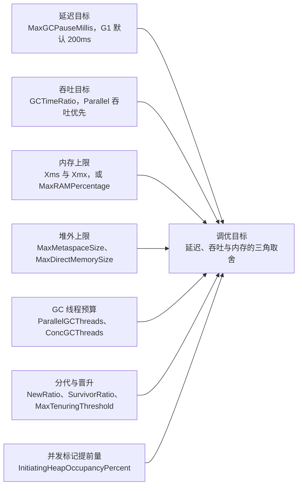

2. **调优方法论（四步）**：
   - **第 1 步：定目标**。吞吐型（批处理）看**吞吐量**，延迟型（实时预警）看 **P99/最大停顿**。目标不同，参数方向相反。
   - **第 2 步：压测基线**。用真实流量模型（不是 `ab` 打静态页）压出**基线数据**：GC 频率、停顿分布、老年代增长速率、TPS、P99。
   - **第 3 步：单变量调整 + 复测**。**一次只改一个参数**，记录前后对比，避免"改了一堆参数不知道哪个起作用"。优先改代码，其次改堆/新生代，最后才动收集器。
   - **第 4 步：灰度上线 + 持续监控**。先在灰度/一组机器上跑，观察 24h+，再做全量。
3. **参数写在哪**：
   - **不要硬编码在 Dockerfile 的 `ENTRYPOINT` 里**（改参数要重新构建镜像）。
   - **推荐用环境变量 `JAVA_TOOL_OPTIONS` / `_JAVA_OPTIONS`**（容器化最佳实践，改参数不用重新打镜像），或用 `JAVA_OPTS` 由启动脚本注入。
   - **配合 Apollo 之类的配置中心**：部分业务参数（线程池大小、队列长度）可以动态调整，但**纯 JVM 参数（堆大小、收集器）需要重启生效**，不能指望配置中心动态改 `-Xmx`（除非用 `jinfo -flag` 在线改，但**只有部分 flag 是 manageable 的**，且生产慎用）。
   - **Jenkins 流水线里固化为参数文件**（你的 Docker+Jenkins 场景），把 JVM 参数做成模板变量，不同环境（dev/test/prod）注入不同值。

**企业实际处理**：
- **建立"参数基线 + 变更记录"**：每个服务的 JVM 参数、GC 收集器、堆大小写进文档/配置仓库，改动有记录、有复测报告。
- **"改参数"要走评审**：JVM 参数影响可用性，不能随手改，尤其在容器里改了 `-Xmx` 要同步校核 K8s limit。
- **上生产前先在压测环境跑满目标流量**：验证 GC 停顿、Full GC 次数、OOM 兜底都符合预期。
- **监控告警配套**：GC 停顿 P99、Full GC 次数（>0 就该告警）、堆使用率、元空间使用率，缺一不可。

**为什么这样做**：
- **因为调优是"约束求解"不是"参数堆砌"**：`-Xmx` 定的是资源上限，`MaxGCPauseMillis` 定的是延迟目标，`ParallelGCThreads` 定的是 CPU 预算——它们互相约束（想低延迟就得多花 CPU 和内存）。不理解约束关系，就会配出"堆很大、新生代很小、停顿目标 50ms、GC 线程还只给 2 个"这种自相矛盾的参数。
- **因为"一次只改一个变量"是实验设计的基本原则**：JVM 参数相互影响（改 `NewRatio` 会改变 `MaxTenuringThreshold` 的实际效果），同时改多个参数无法归因，调优就变成了"玄学"，下次出问题还是不会。
- **因为参数外置（环境变量/配置）是工程效率问题**：镜像里硬编码参数意味着每次调优都要走一次完整 CI/CD（你简历里从 4 小时压到 15 分钟的发布流程，更不该被"改个堆大小"重新浪费一遍）。

**企业级代码示例**（📦 按 JDK 17 书写、未实测）：一套可参数化、分环境的 JVM 启动配置

```bash
#!/usr/bin/env bash
# 📦 按 JDK 17 书写、未实测；演示参数外置 + 环境差异化
set -euo pipefail

# ---- 公共基线（所有环境一致）----
BASE_OPTS="
-XX:+UseG1GC
-XX:MaxGCPauseMillis=100
-XX:+HeapDumpOnOutOfMemoryError
-XX:HeapDumpPath=/opt/dump
-Xlog:gc*:file=/opt/logs/gc.log:time,uptime,level,tags:filecount=10,filesize=100m
-XX:+ExplicitGCInvokesConcurrent
-Djava.security.egd=file:/dev/./urandom
"

# ---- 环境差异化（容器下用 MaxRAMPercentage，不用写死 -Xmx）----
case "${ENV:-prod}" in
  dev)
    ENV_OPTS="-XX:MaxRAMPercentage=50.0 -XX:MaxMetaspaceSize=256m" ;;
  test)
    ENV_OPTS="-XX:MaxRAMPercentage=65.0 -XX:MaxMetaspaceSize=256m -XX:MaxDirectMemorySize=256m" ;;
  prod)
    # 容器 limit 2Gi 时，70% 约 1.4G 堆，余量给堆外/元空间/线程栈
    ENV_OPTS="-XX:MaxRAMPercentage=70.0 -XX:InitialRAMPercentage=70.0 \
-XX:MaxMetaspaceSize=256m -XX:MaxDirectMemorySize=256m -XX:+AlwaysPreTouch" ;;
esac

# ---- 合并优先级：BASE < ENV < 运行时覆盖 ----
exec java ${BASE_OPTS} ${ENV_OPTS} ${JAVA_EXTRA_OPTS:-} -jar /opt/app/app.jar
```

```bash
# 在线查看生效参数（排查参数是否被覆盖）
jcmd <pid> VM.flags -all | grep -Ei 'MaxHeapSize|NewRatio|G1HeapRegionSize'
# 或
java -XX:+PrintFlagsFinal -version 2>/dev/null | grep -E 'MaxHeapSize|MaxRAMPercentage'
```

**面试加分项**：
- 说清 **`-Xms=-Xmx` 为什么是常规做法**：避免堆动态扩缩容带来的抖动和一次额外的 Full GC（扩容时也可能触发），且配合 `AlwaysPreTouch` 能提前把内存落实，运行更稳。**反面**是容器里设 `AlwaysPreTouch` 会立刻占满声明内存，需权衡。
- 提 **`jinfo -flag` 只能改 manageable 的 flag**（如 `PrintGCDetails` 之类的诊断参数），**堆大小、收集器选择不能在运行时改**，需要重启——这是"配置中心改 JVM 参数"的常见误解。
- 主动说 **参数调优的收益排序**：**代码优化 >> 堆/新生代布局 >> 收集器选型 >> 细节参数**。把这句话说出来，面试官会认为你有正确的调优优先级。

---

### <a id="q15"></a>题 15：一个 Java 对象占多少字节？容量怎么算？

- **题干**：「最后一个：如果一个对象大概占多少内存，你怎么算？如果我要缓存 100 万个这种对象，堆要开多大？」
- **考察点**：对象大小计算 + 内存布局应用 + 容量规划。

**标准答案**：
1. **计算规则**（64 位 HotSpot，**开启压缩指针**下）：
   - **对象头**：普通对象 **12 字节**（Mark Word 8 + Klass Pointer 4）；数组对象 **16 字节**（多 4 字节长度）。关闭压缩指针则分别是 16 / 20 → 补齐后 16 / 24。
   - **字段大小**：`boolean`/`byte` 1；`char`/`short` 2；`int`/`float` 4；`long`/`double` 8；**引用类型 4（压缩指针下）/ 8（未压缩）**。
   - **对齐填充**：对象总大小**必须是 8 的倍数**，不足补齐。数组元素之间不补齐，但数组整体长度要补齐。
2. **字段重排（Field Reordering）**：JVM 会**按宽度重排字段**（long/double 优先，同宽度放一起，父类字段在前），以减少 padding。**所以你不能简单地按代码书写顺序累加**。要精确知道，用 JOL（`ClassLayout.parseInstance(obj).toPrintable()`）。
3. **举例计算**（压缩指针下）：
   ```java
   class OrderEvent {
       long orderId;   // 8
       int status;     // 4
       String symbol;  // 4 (引用，压缩指针)
   }
   ```
   - 对象头 12 + long 8 + int 4 + 引用 4 = **28**，对齐到 8 的倍数 → **32 字节**。
   - 关闭压缩指针：16 + 8 + 4 + 8 = 36 → 对齐 → **40 字节**。
4. **容量规划示例**：缓存 **100 万个 `OrderEvent`**：
   - 对象本体：100 万 × 32B = **32MB**。
   - 但 `symbol` 引用指向的 `String` 对象才是大头！一个 `String` = String 对象（12 头 + `byte[]` 引用 4 + `int hash` 4 = 20 → 24B，压缩指针下）+ `byte[]` 数组（16 头 + 内容 + 对齐）。一个 10 字符的 String 大约 16 + 10 = 26 → **32B**。
   - 若 `symbol` 各不相同（无法复用常量池），则总内存 ≈ 100万 × (32 + 24 + 32) ≈ **88MB**（加上容器/Map 结构的开销还要更多）。
   - **结论：算对象大小不能只看类本身，必须递归算引用链。** 这也是"缓存大对象"容易 OOM 的原因。
5. **容器/集合的开销**（最容易漏算）：
   - `HashMap` 每个 `Node` 约 32B（对象头 12 + hash 4 + key 引用 4 + value 引用 4 + next 引用 4 = 28 → 32），**加上数组 `table` 本身**。装 100 万个 entry，光 Node 就 32MB。
   - `ArrayList` 的底层数组会有**容量冗余**（扩容 1.5 倍），实际占用可能比元素多 50%。
   - 一个经验值：**用 `HashMap` 缓存对象，实际内存 ≈ 对象大小 × 2 ~ 3 倍**。

**企业实际处理**：
- **不要手算，用 JOL 验证**：`ClassLayout.parseInstance()` 和 `GraphLayout.parseInstance()`（可算整个对象图，含引用链），避免手算漏项。
- **容量规划留 1.5~2 倍余量**：因为存在对象头、对齐、集合结构、以及"内存碎片和 GC 存活集合"的影响。
- **缓存必设上限**（`maximumSize` + `expireAfterWrite`），并用 JOL 算清单个 entry 的字节数反推 `maximumSize`，而不是拍脑袋设 100 万。
- **大对象（如全量快照）不要放堆**：放 Redis / ADB / 本地文件，堆里只留索引和热数据。这是你 ADB/Hologres 经验能自然衔接的点。

**为什么这样做**：
- **因为"对象大小"是缓存容量、GC 压力、容器内存三者之间的换算桥梁**：不算清对象大小，要么缓存设得过大把堆撑爆，要么设得过小命中率低。面试官问这个，是想验证你能不能把"内存"这个模糊概念变成可计算的数字。
- **因为"引用链递归"是容量估算最容易翻车的地方**：一个 `List<User>` 看起来只占"元素个数 × 引用大小"，实际每个 `User` 及其 `String` 字段都是独立对象。**知道要递归算，比算对具体数字更重要**。
- **因为对齐填充规则决定了"字段顺序也能影响内存"**：把 `int` 和 `long` 交错声明会多出 padding，而 JVM 的字段重排已经帮你做了优化（但不同 JVM 实现策略可能不同，视实现而定），所以最终还是要用 JOL 实测而不是推理。

**企业级代码示例**（📦 按 JDK 17 书写、未实测，需 `org.openjdk.jol:jol-core`）：算对象本体 + 对象图总大小

```java
import org.openjdk.jol.info.ClassLayout;
import org.openjdk.jol.info.GraphLayout;

public class ObjectSizeDemo {

    static class OrderEvent {
        long orderId;
        int status;
        String symbol;
        OrderEvent(long orderId, int status, String symbol) {
            this.orderId = orderId;
            this.status = status;
            this.symbol = symbol;
        }
    }

    public static void main(String[] args) {
        OrderEvent one = new OrderEvent(1L, 1, "AAPL240115C150");
        // 1) 单个对象本体大小（不含引用的对象）
        System.out.println(ClassLayout.parseInstance(one).toPrintable());
        System.out.println("对象本体字节数: " + ClassLayout.parseInstance(one).instanceSize());

        // 2) 整个对象图（含引用的 String / byte[] 递归）
        java.util.List<OrderEvent> list = new java.util.ArrayList<>();
        for (int i = 0; i < 1_000_000; i++) {
            list.add(new OrderEvent(i, i % 10, "SYM" + (i % 1000))); // 复用部分 symbol
        }
        GraphLayout graph = GraphLayout.parseInstance(list);
        System.out.println("100 万对象图总大小: " + graph.totalSize() + " 字节");
        System.out.println("平均每个 entry: " + (graph.totalSize() / 1_000_000) + " 字节");
        // 3) 打印支配对象，看大头在哪
        System.out.println(graph.toFootprint());
    }
}
```

**面试加分项**：
- 说清 **`-XX:+UseCompressedOops` 关闭后对象头从 12 → 16 字节**，且引用从 4 → 8，所以**同一个类在 32GB 以上堆里可能大 30%~50%**，这是"堆不是越大越好"的量化结论。
- 提 **数组元素的特殊处理**：`int[1000]` = 16（头）+ 4000 = 4016 → 对齐 → **4016**（已是 8 的倍数）；`long[1000]` = 16 + 8000 = 8016 → **8016**。数组不用管元素间填充。
- 主动说 **`String` 的内部结构随版本变化**：**JDK 9 起 `String` 底层从 `char[]` 改为 `byte[]` + `coder`（Compact Strings，JEP 254）**，拉丁字符场景内存直接减半。这个细节既体现版本敏感度，也直接改变容量估算结果。

## 一句话主线

> **JVM = 内存流水线 + 故障处置能力**：类从双亲委派进来，对象在 TLAB 里生出（头 12 字节、指针压缩、8 字节对齐），靠 GC Roots + 四种引用判死活，靠分代 + 收集器（JDK 8 默认 Parallel、JDK 9+ 默认 G1、超低延迟上 ZGC）清走，靠 JIT + 逃逸分析变快。面试真正考的是**出事时你会不会查**：CPU 100% 走 `top -Hp → jstack/Arthas`，OOM 走 `jstat → jmap/MAT → Path to GC Roots`，容器 OOMKilled 先分清是 cgroup 杀进程（exit 137）还是 JVM OOM，调优永远**先改代码、再调堆、后换收集器**，并且**堆不是越大越好（32GB 压缩指针边界）、limit 不等于 `-Xmx`**。

## 面试官深挖追问

1. **「为什么不用引用计数？」** → 循环引用无法回收 + 计数增减开销，主流 JVM 用可达性分析。
2. **「GC Roots 里"虚拟机栈中引用的对象"具体指什么？」** → 栈帧局部变量表中存放的引用类型变量所指向的对象，这是最大的一类 Root。
3. **「软引用和弱引用在缓存里怎么选？」** → 软引用（内存不足才回收）适合可回源的缓存；弱引用（下次 GC 必收）适合规范化映射/ThreadLocal，做业务缓存命中率不可控。
4. **「为什么堆开到 32GB 以上反而更慢？」** → 压缩指针失效，引用从 4B 变 8B，对象变大、缓存局部性变差，可用内存反而下降。
5. **「CMS 的并发标记为什么不会漏标？G1 为什么用 SATB？」** → CMS 用增量更新（记录新引用），G1 用原始快照 SATB（记录被覆盖的旧引用）；SATB 的代价是浮动垃圾，收益是避免重新扫描新生代。
6. **「G1 的 `-Xmn` 为什么没用？」** → G1 的 Region 是逻辑分代，没有物理连续的新生代，需用 `-XX:G1NewSizePercent` / `-XX:G1MaxNewSizePercent`。
7. **「ServiceLoader 为什么能加载到 classpath 下的实现类？」** → 用线程上下文类加载器（`Thread.currentThread().getContextClassLoader()`），以"父请求子"的方式打破双亲委派。
8. **「Tomcat 为什么要打破双亲委派？」** → 应用隔离（不同 webapp 不同 Jar 版本）和热部署（reload 时整个 ClassLoader 丢弃）。
9. **「JIT 的逃逸分析真的会把对象分配在栈上吗？」** → HotSpot 没有真正的栈上分配，是标量替换把对象拆散成标量放栈帧/寄存器。
10. **「CPU 100% 时 `jstack` 抓不到热点方法怎么办？」** → 用 Arthas `thread -n` 或 async-profiler 火焰图采样，`jstack` 只是瞬时快照，可能错过。
11. **「OOMKilled 时为什么没有 Heap Dump？」** → 那是内核 OOM Killer 发 SIGKILL 杀进程（exit 137），JVM 完全来不及响应，只能靠 cgroup 内存曲线排查。
12. **「配置中心能动态改 `-Xmx` 吗？」** → 不能。`jinfo -flag` 只支持 manageable 的 flag，堆大小/收集器选择必须重启生效。
13. **「元空间会 OOM 吗？什么场景？」** → 会。动态生成类（CGLIB、反射代理、热部署、脚本引擎）持续加载类而不卸载，Metaspace 持续增长直到 `MaxMetaspaceSize`。
14. **「Safepoint 是什么？和 GC 停顿有什么关系？」** → GC 需要所有线程到安全点才能开始，`Time to Safepoint` 也算 STW；长循环无 safepoint 会拖长停顿，`-Xlog:safepoint` 可观测。
