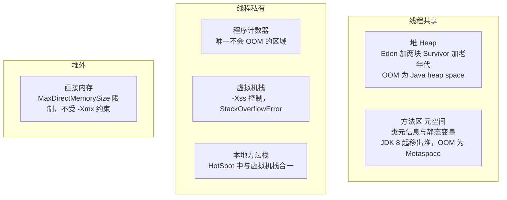
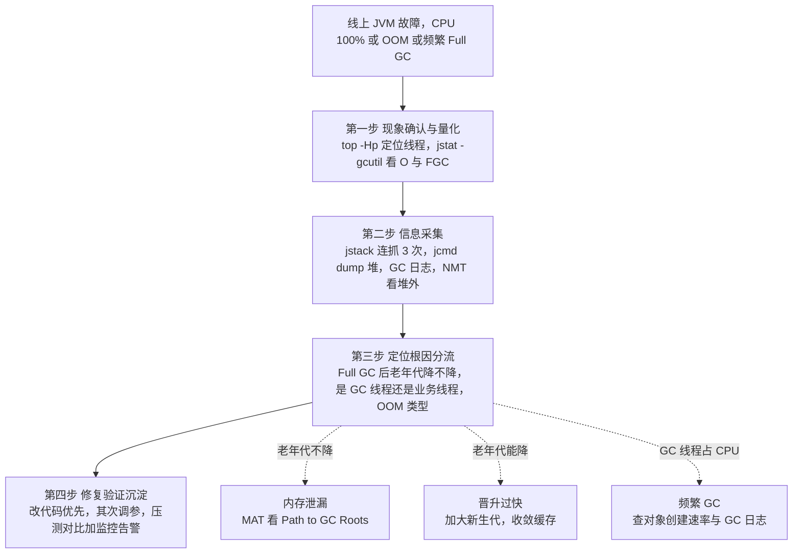

# 01 · JVM 速记版（考前 10 分钟扫一遍）

> **一句话主线**：JVM = **内存流水线 + 故障处置能力**。内存在哪儿（堆/栈/方法区/元空间/直接内存）→ 对象怎么生（TLAB、头 12B、指针压缩、8 字节对齐）→ 怎么判死（GC Roots + 四种引用）→ 怎么清走（分代 + 收集器：JDK 8 默认 Parallel、JDK 9+ 默认 G1、超低延迟 ZGC）→ 怎么变快（JIT + 逃逸分析）。**面试真正的分水岭是"出事会不会查"**：CPU 100% 走 `top -Hp → jstack/Arthas`，OOM 走 `jstat → jmap → MAT → Path to GC Roots`，容器 OOMKilled 先分清是 cgroup 杀进程（exit 137）不是 JVM OOM，调优顺序永远是**先改代码 → 再调堆 → 后换收集器**。

**图 1-16：JVM 内存结构总览**

## 基础（8 条）

| # | 面试题 | 关键词速答 |
|---|--------|-----------|
| 1 | JVM 运行时数据区有哪些？ | 程序计数器/虚拟机栈/本地方法栈/堆/方法区(元空间)/直接内存；**堆 + 方法区线程共享，其余私有；PC 寄存器是唯一不会 OOM 的区域** |
| 2 | 对象创建的过程？ | 类加载检查 → **分配内存（指针碰撞/空闲列表，TLAB 优先）→ 零值初始化 → 设对象头 → 执行 `<init>`** |
| 3 | 对象内存布局？ | **对象头（Mark Word 8B + Klass Pointer 4B 压缩下）+ 实例数据 + 对齐填充**；普通对象头 12B、数组 16B、总大小对齐到 8 的倍数 |
| 4 | 指针压缩是什么？ | `-XX:+UseCompressedOops`，**JDK 6u23+ 64 位默认开**；8 字节对齐 → 低 3 位可省 → 32 位表示 32GB，**堆超 32GB 自动失效** |
| 5 | TLAB 是什么？ | 线程私有的 Eden 分配缓冲区，默认开启、**默认占 Eden 1%**，避免分配时 CAS 竞争；用尽仍走 Eden + CAS |
| 6 | 怎么判断对象可回收？GC Roots 有哪些？ | **可达性分析**（不用引用计数，因为循环引用）；Roots = 虚拟机栈局部变量 / 静态变量 / 常量 / JNI 引用 / 同步锁持有的对象 / JVM 内部引用 |
| 7 | 四种引用？ | 强（OOM 也不收）/ 软（内存不足收，做缓存）/ 弱（下次 GC 必收，ThreadLocal、WeakHashMap）/ 虚（取不到对象，只做回收通知，如 Cleaner） |
| 8 | 类加载流程与双亲委派？ | 加载→验证→**准备(静态变量设零值，final 常量直接赋值)**→解析→初始化；双亲委派：**先委托父加载器**，Bootstrap→Platform→Application，保证安全 + 类唯一 |

## 进阶（8 条）

| # | 面试题 | 关键词速答 |
|---|--------|-----------|
| 9 | GC 三种基础算法？ | 标记-清除（有碎片）/ 复制（新生代，浪费一半空间）/ 标记-整理（老年代，无碎片但移动成本高）；分代假说：**大部分对象朝生夕灭** |
| 10 | 对象什么时候晋升老年代？ | **年龄达 `MaxTenuringThreshold`(默认 15、CMS 6）**；动态年龄判定（同龄总和 > Survivor 一半）；大对象直接进老年代；Survivor 不足 + 分配担保 |
| 11 | 打破双亲委派的场景？ | **SPI（JDBC/ServiceLoader 用线程上下文类加载器）**；Tomcat（WebappClassLoader 自己优先，做隔离 + 热部署）；OSGi / 自定义 ClassLoader |
| 12 | GC 收集器怎么选？ | Serial（单线程）/ Parallel（**JDK 8 默认，吞吐优先**）/ CMS（**JDK 9 废弃、14 移除**，低延迟、有碎片、有 CMF）/ G1（**JDK 9+ 默认**，Region 化、可预测停顿）/ ZGC（JDK 15 转正，亚毫秒，吞吐降） |
| 13 | G1 为什么"可预测停顿"？ | 堆分约 **2048 个 Region**，按**回收收益排序**优先回收（Garbage First），在 `MaxGCPauseMillis`（默认 200ms）内选 Region；Mixed GC = 全 Young + 部分 Old；**SATB 原始快照防漏标、RSet 记跨 Region 引用、IHOP 默认 45%** |
| 14 | CMS 四阶段？ | **初始标记(STW) → 并发标记 → 重新标记(STW) → 并发清除**；缺点：CPU 敏感、浮动垃圾、碎片；**Concurrent Mode Failure 退化为 Serial Old 全 STW** |
| 15 | JIT 与逃逸分析？ | 解释器保启动、JIT 保峰值；热点探测（方法调用计数器/回边计数器，OSR）；**分层编译 JDK 8 默认**；逃逸分析默认开 → **标量替换(不是真栈上分配!)/锁消除/方法内联** |
| 16 | GC 日志怎么看？ | JDK 8 用 `-XX:+PrintGCDetails -Xloggc:path`，**JDK 9+ 用 `-Xlog:gc*:file=...`（旧参数失效）**；重点看**触发原因**（Allocation Failure / Metadata GC Threshold / System.gc() / To-space Exhausted）+ **Full GC 后老年代降不降** |

## 高阶（6 条）

| # | 面试题 | 关键词速答 |
|---|--------|-----------|
| 17 | CPU 100% 怎么排查？ | **`top` → `top -Hp pid` 找 TID → `printf '%x\n' tid` 转十六进制 → `jstack pid \| grep -A30 nid=0x<hex>`，连续抓 3 次**；Arthas `thread -n 3`；根因：死循环 / 频繁 GC / **正则回溯** / 锁竞争 |
| 18 | 内存泄漏/OOM 怎么排查？ | 先分 OOM 类型（Java heap space / Metaspace / Direct buffer / unable to create native thread / GC overhead limit）；**必开 `HeapDumpOnOutOfMemoryError`**；MAT 看 **Leak Suspects → Histogram → Dominator Tree → Path to GC Roots**；`jcmd pid GC.heap_dump` 比 jmap 稳 |
| 19 | 容器 OOMKilled 但堆没满？ | **exit 137 = 128+SIGKILL，是 cgroup 内核杀的，不是 JVM OOM（来不及打 dump）**；总内存 = 堆 + 元空间 + Code Cache + 线程栈 + 直接内存 + GC 结构 ≈ **堆 × 1.3~1.5**；`-Xmx` 设 limit 的 **60%~75%** |
| 20 | 频繁 Full GC 怎么定位？ | `jstat -gcutil` 看 FGC 增速；**看触发原因 + Full GC 后老年代是否下降**（不降=泄漏，降=晋升过快）；预警场景要**消灭 Full GC**：改代码减对象 → 加大堆/新生代 → G1 `MaxGCPauseMillis` → ZGC |
| 21 | JVM 调优参数怎么落地？ | 调优四步：**定目标（吞吐/延迟）→ 压测基线 → 单变量调整复测 → 灰度上线**；参数外置用 `JAVA_TOOL_OPTIONS` 环境变量，**别硬编码进镜像**；收益排序：**代码 >> 堆布局 >> 收集器 >> 细节参数** |
| 22 | 对象占多少字节？容量怎么算？ | 头 12B(压缩) + 字段 + **对齐到 8 的倍数**；`long id + int + ref` = 12+8+4+4=28→**32B**；**必须递归算引用链**（String 要算对象 + byte[]）；用 **JOL** 实测；HashMap 装 100 万 entry 光 Node 就 32MB |

## 必背数字与参数速查

| 项 | 值/参数 | 说明 |
|----|---------|------|
| 堆初始/最大 | `-Xms` / `-Xmx` | **设成相等**，避免扩容抖动；容器下用 `-XX:MaxRAMPercentage` |
| 默认最大堆 | 物理内存 / 4 | 容器内 JDK 10+/8u191+ 改为 **limit 的 25%**（`MaxRAMPercentage` 默认 25%） |
| 新生代比例 | `-XX:NewRatio=2`（默认） | 老年代:新生代 = 2:1 |
| Eden:Survivor | `-XX:SurvivorRatio=8`（默认） | 即 **8:1:1** |
| 晋升年龄 | `-XX:MaxTenuringThreshold=15`（默认） | **CMS 默认为 6** |
| 大对象阈值 | `-XX:PretenureSizeThreshold` | 默认 0（不启用），**仅对 Serial/ParNew 有效**，G1 无效（用 Humongous） |
| 元空间 | `-XX:MetaspaceSize`（约 21MB，视版本）/ `-XX:MaxMetaspaceSize` | JDK 8 起用，**必须设上限** |
| 直接内存 | `-XX:MaxDirectMemorySize` | NIO/Netty 场景必设 |
| G1 目标停顿 | `-XX:MaxGCPauseMillis=200`（默认） | 低延迟场景调到 50~100ms |
| G1 Region | `-XX:G1HeapRegionSize` = 1~32MB、2 的幂、默认 ≈ 堆/2048 | **> Region 一半的对象走 Humongous** |
| G1 并发标记触发 | `-XX:InitiatingHeapOccupancyPercent=45`（默认） | 老年代占比阈值，设太高易 Full GC |
| 压缩指针边界 | 堆 < 32GB（8 字节对齐 × 2^32） | 超了引用 4B→8B，对象变大 |
| 对象头 | 普通 12B / 数组 16B（压缩指针下） | 无压缩：16B / 20B→对齐 24B |
| TLAB | `-XX:+UseTLAB` 默认开，占 Eden 1% | `-XX:TLABWasteTargetPercent` |
| 线程栈 | `-Xss`，默认 512KB~1MB（视平台） | 线程数多时是内存大头 |
| 并行 GC 线程 | `-XX:ParallelGCThreads` | 容器下受 CPU limit 影响 |
| 容器感知 | `-XX:+UseContainerSupport`（JDK 10+ 默认开，8u191+ 回移） | JDK 8u131 需 `-XX:+UseCGroupMemoryLimitForHeap`（**JDK 11+ 已移除，写了启动失败**） |
| OOM 兜底 | `-XX:+HeapDumpOnOutOfMemoryError -XX:HeapDumpPath=...` | **生产必开** |
| 显式 GC 并发化 | `-XX:+ExplicitGCInvokesConcurrent` | 把 `System.gc()` 转成并发 GC，比 `-XX:+DisableExplicitGC` 安全 |
| 容器 exit code | **137 = 128 + SIGKILL(9)** | OOMKilled 的标志 |

## 答题模板

**遇到 JVM 排查类问题（CPU 100% / OOM / 内存泄漏 / 频繁 Full GC），四步通用框架：**

1. **现象确认与量化** —— 先拿数据，不猜。CPU：`top -Hp` 定位线程；内存：`jstat -gcutil 1000 10` 看 O、FGC、FGCT；GC：看日志触发原因。**说清"我看到了什么数字"**。
2. **信息采集与工具选择** —— 现场证据优先：`jstack` 连抓 3 次、`jcmd` dump 堆、GC 日志、`pmap`/`NMT` 看堆外。**说清工具为什么选它**（如 OOMKilled 要看 cgroup 曲线而不是 JVM 日志）。
3. **定位根因（分流）** —— 按判据分流：**Full GC 后老年代降不降**（泄漏 vs 晋升过快）；**是 GC 线程还是业务线程占 CPU**；**OOM 类型是什么**。追到具体的类/引用链/代码行。
4. **修复、验证、沉淀** —— 优先改代码（减少对象、收敛缓存、去大对象），其次调参数，最后换收集器；**压测复现 + 前后对比数据 + 灰度上线 + 加监控告警**；补上 `HeapDumpOnOutOfMemoryError` 这类兜底配置。

**图 1-17：JVM 排查四步决策树**

> **一句口诀**：**先量化、再采证、按类型分流、改代码优先于调参数。** 任何一步都能说出"我用了什么工具、看到什么数据、指向什么结论"，就不怕面试官追问。
