# 02 · Java 并发编程 精炼版（15 题）
> **模块主线**：并发不是"会写 Thread"，而是**在共享可变状态上建立正确的可见性、原子性与有序性契约，并让线程资源可控可观测**——先问"这块内存有没有被共享"，再问"谁保证可见、谁能保证原子、谁来兜底容量"，最后问"线程资源满了怎么办"。
>
> **本文件用途**：详解的压缩版 —— 保留全部技术事实、参数、版本与推理链，只压表述。配套 `02_并发编程_详解.md`（学透，含完整代码）、`02_并发编程_速记.md`（考前 10 分钟）。

---

## 题 1：volatile 能保证什么？JMM 和 happens-before 到底在讲什么
- **题干**：「你简历写了熟悉多线程，那先问个基础但很多人答不清的：`volatile` 到底保证了哪几件事、没保证哪件事？它凭什么能保证可见性？顺便说一下 JMM 和你理解的 happens-before。」

**骨架答案**
- **JMM 是什么**：JVM 规范定义的抽象层（屏蔽硬件差异）。
- 变量存在**主内存**，每线程有**工作内存**（CPU 寄存器/缓存/写缓冲区的抽象）；线程操作必须"主内存读副本 → 改副本 → 写回主内存"，因此天然出现**副本不一致（可见性）**与**编译/CPU 重排序（有序性）**。
- 8 种原子操作：read/load/use/assign/store/write/lock/unlock。
- **happens-before 是可见性契约，不是时间先后**：A hb B ⇒ A 的结果对 B 可见且 A 排在 B 前。
- 8 条规则：**程序顺序**（单线程内前操作 hb 后操作）、**监视器锁**（同锁 unlock hb 后续 lock）、**volatile**（volatile 写 hb 后续读）、**线程启动**（start hb 新线程所有操作）
- **线程终止**（线程内操作 hb join 返回）、**中断**（interrupt hb 被中断线程检测到）、**对象终结**（构造完成 hb finalize 开始）、**传递性**（A hb B 且 B hb C ⇒ A hb C）。
- **volatile 三件事**：**保证可见性**（写立即刷主存、读强制从主存读）；**保证有序性**（禁特定重排序）；**不保证原子性**（`i++` 是读-改-写三步，只保证每步看到最新值，多线程仍丢更新）。
- **底层靠内存屏障**：编译期 volatile 写前插 **StoreStore**、写后插 **StoreLoad**；读后插 **LoadLoad + LoadStore**。x86 上体现为写操作前加 `lock` 前缀，触发缓存行回写并让其他核缓存行失效（MESI 协议）；**适用边界**：只适合**读多写极少的标志位**，不适合高频写入的共享计数器。

**图 2-1：JMM 抽象结构与 8 种原子操作**
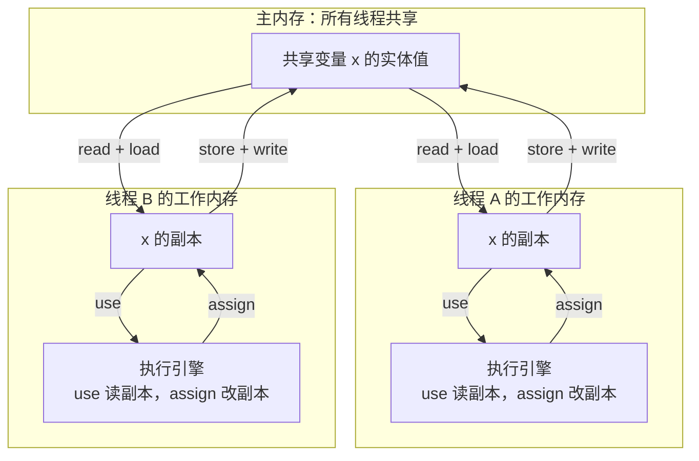

**图 2-2：happens-before 核心规则的关系**
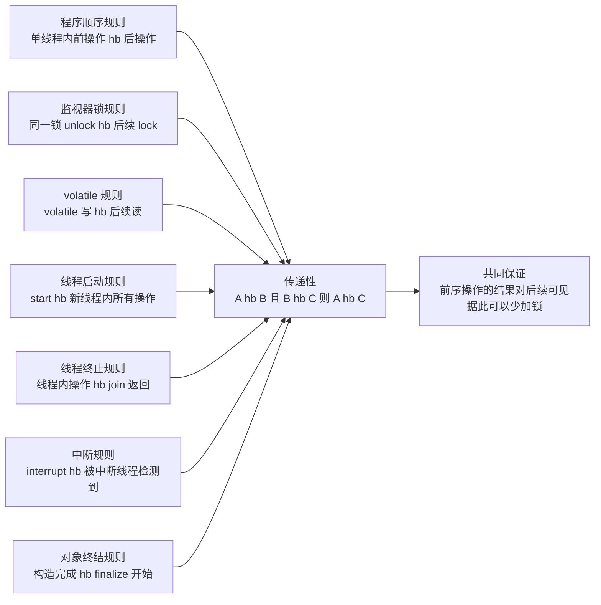

**为什么 / 取舍**
- **因为 volatile 的成本是"每次读写都穿透到主存层级"**：x86 上读几乎不亏（读屏障退化为编译器屏障），但写要触发 `lock` 前缀 + 缓存行失效，高竞争下形成缓存行乒乓（cache line bouncing）→ 只适合读多写极少的标志位
- **因为 happens-before 的真正价值是"允许你少加锁"**：能用 volatile / final / 线程启动终止规则推导出可见性就不必上重量级锁；且 JMM 是"最小保证"而非"实现描述"——允许重排序是给编译器和 CPU 留优化空间换性能，一旦依赖"没有 hb 关系的顺序"就是赌底层实现，换 CPU 架构或 JDK 版本就可能翻车，**这才是 volatile 存在的根因**。

**企业实际处理**
- 状态标志位一律 volatile：预警服务 `volatile boolean running`、配置热更新 `volatile ConfigSnapshot config`，配合 Apollo 监听器改写引用（引用替换本身原子）。
- 计数一律不用 volatile：QPS 统计、规则命中次数用 `LongAdder`（见题 7）或 `AtomicLong`。
- DCL 单例 `private static volatile XxxService instance`，用 volatile 堵住"分配内存→构造→赋引用"重排序，防另一线程拿到半初始化对象
- 团队规约：SonarQube 规则 `S3077`（Non-primitive fields should not be volatile）会拦掉 `volatile Map` 这类误用，评审时当硬性红线。

**代码片段**（📦 按 JDK 17 书写、未实测）：演示 DCL 单例中 volatile 为何不可省。

对照：`volatile boolean running` + `while (running)` 是正确用法（非 volatile 可能永远读旧值 true）；`volatile int cnt; cnt++` 100 线程并发结果 < 100，应改 `AtomicInteger.incrementAndGet()`。
```java
private static volatile VolatileDemo instance;
public static VolatileDemo getInstance() {
    if (instance == null)                      // 第一次检查：避免每次加锁
        synchronized (VolatileDemo.class) {    // 第二次检查：避免重复创建
            if (instance == null) instance = new VolatileDemo();   // 无 volatile 可能先赋引用后构造
        }
    return instance;
}
```

**易错 / 加分**
- ⚠️ 只说"volatile 不保证原子性"却不解释 `i++` 三步、也不提屏障，显浅。
- 💡 volatile 写屏障是 **StoreLoad**，成本最高（要清空写缓冲区）——这解释了 x86 上"读便宜、写贵"
- 另补 **final 字段语义**：构造器内正确初始化的 final 域无需同步即可被其他线程看到正确值（禁止 final 写重排到构造器外），这是不可变对象能安全发布的理论基础
- 另：**as-if-serial**（单线程重排序必须保证结果不变，多线程才需 hb 约束）与**伪共享**（两个 volatile 变量在同一缓存行 64 字节反复失效，可用 `@Contended`，需 `-XX:-RestrictContended`，Disruptor、LongAdder 真实用到）。

---

## 题 2：synchronized 锁的是什么？锁升级过程讲一下
- **题干**：「synchronized 你肯定天天用，那它锁的到底是什么对象？从无锁到重量级锁中间经历了哪几个状态、怎么升上去的？注意，这块 JDK 版本差异很大，你说清楚。」

**骨架答案**
- **锁的对象**：一把锁对应**一个对象**，锁信息记在该对象的**对象头 Mark Word**。修饰**实例方法** → 锁 `this`；**静态方法** → 锁当前类的 `Class` 对象；**代码块** → 锁 `synchronized(obj)` 括号里的对象。两个不同实例的方法互不阻塞，锁 `Class` 才是全类共享。
- **Mark Word（64 位 JVM）**：hashCode（31 位）、GC 分代年龄（4 位）、偏向标志（1 位）、**锁标志位（2 位）**。
- `01`+偏向位 0 → 无锁；`01`+偏向位 1 → **偏向锁**（存线程 ID + epoch）；`00` → **轻量级锁**（存指向栈帧 Lock Record 的指针）；`10` → **重量级锁**（存指向 ObjectMonitor 的指针）；`11` → GC 标记。
- 32 位 JVM 结构相同、位宽更窄（hashCode 占 25 位）。
- **锁升级路径（只升不降）**：
  - **无锁 → 偏向锁**（第一个线程 CAS 把线程 ID 写进 Mark Word，之后同线程再进入只比较线程 ID、**零 CAS 开销**，适合单线程反复进入）
  - **偏向锁 → 轻量级锁**（第二个线程竞争触发偏向撤销，**撤销需在安全点 STW**；线程在栈帧建 **Lock Record**，CAS 把 Mark Word 指向它，失败则**自旋**）
  - **轻量级锁 → 重量级锁**（自旋失败/竞争激烈，膨胀为重量级锁，Mark Word 指向 **ObjectMonitor**，未抢到者进 `_EntryList` 阻塞，由 OS 调度，涉及**用户态↔内核态切换**，成本最高）。
- **ObjectMonitor 关键结构**：`_owner`（持有者）、`_EntryList`（等锁阻塞队列）、`_WaitSet`（`wait()` 后的等待集）、`_cxq` / `_recursions`（重入次数）
- **版本事实（必须说清）**：偏向锁 JDK 6 引入；**JDK 15 起默认禁用（JEP 374，需 `-XX:+UseBiasedLocking` 手动开启，同时标记废弃）**；**JDK 18 起彻底移除（JDK-8256425）**。
- JDK 17 上讲偏向锁要注明"默认已关闭"，JDK 18+ 无此概念。
- 早期 `-XX:BiasedLockingStartupDelay` 默认 **4000ms**（JVM 启动 4 秒后才启用），是压测结果不一致的常见坑。

**图 2-3：对象头 Mark Word 的位域与锁状态**
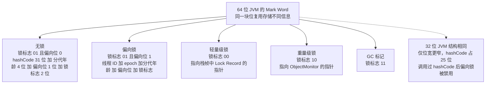

**图 2-4：synchronized 锁升级路径**
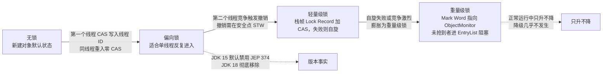

**为什么 / 取舍**
- **因为锁升级本质是"用 CAS 换掉系统调用"**：轻量级锁假设"很快能拿到"，自旋等待免去内核态切换；重量级锁假设"一时半会拿不到"，索性挂起让出 CPU。自旋阈值（自适应自旋）就是在两种假设间动态权衡。而**偏向锁被淘汰是因为它需要撤销时 STW**：在大量使用并发库（本身已用 CAS 优化）的现代应用里撤销开销 > 节省的 CAS 开销，官方直接移除——"优化手段随硬件与用法演进被废弃"的典型
- **因为 Mark Word 只有 64 位、结构复用**：同一块位既存 hashCode 又存锁指针，所以两者冲突——**调用过 `Object.hashCode()` 后偏向锁被禁用**。理解"位复用"才能解释为什么有的对象升不上去。

**企业实际处理**
- 锁对象用 **dedicated final 对象**，绝不用 `this`、字符串常量、包装类型：`synchronized("abc")` 锁的是常量池里那个唯一对象 → 全局串行（经典事故）；`synchronized(Integer.valueOf(i))` 受 `IntegerCache`（-128~127 缓存）影响，小值会互相阻塞
- 高竞争直接上 `ReentrantLock`：需要超时（`tryLock(timeout)`）、可中断、公平锁、多 Condition 时 synchronized 做不到。
- 风控规则共享缓存更新走 ReentrantLock + `tryLock(50ms)`，拿不到就降级读旧值；降锁粒度：只保护真正共享的部分，把 IO/RPC 移出锁块。
- 曾见预警规则服务把"查库+计算+更新缓存"全放进同步块，QPS 从 2000 掉到 80；拆出查库后锁只包更新，QPS 回升。
- JDK 8/11 生产显式加 `-XX:-UseBiasedLocking` 或用 `-XX:+PrintFlagsFinal` 确认状态，避免团队对"到底有没有偏向锁"分歧。

**代码片段**（📦 按 JDK 17 书写、未实测）：演示锁对象选择与锁粒度切分。
```java
synchronized ("ALERT_LOCK") { }                // 【错误】锁字符串常量（常量池唯一对象）→ 全局串行
private final Object lock = new Object();      // 【正确】专用 final 锁对象，外部拿不到
synchronized (lock) { /* 只保护必要临界区 */ }
double value = loadFromRemote(ruleId);         // 【正确】耗时 RPC/DB 在锁外做
synchronized (lock) { ruleCache.putIfAbsent(ruleId, value); }   // 同步块只包写回
```

**易错 / 加分**
- ⚠️ 说"锁升级后能降级"是错的：除 STW 期间可能重置，正常运行中**只升不降**。
- 💡 **自旋锁与自适应自旋**：JDK 6 后自旋次数由 JVM 按"上次在同一锁上的自旋成功率"动态调整（成功多转、失败少转），**不是固定 10 次**
- **锁消除 / 锁粗化是 JIT 层面优化**（详见题 14），编译后 synchronized 不一定真加锁，这解释了"为什么加了锁性能也没掉"
- 另：**synchronized 保证可见性的机制**：进同步块清空工作内存（读主存）、退出刷回主存，等价于 volatile 的可见性 + 互斥带来的原子性。

---

## 题 3：AQS 原理？ReentrantLock 和 synchronized 怎么选
- **题干**：「说说 AQS 吧，它凭什么能同时支撑 ReentrantLock、Semaphore、CountDownLatch 这些不同的工具？还有，你项目里什么时候用 ReentrantLock 而不是 synchronized？」

**骨架答案**
- **AQS = `AbstractQueuedSynchronizer`**，JUC 的"并发原子"：用 `volatile int state` 表示同步状态，用 **CLH 变体的双向 FIFO 队列**管理拿不到锁的线程，把"抢锁/排队/唤醒"抽象出来，子类只实现"尝试获取/释放"的判断。
- **三大要素**：
  - **state**（`volatile int state`，语义由子类定义——ReentrantLock 里是**重入次数**：0 未锁、n 重入 n 次；Semaphore 里是**可用许可数**；CountDownLatch 里是**剩余计数**；**CyclicBarrier 不用 AQS**，它用 ReentrantLock + Condition）
  - **CLH 队列**（双向链表，Node 封装线程，抢锁失败 CAS 入队尾并**自旋/挂起 `LockSupport.park`**，等前驱释放时被 `unpark`。Node 的 `waitStatus`：**`SIGNAL(-1)` 后继需唤醒、`CANCELLED(1)` 已取消、`CONDITION(-2)` 在条件队列、`PROPAGATE(-3)` 共享模式传播**）
  - **独占/共享两种模式**（独占 `acquire/release`，如 ReentrantLock，同一时刻只一个线程成功；共享 `acquireShared/releaseShared`，如 Semaphore、CountDownLatch、ReadWriteLock 读锁，允许多个线程同时成功）。
- **模板方法模式**：AQS 定好骨架 `acquire() { tryAcquire(); 入队; park(); }`，暴露 `tryAcquire / tryRelease / tryAcquireShared / tryReleaseShared / isHeldExclusively` 给子类填——"一个骨架多种语义"。
- **ReentrantLock vs synchronized**：实现层（JVM 关键字 monitorenter/exit vs AQS 纯 Java）；释放（自动 vs **必须 finally 手动 unlock**）；公平性（非公平 vs 可选公平/非公平）；中断（不支持 vs `lockInterruptibly()`）；超时（不支持 vs `tryLock(timeout, unit)`）
- 多条件（单 wait/notify vs 多 Condition 精确唤醒）；性能（现代 JDK 接近，高竞争下 ReentrantLock 有优势）
- **选型结论**：**默认用 synchronized**（简洁、不会忘释放、JVM 持续优化）；**需要超时 / 可中断 / 公平 / 多条件队列 / 跨方法传递锁状态时用 ReentrantLock**。

**图 2-5：AQS 的 state 与 CLH 双向队列**
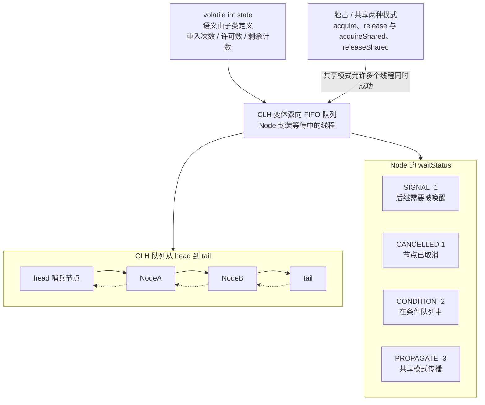

**图 2-6：ReentrantLock 加锁与解锁流程**
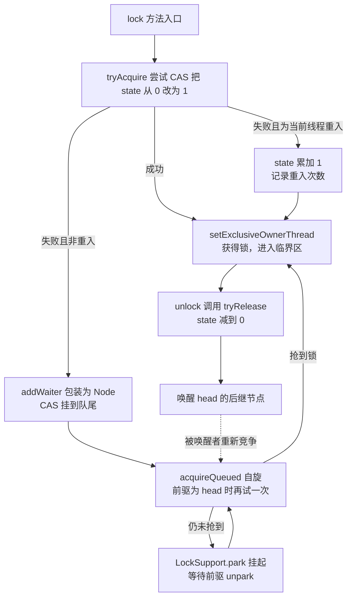

**为什么 / 取舍**
- **因为 AQS 的核心取舍是"排队用 CLH + 挂起用 LockSupport"**：自旋在竞争激烈时白烧 CPU，直接阻塞又太贵（内核态切换），AQS 折中是"先自旋几次（tryAcquire），失败再 park 挂起，由前驱节点精确唤醒"——"少切态 + 不错过唤醒"的平衡，这解释了 release 为什么是唤醒直接后继而不是广播
- **因为 state 是 int 而非 boolean**：一个字段同时表达"锁了几次（重入）""还剩几个许可""还差几次倒计时"，避免为每种工具设计不同结构（代价是重入次数受 int 上限约束）
- **因为公平锁有真实性能代价**：公平模式每次要检查队列有无前驱（`hasQueuedPredecessors()`）且严格 FIFO 唤醒，吞吐低于非公平（非公平允许插队、减少切换），所以**默认非公平**——绝大多数场景要吞吐不要先来后到。

**企业实际处理**
- 规则缓存刷新用 ReentrantLock + `tryLock(50ms)`：风控规则每 5 分钟全量刷新，抢不到就放弃本轮（下周期再刷），避免刷新线程堆积打满线程池（synchronized 做不到"抢不到就走"）。
- 读写分离用 `ReentrantReadWriteLock`：规则配置读极多写极少，读锁共享、写锁独占，比全互斥吞吐高一个量级；注意防写饥饿，必要时用公平模式或 `StampedLock` 乐观读
- `unlock` 一定在 finally，锁对象不可为 null；`lock()` 与 `try{}finally{unlock();}` 之间不能有其它可能抛异常的语句，否则"锁未持有却 unlock"抛 `IllegalMonitorStateException`。
- 绝不把 ReentrantLock 暴露给外部（私有字段），避免外部绕过封装直接 `unlock()`。
- **但 `ReentrantReadWriteLock` 有三个已知短板，面试常被追问**：
  - ① **不支持 `Condition`**——写锁想"等某个条件成立"做不到，只能退回 `synchronized` 或改用 `ReentrantLock`
  - ② **读锁的中断支持不完整**——`readLockInterruptibly` 虽存在但语义不完善、实际很少用，导致读线程一旦卡住**无法靠中断救出**
  - ③ **可能写饥饿**——读多写少时写线程长期抢不到锁（非公平模式尤甚）。
- 所以高竞争场景更推荐 `StampedLock` 的乐观读，或干脆用 `ReentrantLock` + 分离数据。

**代码片段**（📦 按 JDK 17 书写、未实测）：tryLock 超时防堆积 + 自定义 AQS 最小骨架。另：多 Condition 时生产者 `notFull.await()`、消费者 `notEmpty.signal()` 定向唤醒，判断必须用 **while 防虚假唤醒**。
```java
// 1) tryLock 超时：抢不到就放弃本轮，防止线程堆积（synchronized 做不到）
try { locked = refreshLock.tryLock(50, TimeUnit.MILLISECONDS); if (!locked) return; }
catch (InterruptedException e) { Thread.currentThread().interrupt(); }   // 恢复中断标志，别吞
finally { if (locked) refreshLock.unlock(); }

// 2) 自定义 AQS 独占锁：看 tryAcquire/tryRelease 有多薄
static class SimpleLock extends AbstractQueuedSynchronizer {
    @Override protected boolean tryAcquire(int arg) {          // 抢到 state 0->1
        if (compareAndSetState(0, 1)) { setExclusiveOwnerThread(Thread.currentThread()); return true; }
        return false;                                          // 失败后由 AQS 负责入队 + park
    }
    @Override protected boolean tryRelease(int arg) {          // 释放，AQS 会唤醒后继
        if (getState() == 0) throw new IllegalMonitorStateException();
        setExclusiveOwnerThread(null); setState(0); return true;
    }
}
```
**易错 / 加分**
- ⚠️ 把 CyclicBarrier 也算成 AQS 实现是错的：它用 ReentrantLock + Condition 实现代际（generation）复用；CountDownLatch 基于 AQS 共享模式且**一次性**。
- 💡 acquire 的乐观策略：先试探性 `tryAcquire`，再判断队列是否为空（`hasQueuedPredecessors`），避免无谓入队——"能不排队就不排队"
- AQS 改 CLH 为正双向 + 显式 state + SIGNAL 状态，是为支持"取消节点"与"共享模式传播"（Doug Lea 的工程改造）
- 另：`LockSupport.park/unpark` 有"许可"（permit，最多一个），`unpark` 先于 `park` 调用也不会丢唤醒——这是 AQS 能避免"唤醒丢失"的底层保证。

---

## 题 4：线程池 7 个参数和执行流程？为什么不用 Executors
- **题干**：「线程池你项目里肯定用了，7 个参数说一下，然后任务提交进去的执行流程是什么？还有个经典问题——为什么阿里规约不建议用 `Executors` 创建线程池？」

**骨架答案**
- **7 个参数**：`corePoolSize`（核心线程数，即使空闲也默认保留，除非开 `allowCoreThreadTimeOut`）/ `maximumPoolSize`（最大线程数 = 核心 + 临时）/ `keepAliveTime`（非核心线程空闲存活时间，配合 allowCoreThreadTimeOut 也可作用于核心线程）/ `unit`（keepAliveTime 的时间单位）
- `workQueue`（**任务排队用的阻塞队列**，决定"核心满了之后去哪"）/ `threadFactory`（线程工厂，**用来给线程起名、设 daemon、设优先级、兜底异常**）/ `handler`（`RejectedExecutionHandler` 拒绝策略）。
- **执行流程（先核心、再排队、后扩容、最后拒绝）**：
  - ① 运行中线程数 < corePoolSize → 新建核心线程执行
  - ② 否则 `workQueue.offer(task)` 成功 → 入队等待
  - ③ 否则运行数 < maximumPoolSize → 新建非核心线程执行
  - ④ 否则 `handler.rejectedExecution(task)` 触发拒绝策略。
- **易错点：不是"核心满了直接扩容到 max"，而是"先塞队列、队列满了才扩容"**——所以用无界队列时 `maximumPoolSize` 形同虚设（永远走不到第 3 步）。
- **4 种拒绝策略**：
  - `AbortPolicy`（**默认**，抛 `RejectedExecutionException`，调用方能感知）
  - `CallerRunsPolicy`（**提交任务的线程自己执行**，起反压作用、拖慢生产者）
  - `DiscardPolicy`（静默丢弃、无任何日志，最危险）
  - `DiscardOldestPolicy`（丢掉队列里最老的任务再重试提交）。
- 生产建议用**自定义策略**：计数 + 打日志 + 告警 + Prometheus 指标。
- **为什么不用 Executors**：
  - `newFixedThreadPool` / `newSingleThreadExecutor` 用 `LinkedBlockingQueue`（**默认容量 `Integer.MAX_VALUE`，等价无界**）→ 任务无限堆积 → **OOM**
  - `newCachedThreadPool` / `newScheduledThreadPool` 的 `maximumPoolSize = Integer.MAX_VALUE` → 无限建线程 → **OOM / CPU 打满**
  - 且无法自定义线程名（排障时一堆 `pool-1-thread-1`）、不能自定义拒绝策略。
- 结论：**用 `new ThreadPoolExecutor(...)` 显式构造，队列给有界容量，线程起名，拒绝策略自定义**。

**图 2-7：线程池的四步执行流程与 7 参数作用位置**
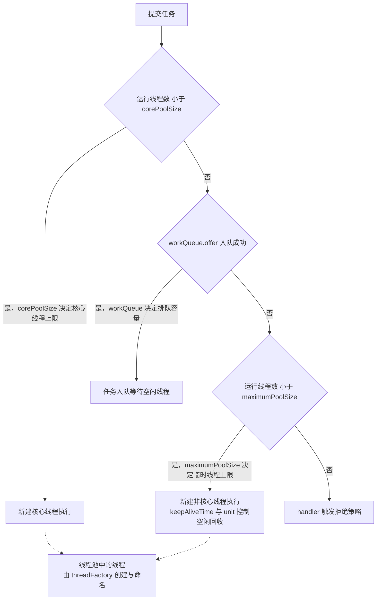

**为什么 / 取舍**
- **因为"先排队再扩容"这个反直觉设计，本质是降低线程创建/切换成本**：线程是稀缺资源，创建线程与上下文切换都不便宜，而任务入队几乎无成本，所以默认策略是"能排队就排队，队排不下才开新线程"。理解这点才知道**想快速扩容就必须用有界小队列或 `SynchronousQueue`**
- **因为无界队列是"用内存换平滑"的陷阱**：它把"拒绝"这个**压力信号**变没了，生产者感觉不到背压，持续高速生产直到内存耗尽才 OOM——而 OOM 时已无法定位是哪类任务堆积。有界队列让压力**当场**以拒绝的形式暴露，便于加监控、做降级：**让它早点失败，比让它慢慢崩溃更好**。
- 且线程池不是"越大越好"：线程数超过某点后 CPU 花在上下文切换上的占比飙升，吞吐反而下降（题 6 要算最优线程数的根因）。

**企业实际处理**
- 强制规约（对齐阿里规约）：必须显式构造、必须 `ThreadFactory` 命名（如 `risk-alert-rule-%d`）、必须有界队列、必须自定义拒绝策略，封 `ThreadPoolBuilder` 统一收口。
- 命名示例 `new ThreadFactoryBuilder().setNameFormat("alert-async-%d").build()`（Guava），线上 `jstack` 一眼区分"哪个池的线程"，排障时间从 30 分钟压到 3 分钟
- 拒绝策略按业务定：预警核心链路 → 自定义（记录 + 触发告警 + 可降级，丢非关键任务但保住 P0 规则）；日志/埋点类 → `DiscardOldestPolicy` 或直接丢弃；**绝不能默认 `AbortPolicy` 用在异步任务上却不处理异常**，否则异常被静默吞掉。
- 打点：`getActiveCount()` / `getQueue().size()` / `getCompletedTaskCount()` / `getLargestPoolSize()` 定时采集上报 Prometheus，队列使用率超 **80%** 告警。
- **每个业务域独立线程池（舱壁隔离）**：预警计算、通知推送、报表生成各用各的池，避免一个慢任务占满公共池拖垮全部业务（见题 15）。

**代码片段**（📦 按 JDK 17 书写、未实测）：生产级构造 + 自定义拒绝策略 + 监控打点。
```java
// 生产级构造：核心 8、最大 32、有界队列 500、非核心空闲 60s 回收
new ThreadPoolExecutor(8, 32, 60L, TimeUnit.SECONDS,
        new ArrayBlockingQueue<>(500),          // 有界！绝不用无界 LinkedBlockingQueue
        namedFactory("alert-rule"),             // 工厂内 setDaemon(false) + UncaughtExceptionHandler
        new AlertRejectHandler("alert-rule"));  // 计数 + 打日志 + 上报，替代静默丢弃
// 监控：active/pool/queue/completed/largest 定时采集，接入 Prometheus / Micrometer
```

**易错 / 加分**
- ⚠️ 以为"核心满了就扩容"、以为无界队列下 maximumPoolSize 有效——两大高频错误。
- 💡 **`SynchronousQueue` 语义**：不存储任务，`offer` 成功的前提是**已有线程在等待取**，否则直接走"扩容/拒绝"分支——`newCachedThreadPool` 用它实现"来一个任务就找一个空闲线程或新建"，是"队列容量为 0"的极端案例
- 另：**线程池预热 + 允许核心线程超时**：`prestartAllCoreThreads()` 避免流量突增时临时创建线程；`allowCoreThreadTimeOut(true)` 让低峰期核心线程也能回收。
- **`execute` vs `submit`**：`submit` 返回 `Future`，任务异常被**封装进 Future**，不主动 `get()` 就永远看不到（静默失败重灾区）；`execute` 抛出的异常会传给 `UncaughtExceptionHandler`。
- **线程池状态**：`RUNNING / SHUTDOWN / STOP / TIDYING / TERMINATED`；`shutdown()` 是不接新任务、跑完存量再关，`shutdownNow()` 是中断所有线程、返回未执行任务，优雅停止用 `shutdown` + `awaitTermination`。

---

## 题 5：ThreadLocal 原理？为什么会内存泄漏
- **题干**：「你们链路追踪怎么把 TraceId 从入口传到下游的？ThreadLocal 吧？那 ThreadLocal 为什么会内存泄漏，你怎么防？线程池里 InheritableThreadLocal 还有效吗？」

**骨架答案**
- **存储结构**：每个 `Thread` 对象内部有 `threadLocals` 字段，类型 `ThreadLocal.ThreadLocalMap`。所以数据**存在线程自己身上**，不是存在 ThreadLocal 里——ThreadLocal 只是拿自己的引用做 key 去这个 map 里查。
- **Entry 关键设计**：`Entry extends WeakReference<ThreadLocal<?>>`，即 **key 是弱引用（指向 ThreadLocal 对象），value 是强引用（指向你的数据）**。
- **内存泄漏链路**：线程池线程**长期存活**（核心线程不死）→ ThreadLocal 对象在外部（方法栈）不再被引用后 **key 被 GC 回收变成 null** → 但 **value 仍被线程的 ThreadLocalMap 强引用**，且这个 map 又挂在长生命周期线程上 → `Thread → ThreadLocalMap → Entry(null key, value)` 链**永远可达**，value 无法回收 → 泄漏
- 若 value 是大对象（缓存、大 List、数据库连接），累积起来就是 OOM。
- **为什么设计成弱引用 key**：其实是"**尽最大努力减少泄漏**"的折中——若 key 也是强引用，ThreadLocal 对象本身也永不回收、泄漏更严重。JDK 在 `get/set/remove` 时会顺带清理 key==null 的 Entry（`expungeStaleEntry`），但**这只是兜底、不能保证及时**（某线程 set 完再也不用这个 ThreadLocal 就永远不触发清理）
- **正确做法与传递问题**：**用完必须 `finally { threadLocal.remove(); }`**（唯一可靠方案）。`InheritableThreadLocal` 靠"创建子线程时把父线程的 map 复制过来"实现传递，**只在 `new Thread()` 那一刻生效**；线程池线程是预先创建、被复用的，创建时还没你的 TraceId，所以**在线程池里失效**（传不进去，或残留上一个请求的脏值）。

**图 2-8：ThreadLocal 的内存结构与泄漏引用链**
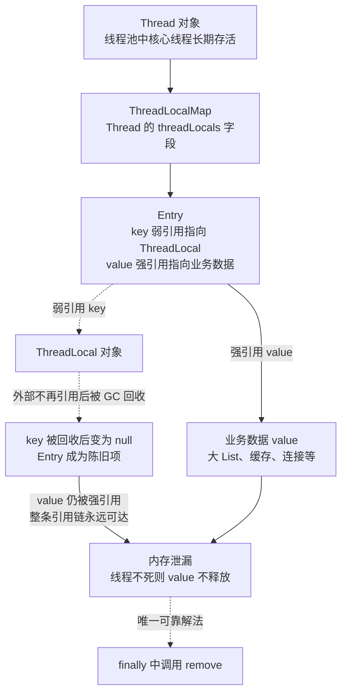

**为什么 / 取舍**
- **因为"存在线程上"这个设计是为了免锁的高性能**：若把上下文存在全局 map（key=线程），每次读写都要锁（并发），性能差；存线程私有属性则天然无竞争——这是 ThreadLocal 存在的根本理由，也是它必须依附长生命周期线程时"泄漏"这个副作用的来源
- **因为弱引用 key 是"防御性设计而非根治"**：JDK 明知弱引用会导致"key 没了 value 还在"，但它选了"至少让 ThreadLocal 对象本身可回收 + 兜底清理"，把最终责任交还给使用者 `remove()`——理解这个"责任划分"才能答到点上。
- 而**池化世界里"线程生命周期 ≠ 请求生命周期"**是所有 ThreadLocal 问题的总根源：线程被复用、请求却是一次性的，任何"把请求状态挂在复用资源上"的做法都要显式清理（该视角可迁移到连接池、对象池）。

**企业实际处理**
- TraceId 传递用 **`TransmittableThreadLocal`（阿里 TTL）** 或手动包装：TTL 通过 `TtlRunnable` / `TtlExecutors.getTtlExecutorService()` 在任务提交时**捕获快照**、执行前**回放**、执行后**复原**，解决线程池复用下的传递与脏读（Spring Cloud Sleuth / Micrometer Tracing 就是这套思路）
- 自定义线程池时必须用 `TtlExecutors` 包装，否则链路 ID 在异步分支里断掉
- 统一封装 + 强制 remove：封 `TraceContext` 工具类（set/get/clear），Web 入口用拦截器/Filter 在 `afterCompletion` 里 `remove()`，异步任务在 `finally` 里 remove，Code Review 硬性检查。
- 不要在线程池线程里放大对象进 ThreadLocal（整页查询结果、大 Map），只用它传轻量上下文（traceId、userId、租户号）。
- **JDK 21+ 的替代**：虚拟线程场景推荐 `ScopedValue`（预览特性），天然随作用域自动清理，不存在泄漏问题。

**代码片段**（📦 按 JDK 17 书写、未实测）：TraceId 上下文标准写法 + ITL 失效演示。
```java
public static final ThreadLocal<String> TRACE_ID = new ThreadLocal<>();
public static void set(String id) { TRACE_ID.set(id); }
public static void clear() { TRACE_ID.remove(); }   // 必须提供，且必须被调
// Web 入口 Filter：try { chain.doFilter(...); } finally { clear(); }   ★ 关键
static void asyncTask() {
    try { System.out.println("async traceId=" + get()); }
    finally { clear(); }   // ★ 池化线程必须清，否则脏读 + 泄漏
}
// InheritableThreadLocal 在线程池失效：池里线程已存在 → 创建拷贝不发生（读到 null 或上一请求脏值）
// 正解：TransmittableThreadLocal + TtlExecutors.getTtlExecutorService(POOL)
```

**易错 / 加分**
- ⚠️ 只答"弱引用导致泄漏"却不解释"为什么弱引用还不够、所以要 remove"，答不到点上。
- 💡 `ThreadLocalMap` 用**开放地址法（线性探测）**而非链表解哈希冲突，扩容阈值是 **`2/3`（`threshold = len * 2 / 3`）**（为省 Entry 对象、缓解内存，与 HashMap 拉链法不同）
- key 的 hash 用 `ThreadLocalHashCode` 的魔数 **`0x61c88647`（斐波那契散列）**，让冲突均匀分布
- 另：**`remove()` 会真正断开 value 强引用，而 `set(null)` 不会删除 Entry**（只是把 value 置 null，Entry 与弱引用 key 还在），所以清理必须用 `remove()`。"无继承的线程内共享"与"跨线程传递"
- 是两个问题：ThreadLocal 解决前者，跨线程要靠 TTL、显式参数传递、或 `CompletableFuture` 的上下文快照。

---

## 题 6：核心线程数怎么定？线程池打满导致预警延迟怎么排查
- **题干**：「你简历里提到预警延迟优化和线程池调优，那我问具体的：核心线程数你怎么算的？如果线上预警延迟从毫秒级飙到几秒，你怀疑是线程池的问题，怎么一步步定位？参数改动线上生效吗？」

**骨架答案**
- **线程数估算模型**：**CPU 密集**（规则匹配、指标聚合）用 `N + 1`（N = 核数），多 1 个是为偶发缺页/阻塞时顶上，再多就是纯上下文切换开销
- **IO 密集**（等 RPC/DB/网络）用 `N × (1 + W/C)`（W = 等待时间、C = 计算时间），经验值 `2N` 起步，若 W/C = 9（90% 时间在等）则 `N × 10`
- **真实做法不是算，是压测**——模型给初值，再用压测（JMeter/Gatling）在"目标 QPS 下 P99 达标"与"系统资源不饱和"之间找最优点（公式给方向，压测给数字）。
- **预警延迟飙升排查路径（五步）**：
  - ① **看监控**——CPU / Load / GC（`jstat -gcutil` 看 Full GC 频率）/ 线程池指标（`activeCount`、`queue.size`、拒绝数），先分清"计算慢"还是"排队久"：`queue.size` 高但 `activeCount` 已到 max → **线程不够/任务太慢**，queue 不高但任务耗时长 → **下游慢**
  - ② **dump 线程栈**——`jstack <pid>` **连打 3 次（间隔 1-2s）**：大量线程卡同一锁（`BLOCKED on ... waiting to lock`）→ 锁竞争，大量 `WAITING` 在 socket read → 下游 RPC 慢（线程被长时间占用），池内线程全 RUNNABLE 且任务耗时高 → 真·线程不足
  - ③ **Arthas 现场诊断**——`thread -n 10` 看最忙的 10 个线程栈、`thread -b` 直接定位阻塞其他线程的"元凶"、`watch`/`trace` 看方法耗时
  - ④ **定位根因**——①核心链路混进慢 IO（一个同步 HTTP 调用把线程占几十秒）②某段 `synchronized` 全局锁导致串行 ③下游劣化触发重试风暴、任务数翻倍 ④队列太大导致"排队久但不拒绝"掩盖容量不足
  - ⑤ **处置**——临时扩线程（动态调参）+ 恢复下游，长期是**隔离 + 降级**（慢业务独立线程池、加超时熔断、核心任务优先）。
- **动态调参**：`setCorePoolSize()` / `setMaximumPoolSize()` **运行时修改、立即生效**（新值 < 当前值只影响后续回收）；**但队列容量改不了**（`ArrayBlockingQueue` 的 capacity 是 final），想动态改队列必须自定义队列。
- 生产级做法是**动态线程池框架**（Hippo4j、美团动态线程池思路）= 配置中心（Apollo/Nacos）下发参数 + 监听器调 setter + 监控上报 + 阈值告警 + 一键回滚。

**为什么 / 取舍**
- **因为"CPU 密集 N+1 / IO 密集 2N"是理想模型，真实系统是混合负载**：线程执行时一会儿计算一会儿等待，纯公式算不准，专业做法是"模型给初始值 + 压测找拐点 + 监控持续校准"三级递进，说"先算再压测"比只背公式高一个层次
- **因为扩大线程数不是免费午餐，且有反直觉副作用**：线程多了上下文切换成本上升、内存（线程栈默认 **1MB**）消耗增加、下游压力增大（更多并发打到 DB/下游可能触发下游限流），所以"扩线程"往往只是缓解，真根因常在"任务里混了慢 IO"或"锁竞争"
- **动态调参的价值则在"不用重启"**——线上事故重启有服务中断和状态丢失风险，动态调参让你在事故中快速试错、立即回滚，这是"可运维性"的体现。

**企业实际处理**
- **分层线程池 + 舱壁隔离**：预警实时计算（低延迟、CPU 密集，核心 = N+1）、规则异步刷新（IO 密集）、通知推送（IO 密集、可容忍延迟）三个池物理隔离，核心池满了绝不影响通知池。
- 每个池配 Prometheus 指标：`executor_pool_size`、`executor_active`、`executor_queue_size`、`executor_rejected_total`，Grafana 设"队列使用率 > 70% 持续 1 分钟"告警
- Apollo 驱动的动态线程池：核心参数放 Apollo，值改变时监听器调 `setCorePoolSize/setMaximumPoolSize`，秒级生效、无需重启，大促前预先扩容、大促后缩容。
- 核心链路任务必须带超时（`Future.get(timeout)` 或 `CompletableFuture.orTimeout`）防单个卡死任务永久占用线程；拒绝策略配降级（队列满时优先保 P0 规则、丢弃 P2 通知并打点告警）。

**代码片段**（📦 按 JDK 17 书写、未实测）：可动态调整的线程池 + 队列水位弹性扩容。
```java
private static final ThreadPoolExecutor POOL = new ThreadPoolExecutor(
        8, 32, 60L, TimeUnit.SECONDS, new ArrayBlockingQueue<>(500),
        r -> new Thread(r, "alert-rule-" + System.nanoTime()),
        new ThreadPoolExecutor.CallerRunsPolicy());
public void onConfigChange(int newCore, int newMax) {
    POOL.setCorePoolSize(newCore); POOL.setMaximumPoolSize(newMax);
    // 注意：ArrayBlockingQueue 的 capacity 是 final，改不了；要动态改需自研队列
}
// 监控 + 弹性：usage = queue/500，> 0.8 且未到 64 则 setMaximumPoolSize(+16)
```

**易错 / 加分**
- ⚠️ 张口就背"N+1"，被追问"IO 密集呢 / 你怎么验证"就哑口。
- 💡 **利特尔法则（Little's Law）**：`并发 = QPS × RT`——若 QPS=2000、RT=50ms 则并发约 100，线程数应 ≥ 100 还要留余量，用"吞吐量 × 平均耗时 = 并发数"估线程，面试官很吃
- 另：**线程池预热 + 队列预热**：`prestartAllCoreThreads()` 在流量高峰前把核心线程建好，避免"冷启动时请求先排队"
- **jstack 连续 3 次的价值**在于区分"卡在同一处不动（死锁/长阻塞）"和"在不同方法间流动（正常干活）"
- **上下文切换成本量化**用 `vmstat` 的 `cs` 列或 `pidstat -w`（超过几万要警惕）——"线程并非越多越好"的实证依据。

---

## 题 7：CAS 是什么？ABA 问题怎么解？LongAdder 为什么快
- **题干**：「你说熟悉原子类，那 CAS 底层是什么？ABA 问题怎么产生的、怎么解？还有——为什么高并发计数场景推荐 `LongAdder` 而不是 `AtomicLong`，它快在哪？」

**骨架答案**
- **CAS 是什么**：Compare And Swap，一条 **CPU 原子指令**（x86 是 `cmpxchg`，多核下加 `lock` 前缀）。语义 `cas(预期值, 新值)`：只有内存当前值 == 预期值时才更新为新值并返回是否成功。Java 通过 `sun.misc.Unsafe` / `VarHandle` 暴露，`AtomicInteger` 等封装它。
- **CAS 的三个问题**：
  - **ABA**——线程 1 读到值 A 准备 CAS 改为 C，期间线程 2 把 A→B→A，线程 1 的 CAS 成功但它**没察觉到值被改过两次**（多数计数场景无害，**涉及引用/状态机时致命**，如链表节点先被摘除又放回、指针看似没变实际已变）
  - **自旋开销**——失败要重试，高竞争下大量线程空转烧 CPU
  - **只能保证一个变量原子**——多变量需 `AtomicReference` 打包成一个对象或用锁。
- **ABA 解法**：`AtomicStampedReference` 加一个**版本号 stamp**，CAS 时同时比较 `(值, 版本)`，`A→B→A` 版本从 0 变 2 → 校验失败
- `AtomicMarkableReference` 加一个 boolean 标记，只关心"有没有被改过"
- 无锁队列（如 `ConcurrentLinkedQueue`）里通过"标记节点为已删除"间接规避 ABA。
- **AtomicLong vs LongAdder**：`AtomicLong` 所有线程 CAS **同一个 volatile long 字段**，高并发下 CAS 频繁失败 → 疯狂自旋重试 → CPU 飙高、吞吐下降（**热点竞争**）
- `LongAdder`（**JDK 8+**）核心是 **`Cell[]` 数组 + 分段累加（striping）**——线程通过 `Thread` 的探针哈希 `getProbe()` 映射到某个 Cell，**各自 CAS 自己的 Cell**（`cellsBusy` 自旋锁保证数组扩容安全），大幅分散竞争，`sum()` 时把 `base + ΣCell.value` 累加。
- 代价是**`sum()` 不是强一致的**（读到的是各 Cell "某个瞬间快照之和"，并发写时可能不准），是**最终一致**的近似值 → 适合"写多读少的统计（QPS、命中数）"，不适合"需要精确值的场景（序列号生成）"。
- **选型口诀：读多写少用 `AtomicLong`；写多读少（高并发计数）用 `LongAdder`。**
- **第三种选择 · 字段更新器 `AtomicIntegerFieldUpdater` / `AtomicLongFieldUpdater`**：用反射直接对**已有对象的 `volatile` 字段**做 CAS，**不需要为每个计数器单独创建一个 Atomic 对象**——海量小对象（如每个预警规则一个命中计数）时省下的对象头开销很可观。
- 代价是：被更新的字段**必须是 `volatile`**、必须由调用方持有对象引用、且访问检查带来少量开销。
- **面试价值**：能说出"原子类还有字段更新器这条路"，说明你不是只背了 `AtomicInteger`/`LongAdder` 两个 API。

**图 2-9：CAS 的 ABA 过程与 AtomicStampedReference 破解**
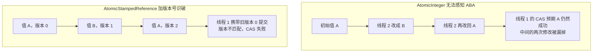

**为什么 / 取舍**
- **因为 CAS 本质上是用"硬件原语"换掉"操作系统锁"**：锁需要线程挂起/唤醒（内核态），CAS 是"乐观"的——假设冲突少、直接改、失败再重试；乐观策略在**竞争低**时极快（无需切换），**竞争高**时退化为自旋风暴，这就是 LongAdder 要用"分段"救场的根因：把一个大热点拆成 N 个小热点，让每个线程各打各的
- **因为分段思想是可迁移的通用套路**：`ConcurrentHashMap` 的 `CounterCell` 计数、`LongAdder` 的 `Cell`、JDK 7 ConcurrentHashMap 的 Segment——**同一个"分散热点"思想在不同层反复出现**（面试把三者串起来讲，体现你理解的是"模式"而非"API"）
- 且**最终一致性是刻意接受的设计权衡**：LongAdder 用"读不精确"换"写不冲突"，是典型的**牺牲一致性换吞吐**，能否接受取决于业务对这个数字"晚几毫秒准确"是否敏感。

**企业实际处理**
- QPS / 命中数统计用 `LongAdder`：预警系统的"规则命中次数""接口调用量"这类高频累加用它后 CPU 明显下降，对外展示的 TPS 曲线晚几秒无所谓
- ID 生成 / 序号用 `AtomicLong`（需要严格精确递增，如订单号，LongAdder 的最终一致性不可接受）
- CAS 自旋加退避：自研无锁结构时 CAS 失败后加 `Thread.onSpinWait()`（**JDK 9+**）或短暂 `Thread.yield()` 退避，减少无效自旋。
- ABA 真实场景（无锁栈/队列、用对象做状态标记如 INIT→RUNNING→INIT）必须上 `AtomicStampedReference`，Code Review 专门查。
- **别迷信无锁**：竞争激烈时无锁不一定比锁快（重试风暴），压测对比后再定。

**代码片段**（📦 按 JDK 17 书写、未实测）：CAS 自旋锁 + ABA 复现与解法。
```java
// 1) CAS 手写自旋锁（对比 synchronized 的挂起式锁）
while (!locked.compareAndSet(false, true)) Thread.onSpinWait();   // JDK 9+：提示 CPU 在自旋
// 2) ABA 复现：AtomicInteger 会把 A->B->A 当成没变
int expected = ref.get();                                  // 线程1 读到 100
ref.compareAndSet(100, 200); ref.compareAndSet(200, 100);  // 线程2 偷偷改回
boolean ok = ref.compareAndSet(expected, 999);             // ok == true（危险！）
// 3) AtomicStampedReference 解法：版本号兜住 ABA
int stamp = sref.getStamp();
sref.compareAndSet(100, 200, sref.getStamp(), sref.getStamp() + 1);
sref.compareAndSet(200, 100, sref.getStamp(), sref.getStamp() + 1);
boolean ok2 = sref.compareAndSet(100, 999, stamp, stamp + 1);   // ok2 == false
```

**易错 / 加分**
- ⚠️ 说 LongAdder "更快"却讲不出"分段分散热点""sum 最终一致"，等于没答。
- 💡 **`LongAdder.sum()` 无原子快照**：逐个读 Cell 累加，读的过程中别的线程还在写，所以是近似值；`sumThenReset()` 也不是整体原子的，高并发下会丢更新。
- **为什么 AtomicLong 用 volatile + CAS 还不够**：volatile 保证可见性、CAS 保证原子性，但**高竞争下 CAS 反复失败重试**才是瓶颈——LongAdder 解决的是"重试风暴"而非可见性
- 另：**按需分段**：LongAdder 无竞争时退化为 `base` 单个变量（省内存），竞争才创建 Cell 数组
- **CAS 与乐观锁的关系**：CAS 是乐观锁的一种硬件实现，数据库乐观锁（version 字段）是同一思想的持久化版本。

---

## 题 8：ConcurrentHashMap 怎么保证线程安全？并发容器怎么选
- **题干**：「`HashMap` 线程不安全，那 `ConcurrentHashMap` 是怎么做到线程安全的？JDK 7 和 8 实现有什么不同？另外你项目里并发容器怎么选型——什么时候用 CopyOnWriteArrayList、什么时候用 BlockingQueue？」

**骨架答案**
- **ConcurrentHashMap 演进**：**JDK 7** 用**分段锁 Segment**（继承 `ReentrantLock`），默认 **16 段**，每段是一个小 HashMap，不同段可并行写、同段内串行，**并发度 = 段数**，段数固定后不可扩
- **JDK 8** **取消 Segment**，改为 **CAS + synchronized 锁单个桶（bin）的头节点**——插入空桶用 **CAS**（无锁），插入非空桶 **synchronized 锁住该桶头节点**（只锁一个桶，并发度 = 桶数量，远高于段数），扩容**多线程协助扩容**（`transfer` + `ForwardingNode`）、扩容时读写不阻塞（读旧表、写新表）
- **链表长度 ≥ 8 且 table 长度 ≥ 64 时树化为红黑树、退化阈值是 6**，**计数用 `baseCount + CounterCell[]`**（与 LongAdder 同款分段思想）、`size()` 是近似值。
- 二者都**不允许 null key / null value**（并发下无法区分"不存在"和"值为 null"）；迭代器是**弱一致**（不抛 `ConcurrentModificationException`，但不保证看到最新数据）。
- **并发容器选型**：**`ConcurrentHashMap`**（通用并发 Map，高并发读写，默认首选）
  - **`CopyOnWriteArrayList`**（**读多写极少**、几乎不写，如监听器列表、白名单，写时复制整个数组、读无锁；缺点：写代价高（复制全量）、内存双倍、写后读有延迟、数据量大不适合）
  - **`ConcurrentLinkedQueue`**（无锁高吞吐队列，CAS 实现，但不阻塞、无界，消费者需自己轮询）
  - **`BlockingQueue` 家族**（有阻塞语义，适合生产者-消费者）——`ArrayBlockingQueue`（有界数组、单锁、FIFO，线程池队列推荐）、`LinkedBlockingQueue`（可选界默认无界、双锁存取分离，**必须指定容量**）、`SynchronousQueue`（不存储、直接移交，`CachedThreadPool` 用）、`PriorityBlockingQueue`（无界、优先级堆）
  - `DelayQueue`（延时到期才可取，定时任务、**预警延迟触发**）、`LinkedTransferQueue`（更高效的移交）
  - **`ConcurrentSkipListMap`**（需要**有序 + 并发**时用，跳表实现，如按分数排序的排行榜）。

**为什么 / 取舍**
- **因为"锁粒度决定并发度"是容器设计的核心矛盾**：JDK 7 锁 1/16 的表，JDK 8 锁 1/N 的桶（N 通常远大于 16），并发度大幅提高；同时 JDK 8 用 CAS 处理"空桶插入"这个最常见路径，让高频操作完全无锁——**"缩小临界区"思想的极致应用**
- **因为"读多写极少"和"读写均衡"是两种完全不同的优化目标**：COW 用"写放大（复制全量）"换"读零开销"，只有读写比例极高（如 10000:1）才划算，一般场景写代价不可接受，选型必须先问"读写比例"
- 而 **BlockingQueue 的价值在于"内建阻塞与背压"**——它把"队列空时等待、队列满时阻塞"的生产者-消费者协调逻辑封装好，用 `put/take` 天然实现流量削峰，自己用锁 + 条件变量写容易出 bug。

**企业实际处理**
- 本地缓存用 `ConcurrentHashMap`：规则 ID → 规则对象的本地热点缓存，用 `computeIfAbsent` 原子地做"miss 则加载"避免重复加载（**注意别在 compute 里做慢 IO，会锁桶**）。
- 预警的"延迟触发"用 `DelayQueue` / `ScheduledThreadPool`（如"某指标连续 3 分钟异常才触发"，任务放进 DelayQueue、到期才取出判断）
- 监听器/插件列表用 `CopyOnWriteArrayList`（通知渠道注册表基本不变、频繁遍历，COW 的"读无锁"优势最大化）。
- **禁用 `Collections.synchronizedMap` 做热点缓存**（全表一把锁，高并发下是瓶颈）；**`size()` 不作为精确依据**（CHM 的 size 是近似值，做限流/配额判断要留余量或换精确方案）。

**代码片段**（📦 按 JDK 17 书写、未实测）：CHM 原子加载 + DelayQueue 延迟预警 + COW 监听器。
```java
// 1) CHM：computeIfAbsent 原子加载本地规则缓存（同一 key 只会加载一次）
private final Map<String, String> ruleCache = new ConcurrentHashMap<>();
public String getRule(String ruleId) {
    return ruleCache.computeIfAbsent(ruleId, this::loadRuleFromDb);
    // 注意：loadRuleFromDb 若做慢 IO 会长时间锁住该桶；更稳：先 get，miss 再用 Caffeine loader
}
// 2) DelayQueue：延迟预警（put 一个 1s 后到期任务，take 会阻塞到到期才返回）
delayQueue.put(new DelayedAlert("RULE_A", 1000));  DelayedAlert a = delayQueue.take();
// 3) CopyOnWriteArrayList：监听器列表（写极少、读频繁，读无锁）
for (Consumer<String> l : listeners) l.accept(event);
```

**易错 / 加分**
- ⚠️ 只答"JDK 8 用 CAS + synchronized"却不知"锁的是桶的头节点""并发度从 16 段变成桶数"。
- 💡 **`ForwardingNode` 与协助扩容（helpTransfer）**：扩容时插入 `ForwardingNode` 标记老桶已迁移，其他线程遇到它就去帮忙迁移，把扩容成本分摊到多线程——"把 STW 改成并行"的经典设计
- 另：**为什么 CHM 禁用 null**：单线程 HashMap 可用 `containsKey` 区分"值是 null"与"键不存在"，并发下这两步之间状态可能变、无法安全区分，故直接禁止——**用约束换正确性**。
- **COW 的内存与实时性代价**：写是 `Arrays.copyOf` 全量复制 + 替换引用（引用替换靠 volatile 保证可见），所以写极慢、内存峰值翻倍，写后立刻读可能读到旧列表。
- **`ConcurrentSkipListMap` 取舍**：跳表用"空间换时间 + 无锁"实现并发有序，优于"有序 + 分段锁"包装的 TreeMap；Redis 的 zset 也用跳表，可横向对比。

---

## 题 9：Condition 原理？CountDownLatch/CyclicBarrier/Semaphore 区别
- **题干**：「`wait/notify` 和 `Condition` 有什么区别？还有一组常被混用的工具——`CountDownLatch`、`CyclicBarrier`、`Semaphore`，它们分别解决什么问题，你项目里怎么选？」

**骨架答案**
- **Condition 原理**：由 `ReentrantLock.newCondition()` 创建，底层也是 AQS——每个 Condition 有**一个条件队列**（单向），调用 `await()` 的线程从**同步队列**转移到**条件队列**并释放锁，`signal()` 把节点从条件队列移回同步队列等锁。
- 相比 `Object.wait/notify`：一个 Lock 可 `new` **多个 Condition** 实现**精确唤醒**（生产者只叫醒消费者、消费者只叫醒生产者），而 `notify` 是随机唤醒一个、`notifyAll` 全部唤醒（无效唤醒多）；**必须用 `while` 而非 `if` 判断条件**（防虚假唤醒 spurious wakeup）。
- **三者语义对比**：
  - **`CountDownLatch`**——一个/多个线程等 N 个事件都完成，**一次性**（计数到 0 不能重置），底层 **AQS 共享模式**，场景：主线程等 N 个子任务都完成再汇总
  - **`CyclicBarrier`**——N 个线程互相等、都到齐才继续（**栅栏**），**可循环重用**（自带 generation），底层 **ReentrantLock + Condition**，场景：多线程分段计算、全部到齐后进入下一轮
  - **`Semaphore`**——控制同时访问的**许可数**（限流），可增减许可，底层 **AQS 共享模式**，场景：接口限流、连接池限流。
- **一句话区分**：**CountDownLatch 是"我等你（们）"（一方等多方）；CyclicBarrier 是"大家互相等"（多方等多方，且可循环）；Semaphore 是"同时只允许 N 个进来"（限流）。**

**为什么 / 取舍**
- **因为"一次性 vs 可循环"是被底层实现决定的，而非随意**：CountDownLatch 的 state 只减不增（`countDown` 是 `releaseShared(1)`），到 0 后无法恢复，所以必须一次性；CyclicBarrier 用 `ReentrantLock + Condition` 并引入 generation（代），每轮到齐后 `nextGeneration()` 重置计数，所以能循环——选型时**"这组等待会不会重复发生"是决定因素**
- **因为精确唤醒（多 Condition）能显著降低无效唤醒开销**：单 Condition + notifyAll 在高并发下会让大量线程"醒来发现拿不到锁又睡回去"，白白上下文切换；用两个 Condition 定向唤醒，是与 LongAdder 分散热点同源的"减少无效竞争"思路。
- 且 **Semaphore 的"许可"语义比"锁"更灵活**：锁是"1 个许可"、Semaphore 是"N 个许可"，天然表达"资源池大小"，也可当"限流器"或"互斥锁（许可=1）"，是比 synchronized 更细粒度的流量控制原语。

**企业实际处理**
- CountDownLatch 做并行任务汇聚：报表服务把"查 5 个分片"并行化，主线程 `await()`、每个分片完成 `countDown()`，全部到齐后合并，带超时 `await(3, SECONDS)` 防卡死（**无论成败都要 countDown，否则永久阻塞**）。
- 预警启动时也用它等"规则加载、缓存预热、Kafka 消费就绪"三件事都完成才放开流量
- Semaphore 做下游限流：调第三方风控接口对方限 50 QPS，本地用 `Semaphore(50)` 做并发闸门，超出的 `tryAcquire(timeout)` 拿不到则降级；**注意 Semaphore 是"并发数"限流，不是"QPS"限流**（QPS 需配合时间窗）。
- CyclicBarrier 用于分层计算：大矩阵/大指标集分 N 份并行算，每轮算完 `await()` 等齐再进入下一轮，带 barrierAction 可在"到齐时"汇总；**某线程异常/中断会导致 `BrokenBarrierException`**，要处理。

**代码片段**（📦 按 JDK 17 书写、未实测）：三者典型用法 + Condition 精确唤醒。
```java
// 1) CountDownLatch：并行汇聚，带超时兜底（成败都要 countDown，否则永久阻塞）
CountDownLatch latch = new CountDownLatch(ruleIds.size());
pool.submit(() -> { try { result.put(id, calcRule(id)); } finally { latch.countDown(); } });
boolean done = latch.await(3, TimeUnit.SECONDS);       // 超时防卡死
// 2) Semaphore：第三方接口并发限流（最多 50 并发），拿不到许可立即降级
if (!THIRD_PARTY.tryAcquire(200, TimeUnit.MILLISECONDS)) return "降级默认值";
try { return doHttp(req); } finally { THIRD_PARTY.release(); }   // 必须释放，否则许可泄漏
// 3) CyclicBarrier：await() 等所有人到齐（有线程中断会破损抛 BrokenBarrierException），可循环重用
// 4) Condition 精确唤醒：while (buf.isEmpty()) notEmpty.await();（while 防虚假唤醒）
//    buf.addLast(item); notEmpty.signal();   // 只唤醒消费者，不广播
```

**易错 / 加分**
- ⚠️ 把 CountDownLatch 说成"可重用"、把 Semaphore 说成"QPS 限流"——两个高频错误。
- 💡 **CountDownLatch 不能重用，要重用就用 CyclicBarrier 或 Phaser**：Phaser 是更通用的"多阶段栅栏"，支持动态注册参与者，是 CyclicBarrier 的超集。
- **Semaphore 是并发数限制，不是速率限制**：限 QPS 需配合令牌桶/滑动窗口（Guava RateLimiter、Sentinel）
- 另：**`await()` 必须配超时**：无超时的 `await()` 一旦对方 `countDown` 漏了，线程永久挂起，是线上"线程泄漏"常见原因
- **Barrier 破损的传播**：任一参与线程被中断或超时，栅栏判定破损，其余等待线程都会抛 `BrokenBarrierException`，必须处理。

---

## 题 10：死锁的四个必要条件？线上怎么排查？线程中断怎么用
- **题干**：「线上突然有接口全部超时，`jstack` 一看一堆线程 BLOCKED。你怎么确认是死锁、怎么定位到代码？顺便说说死锁的四个必要条件，以及线程中断机制你平时怎么用。」

**骨架答案**
- **死锁四个必要条件**（同时满足才可能死锁）：**互斥**（资源同一时刻只能被一个线程占用）、**请求与保持/占有且等待**（持有资源的同时还在请求其他资源）、**不可剥夺**（已获得的资源不能被强行夺走，只能主动释放）、**循环等待**（存在线程环 T1→T2→...→Tn→T1，各自等对方持有的资源）。
- **破坏任一条件即可破死锁**：破坏"循环等待"最实用（**统一加锁顺序**）；破坏"不可剥夺"用 `tryLock(timeout)`；破坏"请求与保持"用"一次性申请全部资源"。
- **排查步骤**：
  - ① `jstack <pid>`——HotSpot 会**自动检测并打印 "Found one Java-level deadlock"** 及线程环、锁对象地址、持有/等待关系，直接打印死锁代码栈（最快的定位方式）
  - ② `thread -b`（Arthas）直接找出"阻塞其他线程最多的那个线程"，一句话定位"元凶"
  - ③ 看锁的持有者——栈里 `waiting to lock <0x...>` 是"想拿的锁"、`locked <0x...>` 是"已持有的锁"，顺着地址找环
  - ④ 确认加锁顺序不一致的代码点，统一顺序 / 换 `tryLock` / 缩小锁范围。
- **其他"看起来像死锁"的阻塞**：**线程池死锁**（任务 A 提交任务 B 到同一个池并等 B 结果，池被 A 占满 → B 永远排不上队，**池内嵌套提交**非常隐蔽，解法是用不同线程池/避免同步等待）
- `synchronized` 嵌套 + 等待外部回调（常见于老代码）
- 数据库死锁（`SHOW ENGINE INNODB STATUS` 看 `LATEST DETECTED DEADLOCK`）。
- **线程中断机制**：`interrupt()` **不是"强行停止线程"**，而是**设置中断标志位**，协作式（被中断线程自己决定怎么响应）
- 阻塞方法（`sleep` / `wait` / `join` / `park` / `BlockingQueue.take`）会**检测到中断并抛 `InterruptedException`、同时清除中断标志**
- **运行中的线程不会被中断**，只能用 `while (!Thread.currentThread().isInterrupted())` 主动轮询；`isInterrupted()` 不清标志，`interrupted()`（static）会清除标志。
- **最佳实践**：捕获 `InterruptedException` 后**要么向上抛，要么 `Thread.currentThread().interrupt()` 恢复标志**，绝不静默吞掉（吞掉会让上层无法感知取消，是线程泄漏与"取消失效"的根源），不要用 `e.printStackTrace()` 一带而过。

**图 2-10：死锁的循环等待环**
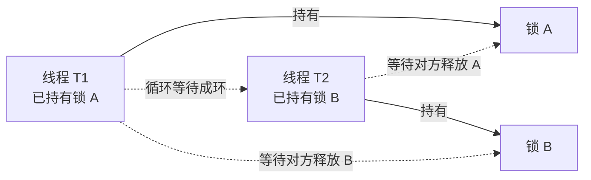

**图 2-11：线程的状态转换**
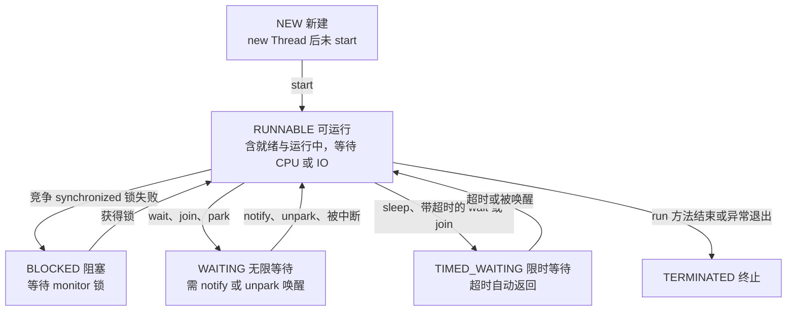

**为什么 / 取舍**
- **因为"协作式中断"是 Java 保证"不破坏数据一致性"的前提**：若允许强行 kill 线程（如早已废弃的 `Thread.stop()`），线程可能停在"改了半个数据结构"的位置，导致对象不一致、锁永不释放；所以 Java 选择"通知 + 被中断方自己处理"，让中断点落在可控位置——**正确性优先于强制性**的权衡
- **因为死锁在开发环境几乎不复现，只在特定并发时序下触发**：防御要前置到"编码规约（加锁顺序、超时）"和"运行时可观测（jstack 检测）"，而不是靠测试发现——"并发缺陷只能靠设计与监控，不能靠单测兜底"
- **线程池嵌套死锁的根因是"资源被自己人占满"**（池内线程互相等待对方占用的槽位，而槽位又被等待者自己占着，本质是"永久性资源被循环依赖"，与经典死锁同构），理解这点才能解释为什么"隔离线程池"能根治它。

**企业实际处理**
- **统一加锁顺序作为编码规约**：多把锁场景（如"账户 A 转 B"）按稳定 id（如账户号）排序后加锁，从根消灭循环等待；风控里"规则缓存"与"配置缓存"双向依赖时规定"先锁规则再锁配置"。
- **禁止线程池内嵌套提交并等待**：需要并行就显式传不同池或用 `CompletableFuture` + 独立池。
- **所有阻塞等待带超时**：`tryLock(timeout)`、`Future.get(timeout)`、`await(timeout)`，永不无限等待
- **优雅停机走中断**：应用关闭时 `shutdownNow()` → 中断工作线程 → 线程在 `while (!isInterrupted())` 循环里退出 → 保存进度，自定义 `Runnable` 里正确响应中断。
- **监控**：`jstack` 定时采集 + 死锁检测脚本（每分钟跑一次，发现 "Found one Java-level deadlock" 立即告警），或用 Arthas / Prometheus JMX 的 `java.lang:type=Threading` 检测。

**代码片段**（📦 按 JDK 17 书写、未实测）：死锁复现、破环、中断的正确处理。
```java
// 【错误】死锁复现：T1 先 A 后 B，T2 先 B 后 A，形成循环等待
new Thread(() -> { synchronized (LOCK_A) { sleep(100); synchronized (LOCK_B) { } } }, "T1").start();
new Thread(() -> { synchronized (LOCK_B) { sleep(100); synchronized (LOCK_A) { } } }, "T2").start();
// 【正确】破环 1：统一加锁顺序（都按 A->B），从根上消除循环等待
// 【正确】破环 2：tryLock 超时（破坏"不可剥夺"）——拿不到就放弃并释放已持有的锁
try {
    if (!LA.tryLock(100, TimeUnit.MILLISECONDS)) return false;
    try {
        if (!LB.tryLock(Math.max(deadline - System.currentTimeMillis(), 1), MILLISECONDS)) return false;
        try { /* 临界区 */ return true; } finally { LB.unlock(); }
    } finally { LA.unlock(); }        // 拿不到 LB 时释放 LA，避免"请求与保持"
} catch (InterruptedException e) { Thread.currentThread().interrupt(); return false; }
// 【正确】中断：while (!Thread.currentThread().isInterrupted()) taskQueue.take();
//    catch (InterruptedException e) { Thread.currentThread().interrupt(); break; }  恢复标志后退出
```

**易错 / 加分**
- ⚠️ 说"`interrupt()` 会停止线程"是错的：run 中的线程不受影响，只置标志位。
- 💡 **区分 `BLOCKED` 与 `WAITING`**：`BLOCKED` 是"等 synchronized 锁"，`WAITING` 是"等 notify/park/join"，栈特征不同——死锁排查时前者看锁地址，后者看谁该来唤醒。
- **jstack 的 "Found one Java-level deadlock" 只覆盖 synchronized 与 ReentrantLock 的 JVM 可检测死锁**：用 `LockSupport.park` 自己搞的等待环 JVM 检测不到，得靠人工分析栈
- 另：**线程池死锁的另一个变体**：`maxPoolSize=1` 且任务里 `submit 子任务并 get()`，一定自锁，是代码评审重点拦截项
- **中断与 `Future.cancel(true)`**：`cancel(true)` 会向执行任务的线程发中断，所以任务必须响应中断才能真正停下，否则任务继续跑、只是结果被丢弃。

---

## 题 11：CompletableFuture 怎么编排？异常怎么处理
- **题干**：「你项目里用 CompletableFuture 做并行编排吧？说一下你常用的那几个方法，`thenApply` 和 `thenCompose` 什么区别？异常处理有哪几种方式？还有——默认用的线程池是什么，有什么坑？」

**骨架答案**
- **创建**：`runAsync`（无返回）、`supplyAsync`（有返回），都可传自定义 `Executor`，**强烈建议传自定义线程池**。
- **串联（链式）**：`thenApply(fn)` **同步**转换 `T→U`（同线程执行）；`thenApplyAsync(fn)` **异步**转换（提交到线程池）
- `thenCompose(fn)` 的 `fn` 返回 `CompletableFuture<U>`，用于**扁平化嵌套**（`T → CompletableFuture<U>`），等价 flatMap；`thenCombine(other, fn)` 合并两个**独立**异步结果 `(T,U)→R`；`thenAccept` / `thenRun` 是只要结果不要返回值 / 都不要。
- **多任务聚合**：`allOf(cfs)` 等所有完成、返回 `CompletableFuture<Void>`（要拿各结果需自己 `join` 收集）；`anyOf(cfs)` 任一完成即可（返回 `Object`，需类型转换）。
- **异常处理三件套**：`exceptionally(fn)` **只在异常时**执行，`fn` 接收异常返回**兜底值**（正常时不执行）
  - `handle(fn)` **无论成败都执行**，`fn` 接收 `(结果, 异常)` 返回新值，可同时处理两条路径（最灵活）
  - `whenComplete(fn)` **无论成败都执行但不改变结果**（`fn` 返回值被丢弃），只做副作用（打日志、埋点、释放资源）。
- **记忆：`exceptionally` 只兜底、`handle` 能转换、`whenComplete` 只观察。**
- **默认线程池的坑**：不传 `Executor` 时用 **`ForkJoinPool.commonPool()`**，其**并行度 = CPU 核数 − 1**（`Runtime.getRuntime().availableProcessors() - 1`）。
- 坑 1：**commonPool 是全局共享的**，你（和所有框架/并行流）都用它，一个慢任务会拖垮全应用
- 坑 2：IO 密集任务（RPC/DB）在 commonPool 上跑，线程数太少（只有核数-1）→ 大量任务排队
- 坑 3：某些环境（容器化 + 特定 JDK）下 commonPool 被设为不可用，`ForkJoinPool.commonPool()` 可能退化为单线程执行。
- **结论：业务异步一律传自己的线程池。**

**图 2-12：CompletableFuture 的编排形态**
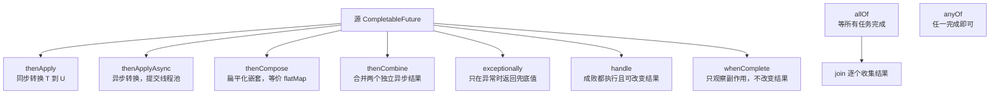

**为什么 / 取舍**
- **因为 `thenApply` 与 `thenCompose` 的差异是"是否有嵌套 Future"**：`fn` 返回普通值用 `thenApply`，返回 `Future` 用 `thenCompose`；用错会得到 `CompletableFuture<CompletableFuture<T>>`（嵌套），要手动拆——与 Stream 里 `map` vs `flatMap` 完全同构
- **因为默认 commonPool 的"核数-1"是给并行流设计的，不适合 IO**：ForkJoinPool 假设任务是 CPU 密集（工作窃取机制针对计算任务），IO 任务会长时间阻塞工作线程、导致池内其他任务饿死，所以 IO 场景必须用**自己按 IO 模型配参数**的池（线程数可远大于核数）
- 且**缺少超时的异步编排比同步调用更危险**——同步调用卡住至少能看到线程栈，异步编排卡住可能表现为"某个 Future 永远不 complete"、主线程 `join` 永久等待而日志里什么都看不到，所以超时不是可选项、是必需品。

**企业实际处理**
- 风控规则并行调用用独立池：`rule-calc-pool` 专用池 + `allOf` 聚合 + 每个子任务 `orTimeout(200, MS)`，任一超时用 `handle` 给默认值，保证整体 P99 可控。
- **必须设置超时**：`CompletableFuture.orTimeout(timeout, unit)`（**JDK 9+**）或 `completeOnTimeout(defaultVal, timeout, unit)`，不设超时是"异步雪崩"的头号原因
- **必须处理异常防静默失败**：`allOf` 之后一定要跟 `exceptionally` / `handle`，否则某个子任务失败会导致 `join()` 抛 `CompletionException`，且若不处理会被"吞"在 Future 里。
- **`join()` vs `get()`**：`join()` 抛**非受检** `CompletionException`（不用 try-catch），`get()` 抛**受检** `ExecutionException/InterruptedException`，业务聚合里用 `join()` 更简洁但要注意异常包装层次。
- 团队封 `AsyncUtils.allOfWithTimeout(...)` 强制"传池 + 设超时 + 兜底异常"。

**代码片段**（📦 按 JDK 17 书写、未实测）："并行调用 + 超时 + 兜底 + 聚合"生产模板。
```java
for (String id : ruleIds) {
    futures.put(id, CompletableFuture
            .supplyAsync(() -> callRule(id), RULE_POOL)   // 传自定义池
            .orTimeout(200, TimeUnit.MILLISECONDS)        // 单规则超时(JDK9+)
            .exceptionally(ex -> "DEFAULT_PASS")          // 超时/异常兜底降级
            .whenComplete((r, ex) -> { /* 埋点：记录单规则耗时 */ }));
}
CompletableFuture.allOf(futures.values().toArray(new CompletableFuture[0])).join();  // 等全部完成
futures.forEach((id, f) -> result.put(id, f.join()));     // join 拿结果
// 语义对比：thenApply 是 T->U；thenCompose 是 T->CF<U>（扁平化）；handle 成败都执行且可改结果
```

**易错 / 加分**
- ⚠️ 不传自定义线程池是最高频错误；不设超时、不处理异常是"异步雪崩"与"静默失败"的双根源。
- 💡 **`orTimeout` 的实现本质**：内部启动一个 `ScheduledThreadPoolExecutor` 的守护线程，到点调用 `completeExceptionally(TimeoutException)`——它用 `ForkJoinPool` 内部的 `Delayer`，超时精度受调度影响，高精度可用 `completeOnTimeout` 或外部定时器
- 另：**`allOf` 不会因某个失败而短路**：它等**所有**任务结束（成功或异常），任一失败时 `join` 才抛异常，要"快速失败"需自己用 `anyOf` 或 `applyToEither` 组合。
- **异步链里 ThreadLocal 丢上下文**：`supplyAsync` 切线程后 TraceId 丢失，需用 TTL 包装或显式传递（呼应题 5）
- **虚拟线程 + CompletableFuture 的契合**：JDK 21 下可用虚拟线程执行器，让 IO 密集的并行编排成本极低（见题 13）。

---

## 题 12：一个接口串行调了 5 个服务 800ms，怎么优化到 200ms
- **题干**：「你简历写了"接口耗时降 65%""预警规则计算优化到毫秒级"。那我给你个具体场景：一个接口串行调了 5 个下游服务，每个 160ms，总耗时 800ms，P99 更差。你怎么优化？给我讲方案和边界。」

**骨架答案**
- **先量化，别拍脑袋**：
  - **画调用链**——5 个服务是"串联依赖"还是"可并行独立"？B 依赖 A 的结果则 B 不能和 A 并行（**先看依赖关系，能并行的才有并行收益**）
  - **算理论收益**——若 5 个互相独立、各 160ms，并行后理论耗时 = `max(160ms) + 编排开销 ≈ 180ms`（从 800ms → 180ms，-77%），若存在依赖只能部分并行
  - **看 P99 而非均值**——均值 800ms 可能 P99 是 3s，优化要盯 P99（长尾）。
- **方案一：并行化（最直接）**：用 `CompletableFuture.allOf` + 自定义线程池并行发起 5 个调用，每个子调用设**独立超时**（`orTimeout`）+ 失败降级（`exceptionally` 返回默认值），再聚合结果——这是"800ms → 200ms 级"的主力手段（呼应题 11）。
- **方案二：消除不必要的调用**：**合并请求（batch）**（5 个服务能否合成 1 个批量接口，N 次 RPC → 1 次，网络往返从 5 次降到 1 次）；**加缓存**（变化不频繁的如规则配置用本地 Caffeine 或 Redis，直接省掉调用）；**懒加载/按需调用**（不是每个字段都要实时算，能异步/延迟的就不阻塞主链路）。
- **方案三：异步化（改同步为事件驱动）**：主链路只做"必要同步"，非关键的（写日志、发通知）改为发 MQ 异步处理，把响应时间还给用户
- **边界与代价（必须说清）**：
  - **并行会放大下游压力**（从"串行 1 个并发"变成"5 个并发"，下游单机 QPS 可能被打 5 倍，需与下游确认容量或加限流）
  - **线程池必须隔离**（给这个并行编排一个专用池，否则打满公共池影响其他业务）
  - **超时是生命线**（任一子调用卡死 `allOf` 会一直等，必须每个子 Future 设超时，或整体设超时后走降级）
  - **失败降级策略要业务确认**（某风控规则服务挂了是"默认放行"还是"默认阻断"？这是业务决策不是技术决策）
  - **分布式事务问题**（并行调用如果有写操作，要考虑部分成功的一致性，SAGA / 补偿）。
- **验证**：改完必须**压测对比**（优化前后 P50/P99/吞吐/QPS/CPU），并观察下游错误率。

**图 2-13：串行 800ms 与并行 160ms 的耗时对比**
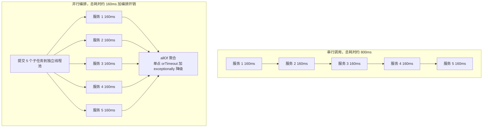

**为什么 / 取舍**
- **因为"并行化的收益上限由最慢的那个分支决定"（木桶效应）**：5 个 160ms 并行后 ≈ 180ms，但如果其中一个 P99 是 2s，整体就是 2s——所以并行化的关键不是"全并行"，而是**控制最慢分支的超时**，这才是"800ms→200ms"能稳定成立的原因
- **因为"把串行改并行"本质是"用并发换延迟，同时把压力前移给下游"**：用户看到的延迟降了，但下游承受的瞬时并发涨了 5 倍；如果不做容量评估和限流，就是把用户侧的超时转移成下游侧的服务雪崩——**这个权衡是高级工程师必须主动讲出来的**
- 且**优化要按收益排序做**：先做"零风险高收益"的（加缓存、合并请求），再做"有风险需评估"的（并行化），最后才是"架构级"的（异步化、CQRS），上来就并行化是最常见但最不总是最优的路径。

**企业实际处理**
- **风控规则引擎的并行改造**：原本 5 类规则（黑名单、限额、频次、设备、地域）串行执行、总 800ms 级；改成 `CompletableFuture.allOf` 并行 + `rule-calc-pool`（核心 32、队列 200、CallerRunsPolicy）+ 单规则 200ms 超时降级，P99 从 800ms 降到 200ms 内。
- **线程池参数按"规则服务 RT"定**：`并发 = QPS × RT`，若接口 QPS=500、规则 RT=50ms 则需并发约 25，池核心给 32 留余量
- **超时 + 熔断 + 降级三件套**：对接 Sentinel/Resilience4j，某个下游错误率超阈值直接熔断、走本地默认规则，避免"并行化把故障放大"
- **批量接口优先于并行**（能用 batch 就用 batch，1 次 RPC 比 5 次并行更省网络与线程）
- **压测验证**（JMeter 压 500 并发，对比改造前后 P99 与下游错误率，确认收益且未压垮下游）。

**代码片段**（📦 按 JDK 17 书写、未实测）：串行 vs 并行的对比核心。
```java
// 【错误】串行：总耗时约 5 * 160 = 800ms
for (String svc : List.of("blacklist","limit","frequency","device","geo")) map.put(svc, call(svc));
// 【正确】并行：总耗时约 160ms + 编排开销，单点超时不影响整体
for (String svc : services) {
    futures.put(svc, CompletableFuture.supplyAsync(() -> call(svc), BIZ_POOL)  // 独立池，避免污染公共池
            .orTimeout(250, TimeUnit.MILLISECONDS)          // 单服务超时
            .exceptionally(ex -> svc + "-DEFAULT"));        // 超时/异常降级
}
CompletableFuture.allOf(futures.values().toArray(new CompletableFuture[0]))
        .orTimeout(400, TimeUnit.MILLISECONDS).exceptionally(ex -> null).join();   // 整体兜底，绝不无限等
futures.forEach((k, f) -> result.put(k, f.getNow(k + "-DEFAULT")));   // 未完成也给默认
```

**易错 / 加分**
- ⚠️ 上来就说"并行化"而不先看依赖关系、不算理论收益、不评估下游容量——最容易踩的答法。
- 💡 **利特尔法则反推线程池大小**：`并发数 = QPS × 平均RT`，把"接口 QPS"换算成"需要多少线程"，而不是拍一个 32
- 另：**并行化后的可观测性**：必须给每个子调用打点（耗时、成功/超时/降级），否则"整体快了"但"不知道快在哪、哪个下游还慢"。
- **什么时候不该并行**：CPU 密集的本地计算并行会抢 CPU 反而更慢，有强依赖的调用不能并行，下游无容量时并行是灾难
- 实践中往往是**"先加缓存砍掉一半调用 → 剩下的合并成 batch → 确实独立的再并行"**的组合拳，三者叠加收益最大。

---

## 题 13：JDK 21 虚拟线程是什么？能替代线程池吗
- **题干**：「JDK 21 虚拟线程转正了，你怎么看？它能替代我们现在的线程池吗？什么场景适合、什么场景有坑？」

**骨架答案**
- **是什么**：虚拟线程（Virtual Thread）是 **JEP 444 在 JDK 21 正式发布**（预览于 **JDK 19/20**）的轻量级线程，由 **JVM 在用户态调度**，不一一对应操作系统线程。
- **核心模型**：
  - **载体线程（Carrier Thread）**——虚拟线程运行在平台线程上（ForkJoinPool 调度，**默认并行度 = 核数**）
  - **Continuation**——虚拟线程是一个可在阻塞时"暂停-恢复"的续体，当它执行**阻塞式 IO**（`File`/socket/大多数 JUC 阻塞操作）时，JVM 把它从载体线程上**卸载（unmount）**，载体线程去跑别的虚拟线程，IO 完成后再**挂载（mount）**回去继续
  - **代价极低**——栈帧存在堆上、可增长，创建百万级虚拟线程也无压力（平台线程受 **1MB** 栈 + 内核限制，几千就吃紧）。
- **典型用法**：`Thread.startVirtualThread(() -> {...})`；`Thread.ofVirtual().name("v-", 0).factory()`；`try (var executor = Executors.newVirtualThreadPerTaskExecutor()) {...}`。
- **注意：虚拟线程不需要池化**（池化的意义是复用稀缺 OS 线程，虚拟线程不稀缺，池化反而浪费），所以**不用 `ThreadPoolExecutor` 包它**。
- **适合的场景**：**高并发 + IO 密集**（大量阻塞式 RPC/DB/HTTP 等待）——用"每请求一个虚拟线程"的**同步写法**就能达到以前"异步 + 线程池"的效果，代码简单得多，且没有回调地狱
- **不能替代线程池的场景 / 坑**：
  - **CPU 密集**（虚拟线程不解决计算瓶颈，并行度还是受核数限制，无收益）
  - **`synchronized` 阻塞会固定（pin）载体线程**（在 synchronized 块里阻塞 IO 时虚拟线程**无法卸载**，载体线程被"钉住"，吞吐退化甚至饥饿，**JDK 21 下应改用 `ReentrantLock`**；JEP 491 在后续版本才修复 synchronized 的 pin 问题，JDK 21 上仍需注意）
  - **`ThreadLocal` 慎用**（线程数可能上百万，每个都带 ThreadLocalMap 会内存暴涨，JDK 21 推荐用 **`ScopedValue`（预览）** 替代）
  - **`ThreadGroup` 语义变化**（虚拟线程属于固定的 VirtualThreads 组，`ThreadGroup` 基本废弃）
  - **本地方法（JNI）阻塞**同样会 pin
  - **`Thread.currentThread()` 与栈轨迹**的调试工具支持在演进。

**图 2-14：虚拟线程与平台线程的调度模型对比**
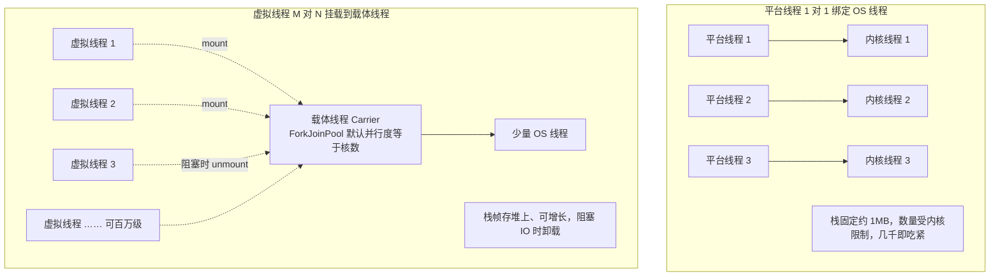

**为什么 / 取舍**
- **因为虚拟线程的本质是"把阻塞的代价从 OS 线程转移到 JVM 堆"**：传统模型下"每个请求一个线程"因为 OS 线程昂贵而不可行，才逼出"线程池 + 异步回调"的复杂编程模型；虚拟线程让"每请求一线程"重新可行，**用可读性换回了原来靠异步换来的吞吐**——它最大的价值是**简化编程模型**，不单纯是"更快"
- **因为 pin 问题是"阻塞点是否可被 JVM 感知"的限制**：虚拟线程能卸载的前提是 JVM 接管了阻塞（IO、`LockSupport`），而 `synchronized` 是 JVM 层实现但历史上与 monitor 强绑定，阻塞在 monitor 上无法安全卸载、只能钉住载体——**这是实现层的遗留限制，不是设计意图**
- 且 **"无限并发"是个陷阱**：虚拟线程让你能廉价创建海量并发，但**下游资源（DB 连接、下游 QPS）仍是有限的**，它把瓶颈从"线程"转移到"连接池/下游"，所以**限流与背压变得更必要**而不是更不需要。

**企业实际处理**
- **保守起步**：老项目不盲目全局切换，先在**IO 密集的独立服务/独立路径**上试点（对外 HTTP 聚合、批量查询），用 `Executors.newVirtualThreadPerTaskExecutor()` 跑压测对比。
- **Spring Boot 3.2+ 可一键开启**：`spring.threads.virtual.enabled=true` 让 Tomcat 用虚拟线程处理请求；但底层 DB 连接池（Hikari）仍是瓶颈——**连接池大小才是真正的并发上限**，虚拟线程只是让"等待"更便宜
- **配套治理**：并发上去了下游压力同步上去 → 必须配限流（Semaphore/Sentinel），否则"你能发 10 万个并发"直接打垮 DB 和下游。
- **替代 synchronized 为 ReentrantLock**：迁移前用 `-Djdk.tracePinnedThreads=full` 打印被 pin 的位置，逐处改造
- **不要把虚拟线程放进原有 `ThreadPoolExecutor`**（会浪费它的优势），改用 `newVirtualThreadPerTaskExecutor`。

**代码片段**（📦 按 JDK 21 书写、未实测）：虚拟线程标准用法与"避免池化 / 避免 pin"。
```java
// 【正确】标准用法：每任务一个虚拟线程，无需池化
try (ExecutorService exec = Executors.newVirtualThreadPerTaskExecutor()) {
    for (int i = 0; i < 10_000; i++)            // 1 万个请求轻松创建
        exec.submit(() -> { Thread.sleep(100); return "ok"; });   // 阻塞式 IO 会被卸载
} // try-with-resources 关闭并等待所有任务完成
// pin 陷阱：synchronized 里做阻塞 IO 会钉住载体线程
synchronized (LOCK) { Thread.sleep(1000); }     // 会 pin 载体线程，吞吐退化
// 【正确】改用 ReentrantLock：RLOCK.lock(); try { Thread.sleep(1000); } finally { RLOCK.unlock(); }
```

**易错 / 加分**
- ⚠️ 跟风说"无脑上虚拟线程"、或把它当"更快"而非"更省线程"来答。
- 💡 **`-Djdk.tracePinnedThreads=full`**（JDK 21 可用）能定位哪些代码在 pin 载体线程——迁移期最实用的工具
- 另补 **`Thread.ofVirtual()` vs `Thread.ofPlatform()`** 的统一 Builder API 与 `Thread.Builder` 的 `name` 前缀用于排障
- 另：**虚拟线程与 `ForkJoinPool` 的关系**：默认调度器是一个专用 ForkJoinPool（并行度 = 核数，可通过 `jdk.virtualThreadScheduler.parallelism` 调整），**不要拿它当业务线程池用**
- **结构并发（Structured Concurrency，`StructuredTaskScope`，JDK 21 预览）**是虚拟线程的"亲儿子"，用 try-with-resources 管理一组子任务的生命周期，天然处理好取消与异常传播，是未来替代 `CompletableFuture` 编排的方向。

---

## 题 14：锁优化有哪些手段？什么场景用无锁
- **题干**：「除了加锁，JVM 层面和代码层面还有哪些锁优化手段？锁消除、锁粗化是怎么回事？还有——什么场景你会选择无锁方案而不是加锁？」

**骨架答案**
- **JIT 编译器的锁优化（JVM 自动做，不用你写）**：
  - **锁消除（Lock Elision）**——JIT 通过**逃逸分析**发现某个锁对象**不会逃逸出当前线程**（如方法内 `new Object()` 加锁），就认为不存在竞争、**直接消除锁**（典型例子：`StringBuffer` 在方法内局部使用，`synchronized` 全被消掉）
  - **锁粗化（Lock Coarsening）**——JIT 发现一连串**连续的、对同一对象的加锁/解锁**（如循环里反复 `synchronized`），会把它们**合并成一次大锁**减少反复加解锁开销（乍看违反"缩小锁粒度"，但"多次小锁"的总开销可能大于"一次大锁"）
  - **自适应自旋**（自旋次数由 JVM 按"上次在同一锁上的成功率"动态调整）
  - **偏向锁 / 轻量级锁**（见题 2，注意版本：JDK 15 起偏向锁默认关闭，JDK 18 移除）。
- **代码层面的锁优化**：
  - **缩小锁粒度 / 缩短临界区**（把 IO、RPC、耗时计算移出同步块）
  - **锁分段（Lock Striping）**（`ConcurrentHashMap` 的 JDK7 Segment、`LongAdder` 的 Cell 数组，把一把大锁拆成 N 把小锁）
  - **读写分离**（`ReentrantReadWriteLock`、`StampedLock` 乐观读 + 悲观写）
  - **减少锁持有时间**（只在真正共享的读写上加锁）
  - **避免锁嵌套**（统一加锁顺序防死锁）。
- **无锁（Lock-Free）方案**：
  - 基于 CAS 的原子类（`AtomicInteger`/`LongAdder`，适合计数器、状态标志）
  - **不可变对象**（只要对象不可变——所有字段 final、状态不可改——就天然线程安全、**无需加锁**，可自由并发读，是"用约束换免锁"的最高境界）
  - **线程封闭（Thread Confinement）**（数据只在一个线程内使用，如 ThreadLocal、局部变量）
  - **写时复制（COW）**
  - **无锁队列**（`ConcurrentLinkedQueue`、Disruptor 的环形缓冲 + 序号屏障）。
- **无锁的代价与边界**：**竞争激烈时 CAS 重试风暴**（CPU 飙升），此时加锁反而可能更好；**实现复杂、易错**（ABA、内存序）；**不能保证无等待（wait-free）**，通常是 lock-free（整体有进展，个别线程可能饥饿）；**只适合"操作可表达为单个原子 CAS"的场景**（计数、状态切换、栈/队列头尾操作）。

**为什么 / 取舍**
- **因为 JIT 优化揭示了一个反直觉事实：你写的 `synchronized` 未必真加锁**——逃逸分析能在编译期判定"无竞争"并直接消除，所以"某段代码加了锁但不慢"往往不是"锁很快"而是"锁被消掉了"；理解这点才知道**性能分析要看实际编译后的代码（`-XX:+PrintCompilation` / JITWatch），不能只看源码**
- **因为锁优化的本质是"减少竞争 + 减少临界区 + 减少加锁次数"，三者往往互相冲突**：缩小临界区可能增加加锁次数（被锁粗化抵消），分段减少竞争但增加内存与复杂度——**没有银弹，都是权衡**。
- 且**无锁的真正对手不是"锁慢"，而是"临界区太小、加锁本身成了开销"**：CAS 和锁的成本在高竞争下趋同甚至反转，所以选型判断依据是**争用程度**——低争用时无锁略优（省去挂起/切换），高争用时锁可能更优（避免重试风暴）。

**企业实际处理**
- **不可变优先**：配置对象、规则快照设计成 immutable（final 字段 + 构造注入），发布时整体替换引用（volatile 或 AtomicReference），读方无锁、无竞争（风控规则快照就是这套）。
- **计数用 LongAdder、限流用 AtomicInteger、状态切换用 AtomicReference**，把无锁用在它擅长的地方
- **读多写少用 ReadWriteLock / StampedLock**：规则配置读远多于写，`StampedLock` 的乐观读在读无冲突时**不产生写锁开销**、吞吐更高（但 `StampedLock` 不可重入、不支持 Condition，要小心）。
- **不为了"高级"硬上无锁**：评审时明确"能用不可变就不用锁，能用现成并发容器就不自己写，竞争激烈宁可加锁"，避免自研 CAS 结构引入隐蔽 bug；无锁 vs 加锁的对比**必须压测**，别凭感觉。

**代码片段**（📦 按 JDK 17 书写、未实测）：不可变快照无锁读 + StampedLock 乐观读。
```java
// 1) 不可变快照 + AtomicReference 原子替换引用：读方完全无锁
static final class RuleSnapshot {                    // 不可变对象
    final Map<String, Double> thresholds;            // 构造后不再变
    RuleSnapshot(Map<String, Double> m) { this.thresholds = Collections.unmodifiableMap(new HashMap<>(m)); }
}
public double read(String id) { return snapshot.get().threshold(id); }        // 无锁读
public void refresh(Map<String, Double> r) { snapshot.set(new RuleSnapshot(r)); }  // 引用替换是原子的
// 2) StampedLock：乐观读（读无冲突时无锁开销），注意不可重入
long stamp = sl.tryOptimisticRead();                 // 乐观读，不加锁
double cx = x, cy = y;                               // 读快照
if (!sl.validate(stamp)) { stamp = sl.readLock(); try { cx = x; cy = y; } finally { sl.unlockRead(stamp); } }
```

**易错 / 加分**
- ⚠️ 把"锁粗化"当成坏事、或不知道 `synchronized` 可能被 JIT 消除。
- 💡 **逃逸分析（Escape Analysis）的三态**：不逃逸（可消除锁、可栈上分配）、方法逃逸、线程逃逸——这是标量替换、栈上分配、锁消除共用的分析基础，讲出来立刻显得"懂 JIT"。
- **`StampedLock` 的三个坑**：不可重入（重入会死锁）、不支持 `Condition`、不支持中断，所以只在"纯读多写少的数值/快照"场景用
- 另：**Disruptor 的无锁环形缓冲**：用序号（sequence）+ 内存屏障 + 缓存行填充实现"无锁且无伪共享"的高吞吐队列，是 LMAX 交易所的实战方案（"无锁极限"的例子）。
- **为什么不可变对象是最强免锁**：不可变 + 安全发布（final / volatile / 静态初始化）后，其他线程不可能看到中间状态，从根上消灭可见性与原子性问题——**"不共享可变状态"才是并发编程的最高原则**。

---

## 题 15：设计一个高并发实时预警系统的并发架构
- **题干**：「你是做期权风控实时预警的，那从并发角度讲讲：如果让你设计一个"毫秒级、高并发"的实时预警系统，线程模型怎么设计？线程池怎么划分？怎么保证不丢、不堆、可观测？」

**骨架答案**：用"分层 + 隔离 + 背压 + 可观测"四条主线设计。
- **数据接入层（高吞吐摄取）**：行情/指标从 **Kafka 消费**，消费线程数按分区数（**一个分区一个消费线程，不要超过分区数**，否则空闲线程浪费）
- 消费到后**不解算直接投递到内存队列**（Disruptor 或 ArrayBlockingQueue），**计算与消费解耦**，避免慢计算拖慢消费导致 rebalance
- **手动提交 offset**（处理成功再提交）保证"不丢"，配合幂等去重保证"不重"。
- **计算层（毫秒级规则引擎）**：
  - **线程池隔离（舱壁模式）**——按规则类型分池，实时强规则（P0，核心池 `N+1`，专属队列）、普通规则（P1）、统计/聚合规则（P2，可容忍延迟），**P0 绝不被 P2 阻塞**
  - **规则并行 + 超时**——单条数据要过 N 条规则，用 `CompletableFuture.allOf` 并行，每条规则 `orTimeout(50ms)` 降级
  - **规则快照无锁读**——规则配置用不可变快照 + `AtomicReference` 原子替换，计算线程无锁读、热更新不阻塞
  - **状态与窗口**——用时间窗口聚合（滑动窗口/环形缓冲）做"连续 N 秒异常"判定，避免每次全量重算。
- **触发/通知层（不阻塞计算）**：触发预警后**只入队不直发**——投递到通知队列（`ArrayBlockingQueue` 有界），由独立的**通知线程池**异步发（短信/邮件/IM），**通知慢绝不能反压到计算层**
- **延迟触发用 `DelayQueue`**（如"持续异常 3 分钟才告警"，到期才发，避免抖动误报）
- **通知去重/收敛（静默窗口）**——同一规则短时间内重复触发要收敛，避免告警风暴。
- **背压与降级（不堆、不崩）**：
  - **所有队列有界**，满了走**自定义拒绝策略**（计数 + 告警 + 丢低优先级任务）
  - **核心池满时 `CallerRunsPolicy` 反压**（拖慢上游消费），或**动态扩容**（Apollo 调参 + 自动扩容）
  - **降级链**——规则服务超时用本地默认规则、通知失败入死信队列重试
  - **熔断**——某规则服务错误率高则 Sentinel 熔断、直接跳过该规则，防止雪崩
- **可观测性（可排障）**：
  - **线程池全指标上报**（`activeCount`/`queue.size`/拒绝数/完成数 → Prometheus + Grafana，队列水位 **> 70%** 告警）
  - **链路追踪**（TraceId 贯穿接入→计算→通知，TTL 传播）
  - **`jstack` / Arthas 常态化**（死锁检测脚本、慢任务 top 分析）
  - **压测**（大促前用目标 QPS 压测，验证 P99 与背压行为）。

**图 2-15：高并发实时预警系统的分层并发架构**
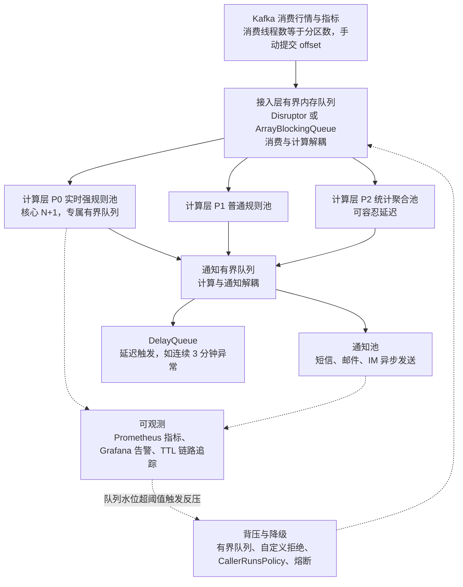

**为什么 / 取舍**
- **因为高并发系统的第一原则是"隔离"而非"优化"**：把不同 SLA 的负载放进不同线程池/队列，任何一部分的故障都被限制在舱壁内（Bulkhead），不会级联——**优化提升上限，隔离保证下限**，预警这类监管级系统"不崩"比"更快"更重要
- **因为"有界队列 + 拒绝策略"是背压的唯一落点**：无界队列会把"过载"变成"延迟累积直到 OOM"，有界队列把过载变成"当场可见的拒绝/反压"，让系统**在过载时优雅降级**而不是无声崩溃（"可用性优先于完整性"的权衡，对应 CAP 里的取舍）。
- 且 **"计算与通知解耦"是防止无关慢操作污染核心链路的通用手段**：通知（短信/IM）延迟不可控、且对实时性无贡献，绝不能让它占着计算线程；同理"消费与计算解耦"防止 rebalance——**每一层只做自己该做的、把慢操作甩给下游**，这是响应式架构（Reactor）的核心思想，用阻塞式线程池一样可以实现。

**企业实际处理**
- **"消费-计算-通知"三段式 + 三段独立线程池**，段间用有界队列连接，任何一段慢都不会直接拖垮上下游。
- **P0/P1/P2 优先级分级**：核心风控规则 50ms 内出结果，非核心可延迟，队列满时按优先级丢弃。
- **规则热更新无锁**：Apollo 下发 → 构建不可变快照 → `AtomicReference.set` → 计算线程即时可见（volatile 语义）
- **告警收敛 + 静默**：同一规则同一标的 5 分钟内只发一次，避免"一跌就 99+ 条告警刷屏"，直接呼应"减少 90% 人工干预"。
- **动态线程池 + 弹性**：用 Apollo 调核心/最大线程数，大促前预扩容。
- **故障演练**：定期 kill 下游、打满队列，验证降级与背压按预期工作。

**代码片段**（📦 按 JDK 17 书写、未实测）：三段式流水线 + 分级池 + 有界队列 + 背压。
```java
// P0 实时风控规则池：CPU 密集 + 低延迟，核心=核数+1，满则反压上游消费
private static final ThreadPoolExecutor P0_POOL = new ThreadPoolExecutor(
        Runtime.getRuntime().availableProcessors() + 1, Runtime.getRuntime().availableProcessors() * 2,
        60L, TimeUnit.SECONDS, new ArrayBlockingQueue<>(1000), factory("alert-p0"),
        new ThreadPoolExecutor.CallerRunsPolicy());
// 通知池：IO 密集，可容忍延迟，队列满丢弃并告警（CountingReject 计数 + 上报 Prometheus）
new ThreadPoolExecutor(16, 32, 60L, TimeUnit.SECONDS, new ArrayBlockingQueue<>(2000),
        factory("alert-notify"), new CountingReject("alert-notify"));
// 计算层：并行跑多条规则 + 单规则超时降级（无锁读规则快照）
CompletableFuture.allOf(CompletableFuture.supplyAsync(() -> hitBlacklist(e), P0_POOL)
        .orTimeout(50, TimeUnit.MILLISECONDS).exceptionally(x -> false), f2)
        .orTimeout(80, TimeUnit.MILLISECONDS).join();
// 触发层：只入队不直发 —— if (!notifyQueue.offer(event)) { 记录并丢弃 + 告警 }
// 通知消费线程：while (!isInterrupted()) { notifyQueue.take(); sendNotification(ev); }
```

**易错 / 加分**
- ⚠️ 只讲"用哪个线程池"，不讲"隔离为什么必要""背压落在哪"，就是背 API 而非讲架构。
- 💡 **舱壁模式（Bulkhead）与 Hystrix/Sentinel 的关系**：Hystrix 的"线程池隔离"是给每个依赖一个独立线程池，一个依赖慢不影响其他；"信号量隔离"则是计数不加线程、成本更低——能说出"线程池隔离 vs 信号量隔离"的取舍（前者隔离彻底但成本高，后者轻量但只限并发数）是资深标志
- 另：**为什么消费线程数 = 分区数**：Kafka 一个分区同一时刻只能被组内一个消费者消费，多开的线程会闲置；且消费与计算解耦后，消费线程只做"快速投递"，不会被计算拖到 rebalance。
- **告警收敛/静默的价值**：直接对应"减少 90% 人工干预"的业绩——不是关掉告警，而是用"同一规则 + 时间窗 + 状态变化才发"把噪声压掉，这本身就是并发/状态管理问题（去重、窗口聚合）。
- **优雅停机**：`shutdown()` → 停止收新任务 → `awaitTermination` 等存量跑完 → 关闭前把内存队列 drain 到本地/DB，保证"不丢"（监管级系统必须回答）。
- **容量规划**：用利特尔法则反推每段需要的并发度，用压测验证，用动态线程池应对峰值。

---

## 一句话主线

> **并发编程的根，是"共享可变状态"这四个字。** 先判断数据是否共享（不共享就用 ThreadLocal / 不可变 / 线程封闭，根本不用锁）；要共享就先定"可见性靠谁（volatile/锁）、原子性靠谁（锁/CAS）、有序性靠谁（hb 规则）"；再管好"线程资源"（池化、隔离、有界队列、背压、监控）
>
> 最后在线上一旦出问题，用 `jstack`/Arthas/Metrics 定位，用超时/降级/熔断兜底。**所有并发方案都是"正确性 ↔ 吞吐 ↔ 复杂度"的三角权衡**——面试里能把权衡讲清楚，比背 API 强十倍。

## 面试官深挖追问

1. **追问：volatile 和 CAS 有什么区别？** 答法：volatile 只保证可见性与有序性、不保证原子性；CAS 靠硬件原子指令保证"比较并交换"的原子性，是原子类的基石，但存在 ABA 和自旋开销。
2. **追问：为什么 LongAdder 的 sum() 不准确？** 答法：它逐个读 base 和各 Cell 累加，读的过程中其他线程还在写，是近似快照；要精确值用 AtomicLong 或停止写入后再 sum。
3. **追问：线程池队列用 ArrayBlockingQueue 还是 LinkedBlockingQueue？** 答法：都可，但**必须指定容量**；ArrayBlockingQueue 是数组、单锁、内存连续；LinkedBlockingQueue 双锁（存取分离）吞吐可能更高但要注意默认无界陷阱。
4. **追问：ThreadLocal 用 static 修饰有什么好处？** 答法：延长 ThreadLocal 对象生命周期，让它始终被强引用、不会被 GC 回收，从而**避免 key 变 null 后 value 泄漏的经典场景**，但**仍需 remove 清理 value**。
5. **追问：AQS 的 state 为什么是 int 不是 long？** 答法：一是设计上够用（重入次数/许可数/计数很少超 int），二是 int 的 CAS 在多数平台更高效；语义需要时可由子类自行定义。
6. **追问：CompletableFuture 的 allOf 有个任务挂了怎么办？** 答法：allOf 会等其他任务都结束，失败任务的异常封装在各自 Future 里；要兜底就给每个子 Future 加 `exceptionally`/`handle`，或整体 `whenComplete` 记录。
7. **追问：并行调用后下游被打挂了怎么办？** 答法：这是并行的固有代价——必须配限流（Semaphore/Sentinel）、熔断、容量评估；并行前先评估下游 QPS 承载能力。
8. **追问：JDK 21 虚拟线程在你的项目里会怎么落地？** 答法：先在 IO 密集的独立聚合服务试点 `newVirtualThreadPerTaskExecutor`，用 `-Djdk.tracePinnedThreads` 排查 pin，把 synchronized 换 ReentrantLock，同时给下游加限流（瓶颈转移到连接池/下游）。
9. **追问：synchronized 和 ReentrantLock 你都用，具体标准？** 答法：默认 synchronized（不会忘记释放、JVM 优化好）；需要超时/可中断/公平/多 Condition 时用 ReentrantLock。
10. **追问：线上 CPU 100% 你怎么判断是不是并发问题？** 答法：`top -H -p <pid>` 找高 CPU 线程 → 转十六进制 → `jstack` 里 `nid=0x...` 定位栈；常见是死循环、自旋风暴、频繁 GC、正则回溯。
11. **追问：怎么保证线程池任务不静默失败？** 答法：用 `execute` 让异常走 UncaughtExceptionHandler，或 `submit` 后务必 `get()`；统一 ThreadFactory 设异常处理器 + AOP 兜底日志。
12. **追问：你如何证明你的并发改造确实提升了性能？** 答法：优化前后 JMeter 压测对比 P50/P99/吞吐；加 Metrics 打点定位耗时分布；确认下游错误率未上升（避免"把超时转移给下游"）。
