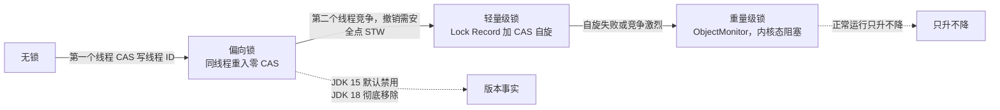
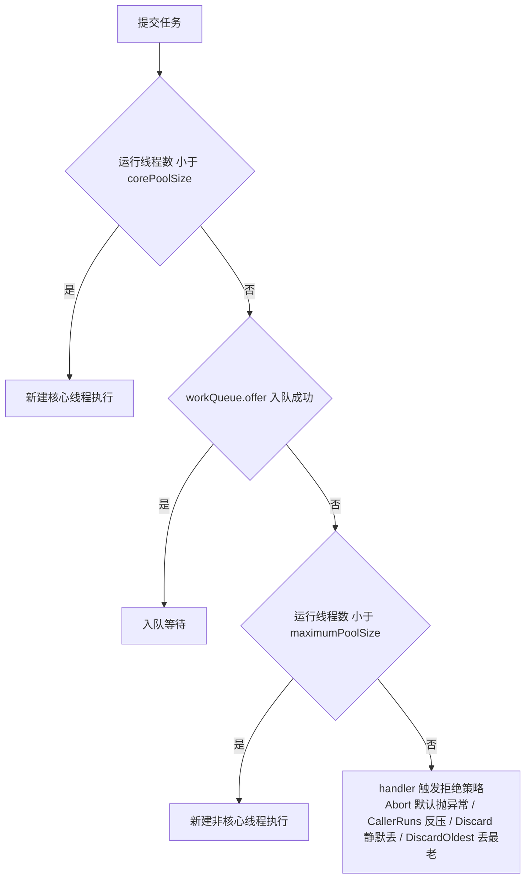

# 02 · Java 并发编程 速记版（考前 10 分钟扫一遍）

> **一句话主线**：并发的一切都从"**共享可变状态**"出发——先判断要不要共享（不共享就用不可变/ThreadLocal/线程封闭，根本不上锁），要共享就定好"**可见性靠谁、原子性靠谁、有序性靠谁**"，再管住"**线程资源**"（池化+隔离+有界队列+背压+监控），最后用"**超时/降级/熔断**"兜底。所有方案都是**正确性 ↔ 吞吐 ↔ 复杂度**的三角权衡。

## 基础（8 条）

| # | 面试题 | 关键词速答 |
|---|--------|-----------|
| 1 | volatile 能保证什么？ | 可见性 + 有序性（禁止重排序）；**不保证原子性**（`i++` 仍不安全）；底层靠内存屏障（写前 StoreStore、写后 StoreLoad，x86 上是 `lock` 前缀） |
| 2 | 什么是 happens-before？ | JMM 的**可见性契约**（不是时间先后）：程序顺序、监视器锁、volatile 变量、start()、join()、中断、对象终结、final 域，以及**传递性** |
| 3 | synchronized 锁的是什么？ | 锁**对象**；实例方法锁 `this`、静态方法锁 `Class`、代码块锁括号对象；锁信息记在**对象头 Mark Word** |
| 4 | 锁升级过程？ | 无锁 → 偏向锁（CAS 写线程ID）→ 轻量级锁（栈锁记录 + 自旋）→ 重量级锁（ObjectMonitor，内核态阻塞），**只升不降** |
| 5 | 偏向锁版本事实？ | JDK 6 引入；**JDK 15 默认禁用（JEP 374），JDK 18 彻底移除**；JDK 17 上答"默认已关闭" |
| 6 | 为什么 Executors 不推荐？ | `newFixedThreadPool` 用**无界 LinkedBlockingQueue** → 堆积 OOM；`newCachedThreadPool` max=**Integer.MAX_VALUE** → 线程爆炸；且无法命名线程、无法自定义拒绝策略 |
| 7 | ThreadLocal 为什么内存泄漏？ | Entry 的 **key 是弱引用(ThreadLocal)、value 是强引用**；线程池线程长期存活 → key 被 GC 后 value 永远可达 → 必须 `finally remove()` |
| 8 | InheritableThreadLocal 在线程池里有效吗？ | **无效**：传递只在 `new Thread()` 那一刻复制；池化线程预先创建/复用，会传不进或残留脏值 → 用 **TransmittableThreadLocal(TTL)** |

**图 2-16：锁升级路径速查**

## 进阶（8 条）

| # | 面试题 | 关键词速答 |
|---|--------|-----------|
| 9 | AQS 三大要素？ | **volatile int state**（子类定义语义：重入次数/许可数/计数）+ **CLH 变体双向队列**（park/unpark）+ **独占/共享两种模式**；模板方法，子类实现 tryAcquire/tryRelease |
| 10 | ReentrantLock vs synchronized？ | 默认用 synchronized（自动释放、JVM 优化）；需要**超时 tryLock / 可中断 / 公平 / 多 Condition** 时用 ReentrantLock（必须 finally unlock） |
| 11 | CAS 是什么？有什么问题？ | CPU 原子指令 `cmpxchg`（加 lock 前缀）；问题：**ABA**（解法 AtomicStampedReference/AtomicMarkableReference）、自旋开销、只能一个变量 |
| 12 | LongAdder 为什么比 AtomicLong 快？ | **分段思想**：Cell[] 数组，各线程 CAS 自己的 Cell，分散热点；`sum()` 是**近似值**（最终一致）；写多读少用它，精确值用 AtomicLong |
| 13 | ConcurrentHashMap 怎么保证安全？ | JDK7：**Segment 分段锁**；JDK8：**CAS 插空桶 + synchronized 锁单个桶头**，多线程协助扩容，链表≥8 且表长≥64 树化，计数用 baseCount+CounterCell |
| 14 | 并发容器怎么选？ | 通用 Map 用 CHM；读多写极少用 CopyOnWriteArrayList（写复制全量）；生产者-消费者用 BlockingQueue（**必须指定容量**）；有序并发用 ConcurrentSkipListMap |
| 15 | Condition 比 wait/notify 强在哪？ | 一个 Lock 可 new **多个 Condition**，实现**精确唤醒**（生产者只叫醒消费者）；判断条件必须用 `while` 防虚假唤醒 |
| 16 | CountDownLatch/CyclicBarrier/Semaphore 区别？ | Latch：一方等多方，**一次性**；Barrier：多方互等，**可循环**（ReentrantLock+Condition）；Semaphore：**限流**，控并发许可数 |

## 高阶（6 条）

| # | 面试题 | 关键词速答 |
|---|--------|-----------|
| 17 | 核心线程数怎么定？ | CPU 密集 `N+1`；IO 密集 `N×(1+W/C)` 或 `2N`；**真实做法=公式给初值+压测找拐点+监控校准**；利特尔法则：`并发 = QPS × RT` |
| 18 | 线程池打满导致预警延迟怎么排查？ | 看监控(active/queue/拒绝数/GC) → `jstack` 连打 3 次看栈 → Arthas `thread -n 10`/`thread -b` → 定位是"锁竞争/下游慢/线程不足" → 隔离+降级；core/max 可**动态改**(setCorePoolSize)，队列容量改不了 |
| 19 | CompletableFuture 异常处理三件套？ | `exceptionally`**只兜底**(返回默认值)、`handle`**能转换**(成败都执行可改结果)、`whenComplete`**只观察**(不改结果)；`thenApply` 同步转换、`thenCompose`扁平化嵌套；**默认 commonPool 并行度=核数-1，业务必须传自定义池** |
| 20 | 接口 800ms 怎么优化到 200ms？ | 先量化(依赖关系/P99) → 并行化 `allOf`+单点超时+降级 → 合并 batch/加缓存/异步化；**边界：下游压力×5、必须线程池隔离、必须超时、降级策略要业务确认** |
| 21 | JDK 21 虚拟线程是什么？ | 用户态调度 + Continuation，阻塞 IO 时 unmount 载体线程；**极轻量(百万级)、不需池化**、适合高并发 IO 密集；坑：CPU 密集无收益、**synchronized 阻塞会 pin 载体线程(用 ReentrantLock)**、ThreadLocal 慎用(用 ScopedValue) |
| 22 | 锁优化手段？死锁四条件？ | JIT：**锁消除**(逃逸分析)、**锁粗化**、自适应自旋；代码：缩小临界区、锁分段、读写分离、无锁(CAS/不可变/COW)；死锁四条件=**互斥/请求与保持/不可剥夺/循环等待**，排查 `jstack`(自动打印死锁环)、Arthas `thread -b` |

## 必背数字与参数速查

| 项 | 值/参数 | 说明 |
|----|---------|------|
| 线程池 7 参数 | core / max / keepAliveTime / unit / workQueue / threadFactory / handler | 执行流程：**核心 → 入队 → 扩到 max → 拒绝**（不是核心满了就扩容） |
| 4 种拒绝策略 | Abort(默认,抛异常) / CallerRuns(调用者执行,反压) / Discard(静默丢) / DiscardOldest(丢最老) | 生产建议自定义：计数+日志+告警 |
| 核心线程数 | CPU 密集 N+1；IO 密集 N×(1+W/C) | N = 核数；压测校准为准 |
| 利特尔法则 | 并发数 = QPS × 平均RT | 反推线程池大小的实用公式 |
| LongAdder | Cell[] 分段 + base；sum() 近似值 | JDK 8+；写多读少计数场景 |
| CHM 树化阈值 | 链表 ≥ 8 且表长 ≥ 64 → 红黑树；退化阈值 6 | JDK 8；JDK 7 默认 16 个 Segment |
| AQS state 语义 | ReentrantLock=重入次数；Semaphore=许可数；CountDownLatch=剩余计数 | volatile int，CAS 修改 |
| AQS Node 状态 | SIGNAL(-1) / CANCELLED(1) / CONDITION(-2) / PROPAGATE(-3) | |
| 偏向锁时间线 | JDK 6 引入 → **JDK 15 默认禁用(JEP 374)** → **JDK 18 移除** | 需安全点 STW 撤销 |
| ThreadLocalMap | 开放地址法(线性探测)，扩容阈值 **2/3**，魔数 `0x61c88647` | key 弱引用、value 强引用 |
| 默认 ForkJoinPool | `commonPool` 并行度 = **核数 − 1** | CompletableFuture/并行流默认用它，IO 任务必须换自定义池 |
| CompletableFuture 超时 | `orTimeout` / `completeOnTimeout`（JDK 9+） | 异步编排**必须设超时** |
| 虚拟线程 | JDK 21 正式(JEP 444)；预览于 JDK 19/20 | 不需池化；pin 风险在 synchronized |
| StampedLock | 乐观读 tryOptimisticRead + validate | 不可重入、不支持 Condition |
| 缓存行 | 64 字节（伪共享填充用 @Contended） | Disruptor / LongAdder 用它抗伪共享 |

**图 2-17：线程池四步执行流程速查**

## 答题模板

**遇到任何并发问题的通用四步框架：**

1. **先定性——数据是否共享**：是共享可变状态吗？能不能改成不可变 / ThreadLocal / 线程封闭（**能不共享就不共享**）？这一步决定要不要上锁。
2. **再定三性——靠什么保证**：可见性（volatile / 锁的内存语义 / final）、原子性（锁 / CAS / 原子类）、有序性（happens-before 规则）。答案要能圈定**具体是哪一行代码、哪一条 hb 规则**。
3. **再管资源——线程与队列**：用不用线程池？几个池（**按业务隔离**）？核心/最大线程数怎么算（利特尔法则+压测）？队列**必须有界**，拒绝策略自定义并告警。
4. **最后兜底——生产可用性**：超时（tryLock / Future.get / orTimeout）+ 降级（默认值 / 本地缓存）+ 熔断（Sentinel）+ **可观测**（Metrics 上报、TraceId 贯穿、jstack/Arthas 常态化）。

**万能收尾句**（主动展示权衡意识）：
> "这个方案的收益是 X（如延迟 800ms→200ms），代价是 Y（如下游并发压力涨 5 倍 / 线程数增加 / 复杂度上升），所以我配套做了 Z（限流 + 隔离 + 超时降级 + 监控）来兜住代价。"

**排障题万能框架**：看现象（监控指标：CPU/GC/队列水位/拒绝数）→ 抓现场（`jstack` 连打 3 次 + `top -H` + Arthas `thread -b`）→ 定根因（锁竞争 / 下游慢 / 容量不足 / 死循环）→ 临时止血（动态扩线程 / 降级）→ 长期根治（隔离 / 超时 / 熔断 / 容量规划）。
