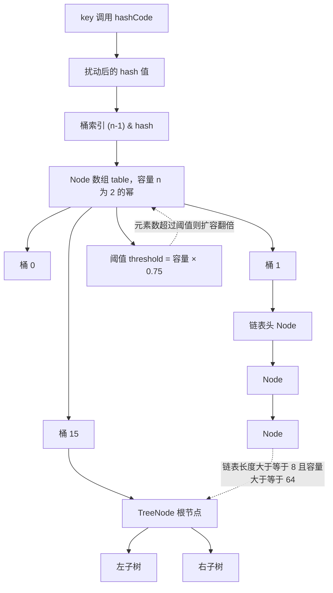
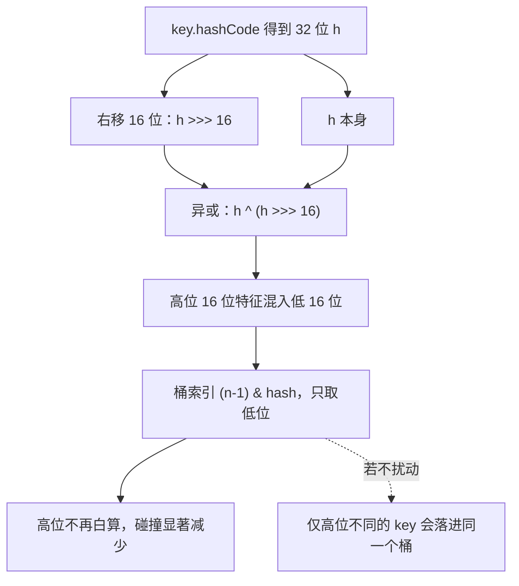
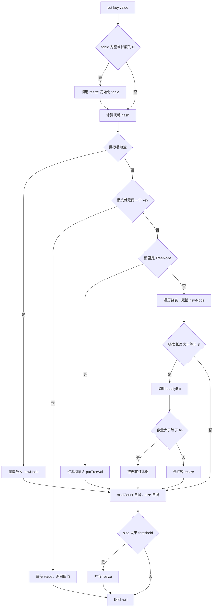
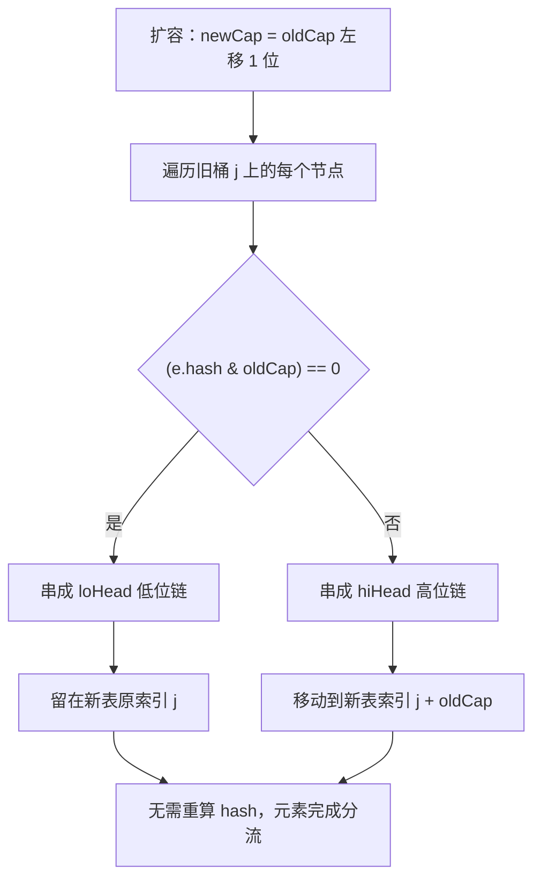
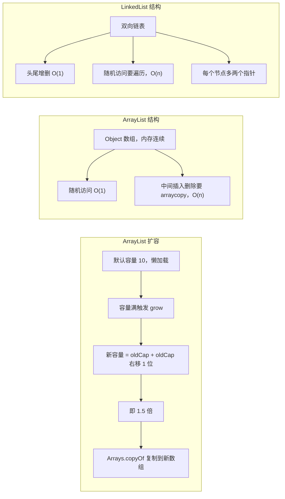
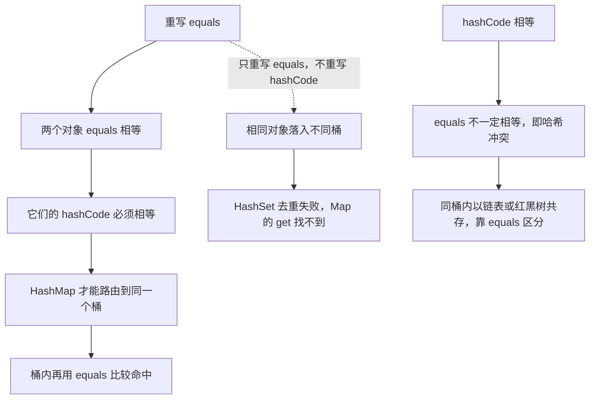
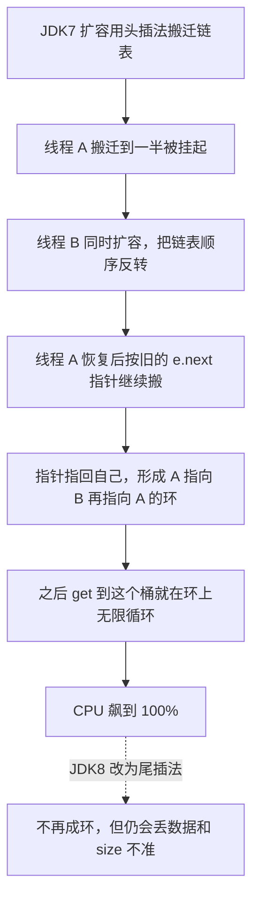
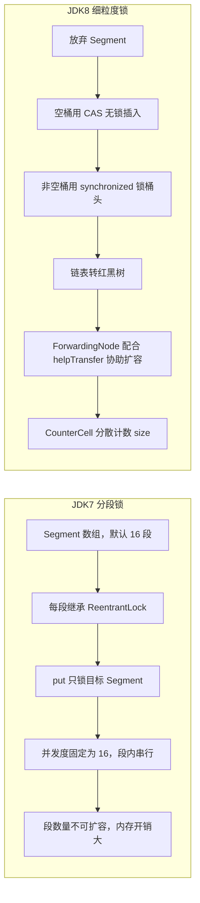
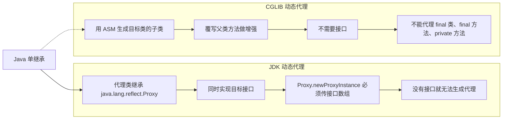
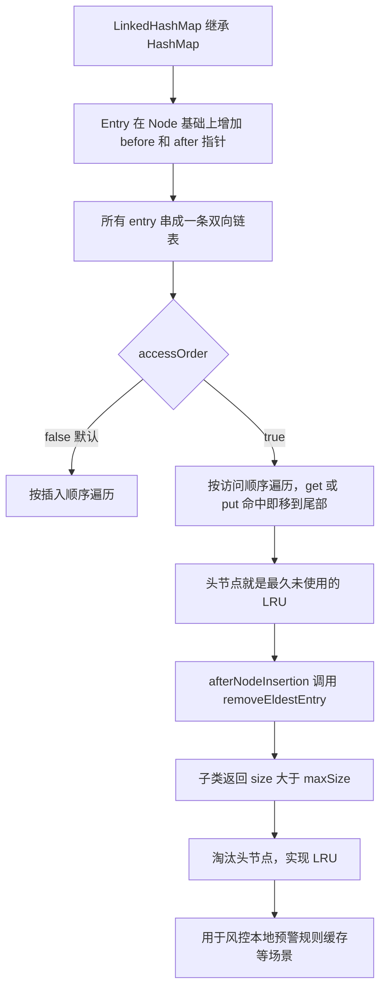

# 03 · 集合框架与 Java 基础（15 题）

> **模块主线**：集合与 Java 基础是「不问不代表不会，一问就要问到底」的模块——面试官用它筛掉只会写业务的候选人。核心就三件事：**HashMap 的源码细节（结构演进 + 扩容数学）、并发容器的演进逻辑（JDK7 → JDK8 为什么改）、以及基础语义的精确性（值传递、equals/hashCode、类型擦除）**。答这模块的诀窍不是背得多，而是能讲清「为什么这样设计」。

## 模块导览

> **背景**：你简历上写了「Java 基础扎实、熟悉多线程、熟悉 JVM」，面试官就一定会拿集合源码和基础语义来验证这句话——这是你自己送上门来的考点。集合是 Java 后端每天都要用的东西，HashMap / ConcurrentHashMap / ArrayList 的源码细节能直接反映一个人是不是真的读过 JDK 源码、有没有在生产上被坑过。对于 9 年经验的候选人，面试官不会满足于「HashMap 是数组加链表」，而是会追问「为什么是 2 的幂」「负载因子为什么 0.75」「JDK7 的并发扩容为什么会死循环」「ConcurrentHashMap 为什么在 JDK8 抛弃分段锁」。基础语义题（值传递、equals/hashCode、BigDecimal）则是「送命题」——答错一句就掉档，因为这是 32 岁高级开发不该犯的错。

**学完这 15 题，你能获得什么：**
- 能把 HashMap 从「数组+链表+红黑树」讲到 `hash()` 扰动、`(n-1) & hash` 索引计算、`resize()` 的 lo/hi 链表拆分，讲清每一个阈值背后的数学依据（泊松分布）
- 能讲透 ConcurrentHashMap 从 JDK7 分段锁到 JDK8 CAS + synchronized 锁桶头的完整演进动机，并和 ConcurrentHashMap 的 size 计数（CounterCell）、多线程协助扩容（ForwardingNode）串起来
- 能一眼识别并解释生产环境的经典陷阱：JDK7 并发扩容死循环、`Integer` 缓存区间的 `==` 陷阱、`Collectors.toMap` 重复 key 抛异常、`BigDecimal` 用 double 构造丢精度
- 能用 LinkedHashMap 手写一个期权风控的本地 LRU 预警规则缓存，并说清它和 Caffeine / Redis 的分层关系
- 能讲清 Java 8 → 17/21 的演进主线（records / sealed / switch 模式匹配 / 文本块 / 虚拟线程），在「老项目升级」这类问题上有话可说

**覆盖技术点速查：**

| 分层 | 技术点 |
|------|--------|
| 基础 | HashMap put 流程 / 扩容 / 树化阈值、ArrayList vs LinkedList、String 不可变与常量池、== vs equals vs hashCode、`new String("a")` 几个对象 |
| 进阶 | HashMap 线程不安全与 JDK7 死循环、ConcurrentHashMap JDK7 分段锁 → JDK8 CAS+synchronized、fail-fast / modCount / CopyOnWriteArrayList、泛型擦除与 PECS、反射与 JDK Proxy / CGLIB、异常体系、try-with-resources / finally、值传递 |
| 高阶 | LinkedHashMap 与 LRU、TreeMap 与红黑树、Stream 惰性求值 / 并行流陷阱 / Collectors、浅拷贝 vs 深拷贝、序列化与 serialVersionUID、SPI、Java 8 → 17/21 新特性、Optional 正确用法 |

**复习指引**：
- **一面（基础面）**：重点押 Q1、Q2、Q3、Q4、Q5——HashMap 源码、String、equals/hashCode 是必问三件套。答题节奏：先给结论，再给源码，最后给一个生产案例。
- **二面（实战面）**：重点押 Q6、Q7、Q13——并发容器的演进逻辑、fail-fast、Stream 并行流在风控计算里的坑，这些能体现「你踩过坑」。
- **三面（架构/资深面）**：重点押 Q11、Q12、Q15——LRU 缓存分层、序列化选型、JDK 升级路线，这些能体现工程判断力。
- **关联模块**：本模块与《04 并发编程》强关联（ConcurrentHashMap 的 CAS 与 synchronized 会引到 AQS、锁升级）；与《JVM》关联（String 常量池在堆、对象内存布局、Metaspace）；与《02 MySQL/Redis》关联（LRU 在 Redis 内存淘汰策略里是同一个思想）。**面试时如果集合答完了，可以主动把话题引向「JDK7→JDK8 的并发演进」和「Java 8→17 的升级」，这是你作为 9 年经验的加分位。**

**本模块目录（15 题）：**

1. [题 1：HashMap 的 put 过程说一下？底层结构到底长什么样](#q1)
2. [题 2：HashMap 的容量为什么必须是 2 的幂？扩容怎么扩？负载因子为什么是 0.75](#q2)
3. [题 3：ArrayList 和 LinkedList 怎么选？ArrayList 扩容是几倍](#q3)
4. [题 4：String 为什么设计成不可变的？`new String("a")` 创建了几个对象](#q4)
5. [题 5：== 和 equals 的区别？为什么重写 equals 必须重写 hashCode](#q5)
6. [题 6：HashMap 线程不安全体现在哪？ConcurrentHashMap 怎么保证线程安全的](#q6)
7. [题 7：fail-fast 和 fail-safe 是什么？CopyOnWriteArrayList 什么场景用](#q7)
8. [题 8：泛型擦除是怎么回事？JDK 动态代理为什么必须基于接口](#q8)
9. [题 9：Java 的异常体系说一下？finally 和 return 谁先执行](#q9)
10. [题 10：金额计算能用 double 吗？`Integer a=128, b=128, a==b` 结果是啥](#q10)
11. [题 11：怎么用 LinkedHashMap 实现一个 LRU 缓存？TreeMap 用在什么场景](#q11)
12. [题 12：Stream 的惰性求值怎么理解？并行流在风控批量计算里有什么坑](#q12)
13. [题 13：深拷贝和浅拷贝的区别？序列化这块要注意什么](#q13)
14. [题 14：SPI 机制了解吗？JDBC 和 Spring Boot 自动配置是怎么用它解耦的](#q14)
15. [题 15：Java 8 到 17/21 有哪些你觉得重要的新特性？老项目怎么升级](#q15)

**本模块图表索引：**

- **图 3-1**：HashMap 的数据结构总览 —— 题 1
- **图 3-2**：hash 扰动函数与索引计算 —— 题 1
- **图 3-3**：HashMap 的 put 流程 —— 题 1
- **图 3-4**：HashMap resize 的 lo/hi 拆分 —— 题 2
- **图 3-5**：ArrayList 扩容与 ArrayList / LinkedList 结构对比 —— 题 3
- **图 3-6**：==、equals、hashCode 的契约关系 —— 题 5
- **图 3-7**：HashMap 线程不安全之 JDK7 并发扩容成环 —— 题 6
- **图 3-8**：ConcurrentHashMap 的锁演进对比 —— 题 6
- **图 3-9**：JDK 动态代理与 CGLIB 代理的结构对比 —— 题 8
- **图 3-10**：LinkedHashMap 的 LRU 结构 —— 题 11

---

## 基础考察题（5 道）

### <a id="q1"></a>题 1：HashMap 的 put 过程说一下？底层结构到底长什么样

- **题干**：「HashMap 你肯定天天用吧？那你说说它的底层结构，还有 put 一个元素进去，整个流程是怎么走的。」
- **考察点**：源码阅读能力 + 结构演进（数组/链表/红黑树）+ 能否讲到 hash 扰动与尾插法。

**标准答案**：

1. **底层结构（JDK8）**：`Node<K,V>[] table` 数组，每个桶（bucket）挂一条链表；当单个桶的链表长度 ≥ 8 且数组容量 ≥ 64 时，链表转成红黑树（`TreeNode`），把最坏查询从 O(n) 降到 O(log n)。JDK7 里叫 `Entry[] table`，且只有数组 + 链表，没有红黑树。

**图 3-1：HashMap 的数据结构总览**



2. **hash 扰动**：put 之前先对 key 的 `hashCode()` 做一次扰动：
   ```java
   static final int hash(Object key) {
       int h;
       return (key == null) ? 0 : (h = key.hashCode()) ^ (h >>> 16);
   }
   ```
   把 32 位 hash 的高 16 位异或到低 16 位，让高位的特征也参与后面的索引计算——因为数组下标只用到了低位（`(n-1) & hash`），不扰动的话高位就白算了，冲突概率高。

3. **索引定位**：`i = (n - 1) & hash`，等价于 `hash % n`，但位运算快得多（且 n 是 2 的幂才等价，见 Q2）。

**图 3-2：hash 扰动函数与索引计算**



4. **put 流程（putVal 骨架）**：
   ```java
   final V putVal(int hash, K key, V value, boolean onlyIfAbsent, boolean evict) {
       Node<K,V>[] tab; Node<K,V> p; int n, i;
       // 1. table 为空或长度为 0 → 先初始化（懒加载，第一次 put 才分配）
       if ((tab = table) == null || (n = tab.length) == 0)
           n = (tab = resize()).length;
       // 2. 目标桶为空 → 直接放一个 newNode，结束
       if ((p = tab[i = (n - 1) & hash]) == null)
           tab[i] = newNode(hash, key, value, null);
       else {
           Node<K,V> e; K k;
           // 3a. 桶头就是同一个 key → 记下 e，后面覆盖 value
           if (p.hash == hash && ((k = p.key) == key || (key != null && key.equals(k))))
               e = p;
           // 3b. 桶里已经是红黑树 → 走树的插入
           else if (p instanceof TreeNode)
               e = ((TreeNode<K,V>)p).putTreeVal(this, tab, hash, key, value);
           else {
               // 3c. 遍历链表
               for (int binCount = 0; ; ++binCount) {
                   if ((e = p.next) == null) {
                       p.next = newNode(hash, key, value, null);  // 尾插（JDK8）
                       // 链表长度达到 8（binCount 从 0 计到 7）→ 尝试树化
                       if (binCount >= TREEIFY_THRESHOLD - 1)
                           treeifyBin(tab, hash);
                       break;
                   }
                   if (e.hash == hash && ((k = e.key) == key || (key != null && key.equals(k))))
                       break;                 // 链表中找到了同一个 key
                   p = e;
               }
           }
           // 4. 找到了相同 key → 覆盖 value，返回旧值
           if (e != null) {
               V oldValue = e.value;
               if (!onlyIfAbsent || oldValue == null)
                   e.value = value;
               afterNodeAccess(e);            // LinkedHashMap 的钩子
               return oldValue;
           }
       }
       ++modCount;                            // 结构修改计数，fail-fast 用
       if (++size > threshold)                // 5. 超过阈值 → 扩容
           resize();
       afterNodeInsertion(evict);             // LinkedHashMap 的钩子
       return null;
   }
   ```

**图 3-3：HashMap 的 put 流程**



5. **判断「同一个 key」的规则**：`hash` 相等 **且**（引用相等 `==` **或** `equals` 相等）。所以自定义对象做 key 必须正确重写 `equals` 和 `hashCode`（Q5）。

6. **JDK7 与 JDK8 的两个关键差异**：① JDK7 插入链表是**头插法**（`e.next = newTable[i]; newTable[i] = e;`），JDK8 改成**尾插法**；② JDK7 的扩容触发条件是「`size >= threshold` 且当前桶非空」，JDK8 只看 `++size > threshold`。

**企业实际处理**：
- 期权风控里，`Map` 常用来做本地维度缓存：`Map<String, RiskLimit>` 按「账户 + 合约」维度缓存限额。上线前都会用 `new HashMap<>(expectedSize / 0.75f + 1)` 预估容量，避免运行期反复扩容——风控行情高峰时单机 QPS 上万，一次扩容就是一次 O(n) 的数据搬迁，能省则省。
- 自定义对象当 key 的地方（比如 `PositionKey`），一律用 IDEA 生成 `equals`/`hashCode`，或者直接用 `record`（JDK16+ 自动生成符合规范的 `equals`/`hashCode`）。
- 高并发读写的共享 Map 绝不用 `HashMap`，统一走 `ConcurrentHashMap`；只在单线程内、或方法栈内的临时聚合用 `HashMap`。

**为什么这样做**：

- **因为 `hash` 扰动是「用一次异或换均匀性」的廉价买卖**：`(n-1) & hash` 只截取了低位，如果两个 key 的 `hashCode` 只有高位不同，低位相同，它们就会永远落进同一个桶。异或高 16 位相当于把高位信息「折叠」到低位，成本是一次移位 + 一次异或（纳秒级），却显著降低了碰撞率。
- **因为红黑树是「防退化」的保险，不是常规路径**：正常情况下链表长度服从泊松分布，长度到 8 的概率是 6e-8，几乎不可能发生。加红黑树是为了防**恶意构造的 hash 碰撞**（攻击者塞一堆 `hashCode` 相同的 key，把 O(1) 退化成 O(n)，造成 DoS）。所以阈值定在 8——既保证正常路径不走树的复杂逻辑，又能在退化时兜底。
- **因为「懒加载 table」避免了小 Map 的内存浪费**：`new HashMap<>(1000)` 只是把 `threshold` 算成 1024，`table` 仍是 `null`，第一次 put 才真正 `new Node[1024]`。大量只创建不填充的 Map（配置对象、DTO 里可选的 Map 字段）就能省掉一整块数组内存。

**企业级代码示例**（📦 按 JDK 17 书写、未实测）：演示如何按预期元素数正确设置初始容量，以及为什么容量会被向上取整成 2 的幂。

```java
import java.util.HashMap;
import java.util.Map;

public class HashMapCapacityDemo {
    public static void main(String[] args) {
        // 预期放 1000 个元素：1000 / 0.75 = 1333，向上取到 2 的幂 = 2048
        Map<String, Double> limitMap = new HashMap<>(2048);

        // 反例：给非 2 的幂，构造器里的 tableSizeFor 会向上取整
        Map<String, Double> odd = new HashMap<>(1000); // 实际 threshold 会被算成 1024

        for (int i = 0; i < 1000; i++) {
            limitMap.put("ACCT_A" + i, 1000.0 + i);
        }
        System.out.println("size = " + limitMap.size());          // 1000
        System.out.println("ACCT_A500 = " + limitMap.get("ACCT_A500")); // 1500.0
    }
}
```

**面试加分项**：
- 主动点出**树化前的容量检查**：`treeifyBin` 里如果 `tab.length < MIN_TREEIFY_CAPACITY(64)`，是**先扩容而不是树化**——因为小容量下冲突多只是因为桶太少，扩容比建树更划算。这句能直接证明你读过源码。
- 提一句 **`afterNodeAccess` / `afterNodeInsertion` 是给 LinkedHashMap 留的钩子**（HashMap 里是空实现）——这一句能把 Q1 和 Q11 提前串起来。
- 提 **JDK9 起 `Node` 的 `hash` 字段做了一次「延迟计算/缓存」相关的优化讨论**要谨慎，不确定就别展开；稳妥的加分点是 JDK8 把 `hash` 缓存在 `Node.hash` 字段里，避免每次比较都重算。

---

### <a id="q2"></a>题 2：HashMap 的容量为什么必须是 2 的幂？扩容怎么扩？负载因子为什么是 0.75

- **题干**：「你刚说索引是 `(n-1) & hash`，那为什么容量一定要是 2 的幂？还有默认 16、负载因子 0.75 这俩数是怎么来的？」
- **考察点**：对位运算与取模等价性的理解 + 扩容机制 + 阈值背后的概率依据。

**标准答案**：

1. **为什么必须是 2 的幂**：`(n - 1) & hash` 等价于 `hash % n` 的**前提是 n 为 2 的幂**——只有 2 的幂减 1 之后二进制全是低位连续的 1（如 16-1 = 1111b），与操作才能完整截取 hash 的低位。三个好处：
   - 位运算比取模快（取模是除法，CPU 周期多）。
   - `n-1` 低位全是 1，hash 的低位有多少种取值，桶就能覆盖多少个，分布更均匀；如果 n 不是 2 的幂，`n-1` 中间会有 0 位，某些桶永远取不到，白白浪费空间。
   - 扩容时可以做到「元素要么留在原位，要么移动到 原位 + oldCap」，不需要重算 hash（见下）。

2. **初始容量怎么来**：默认 `DEFAULT_INITIAL_CAPACITY = 16`。如果你传了非 2 的幂（如 1000），`tableSizeFor` 会向上取整到最近的 2 的幂：
   ```java
   static final int tableSizeFor(int cap) {
       int n = cap - 1;
       n |= n >>> 1; n |= n >>> 2; n |= n >>> 4;
       n |= n >>> 8; n |= n >>> 16;   // 把最高位 1 后面全部填 1
       return (n < 0) ? 1 : (n >= MAXIMUM_CAPACITY) ? MAXIMUM_CAPACITY : n + 1;
   }
   ```
   `MAXIMUM_CAPACITY = 1 << 30`（约 10.7 亿）。

3. **扩容 resize**：容量翻倍（`newCap = oldCap << 1`），然后把旧数组元素搬到新数组。JDK8 的巧妙之处是**不需要重算索引**：
   ```java
   // resize() 中的核心搬迁逻辑
   if ((e.hash & oldCap) == 0) {
       // 结果只取决于 hash 在 oldCap 那一位上是 0 还是 1
       // 为 0 → 索引不变，仍在 j；串成 loHead/loTail 低位链
   } else {
       // 为 1 → 新索引 = j + oldCap；串成 hiHead/hiTail 高位链
   }
   ```
   原理：扩容后 `n` 变成了 `oldCap << 1`，索引从 `hash & (oldCap-1)` 变成 `hash & (2*oldCap-1)`，多出来的那一位正好是 `oldCap` 对应的位。所以只要看 `hash & oldCap` 是 0 还是 1，就知道元素该留在原位还是搬到 `j + oldCap`。**JDK7 是重新计算 `indexFor` 的，而且用头插法搬，这正是死循环的根源（见 Q6）。**

**图 3-4：HashMap resize 的 lo/hi 拆分**



4. **负载因子 0.75**：这是**空间与时间的折中**。JDK 源码注释里写得很清楚：负载因子过高（如 1）省空间但冲突严重、查询变慢；过低（如 0.5）冲突少但数组利用率低、扩容频繁、浪费内存。0.75 是在「随机 hash 下」让桶内碰撞长度符合**参数 λ≈0.5 的泊松分布**，此时一个桶出现 8 个元素的概率约为 **6e-8（千万分之六）**，几乎不可能——所以树化阈值定 8。

5. **扩容触发**：JDK8 是 `if (++size > threshold) resize()`，其中 `threshold = capacity * loadFactor`。**注意 JDK7 的条件不同**：`if (size >= threshold && null != table[bucketIndex])`，多了「当前桶非空」判断。

**企业实际处理**：
- 风控规则缓存的 Map 一定是「预估容量一次到位」：`new HashMap<>(规则数 / 0.75f + 1)`，因为扩容时如果恰好在盘中高峰，会有一次内存翻倍的抖动（旧数组 + 新数组同时存在），可能触发 GC。
- 如果 Map 存的是热点数据、且容量会持续增长，就直接用 `ConcurrentHashMap` 并给初始容量——`ConcurrentHashMap` 同样会在 put 时按 `sizeCtl` 做扩容，且支持多线程协助扩容（Q6）。
- 大 Map（百万级）做序列化时要注意：`HashMap` 的 `serializedForm` 只序列化 entry 数量和 K/V 对，反序列化会重建 table，避免把整个数组结构 write 出去。

**为什么这样做**：

- **因为「2 的幂」是把「除法」降级成「位与」的唯一干净解法**：`hash % n` 当 n 为 2 的幂时完全等价于 `hash & (n-1)`，这是补码的性质。代价是容量必须被约束成 2 的幂，所以 `tableSizeFor` 强行走「向上取整」——用一个约束换掉热路径上的除法，是典型的「把复杂度前移到初始化」的权衡。
- **因为 0.75 让「扩容次数」和「桶内碰撞」两条曲线在交点附近**：负载因子越小，扩容越频繁（每次扩容 O(n)）；越大，碰撞越多（链表越长，查询越慢）。0.75 是实测 + 泊松推导下的均衡点，且恰好是 3/4——一个二进制下很好算的数（`threshold = cap - (cap >>> 2)`）。
- **因为 `hash & oldCap` 拆分把扩容的常数降了一个量级**：JDK7 扩容对每个元素都要重算一次索引并头插，还引入了并发问题；JDK8 只做一次判断、保持链表内部相对顺序（尾插），既避免了 JDK7 的死循环，也让扩容后仍能保持一定的局部性。

**企业级代码示例**（📦 按 JDK 17 书写、未实测）：演示容量如何被向上取整、以及扩容后元素「原位或 +oldCap」的观察方法。

```java
import java.util.HashMap;
import java.util.Map;

public class ResizeDemo {
    public static void main(String[] args) throws Exception {
        Map<Integer, String> map = new HashMap<>(1);
        // 反射拿 threshold，验证 tableSizeFor：传 1 → capacity 1，threshold = 1*0.75 = 0
        // 为演示取整效果，这里直接放元素感受扩容节奏
        for (int i = 0; i < 13; i++) {
            map.put(i, "v" + i);
            int cap = tableCapacity(map);
            System.out.printf("size=%2d, table.capacity=%d%n", map.size(), cap);
        }
        // 预期：容量在 size 超过 12(16*0.75) 时从 16 翻到 32
    }

    /** 借助反射读取 HashMap 内部的 table 长度（仅用于教学演示，生产勿用） */
    @SuppressWarnings("unchecked")
    static int tableCapacity(Map<?, ?> map) throws Exception {
        var f = HashMap.class.getDeclaredField("table");
        f.setAccessible(true);
        Object[] table = (Object[]) f.get(map);
        return table == null ? 0 : table.length;
    }
}
```

**面试加分项**：
- 主动说「`new HashMap<>(1000)` 的 1000 不是最终容量，`tableSizeFor` 会把它变成 1024，而且 `threshold` 在构造期被临时用来存这个值，第一次 put 时才真正建表」——这是区分「看过博客」和「读过源码」的分水岭。
- 能说出**扩容时如果旧桶是红黑树**，会走 `split()` 按 `(e.hash & bit) == 0` 把树也拆成 lo/hi 两棵，并且当拆分后节点数 ≤ 6（`UNTREEIFY_THRESHOLD`）时会退化成链表。
- 提一句「负载因子可以自定义，比如实测某业务 90% 的 key 集中在少数桶上，会考虑加大初始容量而不是减小负载因子，因为减小因子等于变相扩容」。

---

### <a id="q3"></a>题 3：ArrayList 和 LinkedList 怎么选？ArrayList 扩容是几倍

- **题干**：「ArrayList 和 LinkedList 你平时怎么选？说说 ArrayList 扩容是怎么扩的，为什么不是 2 倍。」
- **考察点**：数据结构复杂度对比 + 扩容策略 + 真实的选型判断（能不能跳出「链表插入快」的教科书答案）。

**标准答案**：

1. **底层结构**：
   - `ArrayList`：`Object[] elementData` 数组，内存连续，支持 O(1) 随机访问；中间插入/删除要 `System.arraycopy` 搬移，O(n)。
   - `LinkedList`：双向链表，每个节点是 `Node<E> { E item; Node<E> prev, next; }`，头尾增删 O(1)，但随机访问要遍历，O(n)，且每个元素额外两个引用指针的内存开销。

2. **ArrayList 扩容**：
   ```java
   private Object[] grow(int minCapacity) {
       int oldCapacity = elementData.length;
       if (oldCapacity > 0 || elementData != DEFAULTCAPACITY_EMPTY_ELEMENTDATA) {
           // 新容量 = 旧容量 + 旧容量/2，即 1.5 倍
           int newCapacity = ArraysSupport.newLength(oldCapacity,
                   minCapacity - oldCapacity,   // 最小增长量
                   oldCapacity >> 1);           // 首选增长量 = oldCapacity / 2
           return elementData = Arrays.copyOf(elementData, newCapacity);
       } else {
           return elementData = new Object[Math.max(DEFAULT_CAPACITY, minCapacity)];
       }
   }
   ```
   即 `newCapacity = oldCapacity + (oldCapacity >> 1)`（JDK 早期版本写法），1.5 倍。

**图 3-5：ArrayList 扩容与 ArrayList / LinkedList 结构对比**



3. **默认容量 10，但是懒加载**：`DEFAULT_CAPACITY = 10`，但无参构造 `new ArrayList<>()` 时 `elementData` 指向一个**共享的空数组**（`DEFAULTCAPACITY_EMPTY_ELEMENTDATA`），第一次 `add` 才分配容量 10。所以无数个空 ArrayList 不占 10 个元素的空间。

4. **为什么是 1.5 倍不是 2 倍**：2 倍空间浪费更多（平均浪费一半容量），1.5 倍是在「扩容频率」和「空间浪费」之间的折中——增长因子越大，空间越浪费；越小，扩容越频繁。1.5 倍还能让「上次释放的内存刚好够本次分配」这种情况更容易发生（内存复用），且 `oldCapacity >> 1` 是位运算，算得快。

5. **`ensureCapacity`**：如果能预知元素数量，先 `list.ensureCapacity(n)` 一次性扩到位，避免多次扩容 + 数组复制。

6. **真实选型结论**：**99% 的场景选 ArrayList**。原因不是教科书上那句「LinkedList 插入快」，而是：
   - 「插入快」的前提是**你已经持有那个位置的节点引用**（比如用 `ListIterator`）。如果按索引插入，LinkedList 要先 O(n) 找到位置，再 O(1) 插入，合起来还是 O(n)，而且常数比 ArrayList 的 `arraycopy` 大得多（`arraycopy` 是 JVM 内建的、高度优化的内存批量拷贝）。
   - ArrayList 内存连续，**对 CPU 缓存友好**（空间局部性好），遍历时快几倍；LinkedList 节点分散在堆上，遍历时 cache miss 严重。
   - LinkedList 每个节点多两个指针，内存开销大，GC 压力也大。
   - LinkedList 真正的价值是它**实现了 `Deque`**，适合当头尾队列用；但即便做队列，`ArrayDeque` 通常也比它快。

**企业实际处理**：
- 风控里批量计算持仓、逐笔明细聚合，一律 `ArrayList`；如果循环内 `list.add` 且能预估大小（比如一个账户 500 条持仓），直接 `new ArrayList<>(512)`。
- 做队列/栈用 `ArrayDeque`，几乎不用 `LinkedList`。
- **绝对不用 ArrayList 当共享缓存**：它不是线程安全的，多线程 add 会丢数据、甚至数组越界。共享列表用 `CopyOnWriteArrayList`（读多写少，Q7）或加锁。

**为什么这样做**：

- **因为现代 CPU 的性能瓶颈是内存访问而不是指令数**：ArrayList 的 `arraycopy` 看起来是「搬 n 个元素」，但底层是 `System.arraycopy` 的向量化内存拷贝（intrinsic），实际吞吐远高于链表逐个节点改指针 + 随机访存。所以「链表插入 O(1) 比数组 O(n) 快」在真实机器上经常是反的。
- **因为 1.5 倍让「均摊扩容成本」保持常数**：每次扩容复制 n 个元素，但两次扩容之间的元素数是指数增长的，均摊到每次 add 是 O(1)。1.5 倍相比 2 倍，均摊成本略高一点，但空间浪费显著减少——这是「用一点时间换空间」的经典权衡。

**企业级代码示例**（📦 按 JDK 17 书写、未实测）：演示预估容量对性能的影响，以及 `Arrays.asList` 返回的固定长度列表的坑。

```java
import java.util.ArrayList;
import java.util.Arrays;
import java.util.List;

public class ArrayListDemo {
    public static void main(String[] args) {
        // 1. 预分配容量，避免多次扩容
        List<String> orders = new ArrayList<>(10000);
        for (int i = 0; i < 10000; i++) {
            orders.add("ORDER_" + i);
        }
        System.out.println(orders.size());

        // 2. Arrays.asList 返回的是固定长度视图，add/remove 会抛 UnsupportedOperationException
        List<Integer> fixed = Arrays.asList(1, 2, 3);
        try {
            fixed.add(4);
        } catch (UnsupportedOperationException e) {
            System.out.println("Arrays.asList 不支持 add"); // 会走到这里
        }

        // 3. 需要可变列表时包一层
        List<Integer> mutable = new ArrayList<>(Arrays.asList(1, 2, 3));
        mutable.add(4);
        System.out.println(mutable); // [1, 2, 3, 4]
    }
}
```

**面试加分项**：
- 主动指出 `List.of(...)`（JDK9）返回的是**真正不可变**的列表，`add` 一律抛异常，而 `Arrays.asList` 只是固定长度、元素还能 `set`——两者的差别常被追问。
- 提一句「ArrayList 的 `remove(int index)` 和 `remove(Object o)` 存在重载歧义」：`list.remove(1)` 删的是索引 1，想删元素 1 得写 `list.remove(Integer.valueOf(1))`——这是线上 bug 高发点。
- 说「`subList` 返回的是原列表的视图，不是拷贝，改视图会影响原列表，而且原列表结构性修改后视图会失效抛 `ConcurrentModificationException`」。

---

### <a id="q4"></a>题 4：String 为什么设计成不可变的？`new String("a")` 创建了几个对象

- **题干**：「String 源码看过吗？它为什么设计成 final、不可变的？还有，`String s = new String("a")` 这行代码创建了几个对象？」
- **考察点**：不可变性的设计动机 + 字符串常量池 + 对「1 个还是 2 个」这个经典题能不能讲清前提。

**标准答案**：

1. **String 不可变的原因**：
   - `String` 类是 `final` 的，不能被继承；内部存字符的容器是 `private final char[] value`（**JDK9 起改成 `private final byte[] value` + `coder` 字段，即 Compact Strings 优化**，Latin-1 字符用 1 字节存储，省一半内存）。`final` 保证引用不可变，且 String 没有暴露任何能改数组内容的 API。

2. **为什么设计成不可变（四个动机）**：
   - **安全性**：String 被大量用于关键参数——类名（类加载）、文件路径、数据库连接 URL、网络主机名、SQL。如果可变，攻击者能在校验通过后篡改内容（TOCTOU 攻击）。
   - **可作 HashMap 的 key**：不可变意味着 `hashCode` 可缓存（String 内部缓存 `hash` 字段），每次查找不用重算，且放进 Map 后内容不会变导致定位失效。
   - **线程安全**：不可变天然线程安全，多线程共享无需加锁。
   - **字符串常量池共享**：只有不可变才能让多个引用安全地指向池中同一个对象，节省大量内存。

3. **`String s = new String("a")` 创建几个对象**：**1 个或 2 个**，取决于常量池里有没有 `"a"`：
   - 如果 `"a"` **不在**常量池：先在常量池创建 `"a"`（1 个），再在堆上 `new` 一个 String 对象（1 个）→ **2 个**。
   - 如果 `"a"` **已在**常量池（比如之前执行过 `String x = "a";`）：只 `new` 堆上那一个 → **1 个**。
   - **面试标准答法**：先答「2 个」，然后补充「准确说是不一定，取决于常量池是否已存在 `"a"`」。只答 2 个不补前提的，会被追问到答不上来。

4. **字符串常量池位置**：JDK7 之前常量池在**永久代（PermGen）**；JDK7 起把字符串常量池**移到了堆**（因为永久代回收效率低、容易 OOM）；JDK8 起永久代被 **Metaspace** 取代。

5. **`intern()`**：`s.intern()` 会去常量池查，有就返回池中引用，没有就把当前字符串放进去（JDK7 后是放堆中的引用）并返回。

6. **String / StringBuilder / StringBuffer**：
   - `String` 不可变，每次拼接都产生新对象。
   - `StringBuilder` 可变，内部 `char[]`（JDK9 后 `byte[]`）可扩容，**非线程安全，但快**。
   - `StringBuffer` 和 StringBuilder 几乎一样，只是方法都加了 `synchronized`，**线程安全但慢**（锁开销大）。
   - 编译器优化：`String a = "x" + "y" + z;` 这种**单条语句**会被编译成 `StringBuilder` 拼接；但**循环体内用 `+` 拼接是灾难**——每次循环都会 new 一个 StringBuilder，应该把 StringBuilder 提到循环外。

**企业实际处理**：
- 风控里拼 SQL、拼报文（比如拼 Kafka 消息的 key、拼日志）一律用 `StringBuilder`，循环拼接必须有意识地提到循环外。
- **哨兵 key、空值常量**用 `String` 常量（`private static final String EMPTY = ""`），依赖常量池共享。
- 敏感字段（账号、身份证）在日志里脱敏，避免 String 因为不可变而长期驻留内存被 dump 出来——这也是不可变的副作用之一。

**为什么这样做**：

- **因为不可变是把「并发安全」和「缓存友好」的复杂度一次性消掉**：只要对象不可变，就天然线程安全（不用锁）、可以安全共享（不用拷贝）、可以缓存 hash（不用重算）。代价是每次「修改」都要新建对象，所以有了 StringBuilder/Buffer 这对可变补充。
- **因为 JDK9 的 Compact Strings 是「用编码标记换内存」**：JDK8 及以前用 `char[]`，一个 ASCII 字符占 2 字节，纯英文场景浪费一半内存；JDK9 改成 `byte[] + coder`（Latin-1 或 UTF-16），英文一律 1 字节。代价是引入了编码分支判断，但 String 内存占用平均降了 30%~50%，对堆内存敏感的服务收益很大。

**企业级代码示例**（📦 按 JDK 17 书写、未实测）：演示 `==` 在字符串上的陷阱与 `intern`。

```java
public class StringDemo {
    public static void main(String[] args) {
        String a = "abc";                 // 常量池中的对象
        String b = "abc";                 // 复用常量池，a == b
        String c = new String("abc");     // 堆上新对象
        String d = new String("abc").intern(); // 主动入池，返回池中引用

        System.out.println(a == b);            // true
        System.out.println(a == c);            // false（一个池一个堆）
        System.out.println(a == d);            // true（intern 回池）
        System.out.println(a.equals(c));       // true（内容相同）

        // 编译期常量折叠："ab" + "cd" 在编译期就算成 "abcd" 放进常量池
        String e = "ab" + "cd";
        String f = "abcd";
        System.out.println(e == f);            // true

        // 运行期拼接不会折叠，走 StringBuilder
        String g = new String("ab") + "cd";
        System.out.println(f == g);            // false
    }
}
```

**面试加分项**：
- 能说出「编译期常量折叠」规则：只有**编译期已知的 final 常量 / 字面量**拼接才会在编译期算成常量，含变量（哪怕 final 但非编译期常量）都会走运行期 StringBuilder。
- 提一句 **JDK 9+ 的 Compact Strings**：`byte[] value` + `byte coder`（0=Latin-1，1=UTF-16），是 String 内存优化的重要一步，很多面试官不知道，说出来很加分。
- 能顺口带一句「不可变带来的副作用是敏感信息（密码、身份证）会长期存在于堆中，所以密码用完后要用 `char[]` 并及时清零，而不是 String」——这就是把基础知识点用到了安全意识上。

---

### <a id="q5"></a>题 5：== 和 equals 的区别？为什么重写 equals 必须重写 hashCode

- **题干**：「== 和 equals 有什么区别？还有一个经典问题：为什么重写了 equals 就一定要重写 hashCode？」
- **考察点**：Java 对象比较契约（equals/hashCode 契约）+ 能否用 HashMap 的源码解释这个契约的实际后果。

**标准答案**：

1. **== 的语义**：
   - 基本类型（`int`、`double`、`boolean` 等）：比较**值**。
   - 引用类型：比较**引用地址**（是不是同一个对象）。

2. **equals 的语义**：
   - `Object.equals` 的默认实现就是 `return (this == obj);`，即默认和 `==` 一样。
   - 重写后可以按业务定义「相等」，比如两个 `Position` 对象只要 `account + symbol` 相同就算相等。

3. **equals 的五大契约**（《Effective Java》）：自反性、对称性、传递性、一致性（多次调用结果不变）、`x.equals(null)` 必须返回 false（不能抛 NPE）。

4. **hashCode 的契约**：
   - **如果两个对象 `equals` 相等，它们的 `hashCode` 必须相等。**
   - 如果两个对象 `hashCode` 相等，`equals` **不一定**相等（这叫哈希冲突，正常现象）。
   - 对象在 `equals` 比较中用到的字段没变时，多次调用 `hashCode` 应返回同一个值。

5. **为什么重写 equals 必须重写 hashCode**：因为**基于哈希的集合（HashMap / HashSet / ConcurrentHashMap）是「先按 hashCode 定位桶，再在桶内用 equals 比较」的两段式查找**。
   - 如果你只重写了 `equals`、没重写 `hashCode`，那么两个「业务上相等」的对象，会走 `Object.hashCode` 返回的**不同哈希值**，被放进**不同的桶**。
   - 结果就是：`hashSet.add(a); hashSet.add(b);` 两个都加进去了（去重失败），`map.get(b)` 也找不到 `a`——因为 `b` 被路由到了另一个桶，根本不会跟 `a` 比较。
   - 反过来说，**只重写 hashCode 不重写 equals** 也会出错：不同对象被路由到同一个桶，但 `equals` 用的是地址比较，两个「内容相同」的对象在桶里被判为不等，同样去重失败。
   - 所以两者**要么都不重写，要么一起重写**。

**图 3-6：==、equals、hashCode 的契约关系**



6. **`hashCode` 相同的不同对象**：会落进同一个桶，以链表/红黑树形式共存，靠 `equals` 区分——这就是 Q1 的哈希冲突。

**企业实际处理**：
- 风控里的值对象（`PositionKey`、`RuleKey`、`AccountSnapshot`）只要会进 `Set` 或当 `Map` key，一律用 IDEA 生成 `equals` + `hashCode`，或者更稳妥地用 `record`（JDK16+ 自动生成符合规范的实现）。
- **可变对象当 Map key 是事故高发点**：如果一个对象放进 `HashSet` 后，又修改了参与 `hashCode` 的字段，它的哈希值变了，就永远找不回来了——俗称「对象在集合里丢了」。所以用于 key 的对象要么做成不可变，要么放进去后不修改关键字段。
- 代码评审里会把「重写 equals 不重写 hashCode」「用可变字段参与 hashCode」列为必须打回的项。

**为什么这样做**：

- **因为哈希集合的 O(1) 查找完全依赖「hashCode 决定桶位置」这个前提**：`equals` 只在「同一个桶内」才有机会被调用。如果 hashCode 不一致导致分桶就错了，`equals` 无论如何正确都救不回来。这是「契约被违反后，优化结构失效」的典型案例——不是 `equals` 错了，而是路由错了。
- **因为 Java 选择「契约靠约定、编译器不强制」**：语言层面无法强制「重写 equals 就必须重写 hashCode」（编译器不检查），所以只能靠规范 + 静态检查工具（如 ErrorProne、Sonar 的 `EqualsHashCode` 规则）来兜底。理解这一点，就理解了为什么面试官爱问——它筛的是「有没有契约意识」。

**企业级代码示例**（📦 按 JDK 17 书写、未实测）：演示只重写 equals 导致的去重失败，以及 record 的正确姿势。

```java
import java.util.HashSet;
import java.util.Objects;
import java.util.Set;

public class EqualsHashCodeDemo {
    // 反例：只重写 equals
    static class BadKey {
        final String account;
        final String symbol;
        BadKey(String a, String s) { this.account = a; this.symbol = s; }
        @Override public boolean equals(Object o) {
            if (this == o) return true;
            if (!(o instanceof BadKey)) return false;
            BadKey k = (BadKey) o;
            return Objects.equals(account, k.account) && Objects.equals(symbol, k.symbol);
        }
        // 没有重写 hashCode！
    }

    // 正例：record 自动生成 equals 和 hashCode（基于所有组件）
    record GoodKey(String account, String symbol) {}

    public static void main(String[] args) {
        Set<BadKey> bad = new HashSet<>();
        bad.add(new BadKey("A001", "IO2409"));
        bad.add(new BadKey("A001", "IO2409"));
        System.out.println("bad size = " + bad.size());   // 2 —— 去重失败！

        Set<GoodKey> good = new HashSet<>();
        good.add(new GoodKey("A001", "IO2409"));
        good.add(new GoodKey("A001", "IO2409"));
        System.out.println("good size = " + good.size()); // 1 —— 正确
    }
}
```

**面试加分项**：
- 主动把「hashCode 契约」和 Q1 的 HashMap put 流程缝在一起讲：「putVal 里判断同一个 key 的条件是 `p.hash == hash && (k == key || key.equals(k))`，前半个条件就是 hashCode 契约的代码体现」——这一句能证明你是真读过源码，而不是背的。
- 提 **`Objects.hash(...)` 每次调用都新建 `Object[]` 数组**，热路径上性能不理想，所以高频使用的值对象可以自己手写 hashCode（或用 record 生成的）。
- 提 **`BigDecimal` 的 `equals` 和 `compareTo` 不一致**（`new BigDecimal("2.0").equals(new BigDecimal("2.00"))` 是 false，因为 scale 不同），放在 `HashSet` 里会当成两个元素——这和 Q10 呼应。

---

## 进阶实战题（5 道）

### <a id="q6"></a>题 6：HashMap 线程不安全体现在哪？ConcurrentHashMap 怎么保证线程安全的

- **题干**：「你刚才说共享 Map 要用 ConcurrentHashMap，那 HashMap 到底哪里线程不安全？还有，ConcurrentHashMap 在 JDK7 和 JDK8 的实现差在哪，为什么 JDK8 要改？」
- **考察点**：并发场景下的失效模式（死循环 vs 丢数据）+ 并发容器演进的动机 + 对 CAS/synchronized 的理解。

**标准答案**：

1. **HashMap 线程不安全的两个典型症状**：
   - **JDK7：并发扩容导致链表成环，`get` 死循环，CPU 飙到 100%。** 根因是 JDK7 用**头插法**搬迁链表。两个线程同时触发 `resize` 时，线程 A 搬迁到一半被挂起，线程 B 把链表顺序反转了；A 恢复后按旧的 `e.next` 指针继续搬，就可能把自己指回自己，形成 `A → B → A` 的环形链表。之后任何 `get` 到这个桶的请求都会在这条环上无限循环。
     ```java
     // JDK7 transfer() 的核心：头插法
     void transfer(Entry[] newTable, boolean rehash) {
         int newCapacity = newTable.length;
         for (Entry<K,V> e : table) {
             while (null != e) {
                 Entry<K,V> next = e.next;              // 保存下一个
                 int i = indexFor(e.hash, newCapacity);
                 e.next = newTable[i];                  // 头插：新节点的 next 指向当前桶头
                 newTable[i] = e;
                 e = next;
             }
         }
     }
     ```
   - **JDK8：改成了尾插法，不会成环死循环，但仍会「丢数据」和「size 不准」。** 经典丢数据场景：两个线程同时对同一个空桶执行 `tab[i] = newNode(...)`（`putVal` 里那行赋值不是原子操作），后写的覆盖先写的，先写的那个 entry 就丢了。`++size` 也不是原子的，多线程下 size 计数会偏小。

**图 3-7：HashMap 线程不安全之 JDK7 并发扩容成环**



2. **ConcurrentHashMap 的演进**：

   **JDK7：分段锁（Segment）**
   - 结构：`Segment<K,V>[] segments`，每个 `Segment` 继承 `ReentrantLock`，内部又是一个 `HashEntry[]` 数组 + 链表。
   - 默认并发度 `DEFAULT_CONCURRENCY_LEVEL = 16`，即 16 个 Segment，最多 16 个线程同时写（不同 Segment 之间互不阻塞）。
   - `put` 时只锁住目标 Segment，`get` 不加锁（`HashEntry` 的 `value` 和 `next` 是 `volatile`，保证可见性）。
   - **缺点**：Segment 数量一旦确定无法扩容，并发度固定；同一个 Segment 内还是串行；内存开销大（每个 Segment 是一把锁 + 一个数组）。

   **JDK8：放弃 Segment，改用 CAS + synchronized 锁桶头**
   ```java
   final V putVal(K key, V value, boolean onlyIfAbsent) {
       if (key == null || value == null) throw new NullPointerException(); // 不允许 null
       int hash = spread(key.hashCode());   // spread: (h ^ (h >>> 16)) & HASH_BITS
       int binCount = 0;
       for (Node<K,V>[] tab = table;;) {
           Node<K,V> f; int n, i, fh;
           if (tab == null || (n = tab.length) == 0)
               tab = initTable();                       // CAS 初始化（sizeCtl 控制）
           else if ((f = tabAt(tab, i = (n - 1) & hash)) == null) {
               // 空桶：用 CAS 直接放进去，无锁
               if (casTabAt(tab, i, null, new Node<K,V>(hash, key, value)))
                   break;
           }
           else if ((fh = f.hash) == MOVED)            // 遇到 ForwardingNode，说明正在扩容
               tab = helpTransfer(tab, f);              // 当前线程去帮忙扩容
           else {
               V oldVal = null;
               synchronized (f) {                       // 只锁这个桶的头节点
                   // 桶内按链表 / 红黑树插入或覆盖
               }
           }
       }
       addCount(1L, binCount);   // 计数 + 检查是否要扩容
       return null;
   }
   ```
   要点：
   - **空桶用 CAS 插入，非空桶 `synchronized` 锁住桶头节点**。锁粒度从「Segment（一段数组）」降到「单个桶」，并发度大幅提升，且锁的竞争范围极小。
   - **`size` 计数用 `CounterCell[]` 分散累加**（LongAdder 的思路）：`baseCount + 各个 CounterCell 之和`，避免所有线程争抢同一个计数字段。
   - **多线程协助扩容**：扩容时旧的桶会被替换成 `ForwardingNode`（`hash == MOVED == -1`），其他线程撞见 `MOVED` 就调用 `helpTransfer` 一起搬，把扩容从「单线程 O(n)」变成「多线程并行」，减少扩容期间的停顿。
   - **不允许 null key / null value**（HashMap 允许）。

**图 3-8：ConcurrentHashMap 的锁演进对比**



3. **为什么 JDK8 要抛弃分段锁**：Segment 的并发度被固定成 16，锁粒度太粗（一个 Segment 下可能有上千个桶），高并发下仍然会成为瓶颈；而且每个 Segment 是一把重量级 `ReentrantLock`，内存浪费。JDK8 用 **CAS（无竞争时零开销）+ synchronized（有竞争时只锁一个桶）**，把锁粒度做到最细，并借助 JVM 对 synchronized 的锁优化（偏向锁/轻量级锁，JDK15+ 后偏向锁被移除但轻量级锁仍在），在低竞争下几乎没有锁开销。

**企业实际处理**：
- 风控服务的共享缓存（如「账户 → 当前持仓」快照）一律 `ConcurrentHashMap`。但要注意 **`computeIfAbsent` 是原子的、`get` 后再 `put` 不是**——「检查再更新」的复合操作必须用 `compute` / `computeIfAbsent` / `merge` 这类原子方法，否则照样丢数据。
- 高并发计数器（如「本秒某规则命中次数」）用 `ConcurrentHashMap` + `LongAdder`，而不是 `AtomicLong`——`LongAdder` 在多写场景下性能好得多。
- **`ConcurrentHashMap` 的 `size()` 是近似值**（遍历 CounterCell 求和，期间可能有并发修改），如果业务要求精确计数，得另用 `LongAdder` 或加锁。

**为什么这样做**：

- **因为锁的粒度决定了并发上限**：JDK7 的 Segment 锁把「互不相干的桶」强行放在同一把锁下，本质是「为了降低锁对象数量而牺牲并发度」。JDK8 用一条更强的原则替代它——**「只锁真正冲突的那个桶」**，把并发度从固定的 16 提高到「近似等于桶数量」，代价是要用 CAS 处理无竞争的快速路径。
- **因为 CAS 和 synchronized 是互补而不是替代**：CAS 在**无竞争**时是一条 CPU 指令（最快），但竞争激烈时会导致自旋风暴、CAS 失败重试；synchronized 在**有竞争**时会阻塞、由 JVM 管理等待队列，更稳定。JDK8 的设计正是「无竞争走 CAS（空桶插入、初始化、计数），有竞争走 synchronized（锁桶头）」，各取其长。

**企业级代码示例**（📦 按 JDK 17 书写、未实测）：演示 `ConcurrentHashMap` 的原子复合操作，对比「先 get 再 put」的竞态。

```java
import java.util.concurrent.ConcurrentHashMap;
import java.util.concurrent.ExecutorService;
import java.util.concurrent.Executors;
import java.util.concurrent.TimeUnit;
import java.util.concurrent.atomic.LongAdder;

public class ConcurrentMapDemo {
    public static void main(String[] args) throws InterruptedException {
        ConcurrentHashMap<String, LongAdder> hitCount = new ConcurrentHashMap<>();
        ExecutorService pool = Executors.newFixedThreadPool(8);

        // 错误示范：get 判空再 put，两个线程可能各 new 一个 LongAdder，导致计数丢失
        // 正确示范：computeIfAbsent 是原子的
        for (int t = 0; t < 8; t++) {
            pool.submit(() -> {
                for (int i = 0; i < 10_000; i++) {
                    hitCount.computeIfAbsent("RULE_001", k -> new LongAdder()).increment();
                }
            });
        }
        pool.shutdown();
        pool.awaitTermination(10, TimeUnit.SECONDS);

        System.out.println("RULE_001 命中 = " + hitCount.get("RULE_001").sum()); // 80000
    }
}
```

**面试加分项**：
- 主动澄清一个常见误区：「JDK8 的 ConcurrentHashMap **仍然用 synchronized**，不是纯 CAS；CAS 只用在空桶插入和初始化上，有元素时还是锁桶头（synchronized 锁的是头节点对象，不是整个表）」——很多人答成「JDK8 完全用 CAS，没有锁」，这是错的。
- 提 **`ConcurrentHashMap` 的读操作不加锁**：`get` 直接 `tabAt` + 链表遍历，靠 `Node.val` 和 `Node.next` 的 `volatile` 语义保证可见性，所以是「弱一致性」的。
- 提 **扩容的 `sizeCtl` 负值语义**：`sizeCtl` 为负表示正在扩容或初始化，高 16 位是扩容戳、低 16 位是参与扩容的线程数——这个细节能立刻证明你翻过源码。

---

### <a id="q7"></a>题 7：fail-fast 和 fail-safe 是什么？CopyOnWriteArrayList 什么场景用

- **题干**：「你在遍历集合的时候，如果同时在改它，会怎么样？fail-fast 和 fail-safe 你了解吗？CopyOnWriteArrayList 你在什么场景用？」
- **考察点**：`modCount` 机制 + 迭代器一致性 + 对并发读写容器的场景判断。

**标准答案**：

1. **fail-fast（快速失败）**：
   - `ArrayList`、`HashMap` 等集合内部维护一个 `modCount` 字段，记录**结构性修改**的次数（增删元素、扩容等；`set` 改值不算）。
   - 迭代器创建时用 `expectedModCount` 记住当时的 `modCount`；每次 `next()` 都检查两者是否相等，不等就抛 `ConcurrentModificationException`（CME）。
   ```java
   // ArrayList.Itr
   public E next() {
       checkForComodification();   // 检查 modCount == expectedModCount
       ...
   }
   final void checkForComodification() {
       if (modCount != expectedModCount)
           throw new ConcurrentModificationException();
   }
   ```
   - **注意**：这是「尽力而为」的检测，不是保证——它只在 `next()` 时检查，所以只加一个元素可能检测不到，多删几个才会触发。**不能依赖它做并发安全**，它只是帮你尽早发现 bug。
   - **正确删除姿势**：用迭代器自己的 `iterator.remove()`（它会同步 `expectedModCount`），或 JDK8 的 `list.removeIf(...)`。

2. **fail-safe（安全失败）**：
   - 迭代器遍历的是**快照或弱一致性视图**，遍历期间的修改不影响本次遍历，不抛 CME。
   - 典型：`CopyOnWriteArrayList`（遍历的是数组快照）、`ConcurrentHashMap`（弱一致性迭代器，可能看到也可能看不到遍历期间的新增）。

3. **CopyOnWriteArrayList（COW）**：
   - **写时复制**：写操作（add/set/remove）先加锁（`ReentrantLock`），把当前数组**复制一份**、在副本上修改，然后 `setArray` 替换掉 `volatile` 的数组引用；读操作**不加锁**，直接读当前数组引用。
   ```java
   public boolean add(E e) {
       synchronized (lock) {
           Object[] es = getArray();
           int len = es.length;
           es = Arrays.copyOf(es, len + 1);   // 复制新数组
           es[len] = e;
           setArray(es);                       // volatile 写，发布新数组
           return true;
       }
   }
   public E get(int index) {
       return elementAt(getArray(), index);    // 无锁，读快照
   }
   ```
   - **优点**：读完全无锁，读性能极高。
   - **缺点**：每次写都要复制整个数组，**写开销 O(n)**，内存瞬时占用翻倍（新旧两个数组）；而且**只能保证最终一致性**——读线程可能读到旧数据。

4. **适用场景**：
   - **COW 适合「读多写极少」**：典型的如**风控的黑名单 / 白名单 / 预警规则列表**——规则一天改几次，但每个请求都要遍历匹配（读上万次）。这种场景 COW 就非常合适：读无锁，写的时候复制一次。
   - **反面场景**：如果写频繁（比如每笔行情都更新），COW 每次复制数组会直接把 CPU 和内存打爆，绝对不能用。

5. **对比**：
   | 容器 | 一致性 | 读 | 写 | 适用 |
   |------|--------|----|----|------|
   | `ArrayList`（fail-fast） | 强一致，并发改抛 CME | 快 | 快 | 单线程 |
   | `Collections.synchronizedList` | 加锁串行，遍历仍需手动加锁 | 慢（锁表） | 慢 | 兼容旧代码 |
   | `CopyOnWriteArrayList` | 最终一致，遍历快照 | 极快（无锁） | 极慢（复制数组） | 读多写极少 |
   | `Vector` | 方法级 synchronized | 慢 | 慢 | 已不推荐 |

**企业实际处理**：
- 期权风控系统的**预警规则列表**用 `CopyOnWriteArrayList` 做本地缓存：规则由 Apollo/配置中心推送变更（写极少），每笔行情到来时遍历规则做匹配（读极多）。规则更新时整个列表重建一次即可，天然线程安全。
- **黑名单**这类「需要 O(1) 判存在 + 读多写少」的用 `ConcurrentHashMap` 或布隆过滤器更合适；COW 列表适合「需要顺序遍历」的场景。
- 遍历集合时如果确实要删元素，统一用 `removeIf` 或迭代器的 `remove()`，代码评审卡这条。

**为什么这样做**：

- **因为「读多写少」的读写代价极度不对称时，优化读才是正确的投资**：COW 用「写时复制整个数组」这个昂贵操作，换取「读完全无锁」；只有当读的频次远高于写（比如 1000:1）时，这个交易才划算。如果读写差不多，复制成本会反噬，还不如直接加锁。
- **因为 fail-fast 是「调试辅助」不是「并发控制」**：`modCount` 机制的定位是「尽早暴露误用」，它的检查是有空隙的，绝不能用来替代并发容器。把这两者混淆，是初级开发最容易犯的错——面试官问这题时的靶子正是这个。

**企业级代码示例**（📦 按 JDK 17 书写、未实测）：演示 fail-fast 触发、正确的 `removeIf`，以及 COW 的遍历-写入不抛异常。

```java
import java.util.ArrayList;
import java.util.Iterator;
import java.util.List;
import java.util.concurrent.CopyOnWriteArrayList;

public class IteratorDemo {
    public static void main(String[] args) {
        // 1. fail-fast：边遍历边删 -> ConcurrentModificationException
        List<String> list = new ArrayList<>(List.of("A", "B", "C", "D"));
        try {
            for (String s : list) {
                if ("B".equals(s)) list.remove(s);   // 抛 CME
            }
        } catch (Exception e) {
            System.out.println("捕获: " + e.getClass().getSimpleName());
        }

        // 2. 正确姿势一：迭代器 remove
        List<String> l2 = new ArrayList<>(List.of("A", "B", "C", "D"));
        Iterator<String> it = l2.iterator();
        while (it.hasNext()) {
            if ("B".equals(it.next())) it.remove();
        }
        System.out.println("迭代器删除后: " + l2);   // [A, C, D]

        // 3. 正确姿势二：removeIf
        List<String> l3 = new ArrayList<>(List.of("A", "B", "C", "D"));
        l3.removeIf("B"::equals);
        System.out.println("removeIf 后: " + l3);    // [A, C, D]

        // 4. CopyOnWriteArrayList：遍历中写入不抛异常（遍历的是旧快照）
        CopyOnWriteArrayList<String> cow = new CopyOnWriteArrayList<>(List.of("R1", "R2"));
        for (String rule : cow) {
            if ("R1".equals(rule)) cow.add("R3");    // 不抛异常，但本次遍历看不到 R3
            System.out.println("遍历中看到: " + rule);
        }
        System.out.println("遍历结束后: " + cow);     // [R1, R2, R3]
    }
}
```

**面试加分项**：
- 提一句 **`ConcurrentHashMap` 的迭代器是「弱一致性」而不是严格 fail-safe**：它不抛 CME，但也可能看到遍历期间的部分修改，因为迭代器直接遍历当前 table，没有做完整快照。把这个区分讲清楚很加分。
- 提 **`Arrays.asList` 的迭代器**同样 fail-fast，但它的 `add` 直接抛 `UnsupportedOperationException`（固定长度）。
- 提「**`modCount` 是 int**，极端情况下溢出（约 21 亿次结构修改）会导致 fail-fast 失效，但现实中不可能达到」——这是个冷知识，说出来可以体现你对源码的细致。

---

### <a id="q8"></a>题 8：泛型擦除是怎么回事？JDK 动态代理为什么必须基于接口

- **题干**：「泛型你肯定熟，那泛型擦除说说？还有，Spring AOP 的动态代理，为什么 JDK 代理必须基于接口，CGLIB 又是什么原理？」
- **考察点**：类型擦除的机制与后果 + 反射 + 动态代理的实现原理（单继承的约束）。

**标准答案**：

1. **类型擦除**：泛型是**编译期**概念，运行期被「擦除」：
   - `List<String>`、`List<Integer>` 编译后都是 `List`；泛型参数被擦除成它的**上界**（无界则是 `Object`，`<T extends Number>` 则擦成 `Number`）。
   - 编译器在需要的地方自动插入**强制类型转换**（`checkcast`），保证取出来的类型正确。
   - **目的**：向后兼容——JDK5 引入泛型时，要让泛型代码能和 JDK5 之前的裸类型字节码共存（同一种 `List` 类，不产生 `List<String>.class` 这种新类）。

2. **擦除带来的限制**：
   - 运行时拿不到泛型实参：《`new ArrayList<String>().getClass() == new ArrayList<Integer>().getClass()` 为 `true`》；`list instanceof List<String>` 编译不过。
   - 不能 `new T[]`、不能 `new T()`（运行时不知道 T 是什么）。
   - 不能按泛型重载：`void f(List<String>)` 和 `void f(List<Integer>)` 擦除后签名相同，编译报错（名称冲突）。
   - 静态成员不能用类的泛型参数。

3. **想在运行时拿到泛型怎么办**：通过**子类保留泛型信息**的技巧。泛型信息会写进 `Signature` 属性，通过反射 `getGenericSuperclass()` / `getGenericParameterTypes()` 可以读到。Jackson 的 `TypeReference`、Guava 的 `TypeToken` 都是这个套路：匿名子类把泛型固化在父类签名里。

4. **泛型通配符 PECS**：
   - **PECS = Producer Extends, Consumer Super**。
   - `List<? extends Number>`（上界通配符）：只能**读**（读出来是 `Number`），不能 `add`（除了 `null`）——因为编译器不知道具体是 `List<Integer>` 还是 `List<Double>`，加任何具体类型都不安全。**它是「生产者」，只向外提供元素。**
   - `List<? super Integer>`（下界通配符）：只能**写**（可以 `add(Integer)`），读出来只能是 `Object`。**它是「消费者」，只接收元素。**
   - 记忆：**「extend 只能 get，super 只能 put」**。
   - 典型例子：`Collections.copy(List<? super T> dest, List<? extends T> src)`——src 是生产者，dest 是消费者。

5. **反射**：
   ```java
   Class<?> clazz = Class.forName("com.example.RiskRule");        // 拿 Class
   Object obj = clazz.getDeclaredConstructor().newInstance();      // 创建实例
   var method = clazz.getDeclaredMethod("check", double.class);    // 拿方法
   method.setAccessible(true);                                     // 突破 private
   Object result = method.invoke(obj, 100.0);                      // 调用
   ```
   反射性能比直接调用慢（方法查找、参数装箱、访问检查），可通过 `setAccessible(true)` + 缓存 `Method` 对象来缓解。

6. **动态代理**：
   - **JDK 动态代理**：
     ```java
     Object proxy = Proxy.newProxyInstance(
         classLoader,
         new Class<?>[]{ SomeInterface.class },   // 必须传接口数组
         (p, method, args) -> {                    // InvocationHandler
             System.out.println("before " + method.getName());
             return method.invoke(target, args);
         });
     ```
     生成的代理类形如 `class $Proxy0 extends Proxy implements SomeInterface`——**它已经 `extends Proxy` 了**。
   - **CGLIB 动态代理**：用 ASM 字节码库**生成目标类的子类**，在子类方法里插入增强逻辑（覆写父类方法）。所以不需要接口，但不能代理 `final` 类 / `final` 方法 / `private` 方法。
   - **Spring AOP 的选择**：目标类**有接口**时默认用 JDK 动态代理；**没有接口**时用 CGLIB。Spring Boot 2.x 起，`spring.aop.proxy-target-class` 默认 `true`，即**默认全用 CGLIB**（避免「注入接口还是实现类」的坑）。

**图 3-9：JDK 动态代理与 CGLIB 代理的结构对比**



7. **为什么 JDK 代理必须基于接口**：**Java 是单继承的**。JDK 生成的代理类必须 `extends java.lang.reflect.Proxy`（框架要用 `Proxy` 里的 `InvocationHandler` 字段来分发调用），既然已经继承了 `Proxy`，就**再也不能继承目标类**了。唯一能把「代理类」和「目标类」绑定在一起的途径，就是让代理类**实现目标类的接口**。所以没有接口就没有可实现的契约，JDK 代理也就无从生成——这就是「必须基于接口」的根本原因。

**企业实际处理**：
- 风控服务的埋点、幂等、限流、事务都用 Spring AOP 实现。**注意：同一个类内部方法自调用（`this.methodB()`）不会走代理**，因为自调用不经过代理对象，这是个经典坑——解决方案是从容器里取自己的代理对象（`AopContext.currentProxy()`）或把方法拆到另一个 Bean。
- **`@Transactional` 失效的一大原因就是「非 public 方法」或「自调用」**——CGLIB 无法覆写 private/final 方法，Spring 的 `@Transactional` 也只对 public 方法生效。这句在面试里非常吃香。
- 序列化/反序列化里用了 Jackson 的 `TypeReference`（正是利用了「运行时保留泛型」的匿名子类技巧），这是每天都要写的代码。

**为什么这样做**：

- **因为「擦除换兼容」是引入泛型时唯一可行的路线**：JDK5 要引入泛型，但又不能让所有 JDK5 之前的类库、字节码失效。如果泛型不擦除，`List<String>` 和 `List` 就成了两个不同的类型，所有老代码都得改。擦除的代价是「运行时看不到泛型」，但换来的是「泛型代码和无泛型代码用同一个类」，平滑升级。
- **因为「单继承 + 代理类必须继承 Proxy」把 JDK 代理逼到了接口这条路**：这不是设计者的偏好，而是语言约束下的唯一解。理解这一点，就理解为什么 Spring 需要 CGLIB 作为补充——CGLIB 不受单继承限制，因为它生成的是目标类的**子类**，而不是继承框架类。

**企业级代码示例**（📦 按 JDK 17 书写、未实测）：演示手写 JDK 动态代理实现一个风控方法耗时/限流切面。

```java
import java.lang.reflect.InvocationHandler;
import java.lang.reflect.Method;
import java.lang.reflect.Proxy;

public class JdkProxyDemo {
    interface RiskService {
        boolean check(String account, double amount);
    }

    static class RiskServiceImpl implements RiskService {
        @Override public boolean check(String account, double amount) {
            return amount < 1_000_000;
        }
    }

    /** 通用切面：打印耗时 + 简单限流判断 */
    static class TimingHandler implements InvocationHandler {
        private final Object target;
        TimingHandler(Object target) { this.target = target; }

        @Override public Object invoke(Object proxy, Method method, Object[] args) throws Throwable {
            long start = System.nanoTime();
            try {
                return method.invoke(target, args);   // 反射调用真实方法
            } finally {
                long costUs = (System.nanoTime() - start) / 1000;
                System.out.printf("%s 耗时 %d us%n", method.getName(), costUs);
            }
        }
    }

    public static void main(String[] args) {
        RiskService target = new RiskServiceImpl();
        RiskService proxy = (RiskService) Proxy.newProxyInstance(
                RiskService.class.getClassLoader(),
                new Class<?>[]{ RiskService.class },     // 必须是接口
                new TimingHandler(target));
        System.out.println(proxy.check("A001", 500_000)); // true，并打印耗时
    }
}
```

**面试加分项**：
- 提 **JDK8 起可以用 `method.getParameters()` 拿到参数名**（需要编译时加 `-parameters`），`arg0` 这种参数名问题在 Spring MVC 里就是这个原因导致的。
- 提 **CGLIB 在 JDK17 上的适配**：CGLIB 依赖 ASM，高版本 JDK 需要较新的 CGLIB 版本，老项目升级 JDK 时这是一类典型坑（对应 Q15）。
- 提 **`@Transactional` 自调用失效**是「代理对象 vs 真实对象」这个本质问题的直接后果——能把 AOP 原理和日常 bug 串起来讲，是高级开发该有的表现。

---

### <a id="q9"></a>题 9：Java 的异常体系说一下？finally 和 return 谁先执行

- **题干**：「异常体系讲一下，Error 和 Exception 的区别？再问个细的：try 里有 return，finally 还会执行吗？谁先谁后？」
- **考察点**：异常分类 + 受检/非受检 + `finally` 与 `return` 的执行顺序（字节码层面）+ 值传递语义。

**标准答案**：

1. **异常体系**：
   ```
   Throwable
   ├── Error                       // 不可恢复的严重错误，程序通常无法处理
   │   ├── OutOfMemoryError        // 堆/元空间耗尽
   │   ├── StackOverflowError      // 栈溢出（递归太深）
   │   └── NoClassDefFoundError
   └── Exception
       ├── RuntimeException        // 非受检异常（unchecked）
       │   ├── NullPointerException
       │   ├── IndexOutOfBoundsException
       │   ├── ClassCastException
       │   └── IllegalArgumentException
       └── 其他受检异常（checked）
           ├── IOException
           ├── SQLException
           └── InterruptedException
   ```
   - **受检异常**：必须被 `catch` 或 `throws` 声明，编译器强制检查。用于「可恢复、调用方应该处理」的场景（IO、网络、数据库）。
   - **非受检异常（RuntimeException 及子类）**：编译器不强制处理，通常是**编程错误**（空指针、越界、类型转换），应该修 bug 而不是 catch。
   - **Error**：JVM 层面的错误（OOM、栈溢出），应用**不应该 catch**（catch 了也处理不了，反而掩盖问题）。`OutOfMemoryError` 偶尔会在「可回收的内存压力」场景下被捕获重试，但这是极端手段，不是常规做法。

2. **finally 与 return 的执行顺序**（重点）：
   - `finally` **一定会在方法返回前执行**（除了一种情况：`System.exit()` 或 JVM 崩溃）。
   - 执行顺序：`try` 里 `return` 的表达式**先求值并暂存**，然后执行 `finally`，最后把暂存的值返回。
   - **如果 `finally` 里也 `return`，会覆盖 `try` 的返回值**（而且会吞掉 `try` 里抛出的异常）——所以**绝对不要在 finally 里写 return**。
   - **如果 `finally` 修改的是「暂存的基本类型返回值」，不生效**（因为值已经暂存了）；**修改引用类型对象的内部状态，会生效**（因为暂存的是引用，指向同一个对象）。
   ```java
   static int test1() {
       int x = 1;
       try { return x; }        // 求值 x=1 暂存，再执行 finally（x 变成 2，但暂存的还是 1）
       finally { x = 2; }
   }   // 返回 1

   static int test2() {
       int x = 1;
       try { return x; }
       finally { x = 2; return x; }   // finally 里的 return 覆盖了 try 的 return
   }   // 返回 2

   static StringBuilder test3() {
       StringBuilder sb = new StringBuilder("a");
       try { return sb; }       // 暂存引用
       finally { sb.append("b"); }   // 修改对象内部状态，生效
   }   // 返回的 StringBuilder 内容是 "ab"
   ```

3. **try-with-resources**：
   ```java
   try (FileInputStream in = new FileInputStream("x.dat");
        BufferedReader br = new BufferedReader(new InputStreamReader(in))) {
       // 使用 br
   }   // 离开代码块时自动 close，逆序关闭（先 br 后 in）
   ```
   - 只有实现了 `AutoCloseable` 的资源才能这么写。
   - 编译后等价于 `try { ... } finally { br.close(); }`，但**如果 `try` 块和 `close()` 都抛异常，`close()` 的异常会被抑制（suppressed）而不会覆盖业务异常**——这是 try-with-resources 相比手写 finally 的巨大优势（手写 finally 里 `close()` 抛异常会吞掉真实业务异常）。
   - 通过 `Throwable.getSuppressed()` 可以拿到被抑制的异常。

4. **Java 是值传递还是引用传递**：**Java 只有值传递（pass-by-value）**。
   - 基本类型传值（副本）。
   - 对象传递的是**引用的副本**（不是对象本身）。所以：
     - 方法内修改对象的**内部状态**（`list.add(...)`）会反映到外面——因为副本引用指向同一个对象。
     - 方法内把参数**重新赋值**（`obj = new Xxx()` 或 `list = new ArrayList<>()`）不会影响外面——因为只是改了副本引用。

**企业实际处理**：
- 风控服务的异常处理分三类：**业务异常**（自定义 `RiskBizException extends RuntimeException`，带错误码，全局 `@RestControllerAdvice` 统一转成响应体）、**系统异常**（兜底 `Exception`，记日志 + 告警，绝不吞掉）、**参数校验异常**（`MethodArgumentNotValidException`）。
- 资源（文件流、数据库连接、锁）一律用 try-with-resources，禁止手写 `finally { close(); }`——手写容易吞异常，且嵌套多层时容易漏关。
- **日志打印异常必须带堆栈**：`log.error("xxx失败, account={}", account, e)`，不能只打 `e.getMessage()`，否则线上排查时没有堆栈。

**为什么这样做**：

- **因为受检/非受检的划分决定了「谁来负责」**：受检异常的设计意图是「这是个可恢复的、调用方有能力处理的情况」，编译器强制你处理，避免遗漏；非受检异常代表「程序有 bug」，应该让它冒泡到全局处理器并告警。实践中很多团队（包括 Spring 生态）**倾向于全用非受检异常**，因为受检异常会污染方法签名、导致层层 `throws`，反而降低可读性——`@Transactional` 默认只对 `RuntimeException` 回滚，就是这个倾向的体现。
- **因为 try-with-resources 的「异常抑制」是语言层面给的正确性保证**：手写 `finally { close(); }` 时，如果 `close()` 抛异常，会**覆盖**掉 try 块里真正的业务异常，导致线上看到的是「关闭失败」而不是真实原因。try-with-resources 把 close 的异常挂到主异常的 `suppressed` 列表中，保住了主异常——这是「把最容易写错的地方交给编译器」的典范。

**企业级代码示例**（📦 按 JDK 17 书写、未实测）：演示 finally 与 return 的顺序、异常抑制。

```java
public class ExceptionDemo {
    static int withFinallyValue() {
        int x = 1;
        try { return x; } finally { x = 2; }   // 返回 1
    }
    static int withFinallyReturn() {
        int x = 1;
        try { return x; } finally { return 2; } // 返回 2，覆盖 try
    }

    static class Resource implements AutoCloseable {
        final String name;
        Resource(String name) { this.name = name; }
        @Override public void close() { System.out.println("关闭 " + name); }
    }

    public static void main(String[] args) {
        System.out.println(withFinallyValue());   // 1
        System.out.println(withFinallyReturn());  // 2

        // try-with-resources：逆序关闭
        try (Resource a = new Resource("A"); Resource b = new Resource("B")) {
            System.out.println("使用资源");
        }
        // 输出：使用资源 -> 关闭 B -> 关闭 A

        // 值传递：修改对象内部状态生效，重新赋值不生效
        StringBuilder sb = new StringBuilder("原始");
        modify(sb);
        System.out.println(sb);  // 原始-追加（内部状态被改）
    }
    static void modify(StringBuilder s) {
        s.append("-追加");       // 生效
        s = new StringBuilder("新对象"); // 不生效，只改副本引用
    }
}
```

**面试加分项**：
- 提 **`finally` 里 `return` 会吞掉异常**这一点，并强调规范上禁止在 `finally` 里 `return`/`throw`。
- 提 **`InterruptedException` 的正确处理**：捕获后必须 `Thread.currentThread().interrupt()` 恢复中断标志，或者向上抛，绝不能吞掉——这是并发代码的基本素养（关联《04 并发编程》）。
- 提 **Spring 的 `@Transactional` 默认只对 `RuntimeException` 和 `Error` 回滚**，受检异常不回滚，要显式写 `rollbackFor = Exception.class`——这是把异常体系和事务串起来的经典加分点。

---

### <a id="q10"></a>题 10：金额计算能用 double 吗？`Integer a=128, b=128, a==b` 结果是啥

- **题干**：「风控里算保证金、权利金，你用 double 还是 BigDecimal？为什么？再问你个小的：`Integer a = 128; Integer b = 128; a == b` 是 true 还是 false？」
- **考察点**：浮点精度问题的根因 + BigDecimal 正确用法 + 自动装箱缓存机制。

**标准答案**：

1. **金额不能用 double**：`double` / `float` 是 IEEE 754 二进制浮点数，**很多十进制小数无法用有限二进制位精确表示**。经典例子：
   ```java
   System.out.println(0.1 + 0.2);          // 0.30000000000000004
   System.out.println(1.0 - 0.9);          // 0.09999999999999998
   System.out.println(0.1 + 0.2 == 0.3);   // false
   ```
   原因是 `0.1`、`0.2` 在二进制下是无限循环小数，只能近似存储。金额计算哪怕差 0.0000001，累加之后也会导致**对账不平**——在期权风控里，保证金算错是监管级事故。

2. **正确做法：`BigDecimal`**，但有坑：
   - **必须用 `new BigDecimal(String)` 或 `BigDecimal.valueOf(double)` 构造**，**绝不能用 `new BigDecimal(double)`**：
     ```java
     new BigDecimal(0.1);              // 0.1000000000000000055511151231257827021181583404541015625
     new BigDecimal("0.1");            // 0.1  正确（精确）
     BigDecimal.valueOf(0.1);          // 内部就是 new BigDecimal(Double.toString(0.1))，0.1 正确
     ```
   - **比较大小时用 `compareTo()`，不要用 `equals()`**：`equals` 会比较 `scale`（小数位数），`new BigDecimal("2.0").equals(new BigDecimal("2.00"))` 是 **false**，而 `compareTo` 返回 0。放进 `HashSet` 会因为 scale 不同被当成两个元素（呼应 Q5）。
   - **除法必须指定精度和舍入模式**，否则除不尽时抛 `ArithmeticException`：
     ```java
     BigDecimal a = new BigDecimal("10");
     BigDecimal b = new BigDecimal("3");
     // a.divide(b);                                    // 抛 ArithmeticException: Non-terminating decimal expansion
     a.divide(b, 2, RoundingMode.HALF_UP);              // 3.33（正确写法）
     ```
   - **`BigDecimal` 不可变**，每次运算返回新对象，所以循环里做累加要留意对象创建开销；也可以把它转成 `long`（以「分」为单位）参与高性能计算，只在展示时转回 `BigDecimal`。

3. **`Integer a = 128, b = 128; a == b` 的结果是 `false`**：
   - 自动装箱走的是 `Integer.valueOf(int)`，而 `Integer.valueOf` 内部有缓存：
     ```java
     public static Integer valueOf(int i) {
         if (i >= IntegerCache.low && i <= IntegerCache.high)  // 默认 -128 ~ 127
             return IntegerCache.cache[i + (-IntegerCache.low)];
         return new Integer(i);                                // 超出范围才 new
     }
     ```
   - **`-128 ~ 127` 命中缓存，返回同一个对象**，所以 `Integer a = 100, b = 100; a == b` 是 **true**。
   - **128 超出缓存上界**，两次 `valueOf` 各 `new` 一个对象，`a == b` 是 **false**，必须用 `a.equals(b)`（或 `intValue()` 拆箱后比）。
   - 缓存上界可通过 `-XX:AutoBoxCacheMax=<size>` 调大。
   - **对比**：`new Integer(100) == new Integer(100)` 永远是 false（显式 new 不走缓存）；`Long` / `Byte` / `Short` / `Character` 也有类似的 `-128~127` 缓存，`Float` / `Double` **没有缓存**。

**企业实际处理**：
- 期权风控里所有金额、保证金、权利金、盈亏一律 `BigDecimal`，且**统一规定 scale（比如保留 4 位小数，`RoundingMode.HALF_UP`）**，在团队里固化成工具类，禁止各自写。
- **数据库字段**用 `DECIMAL(m,n)` 而不是 `FLOAT`/`DOUBLE`，MySQL 的 `DECIMAL` 是定点数，精确。
- **空值处理**：`BigDecimal` 相减时如果有一个是 null，会抛 NPE；团队里统一封装 `nvl(bd)` 为 `BigDecimal.ZERO`。
- 代码评审规则：**「`==` 比较包装类型」一律打回**，静态检查工具（Sonar `S1698`）会直接告警。

**为什么这样做**：

- **因为十进制小数和二进制小数之间存在不可消除的表示鸿沟**：`0.1` 在二进制下是无限循环小数，用 64 位 `double` 只能存近似值。这不是「精度不够」的问题，是「表示法根本不同」的问题——加大位数也解决不了（float 到 double 只是误差变小，不是消失）。金额是人类定义的十进制量，就必须用十进制定点数（BigDecimal）来算。
- **因为 `Integer` 缓存是「用空间换时间 + 减少 GC」的优化**：小整数（-128~127）在业务里出现频率极高（循环下标、状态码、标志位），每次装箱都 new 对象会产生大量短命对象、加重 GC。缓存这一段就消除了这部分开销。代价是引入了 `==` 的语义陷阱——但这属于「使用者必须理解装箱语义」的成本，语言设计者认为这个交易划算。
- **因为 `Integer.valueOf` 的缓存只覆盖小范围**：缓存上界太大（比如全范围）会导致启动时创建海量对象、内存浪费；所以选 -128~127 这个「覆盖面广、代价小」的区间。这体现了「优化要选性价比最高的热点区间」的工程原则。

**企业级代码示例**（📦 按 JDK 17 书写、未实测）：演示金额计算的正确工具类写法。

```java
import java.math.BigDecimal;
import java.math.RoundingMode;

public class MoneyDemo {
    /** 统一 scale 和舍入模式，避免各处各自为政 */
    private static final int SCALE = 4;
    private static final RoundingMode ROUND = RoundingMode.HALF_UP;

    public static BigDecimal of(String v) {
        return v == null ? BigDecimal.ZERO : new BigDecimal(v).setScale(SCALE, ROUND);
    }
    public static BigDecimal of(double v) {
        return BigDecimal.valueOf(v).setScale(SCALE, ROUND);   // 不用 new BigDecimal(double)
    }

    public static void main(String[] args) {
        // 浮点误差
        System.out.println(0.1 + 0.2);                       // 0.30000000000000004
        System.out.println(of("0.1").add(of("0.2")));        // 0.3000

        // equals vs compareTo
        System.out.println(new BigDecimal("2.0").equals(new BigDecimal("2.00")));    // false
        System.out.println(new BigDecimal("2.0").compareTo(new BigDecimal("2.00")) == 0); // true

        // 除法指定精度
        System.out.println(of("10").divide(of("3"), SCALE, ROUND));  // 3.3333

        // 装箱缓存陷阱
        Integer a = 127, b = 127;
        Integer c = 128, d = 128;
        System.out.println(a == b);          // true  （命中缓存）
        System.out.println(c == d);          // false （超出缓存）
        System.out.println(c.equals(d));     // true
        System.out.println(c.intValue() == d.intValue()); // true
    }
}
```

**面试加分项**：
- 提 **`BigDecimal` 的性能**：它是对象、每次运算都 new，在高频累加场景（比如逐笔计算上千个持仓的盈亏）会明显慢；优化手段是**用 `long` 以「分」/「厘」为单位做整数运算，最后展示时转 `BigDecimal`**——这是金融系统的常见做法。
- 提 **`-XX:AutoBoxCacheMax`** 能调整 Integer 缓存上界，说明你知道这是个可调参数，而不是死记 -128~127。
- 提 **三目运算符的「自动拆箱 NPE」陷阱**：`Integer a = null; Integer b = true ? a : 0;` 会因为类型推断把两边都拆箱成 int，导致 NPE——这是「装箱 + 三目 + 空值」的经典事故组合，面试官听到会眼前一亮。

---

## 高阶架构题（5 道）

### <a id="q11"></a>题 11：怎么用 LinkedHashMap 实现一个 LRU 缓存？TreeMap 用在什么场景

- **题干**：「你们风控系统里规则是本地缓存的吧？如果让你用 JDK 自带的容器实现一个 LRU 缓存，你怎么写？还有，TreeMap 你什么时候会用？」
- **考察点**：LinkedHashMap 的 `accessOrder` + `removeEldestEntry` 钩子（这是 HashMap 留的模板方法）+ 红黑树有序结构的使用场景。

**标准答案**：

1. **LinkedHashMap 的结构**：它继承 `HashMap`，在 `HashMap.Node` 的基础上扩展出 `Entry<K,V>`，多了 `before` / `after` 两个指针，把所有 entry 串成一条**双向链表**，维护插入顺序或访问顺序。
   - `accessOrder = false`（默认）：按**插入顺序**遍历。
   - `accessOrder = true`：按**访问顺序**遍历——每次 `get` / `put` 命中的节点，会被移动到链表尾部（最近使用）。

2. **它是怎么「插进」HashMap 的**：HashMap 在 `putVal` / `getNode` 之后调用了三个空实现的钩子方法（Q1 提到的），LinkedHashMap 重写了它们：
   ```java
   // LinkedHashMap 重写 HashMap 的钩子
   void afterNodeAccess(Node<K,V> e) {   // 访问后：把节点移到链表尾部
       LinkedHashMap.Entry<K,V> last;
       if (accessOrder && (last = tail) != e) {
           // 从当前位置摘下 e，接到 tail 后面（双向链表指针调整）
       }
   }
   void afterNodeInsertion(boolean evict) {   // 插入后：看要不要淘汰最老的
       LinkedHashMap.Entry<K,V> first;
       if (evict && (first = head) != null && removeEldestEntry(first)) {
           K key = first.key;
           removeNode(hash(key), key, null, false, true);   // 删除头节点（最久未用）
       }
   }
   // 默认返回 false（不淘汰），子类重写来做 LRU
   protected boolean removeEldestEntry(Map.Entry<K,V> eldest) { return false; }
   ```

3. **LRU 缓存实现（三行核心）**：
   ```java
   public class LruRuleCache<K, V> extends LinkedHashMap<K, V> {
       private final int maxSize;
       public LruRuleCache(int maxSize) {
           super(maxSize, 0.75f, true);   // ★ accessOrder = true
           this.maxSize = maxSize;
       }
       @Override
       protected boolean removeEldestEntry(Map.Entry<K, V> eldest) {
           return size() > maxSize;       // ★ 超容量就淘汰最久未访问的
       }
   }
   ```
   - `accessOrder = true` 是开关：**它让链表顺序变成「访问顺序」，头节点就是最久未使用的（LRU）**，`removeEldestEntry` 删的正是头节点。

**图 3-10：LinkedHashMap 的 LRU 结构**



4. **LinkedHashMap 不是线程安全的**：共享的 LRU 缓存要么外层加锁，要么用 `Collections.synchronizedMap(new LruRuleCache<>(...))`（但锁整个 Map，并发差），要么上 Caffeine。

5. **TreeMap**：基于**红黑树**（自平衡二叉查找树）实现，key **必须实现 `Comparable` 或传入 `Comparator`**，`get`/`put`/`remove` 都是 **O(log n)**，遍历是**按 key 有序**。它不是线程安全。
   - 常用 API（`NavigableMap` 接口）：`firstKey`/`lastKey`、`ceilingKey(k)`（≥ k 的最小 key）、`floorKey(k)`（≤ k 的最大 key）、`higherKey`/`lowerKey`、`headMap`/`tailMap`/`subMap`（范围视图）。
   - **适用场景**：需要**有序遍历**或**范围查询**的场合。比如风控的「按时间窗口统计」——把成交时间戳作为 key 存 TreeMap，用 `subMap(start, end)` 拿到某个时间窗口内的所有成交，做窗口内累计敞口。

6. **选型对照**：
   | 需求 | 选型 |
   |------|------|
   | 纯按 key 查找，无序 | `HashMap`（O(1)） |
   | 需要保持插入顺序 / 访问顺序（LRU） | `LinkedHashMap` |
   | 需要按 key 有序、范围查询 | `TreeMap`（O(log n)） |
   | 并发共享 | `ConcurrentHashMap`（无顺序）/ `ConcurrentSkipListMap`（有序、并发） |

**企业实际处理**：
- 风控的**本地规则缓存**分层：L1 用 Caffeine（W-TinyLFU 淘汰算法，命中率比 LRU 高，带过期、异步刷新），L2 用 Redis。**但如果只是要一个简单的「限额/热点账户 LRU」，或者做笔试题，JDK 自带的 LinkedHashMap 三行就能搞定**，不必引依赖。
- 时间窗口统计（如「最近 5 秒内某账户的委托笔数」）用 `TreeMap<Long, Integer>` 或跳表，靠 `subMap` 做窗口滑动；大数据量、高并发场景换成 `ConcurrentSkipListMap` 或直接用 Flink 的窗口。
- **必须注意**：`Collections.synchronizedMap` 包出来的 LRU 缓存，**复合操作（先 get 判断、再 put）仍然有竞态**，要用 `computeIfAbsent` 之类的原子方法或外层自己加锁。

**为什么这样做**：

- **因为 LinkedHashMap 是「模板方法模式」的最佳教学案例**：HashMap 把「节点访问后」「节点插入后」两个扩展点做成空实现的钩子，LinkedHashMap 只重写这两个钩子就实现了完全不同的顺序语义，一行核心代码都没改 HashMap。这就是「对扩展开放、对修改关闭」——面试时把这一点点出来，比单纯写出 LRU 代码更能体现设计能力。
- **因为 LRU 用双向链表是「O(1) 移动」的必要条件**：LRU 需要「命中后把节点移到尾部」和「淘汰头节点」两个操作都是 O(1)。如果只有单链表，摘除中间节点需要前驱指针，就得 O(n) 查找；双向链表 + 头尾指针让两者都是 O(1)。这是「LRU 的标准实现就是哈希表 + 双向链表」的根本原因（HashMap 提供 O(1) 定位，双向链表提供 O(1) 顺序调整）。
- **因为 `removeEldestEntry` 的默认返回 false 是「安全默认」**：默认不淘汰，避免使用者误继承后无限增长；想淘汰必须显式重写并声明策略。这是「危险行为必须显式开启」的 API 设计原则。

**企业级代码示例**（📦 按 JDK 17 书写、未实测）：一个线程安全的 LRU 规则缓存，带命中率统计。

```java
import java.util.LinkedHashMap;
import java.util.Map;

/** 期权风控：按「账户+合约」维度缓存限额规则，最多缓存 maxSize 个，超了淘汰最久未用的 */
public class LruRuleCache<K, V> {
    private final LinkedHashMap<K, V> map;
    private long hit, miss;

    public LruRuleCache(int maxSize) {
        // 第三个参数 accessOrder = true：按访问顺序维护链表
        this.map = new LinkedHashMap<>(maxSize, 0.75f, true) {
            @Override
            protected boolean removeEldestEntry(Map.Entry<K, V> eldest) {
                return size() > maxSize;   // 超过容量，淘汰链表头（最久未访问）
            }
        };
    }

    public synchronized V get(K key) {          // 手工加锁保证线程安全
        V v = map.get(key);
        if (v == null) { miss++; } else { hit++; }
        return v;
    }
    public synchronized void put(K key, V value) { map.put(key, value); }
    public synchronized double hitRate() {
        long total = hit + miss;
        return total == 0 ? 0 : (double) hit / total;
    }

    public static void main(String[] args) {
        LruRuleCache<String, Double> cache = new LruRuleCache<>(3);
        cache.put("A001", 1000.0);
        cache.put("A002", 2000.0);
        cache.put("A003", 3000.0);
        cache.get("A001");            // 访问 A001，A001 变成「最近使用」
        cache.put("A004", 4000.0);    // 超容量，淘汰最久未用的 A002

        System.out.println(cache.get("A002"));  // null（已被淘汰）
        System.out.println(cache.get("A001"));  // 1000.0（仍在）
    }
}
```

**面试加分项**：
- 主动说 **Caffeine 用 W-TinyLFU 而不是纯 LRU**，以及为什么：纯 LRU 在「扫描型访问」（一次性遍历大量 key）下会污染缓存、把热点挤出去（cache pollution）；TinyLFU 用频率统计 + 窗口，抗扫描能力更强。这段能把话题引向你熟悉的缓存选型，是加分位。
- 提 **`LinkedHashMap` 的 `accessOrder=true` 对 `get` 是「写操作」**：`get` 会修改链表结构，所以 `accessOrder=true` 的 LinkedHashMap 在并发读时**不是只读**，多线程读也可能破坏链表——这是个容易忽略的坑。
- 提 **`ConcurrentSkipListMap`** 作为「并发 + 有序」的容器（基于跳表，O(log n)，Java 里没有 `ConcurrentTreeMap`，因为红黑树的旋转难以无锁化，跳表更容易并发）。

---

### <a id="q12"></a>题 12：Stream 的惰性求值怎么理解？并行流在风控批量计算里有什么坑

- **题干**：「Java 8 的 Stream 你用得多吧？说说什么是惰性求值。还有，你们风控里批量算指标，会不会用 parallelStream？用的时候有什么坑？」
- **考察点**：Stream 中间操作/终止操作的执行模型 + 并行流的线程模型与失效场景 + `Collectors` 的常见坑。

**标准答案**：

1. **惰性求值（lazy evaluation）**：
   - Stream 的操作分两类：**中间操作**（`map`、`filter`、`sorted`、`distinct`、`peek`、`limit`）返回新的 Stream，但**不立刻执行**；**终止操作**（`collect`、`forEach`、`count`、`reduce`、`anyMatch`、`findFirst`）才真正触发执行。
   - **没有终止操作，整条流水线一行都不会跑**：
     ```java
     list.stream().filter(x -> { System.out.println("filter"); return x > 0; });
     // 什么都不会打印——因为没有终止操作
     ```
   - 执行时，是**按元素「垂直」处理**的：一个元素走完整条流水线，再处理下一个；而不是「先全 filter 一遍，再全 map 一遍」。这个执行模型叫「循环合并」（loop fusion），也是 Stream 高效的原因之一。

2. **并行流 `parallelStream()`**：
   - 底层是 `ForkJoinPool`，**默认用全局的 `ForkJoinPool.commonPool()`**，其并行度默认是 **CPU 核数 - 1**。
   - 它把数据源切分（默认 `Spliterator` 切分，`ArrayList` 切分性能好，`LinkedList`/`Stream.iterate` 切分差），分给多个线程处理，再合并。

3. **并行流的坑（重点）**：
   - **共享可变状态不安全**：在 `parallelStream` 里向一个非线程安全的 `ArrayList` / `HashMap` 做 `add`，会丢数据甚至抛异常。必须用 `collect(Collectors.toList())` 这种由框架收集的方式，或线程安全容器。
     ```java
     // 反例：并发 add 到 ArrayList，结果数量不对
     List<Integer> bad = new ArrayList<>();
     IntStream.range(0, 10000).parallel().forEach(bad::add);

     // 正例：由 Stream 自己收集
     List<Integer> good = IntStream.range(0, 10000).parallel()
             .boxed().collect(Collectors.toList());
     ```
   - **阻塞任务会拖垮整个 commonPool**：commonPool 是**全局共享**的。如果某个并行流里做了远程调用（比如查 Redis / 调风控下游），线程会被阻塞，全 JVM 里所有用 commonPool 的并行流都受影响——这是生产事故级的问题。**并行流里绝对不要做 IO / RPC。**
   - **有状态 / 顺序敏感的操作不保证结果**：`forEach` 不保证顺序（要顺序用 `forEachOrdered`），`findFirst` 在并行下开销大。
   - **不是所有场景都更快**：数据量小（几百个元素）时，切分和合并的开销超过收益，反而更慢；`LinkedList` 作为数据源时切分成本高，并行几乎没收益。**并行流只适合「数据量大、每个元素计算密集、无状态、无顺序要求」的场景。**
   - **注意事项**：可以给并行流指定独立的 `ForkJoinPool`（把任务提交到自定义池里执行），避免污染 commonPool。

4. **`Collectors` 常用与坑**：
   - `toList()` / `toSet()` / `toMap()` / `groupingBy()` / `partitioningBy()` / `joining()` / `counting()`。
   - **`Collectors.toMap` 的两个经典坑**：
     - **value 为 null 会抛 NPE**（`HashMap.merge` 内部对 null 值抛 NPE）。
     - **key 重复会抛 `IllegalStateException: Duplicate key`**——必须传 merge 函数：`toMap(k, v, (a, b) -> b)`。
   - `Collectors.toList()` 返回的 List **不保证可变**（实现上可能是 ArrayList，但规范不保证），要可变就 `new ArrayList<>(...)` 或 JDK16+ 用 `toList()`（返回不可变列表）。

**企业实际处理**：
- 风控的**批量指标计算**（比如对一批账户循环算风险敞口）是典型的 CPU 密集、无状态、可并行场景，可以用并行流；但**前提是每个元素的计算不涉及 IO、不共享可变状态**。
- 如果计算里要查数据库 / Redis，**改用 CompletableFuture + 自定义线程池**做异步，而不是并行流——因为并行流没有 IO 超时控制、没有隔离、没有监控，RPC 场景用它等于埋雷。
- 团队规范里明确：**禁止在业务代码里裸用 `parallelStream()`**，要用必须显式指定自定义 `ForkJoinPool`，并在 code review 里说明「数据规模、是否有状态、是否有 IO」。

**为什么这样做**：

- **因为惰性求值是「先把计算表达出来、再决定怎么执行」的分离**：用户只描述「要做什么」（filter/map/collect），框架决定「怎么执行」（串行/并行、是否合并循环、能否短路）。这种「描述与执行分离」正是 Stream 能用同一份代码切换串行/并行的基础。代价是调试时断点不好打——因为执行时机延迟了。
- **因为 commonPool 是全局共享的「公共资源」，必须谨慎使用**：它的设计初衷是「给框架内部的小型并行任务用」，并行度固定为 CPU-1，且**没有任务隔离、没有超时**。一旦有人在里面阻塞，就会拖累整个 JVM 上所有依赖它的并行流。所以「IO 密集任务不能用 commonPool」不是风格问题，是可用性问题。
- **因为并行不是免费的**：切分数据源、调度任务、合并结果都有开销。只有当「单元素计算量 × 元素数」远大于「并行调度开销」时才有收益。盲目并行会把简单的循环变成线程调度的负担，得不偿失。

**企业级代码示例**（📦 按 JDK 17 书写、未实测）：演示惰性求值、toMap 的两个坑，以及在自定义池里跑并行流。

```java
import java.util.*;
import java.util.concurrent.ForkJoinPool;
import java.util.stream.Collectors;
import java.util.stream.IntStream;

public class StreamDemo {
    record Position(String account, String symbol, double pnl) {}

    public static void main(String[] args) {
        // 1. 惰性求值：无终止操作，什么都不发生
        List<Integer> nums = List.of(1, -2, 3, -4, 5);
        nums.stream().filter(x -> { System.out.println("filter " + x); return x > 0; });
        System.out.println("--- 上面没有任何输出，因为没有终止操作 ---");

        // 2. toMap 的坑：重复 key 抛 IllegalStateException
        List<Position> poses = List.of(
                new Position("A001", "IO2409", 100),
                new Position("A001", "IO2409", 200),   // 重复 key
                new Position("A002", "IO2412", 50));
        try {
            Map<String, Double> m = poses.stream()
                    .collect(Collectors.toMap(Position::account, Position::pnl));   // 抛异常
        } catch (IllegalStateException e) {
            System.out.println("toMap 重复 key: " + e.getMessage());
        }
        // 正解：提供 merge 函数
        Map<String, Double> merged = poses.stream()
                .collect(Collectors.toMap(Position::account, Position::pnl, Double::sum));
        System.out.println(merged);   // {A001=300.0, A002=50.0}

        // 3. 并行流放进自定义 ForkJoinPool，避免污染 commonPool
        ForkJoinPool pool = new ForkJoinPool(4);
        try {
            long sum = pool.submit(() ->
                    IntStream.rangeClosed(1, 1_000_000).parallel().asLongStream().sum()
            ).get();
            System.out.println("sum = " + sum);   // 500000500000
        } catch (Exception e) {
            e.printStackTrace();
        } finally {
            pool.shutdown();
        }
    }
}
```

**面试加分项**：
- 提 **Stream 不能复用**：一个 Stream 只能被消费一次（有一次终止操作就「关闭」了），再次操作抛 `IllegalStateException: stream has already been operated upon or closed`。
- 提 **`peek` 是给调试用的**，不要用 `peek` 做业务副作用——在并行流或短路操作下 `peek` 可能不执行（因为惰性 + 短路），这是个隐蔽的坑。
- 提 **`Optional` 的正确用法**（可顺带答到）：`Optional` 应该只用于**方法返回值**表示「可能为空」，不要用作字段、不要作方法参数（不可序列化、有额外开销）。`orElse(x)` **总是会求值**（哪怕不为空），`orElseGet(() -> x)` 才是惰性求值——这个区别在 `orElse` 里放一个昂贵的调用时会造成性能问题。`Optional.get()` 前必须 `isPresent()` 检查，推荐直接用 `orElseThrow()`。

---

### <a id="q13"></a>题 13：深拷贝和浅拷贝的区别？序列化这块要注意什么

- **题干**：「你们风控里做持仓快照、把对象丢到 Kafka，对象拷贝和序列化肯定绕不开。浅拷贝和深拷贝区别说一下？序列化有什么坑？」
- **考察点**：对象复制的语义 + `clone` 机制 + Java 序列化机制与安全/性能问题。

**标准答案**：

1. **浅拷贝（shallow copy）**：
   - 只复制对象本身，**基本类型字段复制值，引用类型字段复制引用**（新旧对象共享同一个引用指向的对象）。
   - `Object.clone()` 默认就是浅拷贝。
   - 后果：改新对象的引用字段指向的对象内部状态，原对象也跟着变。

2. **深拷贝（deep copy）**：
   - 递归复制所有引用指向的对象，新旧对象**完全独立**。
   - 实现方式：
     1. **递归重写 `clone`**：在 `clone()` 里对每个引用字段再调一次 `clone()`（侵入性强，字段多时容易漏）。
     2. **序列化再反序列化**（最常用）：`clone` 通过「把对象写成字节再读回来」天然实现深拷贝，任何实现 `Serializable` 的对象都能用。可用 JDK 原生序列化、JSON（Jackson）、Kryo、Protobuf。
     3. **手写拷贝构造**（copy constructor）：最可控，但要维护字段同步。
   - **注意**：如果引用字段是**不可变对象**（String、Integer、BigDecimal），浅拷贝共享它们是安全的（因为不可变），不需要深拷贝。

3. **`clone` 的细节**：
   - `Object.clone()` 是 `protected native` 方法，要通过实现 `Cloneable` 接口（**标记接口，无方法**）来「开启权限」，否则抛 `CloneNotSupportedException`。
   - 正确的 `clone` 写法：`super.clone()` 拿到浅拷贝，再对引用字段做深拷贝。
   ```java
   @Override public Position clone() throws CloneNotSupportedException {
       Position copy = (Position) super.clone();     // 浅拷贝
       copy.tags = new ArrayList<>(this.tags);       // 手动深拷贝引用字段
       return copy;
   }
   ```

4. **序列化**：
   - 实现 `java.io.Serializable`（标记接口）即可被 `ObjectOutputStream` 序列化。
   - **`serialVersionUID`**：反序列化时用于版本校验。如果序列化方的 UID 和反序列化方的不一致，抛 `InvalidClassException`。
     - 不显式声明时，编译器会根据**类的结构**（字段、方法签名等）生成一个 UID，**类的任何结构变化都会导致 UID 改变**，从而让老数据反序列化失败。
     - **所以一定显式声明**：`private static final long serialVersionUID = 1L;`，这样后续加字段也能反序列化老数据（新字段取默认值）。
   - **`transient`**：被修饰的字段**不参与序列化**，反序列化后是默认值。用于密码、敏感信息、可重新计算的缓存字段、不可序列化对象。

5. **Java 原生序列化的三大问题**：
   - **性能差**：体积大（带类描述信息）、速度慢。
   - **安全隐患**：反序列化会**执行代码**（`readObject` 是攻击入口），历史上出现过大量反序列化漏洞（Apache Commons Collections 的 gadget chain，能直接 RCE）。所以**永远不要反序列化不可信的数据**。
   - **跨语言差**：只适用于 Java 生态。
   - **所以生产上：内部 RPC 用 Protobuf/Thrift，缓存/消息中间件用 JSON（Jackson）/Kryo，基本不用 JDK 原生序列化。**

**企业实际处理**：
- 风控的**持仓快照 / 消息**（发到 Kafka）用 JSON（Jackson）或 Protobuf，不用 JDK 原生序列化——既为了跨语言、可读性，也为了安全和性能。
- **对象跨 Kafka 传输前一律先深拷贝**（避免发送方后续修改影响已入队的消息），深拷贝统一走 Jackson 的 `objectMapper.convertValue(obj, new TypeReference<...>(){})` 或 Kryo。
- 所有 DTO / 事件类显式声明 `serialVersionUID`，团队规范固化。
- 敏感字段（账号、密码、密钥）用 `transient` 排除，或依赖 Jackson 的 `@JsonIgnore`。

**为什么这样做**：

- **因为「拷贝的深度」取决于「共享是否安全」**：如果引用字段是不可变对象，共享它就是安全的（反正改不了），浅拷贝足够；如果引用字段是可变对象且后续会被修改，就必须深拷贝，否则两个对象会互相影响。所以判断要不要深拷贝的问题，等价于问「这个字段会被改吗」。金融场景里快照和消息特别忌讳「改了一个地方，另一个地方跟着变」的隐蔽 bug，所以宁可统一深拷贝。
- **因为 JDK 原生序列化的设计目标是「通用」，而不是「安全/高效」**：它把「如何重建对象」的信息编码进字节流（甚至允许自定义 `readObject`），这给了攻击面；它把所有类描述都写进流里，体积就大。这些特性在 1997 年设计时是合理的，但在今天「安全 + 跨语言 + 高性能」的要求下就全面落后了，所以被 Protobuf/JSON 取代。
- **因为 `serialVersionUID` 是「版本兼容契约的显式声明」**：不写就是让编译器隐式生成，而隐式生成的规则对类结构极其敏感，任何重构都可能破坏兼容。显式声明等于「我承诺这个 UID 代表这个版本的数据格式」，是稳定演进的前提。

**企业级代码示例**（📦 按 JDK 17 书写、未实测）：演示深拷贝与浅拷贝的差异，以及 clone 的深拷贝实现。

```java
import java.util.ArrayList;
import java.util.List;

public class CopyDemo implements Cloneable {
    String account;
    List<String> tags = new ArrayList<>();

    public CopyDemo(String account) { this.account = account; }

    /** 浅拷贝：super.clone() 后 tags 仍与原对象共享 */
    @Override public CopyDemo clone() {
        try {
            return (CopyDemo) super.clone();
        } catch (CloneNotSupportedException e) {
            throw new AssertionError(e);
        }
    }

    /** 深拷贝：对可变引用字段再拷一份 */
    public CopyDemo deepClone() {
        CopyDemo c = clone();
        c.tags = new ArrayList<>(this.tags);   // 关键：新建一份
        return c;
    }

    public static void main(String[] args) {
        CopyDemo origin = new CopyDemo("A001");
        origin.tags.add("HIGH_RISK");

        CopyDemo shallow = origin.clone();
        shallow.tags.add("NEW");               // 会影响 origin！
        System.out.println("原对象 tags（浅拷贝）: " + origin.tags);  // [HIGH_RISK, NEW]

        CopyDemo origin2 = new CopyDemo("A002");
        origin2.tags.add("HIGH_RISK");
        CopyDemo deep = origin2.deepClone();
        deep.tags.add("NEW");                  // 不影响 origin2
        System.out.println("原对象 tags（深拷贝）: " + origin2.tags); // [HIGH_RISK]
    }
}
```

**面试加分项**：
- 提 **`record` 天然适合做「不可变值对象」**：字段是 final、没有 setter，拷贝时不需要深拷贝（本质上是不可变的，共享安全），这也是 JDK16+ 推荐用 `record` 表达快照/DTO 的原因。这把 Q13 和 Q15 串起来了。
- 提 **Jackson 的 `@JsonIgnore` 与 `transient` 的差异**：`transient` 只影响 JDK 原生序列化，Jackson 默认不看 `transient`（除非配 `MapperFeature.PROPAGATE_TRANSIENT_MARKER`），所以 JSON 场景要用 `@JsonIgnore`。
- 提 **反序列化漏洞**：`ObjectInputStream.readObject` 会调用对象自己的 `readObject`，攻击者构造恶意流即可执行任意代码——这就是 FastJSON 历史漏洞的根源（`autoType`）。一句话带出，能体现安全意识。

---

### <a id="q14"></a>题 14：SPI 机制了解吗？JDBC 和 Spring Boot 自动配置是怎么用它解耦的

- **题干**：「SPI 你了解吧？说说它的原理，还有 JDBC 驱动加载、Spring Boot 自动配置是不是都用了它？」
- **考察点**：对「接口与实现分离」的框架级理解 + 能否把 SPI 和常见的三板斧（JDBC、SLF4J、Spring Boot、Dubbo）串起来。

**标准答案**：

1. **SPI = Service Provider Interface（服务提供者接口）**：一种「**接口定义方**和**实现方**解耦」的机制。调用方只依赖接口，具体实现由运行期从 classpath 下的配置文件里发现——**不需要在代码里硬编码实现类名**。

2. **JDK 原生 SPI 的用法**：
   - 定义接口（如 `com.example.RiskRuleMatcher`）。
   - 每个实现方在自己的 jar 里提供文件：`META-INF/services/com.example.RiskRuleMatcher`。
   - 文件内容是**实现类的全限定名**（一行一个）。
   - 调用方用 `ServiceLoader.load(RiskRuleMatcher.class)` 拿到所有实现：
     ```java
     ServiceLoader<RiskRuleMatcher> loader = ServiceLoader.load(RiskRuleMatcher.class);
     for (RiskRuleMatcher m : loader) {   // 遍历所有实现
         m.match(...);
     }
     ```

3. **JDBC 就是 SPI 的经典应用**：
   - JDK 只定义 `java.sql.Driver` 接口，**具体驱动（MySQL 的 `com.mysql.cj.jdbc.Driver`）由各数据库厂商实现**，并在自己的 jar 里放 `META-INF/services/java.sql.Driver`。
   - **JDBC 4.0（Java 6）起，`DriverManager` 会自动用 SPI 发现驱动，不用再写 `Class.forName("com.mysql.jdbc.Driver")`**（那句老代码就是手动触发类加载来注册驱动）。
   - 好处：**换数据库只换 jar + 连接串，业务代码一行不改**。

4. **其他经典应用**：
   - **SLF4J**：日志门面，底层用 `ServiceLoader` 找具体的日志实现（Logback / Log4j2）。
   - **Spring Boot 自动配置**：早期用 `META-INF/spring.factories`（一个「key=实现类列表」的文件）；**Spring Boot 2.7 引入、3.x 全面改用 `META-INF/spring/org.springframework.boot.autoconfigure.AutoConfiguration.imports`**（每行一个自动配置类）。
   - **Dubbo**：扩展点加载机制（`ExtensionLoader`）是 SPI 的加强版，支持**按 key 按需加载**（而不是一次性加载所有实现）。

5. **JDK 原生 SPI 的缺点**：
   - `ServiceLoader.load` 会**一次性实例化所有实现**（`iterator` 遍历时全部加载），不能按需、不能按 key 选择——如果某个实现很重（比如会建立连接），就会白白付出代价。
   - **没有优先级 / 排序**机制。
   - **不支持依赖注入**（不能用 Setter/构造器注入）。
   - Dubbo / Spring 的 SPI 就是对这几点做了增强。

**企业实际处理**：
- 风控系统里做**多数据源/多通道的插件化**：定义 `RiskDataProvider` 接口，A 券商实现、B 券商实现各自打包成 jar，运行时靠 SPI 装配，新增一家渠道不用改主工程。
- **多规则的匹配器**（不同品种有不同的保证金算法）用 SPI 或策略工厂 + Spring 的 `Map<String, Bean>` 注入（Spring 的 `@Autowired Map<String, XxxStrategy>` 会自动按 bean 名注入所有实现，是最常用的「策略枚举」手法）。
- 自研中间件 / SDK 时，**暴露扩展点的标准做法就是 SPI**（比如自定义的限流器、序列化器），让业务方实现接口 + 提供 `META-INF/services` 文件即可接入。

**为什么这样做**：

- **因为 SPI 是「依赖倒置原则 + 运行期装配」的落地方式**：如果调用方直接 `new MySQLDriver()`，就把自己绑死在了具体实现上。SPI 让调用方只 `import` 接口，实现类名放在配置字符串里、由运行期解析——**编译期零依赖，运行期可替换**。这是所有「插件化框架」的基础。
- **因为「约定配置文件位置」比「注解扫描」更轻量、更早可用**：`META-INF/services` 是纯文本约定，**连反射扫描类路径都不需要**（`ServiceLoader` 直接读文件知道要加载哪些类），比扫描所有 class 找注解快得多，也不依赖任何框架。代价是「约定是隐式的」，写错路径就静默失效，所以需要单元测试兜底。
- **因为 Dubbo / Spring 增强 SPI 的方向恰恰暴露了 JDK SPI 的短板**：JDK SPI 是「全量、无序、无注入」的，而真实框架需要「按需、有序、可注入」——理解这个「从 JDK SPI 到增强 SPI」的演进，就理解了为什么框架都要自己造一套。

**企业级代码示例**（📦 按 JDK 17 书写、未实测）：通过 SPI 加载一套风控规则匹配器。

```java
// 1. 接口（定义在公共模块）
public interface RiskRuleMatcher {
    String name();
    boolean match(String account, double amount);
}

// 2. 实现 A（某个插件 jar 内）
public class AmountLimitMatcher implements RiskRuleMatcher {
    @Override public String name() { return "amountLimit"; }
    @Override public boolean match(String account, double amount) { return amount > 1_000_000; }
}

// 3. 实现 B
public class BlackListMatcher implements RiskRuleMatcher {
    @Override public String name() { return "blackList"; }
    @Override public boolean match(String account, double amount) { return "BAN001".equals(account); }
}

// 4. 每个实现方提供文件：META-INF/services/com.example.RiskRuleMatcher
//    内容两行：
//    com.example.AmountLimitMatcher
//    com.example.BlackListMatcher

// 5. 调用方：只依赖接口，运行期发现实现
import java.util.ServiceLoader;
public class SpiMain {
    public static void main(String[] args) {
        ServiceLoader<RiskRuleMatcher> loader = ServiceLoader.load(RiskRuleMatcher.class);
        boolean hit = false;
        for (RiskRuleMatcher m : loader) {
            System.out.println("加载匹配器: " + m.name());
            if (m.match("BAN001", 2_000_000)) { hit = true; }
        }
        System.out.println("是否命中风控: " + hit);
    }
}
```

**面试加分项**：
- 提 **Spring 的 `@Autowired Map<String, Xxx>` 是「策略模式 + 依赖注入」最优雅的写法**：Spring 会把所有该类型的 bean 按 bean 名注入 Map，业务代码按 key 取——比手写 SPI 更常用，且天然带依赖注入和事务支持。这段能把 SPI 知识和 Spring 实践串起来。
- 提 **Spring Boot 3.x 用 `.imports` 文件替代 `spring.factories`** 这个变化，说明你了解较新的版本演进（很多候选人的知识停在 2.x）。
- 提 **SPI 文件写错会静默失效**：类名写错、路径不对、jar 没打进去，都不会报错，只是「实现没加载到」。所以用 SPI 的模块必须有针对性的集成测试——这是实战经验，不是背来的。

---

### <a id="q15"></a>题 15：Java 8 到 17/21 有哪些你觉得重要的新特性？老项目怎么升级

- **题干**：「你们现在用的什么 JDK 版本？Java 8 之后到 17、21 之间，有哪些你觉得对业务真正有价值的新特性？如果让你主导一个老项目升级，你会怎么做？」
- **考察点**：技术视野 + 对版本演进的判断力 + 有没有「升级落地」的工程思维（9 年经验的候选人应该有）。

**标准答案**：

1. **Java 8（基线，2014）**：Lambda、Stream、`Optional`、函数式接口、默认方法、新日期时间 API（`java.time`）、**永久代（PermGen）被元空间（Metaspace）取代**。

2. **Java 9（2017）**：模块化系统（JPMS，`module-info.java`）、集合工厂方法 `List.of()` / `Map.of()`（**返回真正不可变**）、接口私有方法、`Optional.ifPresentOrElse`（之后版本）。

3. **Java 10**：局部变量类型推断 `var`。

4. **Java 11（LTS，2018）**：`HttpClient`（标准化，支持 HTTP/2）、`String` 新增 `isBlank` / `lines` / `strip` / `repeat`、**可以直接 `java Foo.java` 运行单文件源码**（免 javac）、移除 Java EE / CORBA 模块。

5. **Java 12 → 15**：
   - **Switch 表达式**（Java 14 正式）：`var r = switch (x) { case 1 -> "a"; default -> "b"; };` 支持箭头语法、可作为表达式、**无 fall-through**。
   - **文本块**（Java 15 正式）：`"""..."""` 多行字符串，写 JSON/SQL 可读性大幅提升。
   - **`instanceof` 模式匹配**（Java 16 正式）：`if (o instanceof Position p) { p.account(); }` 省掉强转。

6. **Java 16**：**`record`** 正式——不可变数据载体，自动生成构造器、`equals` / `hashCode` / `toString` / 访问器，**完美契合 DTO / 事件 / 值对象**。

7. **Java 17（LTS，2021）**：**`sealed` 密封类正式**（`sealed interface Shape permits Circle, Rect`，限定继承者，配合 `switch` 模式匹配可做穷尽性检查）、`switch` 模式匹配（预览）、强封装 JDK 内部 API（很多依赖 `sun.misc.*` 的老库会挂）、移除 Applet。

8. **Java 21（LTS，2023）**：
   - **虚拟线程（Virtual Threads）正式**：`Thread.ofVirtual()` / `Executors.newVirtualThreadPerTaskExecutor()`。由 JVM 调度的轻量线程，**一句话概括：能用同步阻塞的写法拿到异步的吞吐**——IO 密集（RPC、DB、Redis）场景吞吐大幅提升，不用再把代码写成回调/响应式。
   - **`switch` 模式匹配正式**（含 record patterns）。
   - **Sequenced Collections**（`SequencedCollection` / `SequencedMap`，统一了「首尾访问」的 API）。

9. **对 32 岁高级开发真正有价值的几个**（面试时挑这几个讲）：
   - **`record`**：让 DTO / 值对象少写几百行样板代码，且天然不可变、天然正确的 `equals`/`hashCode`（直接呼应 Q5、Q13）。
   - **`sealed` + `switch` 模式匹配**：把「枚举式的多态」写得更类型安全——风控里的「事件类型」（下单、撤单、成交）用 sealed interface 定义，`switch` 处理时编译器帮你做穷尽检查，漏了分支编译报错。
   - **文本块**：写 SQL、JSON、报文模板可读性质变。
   - **虚拟线程**：对风控这种「大量 RPC/DB 调用」的服务，是**吞吐量的直接提升**，而且不用重构代码模型。
   - **`var`**：局部变量推断，减少重复的类型声明（注意团队规范，不要滥用）。

10. **老项目升级的落地方法（分步走）**：
    - **先评估阻塞项**：依赖的库（CGLIB、Lombok、ASM、字节码增强框架）是否支持目标版本；有没有用 `sun.misc.Unsafe` / 反射访问 JDK 内部 API（Java 17 强封装会直接报错，需要加 `--add-opens`）。
    - **依赖先行**：先把框架（Spring Boot 2.x → 3.x 需要 Java 17 起）和工具库升到兼容版本，再动 JDK。
    - **小步快跑、分阶段**：8 → 11 → 17（跳过中间 LTS 也行，但要跨一次 LTS 就全面回归一次）。每次只升级一个 LTS，跑全量回归 + 压测。
    - **构建与运行环境先行**：JDK、Maven/Gradle、Docker 基础镜像、CI 流水线都要同步升级。
    - **加显式 GC 参数**：JDK9 起默认 GC 是 G1（JDK8 是 Parallel），升级后要重新压测调优 GC 参数；JDK11 后 ZGC 可用。
    - **利用工具**：`jdeps`（分析依赖）、`jdeprscan`（扫描废弃 API）、IDE 的升级检查。

**企业实际处理**：
- 我们风控服务的新模块直接用 **JDK 17**：`record` 写 DTO 和事件、`sealed` + `switch` 模式匹配处理事件类型、文本块写 SQL。
- 老的监测服务还在 JDK 8，升级路线是「先升 Spring Boot 2.x → 3.x（这时必须 Java 17）、同步升 CGLIB/ASM、再切 JDK」，用灰度发布 + 全量回归兜底。
- **Docker 基础镜像统一换成 `eclipse-temurin:17-jre`**，Jenkins 流水线加 JDK 版本检查，避免环境不一致。

**为什么这样做**：

- **因为 `record` / `sealed` / 模式匹配三者组合，是 Java 在「表达力」上最实质的一次进步**：过去描述「一组固定的类型 + 对每种类型分别处理」只能靠枚举 + `instanceof` 强转 + `if-else`，编译器不检查你是否漏了分支；用 `sealed interface` + `switch` 模式匹配，**漏处理一个子类型编译期直接报错**。这不是语法糖，是把「运行时错误」提前到「编译期错误」。
- **因为虚拟线程是「用更少的改动拿到异步收益」**：传统平台线程（1:1 映射到内核线程）在 IO 阻塞时白白占着线程；虚拟线程由 JVM 在少量载体线程上调度成千上万个虚拟线程，阻塞时自动让出。它的价值在于**不需要把代码改成响应式（WebFlux）就能获得高并发吞吐**——对存量业务代码几乎没有侵入，这在工程上是巨大优势。
- **因为升级 JDK 的成本主要不在语言特性，而在生态兼容**：语言新特性是「加法」（不用也没事），但**强封装 JDK 内部 API、GC 默认值变化、字节码版本变化**是「减法」，会直接让老库挂掉。所以升级的正确顺序是「先摸清依赖兼容性，再动 JDK」，而不是「先升级再看哪里报错」。

**企业级代码示例**（📦 按 JDK 17 书写、未实测）：用 `record` + `sealed` + `switch` 模式匹配表达风控事件处理。

```java
public class ModernJavaDemo {
    // sealed：把「事件类型」限定为三种，编译器可知穷尽性
    sealed interface RiskEvent permits OrderEvent, CancelEvent, TradeEvent
            extends java.io.Serializable {}

    record OrderEvent(String account, String symbol, double price, long qty) implements RiskEvent {}
    record CancelEvent(String account, String orderId) implements RiskEvent {}
    record TradeEvent(String account, String symbol, double price, long qty) implements RiskEvent {}

    /** switch 模式匹配（Java 21 正式，Java 17 为预览）：编译器检查是否穷尽 */
    static String handle(RiskEvent e) {
        return switch (e) {
            case OrderEvent o   -> "下单校验: " + o.account() + " " + o.symbol();
            case CancelEvent c  -> "撤单处理: " + c.orderId();
            case TradeEvent t   -> "成交入账: " + t.account() + " 金额=" + (t.price() * t.qty());
        };
    }

    public static void main(String[] args) {
        // 文本块：写多行 JSON 可读性远高于字符串拼接
        String payload = """
                {
                  "account": "A001",
                  "symbol": "IO2409",
                  "rule": "AMOUNT_LIMIT"
                }
                """;
        System.out.println(payload);

        System.out.println(handle(new OrderEvent("A001", "IO2409", 4.5, 100)));
        System.out.println(handle(new TradeEvent("A001", "IO2409", 4.5, 100)));
    }
}
```

**面试加分项**：
- 提 **虚拟线程的适用边界**：它适合 **IO 密集**（阻塞等待）场景，对 **CPU 密集**任务没有收益（虚拟线程还是要在载体线程上跑）；而且**不要池化虚拟线程**（每个任务 new 一个即可），这和平台线程池的思路完全相反——这是最容易被追问的点。
- 提 **Spring Boot 3 + Spring Framework 6 要求 Java 17 起**，所以「升 JDK」和「升 Spring」在欧洲是绑定的，这是升级规划的关键约束。
- 提 **Java 17 的强封装（JEP 403）**：`--illegal-access` 被移除，反射访问 JDK 内部 API 直接抛异常，需要 `--add-opens` 显式开放——老项目升级最常见的拦路虎，能提前说出来说明你真的做过升级。

---

## 一句话主线

> **集合考的是「你知不知道 JDK 在性能和安全上做了哪些权衡」**：HashMap 用 2 的幂换位运算、用 0.75 均衡时空、用红黑树防退化、用尾插法避免死循环；ConcurrentHashMap 从「分段锁的粗粒度并发」演进到「CAS + synchronized 锁桶头的细粒度并发」。**Java 基础考的是「语义的精确性」**：Java 只有值传递、equals 必须配 hashCode、BigDecimal 才能算金额、装箱缓存让 `==` 在 -128~127 之间为真、类型擦除是编译器行为、JDK 代理受单继承约束所以必须基于接口。**所有「为什么」的答案都指向同一个思路：把复杂度前移到初始化/编译期，换取热路径上的速度与安全。** 答题时永远按「结构 → 关键操作流程 → 设计权衡 → 生产注意点」四步走，代码量少的时候用「版本差异」和「生产事故」补充深度。

## 面试官深挖追问

1. **「HashMap 的 hash 扰动为什么是 `h ^ (h >>> 16)`，而不是其他形式？」** —— 答法：因为下标只用低位（`(n-1) & hash`），把高 16 位异或到低位，让高位特征也参与，降低碰撞；移位 16 是因为 32 位 hash 的高低位各占一半，一次异或就能混合，成本最低。

2. **「HashMap 线程不安全，那它多线程读有没有问题？」** —— 答法：JDK8 下「无写入的纯读」基本安全（没有结构性修改就不会出问题），但只要有一个线程在写，读就可能因扩容期间读到旧/新 table 而拿到不一致的结果，且 size 可能不准。所以有写就必须用 ConcurrentHashMap。

3. **「ConcurrentHashMap 为什么不允许 null key / null value？」** —— 答法：因为并发下无法区分「key 不存在」和「key 存在但 value 为 null」（`get` 返回 null 时，你没法用「再 containsKey 一下」来区分——这两步之间可能被别的线程改了）。HashMap 允许 null 是因为单线程下可以用 `containsKey` 区分。

4. **「ArrayList 的 `removeIf` 为什么不会抛 ConcurrentModificationException？」** —— 答法：`removeIf` 内部用 `BitSet` 标记要删的元素，遍历结束后一次性 `arraycopy` 压缩数组，它自己维护统一的删除逻辑，不走迭代器的 `checkForComodification` 路径，所以不会抛。

5. **「`Collections.synchronizedMap` 和 `ConcurrentHashMap` 有什么区别？」** —— 答法：前者是「装饰器 + 一把大锁」（在方法上加 synchronized），所有操作串行，并发度 1；后者是细粒度并发（CAS + 锁桶头 + CounterCell 计数）。此外 `synchronizedMap` 的**迭代仍需手动加锁**，而 `ConcurrentHashMap` 的迭代是弱一致、无需加锁。

6. **「`String` 用 `+` 拼接，什么情况下编译器会优化成 StringBuilder？」** —— 答法：**单条表达式**（如 `a + b + c`）在 JDK8 里编译成一次 StringBuilder 拼接；但**循环体内的 `+`** 每次迭代都 new 一个 StringBuilder，必须手动提到循环外。JDK9 之后字符串拼接改用 `invokedynamic` + `StringConcatFactory`，性能进一步优化，但「循环内拼接」的问题依旧存在。

7. **「`Integer` 缓存为什么默认只到 127？」** —— 答法：-128~127 是业务里出现频率最高的小整数区间（状态码、下标、标志位），缓存这段能覆盖大部分装箱场景又不用付出太大内存代价；上界可通过 `-XX:AutoBoxCacheMax` 调大。

8. **「`BigDecimal` 的 `equals` 和 `compareTo` 为什么不一致？」** —— 答法：`equals` 同时比较 `value` 和 `scale`（`2.0` 和 `2.00` 的 scale 不同，故不相等），`compareTo` 只比较数值大小。所以 `BigDecimal` 放进 `HashSet` / 做 `Map` key 要特别小心（呼应 Q5 的 hashCode 契约）。

9. **「`LinkedList` 插入真的比 `ArrayList` 快吗？」** —— 答法：只有「已经持有节点位置引用」时插入才 O(1)；按索引插入要先 O(n) 定位，且常数比 `arraycopy`（内存连续 + JVM 内建向量化）大。真实场景下 ArrayList 几乎总是更快，LinkedList 的主要价值是实现 `Deque`。

10. **「JDK8 的 ConcurrentHashMap 为什么还用 synchronized，不用 ReentrantLock？」** —— 答法：JDK8 里 `synchronized` 经过锁优化（偏向锁/轻量级锁/自旋）在低竞争下开销很小；而且 JDK 团队在 ConcurrentHashMap 上对 synchronized 做了针对性优化（如 `@ReservedStackAccess`）。此外 synchronized 是 JVM 内建、代码更简洁、不会像 ReentrantLock 那样有额外对象开销。**JDK15 之后偏向锁被移除**，但轻量级锁仍在，这个设计的合理性依旧成立。

11. **「`Optional` 为什么不能用作字段或方法参数？」** —— 答法：`Optional` 没有实现 `Serializable`（作字段影响序列化）；作参数会强制调用方包装，且掩盖了「参数可空」的设计问题；它还会增加对象开销。它的定位就是**方法返回值**，明确表达「可能没有结果」。

12. **「并行流和 `CompletableFuture` 做并行，你怎么选？」** —— 答法：**CPU 密集、无状态、无 IO** 用 `parallelStream`（简单）；**涉及 IO/RPC、需要超时/隔离/监控、需要组合异步结果** 用 `CompletableFuture` + 自定义线程池。并行流的 commonPool 没有超时和隔离，用在 RPC 上是隐患。
