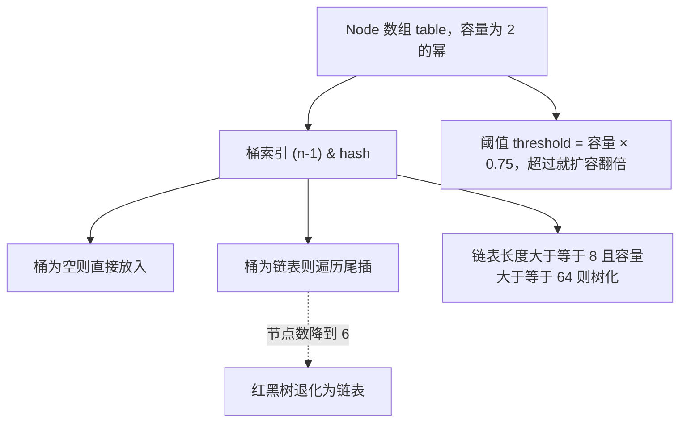
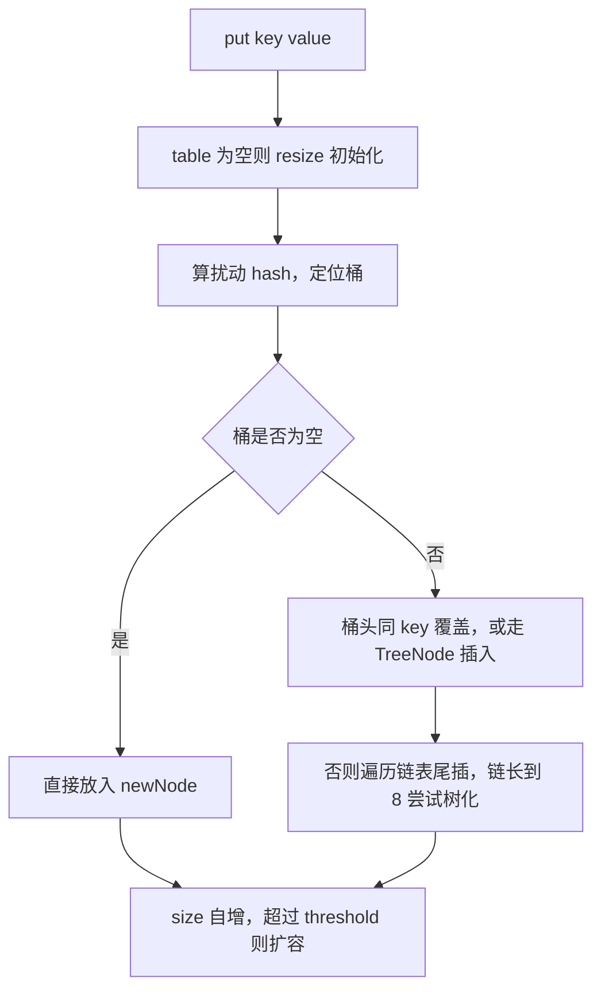

# 03 · 集合框架与 Java 基础 速记版（考前 10 分钟扫一遍）

> **一句话主线**：集合考的是 **JDK 做了哪些权衡**（2 的幂 = 位运算、0.75 = 时空折中、红黑树 = 防退化、尾插 = 避免死循环、CHM 分段锁 → CAS+锁桶头 = 细粒度并发）；Java 基础考的是 **语义精确性**（只有值传递、equals 必配 hashCode、金额用 BigDecimal、装箱缓存让小整数 `==` 为真、擦除是编译期行为、JDK 代理受单继承约束所以必须基于接口）。所有「为什么」最终都指向：**把复杂度前移到初始化/编译期，换热路径的速度与安全**。

## 集合（10 条）

| # | 面试题 | 关键词速答 |
|---|--------|-----------|
| 1 | HashMap 底层结构？ | JDK8 = `Node[] 数组 + 链表 + 红黑树`；JDK7 = `Entry[] 数组 + 链表`（无红黑树）；单桶链表长度 ≥ 8 且容量 ≥ 64 才树化 |
| 2 | hash 扰动函数？ | `(h = key.hashCode()) ^ (h >>> 16)`，把高 16 位异或到低位，让高位也参与索引计算，降低碰撞 |
| 3 | 索引怎么算？为什么容量必须 2 的幂？ | `(n-1) & hash`；n 为 2 的幂时等价于 `hash % n` 但更快，且 `n-1` 低位全 1 → 分布更均匀，扩容还能免重算 |
| 4 | put 流程（5 步）？ | ① table 空 → resize 初始化 ② 桶空 → 直接放 ③ 桶头同 key / 是树 → 对应处理 ④ 遍历链表尾插，长度到 8 尝试树化 ⑤ 同 key 覆盖，`++size > threshold` 则扩容 |
| 5 | 为什么负载因子 0.75 / 树化阈值 8？ | 0.75 = 空间与时间折中，此时桶长服从泊松分布(λ≈0.5)，出现 8 个元素的概率约 6e-8 → 树化阈值定 8（防恶意哈希碰撞退化）；退化阈值 6 是为了留缓冲、避免反复树化/链化振荡 |
| 6 | 扩容怎么扩？为什么不用重算索引？ | 容量翻倍；JDK8 看 `(e.hash & oldCap) == 0`：为 0 留原位 j，为 1 移到 `j + oldCap`，拆成 lo/hi 两条链，无需重算 hash（JDK7 是重算 + 头插） |
| 7 | HashMap 为什么线程不安全？ | JDK7：并发扩容 + 头插法 → 链表成环 → get 死循环 CPU 100%；JDK8：改尾插无死循环，但仍会丢数据（非原子 `tab[i]=newNode`、`++size` 非原子） |
| 8 | ConcurrentHashMap JDK7 vs JDK8？ | JDK7：`Segment[] 分段锁`（继承 ReentrantLock，默认并发度 16，get 无锁靠 volatile）；JDK8：**放弃 Segment**，`Node[] + CAS(空桶插入/初始化) + synchronized(锁桶头)`，size 用 CounterCell 分散计数，扩容多线程协助（ForwardingNode/MOVED） |
| 9 | ArrayList vs LinkedList？扩容几倍？ | ArrayList = 数组（随机访问 O(1)、中间增删 O(n)、扩容 **1.5 倍**、默认容量 10 但懒加载）；LinkedList = 双向链表（头尾 O(1)、随机访问 O(n)、内存开销大）；**实际 99% 选 ArrayList**（内存连续、CPU 缓存友好、arraycopy 向量化） |
| 10 | fail-fast / fail-safe / COW？ | fail-fast：`modCount` vs `expectedModCount`，遍历中被结构修改抛 ConcurrentModificationException（ArrayList/HashMap）；fail-safe：遍历快照/弱一致不抛（CopyOnWriteArrayList、ConcurrentHashMap）；**COW = 写时复制 + 加锁写、无锁读，读多写极少才用**（如风控预警规则列表） |

## 两图记住 HashMap（配合上面第 1、4 条看）

**图 3-11：HashMap 的数据结构**

**图 3-12：HashMap 的 put 流程**

## Java 基础（12 条）

| # | 面试题 | 关键词速答 |
|---|--------|-----------|
| 11 | String 为什么不可变？ | `final class` + `private final char[]`（JDK9 起 `byte[] + coder`，Compact Strings 省一半内存）；动机：安全（类名/URL/路径）、可缓存 hash、线程安全、常量池共享；JDK7 起常量池从永久代移到堆 |
| 12 | `new String("a")` 创建几个对象？ | **1 或 2 个**：常量池无 "a" → 2 个（池 + 堆）；已有 → 1 个（堆）；标准答「2 个」后必须补「取决于常量池」 |
| 13 | == / equals / hashCode？为什么重写 equals 必须重写 hashCode？ | `==` 比基本类型值 / 引用地址；`equals` 默认同 `==`；**hashCode 契约：equals 相等 → hashCode 必相等**；哈希集合先按 hashCode 定位桶、再 equals 比较，只重写一个会导致去重失败 / get 不到（放不进同一个桶） |
| 14 | HashMap / Hashtable / synchronizedMap？ | Hashtable：方法级 synchronized、锁全表、禁 null，已淘汰；`Collections.synchronizedMap`：装饰器 + 一把大锁，迭代仍需手动加锁；ConcurrentHashMap：CAS + 锁桶头，细粒度并发 |
| 15 | LinkedHashMap 与 LRU？ | 继承 HashMap，Entry 多 `before/after` 双向链表；`accessOrder=true` → 按访问顺序，头节点即最久未用；重写 `removeEldestEntry` 返回 `size() > maxSize` 三行实现 LRU（`super(maxSize, 0.75f, true)`） |
| 16 | TreeMap 是什么？ | 红黑树实现，key 须 Comparable 或传 Comparator，get/put O(log n)，按 key 有序；有 `ceilingKey/floorKey/subMap/headMap` 等范围 API，适合时间窗口统计；并发有序用 ConcurrentSkipListMap |
| 17 | HashSet 去重原理？ | 底层就是 HashMap，value 存常量 `PRESENT`；`add` 返回 `map.put(e, PRESENT) == null`；去重靠 `hashCode` + `equals`，自定义对象必须两个都重写 |
| 18 | 泛型擦除与 PECS？ | 泛型是编译期概念，运行期擦成上界（无界 → Object），编译器插 `checkcast`；因此不能 `new T[]`、不能 `instanceof List<String>`、不能按泛型重载；**PECS：extend 只能 get（生产者），super 只能 put（消费者）** |
| 19 | JDK 代理为什么必须基于接口？CGLIB？ | JDK 代理生成的类已 `extends Proxy`，**Java 单继承**无法再继承目标类，只能通过 `implements` 接口；CGLIB 用 ASM 生成目标类的子类，无需接口，但 final 类/方法不能代理；Spring Boot 2.x 默认全 CGLIB |
| 20 | 异常体系？finally 和 return 顺序？ | `Throwable → Error(不可恢复) / Exception → RuntimeException(非受检) + 受检(IOException)`；**finally 一定执行**（除 System.exit）；try 的 return 先求值暂存 → 执行 finally → 返回暂存值；finally 里 return 会覆盖 + 吞异常，禁用；try-with-resources 会「抑制」close 的异常不覆盖主异常 |
| 21 | Java 是值传递吗？深拷贝 vs 浅拷贝？ | **只有值传递**，对象传的是引用副本（改内部状态生效，重新赋值不生效）；浅拷贝 = `Object.clone()` 共享引用字段；深拷贝 = 递归 clone / 序列化 / 拷贝构造；不可变字段（String/BigDecimal）浅拷贝共享是安全的 |
| 22 | 金额为何不能用 double？自动装箱缓存？ | double 是二进制浮点，`0.1+0.2=0.30000000000000004`；金额用 `BigDecimal`（**必须 `new BigDecimal(String)` 或 `valueOf(double)`，禁止 `new BigDecimal(double)`**，比较用 `compareTo` 不用 `equals`，除法必须指定精度）；`Integer.valueOf` 缓存 **-128~127**：`Integer a=127,b=127 → a==b` true，`128` 则 false |

## 必背数字与参数速查

| 项 | 值 | 说明 |
|----|----|------|
| HashMap 默认初始容量 | 16 | `DEFAULT_INITIAL_CAPACITY`，**懒加载**，首次 put 才建表 |
| HashMap 负载因子 | 0.75 | 空间/时间折中；`threshold = capacity * 0.75` |
| HashMap 最大容量 | 1 << 30 | 约 10.7 亿，`MAXIMUM_CAPACITY` |
| HashMap 树化阈值 | 8 | `TREEIFY_THRESHOLD`；泊松分布下概率约 6e-8 |
| HashMap 退化阈值 | 6 | `UNTREEIFY_THRESHOLD`；与 8 之间留缓冲防振荡 |
| HashMap 最小树化容量 | 64 | `MIN_TREEIFY_CAPACITY`；容量 < 64 时优先扩容而非树化 |
| HashMap 初始容量取整 | 向上取 2 的幂 | `tableSizeFor`；传 1000 → 1024 |
| JDK7 HashMap 扩容条件 | `size >= threshold 且桶非空` | 与 JDK8 的 `++size > threshold` 不同 |
| ConcurrentHashMap（JDK7）默认并发度 | 16 | `DEFAULT_CONCURRENCY_LEVEL`，即 16 个 Segment |
| ConcurrentHashMap（JDK8）MOVED | -1 | ForwardingNode 的 hash 值，表示该桶正在扩容 |
| ConcurrentHashMap 禁 null | key/value 都不许 | 并发下无法区分「不存在」与「值为 null」 |
| ArrayList 默认容量 | 10 | 懒加载，首次 add 才分配 |
| ArrayList 扩容倍数 | 1.5 | `oldCap + (oldCap >> 1)` |
| Integer 缓存区间 | -128 ~ 127 | `IntegerCache`；可用 `-XX:AutoBoxCacheMax` 调大 |
| 浮点精度反例 | 0.1 + 0.2 = 0.30000000000000004 | double 二进制表示误差 |
| BigDecimal 比较 | 用 compareTo | `2.0` 与 `2.00` equals 为 false（scale 不同） |
| 并行流默认池并行度 | CPU 核数 - 1 | `ForkJoinPool.commonPool()` |
| String 不可变默认 | final class + final 数组 | JDK9 起 `byte[] + coder`（Compact Strings） |
| 字符串常量池位置 | JDK7 前永久代 / JDK7 起堆 | JDK8 永久代被 Metaspace 取代 |
| serialVersionUID | 必须显式声明 | 否则类结构变化导致反序列化 `InvalidClassException` |
| JDK 版本节点 | 8 / 11 / 17 / 21 | 17、21 为 LTS；Spring Boot 3 要求 Java 17+ |

## 答题模板

**源码类问题（HashMap / ArrayList / ConcurrentHashMap）四步框架：**

1. **数据结构**：先说底层是什么（数组 + 链表 + 红黑树 / 分段锁 + 数组 / 数组），以及**JDK 版本差异**（JDK7 无红黑树、有 Segment；JDK8 有红黑树、无 Segment）。
2. **关键操作流程**：按步骤讲核心方法骨架（如 `putVal`：空表初始化 → 桶空直插 → 桶头命中 → 树/链处理 → 尾插树化 → 覆盖或 `++size` 扩容），能报出关键代码行（`(n-1) & hash`、`(e.hash & oldCap) == 0`、`casTabAt`）。
3. **设计权衡**：每个数字和设计都要能讲「为什么」——为什么 2 的幂（位运算替代取模）、为什么 0.75（时空折中 + 泊松分布）、为什么树化 8 退化 6（防退化 + 防振荡）、为什么 JDK8 抛弃 Segment（锁粒度从段降到桶）。
4. **并发 / 生产注意点**：明确线程安全性（HashMap 不安全、CHM 安全但 size 近似、COW 最终一致），以及生产用法（预估容量避免扩容抖动、复合操作要用 `computeIfAbsent`、禁用 `==` 比较包装类型、金额用 BigDecimal、遍历删除用 `removeIf`）。

**基础语义类问题（值传递 / equals / String / 泛型）三步框架：**

1. **给结论**（一句话下判断，例如「Java 只有值传递」「重写 equals 必须重写 hashCode」）。
2. **给机制**（为什么：引用副本 vs 对象本身；哈希集合先定位桶再 equals；类型擦除为了向后兼容）。
3. **给反例 / 生产坑**（`new BigDecimal(0.1)` 丢精度、`Integer 128 == 128` 为 false、`toMap` 重复 key 抛异常、COW 写时复制开销、try-with-resources 抑制异常）。

**一句话口诀**：**「结构 → 流程 → 权衡 → 生产」讲集合；「结论 → 机制 → 反例」讲基础。**
