# 04 · Spring 全家桶 精炼版（15 题）

> **模块主线**：Spring 全家桶的本质是「**用代理 + 容器把横切关注点从业务代码里抽走**」——IoC/AOP 是底座，SpringBoot 解决「怎么少写配置」，SpringCloud 解决「多个 Boot 应用怎么协同」，MyBatis 解决「ORM 怎么被容器管起来」。
>
> 所有面试题最终都落在三个问题上：**Bean 什么时候被创建、方法调用有没有被代理拦住、跨进程/跨线程时上下文还在不在**。
>
> **本文件用途**：详解的压缩版 —— 保留全部技术事实、注解、版本演进与推理链，只压表述。
> 配套：`04_Spring全家桶_详解.md`（学透，含完整代码示例）、`04_Spring全家桶_速记.md`（考前 10 分钟）。

---

## 题 1：Bean 的生命周期，@PostConstruct 和 afterPropertiesSet 谁先执行？

- **题干**：「你简历写了熟练 Spring，那先说说 Bean 的生命周期吧，创建到销毁都经历了什么？我再问一句，@PostConstruct 和 InitializingBean 的 afterPropertiesSet 哪个先跑？」

**骨架答案**
- **8 个阶段**：① **实例化**：构造器或工厂方法（`@Bean` / `FactoryBean.getObject()`）创建**原始对象**，属性全 null；源码 `AbstractAutowireCapableBeanFactory.createBeanInstance()`。
  - ② **属性填充**：`populateBean()` 依赖注入，注意 **AOP 代理此时还没生成**。
  - ③ **Aware 回调**：依次 `BeanNameAware`、`BeanClassLoaderAware`、`BeanFactoryAware`；ApplicationContext 容器还经 `ApplicationContextAwareProcessor` 回调 `EnvironmentAware`、`ApplicationContextAware` 等。
  - ④ **`BeanPostProcessor.postProcessBeforeInitialization`**：**`@PostConstruct` 在这一步被 `CommonAnnotationBeanPostProcessor` 执行**。
  - ⑤ **初始化**：顺序 `@PostConstruct` → `InitializingBean.afterPropertiesSet()` → 自定义 `init-method`，所以 **`@PostConstruct` 一定早于 `afterPropertiesSet`**。
  - ⑥ **`BeanPostProcessor.postProcessAfterInitialization`**：**AOP 代理在这里生成**（`AbstractAutoProxyCreator.wrapIfNecessary()` 判断需增强就返回代理对象替换原始对象）。
  - ⑦ **就绪使用**：进一级缓存 `singletonObjects`。
  - ⑧ **销毁**：容器关闭（`ctx.close()` / `DisposableBeanAdapter.destroy()`）顺序 `@PreDestroy` → `DisposableBean.destroy()` → 自定义 `destroy-method`；**prototype 作用域 Bean，Spring 不管理销毁**。
- 一句话记忆：**实例化 → 属性填充 → Aware → BPP.before → @PostConstruct/afterPropertiesSet/init-method → BPP.after(生成代理) → 使用 → @PreDestroy/destroy/destroy-method**。

**图 4-1：Bean 的完整生命周期**
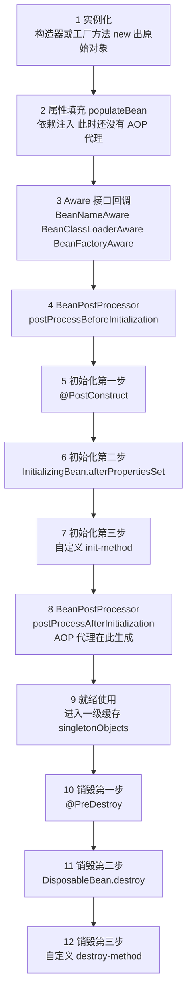

```java
@Component public class RiskEngineWarmUpBean implements InitializingBean, DisposableBean {
    public RiskEngineWarmUpBean() { log.info("1. 构造器（实例化）"); }
    @PostConstruct public void postConstruct() { log.info("2. @PostConstruct 先执行（只做轻量本地校验）"); }
    @Override public void afterPropertiesSet() { log.info("3. afterPropertiesSet 后执行"); }
    @Override public void destroy() { log.info("5. destroy（容器关闭）"); }
}
// 重逻辑（预热风控规则）放 ApplicationReadyEvent：此时 refresh 完成、远程调用/线程池/数据源全就绪
```
📦 演示生命周期回调顺序与「别在 @PostConstruct 里做重活」的替代。

**为什么 / 取舍**
- **Aware / BPP / init 三段分层是为「扩展点分层」**：Aware 给 Bean 拿到容器基础设施；BPP 给框架（AOP、`@PostConstruct`、`@Async` 校验）插手；init 才是用户自己的初始化逻辑——让「框架扩展」和「业务初始化」互不污染。
- **AOP 代理必须放在 BPP.after，不能实例化后立刻生成**：否则属性填充、Aware 回调、init-method 全都会作用在代理对象上，而代理对象的方法调用会走切面，**导致 Bean 自身初始化逻辑被自己的切面拦截，语义就乱了**；放 after 保证「Bean 自己先完整地活一遍，最后再穿上代理这件外套」。
- **prototype 不管理销毁是权衡**：容器不持有 prototype 引用（否则内存泄漏），不持有就无法回调销毁方法，只能交给调用方或 GC——「内存安全」优先于「生命周期完整性」。

**企业实际处理**
- Boot 3.x / JDK 17 业务代码基本不用 `InitializingBean`，统一用 `@PostConstruct`（符合 JSR-250 标准、可读性好）或「构造器 + `@Autowired` 做初始化」。
- 「Bean 创建完成后做一件事」团队约定用 `ApplicationRunner` / `CommandLineRunner`（容器 refresh 完成后执行）或 `ApplicationListener<ApplicationReadyEvent>`，而不是往 `@PostConstruct` 塞重逻辑——此时容器还没完全就绪，发远程调用、启定时任务容易出问题。
- 上线前用 Actuator `/actuator/beans`、`/actuator/conditions` 排查 Bean 是否被创建、哪些自动配置生效。

**易错 / 加分**
- ⚠️ `@PostConstruct`（before 阶段，`CommonAnnotationBeanPostProcessor`）与 `@Autowired`（属性填充阶段，`AutowiredAnnotationBeanPostProcessor`）都是 BPP，但**压根不在同一环节**，别混答。
- 💡 `BeanPostProcessor` 是容器级组件，只对**它注册之后**创建的 Bean 生效；目标 Bean 被 AOP 代理时 `@PostConstruct` 仍在原始对象上执行，但注入到别的 Bean 里的是代理——这解释了「为什么在 `@PostConstruct` 里调自己的 `@Transactional` 方法依然失效」（self-invocation，见 Q6）。

---

## 题 2：依赖注入三种方式 + 循环依赖，三级缓存为什么是三级？

- **题干**：「Spring 有几种依赖注入方式？你平时用哪种？再问你一个经典的——A 依赖 B、B 依赖 A 的循环依赖，Spring 是怎么解决的？它为什么需要三级缓存，二级不行吗？那构造器注入的循环依赖能解决吗？」

**骨架答案**
- **三种注入**：
  - **构造器注入**（构造方法 + `final` 字段）——**官方推荐**，依赖不可变、强依赖、启动即暴露缺失依赖、天然规避循环依赖（直接报错），缺点是参数多时构造器臃肿；
  - **Setter 注入**（`@Autowired` 修饰 setter）——适合可选依赖、可重新配置，缺点依赖可为 null 可能 NPE；
  - **字段注入**（`@Autowired` 修饰字段）——**不推荐**，无法 `final`、不启容器就是 null 无法单测、隐藏依赖、易诱发循环依赖。
- 官方推荐构造器：`final` 保证不可变、单测无需容器、参数过多本身就是「职责太重」的坏味道。
- **三级缓存**（都在 `DefaultSingletonBeanRegistry`）：一级 `singletonObjects` 存完整可用的单例 Bean；
  - 二级 `earlySingletonObjects` 存提前暴露的「半成品」Bean（可能是代理）；
  - 三级 `singletonFactories` 存 `ObjectFactory` 工厂（lambda，内含 `getEarlyBeanReference` 逻辑）。
- **A↔B 流程（字段/Setter 注入）**：① 创建 A：实例化得**原始对象**，**属性填充之前**把 A 的 `ObjectFactory` 放进三级缓存；
  - ② 填充 A 发现需要 B → 创建 B；
  - ③ 创建 B：实例化、放 B 的 `ObjectFactory` 到三级缓存；填充 B 发现需要 A；
  - ④ B 找 A：一级无 → 二级无 → **从三级拿到 A 的 `ObjectFactory` 调 `getObject()`**，其内部走 `getEarlyBeanReference()`，A 需要 AOP 就**在这里提前生成 A 的代理**；然后把该对象放进**二级缓存**并删除三级缓存；
  - ⑤ B 注入提前暴露的 A（或 A 的代理），B 完成初始化进一级缓存；
  - ⑥ A 继续注入 B，A 完成初始化进一级缓存。

**图 4-2：三级缓存解决循环依赖的时序**
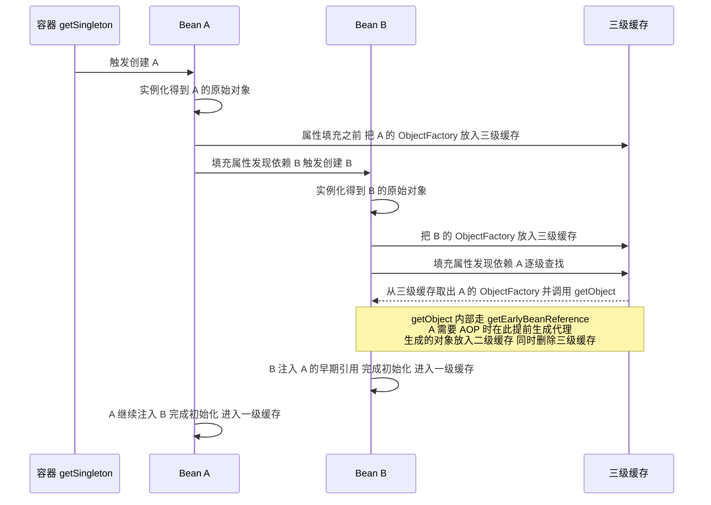

- **为什么必须三级、二级不够**：若只有二级（且直接存「提前暴露对象」），就必须在**每个 Bean 实例化后立刻判断「它要不要被 AOP 代理」**，问题有二：
  - ① **破坏正常生命周期语义**——正常代理在 `postProcessAfterInitialization`（初始化完成后）才生成，提前生成意味着切面可能在属性填充 / init 阶段就被触发；
  - ② **所有 Bean 被迫提前处理**，哪怕它根本没有循环依赖，性能与语义双重浪费。
- **三级缓存的本质是「延迟 + 按需」**：三级缓存存的是一个 `ObjectFactory` 工厂（lambda），只有在**真的发生循环依赖、有人来取它**的时候才调用 `getEarlyBeanReference()` 去生成（或复用）代理；
  - 没有循环依赖的绝大多数 Bean 这个工厂永远不会被调用，代理依然老老实实在 BPP.after 阶段生成。即**用「一层工厂」换来「不破坏生命周期语义 + 按需代理」**。

**图 4-3：为什么必须用三级缓存而非二级缓存**
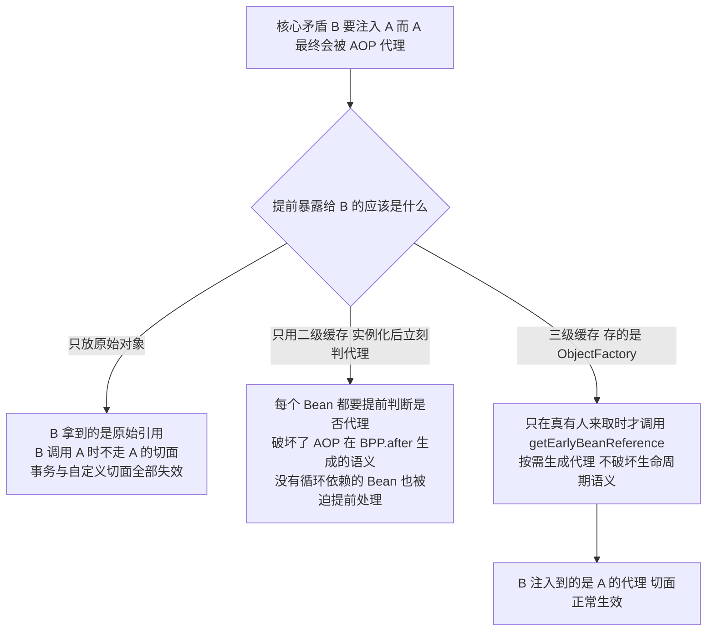

- **为什么提前暴露的必须是代理而不是原始对象**：若 B 注入的是 A 的**原始对象**而 A 最终被代理，则 B 持有原始引用，**B 调用 A 的方法时不会走 A 的切面**（`@Transactional`、`@Async`、自定义切面全部失效）。
  - 为了正确性，B 必须注入到 A 的**代理**，所以 `getEarlyBeanReference()` 必须在这里就把代理建出来——这就是三级缓存不能退化成「只存原始对象」的原因。
- **构造器注入的循环依赖无解**：循环依赖的发生点在**实例化阶段**（`createBeanInstance` 调构造器），而三级缓存提前暴露的前提是「对象已经 new 出来了、只是还没填属性」；
  - 构造器注入要调 A 的构造器就必须要 B 的实例，要 B 的实例就必须要 A 的实例，**第一步就卡死，没有任何半成品可以提前暴露**，Spring 只能抛 `BeanCurrentlyInCreationException`。
  - 解法：① 改用 Setter / 字段注入；② 依赖上打 `@Lazy`（注入一个代理，首次真正调用时才 `getBean`）；③ 用 `ObjectProvider` / `ApplicationContext.getBean()` 延迟获取；④ **最根本：重新设计，循环依赖本身就是坏味道**。

```java
// ❌ 反模式：RiskRuleService 与 AlertService 互相注入，Spring Boot 2.6+ 直接启动失败
// 正确姿势：下沉接口 AlertNotifier、单向依赖
public interface AlertNotifier { void notify(AlertEvent event); }                             // 告警能力抽象
@Service public class RiskRuleService { private final AlertNotifier n; public RiskRuleService(AlertNotifier n) { this.n = n; } }   // 依赖抽象，不依赖实现类
@Service public class AlertService implements AlertNotifier { private final AlertChannelRepository repo; }   // 只依赖仓储，不再依赖 RiskRuleService
```
📦 演示「构造器注入 + 接口下沉」如何从根上消除循环依赖。

**为什么 / 取舍**
- **「启动期失败」优于「运行期失败」**：构造器注入让循环依赖在启动时炸掉，逼你在开发阶段解决；字段注入把问题藏到运行期，监管系统里不可接受。
- **三级缓存是「语义正确性」优先于「实现简单」**：二级缓存实现更简单，但必须以破坏 Bean 生命周期为代价；Spring 选择多一层工厂来保住「AOP 在 BPP.after 生成」这条铁律——典型的「用一点复杂度和微小的内存开销，换语义的纯粹性」。
- **`@Lazy` 是「延迟初始化」而非「解决循环」**：它只是把循环依赖的触发点从启动期推迟到第一次调用，若两个 Bean 真的在运行期互相调用且形成死锁式的构造，依然会出问题——治标不治本。

**企业实际处理**
- Spring Boot 2.6 起**默认禁止循环依赖**（`spring.main.allow-circular-references=false`），启动直接报错；团队不要靠 `allow-circular-references=true` 糊过去，而是重构拆解循环依赖。
- 业务代码统一**构造器注入**（配合 Lombok `@RequiredArgsConstructor` + `private final`），循环依赖会在启动期直接暴露。
- 期权风控 `RiskRuleService` ↔ `AlertNotifyService` 双向依赖，正确做法是抽一个 `AlertNotifier` 接口下沉，两边都依赖抽象。

**易错 / 加分**
- ⚠️ 二级缓存里存的「可能是原始对象、也可能是代理」；**如果没有循环依赖，二级缓存几乎不被用到**（一级就够了），它存在的意义是配合三级缓存的「提前暴露」中转。
- 💡 `getEarlyBeanReference()` 是 `SmartInstantiationAwareBeanPostProcessor` 接口的方法，`AbstractAutoProxyCreator` 实现了它——把「三级缓存」和「AOP」两题串起来；
  - `@Async`、`@Transactional` 失效和循环依赖是**同源问题**（注入的是原始对象而非代理）；
  - 提 `allowCircularReferences` 和 `allowRawInjectionDespiteWrapping` 两个开关说明你读过 `AbstractAutowireCapableBeanFactory`。

---

## 题 3：BeanFactory、FactoryBean、ApplicationContext 有什么区别？

- **题干**：「Spring 里 BeanFactory 和 FactoryBean，名字就差一个词，你能说说区别吗？再对比一下 ApplicationContext 和 BeanFactory。」

**骨架答案**
- **BeanFactory = 最底层的 IoC 容器接口**：核心方法就一个 `getBean()`，**默认懒加载**（用到才创建），只提供最基础的 DI 能力；真正干活的实现是 `DefaultListableBeanFactory`。
- **FactoryBean = 一个「能生产对象的 Bean」**：它是普通 Bean，但容器对它特殊对待——`getBean("&myFactoryBean")` 拿的是 **FactoryBean 本身**（前面加 `&`），`getBean("myFactoryBean")` 拿的是 `FactoryBean.getObject()` 返回的**产品对象**。
  - 三个方法 `getObject()` / `getObjectType()` / `isSingleton()`。
  - 典型用途：创建过程复杂、无法简单 new 的对象；Spring 自己大量使用——`SqlSessionFactoryBean`（生产 `SqlSessionFactory`）、`ProxyFactoryBean`（生产 AOP 代理）。
- **ApplicationContext = BeanFactory 的超集（面向应用）**：继承 `BeanFactory`，额外提供 **国际化**（`MessageSource`）、
  - **事件发布**（`ApplicationEventPublisher` / `ApplicationListener`）、
  - **资源加载**（`ResourcePatternResolver`，`classpath*:` 批量加载）、
  - **自动注册 BeanPostProcessor / BeanFactoryPostProcessor**（BeanFactory 需手动 `addBeanPostProcessor`）、
  - **默认预实例化**（`refresh()` 时创建所有非懒加载单例，启动即暴露错误）。
- 常见实现：`AnnotationConfigApplicationContext`（注解）、`ClassPathXmlApplicationContext`（XML）、SpringBoot 的 `AnnotationConfigServletWebServerApplicationContext`。
- 一句话对比：**BeanFactory 是「发动机」，ApplicationContext 是「整车」；FactoryBean 是「车床」，它本身是个 Bean，但它产出的是另一个对象。**

**为什么 / 取舍**
- **FactoryBean 解决「创建逻辑与使用逻辑分离」**：调用方只想 `@Autowired` 拿到一个 `SqlSessionFactory`，不想知道它内部解析了多少 XML、装了多少插件；把脏活封进 `FactoryBean.getObject()`——封装思想在容器层面的体现。
- **ApplicationContext 是「应用级容器」而 BeanFactory 是「基础容器」**：分层是为了让轻量场景（MyBatis 内嵌的小容器、单元测试）能用最小实现，而完整应用用重一点的 ApplicationContext——**分层 = 让不同场景各取所需**。
- **ApplicationContext 默认预实例化是取舍**：牺牲启动速度，换来「启动即暴露配置错误」和「运行时无锁快速 getBean」；SpringBoot 的**懒加载优化**（Q9）正是把这个默认反过来。

**企业实际处理**
- 业务开发基本只接触 `ApplicationContext`。
- `FactoryBean` 的使用场景是**封装复杂的第三方对象创建**：把 Kafka Producer、动态多数据源的 `DataSource`、加密后的 `SqlSessionFactory` 用 `FactoryBean` 包起来，让它们像普通 Bean 一样被注入。
- 需要拿到容器本身时用 `ApplicationContextAware` 或直接注入 `ApplicationContext`，但团队规范通常禁止业务代码直接 `getBean()`（服务定位器反模式，破坏依赖可见性）。

**易错 / 加分**
- ⚠️ 记牢 `&` 前缀：`getBean("&x")` 拿到 FactoryBean 本身，`getBean("x")` 拿到产品对象。
- 💡 举 Spring 源码里的 FactoryBean 例子（`SqlSessionFactoryBean`、`ProxyFactoryBean`、`LocalContainerEntityManagerFactoryBean`）；补 `BeanFactoryPostProcessor` 与 `BeanPostProcessor` 的区别——
  - 前者在**所有 BeanDefinition 加载完、Bean 实例化前**执行（可改 BeanDefinition，如 `PropertySourcesPlaceholderConfigurer` 解析占位符），
  - 后者在**Bean 实例化过程中**执行（如 `AutowiredAnnotationBeanPostProcessor`）。

---

## 题 4：AOP 原理，JDK 代理和 CGLIB 怎么选？拦截器、过滤器、AOP 有什么区别？

- **题干**：「Spring 的 AOP 底层是怎么实现的？JDK 动态代理和 CGLIB 有什么区别，Spring 怎么选？顺便问一下，过滤器和拦截器、还有 AOP，这三个经常有人搞混，你能说清它们的区别和执行顺序吗？」

**骨架答案**
- **JDK 动态代理**：基于**接口**，`Proxy.newProxyInstance` 运行时生成实现同一接口的代理类；前提目标类**必须实现接口**；代理与目标**兄弟**（同接口）；创建快、调用略慢（反射）。
- **CGLIB**：基于**继承**，用 ASM 字节码生成目标类的**子类**、覆写方法；前提目标类**不能是 final**，方法不能 `final`/`private`/`static`；代理与目标**父子**（子类）；创建慢（生成字节码）、调用快。
- **选择规则**：传统 Spring（XML 时代）**有接口 → JDK 代理**、**无接口 → CGLIB**；
  - **Spring Boot 2.x 起默认走 CGLIB**（`AopAutoConfiguration` 里 `spring.aop.proxy-target-class` 默认 `true`）——原因：CGLIB 能代理到接口里没有的方法（如 `@Transactional` 标在实现类方法上），
  - 也避免了「注入类型不是接口时 JDK 代理 `ClassCastException`」的坑；
  - 强制指定用 `@EnableAspectJAutoProxy(proxyTargetClass = true/false)`。

**图 4-4：AOP 代理的选择规则**
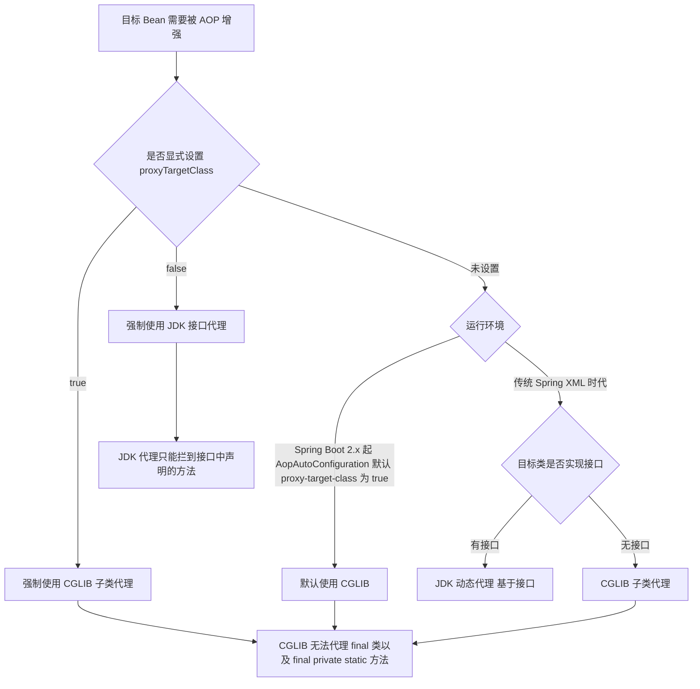

- **@Aspect 通知顺序**（正常返回时）：`@Around(proceed 之前)` → `@Before` → 目标方法 → `@AfterReturning` → `@After` → `@Around(proceed 之后)`；
  - 异常时：`@Around` → `@Before` → 目标抛异常 → `@AfterThrowing` → `@After` → `@Around` 的异常部分。
  - 多个切面之间用 `@Order`（值越小越靠外）控制；**外层切面先进入、后退出**（洋葱模型）。
- **Filter / Interceptor / AOP 对比**：Filter 属 **Servlet 规范**（`jakarta.servlet.Filter`），在 **DispatcherServlet 之前/之后**、最外层，只能拿 `ServletRequest`（拿不到 Handler 信息），
  - 用 Spring Bean 需 `FilterRegistrationBean` 注册，粒度 **URL**，典型做编码、CORS、XSS、TraceId 入口埋点；
  - Interceptor 属 **SpringMVC**（`HandlerInterceptor`），在 HandlerMapping 找到 Handler 之后，`preHandle` 的 `Object handler` 即 `HandlerMethod`，可直接 `@Autowired`，粒度 **Handler（Controller 方法）**，做登录鉴权、权限、日志；
  - AOP 属 **Spring AOP**（`@Aspect`），作用于任意被 Spring 管理的 Bean 方法，`JoinPoint` 拿方法签名与参数，粒度**方法**，做事务、缓存、限流、日志（业务方法级）。
- **执行顺序**（一次请求）：`Filter#doFilter(before)` → `DispatcherServlet` → `Interceptor#preHandle` → `AOP @Around / @Before` → 
  - Controller 方法 → `AOP @AfterReturning / @After` → `Interceptor#postHandle` → `Interceptor#afterCompletion` → `Filter#doFilter(after)`。
  - `postHandle` 在视图渲染前执行，`afterCompletion` 在**整个请求完成后**（含渲染）执行、无论成功失败都会调。

**图 4-5：过滤器、拦截器、AOP 的执行顺序**
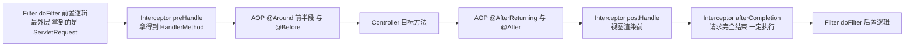

**为什么 / 取舍**
- **三层拦截体系是「分层拦截、各司其职」**：Filter 在最外层，能做与 SpringMVC 无关的通用处理（编码、TraceId）；Interceptor 在 SpringMVC 内部，能拿到 Handler 元信息做鉴权；AOP 在方法级，能精细到参数与返回——**通用能力放外层、业务能力放内层，各自避免越界**。
- **SpringBoot 默认 CGLIB 是「减少一类坑」的取舍**：CGLIB 代价是生成子类（轻微开销、不能代理 final），但换来「不强制目标类实现接口」和「代理到实现类自己的方法」，对注解驱动为主的 SpringBoot 应用明显划算。
- **AOP 基于继承的 CGLIB 决定了「private/final/static 方法切不到」**：子类无法覆写 private 方法，所以 `@Transactional` 标在 private 方法上必然失效——这直接是 Q6 的一个失效场景。

**企业实际处理**
- 期权风控实时预警服务里：**Filter** 用来做 TraceId 生成/提取和 CORS；**Interceptor** 做接口级鉴权和限流计数；**AOP** 做 `@Transactional`、接口耗时埋点、`@SentinelResource`。
- 团队规范：**不要用 AOP 做鉴权**（粒度用错、异常难统一），鉴权放 Interceptor 或网关；**不要用 Interceptor 做事务**（拿不到方法级切入点），事务用 AOP。
- 下单 / 预警这类**强事务**逻辑，AOP 代理必须生效——回到 Q2 的结论：不能自调用、不能 private、Bean 必须被容器管理。

**易错 / 加分**
- ⚠️ `@Order` 对 Filter 无效（Filter 顺序用 `@Order` 或 `FilterRegistrationBean.setOrder()`），Interceptor 顺序用 `InterceptorRegistry.order()`。
- 💡 Spring AOP **只支持方法级**，字段/构造器的「环绕」做不到（对比 AspectJ 编译期织入、可到字段级）；`AopContext.currentProxy()` 暴露当前代理可解决自调用，但需 `@EnableAspectJAutoProxy(exposeProxy = true)`，且**本质是绕开设计问题**，优先重构。

---

## 题 5：一次 HTTP 请求在 SpringMVC 里是怎么走完的？@RequestBody 什么原理？

- **题干**：「说一说一个 HTTP 请求从进来到返回，在 SpringMVC 内部经历了哪些组件？@RequestBody 是怎么把 JSON 变成对象的？不带 @RequestBody 的参数又是怎么绑定的？」

**骨架答案**
- **完整流程（9 步）**：① 请求到达 **`DispatcherServlet`**（前端控制器、总入口，容器启动时注册）；
  - ② 经 **`HandlerMapping`**（实际是 `RequestMappingHandlerMapping`）按 URL + 请求方法**匹配到 `HandlerExecutionChain`**（含目标 `Handler` 即 `HandlerMethod`，封装 Controller 实例和 Method，以及一组 `HandlerInterceptor`）；
  - ③ **依次执行 `Interceptor#preHandle`**，任意一个返回 `false` 请求即中断（鉴权失败走这里）；
  - ④ 经 **`HandlerAdapter`**（`RequestMappingHandlerAdapter`）适配并调用 Handler——用适配器模式把「各种类型的 Handler」统一成 `handle()` 调用；
  - ⑤ **参数绑定**：遍历方法参数，为每个找对应的 **`HandlerMethodArgumentResolver`**——普通 POJO / `@RequestParam` / `@PathVariable` → `ServletModelAttributeMethodProcessor` / `RequestParamMethodArgumentResolver`；
  - `@RequestBody` → `RequestResponseBodyMethodProcessor`；`HttpServletRequest`、`Model` 等 → `ServletRequestMethodArgumentResolver`；
  - ⑥ 执行 Controller 方法得到返回值；
  - ⑦ **返回值处理**：`ModelAndView` → `ModelAndViewMethodReturnValueHandler` 交 `ViewResolver` 解析渲染；
  - `@ResponseBody` / `@RestController` → `RequestResponseBodyMethodProcessor` 用 **`HttpMessageConverter`** 序列化成 JSON 写入响应体（`MappingJackson2HttpMessageConverter`）；
  - ⑧ `Interceptor#postHandle`（视图渲染前）；
  - ⑨ `Interceptor#afterCompletion`（请求完全结束后，无论成功失败）+ 异常处理（`HandlerExceptionResolver`）。
- **@RequestBody 原理**：参数解析器是 `RequestResponseBodyMethodProcessor`，它遍历 `HttpMessageConverter` 列表，找到能处理 `application/json` 的转换器（通常是 `MappingJackson2HttpMessageConverter`），
  - 调用 `read()` 用 Jackson 把请求体反序列化成对象。
  - **前提：请求头必须 `Content-Type: application/json`**，否则报 `HttpMediaTypeNotSupportedException`（415）——线上最常见的「@RequestBody 报 415」根因。
  - 反向的 `@ResponseBody` 走同一个 `RequestResponseBodyMethodProcessor` 的 `write()`。
- **不带 @RequestBody 的绑定原理**：简单类型 + `@RequestParam` → 从 `request.getParameter()` 取；
  - 复杂对象（无注解的 POJO）→ 走 `ModelAttribute` 机制，**从 query string / form-data 逐字段 setter 绑定**（`WebDataBinder` + `ConversionService` 做类型转换，如 String→Date）；
  - `application/x-www-form-urlencoded` / `multipart/form-data` 是表单绑定，`application/json` 才是 `@RequestBody`——**两者不通用**，混用会拿到 null。

**图 4-6：SpringMVC 一次请求的完整流程**
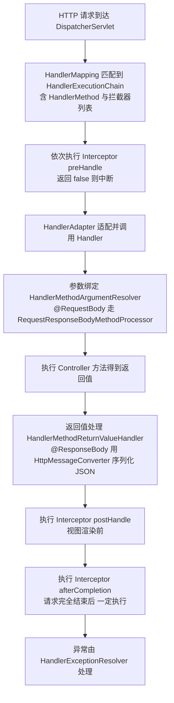

**为什么 / 取舍**
- **是「前端控制器模式 + 策略模式」的组合**：`DispatcherServlet` 是唯一入口（前端控制器），`HandlerMapping`/`HandlerAdapter`/`HandlerMethodArgumentResolver`/`HttpMessageConverter` 全是**策略接口**——
  - 新增一种参数解析方式、一种消息格式只需加一个 Resolver/Converter，不用改核心流程，**开闭原则在框架层面的落地**。
- **参数解析与消息转换分离**：`ArgumentResolver` 负责「从请求里取原始数据」，`HttpMessageConverter` 负责「数据 ↔ 对象的序列化」；分离后同一个 `@RequestBody` 能支持 JSON/XML/Protobuf（换 Converter 即可），**职责单一、可替换**。
- **`afterCompletion` 才是资源释放的正确位置**：`postHandle` 在异常时不一定执行（Handler 抛异常时被跳过），而 `afterCompletion` 一定会执行；所以 TraceId 清理、ThreadLocal 清理必须放 `afterCompletion`——放错地方就是 ThreadLocal 泄漏的经典 bug。

**企业实际处理**
- 风控预警平台对外接口统一用 `@RestController` + `@RequestBody`（JSON），DTO 用 `@Valid` + `@NotNull` 做参数校验（`MethodArgumentNotValidException` 由 `@RestControllerAdvice` 统一转 400）。
- 统一响应包装 `Result<T>` + `@RestControllerAdvice` 全局异常（Q9），保证所有接口错误格式一致。
- 大报文（如批量规则导入）不走 `@RequestBody`（会占内存），改成流式读取或分片上传。

**易错 / 加分**
- ⚠️ `HandlerMapping` 匹配不到返回 404，匹配到但方法不允许返回 405；`@RequestBody` 与表单类型混用会拿到 null。
- 💡 `HandlerExceptionResolver` 的注册顺序：`ExceptionHandlerExceptionResolver`（@ExceptionHandler）优先于 `ResponseStatusExceptionResolver`（@ResponseStatus）优先于 `DefaultHandlerExceptionResolver`（框架默认异常）；
  - `RequestMappingHandlerMapping` 启动时扫描所有 `@RequestMapping` 注册到 `MappingRegistry`，匹配是 O(1) 级别（`PathPattern`，非每次遍历）；
  - Spring Boot 3 用 `PathPatternParser` 替代旧的 `AntPathMatcher`（预解析 pattern，性能更好）。

---

## 题 6：@Transactional 什么时候会失效？

- **题干**：「生产上你有没有遇到过加了 @Transactional 但事务没回滚的情况？说说 @Transactional 失效都有哪些场景，每种怎么排查、怎么改。这题你多讲点，我要看看你对事务的实战理解。」

**骨架答案**
- **8 种失效场景（逐个根因 + 修复）**：
  1. **自调用（self-invocation）**：同类方法 A 调方法 B，B 标了 `@Transactional`。
      - **根因**：事务靠 AOP 代理实现，`this.b()` 是**原始对象**内部调用，根本没经过代理，`TransactionInterceptor` 没机会介入。
      - **修复**：① 把 B 挪到另一个 Bean（首选）；② 注入自身代理 `@Autowired private XxxService self;` 然后 `self.b()`；③ `((XxxService) AopContext.currentProxy()).b()`（需 `exposeProxy=true`）；④ 用 `TransactionTemplate` 编程式事务。
      - **注意：`@EnableAspectJAutoProxy(exposeProxy = true)` 才让 AopContext 可用；`@Transactional` 标在 Controller 上调用 Service 没问题，因为跨 Bean 走的是代理。**
  2. **方法修饰符是 private**：**根因**：CGLIB 靠生成子类覆写方法，**private 方法无法被覆写**；JDK 代理只在接口方法上生效。Spring 官方明确「`@Transactional` 只对 public 方法生效」。**修复**：改成 public；或把逻辑抽到另一个 Bean 的 public 方法。
  3. **方法非 public（protected / 包级默认）**：
      - **根因**：JDK 代理基于接口（接口方法天然 public），CGLIB 理论上能覆写 protected，
      - 但 **Spring 的 `AbstractFallbackTransactionAttributeSource.computeTransactionAttribute()` 明确跳过非 public 方法**，直接返回 null（不解析事务属性）。**修复**：改 public。
  4. **异常被 catch 吞掉**：`try { ... } catch (Exception e) { log.error(...); }` 没有 rethrow。
      - **根因**：`TransactionInterceptor` 靠**捕获到异常**来决定 rollback，异常被吞就当成「正常返回」→ commit。
      - **修复**：要么 rethrow，要么在 catch 里手动 `TransactionAspectSupport.currentTransactionStatus().setRollbackOnly();`。
  5. **异常类型不匹配**：抛的是**受检异常**（如 `IOException`、自定义 `BizException extends Exception`）。
      - **根因**：Spring 默认只对 **`RuntimeException` 和 `Error`** 回滚，受检异常默认 **commit**。
      - **修复**：`@Transactional(rollbackFor = Exception.class)`（团队规范应统一带上）。
      - **自定义异常若继承 `Exception` 而不是 `RuntimeException`，又忘了写 `rollbackFor`，就一定不回滚**——最隐蔽的坑之一。
  6. **多线程 / 异步调用**：在事务方法里 `new Thread()` 或 `@Async` 里执行 DB 操作。
      - **根因**：事务上下文存在 **`TransactionSynchronizationManager` 的 ThreadLocal** 里（绑定的是 `ConnectionHolder`），子线程拿不到父线程的连接，**压根不在同一个事务**。
      - **修复**：让子线程的操作走独立事务（`REQUIRES_NEW`，但仍是独立连接、独立提交）；或用 `TransactionSynchronizationManager` 手动传递资源（不推荐）；根本方案是别在事务里开线程。
  7. **传播行为配置不当**：外层方法**没有事务**、内层用 `NOT_SUPPORTED`；或期望内层独立回滚却用了默认 `REQUIRED`（内层异常被外层 catch，外层仍提交）；或外层 catch 了 `REQUIRES_NEW` 内层的异常导致外层误提交。
      - **根因**：对传播行为语义理解错误——`REQUIRED`（默认）下内层和外层是**同一物理事务**，内层回滚会连累外层；要独立必须 `REQUIRES_NEW`。
      - **修复**：明确设计每个方法的传播语义；「内层失败不影响外层」用 `REQUIRES_NEW` 或 `NESTED`（savepoint）。
  8. **类不被 Spring 管理**：`new XxxService().doSomething()`（自己 new 的）、类没被 `@Service`/`@Component` 扫描到、多数据源下没配对应的 `TransactionManager`。
      - **根因**：没有 Bean 就没有代理，没有代理就没有事务。**修复**：确保被容器管理；多数据源时用 `@Transactional(transactionManager = "orderTxManager")` 指定事务管理器。
- **加分项（额外常被追问的两条）**：① **表引擎不支持事务**——MySQL 的 **MyISAM 引擎不支持事务**（InnoDB 才支持），加了注解也是空转；② **多数据源未配置对应的事务管理器**（即场景 8 的多数据源分支）。
  - 另：`@Transactional(readOnly = true)` 在某些驱动下只是 hint，不真阻止写；**大事务（长耗时）**会导致锁持有时间长、连接占用，是**性能问题**而非「失效」，但常被一起问。

**图 4-7：@Transactional 失效的判定决策树**
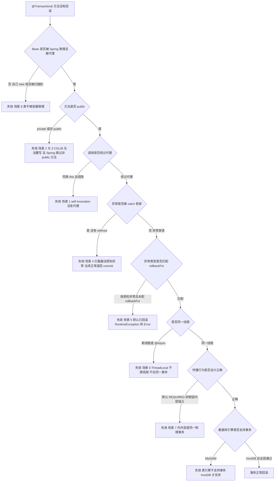

```java
@Service public class AlertTriggerService {
    private final AlertRecordRepository recordRepository;
    private final AlertNotifier alertNotifier;                  // 跨 Bean，避免自调用
    @Transactional(rollbackFor = Exception.class)               // 强制 rollbackFor：避免受检异常不回滚（场景 5）
    public void trigger(AlertEvent event) {                     // 只包住 DB 写，不包含远程调用（避免长事务占连接）
        int updated = recordRepository.markTriggered(event.ruleId(), event.symbol());
        if (updated == 0) throw new BizException("状态已变更，幂等终止");   // RuntimeException，触发回滚
    }
    public void triggerAndNotify(AlertEvent event) {             // 事务提交后再发告警，告警耗时不计入事务
        TransactionSynchronizationManager.registerSynchronization(new TransactionSynchronization() { @Override public void afterCommit() { alertNotifier.notify(event); } });
        trigger(event);                                          // 跨 Bean 调用，代理生效
    }
}
```
📦 演示正确的事务边界——写库在事务内、告警在提交后发，且强制 `rollbackFor`。

**为什么 / 取舍**
- **事务的本质是「AOP 拦截 + ThreadLocal 绑定连接」**：只要这条链上任一环节断了——代理没生效（1/2/3/8）、异常没传到拦截器（4/5/7）、线程换了（6）——事务就失效。把「事务失效」还原成「**AOP 是否生效 + 异常是否穿透 + 线程是否同一**」这三个问题，就不会漏场景。
- **默认只回滚 RuntimeException 是「设计取舍」**：受检异常在 Java 里表达「可恢复、调用方该处理的状况」（如文件不存在），Spring 认为这类异常调用方应自行处理而非一律回滚，代价是**极易踩坑**，于是团队规范统一强制 `rollbackFor`。
- **不要把 RPC/MQ 放进事务是「资源占用」问题**：数据库连接是稀缺资源，事务持有连接直到提交；在事务内做 100ms 的远程调用等于把连接借出去 100ms，高并发下连接池瞬间耗尽（风控实时系统 QPS 高，这点是致命的）。

**企业实际处理**
- 团队编码规范强制：**所有 `@Transactional` 必须显式写 `rollbackFor = Exception.class`**（或用统一的自定义基类异常继承 RuntimeException），避免受检异常不回滚。
- **禁止在 `@Transactional` 方法内做 RPC / MQ / 长耗时操作**（如调告警通道、发短信），否则事务被拉长、连接池被打满。风控场景正确姿势：**先落库（事务内）→ 事务外发告警**，或事务提交后再发（`TransactionSynchronizationManager.registerSynchronization` 的 `afterCommit`）。
- 关键操作（预警触发落库 + 状态变更）用**显式大事务 + 幂等键**，配合 `REQUIRES_NEW` 拆出「写操作日志」这种辅助动作，保证日志即使主事务回滚也留下。
- 上线用 Arthas 的 `trace` 或 Spring 的 `TransactionSynchronization` 埋点排查；定位「事务没生效」时第一件事就是看**调用方是不是同一个类**。

**易错 / 加分**
- ⚠️ 别只背「事务有四大特性」；要能主动说出 `@Transactional` 生效的**判断链路**：Bean 有没有被代理 → 方法是不是 public → 调用是否经过代理 → 异常是否穿透到拦截器 → 是否同一线程，把 8 个场景归结成一条链比零散罗列高一个层次。
- 💡 默认值 `propagation = REQUIRED`、`isolation = DEFAULT`（跟随数据库）、`timeout = -1`（不过期）、`readOnly = false`；
  - 「事务内 self-invocation 调 `REQUIRES_NEW` 方法注解不生效，因为压根没走代理」——把场景 1 和 7 串起来答是高级岗水准；
  - 风控「触发落库 + 推送告警」，推送失败不能回滚落库（否则预警丢失），故推送必须在事务外/afterCommit。

---

## 题 7：事务的 7 种传播行为，Spring 事务为什么能回滚？

- **题干**：「7 种事务传播行为你记得吗？各自什么语义？再往深问一层——Spring 事务底层到底是怎么回滚的？跟 MySQL 的事务是什么关系？」

**骨架答案**
- **7 种传播行为**（`Propagation` 枚举）：
  - **REQUIRED**（默认）有事务则**加入**、无则**新建**（绝大多数场景）；
  - **REQUIRES_NEW** **总是新建**独立事务、挂起当前事务（内层结果独立于外层，如写操作日志、记审计）；
  - **NESTED** 有事务则**嵌套**（savepoint）、无则等同 REQUIRED（「内层失败只回滚内层、外层可继续」）；
  - **SUPPORTS** 有事务则加入、无则以**非事务**方式执行（查询方法）；
  - **NOT_SUPPORTED** 以**非事务**方式执行、挂起当前事务（不想受事务影响的耗时操作）；
  - **MANDATORY** 必须在事务中、**否则抛异常**（强制「只能被事务方法调用」的内部方法）；
  - **NEVER** 必须**无事务**、否则抛异常（断言「此方法绝不能在事务里」）。
- **关键区分（高频）`REQUIRES_NEW` vs `NESTED`**：`REQUIRES_NEW` 开**全新物理事务**（新连接），挂起外层，内层提交/回滚**完全独立**，**外层回滚不影响已提交的内层**；
  - `NESTED` 仍在外层事务内，只是打一个 **savepoint**，内层回滚**回退到 savepoint**、外层可继续，但**外层回滚会连内层一起回滚**（同一个物理事务）。
  - 记忆：`REQUIRES_NEW` 是「另起炉灶、独立结算」，`NESTED` 是「同一笔账里打个标记、局部撤销」。

**图 4-8：事务传播行为 7 种语义对比**
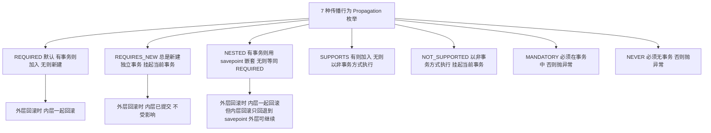

- **Spring 事务为什么能回滚（底层机制）**：① **代理拦截**：`@Transactional` 被 `TransactionInterceptor`（实现 `MethodInterceptor`）拦截，方法调用先进入 `invoke()`；
  - ② **获取事务管理器**：`PlatformTransactionManager`（JDBC 场景是 `DataSourceTransactionManager`），`getTransaction()` 开启/加入事务；
  - ③ **绑定连接（核心）**：`DataSourceTransactionManager.doBegin()` 从 `DataSource` 取一个 `Connection`，调 `setAutoCommit(false)`（设 `autoCommit = false`），
  - 然后用 `TransactionSynchronizationManager.bindResource(dataSource, new ConnectionHolder(conn))` 把这个连接**绑定到当前线程的 ThreadLocal**；
  - ④ **同一线程共享连接**：方法内所有 MyBatis/JdbcTemplate 的 DAO 操作，通过 `DataSourceUtils.getConnection(dataSource)` **从 ThreadLocal 里拿到同一个 Connection**，所以它们天然在**同一个事务**里；
  - ⑤ **提交/回滚**：方法正常返回 → `commit()`；抛异常且命中回滚规则 → `rollback()`；最后 `cleanupAfterCompletion()` 解绑 ThreadLocal、归还连接；
  - ⑥ **回滚设置**：`TransactionAspectSupport.completeTransactionAfterThrowing()` 判断异常是否匹配 `rollbackFor`，匹配才 `rollback()`，否则 `commit()`。
- **与 MySQL 事务的关系**：Spring 事务**不是独立的事务实现**，它**是对 JDBC 事务（即数据库事务）的封装**，真正的提交/回滚由 MySQL 的 InnoDB 执行——`Connection.commit()` / `rollback()` 对应 MySQL 的 COMMIT/ROLLBACK。
  - Spring 事务隔离级别默认 `DEFAULT` → **跟随数据库的隔离级别**（MySQL InnoDB 默认 `REPEATABLE READ`），显式设 `isolation` 则通过 `Connection.setTransactionIsolation()` 应用到该连接。
  - **因此 MySQL 侧的一切规则照样适用**：锁（行锁/间隙锁）、MVCC 快照、undo log（回滚靠 undo log）、redo log（持久化）、两阶段提交（binlog + redo log）——Spring 只是「发指令的人」。
  - 直接推论：**`@Transactional` 的粒度 = 一个数据库连接的 commit 边界**；跨库（多数据源）默认不是原子事务，需要 XA / Seata 这类分布式事务方案。

**图 4-9：Spring 事务回滚的实现链路**
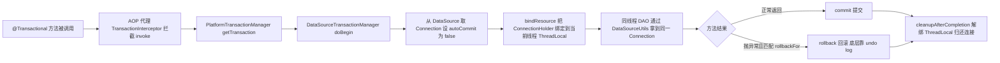

**为什么 / 取舍**
- **「ThreadLocal 绑定连接」是 Spring 事务能跨多个 DAO 生效的根本**：如果没有这个绑定，每个 DAO 各自 `getConnection()` 会拿到不同连接，就不可能在同一事务里；ThreadLocal 让「同一线程的多次数据库操作」共享一个连接——这是**隐式传参**的精妙设计，代价是**跨线程就失效**（Q6 场景 6）。
- **`REQUIRES_NEW` 要挂起外层是有成本的**：挂起意味着外层连接暂时不用但仍被占用，同时新开一个连接——这是「独立性」换「资源占用」的取舍，不能滥用，只有真正需要「独立提交/回滚」时才用。
- **Spring 事务默认跟随数据库隔离级别是「不越权」的取舍**：Spring 不强行规定隔离级别，把选择权交给数据库（DBA 会按业务统一设定），代价是「换数据库行为可能变」，对隔离级别敏感的业务必须显式声明。

**企业实际处理**
- `REQUIRES_NEW` 的典型用途：**审计/操作日志**必须落库，即主业务回滚也要留痕 → 日志方法用 `REQUIRES_NEW`；但它会**多占一个数据库连接**（挂起外层、开新连接），高并发下要评估连接池大小。
- **禁止大事务**：风控规则批量导入几万条若一个大事务全包住，会长时间持锁 + 占连接；做法是**分批提交**（每 1000 条一个小事务），或异步化。
- 读方法统一 `@Transactional(readOnly = true)`：部分数据库能优化（MySQL 下主要是 hint，但对 ORM 的脏检查有优化，如 Hibernate 会跳过 flush）。
- 团队规范：**Controller 不开事务**，事务边界放在 Service 的 public 方法上，且**事务方法内不做 RPC**（呼应 Q6）。

**易错 / 加分**
- ⚠️ 别把 `NESTED` 当「独立事务」——外层一滚它跟着滚。
- 💡 `MANDATORY` / `NEVER` 是用来**表达契约**的**断言工具**（「我只能被事务调用」/「我绝对不能进事务」），不是功能工具；
  - `NESTED` 依赖 savepoint，**JDBC 3.0 才有的 `Connection.setSavepoint()`**，且**对某些数据库/驱动不生效**（Spring 用 `JdbcTransactionObjectSupport` 判断是否支持）；
  - Spring 事务回滚后 `TransactionSynchronization` 的 `afterCompletion(STATUS_ROLLED_BACK)` 会被回调（做补偿/清理）；
  - 答「事务为什么能回滚」要从 Spring 答到 MySQL undo log 才算完整——**回滚靠 undo log，持久化靠 redo log**。

---

## 题 8：SpringBoot 自动装配原理，你自己写过 Starter 吗？

- **题干**：「SpringBoot 最核心的『约定优于配置』是怎么实现的？说说自动装配原理。@SpringBootApplication 这个注解里到底装了什么？还有——你写过自定义 Starter 吗？说说步骤。SpringBoot 3 在这方面有什么变化？」

**骨架答案**
- **`@SpringBootApplication` 是「三合一」** = `@SpringBootConfiguration`（本质是 `@Configuration`，标识配置类）+ `@ComponentScan`（扫描当前包及子包的 `@Component`，所以启动类要放根包）+ `@EnableAutoConfiguration`（自动装配的开关）。
- **`@EnableAutoConfiguration` 也是「二合一」** = `@AutoConfigurationPackage`（把启动类所在包注册为「自动配置包」，供 JPA 实体扫描等使用）+ `@Import(AutoConfigurationImportSelector.class)`（自动装配的核心）。
- **`AutoConfigurationImportSelector` 干了什么**：① 它实现 `ImportSelector`，`selectImports()` 被 Spring 调用，返回**一堆自动配置类的全限定名**；
  - ② 通过 `getCandidateConfigurations()` → `ImportCandidates.load()` / `SpringFactoriesLoader.loadFactoryNames()` **读取 SPI 配置文件**，拿到所有候选自动配置类；
  - ③ **去重 + 排除**：去掉重复的，去掉 `@SpringBootApplication(exclude = ...)` / `spring.autoconfigure.exclude` 指定的；
  - ④ **过滤（关键）**：用 **`AutoConfigurationImportFilter`**（`OnClassCondition`、`OnBeanCondition`、`OnWebApplicationCondition`）做快速过滤，**只保留「条件满足」的配置类**——这一步在**不加载类**的前提下用 ASM 读注解元数据判断，非常快；
  - ⑤ 最终把过滤后的配置类注册成 BeanDefinition，等待容器实例化。
- **SPI 文件的演进（必须答准）**：SpringBoot ≤ 2.6 用 `META-INF/spring.factories`（key = `org.springframework.boot.autoconfigure.EnableAutoConfiguration`，value = 逗号分隔的配置类）；
  - SpringBoot 2.7 **两者都支持**，新增 `META-INF/spring/org.springframework.boot.autoconfigure.AutoConfiguration.imports`（一行一个类），`spring.factories` 中的自动配置标记为 **deprecated**；
  - SpringBoot 3.x **只认 imports 文件**，`spring.factories` 里的自动配置**不再生效**，自动配置类需用 **`@AutoConfiguration`** 注解标注（替代裸 `@Configuration`）。
  - `spring.factories` 在 Boot 3 里仍存在，但**只用于 `ApplicationListener` / `ApplicationContextInitializer` / `EnvironmentPostProcessor` 等非自动配置场景**（即 `SpringFactoriesLoader` 的基础用法还在）。
- **条件注解（自动装配的「开关」）**：`@Conditional` 家族（`@ConditionalOnXxx`，由 `OnClassCondition` / `OnBeanCondition` / `OnPropertyCondition` 等实现）——
  - `@ConditionalOnClass`（classpath 上有某个类才生效，如没引 Redis 依赖，RedisAutoConfiguration 就不装配）；
  - `@ConditionalOnMissingBean`（容器里**没有**某个 Bean 才装配，**这是让用户自定义 Bean 覆盖默认配置的关键**）；
  - `@ConditionalOnProperty`（某配置项为指定值才生效）；
  - `@ConditionalOnBean` / `@ConditionalOnWebApplication` / `@ConditionalOnResource` 等。
- **自定义 Starter 的完整步骤**：① 建两个模块：**`xxx-spring-boot-starter`**（空 jar，只做依赖聚合）+ **`xxx-spring-boot-autoconfigure`**（真正的自动配置代码）；
  - ② autoconfigure 模块里写 **`XxxProperties`**：`@ConfigurationProperties(prefix = "risk.alert")`，把可配置项收拢；
  - ③ 写 **`XxxAutoConfiguration`**：用 **`@AutoConfiguration`**（2.7+ / 3.x）或 `@Configuration`，配 `@EnableConfigurationProperties(XxxProperties.class)`，
  - 核心 Bean 上加 `@ConditionalOnMissingBean`（允许用户覆盖）、`@ConditionalOnClass`（依赖存在才装配）；
  - ④ 在 `src/main/resources/META-INF/spring/` 下建文件 **`org.springframework.boot.autoconfigure.AutoConfiguration.imports`**，写入 `XxxAutoConfiguration` 的全限定名（一行一个）；
  - ⑤ starter 模块的 `pom.xml` 依赖 autoconfigure 模块 + 需要的第三方依赖；
  - ⑥（可选）加 `META-INF/spring-configuration-metadata.json` 或 `spring-boot-configuration-processor` 让 IDE 有配置提示。

**图 4-10：SpringBoot 自动装配的完整链路**
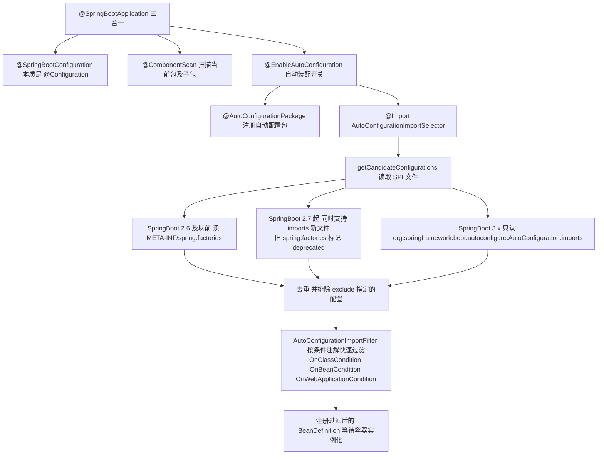
**图 4-11：自定义 Starter 的结构**
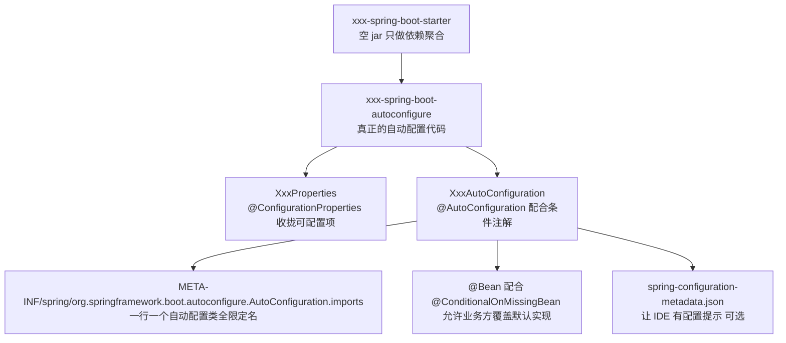

```java
// ===== autoconfigure 模块 =====
@ConfigurationProperties(prefix = "risk.alert")
public class RiskAlertProperties { private boolean enabled = true; private String endpoint = "http://alert-gateway:8080"; private int timeoutMs = 500; }   // getter/setter 省略

@AutoConfiguration                                             // Boot 3 用 @AutoConfiguration
@ConditionalOnClass(AlertChannelClient.class)                  // 依赖存在才装配
@ConditionalOnProperty(prefix = "risk.alert", name = "enabled", havingValue = "true", matchIfMissing = true)
@EnableConfigurationProperties(RiskAlertProperties.class)
public class RiskAlertAutoConfiguration {
    @Bean @ConditionalOnMissingBean                            // 允许业务方自定义覆盖
    public AlertChannelClient alertChannelClient(RiskAlertProperties p) {
        return AlertChannelClient.builder().endpoint(p.getEndpoint()).timeoutMs(p.getTimeoutMs()).build();
    }
}
// 4. 文件：src/main/resources/META-INF/spring/org.springframework.boot.autoconfigure.AutoConfiguration.imports 内容为：
//    com.hongwang.risk.alert.RiskAlertAutoConfiguration     （一行一个自动配置类全限定名）
```
📦 演示「风控告警通道」Starter 的自动配置骨架与 imports 文件内容。

**为什么 / 取舍**
- **SPI + 条件注解 = 「自动装配」的两大支柱**：SPI 解决「框架怎么发现你的配置类」（解耦，不用硬编码 import）；条件注解解决「发现了但要不要生效」（按需装配）。**两者缺一不可**：只有 SPI 会加载一堆用不上的配置；只有条件注解没有 SPI，用户就得手动 `@Import`。
- **`@ConditionalOnMissingBean` 是「约定优于配置但允许打破」的开关**：默认给一套能跑的配置，但用户一旦自己定义了 Bean，默认配置自动让位——**没有它，Starter 就是霸道不可覆盖的**。
- **2.7→3.x 换 SPI 文件是「性能 + 明确性」的驱动**：`spring.factories` 是 Properties 格式，一个 key 下所有类挤在逗号分隔的值里，难读、难维护、加载要全量解析；
  - `.imports` 一行一个类，**可读性和解析效率都更好**（`ImportCandidates` 用 `BufferedReader` 逐行读）。
  - 代价就是**不兼容老写法**，升级到 Boot 3 时所有自定义 Starter 都必须改文件。

**企业实际处理**
- 公司内部统一封装：如「统一日志组件」「统一鉴权客户端」「风控规则 SDK」做成 Starter，各业务服务直接引依赖就能用，避免每个服务复制粘贴配置。
- Starter 里的 Bean 必须加 `@ConditionalOnMissingBean`，**否则业务方无法覆盖默认实现**——这是公司内部 Starter 最常见的设计缺陷。
- 排查「自动配置为什么没生效」：用 `--debug` 启动（打印 `ConditionEvaluationReport`）或 Actuator 的 **`/actuator/conditions`**（SpringBoot 3；旧版 `/actuator/autoconfig`），能看到「哪些自动配置生效/未生效，原因是 `@ConditionalOnClass` 没满足」。

**易错 / 加分**
- ⚠️ 别把「自动配置的 SPI 文件（`.imports`）」和「`SpringFactoriesLoader` 的 `spring.factories`（Boot 3 仍用于 Listener/Initializer）」混为一谈。
- 💡 `@AutoConfiguration` 相比 `@Configuration` 多了 `proxyBeanMethods = false`（**lite 模式，跳过 CGLIB 增强，启动更快**）和「只能通过 imports 文件注册」的约束；
  - 自动配置类加载顺序由 `@AutoConfigureBefore` / `@AutoConfigureAfter` / `@AutoConfigureOrder` 控制（如数据源自动配置要在 MyBatis 自动配置之前）；
  - 结合 Q9：**自动配置太多是启动慢的原因之一**，可用 `spring.autoconfigure.exclude` 裁剪。

---

## 题 9：SpringBoot 的启动流程是怎样的？线上怎么优化启动速度？

- **题干**：「SpringBoot 项目从 `main` 方法开始，到能接收请求，中间发生了什么？你们线上服务启动多快，如果启动慢你会怎么优化？配置文件加载的优先级也顺便说说。」

**骨架答案**
- **`SpringApplication.run()` 关键步骤**：① **`new SpringApplication(...)`（构造阶段）**：推断应用类型 `WebApplicationType`（有 `DispatcherServlet` 且无 `WebFlux` → `SERVLET`；有 WebFlux → `REACTIVE`；都没有 → `NONE`）；
  - 用 `SpringFactoriesLoader` 从 `spring.factories` 加载 **`ApplicationContextInitializer`** 和 **`ApplicationListener`**（Boot 3 构造里走 `getSpringFactoriesInstances`）；推断主启动类（从 `stackTrace` 找 `main` 方法所在类）。
  - ② **`run()` 开始**：启动 `StopWatch` 计时；创建 **`BootstrapContext`**（Boot 3.x，用于早期访问环境）。
  - ③ 发布 `ApplicationStartingEvent`（最早的监听事件）。
  - ④ **`prepareEnvironment()`**：创建并配置 `Environment`，**加载配置文件**（`application.yml`、命令行参数、`application-{profile}` 等），
  - 发布 `ApplicationEnvironmentPreparedEvent`（`ConfigDataEnvironmentPostProcessor` 把配置源加入环境）。
  - ⑤ 打印 Banner（`Banner` 接口，可 `spring.main.banner-mode=off` 关掉）。
  - ⑥ **`createApplicationContext()`**：根据应用类型创建容器，Servlet 场景是 **`AnnotationConfigServletWebServerApplicationContext`**。
  - ⑦ **`prepareContext()`**：设置环境、执行 `ApplicationContextInitializer`、注册主配置类（`refresh()` 前先注册为 BeanDefinition）、发布 `ApplicationContextInitializedEvent` / `ApplicationPreparedEvent`。
  - ⑧ **`refreshContext()`** → `AbstractApplicationContext.refresh()`（**核心 12 步**：`prepareRefresh` → `obtainFreshBeanFactory` → `prepareBeanFactory` → `postProcessBeanFactory` → 
  - `invokeBeanFactoryPostProcessors` → `registerBeanPostProcessors` → `initMessageSource` → `initApplicationEventMulticaster` → `onRefresh` → 
  - `registerListeners` → `finishBeanFactoryInitialization`（**实例化所有非懒加载单例**）→ `finishRefresh`）；
  - **内嵌 Tomcat 的启动就在 `onRefresh()` 里**——`ServletWebServerApplicationContext.createWebServer()` → `TomcatServletWebServerFactory.getWebServer()` 
  - 创建并启动 Tomcat、把 `DispatcherServlet` 注册进去，**所以 Tomcat 是 SpringBoot 自己 new 出来、跑在同一个 JVM 里的**。
  - ⑨ **`afterRefresh()`**：`callRunners()` 执行 **`ApplicationRunner` / `CommandLineRunner`**。
  - ⑩ 发布 `ApplicationStartedEvent` / `ApplicationReadyEvent`（`ready` 表示服务已可对外提供服务，是「预热」的正确时机，见 Q1）。
- **启动优化（按收益排序）**：① **延迟初始化** `spring.main.lazy-initialization=true`（默认 `finishBeanFactoryInitialization` 会创建所有单例，改成「用到才建」；**代价**：首次请求变慢、启动期错误延后暴露——低峰期/灰度环境可用，核心交易服务慎用）；
  - ② **裁剪自动配置** `spring.autoconfigure.exclude=...` 或 `@SpringBootApplication(exclude = ...)`，配合 `/actuator/conditions` 看哪些是「白装配」；
  - ③ **缩小扫描范围**（`@ComponentScan` 精确指定包，别扫 `com`）；
  - ④ **JVM 参数** `-XX:TieredStopAtLevel=1`（只做 C1 编译，启动快）、`-Xshare:auto`/CDS（Boot 3.2 支持 `spring.aot` + AppCDS 减少类加载）、`-XX:+UseSerialGC`（小堆启动更快）；
  - ⑤ **AOT / Native Image**（Boot 3 支持 `mvn spring-boot:process-aot` 生成元数据 + GraalVM Native Image，启动可到**百毫秒级**，但构建复杂、反射要配 `@RegisterReflectionForBinding`、生态兼容性是坑）；
  - ⑥ **减少启动期重活**（把 `@PostConstruct` 的重逻辑移到 `ApplicationReadyEvent`，或用懒加载分包控制）；
  - ⑦ **分层构建**（`spring-boot-maven-plugin` 的 layers，Docker 只重传变化的层，发布提速）。
- **配置文件优先级（由高到低）**：命令行参数 `--server.port=9090` > `SPRING_APPLICATION_JSON`（环境变量里的 JSON）> ServletConfig / ServletContext 初始化参数 > JNDI > Java 系统属性 `-Dxxx` > 操作系统环境变量 > 
  - `application-{profile}.properties`（jar 包外 `./config/` 目录优先 > jar 包外当前目录 > jar 包内 classpath）> `application.properties`（依次：外部 config/ > 外部当前目录 > 内部 classpath）。
  - 关键结论：**外部 > 内部；带 profile 的 > 不带 profile 的；越具体的（更多 profile）越优先**。
- **SpringBoot 解决跨域（三种）**：① 注解级 `@CrossOrigin`（Controller 类/方法）；
  - ② 全局 SpringMVC `WebMvcConfigurer#addCorsMappings` 配置 `CorsRegistry`；
  - ③ **网关级（微服务推荐）** 在 Spring Cloud Gateway 配 `spring.cloud.gateway.globalcors`。
  - ⚠️ **`addCorsMappings` 是 WebMVC 的，Gateway 是 WebFlux 的，两者不通用**——在网关里写 WebMvc 配置不会生效（经典踩坑）。
- **全局异常处理**：`@RestControllerAdvice`（= `@ControllerAdvice` + `@ResponseBody`）配 `@ExceptionHandler(BizException.class)`、
  - `@ExceptionHandler(MethodArgumentNotValidException.class)`（@Valid 校验失败）、`@ExceptionHandler(Exception.class)`（兜底，返回统一错误码）；
  - `@ControllerAdvice` 三大用途：**全局异常**（`@ExceptionHandler`）、**全局数据绑定**（`@InitBinder`）、**全局数据预处理**（`@ModelAttribute`）。

**图 4-12：SpringApplication.run 的启动流程**
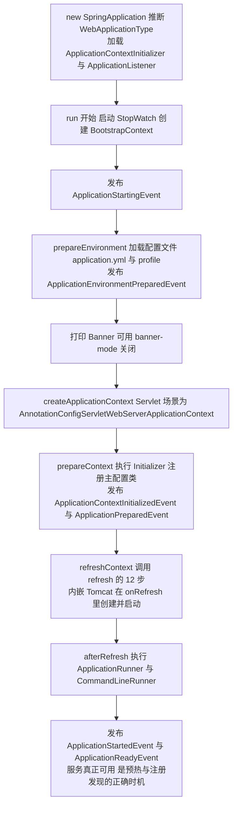

**为什么 / 取舍**
- **`refresh()` 的 12 步是「先注册后实例化」的两阶段设计**：前 11 步都在改 BeanDefinition、注册后置处理器，最后一步 `finishBeanFactoryInitialization` 才真正 new 对象——
  - 这样「BeanPostProcessor/BeanFactoryPostProcessor 能影响所有 Bean」，**必须在实例化之前注册好处理器**，否则后注册的处理器对已创建的 Bean 无效。
- **内嵌 Tomcat 让「打包即运行」成为可能**：传统 war 部署要装外部 Tomcat、配 context、拷 war 包；内嵌后一个 `java -jar` 就起服务，**这是容器化（Docker）和 DevOps 的前提**；代价是每个应用自带一个 Tomcat（内存开销），但对微服务是可接受的权衡。
- **启动优化本质是「延迟 + 裁剪」两招**：启动慢源于「做了太多启动期不需要的事」（创建所有 Bean、加载所有自动配置）——要么**延迟到用时再做**（懒加载、移到 ReadyEvent），要么**干脆不做**（裁剪自动配置）。理解这条主线就不会死记优化清单。

**企业实际处理**
- 核心服务（期权风控）**不用全局懒加载**（首笔预警请求不能因为初始化慢而超时），改用「`ApplicationReadyEvent` 预热 + 精准裁剪自动配置」。
- 用 `spring-boot-maven-plugin` 的 `layers` + Docker 多阶段构建：依赖层、快照层、应用层分开，改代码只重传应用层，配合 Jenkins 流水线把发布从 4 小时压到 15 分钟（简历业绩）。
- 全局异常统一返回 `Result`，**但绝不在兜底 `Exception` 里把堆栈返回给前端**（信息泄露），只记日志并返回统一错误码。

**易错 / 加分**
- ⚠️ 别把 `ApplicationContextInitializer`（容器 refresh 前执行，可改容器）和 `ApplicationRunner` / `CommandLineRunner`（refresh 完成后执行）混了。
- 💡 `ApplicationReadyEvent` 才是「服务真正可用」的信号——做预热、注册到服务发现、开始消费 MQ 都应该在这之后（很多人错在 `@PostConstruct` 里做这些）；
  - Boot 3.2 的 **`spring.aot`** 和虚拟线程（`spring.threads.virtual.enabled=true`，JDK 21+）；
  - 配置优先级口诀：**外部覆盖内部、profile 覆盖默认、命令行覆盖一切**。

---

## 题 10：MyBatis 的执行流程，`#{}` 和 `${}` 有什么区别？

- **题干**：「说说 MyBatis 一次查询的完整执行流程，四大核心组件是什么？`#{}` 和 `${}` 的区别？MyBatis 的一级二级缓存说说，还有——Mapper 接口没有实现类，它是怎么被调用的？分页插件什么原理？」

**骨架答案**
- **执行流程（一次查询）**：① **启动解析**：`SqlSessionFactoryBuilder` 解析 `mybatis-config.xml` + 所有 Mapper XML（或被 `@MapperScan` 扫描的接口），构建全局唯一 **`Configuration`** 对象，`SqlSessionFactory` 由它创建；
  - ② **获取 SqlSession**：`SqlSessionFactory.openSession()` 得到 `SqlSession`（本质是 `DefaultSqlSession`，内部持有 `Executor`）；
  - ③ **获取 Mapper 代理**：`sqlSession.getMapper(UserMapper.class)` → `MapperRegistry.getMapper()` → **`MapperProxyFactory` 用 JDK 动态代理生成 `MapperProxy`**；
  - ④ **调用 Mapper 方法**：`MapperProxy.invoke()` 判断是 Object 方法还是 Mapper 方法 → 找到对应的 **`MapperMethod`** → 执行 `execute()`；
  - ⑤ **Executor 执行**：`Executor`（默认 `SimpleExecutor`，经过插件链包装成 `CachingExecutor` 等）查缓存 → 未命中则 `queryFromDatabase()`；
  - `Configuration.getMappedStatement(id)` 拿到 **`MappedStatement`**（封装了 SQL、参数映射、结果映射、缓存配置）；
  - ⑥ **StatementHandler 创建 Statement**：`PreparedStatementHandler` 用 `Connection.prepareStatement(sql)`；
  - ⑦ **ParameterHandler 设参**：把 Java 参数按 `#{}` 的映射设置到 `PreparedStatement`（`ps.setXxx`）；
  - ⑧ 执行 SQL，得到 `ResultSet`；
  - ⑨ **ResultSetHandler 映射结果**：按 `<resultMap>` / 驼峰映射把结果集转成 Java 对象（含 `TypeHandler` 做 JDBC 类型 ↔ Java 类型转换）；
  - ⑩（插件在此介入）：`Executor`、`StatementHandler`、`ParameterHandler`、`ResultSetHandler` **四大对象都可以被 `Interceptor`（插件）包装**（`Plugin.wrap` 生成代理）。
- **四（五）大核心组件**：**`Executor`**（执行器，负责整体调度、缓存、事务：`SimpleExecutor` / `ReuseExecutor` / `BatchExecutor` / `CachingExecutor`）；
  - **`StatementHandler`**（负责创建 `Statement`、执行 SQL）；**`ParameterHandler`**（负责参数设置）；**`ResultSetHandler`**（负责结果集映射）；
  - （`MappedStatement`：不是「处理器」但很重要，是 XML 里一个 `<select>` 的完整描述）。
- **`#{}` vs `${}`（高频，安全题）**：`#{}` = **预编译占位符 `?`**（`PreparedStatement`），**安全**（参数值不参与 SQL 解析），自动按 `TypeHandler` 处理（加引号、转类型），用于所有**参数值**（where 条件、insert 值）；
  - `${}` = **字符串直接拼接**进 SQL，**有注入风险**，原样拼接需自己保证格式，用于 **动态 SQL 片段**（#{} 做不到的场景，如动态**表名/列名/`ORDER BY` 字段**）。
  - **结论：能用 `#{}` 就用 `#{}`；必须用 `${}` 时（表名、order by），参数一定要走白名单校验**。
  - 举例：`ORDER BY ${sortField}` 若 `sortField` 来自前端，攻击者可传 `id; DROP TABLE ...`；正确做法是 `sortField` 与合法列名做白名单比对，不合法就拒绝。
- **缓存**：一级缓存是 **`SqlSession` 级**、**默认开启**，同一个 `SqlSession` 内相同 `statement + 参数 + 分页` 命中；
  - 执行 `update/insert/delete`、`commit`、`rollback`、`close` 后**清空**；底层是 `SqlSession` 内的 `PerpetualCache`（HashMap），本质是**会话级**。
  - 二级缓存是 **namespace（Mapper）级**、**默认关闭**（需 `<cache/>` 或 `@CacheNamespace` 开启），跨 `SqlSession` 共享，**该 namespace 内有写操作**即清空，实体需 `implements Serializable`；
  - 由 `TransactionalCacheManager` 管理、`CachingExecutor` 触发。
  - **坑**：二级缓存跨 `SqlSession` 共享，多表关联、其他 namespace 改了数据时本 namespace 缓存不会失效 → **脏读**，所以生产上**微服务场景一般不推荐开二级缓存**（用 Redis 做分布式缓存更可控）。
- **Mapper 接口为什么不用实现类（动态代理）**：`@MapperScan` / `@Mapper` 让 MyBatis 启动时扫描接口，注册到 **`MapperRegistry`**（`knownMappers` 是个 `Map<Class, MapperProxyFactory>`）；
  - 调用 `getMapper()` 时 `MapperProxyFactory.newInstance()` 用 **`Proxy.newProxyInstance`** 生成 JDK 动态代理 **`MapperProxy`**（实现 `InvocationHandler`）；
  - 调用接口方法时进 `MapperProxy.invoke()`——**Object 的 `toString/equals/hashCode` 直接走，`default` 方法走 `invokeDefaultMethod`，其余走 `MapperMethod.execute()`**，
  - `MapperMethod` 里根据方法全限定名（`namespace + "." + methodName`）找到 `MappedStatement`，再按 SQL 类型（`SELECT/INSERT/UPDATE/DELETE`）调 `Executor` 对应方法。
  - **本质**：接口 → 全限定名 → `MappedStatement` 的映射，是「**约定优于配置**」在 ORM 层的体现。
- **分页插件原理（PageHelper / MyBatis-Plus `PaginationInnerInterceptor`）**：基于 **`Interceptor` + `Plugin`（JDK 代理）**，
  - 通过 **`@Intercepts` / `@Signature`** 声明拦截 `Executor.query`（PageHelper 拦 `Executor#query`，MyBatis-Plus 3.5+ 拦 `Executor` 的 `query`）；
  - `intercept()` 里：① 从参数（PageHelper 从 **`ThreadLocal`** `PageMethod`，MP 从 `IPage` 参数）判断是否分页请求；
  - ② 先执行一条 **`SELECT COUNT(*)`** 拿总数（可关闭 count 查询）；
  - ③ 用 `Dialect`（方言：MySQL/H2/Oracle）**改写原 SQL**，追加 `LIMIT ?, ?`；
  - ④ 继续 `invocation.proceed()` 执行改写后的 SQL。
  - 是**物理分页**（改写 SQL 让数据库只返回一页），不是内存分页。
  - **坑**：PageHelper 的 `ThreadLocal` 在**异步/线程池**里会串页（分页参数没清干净，导致「上一个请求的页码影响下一个请求」），用 `PageHelper.clearPage()` 或改用 MyBatis-Plus（基于方法参数，无 ThreadLocal 污染）。

**图 4-13：MyBatis 的执行流程**
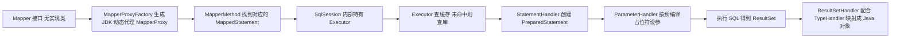

```xml
<select id="selectBySymbol" resultType="com.hongwang.risk.entity.AlertRecord">
    SELECT id, symbol, status, triggered_at FROM risk_alert_record
    WHERE symbol = #{symbol}                       <!-- 值：预编译，安全 -->
      AND status = #{status}
    ORDER BY ${orderColumn}                        <!-- 动态列：必须白名单 -->
    LIMIT #{offset}, #{size}                       <!-- 值：预编译，安全 -->
</select>
```
📦 演示「值走 `#{}`、动态列走 `${}` + 白名单」的安全分页写法（业务侧用 `ALLOWED_SORT.contains(sort)` 校验，不合法则用默认列，并 `Math.min(size, 100)` 限制页大小）。

**为什么 / 取舍**
- **「`#{}` 走 PreparedStatement」是数据库层面最可靠的防注入手段**：预编译让参数值**永远不被当作 SQL 语法解析**，无论参数里有单引号还是 `--` 注释；`${}` 拼接等于把 SQL 结构和数据混在一起，注入就不可避免。
- **二级缓存用 namespace 做隔离是「粒度粗」的设计**：namespace 级失效无法感知「别的 Mapper 改了同样一张表」，所以多表关联必然脏读——这是**简单换正确性**的取舍，生产上不如用独立缓存层（Redis）精确控制。
- **Mapper 用动态代理而不是代码生成/字节码增强**：动态代理**零编译期产物**（不需要像 JPA 那样生成实现），接口只写声明、SQL 放 XML，**职责清爽**；代价是运行期不易调试（要看 `MapperProxy` 链路）。

**企业实际处理**
- **禁用 `${}` 拼参数**，静态扫描（如 SpotBugs/自定义规则）拦截 `${` 出现在 XML 参数位置；必须动态排序时用白名单。
- **二级缓存默认不开**，缓存统一走 Redis（可控 TTL、可控失效、能跨语言）；一级缓存默认开启但不显式依赖（会话很短）。
- 分页统一用 **MyBatis-Plus 的 `IPage`**（无 ThreadLocal 坑），并限制最大页大小（防 `LIMIT 1000000, 10` 拖垮 DB）。
- 复杂查询用 XML 写（可读性好），简单 CRUD 用 MyBatis-Plus 的 `BaseMapper` 省代码。

**易错 / 加分**
- ⚠️ `${}` 即便「值看起来安全」也不能用于用户可控参数，混用 `#{}` 与 `${}` 时别把参数位置搞错。
- 💡 `MapperProxy.invoke()` 对 **`Object` 方法（toString/equals/hashCode）和 `default` 方法**有特殊处理，这是读源码的细节；
  - `StatementHandler` 有 `SimpleStatementHandler`（Statement，用于 `${}` 或静态 SQL）、`PreparedStatementHandler`（PreparedStatement，用于 `#{}`）、`CallableStatementHandler`（存储过程）；
  - 插件用 `@Intercepts` 声明拦截点、`Plugin.wrap()` 生成代理、可嵌套多层（责任链），「分页插件」「慢 SQL 插件」「多租户插件」同一机制；
  - MyBatis-Plus 权衡：省了单表 CRUD 的 SQL，但**复杂 join/多表统计还是得写 XML**，且 `LambdaQueryWrapper` 有轻微反射开销，极端 QPS 下单表查询仍是手写 SQL 更快。

---

## 题 11：微服务拆分后 OpenFeign 调用怎么设置超时和熔断降级？

- **题干**：「你们期权风控系统拆成了多个微服务，服务之间用 OpenFeign 调。服务 A 调服务 B 超时了怎么办？如果 B 挂了，A 会不会被拖死？你怎么配超时、重试和熔断降级？说说 OpenFeign 的底层原理。」

**骨架答案**
- **OpenFeign 原理**：① `@EnableFeignClients` 扫描所有 `@FeignClient` 接口，为每个接口注册一个 **`FeignClientFactoryBean`**；
  - ② 注入时 `FeignClientFactoryBean.getObject()` 返回 **`Feign` 构建的动态代理**（`ReflectiveFeign.newInstance()`，底层 JDK 动态代理），每个方法对应一个 `MethodHandler`；
  - ③ 调用时 `MethodHandler` 根据 `@RequestMapping` 注解生成 **`RequestTemplate`**（URL、方法、Header、Body），
  - 交给 **`Client`** 发起 HTTP 请求（默认 `feign.Client.Default` 走 `HttpURLConnection`，可换 **OkHttp / Apache HttpClient 5**），
  - 请求前经 **`LoadBalancerClient`**（Spring Cloud LoadBalancer）**按服务名选实例**（从注册中心拿到的实例列表里按轮询/随机选），经过 `RequestInterceptor`（可加 TraceId、鉴权头）、`Decoder`/`Encoder`（JSON 编解码）、`ErrorDecoder`（错误处理）；
  - ④ 集成 Sentinel 后，Feign 调用被 Sentinel 资源包裹，可做熔断降级。
- **超时配置（必须显式配，默认值会坑人）**：`spring.cloud.openfeign.client.config.default.connectTimeout: 1000`（连接超时 1s）、`readTimeout: 2000`（读超时 2s），针对指定服务用 `alert-service: readTimeout: 500` 覆盖。
  - **默认 `readTimeout` 是 60s**（Feign 默认 10s，但 Spring Cloud 早期有 60s 的坑），必须显式设小；风控实时预警链路要求**「快速失败」而非「长时间等待」**，超时要短（500ms~2s）。
  - 注意：**LoadBalancer 层也有超时**（`spring.cloud.loadbalancer.retry.*`），Feign 层和 LB 层的超时要一起看，否则上层以为超时了下层还在重试。
- **重试**：Feign 自带 `Retryer`，**Spring Cloud OpenFeign 默认 `Retryer.NEVER_RETRY`（不重试）**，要看 `spring.cloud.openfeign.client.config.default.retryer`；
  - 重试的两个前提：**① 接口幂等**（GET 天然幂等，POST 要保证幂等键）；**② 有重试上限 + 退避**，否则雪崩时重试会放大流量。
  - **风控预警场景慎用自动重试**：预警触发是**写操作**，重试可能导致重复告警；若必须重试，用「幂等键 + 去重表」。
- **熔断降级（Sentinel）**：接入 `feign.sentinel.enabled=true`（旧版）或 Spring Cloud Alibaba 新版配置；`@FeignClient(name = "alert-service", fallback = AlertClientFallback.class)` 或 `fallbackFactory`（能拿到异常原因）。
  - Sentinel 熔断降级策略：**慢调用比例**（RT > 阈值且比例超阈值 → 熔断）、**异常比例**（异常占比超阈值 → 熔断）、**异常数**（异常数超阈值 → 熔断）。
  - 熔断状态机：**CLOSED（正常）→ OPEN（熔断，直接走 fallback）→ HALF_OPEN（放一个请求试探，成功则恢复 CLOSED，失败继续 OPEN）**。
  - **降级策略要贴合业务**：告警通道挂了降级成「写本地 MQ 稍后重试」或「落库待补发」，**绝不能静默丢弃预警**（监管级系统丢预警是重大事故）。
- **限流（Sentinel 流控）**：**QPS 流控 / 线程数流控**；
  - 流控模式：**直接、关联（A 关联 B，B 达阈值限 A）、链路（只限某入口）**；
  - 流控效果：**快速失败、Warm Up（预热，冷启动逐步放量）、排队等待（匀速排队，漏桶）**；
  - **热点参数限流** `@SentinelResource` + `@SentinelResource(value="...", blockHandler="...")`，对某参数值特别限流（如某个 symbol 的规则查询突增）。

**图 4-14：微服务调用链与熔断降级**
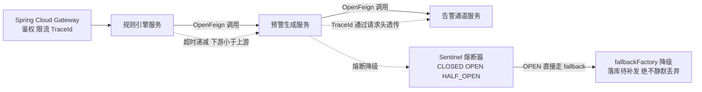

```yaml
spring:
  cloud:
    openfeign:
      client:
        config:
          default:                       # 对所有 FeignClient 生效
            connectTimeout: 1000         # 连接超时 1s
            readTimeout: 2000            # 读超时 2s
          alert-service:                 # 针对指定服务覆盖
            readTimeout: 500             # 告警通道要求快失败，500ms
            loggerLevel: basic
```
📦 演示 OpenFeign 超时配置：全局 default + 按服务覆盖，且超时要短（风控要求快速失败）。

**为什么 / 取舍**
- **「超时 + 熔断」是防雪崩的两道闸**：超时防止「一个慢调用占死线程」，熔断防止「持续打挂掉的依赖」；没有这两道闸，服务 B 一挂，服务 A 的线程全被 B 的调用占满，A 也挂，进而拖垮上游——**这就是雪崩**，微服务里最致命的故障模式。
- **「递减超时」是避免级联放大的关键**：如果下游超时 > 上游超时，上游早就超时了、下游还在干，白耗资源；让 `下游超时 < 上游超时`，保证上游超时前下游一定先返回（成功或失败），资源不悬空。
- **「降级不能丢数据」是风控业务的硬约束**：技术上的「优雅降级」在普通业务里可以是「返回缓存老数据」，但监管级预警系统里**丢一条预警可能就是合规事故**，所以降级必须落到「持久化 + 补偿」而非「丢弃」——**业务约束反过来决定技术方案**的典型。

**企业实际处理**
- 风控预警调用链 `rule-engine → alert-gateway → alert-channel`，每一跳都配 `connectTimeout=500ms / readTimeout=1s`，**超时必须小于上游的总超时**，形成「递减超时」避免级联放大。
- `fallbackFactory` 里**降级不抛异常**，返回一个「降级结果对象」并打点上报，让上游能判断「这是降级数据」而非真实结果。
- Sentinel 规则不写死在代码里，而是**通过 Apollo/Nacos 持久化**（Sentinel 规则持久化到配置中心），支持动态调整阈值、灰度。
- 线程隔离：Sentinel 提供**信号量隔离**（默认，轻量）和**线程池隔离**（重，但能隔离慢调用），对第三方（告警短信通道）用线程池隔离，防止其拖垮自身。

**易错 / 加分**
- ⚠️ 别只背概念：要能主动讲「**超时要小于上游超时，形成递减**」，说明你处理过真实调用链。
- 💡 能区分 Sentinel 的「**熔断降级**」（针对不稳定依赖）和「**限流**」（保护自身不被流量打垮），很多人混为一谈；
  - OpenFeign 换 `Client` 为 **OkHttp/Apache HttpClient 5** 的原因（连接池复用，默认 `HttpURLConnection` 无连接池，高并发下性能差）；
  - `ErrorDecoder` 可以把下游的非 2xx 响应转成自定义异常，配合 Sentinel 的异常统计做熔断；
  - 结合 CAP：熔断降级本质是**牺牲一致性/功能换取可用性（A 优先）**。

---

## 题 12：Apollo 配置中心原理，风控规则改完怎么做到秒级甚至毫秒级生效？

- **题干**：「你们用 Apollo 做配置中心，说说 Apollo 的原理——它是推还是拉？配置改完怎么通知到客户端？@RefreshScope 是怎么动态刷新的？另外结合实际——风控规则改了，怎么保证在预警服务里快速生效，甚至毫秒级？」

**骨架答案**
- **Apollo 架构与「推拉结合」**：角色 **Config Service**（配置读取 + 推送）、**Admin Service**（配置管理 + 发布）、**Config DB / Portal DB**（MySQL 存储配置与发布历史）、**Portal**（管理界面）、**Client**（各应用里的 `apollo-client`）。**推拉结合（核心机制）**：
  - ① **客户端定时拉取（pull）**——`RemoteConfigRepository` 启动定时任务，默认**每 5 分钟全量拉一次**（兜底），同时本地有**缓存文件**（`/opt/data/{appId}/config-cache/...`），启动时先读缓存，保证 Config Service 挂了也能启动；
  - ② **长轮询（long polling）实现准实时推送**——客户端发起 `notifications/v2` 请求，**Config Service 把请求 hold 住最多 30 秒**（用 `DeferredResult` + `ScheduledExecutorService`）：
  - 期间若该 namespace 有配置变更（Admin Service 发布后通过 **`ReleaseMessage`** 表 + 定时扫描（默认 1s 扫 `ReleaseMessage` 表）感知），立即返回「有变更」；
  - 若 30 秒无变更，超时返回，客户端**立即再发起**下一轮长轮询；
  - ③ 客户端收到「有变更」后，**带 `notificationId` 精确拉取**变动的 namespace 的增量配置。
  - **效果**：正常情况下配置变更 **1 秒内**（取决于 `ReleaseMessage` 扫描间隔）到达客户端，是准实时（秒级），不是长轮询的 5 分钟。
- **灰度发布**：Apollo 支持按 **IP / Label（自定义标签）** 灰度——一个配置项可以有「默认值 + 灰度值 + 灰度规则」；
  - 发布时可选择「**全量发布**」或「**灰度发布**」，灰度规则匹配的客户端拿到灰度值，其余拿默认值；
  - 用途：**新规则先在小流量机器验证，再全量**（风控规则尤其需要这个，上线错误规则可能造成误报风暴）；
  - 灰度后还有「**放弃灰度**」「**全量发布**」两个操作。
- **`@RefreshScope` 动态刷新原理**：`@RefreshScope` 的 Bean 被放在一个特殊 Scope（`refresh` scope）里，**实际注入的是它的代理**（`ScopedProxyMode.TARGET_CLASS`）；
  - **刷新时不清除 Bean 本身，而是清空 `RefreshScope` 的缓存**（`destroy()` → `this.scopeCache` 清空），下次访问该 Bean 时**重新创建**（`get()` → 重建 Bean，重新从 `Environment` 读 `@Value`）；
  - **前提**：需要发布 `EnvironmentChangeEvent` 触发刷新——Spring Cloud Context 的 `RefreshEventListener` 监听 `EnvironmentChangeEvent`，调用 `ContextRefresher.refresh()` → `refreshScope.refreshAll()`。
  - **Apollo 的 `@Value` 自动更新**：Apollo 的 Spring 集成（`ApolloConfigChangeListener` + `AutoUpdateConfigChangeListener`）会**用反射直接更新 `@Value` 字段**（不依赖 `@RefreshScope` 重建 Bean），所以 Apollo 场景下 `@Value` 也能自动刷新；
  - **但 `@ConfigurationProperties` 的 Bean 建议加 `@RefreshScope` 或用 Apollo 的 `@ApolloConfigChangeListener` 手动处理**。
  - **最佳实践**：用 **`@ApolloConfigChangeListener`** 显式监听（`@ApolloConfigChangeListener("risk-rules") public void onChange(ConfigChangeEvent e) { /* 重新加载规则到本地缓存 */ }`）。
- **风控规则「毫秒级生效」的落地设计**：Apollo 本身是**秒级**（长轮询 + 1s 扫描），要做到**毫秒级生效**必须靠**「事件驱动 + 本地缓存 + 无锁读取」**——
  - ① 规则不落 `@Value`，而是用 `@ApolloConfigChangeListener` 监听变更，变更时**原子替换本地缓存的规则对象**（用 `AtomicReference<RuleSnapshot>` 直接换引用，无锁）；
  - ② 规则读取走本地缓存（Caffeine / `AtomicReference`），**每次预警判断都是内存读取，纳秒级**——不能每次都查 Apollo 或 DB；
  - ③ Apollo 变更到达（秒级）→ 触发 listener → 原子替换快照（微秒级，无锁）→ 下一个请求立即用新规则，端到端是「Apollo 推送延迟（秒级）+ 替换延迟（微秒）」；
  - ④ **多实例一致性**：Apollo 是每个实例各自长轮询，多个预警实例会在**同一个秒级窗口内**陆续拿到变更，如果要求「所有实例同时切换」（硬约束），需要额外用**版本号 + 双缓冲**（变更时先加载新规则到影子快照，再用 CAS 切换指针），保证单实例内「要么全用旧、要么全用新」，避免读到半更新状态；
  - ⑤ **兜底**：Apollo 挂了，客户端用**本地缓存文件**继续运行（`/opt/data/.../config-cache`），保证「配置中心不可用 ≠ 服务不可用」。

**图 4-15：Apollo 配置热更新的推拉结合机制**
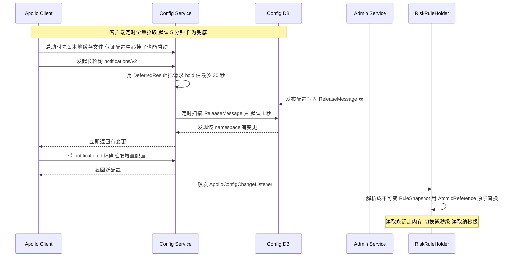

```java
@Component public class RiskRuleHolder {
    // 不可变快照 + 原子引用：读取永远无锁，切换永远原子
    private final AtomicReference<RuleSnapshot> snapshot = new AtomicReference<>(RuleSnapshot.empty());
    private final RuleParser ruleParser;                                  // 把 Apollo 的 JSON 解析成规则对象
    public RiskRuleHolder(RuleParser ruleParser) { this.ruleParser = ruleParser; refresh("startup"); }

    @ApolloConfigChangeListener("risk-rules")                            // 监听指定 namespace 的变更
    public void onRuleChange(ConfigChangeEvent event) {
        if (event.isChanged("rules")) refresh("apollo-change");
    }
    private void refresh(String source) {
        String json = ApolloConfig.getConfig("risk-rules").getProperty("rules", "[]");
        snapshot.set(ruleParser.parse(json));                            // 解析成不可变对象后原子切换，微秒级、无锁
    }
    public RuleSnapshot current() { return snapshot.get(); }             // 3. 预警主链路：只读内存，纳秒级
}
```
📦 演示风控规则通过 Apollo 监听 + `AtomicReference` 原子快照实现「准实时生效」。

**为什么 / 取舍**
- **「推拉结合」是配置中心的通用最优解**：纯推送（服务端维护全部客户端连接）在客户端量大时是灾难（连接管理、广播风暴）；纯拉取（定时轮询）有延迟且浪费请求。**长轮询 = 拉取的形式 + 推送的时效**：连接在服务端 hold 住，有变更立即返回，无变更超时重连——**用最少的资源拿到准实时的效果**。
- **「本地缓存 + 原子替换」是毫秒级生效的前提**：Apollo 的网络延迟无法消除（物理链路），但**规则读取必须永远走内存**，把「配置到达」和「规则生效」解耦——到达是秒级（网络决定），生效是微秒级（内存操作决定）。**这是「把延迟放到变更路径而不是读取路径」的经典设计**。
- **「不可变快照 + 原子指针切换」保证一致性**：风控规则是一个**规则集**，如果逐条修改，并发线程可能读到「只更新了 3 条规则」的中间态，导致误判；用 `AtomicReference` 换整个不可变快照，保证**读到的永远是某个完整版本**——「用不可变对象换线程安全」的取舍。

**企业实际处理**
- `@Value` 只用于**少量、简单**配置；**规则表、灰度开关、限流阈值**用 `@ConfigurationProperties` + 监听器 + 本地缓存。
- 配置项按 **namespace 拆分**：`application`（公共）、`risk-rules`（风控规则）、`alert-channel`（通道配置），各服务只订阅自己关心的 namespace。
- **规则热更新的原子性**：用 `AtomicReference<RuleSnapshot>` 整体替换（不可变对象），**绝不逐条改 Map**——否则并发下会读到「改了一半」的规则集。
- **变更审计**：Apollo 有发布历史（谁在什么时候改了什么），监管场景必须启用（合规要求可追溯）。

**易错 / 加分**
- ⚠️ 别以为 Apollo 的「推送」是长连接/WebSocket——它本质是**长轮询**，这是很多人误解的点。
- 💡 能区分「Apollo 用**反射直接改 `@Value` 字段**」vs「`@RefreshScope` 用**重建 Bean**」两条不同的刷新路径；
  - Config Service 会把长轮询请求 hold 30s，靠 `ReleaseMessage` 表 + 定时扫描（默认 1s）感知变更，这个 1s 是「配置变更多久到达」的关键参数、可调；
  - 主动区分「**配置中心（Apollo/Nacos config）**」和「**注册中心（Nacos discovery）**」（职责不同，但不展开选型对比）；
  - 结合监管场景说「发布历史 + 灰度 + 秒级回滚」，**错误规则上线后可秒级回滚**是风控系统的安全网。

---

## 题 13：Gateway 断言和过滤器怎么工作？TraceId 是怎么跨服务透传的？

- **题干**：「微服务网关你们用的 Spring Cloud Gateway 吧？说说它的路由、断言、过滤器怎么工作？它跟 Zuul 1.x 有什么区别，为什么基于 WebFlux？还有——链路追踪的 TraceId 是怎么从网关一路传到下游服务的？」

**骨架答案**
- **Gateway 三大核心概念**：① **Route（路由）**——网关的基本单元，`id + uri + predicates + filters`，一个请求匹配到 Route 后按 filters 处理后转发到 `uri`；
  - ② **Predicate（断言）**——**路由匹配条件**，`RoutePredicateFactory` 生成，
  - 常用的有 `Path=/api/risk/**`、`Method=POST`、`Header=X-Token, \d+`、`Query=symbol`、`Cookie=sessionId`、`After/Before/Between`（时间窗口，可做**定时发布/灰度**），
  - 断言是「与」关系，全满足才匹配；
  - ③ **Filter**——**`GatewayFilter`（路由级，只对某个 Route 生效，如 `StripPrefix=1`、`RequestRateLimiter`）** 与 
  - **`GlobalFilter`（全局级，对所有 Route 生效，如 `NettyRoutingFilter` 转发、`LoadBalancerClientFilter` 选实例）**，
  - 常见内置 `AddRequestHeader`、`RewritePath`、`RequestRateLimiter`（Redis 令牌桶限流）、`CircuitBreaker`（熔断）；
  - **执行顺序**按 `Ordered` 排序，`pre` 阶段正序执行，`post` 阶段逆序执行（洋葱模型，和 AOP 一致）。
- **请求处理流程**：请求 → `RoutePredicateHandlerMapping` 匹配 Route → 组装 FilterChain（GlobalFilter + 该 Route 的 GatewayFilter，按 order 排序）→ pre 阶段依次执行（改请求：加头、鉴权、限流）→ 
  - `NettyRoutingFilter` 转发到下游服务（WebClient）→ post 阶段逆序执行（改响应）→ 返回给客户端。
- **与 Zuul 1.x 的区别 / 为什么基于 WebFlux**：Zuul 1.x 是 **Servlet 阻塞 IO**（一请求一线程）、线程数即并发上限、过滤器是 `ZuulFilter`（pre/route/post/error）、Netflix 停更且 Zuul 2 未被 Spring Cloud 整合；
  - Gateway 是 **WebFlux + Reactor Netty 异步非阻塞**，少量线程（EventLoop）支撑大量并发连接，过滤器是 `GatewayFilter` + `GlobalFilter`（基于 Reactor），原生异步更适合长连接/SSE/WebSocket，Spring 官方主推。
  - **为什么 WebFlux**：网关是**所有流量的入口**，是典型 IO 密集型场景（大量请求 + 等待下游响应），**阻塞模型下线程都耗在等 IO 上**，加线程又受限于内存和上下文切换；**异步非阻塞用少量 EventLoop 就能扛住高并发**。
  - **代价**：WebFlux 里**不能写阻塞代码**（`Thread.sleep`、阻塞 JDBC 调用会拖垮 EventLoop），所有下游调用必须用响应式 Client；且 **WebFlux 与 WebMvc 不能混用**（一个应用只有一个 Web 栈）——**这就是为什么「网关里配 `addCorsMappings` 不生效」，因为那是 WebMvc 的配置**。
- **TraceId 跨服务透传原理**：① **入口生成**：请求到达网关（或第一个服务）时，若 Header 里没有 TraceId（如 `traceparent` / `X-B3-TraceId`）**生成一个**，有则沿用（保证上游系统传下来的链路不断）；
  - ② **写入 MDC**：把 TraceId 放进 **`MDC`（SLF4J 的 Mapped Diagnostic Context，底层是 ThreadLocal）**，日志配置 `%X{traceId}` 就能自动打印；
  - ③ **出站透传（关键）**：网关转发时用 `GlobalFilter` 把 TraceId 写进下游请求 Header；服务内用 **OpenFeign 的 `RequestInterceptor`** 或 **`RestTemplate` 的 `ClientHttpRequestInterceptor`**，**从 MDC 取出 TraceId，塞进出站请求 Header**；
  - 下游服务同样在入口（Filter/Interceptor）从 Header 取出 TraceId，写入自己的 MDC；
  - ④ **形成链路**：每跳都「取 Header → 进 MDC → 出站时写 Header」；
  - ⑤ **技术栈演进**：**Spring Boot 2.x** 用 Spring Cloud Sleuth（基于 Brave，B3 传播格式 `X-B3-TraceId`）；**Spring Boot 3.x** Sleuth 停更，
  - 官方改用 **Micrometer Tracing**（`micrometer-tracing-bridge-brave` 或 `micrometer-tracing-bridge-otel`），传播格式支持 **W3C Trace Context（`traceparent`）/ B3**；
  - **无侵入方案** SkyWalking / OpenTelemetry Agent（字节码增强），无需改代码，但依赖 Agent 挂载。
- **跨线程的坑（高频追问）**：`MDC` 基于 `ThreadLocal`，**子线程拿不到父线程的 TraceId**（异步、线程池场景会丢）；解决：
  - ① 用 `TaskDecorator` 包装线程池，提交任务时**复制 MDC 到子线程**；
  - ② 用 `TransmittableThreadLocal`（阿里 TTL）跨线程池传递；
  - ③ 响应式场景（WebFlux/Gateway）用 Reactor 的 **`Hooks.onEachOperator` + `contextWrite`** 把 TraceId 放 Reactor Context（不是 ThreadLocal）。

**为什么 / 取舍**
- **网关必须用异步非阻塞，是「流量入口」这个位置决定的**：入口的 QPS 是全局最高，阻塞模型的线程数就是并发天花板，横向扩机器成本高；异步模型用少量 EventLoop 扛住连接，**用「编程复杂度」换「吞吐与资源效率」**——这个取舍对网关是划算的。
- **TraceId 必须靠「Header 透传」而非「共享内存」**：跨进程没有共享内存，唯一能带信息的通道就是协议（HTTP Header）；**每跳都要「读进来、存下去、带出去」**，任一环缺失链路就断——所以要用 `RequestInterceptor` / `ClientHttpRequestInterceptor` 统一在「出口」注入，而不是每个业务方法手写。
- **WebFlux 与 WebMvc 不能混用是「一个应用一个 Web 栈」的硬约束**：两者都抢占 `DispatcherServlet` / `DispatcherHandler` 的入口，Spring Boot 会按 classpath 二选一——**这解释了网关里 WebMvc 配置失效的根因**（不是配置写错，而是压根没有 WebMvc 栈）。

**企业实际处理**
- 网关统一做：**鉴权（JWT 校验）、限流（Redis 令牌桶）、TraceId 生成、CORS、灰度路由（按 Header/用户标签路由到不同版本）**，下游服务专注业务。
- TraceId 用 **W3C `traceparent`** 标准格式（`00-{traceId}-{spanId}-{flags}`），跨语言/跨厂商兼容性最好。
- 日志规范：`logback` 的 pattern 加 `[%X{traceId}]`，配合 ELK/Loki，**一个 TraceId 能查出全链路日志**（风控预警出问题时从网关 TraceId 一路追到规则计算、到告警发送）。
- 线程池统一用带 `TaskDecorator` 的包装（团队提供的 `MdcThreadPoolTaskExecutor`），从根上杜绝 TraceId 丢失。

**易错 / 加分**
- ⚠️ Gateway 的 pre/post 是**洋葱模型**（和 AOP 一样），`GlobalFilter` 用 `Ordered` 控制顺序。
- 💡 `RequestRateLimiter` 基于 Redis + Lua 令牌桶做分布式限流，`keyResolver` 决定限流维度（IP/用户/接口）；
  - 区分「**网关限流**（保护整个后端）」和「**Sentinel 服务内限流**（保护单个服务）」，两者配合使用；
  - 提 W3C `traceparent` 格式的字段含义（version-traceId-spanId-flags）；
  - 「异步/线程池会导致 MDC 丢失 TraceId」并给出 `TaskDecorator` / `TransmittableThreadLocal` 的解法；
  - 结合 Boot 3 说明 Sleuth 已停更、改用 Micrometer Tracing（版本敏感度加分）。

---

## 题 14：分布式任务调度（XXL-Job/SchedulerX）原理，多环境主备怎么切换？

- **题干**：「你们风控系统里有分布式任务调度吧？用的是 XXL-Job 还是 SchedulerX？说说它的原理——任务怎么被触发、怎么保证不重复执行？如果任务机器挂了怎么办？多环境/主备机房怎么用配置切换？」

**骨架答案**
- **XXL-Job 架构与原理**：两个角色——**调度中心（admin）**（管理任务、维护 cron、触发调度）+ **执行器（executor）**（内嵌在业务应用里 `xxl-job-executor`，注册到调度中心并接收触发）。
  - **注册与心跳**：执行器启动后**向调度中心注册**（写注册表，如 DB/注册中心），并**定时心跳**（默认 30s）上报健康；调度中心维护「在线执行器列表」，执行器下线/心跳超时 → 从列表移除。
  - **触发流程**：调度中心线程扫描任务，**cron 到期** → 通过 RPC（默认 HTTP，可换 Netty/gRPC）**下发 `run` 请求给执行器** → 执行器用**业务线程池**执行 `JobHandler` → 回调上报结果。
  - **路由策略**：`FIRST`（第一个）、`ROUND`（轮询）、`RANDOM`、`CONSISTENT_HASH`（一致性哈希，同一任务固定到同一机器）、`FAILOVER`（故障转移）、`SHARDING_BROADCAST`（**分片广播**，所有执行器各分一片）。
  - **阻塞处理策略**：`单机串行` / `丢弃后续` / `覆盖之前`。**失败处理**：失败重试（可配次数）、超时告警、失败告警邮件。
  - **重要**：**调度本身的高可用**——调度中心可集群部署，依赖 DB 行锁/乐观锁（`xxl_job_lock` 表）保证**同一任务同一时刻只被一个调度中心触发**，避免重复调度。
- **SchedulerX（阿里云）**：**Serverless 调度**（阿里云托管，无需自建 admin）；
  - 能力：**秒级 cron**（`0/5 * * * * ?` 能到秒）、**工作流（DAG，任务依赖编排）**、**分片（MapReduce 式）**、**幂等控制**（`blockType` 阻塞策略）、**任务级灰度**；触发原理类似（客户端 SchedulerX Agent 注册到服务端，服务端按计划触发下发）。
  - **工作流（DAG）**：多个 Job 组成有向无环图，**上游成功才触发下游**——这正是简历里「**任务依赖调度**」的实现方式（如「数据采集 → 规则计算 → 预警生成」三步依赖）。
- **核心难点与解法**：**重复执行**（原因：网络抖动 / 调度中心重试 / 多调度中心；解法：① 业务层**幂等**——唯一业务键 + 去重表 / `INSERT IGNORE` / Redis `SETNX`；② 调度中心用**分布式锁**（XXL-Job 的 `xxl_job_lock`）保证单次触发）；
  - **任务丢失**（执行器宕机、下发失败 → 失败重试 + 超时补偿 + **调度日志表**核对）；
  - **长任务阻塞**（上一轮未结束下一轮到来 → 阻塞处理策略（丢弃/串行/覆盖）+ 缩短任务粒度）；
  - **单机瓶颈**（一个任务处理全量数据 → **分片广播**：每个执行器处理 `hash(id) % shardTotal == shardIndex` 的那部分）；
  - **时钟漂移**（多机时间不一致 → 统一 NTP 同步；或由调度中心而非执行器判断到期）。
  - **幂等是分布式调度的第一性要求**：因为网络不可靠（重试）和集群化（可能重复触发），**任何调度任务都必须假设「可能被重复执行」**，用**唯一业务键 + 状态机**保证「重复执行也不会产生副作用」——风控预警生成尤其重要（**重复生成 = 重复告警 = 误报风暴**）。
- **多环境主备切换（结合配置中心）**：**环境隔离**——Apollo 用**不同环境（DEV/FAT/UAT/PRO）部署独立集群**，或同一集群用**不同 cluster（默认 default / 北京 / 上海）**隔离；客户端启动参数 `env` / `apollo.cluster` 决定读哪套配置。
  - **主备双活切换**：① 主备机房各部署一套服务，配置**同 namespace 不同 cluster**（如 `cluster=shanghai` / `cluster=beijing`）；
  - ② 一个**开关配置**（如 `risk.primary.region=shanghai`）决定哪边是主；
  - ③ 切换时**改开关 → Apollo 秒级推送到所有实例 → 各实例按新开关决定「是否接管流量/任务」**；
  - ④ 关键：**切换必须幂等且带防脑裂**——用**分布式锁（Redis/ZK）选主**保证同一时刻只有一个机房在跑定时任务，否则主备双跑会导致重复。
  - **任务调度的主备**：定时任务**只在一个机房启用**（`xxl-job` 执行器只在主机房注册，或 SchedulerX 的任务只在主机房实例上启用），备机房**待命但注册为「禁用」**，切换时启用备机房执行器。

```java
@Component public class RiskAlertDispatchJob {
    @Value("${risk.dispatch.enabled:false}") private boolean enabled;      // Apollo 主备开关：只有主机房为 true 才执行
    public void dispatch(String bizDate) {                                 // XXL-Job / SchedulerX 的 JobHandler
        if (!enabled) { log.info("本机房非主，跳过调度 bizDate={}", bizDate); return; }   // 主备切换：备机房直接跳过
        String lockKey = "lock:risk:dispatch:" + bizDate;                  // 1. 分布式锁防多实例并发（第一道闸）
        Boolean locked = redisTemplate.opsForValue().setIfAbsent(lockKey, "1", Duration.ofMinutes(10));
        if (!Boolean.TRUE.equals(locked)) return;
        try {                                                              // 2. 业务幂等：已生成则跳过（第二道闸）
            if (taskRepository.existsByBizDate(bizDate)) return;
            generator.generate(bizDate); taskRepository.markDone(bizDate);
        } finally { redisTemplate.delete(lockKey); }
    }
}
```
📦 演示幂等的调度任务 + Apollo 主备开关（分布式锁 + 业务幂等两道闸）。

**为什么 / 取舍**
- **「调度中心 + 执行器注册 + 心跳」是中心化调度的通用模式**：中心化便于统一管理（cron、路由、监控），代价是**调度中心成为关键路径**——所以必须集群 + 分布式锁防重复。这是「集中管理」与「高可用」的平衡。
- **「幂等」是分布式调度的第一性原理**：分布式环境下「恰好一次（exactly-once）」在工程上无法保证（网络分区、重试、进程崩溃），只能做到「**至少一次（at-least-once）+ 幂等 = 效果上的恰好一次**」——这和 MQ 的消费幂等是同一个道理。
- **「主备切换靠配置开关」而非「改代码/重部署」**：故障时**改代码重新发布要几分钟到几十分钟**，而改配置是**秒级**；把「环境行为」外置成配置，是**把变更成本从「发布」降到「改配置」**——这对容灾至关重要（RTO 从分钟级降到秒级）。
- **「防脑裂」是主备的命门**：主备双活最大的风险是**两个机房都以为自己是主**，同时跑任务 → 数据重复/冲突；用分布式锁选主（Redis/ZK）是标准解法，**宁可不切换（少可用性）也不能双主（数据错）**。

**企业实际处理**
- 简历里的「**任务依赖调度**」用 **SchedulerX 工作流（DAG）** 或 XXL-Job 的「子任务」串联：采集 Job 成功 → 触发计算 Job → 触发预警 Job，**每步可单独重试、可观测**。
- **所有调度任务强制幂等**：以「业务日期 + 任务类型」或「批次号」为唯一键，重复执行时直接跳过（`INSERT ... ON DUPLICATE KEY UPDATE` 或先查状态）。
- **调度日志 + 告警**：调度失败/超时立刻告警；风控数据传输类任务**双跑校验**（主备各跑一次，比对结果）保证正确性。
- 切换演练：**定期做机房切换演练**（切开关、验证任务接管、验证无重复），因为「没演练过的容灾等于没有容灾」。

**易错 / 加分**
- ⚠️ 别只答「任务怎么跑」，要区分「**调度中心高可用（集群 + 锁）**」和「**任务执行高可用（重试 + 幂等 + 分片）**」两个层面。
- 💡 XXL-Job 的**分片广播**（`ShardingUtil`）如何把大数据量任务拆给多台机器并行（「任务级分布式」核心）；
  - 调度用**秒级 cron（SchedulerX）**还是**分钟级（XXL-Job 支持秒级但习惯用分钟）**的区别；
  - 把「主备切换」和 Q12 的 Apollo 打通——**配置开关秒级生效 = 秒级容灾切换**，并结合「分布式锁防脑裂」讲完整；提「**没演练过的容灾等于没有容灾**」。

---

## 题 15：期权风控实时预警系统，你用 Spring 全家桶怎么落地？

- **题干**：「展开讲讲你做的期权风控实时预警系统吧——微服务是怎么拆的？规则引擎怎么做到全配置化？准实时预警的链路是怎样的？Spring 全家桶在里头分别解决了什么问题？」

**骨架答案**
- **微服务拆分（5~6 个服务，按业务边界）**：**行情/持仓接入服务**（对接交易所行情、持仓数据，清洗后发 Kafka：SpringBoot + Kafka）；
  - **规则引擎服务**（核心，消费行情/持仓、执行风控规则、命中则产生预警事件：SpringBoot + 规则引擎 + Apollo 规则热更新）；
  - **预警生成服务**（规则命中结果落库、生成预警记录：SpringBoot + MyBatis + 事务）；
  - **告警通道服务**（短信/邮件/IM 多渠道发送：SpringBoot + OpenFeign 被调用，Sentinel 降级）；
  - **网关**（Spring Cloud Gateway：统一鉴权、限流、TraceId、CORS）；
  - **配置中心（Apollo）+ 调度（SchedulerX/XXL-Job）**（全局配置、任务依赖编排）。
  - 拆分依据是**业务边界 + 变更频率**：行情接入变更少、规则引擎变更频繁（规则天天改），拆开后**规则引擎可独立发布**，不影响行情接入——这是「微服务解耦」的真实价值（简历原话「整体采用微服务架构解耦业务模块」）。
- **规则引擎「全配置化」（Apollo + 本地快照）**：规则（阈值、条件、动作）全部存 Apollo 的 `risk-rules` namespace，**改规则 = 改配置**，不改代码、不发布（对应简历「全配置化预警规则管理」）；
  - 规则加载 `@ApolloConfigChangeListener` 监听 → 解析成**不可变 `RuleSnapshot`** → `AtomicReference.set()` 原子切换（Q12）；预警主链路只读内存、**纳秒级**；
  - 灰度：新规则先按 IP 灰度到 1~2 台预警实例，观察无误报后再全量（Q12 灰度发布）。
- **准实时预警链路（端到端）**：交易所行情 → 接入服务（清洗）→ Kafka（`topic: market-tick`）→ 规则引擎服务（消费 + 并行规则计算，本地规则快照）→ 命中 → Kafka（`topic: alert-event`）[异步解耦] → 
  - 预警生成服务（消费 + 事务落库，幂等键防重）→ 事务提交后 → OpenFeign 调告警通道服务（Sentinel 熔断降级）→ 短信/邮件/IM。
  - **为什么用 Kafka**：行情是高频流，规则计算要**削峰 + 解耦**；规则引擎挂了，行情还在 Kafka 里，恢复后继续消费（不丢数据）。
  - **为什么落库和告警分离**：落库在事务内、告警在 `afterCommit`（Q6），保证「**预警不丢**（先落库）且**告警不阻塞落库**」。
  - **幂等**：预警生成用「规则ID + 标的 + 触发时间窗口」做唯一键，重复消费不产生重复预警（Q14 幂等思想）。
- **Spring 全家桶各组件解决的问题**：Spring IoC/AOP——服务内部解耦 + 事务/日志/限流切面；SpringBoot——快速构建独立可运行的服务（内嵌 Tomcat、自动装配、Starter 封装公共能力）；SpringMVC——对外 REST API（规则管理、预警查询、手工干预）；
  - Spring Cloud Gateway——统一入口（鉴权、限流、TraceId、灰度路由、CORS）；OpenFeign + Sentinel——服务间调用 + 超时/重试/熔断降级（防雪崩）；
  - Apollo——规则热更新、开关、多环境/主备切换（秒级生效）；SchedulerX/XXL-Job——定时/依赖任务（日终对账、规则同步、T+1 报告）；MyBatis——ORM + 分页 + 一二级缓存控制；Micrometer Tracing——TraceId 全链路透传，问题可追溯。
- **监管级系统的额外考量**：**可追溯**（所有规则变更走 Apollo 发布历史——谁、何时、改了什么 + 预警记录留痕）；**可回滚**（错误规则秒级回滚：改配置 + Apollo 推送）；
  - **不丢数据**（Kafka 持久化 + 消费幂等 + 告警降级落库补发）；**不过载**（网关限流 + Sentinel 服务级限流 + 熔断降级，多级保护）；
  - **可观测**（TraceId 全链路 + 慢规则监控 + 调度失败告警）。

**图 4-16：期权风控系统的微服务架构总览**
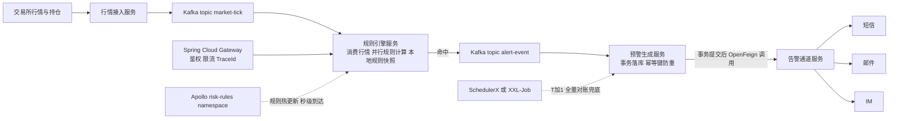

```java
@Service public class MarketTickConsumer {
    @KafkaListener(topics = "market-tick", groupId = "risk-engine", concurrency = "8")   // 并行消费提升吞吐
    public void onTick(MarketTick tick) {
        RuleSnapshot snapshot = ruleHolder.current();       // 只读内存快照，读到的是完整版本，不受热更新影响
        for (RuleHit hit : evaluator.evaluate(tick, snapshot)) {
            AlertEvent event = AlertEvent.of(hit, tick);
            if (alertEventRepository.existsByUniqueKey(event.uniqueKey())) continue;   // 幂等键：规则+标的+窗口 已存在则跳过
            kafkaTemplate.send("alert-event", event.symbol(), event);                    // 异步解耦，交给下游落库+告警
        }
    }
}
```
📦 演示规则引擎消费 Kafka + 命中后异步发预警事件，配合幂等键防重复告警。

**为什么 / 取舍**
- **拆分的依据是「变更频率 + 资源特征」而非「技术炫技」**：规则引擎（CPU 密集、变更频繁）和行情接入（IO 密集、变更少）混在一起会导致「改一行规则要重启行情服务」。**分离关注点 = 让不同的变化节奏解耦**。
- **「全配置化」是风控业务对「响应速度」的硬要求**：市场规则变化时，**改代码发布（分钟级）来不及，改配置（秒级）才跟得上**，所以规则必须外置到配置中心——**业务约束驱动架构**。
- **「异步 + 幂等 + 降级落库」是「不丢预警」的三重保险**：Kafka 削峰解耦防丢失、幂等防重复消费导致重复告警、降级落库防告警通道故障丢数据。监管场景下**「宁可重复告警（可容忍）也不能漏报（不可容忍）」**——所有设计都围绕这个优先级。

**企业实际处理**
1. **服务按「变更频率 + 团队边界」拆，不按技术分层拆**：真实系统是 5~8 个服务（行情接入 / 规则引擎 / 预警生成 / 告警通道 / 查询服务 / 网关），**不会**拆成 controller 服务、service 服务、dao 服务；拆分的唯一判据是「谁和谁的变化节奏不同」。
2. **规则引擎选型分档，不无脑上 Drools**：简单阈值/条件规则（占 80%）→ **Aviator / QLExpress 表达式引擎**（规则存配置中心，解析成表达式预编译缓存）；
   - 复杂组合/时序窗口规则（跨品种、连续 N 笔）→ 下沉到 **Flink CEP** 或用 Drools；
   - 重度用 Drools 的团队普遍反馈「规则文件膨胀后编译慢、排查难」，所以主流是**表达式引擎为主、Drools 为辅**。
3. **规则本身也要走「发布—灰度—全量—回滚」四步**：规则变更在监管场景下等同于代码变更，必须有发布历史（谁、何时、改了什么）、**影子模式**（新规则先只计算不告警，对比新旧规则命中差异）、可一键回滚——这是**监管审计的硬要求**，不是可选项。
4. **主备双活靠「选主 + 幂等」防双写**：主备不双写，同一时刻只有一侧产出预警，靠**分布式锁选主 + 切换开关 + 落库唯一索引**三重保证；切换时必然出现短暂重复消费，由幂等键兜底。
5. **幂等键是最后一道防线**：预警生成用「**规则ID + 标的 + 触发时间窗口**」做唯一键 + 数据库唯一索引；**先落库后告警**，落库冲突即视为重复，直接丢弃。
6. **T+1 全量对账兜底**：实时链路再稳也可能漏报，所以每天用 ADB/Hologres 跑一遍全量重算，与实时结果比对，**发现漏报自动补发**——这条是监管级系统和普通业务系统最大的区别。
7. **告警分级 + 收敛，防告警风暴**：P0 电话 / P1 IM 群 / P2 邮件，同一规则同标的在时间窗口内收敛为一条；**「异常发现小时级→分钟级」的前提是先解决告警风暴，否则告警越多越看不见**。
8. **不是所有预警都要毫秒级**：按监管要求分级——**逐笔无状态规则毫秒级**（内存计算）、**窗口聚合规则秒级**（容忍 Watermark 等待）、**日终规则 T+1**；「秒级/毫秒级双链路」正是这么来的，而不是全链路硬凑毫秒。
9. **容量按峰值 × 3 倍冗余压测**：以行情高峰 TPS 为基准估容量，压测验证规则计算的 P99 延迟，**压测不过不允许上线**。

**易错 / 加分**
- ⚠️ 别罗列技术名词；要把「为什么这样拆、为什么这样选」讲成**业务约束的推论**（监管要求 → 不丢预警 → 异步+幂等+降级落库），这是高级岗和中级岗的根本差别。
- 💡 主动提**技术取舍的另一面**：「异步带来最终一致性，所以预警查询接口要能处理『刚触发但还没落库』的短暂延迟」；
  - 「**先落库后告警**」的顺序是刻意设计的（反过来的话告警发了但落库失败，会「告警了但系统里查不到记录」，监管审计无法解释）；
  - 提「**主备双活 + 分布式锁选主**」（Q14），保证切换时任务不双跑；
  - 收尾一句「**Spring 全家桶的价值不是『我用了多少组件』，而是『每个组件都在解决一个具体的工程问题』**」能显著加分。

---

## 一句话主线

**Spring 全家桶 = 代理 + 容器 + 扩展点**。IoC 用 BeanDefinition + 三级缓存把对象管起来；
- AOP 用 JDK/CGLIB 代理把事务、日志、限流切走（所以 private/自调用/非 public 一律失效）；
- SpringBoot 用 SPI（Boot 3 是 `AutoConfiguration.imports`）+ 条件注解实现「用了就配好」；
- SpringCloud 用网关、Feign、Sentinel、Apollo 把单机应用编成「能容错、能热更、能观测」的集群；
- MyBatis 用 MapperProxy 把接口声明映射成 SQL。
- **面试时永远落到三问：Bean 建好了吗？代理拦住了吗？线程/进程上下文还在吗？**

## 面试官深挖追问

1. 「你说三级缓存解决循环依赖，那**构造器注入**的循环依赖怎么处理？」→ 答：无解（实例化阶段就卡死，没有半成品可暴露），抛 `BeanCurrentlyInCreationException`；解法是 `@Lazy`（注入代理、延迟 getBean）、改 Setter、或重构。
2. 「三级缓存里的 `ObjectFactory.getObject()` 到底调了什么？」→ 答：`getEarlyBeanReference()`（`SmartInstantiationAwareBeanPostProcessor` 方法），需要 AOP 时在此**提前生成代理**并放入二级缓存，删三级缓存。
3. 「为什么 B 注入的必须是 A 的代理而不是原始对象？」→ 答：注入原始对象会导致 B 调 A 时**不走切面**，`@Transactional`/自定义切面全部失效——这和自调用失效同源。
4. 「`@Transactional` 标在 private 方法上为什么不生效？」→ 答：CGLIB 子类无法覆写 private；且 Spring 的 `AbstractFallbackTransactionAttributeSource` 直接跳过非 public 方法，属性都不解析。
5. 「你的事务方法里调了告警通道，结果超时了会怎样？」→ 答：事务被拉长、DB 连接被占用，高并发下连接池耗尽；正解是把告警移到 `afterCommit` 或事务外。
6. 「`@Transactional` 默认回滚哪些异常？为什么？」→ 答：`RuntimeException` + `Error`；受检异常默认不回滚（设计上认为调用方应处理），所以规范强制写 `rollbackFor = Exception.class`。
7. 「SpringBoot 2.7 升 3.0，自定义 Starter 有什么必须改的？」→ 答：`spring.factories` 里的自动配置**不再生效**，
   - 必须迁到 `META-INF/spring/org.springframework.boot.autoconfigure.AutoConfiguration.imports`，并在配置类上加 `@AutoConfiguration`。
8. 「`@ConditionalOnMissingBean` 有什么用？」→ 答：容器里没有该 Bean 才装配，让业务方自定义的 Bean 能覆盖默认配置——这是 Starter 可被覆盖的关键。
9. 「`#{}` 为什么能防注入，`${}` 为什么不能？」→ 答：`#{}` 走 `PreparedStatement` 预编译，参数值不参与 SQL 语法解析；`${}` 是字符串拼接，值会变成 SQL 的一部分。动态表名/排序必须用 `${}` 时，参数走白名单。
10. 「MyBatis 二级缓存为什么生产上不推荐开？」→ 答：namespace 级失效，跨 Mapper 改同表不会清缓存 → 脏读；多实例部署下更是无法保证一致，统一用 Redis 做分布式缓存。
11. 「Apollo 说『推送』，它真的是服务端主动推吗？」→ 答：不是。本质是**长轮询**：客户端发 `notifications/v2`，服务端 hold 30s，有变更（靠 `ReleaseMessage` 表 1s 扫描感知）立即返回，否则超时后客户端立刻重连。
12. 「风控规则要毫秒级生效，Apollo 是秒级的，怎么补？」→ 答：Apollo 负责「配置到达（秒级）」，用 `@ApolloConfigChangeListener` + `AtomicReference` 原子替换本地不可变快照，**读取永远走内存**，把生效延迟压到微秒级。
13. 「Gateway 为什么不能用 `WebMvcConfigurer` 配跨域？」→ 答：Gateway 基于 **WebFlux**，压根没有 WebMvc 的 `DispatcherServlet` 那一套；跨域要在 Gateway 的 `globalcors` 或 WebFlux 的 `CorsWebFilter` 里配。
14. 「TraceId 怎么跨线程池传递？」→ 答：`MDC` 是 ThreadLocal，子线程拿不到；用 `TaskDecorator` 复制 MDC 到子线程，或用 `TransmittableThreadLocal`；WebFlux 场景用 Reactor Context。
15. 「定时任务怎么保证不重复执行？」→ 答：调度中心层用分布式锁（XXL-Job 的 `xxl_job_lock`）保证单次触发；业务层用唯一键 + 状态机做幂等；主备多机房靠配置开关 + 选主锁防脑裂。
