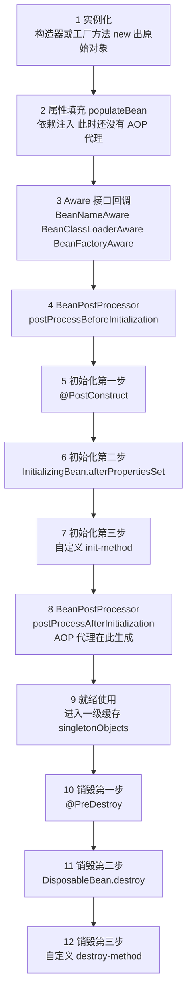
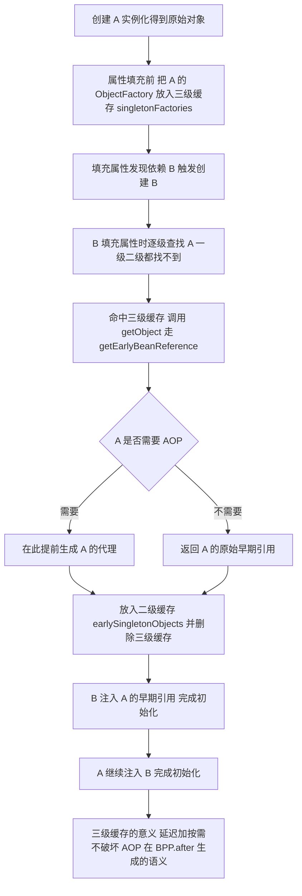

# 04 · Spring 全家桶 速记版（考前 10 分钟扫一遍）

> **一句话主线**：Spring 全家桶 = **代理 + 容器 + 扩展点**。IoC 用 BeanDefinition + 三级缓存把对象管起来；AOP 用 JDK/CGLIB 代理把事务、日志、限流切走（所以 private/自调用/非 public 一律失效）；SpringBoot 用 SPI + 条件注解实现「用了就配好」；SpringCloud 用网关、Feign、Sentinel、Apollo 把单机应用编成能容错、能热更、能观测的集群；MyBatis 用 MapperProxy 把接口声明映射成 SQL。

## Spring 核心（8 条）

| # | 面试题 | 关键词速答 |
|---|--------|-----------|
| 1 | Bean 生命周期？ | 实例化 → 属性填充 → Aware(BeanName/BeanClassLoader/BeanFactory) → BPP.postProcessBefore → **@PostConstruct → afterPropertiesSet → init-method** → BPP.postProcessAfter(**此处生成 AOP 代理**) → 就绪 → **@PreDestroy → destroy → destroy-method**（prototype 不管理销毁） |
| 2 | 依赖注入三种方式 + 推荐哪种？ | 构造器（**官方推荐**，final/不可变/启动即暴露缺失依赖）> Setter（可选依赖）> 字段 `@Autowired`（不推荐：不能 final、单测难、隐藏依赖）；同类型多 Bean 用 `@Primary` / `@Qualifier` / `@Resource(name)` |
| 3 | 循环依赖 + 三级缓存为什么是三级？ | 一级 `singletonObjects`(成品)、二级 `earlySingletonObjects`(提前暴露的半成品/代理)、三级 `singletonFactories`(ObjectFactory 工厂)。**三级 = 延迟+按需**：只有真发生循环依赖才调 `getEarlyBeanReference()` 生成代理，不破坏「代理在 BPP.after 生成」的生命周期语义；**代理必须提前暴露**，否则 B 注入原始对象会让 A 的切面失效 |
| 4 | 构造器循环依赖为什么解决不了？ | 循环点在**实例化阶段**，此时没有「半成品」可提前暴露，直接抛 `BeanCurrentlyInCreationException`；解法：`@Lazy`（注入代理，首次调用才 getBean）/ 改 Setter / 重构成接口下沉。**Spring Boot 2.6+ 默认禁止循环依赖**，启动就报错 |
| 5 | BeanFactory vs FactoryBean vs ApplicationContext？ | BeanFactory=最底层容器（懒加载，`getBean`）；FactoryBean=「生产对象的 Bean」，`getBean("&x")` 拿本体、`getBean("x")` 拿 `getObject()` 产品（如 `SqlSessionFactoryBean`）；ApplicationContext=超集（国际化/事件/资源/自动注册 BPP/默认预实例化） |
| 6 | AOP 原理，JDK vs CGLIB？ | JDK 基于接口(`Proxy`)，CGLIB 基于继承(`Enhancer` 生成子类)。选择：**Spring Boot 2.x 起默认 CGLIB**(`spring.aop.proxy-target-class=true`)；CGLIB 不能代理 final 类/final/private/static 方法 |
| 7 | @Aspect 通知顺序？ | `@Around(前) → @Before → 目标 → @AfterReturning → @After → @Around(后)`；异常时 `@AfterThrowing` 取代 `@AfterReturning`；多切面用 `@Order`（越小越靠外，洋葱模型） |
| 8 | 过滤器 vs 拦截器 vs AOP？ | Filter(Servlet 规范，DispatcherServlet 之前/后，基于 URL，拿不到 Handler) → Interceptor(SpringMVC，拿到 `HandlerMethod`，pre/post/afterCompletion) → AOP(方法级，能拿参数/返回)。顺序：Filter(before)→preHandle→AOP→Controller→AOP→postHandle→afterCompletion→Filter(after)；**ThreadLocal 清理必须放 afterCompletion**（postHandle 异常时会跳过） |

**图 4-17：Bean 的完整生命周期**

**图 4-18：三级缓存解决循环依赖的关键路径**

## SpringBoot（5 条）

| # | 面试题 | 关键词速答 |
|---|--------|-----------|
| 9 | 自动装配原理？ | `@SpringBootApplication` = `@SpringBootConfiguration` + `@ComponentScan` + **`@EnableAutoConfiguration`**；后者 = `@AutoConfigurationPackage` + **`@Import(AutoConfigurationImportSelector)`**；selector 读 SPI 文件拿候选配置类 → 去重/排除 → `AutoConfigurationImportFilter`(OnClass/OnBean) 过滤 → 注册 BeanDefinition；条件注解：`@ConditionalOnClass` / **`@ConditionalOnMissingBean`**(允许用户覆盖) / `@ConditionalOnProperty` |
| 10 | SPI 文件 2.7→3.x 变更？（必答准） | Boot ≤2.6：`META-INF/spring.factories`（key=`EnableAutoConfiguration`）；**2.7 两者都支持**（新文件 deprecated 旧写法）；**3.x 只认 `META-INF/spring/org.springframework.boot.autoconfigure.AutoConfiguration.imports`（一行一个类），配置类用 `@AutoConfiguration`**；`spring.factories` 仍用于 Listener/Initializer |
| 11 | 自定义 Starter 步骤？ | ①starter(空 jar 聚合)+autoconfigure 两模块 → ②`XxxProperties`(`@ConfigurationProperties`) → ③`XxxAutoConfiguration`(+`@AutoConfiguration`/`@EnableConfigurationProperties`/`@ConditionalOnMissingBean`) → ④写 `.imports` 文件 → ⑤启动类加 `--debug` 或 `/actuator/conditions` 验证 |
| 12 | 启动流程 + 内嵌 Tomcat？ | `new SpringApplication`(推断 WebApplicationType、加载 Initializer/Listener) → `run()` → 发布 StartingEvent → `prepareEnvironment`(加载配置) → Banner → `createApplicationContext` → `prepareContext` → **`refreshContext()`**(12 步，**内嵌 Tomcat 在 `onRefresh()` 创建启动**) → `callRunners` → ReadyEvent |
| 13 | 启动优化 + 配置优先级？ | 优化：**懒加载** `spring.main.lazy-initialization`(核心服务慎用)、`spring.autoconfigure.exclude` 裁剪、缩小扫描、`-XX:TieredStopAtLevel=1`/CDS、AOT+Native、重活移到 `ApplicationReadyEvent`、Maven 分层构建。优先级：**命令行 > 环境变量 > 外部 config/ > 外部当前目录 > jar 内**；**profile 覆盖默认，外部覆盖内部** |

## SpringMVC（3 条）

| # | 面试题 | 关键词速答 |
|---|--------|-----------|
| 14 | 一次请求完整流程？ | `DispatcherServlet` → `HandlerMapping` 匹配 `HandlerExecutionChain`(Handler+拦截器) → `preHandle` → `HandlerAdapter` 调用 → **`HandlerMethodArgumentResolver` 参数绑定** → Controller → **`HandlerMethodReturnValueHandler`** → `HttpMessageConverter` 写 JSON → `postHandle` → `afterCompletion`；异常走 `HandlerExceptionResolver` |
| 15 | @RequestBody 原理？ | `RequestResponseBodyMethodProcessor` 找 `HttpMessageConverter`(`MappingJackson2HttpMessageConverter`) 反序列化；**必须 `Content-Type: application/json`，否则 415**；无 @RequestBody 的 POJO 走 `@ModelAttribute`(WebDataBinder 逐字段绑定，来自 query/form) |
| 16 | 跨域 + 全局异常？ | 跨域：`@CrossOrigin` / `WebMvcConfigurer#addCorsMappings` / **网关 `globalcors`(微服务推荐)**；⚠️ `addCorsMappings` 是 WebMvc 的，**Gateway 是 WebFlux，不通用**。全局异常：`@RestControllerAdvice` + `@ExceptionHandler`，兜底 `Exception` 只记日志、不回堆栈给前端 |

## SpringCloud（4 条）

| # | 面试题 | 关键词速答 |
|---|--------|-----------|
| 17 | OpenFeign 原理 + 超时熔断？ | `@EnableFeignClients` → `FeignClientFactoryBean` → JDK 动态代理(`ReflectiveFeign`)，`MethodHandler` 生成 `RequestTemplate` → `Client`(默认 HttpURLConnection，可换 OkHttp) → `LoadBalancerClient` 选实例。超时必须显式配(`connectTimeout`/`readTimeout`，**要小于上游超时，形成递减**)；**Spring Cloud OpenFeign 默认不重试**；`feign.sentinel.enabled` + `fallbackFactory` 做熔断降级，**降级不能丢预警，要落库待补发** |
| 18 | Sentinel 限流熔断？ | 流控：QPS/线程数，模式(直接/关联/链路)，效果(快速失败/WarmUp/排队)；熔断降级：慢调用比例/异常比例/异常数，状态机 **CLOSED→OPEN→HALF_OPEN**；热点参数 `@SentinelResource`；规则持久化到 Apollo/Nacos（不写死代码） |
| 19 | Apollo 原理 + 毫秒级生效？ | **推拉结合**：客户端 5 分钟全量拉(兜底) + 本地缓存文件(容灾)；**长轮询** `notifications/v2` 服务端 hold 30s，靠 `ReleaseMessage` 表 1s 扫描感知变更 → 立即返回（**秒级准实时，不是真推送**）；灰度按 IP/Label；刷新：Apollo 用**反射改 `@Value` 字段**，`@RefreshScope` 用**清缓存重建 Bean**。毫秒级做法：`@ApolloConfigChangeListener` + **`AtomicReference` 原子替换不可变快照**，读取永远走内存 |
| 20 | Gateway + 链路追踪？ | Gateway：**WebFlux + Reactor Netty 异步非阻塞**(Zuul 1.x 是 Servlet 阻塞，一请求一线程)；Route(id/uri/predicates/filters)、Predicate(Path/Method/Header/时间)、Filter(**GatewayFilter 路由级** / **GlobalFilter 全局级**)，pre 正序/post 逆序(洋葱)。TraceId：入口生成/沿用 → 写 MDC → 出站 `RequestInterceptor`/`ClientHttpRequestInterceptor` 塞 Header → 下游提取；**MDC 是 ThreadLocal，跨线程池用 TaskDecorator / TransmittableThreadLocal**；Boot 3 用 **Micrometer Tracing**(W3C `traceparent`) 替代 Sleuth |

## MyBatis（2 条）

| # | 面试题 | 关键词速答 |
|---|--------|-----------|
| 21 | MyBatis 执行流程 + #{} vs ${}？ | 流程：解析 XML → `Configuration` → `SqlSession` → `getMapper()` 生成 **`MapperProxy`** → `MapperMethod` 找 `MappedStatement` → `Executor` → `StatementHandler`(建 Statement) → `ParameterHandler`(设参) → 执行 → `ResultSetHandler`(映射)，四大对象可被插件包装。**`#{}` 走 `PreparedStatement` 预编译、防注入**；**`${}` 字符串拼接、有注入风险**，动态表名/order by 必须用 `${}` 时走白名单 |
| 22 | 缓存 + Mapper 动态代理 + 分页？ | **一级缓存**：`SqlSession` 级、默认开、update/commit/close 清空；**二级缓存**：namespace 级、默认关、跨会话但易脏读，**生产不推荐**。Mapper 无实现类靠 **JDK 动态代理**(`MapperProxyFactory`+`MapperProxy`)，Object 的 toString/equals/hashCode 和 default 方法特殊处理。分页插件拦 `Executor.query`：**先 count 再改写成 `LIMIT`**(物理分页)；PageHelper 用 ThreadLocal 有串页坑，**推荐 MyBatis-Plus 的 `IPage`** |

## 必背速查

| 项 | 内容 | 说明 |
|----|------|------|
| **@Transactional 失效 8 场景** | ①自调用(this 调用，不走代理) ②private 方法(CGLIB 覆写不了) ③非 public(Spring 直接跳过非 public 方法) ④异常被 catch 吞掉 ⑤异常类型不匹配(**默认只回滚 RuntimeException/Error**) ⑥多线程(ThreadLocal 不传递) ⑦传播行为配置不当 ⑧类未被 Spring 管理 | 另补：MyISAM 引擎不支持事务；多数据源没指定 `transactionManager`。**修复主线：Bean 被代理？方法 public？调用走代理？异常穿透拦截器？同一线程？** |
| **事务传播 7 种** | REQUIRED(默认，加入/新建)、REQUIRES_NEW(挂起外层，独立新事务)、SUPPORTS、NOT_SUPPORTED、MANDATORY(无事务抛异常)、NEVER(有事务抛异常)、NESTED(savepoint，外层回滚会连累内层) | **REQUIRES_NEW 独立结算 vs NESTED 同账打标记**；REQUIRES_NEW 多占一个连接，勿滥用 |
| **Spring 事务为什么能回滚** | `TransactionInterceptor` 拦截 → `PlatformTransactionManager.getTransaction()` → `bindResource(dataSource, ConnectionHolder)` **绑定到 ThreadLocal** → 同线程 DAO 拿同一 Connection → 正常 commit / 异常 rollback；**底层就是 JDBC/MySQL 事务**，回滚靠 undo log | 隔离级别默认 DEFAULT = 跟随数据库(MySQL 是 REPEATABLE READ) |
| **AOP 代理选择规则** | 有接口 → 传统 Spring 用 JDK；**Spring Boot 2.x+ 默认 CGLIB** (`spring.aop.proxy-target-class=true`)；CGLIB 不能代理 final 类、final/private/static 方法 | 代理生效前提：Bean 被容器管理 + 调用经过代理 |
| **自动装配关键注解** | `@SpringBootApplication`(三合一)、`@EnableAutoConfiguration`(二合一)、`@Import(AutoConfigurationImportSelector)`、`@AutoConfiguration`、`@ConditionalOnClass`/`OnMissingBean`/`OnProperty`、`@ConfigurationProperties`、`@EnableConfigurationProperties` | Boot 3 的 SPI 文件：`META-INF/spring/org.springframework.boot.autoconfigure.AutoConfiguration.imports` |
| **SpringCloud 组件职责** | Gateway(入口:鉴权限流TraceId灰度CORS)、OpenFeign(调用)、LoadBalancer(负载)、Sentinel(限流熔断)、Apollo(配置热更)、Micrometer Tracing(链路) | 超时递减：下游 < 上游，防级联放大 |
| **易错细节** | `@PostConstruct` 早于 `afterPropertiesSet`；AOP 代理在 BPP.**after** 生成；三级缓存的代理在 `getEarlyBeanReference()` 提前生成；`afterCompletion` 才保证执行；MDC 跨线程会丢；`${}` 有注入风险 | 都是拉开差距的「一句话细节」 |

## 答题模板

**原理类问题通用框架（四步走）**：
1. **核心概念**：一句话定义（是什么，解决什么问题）。
2. **关键流程分步**：按执行顺序拆 4~8 步，每步点到「源码类名/机制关键词」（如 `AbstractAutoWireCapableBeanFactory`、`getEarlyBeanReference`、`ConnectionHolder`），证明看过源码。
3. **设计目的**：**为什么这样设计 / 换一种做法为什么不行**（如「三级而不是二级，是因为要按需生成代理、不破坏生命周期」）——这一步决定你是背题还是懂了。
4. **生产踩坑**：结合真实场景讲一个「失效/故障」的案例和修复（如「@Transactional 自调用不回滚，因为 this 调用不走代理」），并说明**权衡**（如「懒加载优化了启动速度，代价是首请求变慢，所以核心服务不开」）。

**微服务/架构类问题补充**：把每个技术选型讲成「**业务约束 → 技术方案 → 代价**」的推论链，而不是罗列组件名。例：监管要求不丢预警 → Kafka 削峰解耦 + 消费幂等 + 降级落库 → 代价是最终一致性、查询有短暂延迟。
