# 05 · 云原生与可观测性（15 题）

> **模块主线**：用「**镜像是怎么造出来的 → 谁来编排它 → 谁来发布它 → 出问题怎么看见**」这一条链路串起来：Docker 解决"一致地打包运行"，K8s 解决"稳定地调度自愈"，CI/CD 解决"高频且可回滚地交付"，可观测性解决"黑盒变白盒、小时级变分钟级"。

## 模块导览

> **背景**：这个模块在面试里被反复问，是因为它直接对应简历上最亮的一行行数字——「发布 4 小时→15 分钟」「故障率降 82%」「异常发现小时级→分钟级」。面试官不是想考你背不背得过 `docker run`，而是想验证：一个 9 年经验的候选人，能不能把自己做过的事**讲成一套有方法论、有根因、有取舍的工程体系**。云原生题目往往以「你简历写了 XX，那你说说 YY」的形式切入，答不出来会显得业绩是编的。

**学完这 15 题，你能获得什么：**
- 能用「分层/写时复制/命名空间/cgroup」的底层原理解释 Docker 与虚拟机的本质区别，而不是背概念
- 能讲清 K8s 控制面与 Node 组件的协作链路，以及 Pod/Deployment/Service/探针/资源限制背后的设计动机
- 能完整拆解「4 小时→15 分钟」的发布提速来源，并讲出可回滚、可灰度、多环境一键发布的工程做法
- 能按「三支柱 + 告警降噪 + SLO/错误预算」搭出一套可观测体系，并把「小时级→分钟级」讲成指标而非口号
- 能背下一套「线上故障排查方法论」，面对开放题不慌

**覆盖技术点速查：**

| 分层 | 技术点 |
|------|--------|
| 基础 | 镜像分层与 UnionFS/写时复制、容器 vs 虚拟机、Dockerfile 指令与多阶段构建、镜像瘦身与安全、容器网络模式、数据卷、cgroup 资源限制、K8s 架构、Pod、三种探针 |
| 进阶 | Deployment/ReplicaSet/StatefulSet/DaemonSet/Job 选型、滚动更新与回滚、Service 四种类型与 kube-proxy、Ingress、requests/limits 与 QoS、OOMKilled、HPA、ConfigMap/Secret 热更新、优雅退出 |
| 高阶 | 发布提速拆解与故障率下降、可观测性三支柱、Prometheus 数据模型与四种指标类型、PromQL、ELK/EFK、链路追踪原理与采样、OpenTelemetry vs SkyWalking、告警分级与降噪、SLO/SLI/错误预算、故障排查方法论、压测与容量规划 |

**复习指引**：
- 一面（技术基础）侧重 Docker 分层、Dockerfile、K8s 架构、Pod、探针、Service —— 要能画图讲清。
- 二面（项目实战）侧重发布提速、滚动更新与回滚、可观测体系、一次故障排查 —— 要结合简历数字讲。
- 三面/主管面侧重发布策略选型、SLO/错误预算、容量规划、告警风暴治理 —— 要讲取舍与成本。
- 关联模块：与「Kafka/Flink（消息与流处理）」「分布式一致性（Raft/2PC）」「缓存与 MySQL」联动提问的概率极高，例如"你的 Flink 任务在 K8s 上怎么保证 Exactly-Once 的 Checkpoint 存储"、"etcd 的 Raft 和你前面讲的 Raft 有什么差异"。

**本模块目录（15 题）：**

1. [题 1：Docker 镜像为什么分层？容器和虚拟机到底差在哪？](#q1)
2. [题 2：Dockerfile 怎么写才专业？多阶段构建是怎么瘦身的？](#q2)
3. [题 3：容器网络模式有哪几种？数据卷和 cgroup 解决什么问题？](#q3)
4. [题 4：K8s 的整体架构是什么？一次 kubectl apply 到底发生了什么？](#q4)
5. [题 5：为什么调度单元是 Pod 而不是容器？三种探针怎么区分？](#q5)
6. [题 6：Deployment/StatefulSet/DaemonSet/Job 怎么选？滚动更新和回滚的控制参数是什么？](#q6)
7. [题 7：Service 四种类型有什么区别？kube-proxy 怎么转发的？Ingress 又在哪一层？](#q7)
8. [题 8：requests/limits 怎么设？QoS 等级和 OOMKilled 是什么关系？](#q8)
9. [题 9：HPA 自动扩缩容怎么工作？ConfigMap 改了为什么应用感知不到？](#q9)
10. [题 10：Pod 反复重启，你的排查链路是什么？优雅退出为什么要配 preStop？](#q10)
11. [题 11：你说发布从 4 小时缩到 15 分钟，具体怎么做到的？故障率降 82% 靠什么？](#q11)
12. [题 12：可观测性三支柱是什么？Prometheus 的四种指标类型和常用 PromQL 讲讲](#q12)
13. [题 13：链路追踪的原理是什么？TraceId 怎么透传？全量采样可以吗？](#q13)
14. [题 14：告警怎么设计才不吵？为什么"小时级→分钟级"是关键指标？](#q14)
15. [题 15：线上故障你的排查方法论是什么？怎么做压测和容量规划？](#q15)

**本模块图表索引：**

- **图 5-1**：Docker 镜像分层结构与写时复制 —— 题 1
- **图 5-2**：容器与虚拟机的架构差异 —— 题 1
- **图 5-3**：多阶段构建的镜像瘦身对比 —— 题 2
- **图 5-4**：Kubernetes 整体架构与控制面协作 —— 题 4
- **图 5-5**：Pod 内部结构与共享命名空间 —— 题 5
- **图 5-6**：三种探针的作用与失败后果 —— 题 5
- **图 5-7**：Deployment 滚动更新的副本变化 —— 题 6
- **图 5-8**：四种发布策略对比 —— 题 6
- **图 5-9**：Service 类型与流量转发路径 —— 题 7
- **图 5-10**：requests/limits 与 QoS 等级 —— 题 8
- **图 5-11**：Pod 的优雅退出流程 —— 题 10
- **图 5-12**：Jenkins 多环境发布流水线 —— 题 11
- **图 5-13**：可观测性三支柱与 TraceId 串联 —— 题 12
- **图 5-14**：Prometheus 拉取模型与告警链路 —— 题 14
- **图 5-15**：告警分级与自动化处置闭环 —— 题 14
- **图 5-16**：线上故障排查决策树 —— 题 15

---

## 基础考察题（5 道）

### <a id="q1"></a>题 1：Docker 镜像为什么分层？容器和虚拟机到底差在哪？

- **题干**：「你简历写了基于 Docker 做容器化改造，那我先问个基础的：Docker 镜像为什么要设计成分层的？还有，容器和虚拟机到底有什么区别？」
- **考察点**：UnionFS/OverlayFS 与写时复制原理 + 隔离机制（namespace/cgroup）与硬件虚拟化的本质差异。

**标准答案**：

1. **分层的本质是"内容寻址 + 增量复用"**：镜像由一层层只读层叠加而成，每层有一个基于内容算出的摘要（digest），层与层之间通过 `parent` 指针串成链。相同内容的层全局只有一份，所以 `openjdk:17-slim` 这种基础层会被几十个镜像共享，磁盘和拉取带宽都省了。
2. **UnionFS（联合文件系统）负责"把多层目录合并成看得见的一个根文件系统"**。现代 Docker 在 Linux 上默认用 **OverlayFS**（老的用 aufs/devicemapper），它把镜像的只读层（lowerdir）和容器的一个可写层（upperdir）联合挂载成 merged 视图。
3. **写时复制（CoW）**：容器启动时在镜像最上面叠一个可写层。读文件时若上层没有就往下找；写文件时，如果文件来自只读层，内核先把文件**复制**到可写层再改，底层原文件不动。这就是"容器删掉，镜像纹丝不动"的原因，也是分层能同时做到"共享"和"隔离"的关键。

**图 5-1：Docker 镜像分层结构与写时复制**

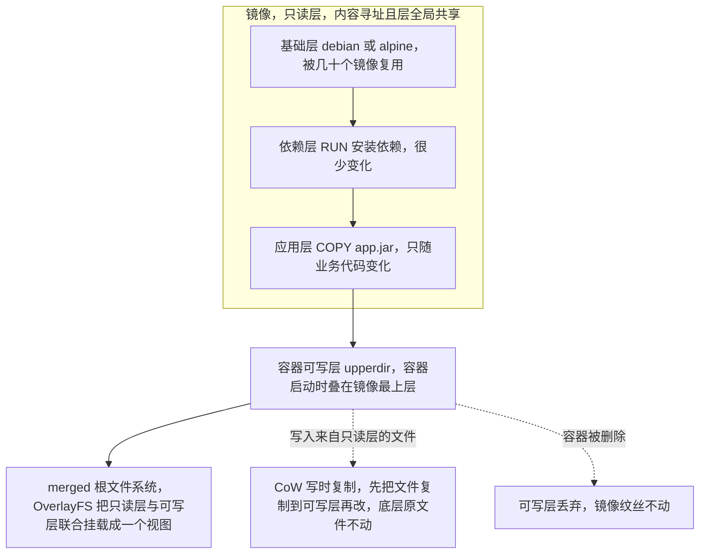

4. **容器不是轻量虚拟机，它是被"限制住"的进程**。容器与宿主机共享同一个内核，靠两组内核能力实现隔离：
   - **namespace（隔离"看得见什么"）**：PID（进程号）、NET（网络栈/网卡/IP/端口）、MNT（挂载点）、UTS（主机名）、IPC（信号量/共享内存）、USER（用户与 UID 映射）、CGROUP（cgroup 视图）。
   - **cgroup（限制"能用多少"）**：CPU 配额、内存上限、IO 带宽、进程数，超了就被限流或 OOM Kill。
5. **虚拟机是硬件级虚拟化**：Hypervisor（如 KVM/ESXi）模拟出虚拟硬件，Guest OS 内核跑在自己的虚拟 CPU 上，隔离性来自"根本看不到宿主机的内核"，代价是每个 VM 都要完整跑一个 OS。

| 维度 | 容器 | 虚拟机 |
|------|------|--------|
| 隔离层级 | 进程级（namespace + cgroup） | 硬件级（Hypervisor + Guest OS） |
| 内核 | 共享宿主内核 | 各自独立内核 |
| 启动 | 毫秒~秒级 | 秒~分钟级 |
| 体积 | MB 级（仅应用 + 依赖） | GB 级（含 OS） |
| 隔离强度 | 较弱（内核漏洞可逃逸，需 seccomp/AppArmor 加固） | 强 |
| 适合场景 | 微服务、弹性伸缩、CI/CD | 强隔离、异构内核、完整 OS 环境 |

**图 5-2：容器与虚拟机的架构差异**

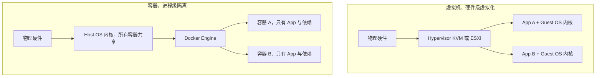

**企业实际处理**：
- 生产上选基础镜像遵循「**能用 distroless 就不用 alpine，能用 alpine 就不用 slim，能用 slim 就不用 full**」。Java 服务常用 `eclipse-temurin:17-jre-jammy` 或 `gcr.io/distroless/java17-debian12`（无 shell，攻击面最小）。
- 存储驱动统一 OverlayFS；CI 构建机上把 `/var/lib/docker` 放 SSD 并定期 `docker system prune` 清理悬空镜像（`<none>` 层），防止构建机磁盘被层缓存打满。
- 安全加固：以非 root 运行 + `--read-only` 根文件系统 + `--cap-drop=ALL` 只留必要 capability + seccomp 默认 profile；镜像用 Trivy/Grype 扫描 CVE 卡 CI 门禁。

**为什么这样做**：
- **因为分层带来的是"传输经济性"**：一次拉取 200MB 基础层，之后 10 个共享它的服务每个只多拉几 MB 的应用层，滚动发布时节点上镜像已缓存，Pod 秒起。
- **因为 CoW 让"启动快"和"共享省"同时成立**：不需要复制整个根文件系统，只挂一个可写层，所以容器启动是"挂载"而不是"拷贝"。
- **因为隔离强度是有取舍的**：容器共享内核意味着内核提权漏洞（如某个 CVE）可能逃逸到宿主机，所以监管级/风控业务（如期权风控系统）在容器化时往往保留更强隔离的选项，或至少做到非 root + 只读根 + capability 最小化，而不是无脑上容器。

**企业级代码示例**（📦 按 Docker 24+ / K8s 1.29 书写、未实测）：演示如何观察镜像分层，以及分层缓存对构建速度的影响。

```dockerfile
# 分层的可视化：每条指令产生一层
FROM eclipse-temurin:17-jre-jammy
WORKDIR /app
COPY target/app.jar app.jar   # 这一层只在 jar 变化时才重建
ENTRYPOINT ["java","-jar","/app/app.jar"]
```

```bash
# 观察分层与体积：每层 ID、大小、创建指令一目了然
docker image history my-app:1.0.0
docker image inspect my-app:1.0.0 --format '{{json .RootFS.Layers}}'
# 查看实际存储驱动（现代 Linux 一般是 overlay2）
docker info | grep -i "Storage Driver"

# 复盘 CoW：容器里的修改只落在可写层，删容器后镜像不变
docker run -it --rm alpine sh -c 'echo hi > /tmp/x && ls -l /tmp/x'
docker diff <container_id>   # 列出容器相对镜像的可写层改动（A/C/D）
```

**面试加分项**：
- 主动点出**"层缓存失效是单向传递"**：Dockerfile 中一旦某层变了，它之后的所有层缓存全部失效——所以才要把变化频率低的操作（装依赖）放前面、变化频率高的（拷代码）放后面。
- 提到 **`docker diff` 看可写层**、**`docker history` 看层体积**这两个排障命令，能体现你真上手调过。
- 提到容器逃逸与加固（seccomp / AppArmor / `--cap-drop`），能体现监管级业务的安全意识。

---

### <a id="q2"></a>题 2：Dockerfile 怎么写才专业？多阶段构建是怎么瘦身的？

- **题干**：「说说你写 Dockerfile 的原则。还有多阶段构建，为什么它既能让镜像变小，又不影响安全？另外 `docker commit` 和 Dockerfile 你会选哪个？」
- **考察点**：Dockerfile 指令语义与最佳实践、多阶段构建原理、镜像瘦身与安全、声明式 vs 命令式。

**标准答案**：

1. **核心原则：把"变化少的"放前面，让缓存命中最大化**。文件名 `.dockerignore` 排除 `target/`、`.git/`、`node_modules/`，避免 `COPY . .` 把所有垃圾打进构建上下文并触发无谓的缓存失效。
2. **指令语义要清楚**：
   - `RUN` 用于构建期命令，多个 `RUN` 用 `&&` 串起来并清理缓存（`apt-get update && apt-get install -y --no-install-recommends xxx && rm -rf /var/lib/apt/lists/*`），减少层数、减小体积。
   - `COPY`（能用 COPY 就别用 ADD，ADD 会自动解压远程 URL、行为不可预测）。
   - `CMD` vs `ENTRYPOINT`：`ENTRYPOINT` 是镜像的固定入口（exec 形式 `["java","-jar",...]`，PID 1 直接接收 SIGTERM），`CMD` 是默认参数，可被 `docker run` 覆盖。
   - `ENV` vs `ARG`：`ARG` 只在构建期有效，不会留在镜像里；**不要用 `ARG`/`ENV` 传密钥**，密钥会留在层历史里。
3. **多阶段构建（Multi-stage Build）**：用多个 `FROM`，前面的阶段负责"编译"，最后一个阶段只负责"运行"。关键动作是 `COPY --from=builder /build/app.jar /app/app.jar`，只把**产物**拷进运行镜像，**把 JDK、Maven、源码、依赖缓存全部留在构建阶段**。一个典型的 Spring Boot 镜像能从 `~600MB` 降到 `~180MB`（JRE）甚至 `~90MB`（distroless）。
4. **瘦身 + 安全是同一件事**：运行镜像里没有编译器、没有包管理器、没有 shell，攻击面就从"一个完整 OS"缩到"一个 JRE + 一个 jar"。再配合 `USER 1000`（非 root）运行。

**图 5-3：多阶段构建的镜像瘦身对比**

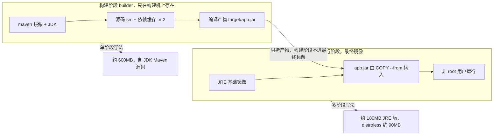

5. **`docker commit` vs Dockerfile**：`commit` 是命令式的——"把当前容器状态存成镜像"，不可复现、不可审计、无法 code review、层里会残留临时文件和历史操作。Dockerfile 是**声明式、可版本化、可缓存、可审计**的构建描述。生产一律用 Dockerfile，`commit` 只在排查/取证时临时用。

**企业实际处理**：
- Spring Boot 项目用**分层 jar**（`layertools`）或直接把 `BOOT-INF/lib` 与业务 jar 分开 COPY，让"依赖层"和"业务层"分离——依赖很少变，业务代码每次变，这样每次发布的镜像**只新增几 MB 的业务层**，推送/拉取飞快。
- 构建阶段用 Maven 时把 `~/.m2` 通过 BuildKit 缓存挂载（`RUN --mount=type=cache,target=/root/.m2 mvn ...`）或 CI 上配本地仓库缓存，避免每次都重新下依赖。
- 运行镜像统一 distroless 或 `-jre` 版本，基础镜像**锁版本 + 锁 digest**（`FROM ...@sha256:...`），防止上游悄悄更新导致"昨天能跑今天不能跑"。

**为什么这样做**：
- **因为镜像体积直接决定发布时长**：节点上没缓存时要拉镜像，200MB 和 600MB 在跨可用区拉取时能差出几十秒到几分钟——这正是"发布 4 小时→15 分钟"里被压缩的一块时间。
- **因为"运行镜像里没有构建工具"是纵深防御**：即使应用被拿下，容器里连 `curl`、`sh` 都没有，攻击者很难继续利用（distroless 的价值就在这里）。
- **因为声明式构建是可回滚的前提**：只有 Dockerfile 在 Git 里，才能做到"任何一次发布镜像都有对应的、可重建的源码"，回滚才有意义。

**企业级代码示例**（📦 按 Docker 24+ / K8s 1.29 书写、未实测）：典型的 Spring Boot 多阶段 + 分层 + 非 root 构建。

```dockerfile
# ---------- 构建阶段：只在构建机上存在，不进最终镜像 ----------
FROM maven:3.9-eclipse-temurin-17 AS builder
WORKDIR /build
# 先只拷 pom，利用缓存下载依赖（pom 不变则这层命中缓存）
COPY pom.xml .
RUN --mount=type=cache,target=/root/.m2 mvn -B dependency:go-offline
# 再拷源码编译打包
COPY src ./src
RUN --mount=type=cache,target=/root/.m2 mvn -B clean package -DskipTests

# ---------- 运行阶段：只带 JRE + 产物 ----------
FROM eclipse-temurin:17-jre-jammy
WORKDIR /app
# 用 Spring Boot layertools 拆层（layers.idx 由 bootJar 生成）
COPY --from=builder /build/target/*.jar app.jar
# 非 root 运行
RUN groupadd -r app && useradd -r -g app app && chown -R app:app /app
USER app
EXPOSE 8080
# exec 形式：PID 1 直接收到 SIGTERM，配合优雅停机
ENTRYPOINT ["java","-XX:MaxRAMPercentage=75.0","-jar","/app/app.jar"]
```

```bash
# 对比两种写法的镜像体积
docker build -t app:multi .   && docker images app:multi
# 构建上下文是否臃肿？先看 .dockerignore 是否生效
docker build --no-cache -t app:multi . 2>&1 | head -5
```

**面试加分项**：
- 主动提 **`--mount=type=cache`（BuildKit）** 做 Maven 依赖缓存，这是"构建提速"的实战细节。
- 提到 **`-XX:MaxRAMPercentage`** 而不是写死 `-Xmx`，因为容器内存上限会变，写死容易和 limits 打架（见题 8 OOMKilled）。
- 提到**基础镜像锁 digest**、**Trivy 扫描卡门禁**，把"安全"从口号落到流水线卡点。

---

### <a id="q3"></a>题 3：容器网络模式有哪几种？数据卷和 cgroup 解决什么问题？

- **题干**：「容器化之后网络和存储是绕不开的。说说 Docker 的几种网络模式，各自什么场景用？还有容器数据怎么持久化？cgroup 是干嘛的？」
- **考察点**：bridge/host/none/container 四种网络模式与场景、卷的三种类型、cgroup 资源限制与 OOM。

**标准答案**：

1. **bridge（默认）**：Docker 在宿主机上建一个虚拟网桥 `docker0`，每个容器分一对 veth 网卡，一端在容器 netns 里，一端接在网桥上，通过 NAT（iptables MASQUERADE）访问外网。**默认 bridge 只能靠 IP 互联；自定义 bridge 网络内置 DNS，可以用容器名直接互相访问**——所以生产上要用 `docker network create` 建自定义网络，而不是用默认的。
2. **host**：容器直接共享宿主机的网络命名空间，没有 NAT，**没有端口映射**（`-p` 会失效），端口直接占宿主机端口。性能最好（少一层 NAT/转发），适合对网络性能敏感、或者本身就是"一个容器一个服务占一个端口"的场景。代价是端口冲突风险、隔离性差。
3. **none**：容器只有回环网卡，没有任何网络。适合只需要计算、不需要网络的批处理任务（或完全由用户自己配网络的强隔离场景）。
4. **container**：新容器共享**另一个已存在容器的**网络命名空间。"同一 Pod 里的多容器共享 IP/端口"就是这个模式——K8s 的 Pod 底层原理就是它。
5. **数据卷三件套**：
   - **named volume（命名卷）**：Docker 管理，存在 `/var/lib/docker/volumes`，跨平台、可备份、生命周期独立于容器，**生产首选**（数据库数据、日志）。
   - **bind mount（绑定挂载）**：把宿主机任意目录挂进容器，**双向、所见即所得**，适合开发时挂代码、挂配置文件。缺点是依赖宿主机路径结构。
   - **tmpfs**：只存在内存，容器停止即消失，适合敏感数据、临时缓存。
6. **cgroup 做资源限制**：`--cpus`（CPU 配额，按周期切分）、`--memory`（内存硬上限，超了内核 OOM Killer 杀进程）、`--memory-swap`（含 swap 的总上限）、`--pids-limit`（防 fork 炸弹）、`--blkio-weight`（IO 权重）。**内存是不可压缩资源，超了就是杀；CPU 是可压缩资源，超了只是被限流变慢**——这个区别是后面理解 K8s QoS 和 OOMKilled 的地基。

**企业实际处理**：
- 无状态服务用 Docker/K8s 自带的网络与存储；**有状态组件（MySQL/PG/Redis/Kafka）的持久化在 K8s 里用 StatefulSet + PVC（云上是云盘/ESSD），在纯 Docker 环境用 named volume 或 bind mount 到独立数据盘**。
- 生产容器统一设 `--memory` 和 `--cpus`（或 K8s 的 requests/limits），并在监控里盯 `container_memory_working_set_bytes` 与限流指标。
- 日志不写容器可写层（写多了会导致容器层膨胀且丢日志），统一输出 stdout/stderr，由日志采集（Fluent Bit/Filebeat）收集（见题 13）。

**为什么这样做**：
- **因为可写层不适合存数据**：容器删了可写层就没了；而且 CoW 层在小文件频繁写时性能差、还占根分区空间。数据必须落在 volume 上。
- **因为"限制资源"是共享宿主机的前提**：一台宿主机跑十几个容器，不给上限的话一个内存泄漏的服务能把整台机器拖垮，把同宿主的其他服务一起带死——这就是后来 K8s 引入 requests/limits 和 QoS 的直接动机。
- **因为 host/container 网络模式是"用隔离换性能"的取舍**：host 少一跳 NAT 延迟更低，但失去端口隔离；container 模式是 K8s 实现"Pod 内容器共享 localhost"的唯一正解。

**企业级代码示例**（📦 按 Docker 24+ / K8s 1.29 书写、未实测）：四种网络模式与卷 + cgroup 限制的对照。

```bash
# 自定义 bridge：容器间用名字互访（生产推荐）
docker network create --driver bridge app-net
docker run -d --name redis --network app-net redis:7-alpine
docker run -d --name api  --network app-net -p 8080:8080 my-api:1.0.0
# api 容器内可直接解析主机名 redis

# host 模式：共享宿主网络栈，无端口映射
docker run -d --network host nginx:1.25

# container 模式：共享另一个容器的网络命名空间（Pod 的底层原理）
docker run -d --name sidecar --network container:api busybox sleep 3600

# 持久化：named volume（生产）vs bind mount（开发）
docker run -d -v mysql-data:/var/lib/mysql mysql:8.0
docker run -d -v /host/conf:/app/conf:ro my-api:1.0.0

# cgroup 资源限制：内存超 200M 被杀，CPU 限 1.5 核
docker run -d --memory 200m --memory-swap 200m --cpus 1.5 --pids-limit 512 my-api:1.0.0
docker stats --no-stream          # 实时看 CPU/内存/IO 用量
```

**面试加分项**：
- 点出 **"内存不可压缩、CPU 可压缩"** 这条本质，直接引出 K8s 里 OOMKilled 与 CPU throttling 两种不同的性能问题。
- 提到 **默认 bridge 无 DNS、自定义 bridge 有 DNS** 这个区分，很多人只知道"有 bridge 模式"却不知道这个细节。
- 提到 **`--network container:` 就是 K8s Pod 的实现原理**，能把 Docker 和 K8s 的知识串成一条线，是典型的加分回答。

---

### <a id="q4"></a>题 4：K8s 的整体架构是什么？一次 kubectl apply 到底发生了什么？

- **题干**：「你们服务跑在 K8s 上，那画一下架构吧：控制面有哪些组件、Node 上有哪些组件？我 `kubectl apply` 一个 Deployment 之后，到 Pod 真正跑起来，中间经历了什么？」
- **考察点**：控制面/Node 组件职责、声明式 API 与控制器循环、调度与绑定、kubelet 落地的完整链路。

**标准答案**：

1. **控制面（Control Plane）**：
   - **kube-apiserver**：整个集群的**唯一入口**，所有组件都只跟它对话；负责认证、鉴权（RBAC）、准入控制（Admission）、校验、并把对象写进 etcd。它是无状态的，可以多副本。
   - **etcd**：唯一的数据源（Source of Truth），保存整个集群的期望状态，基于 **Raft** 保证一致性。它的健康 = 集群的健康，必须做快照备份。
   - **kube-scheduler**：监听到"有 Pod 没有 nodeName"就调度——先 **Filter（过滤）**（资源够不够、亲和性、污点容忍、端口冲突），再 **Score（打分）**，选出最优节点后把结果**写回 apiserver**（它自己不改 Pod，只更新绑定信息）。
   - **kube-controller-manager**：跑一堆控制器循环（Deployment、ReplicaSet、Node、Endpoints、Job……）。每个控制器都是"**观测当前状态 → 与期望状态比对 → 执行动作缩小差距**"（Reconcile）。
   - （cloud-controller-manager 负责对接云厂商 LB/磁盘等，此处略。）
2. **Node 节点**：
   - **kubelet**：节点上的"监工"。它 watch apiserver 拿到"分配给我这个节点的 Pod"，然后调用 **CRI** 让容器运行时去创建容器，并负责**探针执行、挂载卷、上报状态**。
   - **kube-proxy**：实现 Service 的转发规则（iptables/IPVS），把虚拟 IP 的流量分发到后端 Pod（题 7 详述）。
   - **容器运行时（containerd/CRI-O）**：真正跑容器的组件。
3. **附加组件**：CoreDNS（集群内服务发现）、CNI 插件（Calico/Cilium 提供 Pod 网络）。

**图 5-4：Kubernetes 整体架构与控制面协作**

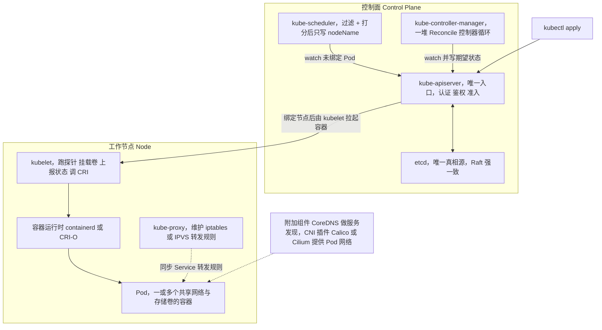

4. **一次 `kubectl apply -f deploy.yaml` 的完整链路**：
   1. `kubectl` 把 YAML 发给 **apiserver**；apiserver 认证/鉴权/准入校验后写入 **etcd**（此刻 Deployment 对象存在于集群里）。
   2. **Deployment 控制器**（在 controller-manager 里）发现"期望 3 个副本、当前 0 个 ReplicaSet"，于是**创建一个 ReplicaSet**。
   3. **ReplicaSet 控制器**发现"期望 3 个 Pod、当前 0 个"，于是**创建 3 个 Pod 对象**（此时 `nodeName` 为空）。
   4. **scheduler** 发现有"未绑定节点"的 Pod，过滤+打分后选好节点，**把 nodeName 写回 apiserver**。
   5. 目标节点上的 **kubelet** watch 到"有 Pod 分给我了"，调用 **CRI** 拉起容器，并执行探针；**kube-proxy** 同步 Service 的转发规则；**CNI** 给 Pod 分配 IP。
   6. Pod 就绪后（readiness 通过），**Endpoints/EndpointSlice 控制器**把它加进 Service 后端，流量开始进来。

**企业实际处理**：
- **etcd 必须做定期快照并异地备份**（`etcdctl snapshot save`），因为它是唯一真相源，etcd 挂了集群就"失忆"。生产用 3 或 5 节点奇数部署。
- **apiserver 做多副本 + LB**，控制面节点用污点（taint）禁止业务 Pod 调度上去。
- **权限最小化**：给应用配独立 ServiceAccount + RBAC 角色，禁止用 `cluster-admin` 跑业务；用准入策略（如 Pod Security Admission）限制特权容器。
- **注意 K8s 版本行为**：`Ingress` 用 `networking.k8s.io/v1`（1.19+）；`PodSecurityPolicy` 在 **1.25 已移除**，改用 Pod Security Admission；`HPA` 用 `autoscaling/v2`（1.23+ 稳定，`v1` 在 1.26 移除）。

**为什么这样做**：
- **因为"声明式 + 控制器循环"是 K8s 自愈能力的根基**：你只声明"我要 3 个副本"，控制器不断地把现实拉回期望。所以删掉一个 Pod 会自动补一个，节点挂了会把 Pod 调度到别处——这不是"运维脚本"，而是一个**持续收敛的反馈回路**。
- **因为"所有组件只跟 apiserver 对话"解耦了系统**：scheduler/kubelet/controller 都是无状态消费者，可以任意重启、水平扩展，整个系统的耦合点被收敛到 apiserver + etcd 这一处。
- **因为"控制器不做实际动作，只改期望状态"保证了幂等**：scheduler 不改容器，只写 nodeName；kubelet 看到期望变了才干活。任何一步失败，下一轮 reconcile 会重试，不会产生"做了一半"的脏状态。

**企业级代码示例**（📦 按 Docker 24+ / K8s 1.29 书写、未实测）：用注释标注"apply 之后每个组件在干什么"。

```yaml
apiVersion: apps/v1            # 1) kubectl -> apiserver -> etcd 落库
kind: Deployment
metadata:
  name: risk-warning
spec:
  replicas: 3                  # 2) Deployment 控制器: 需要 1 个 RS
  selector:
    matchLabels: { app: risk-warning }
  template:                    # 3) RS 控制器: 需要 3 个 Pod（nodeName 空）
    metadata:
      labels: { app: risk-warning }
    spec:
      containers:
        - name: app
          image: harbor.internal/risk/risk-warning:1.8.3  # 锁版本，不用 latest
          ports: [{ containerPort: 8080 }]
      # 4) scheduler 过滤+打分后写入 nodeName
      # 5) 目标节点 kubelet 拉 CRI 起容器 / CNI 分 IP / kube-proxy 更新规则
```

```bash
kubectl apply -f deploy.yaml
kubectl get deploy,rs,pod -o wide        # 看三层对象的生成过程
kubectl describe pod <pod> | tail -20    # 看调度事件与探针结果
kubectl get events --sort-by=.lastTimestamp
kubectl -n kube-system get pods         # 确认控制面组件健康
```

**面试加分项**：
- 强调 **"scheduler 只写 nodeName、不改容器"** 和 **"控制器只改期望状态"**，这是很多人讲架构时讲不清的"谁来干活"的关键。
- 主动把 **etcd 的 Raft** 和前面模块讲的 Raft 做对比：etcd 是"单 Raft 组强一致"，写需多数派确认，所以 apiserver 的写延迟直接受 etcd 集群影响。
- 提到 **EndpointSlice**（1.21 起稳定，替代大集群下的 Endpoints 性能问题），能体现你了解大规模集群的细节。

---

### <a id="q5"></a>题 5：为什么调度单元是 Pod 而不是容器？三种探针怎么区分？

- **题干**：「K8s 为什么不直接调度容器，非要包一层 Pod？Pod 里的容器之间是什么关系？还有 liveness、readiness、startup 三种探针，你平时怎么配？」
- **考察点**：Pod 的设计动机（共享命名空间/协同调度）、sidecar 模式、三种探针的语义与配错导致的故障。

**标准答案**：

1. **Pod 是最小调度单元，本质是"一组共享环境的容器"**。同一个 Pod 里的容器共享：
   - **网络命名空间**：同一个 IP、同一个端口空间，容器之间用 `localhost` 互访（所以不能有两个容器占同一个端口）；
   - **IPC 命名空间**（可用 System V IPC / POSIX 消息队列）；
   - **可共享的 Volume**（如 `emptyDir`，一个容器写日志，另一个 sidecar 读走）。
2. **为什么需要 Pod 而不是直接调度容器**：
   - **有些"辅助进程"必须和应用"同生共死、同机器、同网络"**：日志采集 sidecar、service mesh 的 Envoy 代理、配置热更新的 reloader。如果直接调度容器，就得自己保证它们在同一台机、同时启动、共享网络——这是重复造调度器。
   - **原子性**：Pod 内容器一起调度、一起扩缩、一起被回收，避免了"应用起来了但 sidecar 没起来"的半吊子状态。
   - **共享资源的自然表达**：`emptyDir`、共享网络这些"容器组级别"的概念，需要有一个比容器更大的抽象来承载，那就是 Pod。

**图 5-5：Pod 内部结构与共享命名空间**

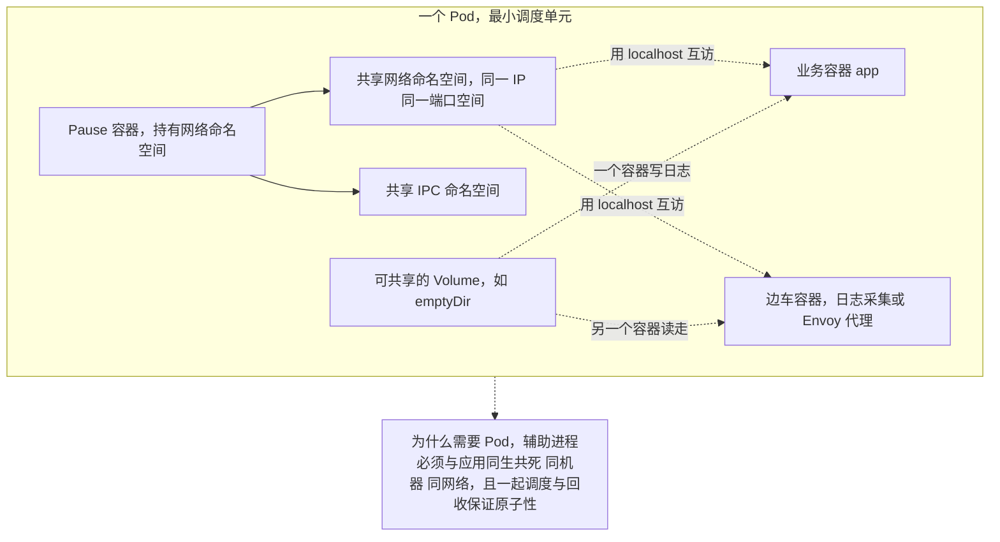

3. **三种探针的语义（关键区别）**：
   - **livenessProbe（存活）**：探测失败 → kubelet **重启容器**。用来检测"死锁、假死"这类"进程还在但已经不能服务"的情况。**不要**拿来探测下游依赖，否则下游一抖你的容器全被重启。
   - **readinessProbe（就绪）**：探测失败 → 把这个 Pod 的 IP 从 Service 的后端（EndpointSlice）**摘掉，不再给它流量**，但**不重启**。用于"正在启动、正在预热、依赖暂不可用但我在自愈"的状态。
   - **startupProbe（启动）**：专门给**慢启动应用**（如 JVM 冷启动几十秒）。只要 startup 还没成功，**liveness 和 readiness 都会被挂起**（不会被误杀），startup 成功后才交给 liveness/readiness 接管。最大容忍时间 = `failureThreshold × periodSeconds`。

**图 5-6：三种探针的作用与失败后果**

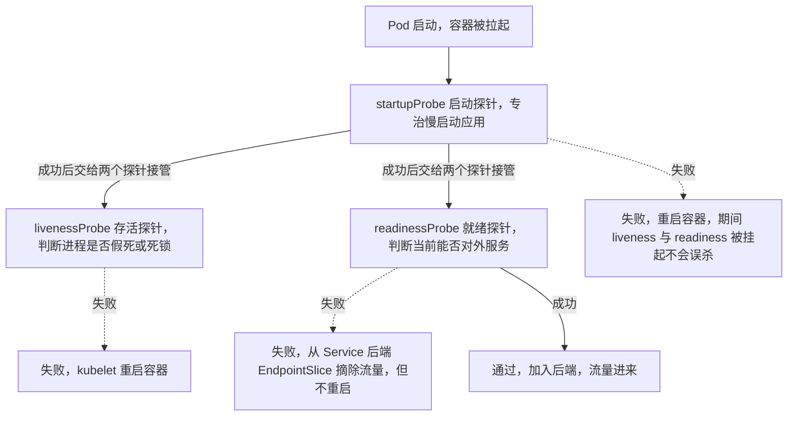

4. **探测方式**：`httpGet`（最常用）、`tcpSocket`、`exec`、`grpc`（1.24 GA）。

**企业实际处理**：
- **配错探针是线上事故高发区**，三个典型坑：
  1. **liveness 太激进**（如 `periodSeconds: 5, failureThreshold: 3`，Java 应用 GC 一次就超过 15 秒）→ 容器被反复重启 → `CrashLoopBackOff`。
  2. **liveness 里检查下游依赖**（DB/Redis/第三方）→ 下游抖动引发集群性重启，把局部故障放大成雪崩。
  3. **没有 readiness** → Pod 还在启动就被塞流量，发布时出现 502/503。
- 生产标配：**readiness 指向应用自己的 `/actuator/health/readiness`（含"是否能服务"判断），liveness 指向一个极轻量的 `/actuator/health/liveness`（只判断进程/线程池没死锁），慢启动 Java 应用一定配 startupProbe**，并且 `initialDelaySeconds` 留足余量。
- 探针超时/阈值要按应用的 P99 响应时间来定，不能拍脑袋；探针 endpoint 要**不查数据库、不调外部接口**。

**为什么这样做**：
- **因为"重启"和"摘流量"是两个完全不同的补救动作**：进程假死需要重启（liveness），而"暂时不能服务但能自愈"需要的只是暂时不给它流量（readiness）。把两者混用，就会出现"要么该重启的没重启，要么不该重启的疯狂重启"。
- **因为容器重启是有代价的**：每次重启都要重新冷启动、重新建立连接池，还触发镜像/依赖重载；对 JVM 应用尤其昂贵。所以 liveness 必须"宽松到只有真的救不回来才动手"。
- **因为 Pod 抽象解决的是"共置与协同"问题**，不是"方便"问题：把 sidecar 塞进同一个 Pod，换来的是"共享网络 + 共享生命周期 + 原子调度"，代价是"Do not put too many containers in one pod"、扩缩容粒度变粗（sidecar 会随业务一起被复制）。

**企业级代码示例**（📦 按 Docker 24+ / K8s 1.29 书写、未实测）：一个典型的 Spring Boot Pod：慢启动用 startup，liveness 轻量，readiness 可判依赖。

```yaml
apiVersion: apps/v1
kind: Deployment
metadata: { name: risk-warning }
spec:
  replicas: 3
  selector: { matchLabels: { app: risk-warning } }
  template:
    metadata: { labels: { app: risk-warning } }
    spec:
      containers:
        - name: app
          image: harbor.internal/risk/risk-warning:1.8.3
          ports: [{ containerPort: 8080 }]
          # 启动探针：最多容忍 30*5 = 150s 冷启动，期间不跑 liveness/readiness
          startupProbe:
            httpGet: { path: /actuator/health/liveness, port: 8080 }
            failureThreshold: 30
            periodSeconds: 5
          # 存活探针：只判进程是否卡死，宽松，绝不查下游
          livenessProbe:
            httpGet: { path: /actuator/health/liveness, port: 8080 }
            periodSeconds: 10
            failureThreshold: 6
          # 就绪探针：不通过就从 Service 摘流量，不重启
          readinessProbe:
            httpGet: { path: /actuator/health/readiness, port: 8080 }
            periodSeconds: 5
            failureThreshold: 3
          resources:
            requests: { cpu: "500m", memory: "1Gi" }
            limits:   { cpu: "2",    memory: "2Gi" }
```

```bash
# 排障：谁在重启、为什么
kubectl get pods -w                                  # 观察 RESTARTS / STATUS
kubectl describe pod <pod> | grep -A10 Events        # 看 "Liveness probe failed" 等事件
kubectl get pod <pod> -o jsonpath='{.status.containerStatuses[*].restartCount}'
```

**面试加分项**：
- 一句话概括三探针：**"startup 管启动期别被误杀，liveness 管卡死了重启，readiness 管没准备好别给流量"**，简洁精准。
- 主动讲 **Spring Boot 3.x 的 `management.endpoint.health.probes.enabled=true`** 会暴露 liveness/readiness 两个分组，K8s 探针直接指过去，体现你了解生态整合。
- 提到 **Native Sidecar（`initContainers` 中 `restartPolicy: Always`，1.29 beta）**，能体现你跟进 K8s 新特性、知道 sidecar 生命周期问题的演进。

---

## 进阶实战题（5 道）

### <a id="q6"></a>题 6：Deployment/StatefulSet/DaemonSet/Job 怎么选？滚动更新和回滚的控制参数是什么？

- **题干**：「你们的服务用哪种工作负载？如果我要部署一个有状态的东西（比如 Kafka），你会用什么？滚动更新的 `maxSurge` 和 `maxUnavailable` 怎么理解？」
- **考察点**：工作负载类型选型、有状态 vs 无状态、滚动更新参数与零停机、回滚机制。

**标准答案**：

1. **五种工作负载选型**：
   - **Deployment**：无状态服务首选，管理 ReplicaSet，支持滚动更新与回滚。你的 10+ 个业务服务基本都是它。
   - **ReplicaSet**：几乎不直接用，它是 Deployment 的实现细节。
   - **StatefulSet**：**有状态**。特点：稳定网络标识（配合 headless Service，Pod 名固定 `xxx-0/1/2`，重启 IP 变但名字不变）、稳定存储（`volumeClaimTemplates` 每个 Pod 独享 PVC）、**有序**部署/扩缩/更新（0→1→2，逆序删）。用于 MySQL/PG/Kafka/ZK/ES 这类需要固定身份和独立存储的组件。
   - **DaemonSet**：**保证每个（或指定）节点跑一个 Pod**。用于日志采集（Fluent Bit）、监控（node-exporter）、CNI、kube-proxy 这类"节点级 agent"。
   - **Job / CronJob**：跑完即止的任务 / 定时任务。注意 CronJob 用 `concurrencyPolicy: Forbid` 防重叠、`startingDeadlineSeconds` 防错过、`backoffLimit` 控重试。
2. **滚动更新（RollingUpdate）两个参数**：
   - **maxSurge**：更新过程中**允许超出期望副本数**的最大值（可以是数量或百分比，默认 25%）。控制"先起新的再删旧的"。
   - **maxUnavailable**：更新过程中**允许不可用**的最大值（默认 25%）。控制"最多能同时下线多少旧 Pod"。
   - 两者一正一反共同决定更新速度与可用性。**要零停机，必须满足：`maxUnavailable: 0` + 正确的 readinessProbe + 足够的副本数 + 优雅停机**。

**图 5-7：Deployment 滚动更新的副本变化**

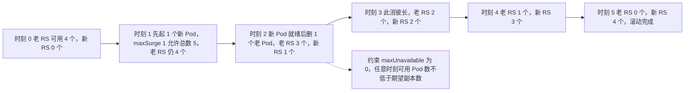

3. **更新与回滚机制**：Deployment 每次更新都新建一个 ReplicaSet，保留历史 RS（`revisionHistoryLimit`，默认 10），所以 `kubectl rollout undo` 就是"切回上一个 RS"，秒级回滚。用 `kubectl rollout status/undo/history/pause` 控制与追踪。`progressDeadlineSeconds` 控制"多久没进展判为失败"。
4. **其他关键字段**：`strategy.type`（RollingUpdate/Recreate）、`minReadySeconds`（新 Pod 就绪后稳定多久才算可用，防止"起来了又马上挂"被算成功）。

**图 5-8：四种发布策略对比**

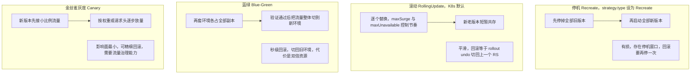

**企业实际处理**：
- **无状态服务统一 Deployment + 滚动更新**；有状态组件尽量用云托管（RDS/云 Kafka），必须自建时用 StatefulSet + 每 Pod 独立 PVC，且 **StatefulSet 的滚动更新是逆序、逐个的**，要配 `podManagementPolicy` 和 readiness 谨慎推进。
- **零停机发布的组合拳**：`maxUnavailable: 0` + `maxSurge: 1`（或 25%）+ readiness 探针 + **preStop 优雅停机（题 10）**，四者缺一不可。很多团队只设了 `maxSurge`，但没配 preStop，结果发布时仍有零星 502。
- **回滚分层**：应用层用 `kubectl rollout undo`（或重新部署上一个镜像 tag）；数据库变更必须**向前兼容**（先加字段后删字段，分两次发布），否则代码回滚了 DB 回不去。
- DaemonSet 更新用 `updateStrategy: RollingUpdate` 的 `maxUnavailable`，配合节点分批（`nodeSelector` 分批打标签）做"分批滚节点"，避免一次性重启全集群采集组件。

**为什么这样做**：
- **因为"有状态"的核心痛点是身份和存储**：Pod 重建后 IP 会变，但 StatefulSet 保证名字不变、PVC 跟着身份走。这就是"为什么数据库不用 Deployment"的根本原因——Deployment 的 Pod 是完全可互换的，而主从复制需要"谁是主"是确定的。
- **因为滚动更新的本质是"用可用性预算换更新速度"**：`maxUnavailable` 越大更新越快但越可能影响用户；生产核心链路必须把它设为 0，宁可慢一点也要保住可用性。
- **因为"能回滚"比"不失败"更重要**：发布必然有失败率，工程上追求的不是"永不失败"，而是"失败后 1 分钟内能回退"。所以镜像 tag 必须不可变、配置与镜像分离（题 11）。

**企业级代码示例**（📦 按 Docker 24+ / K8s 1.29 书写、未实测）：零停机滚动更新 + 一键回滚。

```yaml
apiVersion: apps/v1
kind: Deployment
metadata: { name: risk-warning }
spec:
  replicas: 4
  revisionHistoryLimit: 10          # 保留 10 个历史 RS 供回滚
  minReadySeconds: 10               # 新 Pod 就绪后稳定 10s 才算可用
  progressDeadlineSeconds: 600      # 10 分钟无进展判失败
  strategy:
    type: RollingUpdate
    rollingUpdate:
      maxSurge: 1                   # 最多多起 1 个
      maxUnavailable: 0             # 更新期不允许不可用 -> 零停机
  selector: { matchLabels: { app: risk-warning } }
  template:
    metadata: { labels: { app: risk-warning } }
    spec:
      terminationGracePeriodSeconds: 30
      containers:
        - name: app
          image: harbor.internal/risk/risk-warning:1.8.3   # 不可变 tag
          readinessProbe:
            httpGet: { path: /actuator/health/readiness, port: 8080 }
```

```bash
kubectl rollout status deploy/risk-warning --timeout=300s
kubectl rollout history deploy/risk-warning
kubectl rollout undo deploy/risk-warning                    # 回滚到上一版
kubectl rollout undo deploy/risk-warning --to-revision=3    # 回滚到指定版本
kubectl rollout pause/resume deploy/risk-warning            # 金丝雀式分批（暂停观察）
```

**面试加分项**：
- 讲清 **"`maxUnavailable: 0` 是零停机的必要条件，但不是充分条件"**——还得有 readiness + preStop，这一句能立刻显出深度。
- 提到 **`minReadySeconds` 防止"假就绪"** 和 **`progressDeadlineSeconds` 自动判失败**，这是很多只背概念的人不知道的实用字段。
- 提到 **DB 变更向前兼容 + 两阶段发布**，把"回滚"讲成完整的工程闭环，而不是只知道 `rollout undo` 一条命令。

---

### <a id="q7"></a>题 7：Service 四种类型有什么区别？kube-proxy 怎么转发的？Ingress 又在哪一层？

- **题干**：「Pod 的 IP 是会变的，那服务之间怎么稳定调用？Service 有几种类型？kube-proxy 底层是怎么做转发的？Ingress 和 Service 是什么关系？」
- **考察点**：Service 类型与场景、iptables/IPVS 转发原理、Ingress 七层路由、服务发现。

**标准答案**：

1. **Service 解决"Pod IP 会变，但服务地址不能变"的问题**：它给一组 Pod 一个**稳定的虚拟 IP（ClusterIP）+ DNS 名**，通过 label selector 关联后端 Pod，并把就绪 Pod 的地址维护在 **EndpointSlice** 里。
2. **四种类型**：
   - **ClusterIP（默认）**：只分配集群内虚拟 IP，仅集群内部可访问。**微服务之间调用用它**。
   - **NodePort**：在**每个节点**的 `30000-32767` 区间开一个端口，外部通过 `节点IP:NodePort` 访问。它是在 ClusterIP 之上再加一层。适合测试/无 LB 环境。
   - **LoadBalancer**：在 NodePort 之上，向云厂商申请一个负载均衡器（云 LB），把外部流量导进来。生产对外入口常用（或配合 Ingress 只用它做四层入口）。
   - **ExternalName**：不做代理，只返回一个 CNAME（把集群内的名字映射到外部域名），用于"访问外部服务时统一用集群内名字"。
3. **kube-proxy 的转发实现有两种主要模式**：
   - **iptables 模式（长期默认）**：为每个 Service 生成一堆 iptables DNAT 规则，把发往 ClusterIP 的包随机改写成某个后端 Pod IP。**问题是大规模下规则是 O(n) 线性匹配，几千个 Service 时规则膨胀、转发变慢、更新全量重刷**。
   - **IPVS 模式**：基于内核 IPVS（LVS），用**哈希表**存储转发规则，转发性能 O(1)，支持更多 LB 算法（rr/wrr/lc/sh/sed 等）。**大集群推荐开 IPVS**。（更新的 K8s 还引入了 nftables 模式，1.29 alpha、1.31 beta，作为 iptables 的接替方向。）
   - 两种模式下，**DNAT 之后回包靠 conntrack 反向改写**，Service 的 ClusterIP 从来不是一个真实存在的网卡地址，只是转发规则里的目标。
4. **Ingress 在七层**：Service 是四层（TCP/UDP）转发；**Ingress 是七层（HTTP/HTTPS）路由**，能做"按域名/路径把请求分发到不同 Service"、TLS 终止。**Ingress 只是一个规范（资源对象），必须配合 Ingress Controller（Nginx Ingress / Traefik / 云厂商）才生效**。对外链路通常是：`用户 → 云 LB / NodePort → Ingress Controller → Service → Pod`。

**图 5-9：Service 类型与流量转发路径**

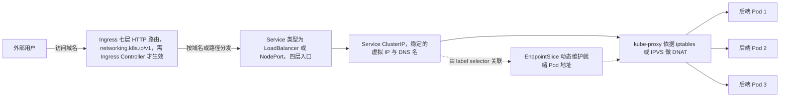

**企业实际处理**：
- 内部服务调用一律用 **ClusterIP + CoreDNS**（`http://risk-warning.namespace.svc.cluster.local`），配合 **gRPC/HTTP 的客户端负载均衡**或 Service Mesh。
- 对外入口用 **Ingress（`networking.k8s.io/v1`，1.19+）** + TLS + 限流/鉴权注解；生产进一步演进到 **Gateway API**（Ingress 的官方继任者）。域名/证书自动化（cert-manager）。
- **大集群开 IPVS**：`kube-proxy --proxy-mode=ipvs`，并按要求加载 `ip_vs` 内核模块。若 Service 数量在几百级别以内，iptables 也够用，不要盲目上 IPVS。
- **Headless Service**（`clusterIP: None`）：不给虚拟 IP，DNS 直接返回所有 Pod 的 A 记录，**StatefulSet 和需要客户端自己做负载均衡/服务发现的场景用它**（如 Kafka 客户端、gRPC 直连）。

**为什么这样做**：
- **因为 Service 提供的是一层"稳定抽象"**：Pod 会随调度、重建、扩缩容不断变 IP，如果调用方直接连 Pod IP，任何一次滚动更新都会打穿。Service 把"后端是谁"这件事从调用方手里拿走，交给 EndpointSlice 动态维护。
- **因为四层和七层的分层是必要的**：四层转发（Service/kube-proxy）通用、高效、无需解析内容；七层路由（Ingress）能做域名/路径/TLS/灰度。混用会导致"要么做不了路由，要么每层都塞个 Nginx"。
- **因为 iptables 的性能瓶颈是"规模问题"而非"功能问题"**：小集群用 iptables 完全没问题，只有在 Service/Endpoint 数量很大时才需要 IPVS——这是一个典型的"按规模选技术"的取舍。

**企业级代码示例**（📦 按 Docker 24+ / K8s 1.29 书写、未实测）：ClusterIP + Ingress + Headless 的对照。

```yaml
# 1) 内部服务：ClusterIP（默认）+ 服务发现
apiVersion: v1
kind: Service
metadata: { name: risk-warning }
spec:
  type: ClusterIP
  selector: { app: risk-warning }
  ports: [{ port: 80, targetPort: 8080 }]
---
# 2) StatefulSet 用 Headless：DNS 直接返回 Pod IP
apiVersion: v1
kind: Service
metadata: { name: kafka-headless }
spec:
  clusterIP: None            # Headless
  selector: { app: kafka }
  ports: [{ port: 9092 }]
---
# 3) 七层入口：Ingress（K8s 1.19+ 用 networking.k8s.io/v1）
apiVersion: networking.k8s.io/v1
kind: Ingress
metadata:
  name: risk-warning-ingress
  annotations:
    nginx.ingress.kubernetes.io/proxy-body-size: "10m"
spec:
  ingressClassName: nginx
  tls:
    - hosts: [risk.example.com]
      secretName: risk-tls
  rules:
    - host: risk.example.com
      http:
        paths:
          - path: /api
            pathType: Prefix
            backend:
              service:
                name: risk-warning
                port: { number: 80 }
```

```bash
kubectl get svc,ep,endpointslice -o wide
kubectl get ingress -A
# 看某 Service 的实际转发规则（iptables 模式）
iptables -t nat -L KUBE-SERVICES -n | head
```

**面试加分项**：
- 一句话分清：**"Service 管四层稳定入口，Ingress 管七层 HTTP 路由，Ingress Controller 才是真正干活的组件"**。
- 主动提 **EndpointSlice 替代 Endpoints**（1.21 稳定）——大集群下 Endpoints 对象过大导致 kube-proxy 全量重刷的性能改进。
- 提到 **Headless Service + StatefulSet** 的组合，以及**"ClusterIP 不是真实网卡地址，只是转发规则的目标"**，能体现你理解底层而非停留在 YAML 层面。

---

### <a id="q8"></a>题 8：requests/limits 怎么设？QoS 等级和 OOMKilled 是什么关系？

- **题干**：「你们的 Pod 资源限额怎么定的？requests 和 limits 有什么区别？有没有遇到过 OOMKilled？怎么排查和解决？」
- **考察点**：requests/limits 语义、QoS 三级与驱逐顺序、CPU throttling vs OOMKill、JVM 与容器内存的配合。

**标准答案**：

1. **requests 与 limits 的角色完全不同**：
   - **requests（请求量）**：**调度依据**。scheduler 按 requests 之和判断节点放不放得下；同时它也是**资源保证**——节点资源紧张时，requests 是你的"保底额度"。
   - **limits（上限）**：**cgroup 硬上限**。CPU 超了被 **throttle（限流，变慢但不死）**，内存超了被 **OOM Kill（杀进程）**。
   - 一句话：**requests 决定"能不能被调度 + 保证多少"，limits 决定"最多能用多少 + 超了怎么死"**。
2. **QoS 三个等级（决定驱逐优先级）**：
   - **Guaranteed**：**每个容器的 CPU 和内存的 requests == limits**（且都设置了）。最稳，节点资源紧张时**最后**被驱逐。
   - **Burstable**：设置了 requests/limits 但**不完全相等**（最常见）。
   - **BestEffort**：**一个都没设**。最容易被驱逐，节点内存压力时**最先**被杀。
   - 驱逐顺序：**BestEffort → Burstable → Guaranteed**。

**图 5-10：requests/limits 与 QoS 等级**

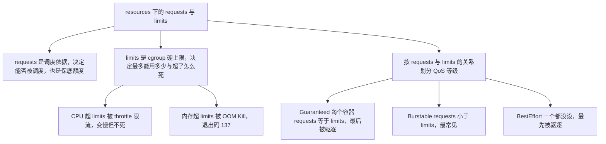

3. **OOMKilled 的两种来源**：
   - **容器级 OOM**：容器内存超过自己的 `limits.memory`，内核 cgroup OOM Killer 杀掉容器主进程 → Pod 重启，`kubectl describe pod` 里 `Last State: Terminated, Reason: OOMKilled, Exit Code: 137`。
   - **节点级驱逐**：整机内存压力大，kubelet 主动驱逐低 QoS 的 Pod（`Evicted`），按 QoS 顺序来。
4. **排查与解决**：
   - `kubectl describe pod` 看 `Reason: OOMKilled` 和 `Exit Code: 137`（137 = 128 + 9，SIGKILL）。
   - `kubectl top pod <pod>` 看实际用量；Prometheus 看 `container_memory_working_set_bytes` 与 limit 的比值趋势。
   - **JVM 与容器的老大难**：JDK 8u191+ / 10+ 支持 `-XX:+UseContainerSupport`（默认开），**JVM 能感知 cgroup 内存上限**。但如果 limits 设了 2Gi 而 `-Xmx` 写死了 4G，JVM 以为自己能用 4G，一涨就被 OOM Kill。**正解是用 `-XX:MaxRAMPercentage=75.0` 让堆随容器上限自适应**，并给堆外内存（元空间、直接内存、线程栈）留 25% 余量。
   - **CPU limits 的坑**：设了 CPU limit 会导致 CFS 周期限流，即使负载不高也可能在高并发瞬时被 throttle 而抖动。有观点（含 K8s 社区）建议**核心服务不设 CPU limits 只设 requests**，防节流抖动——这是取舍，要讲清。

**企业实际处理**：
- **requests 按"稳态用量"设**（通常是峰值用量的 60-80%），**limits 按"可容忍上限"设**（一般是 requests 的 1.5~2 倍），用压测（题 15）和监控数据反推，不靠拍脑袋。
- **核心服务保证 Guaranteed**（requests==limits）或至少 Burstable 且内存 limits 设足；**避免 BestEffort 跑生产**。
- **JVM 服务统一 `-XX:MaxRAMPercentage=75 -XX:InitialRAMPercentage=50`**，并把 `limits.memory` 作为唯一的内存真相源，禁止 `-Xmx` 与 limits 打架。
- 上线前用 `kubectl top` + Prometheus 看一周的用量曲线，观察"是否长期贴着 limit 跑"（贴边=迟早 OOM）。
- 边缘/批处理任务设更宽的 limits 允许 Burstable，利用节点的空闲资源，提高装箱率。

**为什么这样做**：
- **因为"内存不可压缩"决定了它只能被杀**：CPU 可以限流（进程慢一点），但内存申请不到就是真申请不到，内核只能杀。所以**内存 limits 设错的后果比 CPU limits 严重得多**——CPU 设小只是慢，内存设小就是周期性重启。
- **因为 QoS 是"资源紧张时的排序规则"**：节点超卖是常态，QoS 让"舍得牺牲谁"变成一个可声明的策略，而不是内核随机杀——BestEffort 先死，保证核心业务活到最后。
- **因为"requests/limits 是成本与稳定的旋钮"**：requests 设太大 → 资源利用率低、成本高；设太小 → 频繁被驱逐。它是 SRE 层面最日常的权衡之一，也是面试官判断你有没有"成本意识"的点。

**企业级代码示例**（📦 按 Docker 24+ / K8s 1.29 书写、未实测）：JVM 服务的内存自适配置（Guaranteed 版）。

```yaml
apiVersion: apps/v1
kind: Deployment
metadata: { name: risk-warning }
spec:
  replicas: 3
  selector: { matchLabels: { app: risk-warning } }
  template:
    metadata: { labels: { app: risk-warning } }
    spec:
      containers:
        - name: app
          image: harbor.internal/risk/risk-warning:1.8.3
          # requests == limits => QoS: Guaranteed，最后被驱逐
          resources:
            requests: { cpu: "1", memory: "2Gi" }
            limits:   { cpu: "1", memory: "2Gi" }
          env:
            # 堆占容器内存 75%，给元空间/直接内存/线程栈留 25%
            - name: JAVA_TOOL_OPTIONS
              value: "-XX:MaxRAMPercentage=75.0 -XX:InitialRAMPercentage=50.0 -XX:+ExitOnOutOfMemoryError"
```

```bash
# 排查 OOMKilled 的标准三连
kubectl describe pod <pod> | grep -E "OOMKilled|Exit Code|Last State"
kubectl top pod <pod> --containers
kubectl get pod <pod> -o jsonpath='{.status.containerStatuses[*].lastState}'
# PromQL：容器内存使用 / limit 的比值（贴边预警）
# container_memory_working_set_bytes / on(pod,container) kube_pod_container_resource_limits{resource="memory"}
```

**面试加分项**：
- 讲清 **"CPU 超限是 throttle 变慢、内存超限是 OOMKill 被杀"**，并顺势指出 **"核心服务慎设 CPU limits 防节流抖动"** 这个社区争议点——非常有区分度。
- 提到 **`container_memory_working_set_bytes` 才是 OOM 判定的真实口径**（不是 `container_memory_usage_bytes`），这是监控内存的硬核细节。
- 提到 **`-XX:+ExitOnOutOfMemoryError`** 让 JVM OOM 时快速退出由 K8s 重启，避免"堆 OOM 后进程半死"的僵尸态，是生产 JVM 容器的实用配置。

---

### <a id="q9"></a>题 9：HPA 自动扩缩容怎么工作？ConfigMap 改了为什么应用感知不到？

- **题干**：「你们做过自动扩缩容吗？HPA 是怎么工作的？还有——我改了一个 ConfigMap，为什么应用没生效？挂载的配置文件不是会自动更新吗？」
- **考察点**：HPA 原理与依赖、`autoscaling/v2`、扩缩容行为控制；ConfigMap 与 Secret 的区别、挂载更新机制与 env/subPath 的差异、Secret 的类型与安全实践。

**标准答案**：

1. **HPA（HorizontalPodAutoscaler）原理**：它是个控制循环，周期性（默认 15s）拉取指标，计算**期望副本数 = ceil(当前副本 × 当前指标值 / 目标指标值)**，然后修改目标 Deployment 的 `replicas`。
2. **指标来源三层**：
   - **resource（资源指标）**：CPU/内存，来自 **metrics-server**（必须部署，HPA 靠它拿数据）。
   - **custom（自定义指标）**：如 QPS、队列长度，来自 Prometheus Adapter/external-metrics。
   - **external（外部指标）**：集群外的指标（如云 MQ 积压）。
   - **`autoscaling/v2` 是当前稳定版**（1.23 GA，`v1` 在 1.26 移除），支持 `behavior` 精细控制扩缩节奏。
3. **扩缩容行为控制（behavior）**：`scaleUp`/`scaleDown` 各有 `stabilizationWindowSeconds`（防抖动，取窗口内最大/最小值）和 `policies`（每周期最多扩缩多少）。**默认 scaleDown 会等 5 分钟**（防抖动），扩容默认较快。
4. **HPA 生效的前提（常被忽略）**：**目标 Pod 必须设置了 `requests`**——HPA 算的是"CPU 使用率相对 requests 的百分比"，没有 requests 就没法算。
5. **ConfigMap 更新的真相**：
   - **以 volume 挂载的 ConfigMap**：kubelet 会周期性（默认约 1 分钟 + 缓存 TTL）把**最新内容原子性地**更新到容器内的挂载文件（通过临时目录 + symlink 切换，所以是"整体替换"而非逐行改）。**但是**——这**只是文件变了**，**应用不一定会重新加载**。绝大多数应用只在启动时读一次配置。
   - **以 env / envFrom 注入的 ConfigMap**：**完全不会更新**。环境变量在容器启动时就固定了，改了 ConfigMap 必须重启 Pod 才能生效。
   - **用 `subPath` 挂载的 ConfigMap**：**不会更新**，这是最容易踩的坑（为方便只挂一个文件用了 subPath，结果失去了自动更新能力）。
6. **让应用真正感知配置变化的方式**：
   - 应用内**监听文件变化并热加载**（Spring Cloud 用 `@RefreshScope` + `/actuator/refresh`，或 `spring-cloud-kubernetes` 的 config reload）。
   - 用 **reloader 类 sidecar/控制器**（如 stakater/Reloader）：watch ConfigMap 变化后**主动触发 Deployment 滚动重启**。
   - 或者干脆接受"改配置 = 触发一次滚动发布"，靠流水线统一做（**配置与镜像分离，但发布流程统一**）。
7. **Secret：和 ConfigMap 同一套机制，但面向敏感信息**：
   - **ConfigMap vs Secret 的区别**：ConfigMap 放**非敏感**的普通配置；Secret 放**敏感信息**（密码、token、TLS 证书、镜像仓库凭据）。**必须记住：Secret 默认只做 Base64 编码，不是加密**——`kubectl get secret db-secret -o jsonpath='{.data.password}' | base64 -d` 一行就能解出明文，任何能 `get` 这个 Secret 的人、或被攻破的 Pod 都能拿到。所以**必须配 RBAC（限制谁能读写 Secret）+ 静态加密（apiserver 的 `EncryptionConfiguration` / `--encryption-provider-config`，把落进 etcd 的 Secret 加密）**，才谈得上"安全存储"。
   - **三种常用类型（`type` 字段）**：
     - `Opaque`：**默认的通用类型**，任意键值对（数据库密码、API Key 等）。
     - `kubernetes.io/dockerconfigjson`：**拉私有镜像仓库的凭据**（即 `docker login` 生成的 `~/.docker/config.json`），配合 Pod 的 `imagePullSecrets` 使用。
     - `kubernetes.io/tls`：**证书**，固定包含 `tls.crt` + `tls.key` 两个键，供 Ingress 做 TLS 终止。
   - **两种挂载方式与差异（和 ConfigMap 完全一致）**：
     - **环境变量**（`envFrom` / `valueFrom.secretKeyRef`）：**容器启动后不会更新**，改了 Secret 必须重启 Pod。
     - **Volume 挂载**：kubelet 会随同步周期（默认约 1 分钟）更新容器内的**文件内容**，但**应用不重读文件就感知不到**；而且**用 `subPath` 挂载的不会更新**——这是最经典的坑（为省事只挂一个文件，结果失去热更新能力）。
   - **和 ConfigMap 一致的坑**：热更新只改**文件**、不改**环境变量**、不**重启进程**。所以要么让应用主动监听文件变化（如 Spring Cloud Kubernetes 的 config reload + `@RefreshScope`），要么用 Reloader 之类**滚动重启**。
   - **安全实践**：① **不要提交到 Git**，用 **Sealed Secrets / External Secrets Operator / Vault** 从外部密钥系统注入；② **最小权限 RBAC**（default ServiceAccount 默认不该有 Secret 读权限）；③ **`automountServiceAccountToken: false`** 关掉不必要的 SA token 自动挂载，降低 Pod 被攻破后的横向移动面。

**企业实际处理**：
- **HPA 只对"无状态、可水平扩、启动快"的服务开**；有状态/慢启动的就绪时间长的服务，HPA 扩容来不及扛突发流量，要靠**预留 + 提前压测**。
- **扩容要"基于指标+提前量"**：CPU 阈值常设 60%~70%（留出扩容缓冲，等到 90% 再扩已经晚了）；配合 Prometheus Adapter 用 **QPS/队列积压**这类更贴近业务的指标。
- **防止扩容抖动**：配 `stabilizationWindowSeconds` 和 `policies`，并配 **Cluster Autoscaler**（节点不够时加节点）形成"Pod 扩容→节点扩容"两级弹性。
- **配置管理用 Apollo/Nacos 这类配置中心**而不是把 ConfigMap 当热更新主力——ConfigMap 更适合"启动时读一次"的环境变量与挂载配置文件；配置中心才有真正的推送与灰度。

**为什么这样做**：
- **因为 ConfigMap 的定位是"配置分发"而不是"配置推送"**：K8s 只负责把内容同步到节点，**它不知道你的应用怎么读、能不能热加载**。所以"文件更新了"≠"应用生效了"，这是两个层次的事。
- **因为"环境变量天生不能热更新"**：进程的环境变量在 `execve` 时就固化了，想改只能重启进程，这不是 K8s 的限制而是操作系统的限制。
- **因为 HPA 是"以指标为锚的闭环"，指标不可靠则扩容不可靠**：metrics-server 挂了、requests 没设、或指标滞后，HPA 要么不扩要么乱扩——所以它必须建立在**准确的监控与压测数据**之上（呼应题 15）。

**企业级代码示例**（📦 按 Docker 24+ / K8s 1.29 书写、未实测）：HPA + ConfigMap 挂载 + Reloader 注解。

```yaml
# HPA：autoscaling/v2，按 CPU 60% 扩缩，带防抖
apiVersion: autoscaling/v2
kind: HorizontalPodAutoscaler
metadata: { name: risk-warning-hpa }
spec:
  scaleTargetRef:
    apiVersion: apps/v1
    kind: Deployment
    name: risk-warning
  minReplicas: 3
  maxReplicas: 20
  metrics:
    - type: Resource
      resource:
        name: cpu
        target: { type: Utilization, averageUtilization: 60 }
  behavior:
    scaleDown:
      stabilizationWindowSeconds: 300     # 5 分钟防抖窗口
      policies: [{ type: Percent, value: 50, periodSeconds: 60 }]
---
apiVersion: v1
kind: ConfigMap
metadata:
  name: risk-warning-config
  annotations:
    reloader.stakater.com/auto: "true"    # Reloader 监听变化后滚动重启
data:
  application.yaml: |
    risk:
      threshold: 0.85
```

```bash
kubectl get hpa -w                          # 观察 TARGETS / REPLICAS 变化
kubectl describe hpa risk-warning-hpa       # 看扩容/缩容事件与原因
# 验证 ConfigMap 挂载是否更新（注意 subPath 不会更新）
kubectl exec <pod> -- cat /etc/config/application.yaml
kubectl rollout restart deploy/risk-warning # env 注入的配置只能靠重启
```

**面试加分项**：
- 一句话点破：**"ConfigMap 只负责把内容同步到节点，能否生效取决于应用是否支持热加载——env 和 subPath 两种方式根本不更新"**。
- 提到 **HPA 必须设 requests** 才有数据可算，是很多人忽略的硬性前提。
- 提到 **`spring-cloud-kubernetes` 的 config reload + `@RefreshScope`**，把 K8s 原生的配置能力与 Spring 生态打通，体现落地经验。

---

### <a id="q10"></a>题 10：Pod 反复重启，你的排查链路是什么？优雅退出为什么要配 preStop？

- **题干**：「线上一个 Pod 一直 `CrashLoopBackOff`，你怎么排？还有发布的时候偶尔有请求 502，是不是优雅停机没配好？」
- **考察点**：Pod 异常的系统化排查链路、退出码语义、优雅停机与 preStop 的时序、发布期 502 根因。

**标准答案**：

1. **Pod 反复重启的系统化排查链路（从外到内）**：
   1. `kubectl get pods` 看 **STATUS / RESTARTS / AGE**：是 `CrashLoopBackOff`（应用自己退出）、`ImagePullBackOff`（拉不到镜像）、`Pending`（没调度上）、还是 `Running` 但不 Ready。
   2. `kubectl describe pod <pod>` 看 **Events** 和 **Last State**：这是信息量最大的地方——能看到"Liveness probe failed"、"OOMKilled"、"FailedScheduling（资源/亲和性/污点）"。
   3. `kubectl logs <pod> --previous`（**`--previous` 是关键**，看的是上一个崩溃实例的日志，不是当前新起的）。
   4. **看退出码**：`137` = 128+9（SIGKILL，多为 OOMKilled 或被杀）；`143` = 128+15（SIGTERM，优雅终止）；`1`/`2` = 应用自身报错退出；`0` = 正常退出（但也可能是"启动脚本跑完就退"导致的重启）。
   5. **对照变更**：最近有没有发版、改配置、改资源限额、改探针？——**90% 的重启和最近的变更相关**。
   6. 按类型分流：`Pending` → 看资源/污点/亲和性；`CrashLoop` → 看日志+退出码+探针；`Running 不 Ready` → 看 readiness 探针。
2. **优雅退出（Graceful Shutdown）的时序**：
   - Pod 被删时，kubelet 做两件事（**并行**）：① 通知 endpoint 控制器**把该 Pod 从 Service 后端摘掉**；② 执行 **preStop hook**，然后发 **SIGTERM** 给容器的 PID 1，等待 `terminationGracePeriodSeconds`（默认 30s），超时则 **SIGKILL** 强杀。
   - **问题在于 ① 和 ② 是异步的**：SIGTERM 发出去后，**kube-proxy/Ingress 的转发规则可能还没更新完**，仍有新请求被路由到"正在关闭"的 Pod，而这些请求被应用拒绝 → **502**。
   - **解法就是 preStop**：在 preStop 里 `sleep` 几秒（如 `sleep 5`），**给"摘流量"留出传播时间**，同时让应用继续正常服务这段窗口内的存量请求；之后 SIGTERM 到来，应用开始优雅停机（停止接收新请求、处理完在途请求、释放连接池）。
   - 应用侧还要开启**优雅停机开关**：Spring Boot 3.x 用 `server.shutdown=graceful` + `spring.lifecycle.timeout-per-shutdown-phase=30s`。

**图 5-11：Pod 的优雅退出流程**

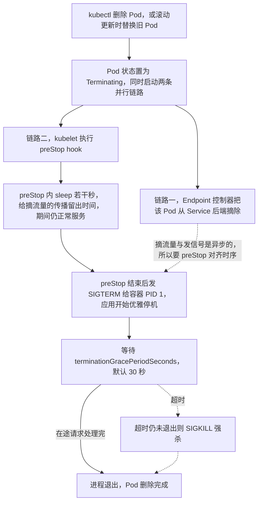

3. **发布期零星 502 的完整根因**：`maxUnavailable: 0` 保证了"先起新的"，但"删旧的"如果没有 preStop + readiness 摘流量时序配合，就还是会打到正在关闭的实例。

**企业实际处理**：
- **preStop 标配 `sleep 5~10s`（小于 `terminationGracePeriodSeconds`）+ readiness 探针 + `server.shutdown=graceful`**，三件套一起上。
- `terminationGracePeriodSeconds` 要**大于**应用处理完一个最长请求的时间 + preStop 的 sleep 时间，否则会被 SIGKILL。
- **CrashLoopBackOff 的退避是递增的**（10s → 20s → 40s → … → 上限 5 分钟），所以看到它说明已经重启好几轮了，不是"刚崩一次"。
- 用 `kubectl debug`（ephemeral container）或 `kubectl exec` 进容器查现场；distroless 镜像没有 shell，要用 `kubectl debug --image=busybox` 挂一个临时调试容器。
- **Long-running 初始化**用 initContainer，别塞进主容器；initContainer 失败会导致 Pod 一直 `Init:xxx` 状态。

**为什么这样做**：
- **因为 K8s 的"摘流量"和"发信号"是两条独立的异步链路**：endpoint 更新要经过 apiserver → kube-proxy → iptables/IPVS，以及 Ingress Controller 的 upstream 更新，都有延迟；preStop 就是在两条链路之间架一座"缓冲桥"。
- **因为"能优雅退出"是零停机发布的最后一块拼图**：不做优雅停机，前面所有的 readiness、maxUnavailable 努力都会在"删旧 Pod"这一步漏气，表现为"发布时监控面板上有一小撮 502"。
- **因为退出码是最快的"病因分类器"**：137 和 143 一眼就能分出"被杀"还是"自己优雅退"，比翻日志快得多。

**企业级代码示例**（📦 按 Docker 24+ / K8s 1.29 书写、未实测）：preStop + 优雅停机完整配置。

```yaml
apiVersion: apps/v1
kind: Deployment
metadata: { name: risk-warning }
spec:
  replicas: 3
  strategy:
    rollingUpdate: { maxSurge: 1, maxUnavailable: 0 }
  selector: { matchLabels: { app: risk-warning } }
  template:
    metadata: { labels: { app: risk-warning } }
    spec:
      terminationGracePeriodSeconds: 45      # 必须 > preStop sleep + 最长请求处理时间
      containers:
        - name: app
          image: harbor.internal/risk/risk-warning:1.8.3
          readinessProbe:
            httpGet: { path: /actuator/health/readiness, port: 8080 }
          lifecycle:
            preStop:
              exec:
                # 给"摘流量"留传播时间；期间仍正常服务
                command: ["sh", "-c", "sleep 10"]
          env:
            - name: JAVA_TOOL_OPTIONS
              value: "-XX:MaxRAMPercentage=75.0"
```

```properties
# Spring Boot 3.x：开启优雅停机（application.properties）
server.shutdown=graceful
spring.lifecycle.timeout-per-shutdown-phase=30s
```

```bash
# 排查 CrashLoop 的四连
kubectl get pods -w
kubectl describe pod <pod> | sed -n '/Events/,$p'
kubectl logs <pod> --previous --tail=200        # 看崩溃的上一个实例
kubectl get pod <pod> -o jsonpath='{.status.containerStatuses[0].lastState.terminated}'
```

**面试加分项**：
- 精确讲出 **"删 Pod 时 kubelet 摘流量和发 SIGTERM 是并行的"**，并因此需要 preStop 来对齐时序——这是绝大多数人讲不出的根因。
- 强调 **`kubectl logs --previous`** 这个参数，很多人不知道崩溃后当前实例日志是空的，真正要看的是上一个。
- 提到 **distroless 镜像无 shell 时用 `kubectl debug` 挂临时容器**，体现你在安全加固（题 2）和排障之间的平衡能力。

---

## 高阶架构题（5 道）

### <a id="q11"></a>题 11：你说发布从 4 小时缩到 15 分钟，具体怎么做到的？故障率降 82% 靠什么？

- **题干**：「你简历写了把发布时长从 4 小时缩到 15 分钟，这个数字挺亮眼。能具体拆一下吗：这 4 小时原来花在哪，15 分钟又是怎么来的？还有故障率降 82%，凭什么？」
- **考察点**：CI/CD 流水线设计、发布耗时拆解能力、标准化/自动化/可回滚的工程思维、多环境一键发布、数字背后的因果。

**标准答案**（这是可背诵的拆解话术）：

1. **先讲"4 小时花在哪"（暴露问题的复盘）**：
   - **人工串行**：开发本地 `mvn package` → 手改各环境配置 → SCP/FTP 传包到服务器 → 逐台 `kill` 进程 → `nohup java -jar` 重启 → 手工改 Nginx → 人工验证。10+ 个服务，一个服务一处手工操作，全流程串行。
   - **重复劳动**：同一次发布要在 测试/预发/生产 多个环境各做一遍，每次都是同一套手工动作。
   - **等待与返工**：编译等本地机器、传包等网络、重启后等人工点页面验证；一旦发现配置改错，全体重来。
   - **无标准化**：每个服务发布方式略有差异（有的 jar、有的 war、路径不统一），每次都要"想一下这个怎么发"。
2. **再讲"15 分钟怎么来的"（工程化改造）**：
   - **容器化（10+ 服务）**：把每个服务用 Dockerfile（多阶段构建，题 2）打成镜像，**环境差异被固化进镜像**（"在我机器上能跑"彻底消失），部署动作从"传包+重启进程"变成"换一个镜像 tag"。
   - **Jenkins Pipeline 全流程自动化**（题 11 代码）：`Git 提交/合并 → 触发流水线 → 单元测试 + SonarQube 质量门禁 → Maven 构建 → 多阶段构建镜像 → 推送 Harbor → 更新 K8s Deployment 镜像 tag → 滚动发布 → 冒烟测试 → 通知`。**人工步骤从"全程"变成"审批"**。
   - **并行化与缓存**：多个服务**并行构建**（Jenkins `parallel` stage）；Maven 依赖走本地仓库缓存（`--mount=type=cache`）；镜像分层让"依赖层"复用，只推增量的业务层。
   - **K8s 滚动发布替代停机重启**：不再"停旧起新"，而是 `maxUnavailable: 0` 滚动替换，无人工介入、无停机窗口。
   - **多环境一键发布**：同一条流水线用 `ENV` 参数区分环境，**镜像完全一致、只有配置不同**（ConfigMap/Apollo），预发验证过就一键上生产，不需要重新构建。
   - **时间账**：构建 + 测试 + 镜像约 5~8 分钟，滚动发布约 2~3 分钟，冒烟验证 1~2 分钟，加上触发与通知，**稳态 15 分钟左右**。相比原来 4 小时，**压缩的是"人工操作时间 + 重复劳动 + 串行等待"**。

**图 5-12：Jenkins 多环境发布流水线**

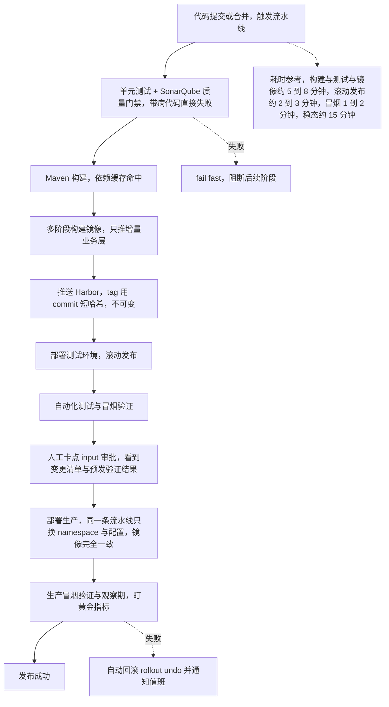

3. **故障率降 82% 靠什么（比提速更值钱的是"稳"）**：
   - **标准化消除差异**：所有服务同一套镜像规范、同一套发布流程，"每服务一种发法"带来的低级错误消失。
   - **质量门禁前移**：单元测试 + 静态扫描（SonarQube）卡在流水线上，**带病代码进不了生产**。
   - **发布前可验证**：冒烟测试自动化，发布后立刻跑关键接口用例，异常自动判失败。
   - **可秒级回滚**：镜像 tag 不可变 + `kubectl rollout undo`，出问题 1 分钟内回退，把"故障时长"压缩到极小。
   - **配置与镜像分离**：改配置不再需要重新构建镜像，也不再"手改服务器配置文件"——**历史上大量事故就出在手工改配置**。
   - **灰度/滚动 + 探针拦截**：新版本先小流量、readiness 不过就不接流量，坏版本在扩散前就被拦下。

**企业实际处理**：
- **流水线设计原则**：快反馈在前（lint/单测几秒出结果）、慢步骤在后（集成测试/镜像构建）；失败即停（fail fast）；任何一步失败都发通知并阻止继续。
- **生产发布保留"审批门禁"**：一键发布不等于无人把关，生产环境 stage 前加人工审批（Jenkins `input`），审批人看到的是变更清单 + 预发验证结果。
- **变更可追溯**：每次发布记录 镜像 tag / Git commit / 构建号 / 审批人 / 发布时间，出问题能立刻定位"这次发布了什么"。
- **发布窗口与观察期**：生产发布后设置观察期，盯黄金指标（题 12/15），确认无异常才宣布成功。

**为什么这样做**：
- **因为"发布时长"本质是"人工操作时长 + 等待时长 + 返工时长"**：自动化压缩不了编译本身，但能压缩掉 90% 的"人在等"和"人在操作"——这才是 4 小时→15 分钟的主因。
- **因为"高频发布"与"高稳定性"必须同时满足**：只提速不降故障率，等于更快地制造事故。所以提速的每一步都配套了质量门禁与回滚能力，**"快"建立在"可回退"之上**。
- **因为"标准化"才是故障率下降的根因**：故障率降的不是因为某个人更小心，而是因为**流程把"犯错的机会"从流程里删掉了**——手工改配置会犯错，那就让配置不再手工改；传包会传错，那就让部署只换 tag。

**企业级代码示例**（📦 按 Docker 24+ / K8s 1.29 / Spring Boot 3.x / Jenkins 书写、未实测）：声明式 Jenkinsfile，多环境参数化一键发布。

```groovy
// Jenkinsfile（声明式 Pipeline）
pipeline {
  agent { label 'build-agent' }
  parameters {
    choice(name: 'ENV', choices: ['dev', 'staging', 'prod'], description: '目标环境')
    string(name: 'IMAGE_TAG', defaultValue: "${env.GIT_COMMIT.take(8)}", description: '镜像 tag=commit 短哈希')
    booleanParam(name: 'SKIP_TESTS', defaultValue: false, description: '仅热修复时跳过单测')
  }
  environment {
    REGISTRY = 'harbor.internal/risk'
    APP      = 'risk-warning'
  }
  stages {
    stage('Checkout') { steps { checkout scm } }

    stage('质量门禁') {
      when { expression { return !params.SKIP_TESTS } }
      steps {
        sh 'mvn -B test'                      // 单元测试
        // 静态扫描 + 质量门禁（SonarQube Quality Gate 不通过则失败）
        sh 'mvn -B sonar:sonar -Dsonar.qualitygate.wait=true'
      }
    }

    stage('构建镜像') {
      steps {
        // 多阶段构建 + 分层缓存：只推增量业务层
        sh "docker build --cache-from ${REGISTRY}/${APP}:latest -t ${REGISTRY}/${APP}:${IMAGE_TAG} ."
      }
    }

    stage('推送镜像') {
      steps {
        withCredentials([usernamePassword(credentialsId: 'harbor', usernameVariable: 'U', passwordVariable: 'P')]) {
          sh 'echo $P | docker login harbor.internal -u $U --password-stdin'
          sh "docker push ${REGISTRY}/${APP}:${IMAGE_TAG}"   // tag 不可变
        }
      }
    }

    stage('生产审批') {
      when { expression { return params.ENV == 'prod' } }
      steps {
        // 人工门禁：审批人看变更清单 + 预发验证结果
        input message: "确认发布 ${APP}:${IMAGE_TAG} 到生产？", ok: '确认发布'
      }
    }

    stage('滚动发布') {
      steps {
        // 同一条流水线，不同环境只是换 namespace + 配置，镜像完全一致
        sh """
          kubectl -n ${params.ENV} set image deploy/${APP} \\
            app=${REGISTRY}/${APP}:${IMAGE_TAG} --record
          kubectl -n ${params.ENV} rollout status deploy/${APP} --timeout=300s
        """
      }
    }

    stage('冒烟验证') {
      steps {
        sh "curl -fsS http://${APP}.${params.ENV}.svc.cluster.local/actuator/health/readiness"
      }
    }
  }
  post {
    failure {
      // 失败自动回滚 + 通知
      sh "kubectl -n ${params.ENV} rollout undo deploy/${APP} || true"
      echo '发布失败，已触发自动回滚并通知值班'
    }
  }
}
```

**面试加分项**：
- **把数字讲成因果链而不是口号**：4 小时=人工+串行+重复+返工；15 分钟=容器化固化环境 + 流水线自动化 + 并行/缓存 + 滚动发布。故障率 -82% = 标准化 + 质量门禁 + 可回滚 + 配置分离。
- 主动提 **"提速的前提是可回滚"**，把"快"和"稳"绑在一起讲，比只讲"我们自动化了"高级得多。
- 提到 **"镜像一样的，配置不一样"** 这个多环境发布的核心原则（Build once, deploy anywhere），并用 `IMAGE_TAG = git commit` 保证"任何线上版本都能追到源码"，体现可追溯的工程意识。

---

### <a id="q12"></a>题 12：可观测性三支柱是什么？Prometheus 的四种指标类型和常用 PromQL 讲讲

- **题干**：「你简历写了链路追踪、日志监控、压测分析。那从可观测性角度讲，你们是怎么搭的？Prometheus 四种指标类型分别是什么，什么时候用哪种？写几条你会常用的 PromQL。」
- **考察点**：三支柱概念与分工、Prometheus 数据模型与拉取模式、四种指标类型语义、PromQL 实战、Grafana 看板。

**标准答案**：

1. **三支柱（Three Pillars）**：
   - **Metrics（指标）**：数值型、可聚合、可下采样，**成本低、适合告警和大盘**。回答"系统整体健康吗"。缺点是**无明细、标签基数有上限**。
   - **Logging（日志）**：离散事件 + 上下文，**明细最全、适合定位具体原因**。缺点是**量大、贵、难以做聚合统计**。
   - **Tracing（链路追踪）**：单个请求跨服务的完整调用链，回答"这一笔慢在哪一跳"。缺点是**采样、有侵入、存储成本高**。
   - **三者靠 TraceId 串联**：指标异常告警 → 用 TraceId 找到具体慢的请求 → 用日志看那一跳的报错细节。这就是你简历里"实时监测与告警体系 + 链路追踪 + 日志监控"能形成闭环的原因。

**图 5-13：可观测性三支柱与 TraceId 串联**

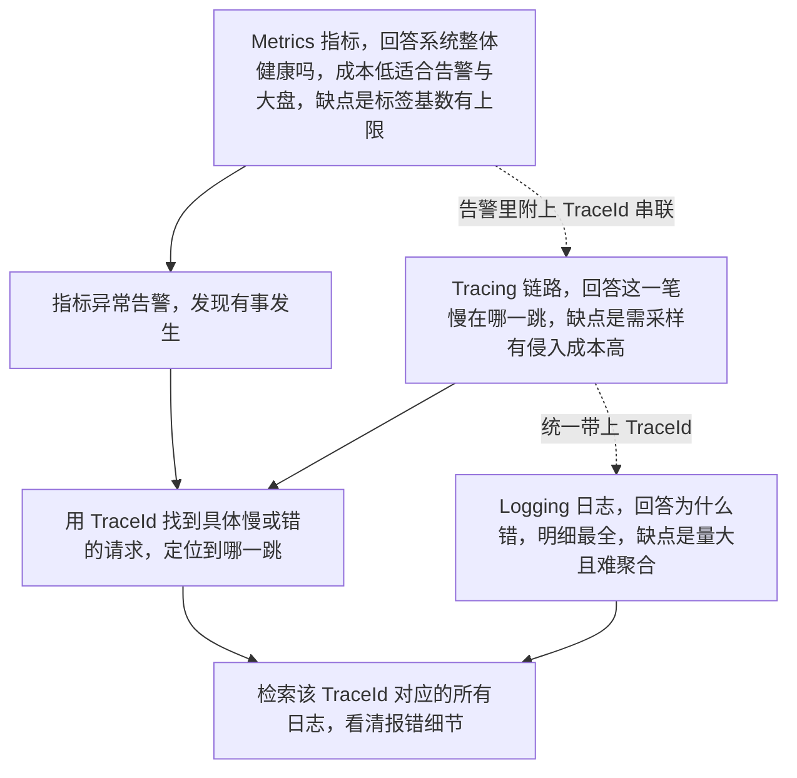

2. **Prometheus 数据模型**：`指标名{标签1="v1", 标签2="v2"} 值 时间戳`。**标签是它的灵魂也是它的成本**——每个不同的标签组合是一条独立时间序列，**高基数标签（如 user_id、trace_id）会撑爆 TSDB**，所以**绝对不能把高基数字段当标签**。
3. **拉取模式（Pull）**：Prometheus **主动**按 `scrape_interval`（默认 15s）去目标的 `/metrics` 拉数据，靠服务发现（K8s SD / `ServiceMonitor`）自动发现目标。相比 Push 的优势是**天然知道谁挂了**（`up == 0`）、配置集中在服务端、不需要客户端长连接。短生命周期任务用 **Pushgateway** 补充。
4. **四种指标类型**：
   - **Counter（计数器）**：**只增不减**（可重置）。如 `http_requests_total`。**必须用 `rate()`/`increase()` 看变化率**，直接看原始值没意义。
   - **Gauge（仪表盘）**：**可增可减**。如 `node_memory_usage_bytes`、`go_goroutines`、队列长度。直接看当前值或做 `avg/max`。
   - **Histogram（直方图）**：客户端按**预设的桶（bucket）**统计，暴露 `_bucket`（累积计数）、`_sum`、`_count`。服务端可用 `histogram_quantile()` **聚合后算分位数**（桶的边界要提前设计，这是它的缺点）。适合延迟分布。
   - **Summary（摘要）**：客户端**直接算出分位数**（如 `_quantile{quantile="0.95"}`）+ `_sum`/`_count`。缺点：**分位数无法跨实例聚合**（多实例 p95 无法合并），所以大规模下更推荐 Histogram。
5. **常用 PromQL**：
   - QPS：`sum(rate(http_requests_total[5m])) by (service)`
   - 错误率：`sum(rate(http_requests_total{status=~"5.."}[5m])) / sum(rate(http_requests_total[5m]))`
   - P95 延迟（Histogram）：`histogram_quantile(0.95, sum(rate(http_request_duration_seconds_bucket[5m])) by (le))`
   - 目标存活：`up{job="risk-warning"} == 0`
   - 内存贴边：`container_memory_working_set_bytes / container_spec_memory_limit_bytes > 0.9`
   - CPU 使用率：`sum(rate(container_cpu_usage_seconds_total[5m])) by (pod)`

**企业实际处理**：
- **分层监控看板**：业务层（QPS/错误率/延迟/核心交易量）、应用层（JVM GC/线程池/连接池）、中间件层（Kafka 积压、Redis 命中率、DB 慢查）、主机/容器层（CPU/内存/网络/磁盘）。
- **指标采集**：Java 应用用 **Micrometer + `/actuator/prometheus`** 暴露指标；K8s 用 **kube-state-metrics**（对象状态）+ **node-exporter**（节点）+ **cAdvisor**（容器）；全部用 `ServiceMonitor`（Prometheus Operator）声明式纳管。
- **Grafana 看板**：按"服务维度"建统一模板（RED 三板斧 + 资源 + 依赖），用变量切换环境/服务；配上 **告警规则**（下一题）。
- **长期存储**：本地 TSDB 只留 15 天左右，更久的用 **Thanos / VictoriaMetrics** 做长期存储与多集群聚合。
- 呼应简历的「**全维度指标体系**（任务运行状态、资源利用率、计算延迟、吞吐量、异常报错）」：这正好对应 **Gauge（任务状态/资源）、Counter（吞吐/异常数）、Histogram（计算延迟）** 三类指标的组合，可以用这个框架来讲自己搭的体系。

**为什么这样做**：
- **因为三支柱是"三种粒度不同的证据"**：指标告诉你"出事了"，链路告诉你"哪一跳"，日志告诉你"为什么"。只建其中之一都不足以定位问题——这就是"可观测性"区别于"监控"的地方：从"知道坏了"升级到"知道为什么坏"。
- **因为 Pull 模式让"监控系统自身"更简单可靠**：目标是匿名的、可任意扩缩的（K8s 场景天天在变），Prometheus 靠服务发现自动跟上；同时 `up` 指标天然提供了"目标是否存活"这一最基础的信号。
- **因为指标类型选错会导致"数据没法用"**：把延迟做成 Gauge 就没法算分位数；把总量用 Counter 却直接看值而不 `rate()` 就得不到速率；用 Summary 就没法跨实例聚合。选型正确是能用 PromQL 分析的前提。

**企业级代码示例**（📦 按 Docker 24+ / K8s 1.29 / Spring Boot 3.x 书写、未实测）：应用指标暴露 + ServiceMonitor + 常用 PromQL。

```yaml
# 声明式纳管：Prometheus Operator 的 ServiceMonitor
apiVersion: monitoring.coreos.com/v1
kind: ServiceMonitor
metadata:
  name: risk-warning
  labels: { release: prometheus }
spec:
  selector:
    matchLabels: { app: risk-warning }
  endpoints:
    - port: http
      path: /actuator/prometheus     # Micrometer 暴露
      interval: 15s
```

```promql
# ---- 黄金指标（RED）----
# Rate：QPS
sum(rate(http_server_requests_seconds_count[5m])) by (uri)
# Errors：5xx 比例
sum(rate(http_server_requests_seconds_count{status=~"5.."}[5m]))
  / sum(rate(http_server_requests_seconds_count[5m]))
# Duration：P95 延迟
histogram_quantile(0.95,
  sum(rate(http_server_requests_seconds_bucket[5m])) by (le, uri))

# ---- JVM / 容器 ----
# 容器内存占用 / limit 比值（贴边预警）
container_memory_working_set_bytes{namespace="prod"}
  / on(pod, container) kube_pod_container_resource_limits{resource="memory"}
# JVM GC 耗时速率
rate(jvm_gc_pause_seconds_sum[5m]) / rate(jvm_gc_pause_seconds_count[5m])

# ---- 目标存活 ----
up{job="risk-warning"} == 0
```

**面试加分项**：
- 把三支柱讲成 **"指标找事、链路找跳、日志找因，靠 TraceId 串起来"**，一句话把体系讲通。
- 点出 **"高基数标签是 Prometheus 的杀手"**，以及 **Summary 无法跨实例聚合** 这两个硬核限制，能立刻区分出"用过"和"懂原理"。
- 把你简历的「**全维度指标体系**」映射到 **Gauge/Counter/Histogram** 三类语义上去讲，显得你的体系是"设计出来的"而非"堆出来的"。

---

### <a id="q13"></a>题 13：链路追踪的原理是什么？TraceId 怎么透传？全量采样可以吗？

- **题干**：「你说用链路追踪定位过线上问题。那讲一下链路追踪的原理：Trace、Span 是什么？TraceId 是怎么从入口一直传到下游的？采样率你们怎么定？用过 SkyWalking 还是 OpenTelemetry？」
- **考察点**：Trace/Span 模型与上下文透传、采样策略、SkyWalking 与 OpenTelemetry 的对比与选型、ELK/EFK 日志体系与 TraceId 串联。

**标准答案**：

1. **核心模型**：
   - **Trace**：一次完整请求的调用链，由 **TraceId** 全局唯一标识。
   - **Span**：链路上的**一个操作单元**（一次 RPC、一次 DB 查询、一次缓存访问），有 `SpanId` 和 `ParentSpanId`。所有 Span 靠 parent 关系组成一棵**调用树（DAG）**，根 Span 就是入口请求。
   - Span 记录：开始/结束时间（→ 耗时）、操作名、标签（http.method/status）、事件、以及跨进程的上下文。
2. **TraceId 透传（上下文传播）**：
   - 入口（网关/第一个服务）**生成或继承** TraceId，并通过**协议头**把它和 SpanId 传给下游。常见头：**W3C `traceparent`**（OpenTelemetry 默认标准，形如 `00-<traceid>-<spanid>-<flags>`）、Zipkin 的 **B3**、SkyWalking 的自定义头（`sw8`）。
   - Java 里通常由**字节码增强 agent 自动完成**：HTTP 客户端（RestTemplate/Feign/OkHttp）、MQ（Kafka 消息头）、线程池、异步调用都被拦截注入/提取上下文。**跨进程传递的坑**：MQ 需要把上下文写进消息 header；线程池需要透传（否则子线程丢失上下文）；`@Async`/CompletableFuture 需要注意上下文继承。
3. **采样（Sampling）—— 为什么不能全量**：
   - **全量采集的成本是线性的**：QPS 越高，Span 数量、网络传输、存储索引都线性涨。一个日 PV 千万的系统全量采样能让存储成本爆炸。
   - **头部采样（Head-based）**：在入口就决定采不采（固定比例/概率），简单、低成本，**但不知道后续会不会出错**，会漏掉低速率的错误请求。
   - **尾部采样（Tail-based）**：先把 Span 全收集到一个收集器（如 OTel Collector），**根据结果决定是否保留**（如"有错误的、慢请求的必须留"）。**质量高但成本高、要采全再丢**。
   - 生产常见策略：**总体低采样率（如 1%~10%）+ 错误/慢请求高保真**（结合尾部采样或"异常必采"规则），兼顾成本与排障。
4. **OpenTelemetry vs SkyWalking**：
   - **OpenTelemetry（OTel）**：CNCF 标准，**厂商中立**，统一了 Trace/Metrics/Logs 的采集 SDK 与 **OTLP 协议**，可对接 Jaeger/Tempo/Prometheus 等任意后端。**趋势方向，生态最广**，但需要自己组装后端与 UI。
   - **SkyWalking**：国产 APM，**Java agent 开箱即用、无侵入**，自带存储（ES/BanyanDB）、UI（拓扑图、慢调用、告警），**上手快、对 Java 友好**，中文社区好。缺点是协议与生态相对封闭，与其他后端互通不如 OTel。
   - 选型：**新项目优先 OTel 标准化采集 + 自选后端（如 Tempo/Jaeger + Prometheus + Grafana）**；老项目/快速落地可选 SkyWalking。很多团队是"**OTel 采集 + SkyWalking/自建后端展示**"混合。
5. **ELK/EFK 日志体系**：`应用输出 → 采集（Filebeat/Fluent Bit） → 缓冲（Kafka，削峰） → 处理（Logstash/Flink） → 存储（Elasticsearch） → 展示（Kibana）`。K8s 上采集用 **DaemonSet 的 Fluent Bit**（比 Filebeat 更省资源）。**日志规范**：统一 JSON 结构化、**必带 TraceId/SpanId/服务名/环境**，这样才能"由 TraceId 一键跳到该请求的所有日志"。

**企业实际处理**：
- **日志规范落地**：MDC/日志框架在入口把 TraceId 注入，全链路日志自动带上；Kibana 里按 `traceId` 一搜就能还原整条链路的所有日志——这是"指标告警 → 链路定位 → 日志找因"闭环的最后一环。
- **采集侧削峰**：日志先写 Kafka 再入库，避免大促时 ES 写入被打爆（这是你简历里 Kafka 经验与可观测体系的结合点）。
- **存储成本控制**：ES 用 **ILM（索引生命周期管理）**——热数据 SS-D、温数据慢盘、冷数据压缩、到期删除；日志分级（ERROR 长期保留、DEBUG 只留 3 天）。
- **采样与成本治理**：高流量接口低采样 + 错误全采；对超长链路设置 Span 上限，防止"一条链几千 Span"。
- **Tracing 与 Metrics 联动**：Grafana 面板上点开某个异常时间段 → 跳到 Trace 查询 → 拿到 TraceId → 跳 Kibana 看日志，形成统一排障入口。

**为什么这样做**：
- **因为"透传"是链路追踪的生命线**：任何一跳没把 TraceId 传下去，链路就断在那里。所以跨线程、跨 MQ、跨异构协议（HTTP/gRPC）的传播是工程落地的最大难点，也是 agent 自动增强的价值所在。
- **因为"采样"是成本与可观测性的直接权衡**：全量=贵，不采=瞎。正确做法不是二选一，而是"**分层采样**"——正常流量少采、异常流量必采，让"值钱的数据"留下。
- **因为"日志搜索"和"链路追踪"是互补而非替代**：日志量大、无结构、跨服务关联难；TraceId 恰好提供了**跨服务的关联键**，把离散日志缝成一条完整请求的叙事。

**企业级代码示例**（📦 按 Docker 24+ / K8s 1.29 / Spring Boot 3.x 书写、未实测）：Logback 把 TraceId 打进日志 + OTel 采样配置。

```xml
<!-- logback-spring.xml：把 TraceId/SpanId 打进每条日志，便于 Kibana 关联 -->
<configuration>
  <appender name="JSON" class="ch.qos.logback.core.ConsoleAppender">
    <encoder class="net.logstash.logback.encoder.LogstashEncoder">
      <!-- 从 MDC 取 traceId/spanId（OTel/SkyWalking agent 会自动注入） -->
      <includeMdcKeyName>traceId</includeMdcKeyName>
      <includeMdcKeyName>spanId</includeMdcKeyName>
      <customFields>{"service":"risk-warning","env":"prod"}</customFields>
    </encoder>
  </appender>
  <root level="INFO"><appender-ref ref="JSON"/></root>
</configuration>
```

```yaml
# OpenTelemetry Java agent：头部采样 10%，异常/错误由 Collector 尾部策略兜底
# 启动参数（JAVA_TOOL_OPTIONS）示例：
# -javaagent:/otel/opentelemetry-javaagent.jar
# -Dotel.service.name=risk-warning
# -Dotel.traces.sampler=parentbased_traceidratio
# -Dotel.traces.sampler.arg=0.1
# -Dotel.exporter.otlp.endpoint=http://otel-collector:4317
```

```yaml
# OTel Collector 尾部采样片段（示意：错误与慢请求必留）
processors:
  tail_sampling:
    decision_wait: 10s
    policies:
      - name: errors-always        # 有错误的 trace 全留
        type: status_code
        status_code: { status_codes: [ERROR] }
      - name: slow-always          # 超过 1s 的 trace 全留
        type: latency
        latency: { threshold_ms: 1000 }
      - name: baseline-10pct       # 其余按 10% 采
        type: probabilistic
        probabilistic: { sampling_percentage: 10 }
```

**面试加分项**：
- 讲出 **"跨线程池和跨 MQ 的上下文透传是链路追踪最容易断的地方"**，这是真做过的人才知道的坑。
- 用 **"头部采样便宜但会漏错、尾部采样准但要先收全"** 精准区分两种采样，并给出"总体低采样 + 异常高保真"的落地策略。
- 把 **SkyWalking 和 OTel 的对比落到"开箱即用 vs 标准化生态"** 上，并说清团队是怎么选的，而不是只说"我用了 XX"。

---

### <a id="q14"></a>题 14：告警怎么设计才不吵？为什么"小时级→分钟级"是关键指标？

- **题干**：「你简历写了实时监测与告警体系、异常发现从小时级缩到分钟级。那我问个刁钻的：告警怎么设计才不会被淹没？你们有没有告警风暴？怎么治理的？」
- **考察点**：告警分级、降噪手段（分组/抑制/静默/去重）、告警风暴根因与治理、SLO/SLI/错误预算、告警指标的意义。

**标准答案**：

1. **告警设计的第一原则：**告警要"**可行动（actionable）**"。每条告警都必须回答三个问题：**谁看、看了做什么、不做什么会怎样**。答不上来的告警就是噪音，应删。
2. **告警分级（按影响面与紧迫度）**：
   - **P0/紧急**：核心链路不可用、影响用户/资金/监管合规（期权风控预警失效即属此类），**立即电话/短信叫醒**。
   - **P1/重要**：核心功能降级、错误率超阈值，**工作时间内快速响应**。
   - **P2/一般**：非核心异常、容量接近阈值（磁盘、连接池），**工单/群消息**。
   - **P3/提示**：趋势性、可观察，**仅看板/日报**，不打扰人。
   - 分级的意义：**把"人的注意力"这个最稀缺的资源用在最紧急的事上**。
3. **四大降噪手段**：
   - **分组（Grouping）**：把"同一时间、同一原因"的大量告警合并成一条（Alertmanager 按 `group_by: [alertname, service]`）。一个 DB 挂了导致 50 个下游报错 → 合成 1 条通知，而不是 50 条。
   - **抑制（Inhibition）**：**高级别告警出现时，自动抑制由它引发的低级别告警**。节点宕机（cause）抑制该节点上所有 Pod 的不可用（effect），避免"1 个根因 → 100 条衍生告警"。
   - **静默（Silence）**：**运维窗口/已知变更期间静默相关告警**（如计划内发布、压测期间）。
   - **去重（Deduplication）**：同一条告警在 `repeat_interval` 内只发一次，恢复时发一次"已恢复"。

**图 5-14：Prometheus 拉取模型与告警链路**

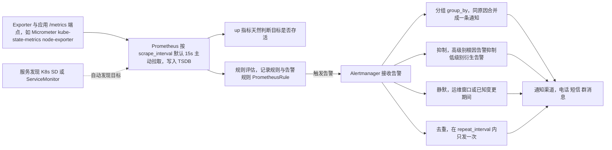

4. **告警风暴（Alert Storm）的根因与治理**：
   - **根因**：**告警的"层层放大"和"根因与症状不分"**。一个底层组件故障，会让所有依赖它的上层都告警，形成雪崩式通知。
   - **治理**：① 基于**抑制规则**让根因告警优先；② 告警**面向症状（用户可感知）而非原因（CPU 高不代表用户有问题）**；③ 设置**告警收敛**（单位时间内同一服务只发 N 条）；④ **值班轮询 + 告警路由**（按服务/团队路由，不相关的人收不到）；⑤ 定期做**告警复盘**，删掉长期"只响不处理"的告警。
5. **为什么"异常发现小时级→分钟级"是关键指标**：
   - 因为 **MTTD（Mean Time To Detect，平均发现时长）直接决定故障影响时长**。故障总时长 ≈ **MTTD（发现） + MTTI（响应） + MTTR（修复）**。把发现从小时级压到分钟级，等于把故障的"暴露窗口"缩短了一到两个数量级。
   - 对**监管级风控系统**（如你做的期权风控实时预警）尤其关键：发现晚了可能意味着风险敞口已经扩大、监管报送延迟、甚至合规问题——所以"分钟级发现"不是效率指标而是**合规底线**。
   - 这个指标能达成，靠的是 **覆盖全链路的指标体系（题 12）+ 合理的告警阈值 + 自动化检测**，而不是靠"人盯"。
6. **SLO / SLI / 错误预算**：
   - **SLI（Indicator）**：可量化的服务质量指标，如可用性 = 成功请求 / 总请求。
   - **SLO（Objective）**：SLI 的目标，如"99.9% 可用（30 天）"。
   - **错误预算（Error Budget）= 1 - SLO**：99.9% 意味着 30 天允许约 43 分钟不可用。预算没用完 → 可以大胆发布；预算耗尽 → **冻结变更、专注稳定性**。它把"稳定 vs 迭代"的争论变成**一个可计算的数字**。
   - **基于烧毁率（Burn Rate）告警**：不用"错误率 > 1%"这种静态阈值，而是"**错误预算以多快的速度被消耗**"——快烧（如 14.4x，1 小时耗尽 2%）告急、慢烧（如 1x，30 天耗尽）预警。这是 Google SRE 推荐的多窗口多烧毁率告警法。

**企业实际处理**：
- **告警规则写进代码/配置，纳入 Git 管理**（PrometheusRule CRD），变更走 Code Review——避免"某人在 Grafana 上随手改了个阈值"导致没人知道。
- **每条告警带 Runbook 链接**：告警通知里直接给出"排查步骤/影响范围/联系人/止损手册"，让半夜被叫醒的人不用先花 20 分钟想"这啥意思"。
- **值班制度**：一线 on-call（先看 Runbook 止血）+ 二线专家（深度定位），值班轮换 + 告警响应 SLA（P0 5 分钟响应）。
- **告警质量度量**：统计"有效告警率""误报率""告警处理时长"，定期优化阈值和规则。目标是把"每周 100 条告警"压到"每周 10 条都是真事"。
- 呼应简历的「**自动化应急处置 80% 自动修复**」：**能自动修复的异常，根本不该告警给人**——先自动处置（重启、扩容、切流、降级），处置成功只记录、处置失败或超时才升级告警。这是告警降噪最彻底的手段：**把 L1 响应自动化**。

**图 5-15：告警分级与自动化处置闭环**

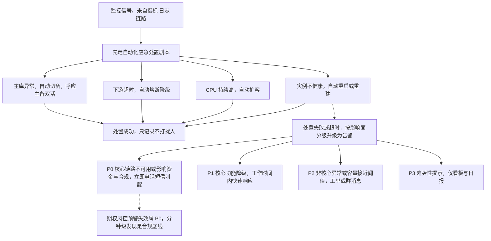

**为什么这样做**：
- **因为"告警"消耗的是人最贵的资源——注意力和睡眠**：告警太多 → 人麻木（Alarm Fatigue）→ 真告警被忽略 → 出大事。所以降噪不是"为了舒服"，而是**保证告警的可信度**。
- **因为"告警"应该盯症状而不是原因**：用户不关心 CPU 是否 90%，只关心"能不能下单"。对着症状告警，才能保证"每一条告警都对应一个真实的用户影响"，从根本上避免噪音。
- **因为"发现时长"是可优化的工程指标而非运气**：它 = 指标覆盖度 × 采集频率 × 阈值合理性 × 自动化程度。你能把它从小时压到分钟，本质是**把"人发现"换成了"系统发现"**——这才是简历上那句话的真正含金量。

**企业级代码示例**（📦 按 K8s 1.29 / Prometheus Operator / Alertmanager 书写、未实测）：分级告警 + 抑制 + 分组。

```yaml
# PrometheusRule：基于错误预算烧毁率告警（比静态阈值更不易误报）
apiVersion: monitoring.coreos.com/v1
kind: PrometheusRule
metadata: { name: slo-rules, labels: { release: prometheus } }
spec:
  groups:
    - name: slo.burnrate
      rules:
        - alert: HighErrorBudgetBurn
          # 5 分钟与 1 小时窗口同时满足高烧毁率 -> 才告急（多窗口防抖）
          expr: |
            (sum(rate(http_server_requests_seconds_count{status=~"5.."}[5m]))
             / sum(rate(http_server_requests_seconds_count[5m]))) > (14.4 * 0.001)
            and
            (sum(rate(http_server_requests_seconds_count{status=~"5.."}[1h]))
             / sum(rate(http_server_requests_seconds_count[1h]))) > (14.4 * 0.001)
          for: 2m
          labels: { severity: critical, service: risk-warning }
          annotations:
            summary: "risk-warning 错误预算快速消耗"
            runbook_url: "https://wiki.internal/runbook/risk-warning-5xx"
```

```yaml
# Alertmanager：分组 + 抑制 + 路由
route:
  group_by: [alertname, service]      # 同原因聚合，避免告警风暴
  group_wait: 30s
  group_interval: 5m
  repeat_interval: 4h
  receiver: default
  routes:
    - matchers: [severity="critical"]  # P0 走电话/短信
      receiver: oncall-pager
    - matchers: [severity="warning"]   # P1 走群消息
      receiver: im-webhook
inhibit_rules:
  # 节点宕机（cause）时，抑制该节点上所有 Pod 的衍生告警（effect）
  - source_matchers: [alertname="NodeDown"]
    target_matchers: [scope="pod"]
    equal: [node]
```

**面试加分项**：
- 讲出 **"告警盯症状不盯原因"** 和 **"能自动修复的异常不该告警给人"**，这两条是降噪的顶层原则，非常有说服力。
- 主动提 **SLO 烧毁率告警 vs 静态阈值告警** 的区别，并说出"多窗口多烧毁率"这个具体做法，直接体现你读过 SRE 方法论而不只是用工具。
- 把 **MTTD** 拆进"故障总时长 = MTTD + MTTI + MTTR"，用一个公式解释"为什么发现时长是核心指标"，比空喊"分钟级"高级得多。

---

### <a id="q15"></a>题 15：线上故障你的排查方法论是什么？怎么做压测和容量规划？

- **题干**：「最后问个开放题：线上突然出故障了，你一般怎么搞？是直接查还是先干嘛？还有你们做不做压测，容量怎么规划的？」
- **考察点**：故障排查方法论（先止血后定位、自上而下 vs 自下而上）、黄金指标、变更关联、压测与容量规划、自动化应急。

**标准答案**：

1. **第一原则：先止血，后定位（Mitigate before Diagnose）**。用户还在受影响时，优先级是**恢复服务**而不是**找到根因**。止损手段：**回滚**（最近发布的版本）、**扩容**、**降级**（关非核心功能）、**限流熔断**、**切流**（切到备/主备双活切换，呼应简历"主备双活协同调度"）。根因分析放在服务恢复之后。
2. **排查方向两条腿**：
   - **自上而下（Top-down）**：从用户症状出发——`入口网关/负载均衡的黄金指标 → 应用服务 → 下游依赖（DB/缓存/MQ/第三方）`，一层层缩小范围。**适合"不知道哪里坏"的未知故障**。
   - **自下而上（Bottom-up）**：从底层资源/中间件指标出发（某台机器 CPU 满、某个 Kafka 分区积压、某个 DB 连接池满），往上看影响了哪些上层。**适合"监控已经指到某个点"的场景**。
   - 实践中两者结合，用**黄金指标**快速定位是哪一类问题。
3. **黄金指标（Golden Signals，Google SRE）**：**延迟（Latency）、流量（Traffic）、错误（Errors）、饱和度（Saturation）**。服务层常用 **RED**（Rate/Errors/Duration），资源层常用 **USE**（Utilization/Saturation/Errors）。**先看这四个，能迅速判断"是流量涨了、还是错误涨了、还是资源满了"**。
4. **必做动作：关联变更**。**90% 的线上故障与最近变更相关**——查"最近 24 小时有没有发版、改配置、改开关、扩缩容、DB 变更"。如果有，**回滚就是最高效的定位手段**（回滚后好了 → 根因基本锁定在这次变更）。
5. **定位手段的组合**：`指标（哪里异常）→ 链路追踪（哪一跳慢/错）→ 日志（为什么错）`，配合 `TraceId` 串联；必要时 `jstack/jmap/arthas` 看线程与堆、`tcpdump` 抓包、`pprof`/火焰图看热点。
6. **压测与容量规划**：
   - **压测**：用 JMeter/wrk/Locust 做**阶梯加压（ramp-up）**，找到**性能拐点**（QPS 上升但延迟开始陡增的点，即系统容量上限）；分别测**单接口极限、全链路、稳定性（长时间高压）**。
   - **容量规划**：`所需实例数 = 峰值QPS / 单实例安全承载 × 冗余系数(1.3~2)`。**单实例安全承载取拐点的 70% 左右**（留安全边际）。结合历史峰值 + 业务增长预估，预留弹性缓冲。
   - **压测要"真"**：数据量、并发模型、依赖（DB/缓存）都要接近生产，否则测出来的容量是假的；全链路压测还要做**流量染色**避免污染生产数据。
7. **自动化应急处置（呼应"80% 自动修复"）**：把高频、明确的故障场景做成**自动化处置剧本**——如"实例不健康 → 自动重启/重建"、"CPU 持续高 → 自动扩容"、"下游超时 → 自动熔断降级"、"磁盘满 → 自动清理日志"、"主库异常 → 自动切备"。**处置失败或超时再升级告警给人**。这正是把 MTTD/MTTR 一起压下来的关键。

**图 5-16：线上故障排查决策树**

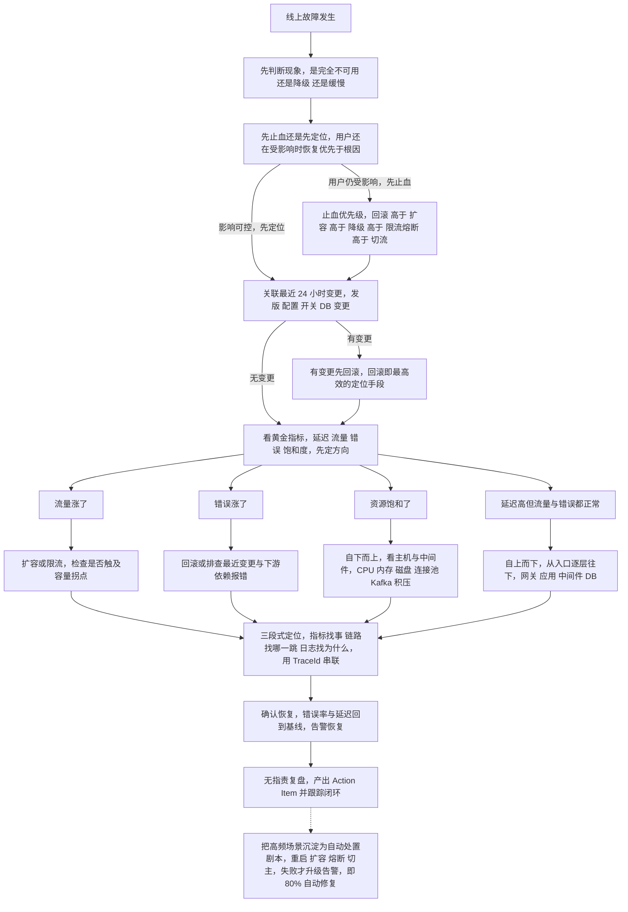

**企业实际处理**：
- **故障处理有标准流程**：`发现（告警）→ 定级 → 拉群/组建指挥 → 止血 → 定位 → 修复 → 复盘`。大故障要有**唯一指挥者**，避免多人同时操作互相打架。
- **故障复盘（Postmortem）做"无指责（blameless）"**：聚焦流程与系统缺陷而非个人，产出**改进项（Action Item）并跟踪闭环**——"同样的故障不能出现第二次"。
- **变更管控**：发布有窗口、有灰度、有回滚预案；DB 变更走评审；高危操作（删数据、改配置）双人复核 + 留痕。
- **主备双活/多活**：核心服务做多机房/多活部署，故障时**自动或一键切流**（呼应简历"主备双活环境的预警协同调度架构"）；定期做**故障演练（Chaos Engineering）**验证切换真的有效。
- **多环境预警结果比对校验**（呼应简历）：在预发用**历史数据回放/影子流量**跑新逻辑，与生产结果做比对，**在不影响生产的前提下验证正确性**——这是风控类系统的典型做法。

**为什么这样做**：
- **因为"故障时的每一分钟都是在烧钱/烧信任"**：用户不关心根因，只关心什么时候恢复。所以工程上把"止血手段"做成**预设的、一键的、可回滚的**，就是为了把 MTTR 压到最短——**先恢复，再真相**。
- **因为"关联变更"是性价比最高的排查动作**：绝大多数故障源于变更，一条"最近你改了什么"往往比查两小时日志更有效。这也是为什么"可回滚发布"（题 11）如此重要——**它同时是发布能力和排障能力**。
- **因为"容量"是设计出来的而不是猜出来的**：容量规划建立在压测拐点 + 历史数据 + 业务预估之上，再配合 HPA/弹性伸缩和预留，才能在突发流量下不崩——**盲目扩容既贵又不解决问题（瓶颈可能在 DB 或下游）**。

**企业级代码示例**（📦 按 K8s 1.29 书写、未实测）：故障排查时的高频命令序列（按"先止血后定位"排序）。

```bash
# ===== 第一步：止血（按代价从低到高）=====
kubectl -n prod rollout undo deploy/risk-warning      # 回滚最近发布
kubectl -n prod scale deploy/risk-warning --replicas=10   # 紧急扩容
# 切流：把异常实例摘出/切到备用集群（按你们的主备双活方案）

# ===== 第二步：定位 =====
kubectl -n prod get pods -o wide | grep -v Running     # 谁不健康
kubectl -n prod top pods                               # 谁资源异常（饱和度）
kubectl -n prod get events --sort-by=.lastTimestamp | tail -30   # 最近发生了什么

# 黄金指标：先从看板看 RED（QPS/错误率/延迟）与 USE（资源）
# PromQL 快速判断是"流量涨了"还是"错误涨了"
#   QPS:  sum(rate(http_server_requests_seconds_count[1m]))
#   错误: sum(rate(http_server_requests_seconds_count{status=~"5.."}[1m]))
#   延迟: histogram_quantile(0.99, sum(rate(http_server_requests_seconds_bucket[1m])) by (le))

# 链路与日志：拿 TraceId 串起来
# Grafana 面板 -> 异常时间段 -> 打开 Trace -> 复制 traceId -> Kibana 搜 traceId

# 应用现场（Java）
kubectl -n prod exec <pod> -- jstack 1 | head -100      # 线程卡在哪
kubectl -n prod exec <pod> -- jcmd 1 GC.heap_info       # 堆与 GC
# 或 arthas：thread -n 3 / dashboard / trace <Class> <Method>

# ===== 第三步：确认恢复 =====
kubectl -n prod rollout status deploy/risk-warning
# 复核错误率回到基线、延迟回到基线、告警恢复
```

**面试加分项**：
- 开口第一句就给方法论：**"先止血后定位，止血手段优先级 = 回滚 > 扩容 > 降级 > 限流"**，让面试官立刻觉得你"见过大场面"。
- 强调 **"关联最近变更"** 和 **"回滚同时是发布能力与排障能力"**，把云原生和故障处理串成一条线。
- 把 **"80% 自动修复"落到具体的自动化剧本**（重启/扩容/熔断/切主）上，并点出"自动处置失败才升级告警"这个分层设计，体现你懂"自动化 + 兜底"的完整闭环。

---

## 一句话主线

**Docker 用"分层 + 写时复制 + namespace/cgroup"把应用打包成一致的运行单元；K8s 用"声明式 API + 控制器循环"把这些单元调度、自愈、弹性伸缩；CI/CD 用"标准化 + 自动化 + 可回滚"把发布从 4 小时压到 15 分钟、把故障率降 82%；可观测性用"指标找事、链路找跳、日志找因 + 告警降噪 + SLO 错误预算"把异常发现从小时级压到分钟级；而这一切的最终目的只有一个——故障时能"先止血后定位"，用自动处置兜住 80% 的常见异常。**

---

## 面试官深挖追问

1. **追问：镜像分层了，那容器里改的文件去哪了？** → 答可写层（CoW），删容器即丢；要持久化必须挂 volume，并点出 `docker diff` 能看可写层改动。
2. **追问：`CMD` 和 `ENTRYPOINT` 有什么差别，为什么用 exec 形式？** → exec 形式让应用成为 PID 1 直接收 SIGTERM，配合优雅停机；shell 形式会导致信号被 shell 吃掉。
3. **追问：`maxUnavailable: 0` 就能零停机吗？** → 不能，还要 readiness 探针 + `maxSurge≥1` + preStop 优雅退出 + 足够的副本数，四者齐备。
4. **追问：Pod 里的 sidecar 有什么代价？** → 跟着业务一起扩缩容放大资源、共享生命周期、端口空间冲突；引出 Native Sidecar（1.29 beta）。
5. **追问：requests 设太小会怎样？** → 调度装箱过密，节点资源紧张时被驱逐（Burstable/BestEffort 先死），表现为"莫名重启"。
6. **追问：为什么 ConfigMap 改了应用没生效？** → volume 挂载约 1 分钟会更新文件，但应用不一定重载；env/envFrom 和 subPath **根本不更新**，需重启或 Reloader。
7. **追问：HPA 扩容为什么慢半拍，怎么解决？** → 指标采集 + 扩缩容窗口滞后，需降低阈值留缓冲、用更贴近业务的指标（QPS/队列）、配 Cluster Autoscaler 两级弹性。
8. **追问：Prometheus 为什么用拉取不用推送？** → 天然感知目标存活（`up`）、服务发现自动跟上 K8s 的动态目标、配置集中；短任务用 Pushgateway 补。
9. **追问：Histogram 和 Summary 怎么选？** → 要跨实例聚合分位数用 Histogram（`histogram_quantile`），Summary 的分位数无法合并。
10. **追问：链路追踪采样率怎么定，全量行不行？** → 全量成本线性爆炸；用"总体低采样 + 错误/慢请求必采"（尾部采样），讲清头部 vs 尾部的取舍。
11. **追问：告警风暴怎么根治？** → 抑制（根因告警抑制衍生告警）+ 分组聚合 + 盯症状不盯原因 + 高频场景自动化处置。
12. **追问：你们的 SLO 怎么定的，错误预算怎么用？** → SLI（成功率）→ SLO（99.9%）→ 错误预算（≈43 分钟/月）；预算耗尽冻结变更，告警用多窗口烧毁率。
13. **追问：压测出来的容量和线上不一致怎么办？** → 数据量/依赖/并发模型要接近生产，全链路压测 + 流量染色；参考拐点取 70% 作为安全承载。
14. **追问：你们做过故障演练吗，怎么验证切换有效？** → Chaos Engineering，主动杀实例/断依赖/切机房，验证主备双活真的能切、告警真的会响、Runbook 真的可用。
15. **追问：Secret 和 ConfigMap 有什么差别？Base64 算加密吗？** → **不算加密，只是编码**，`kubectl get secret -o jsonpath='{.data.x}' | base64 -d` 即可还原明文，所以必须配 RBAC + `EncryptionConfiguration` 静态加密；另外 Secret 的**环境变量注入与 subPath 挂载同样不会热更新**，要重启 Pod 或上 Reloader；生产不要提交 Git（用 Sealed Secrets / External Secrets / Vault）、给最小权限 RBAC、关掉 `automountServiceAccountToken`。
