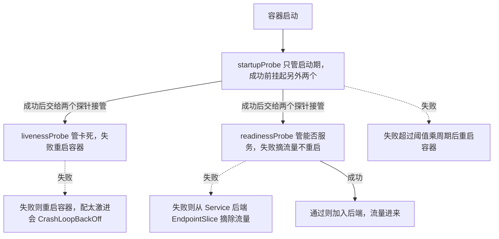
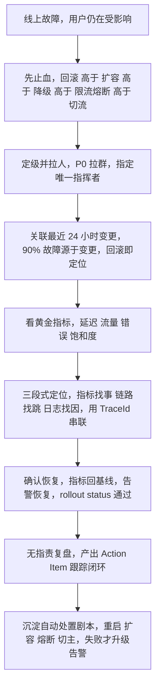

# 05 · 云原生与可观测性 速记版（考前 10 分钟扫一遍）

> **一句话主线**：Docker 用「分层 + 写时复制 + namespace/cgroup」把应用打包成一致运行单元；K8s 用「声明式 API + 控制器循环」做调度/自愈/弹性；CI/CD 用「标准化 + 自动化 + 可回滚」把发布 4 小时→15 分钟、故障率 -82%；可观测性用「指标找事、链路找跳、日志找因 + 告警降噪 + SLO」把异常发现小时级→分钟级；最终目的是故障时**先止血后定位**，靠自动处置兜住 80% 常见异常。

## Docker（5 条）

| # | 面试题 | 关键词速答 |
|---|--------|-----------|
| 1 | 镜像为什么分层？ | 内容寻址 + 增量复用；每条指令一层，层全局共享省磁盘省带宽；UnionFS（OverlayFS）把只读层 + 容器可写层联合成一个根文件系统 |
| 2 | 写时复制（CoW）是什么？ | 读时从上往下找，写时先把文件从只读层复制到可写层再改；容器删掉可写层即丢，镜像纹丝不动 |
| 3 | 容器和虚拟机差在哪？ | 容器共享宿主内核，靠 namespace 隔离「看得见什么」+ cgroup 限制「能用多少」，MB 级/秒起；VM 有 Hypervisor + Guest OS，硬件级隔离，GB 级/分钟起 |
| 4 | 多阶段构建为什么能瘦身？ | 编译阶段（含 JDK/Maven/源码）不进最终镜像，只 `COPY --from=builder` 拷产物；运行镜像只带 JRE+jar，600MB→180MB，顺带消除 shell/编译器攻击面 |
| 5 | 容器网络四种模式？ | bridge（默认/NAT，自定义 bridge 才有 DNS）、host（共享宿主网络栈、无端口映射、性能最好）、none（无网络）、container（共享另一容器 netns = **K8s Pod 底层原理**）；cgroup：内存超限被 OOM Kill、CPU 超限只被 throttle |

## Kubernetes（8 条）

| # | 面试题 | 关键词速答 |
|---|--------|-----------|
| 6 | K8s 控制面有哪些组件？ | apiserver（**唯一入口**，认证/鉴权/准入/写 etcd）、etcd（**唯一真相源**，Raft）、scheduler（Filter+Score 后**只写 nodeName**）、controller-manager（Reconcile 循环）；Node 上 kubelet（探针/挂载/CRI）、kube-proxy、容器运行时 |
| 7 | 一次 apply 发生了什么？ | apiserver 写 etcd → Deployment 控制器建 RS → RS 控制器建 Pod（nodeName 空）→ scheduler 绑定节点 → 该节点 kubelet 起容器 → readiness 通过后 EndpointSlice 加后端 |
| 8 | 为什么调度单元是 Pod？ | 容器共享网络/IPC 命名空间 + 可共享 Volume（localhost 互访）；sidecar（日志/mesh/热更新）必须与应用**共置、同生共死、原子调度**；避免重复造调度器 |
| 9 | 三种探针区别？ | **startup** 管慢启动期不被误杀（期间挂起另两个）；**liveness** 失败**重启容器**（判死锁，绝不查下游）；**readiness** 失败**摘流量不重启**（判能否服务）；配错 → CrashLoop 或发布期 502 |
| 10 | 五种工作负载怎么选？ | Deployment（无状态，滚动+回滚）、StatefulSet（稳定标识/独立 PVC/有序，用于 DB/Kafka）、DaemonSet（每节点一个 agent）、Job/CronJob（跑完即止/定时）、RS（实现细节不直接用） |
| 11 | 滚动更新两个参数？ | **maxSurge**（允许多起多少，默认 25%）、**maxUnavailable**（允许多少不可用，默认 25%）；零停机必须 `maxUnavailable: 0` + readiness + maxSurge≥1 + preStop；`minReadySeconds` 防假就绪，`rollout undo` 秒级回滚 |
| 12 | Service 四种类型 & kube-proxy？ | ClusterIP（内部）、NodePort（30000-32767）、LoadBalancer（云 LB）、ExternalName（CNAME）；Headless（clusterIP:None）给 StatefulSet；kube-proxy：iptables（O(n)，小集群）vs IPVS（哈希表 O(1)，大集群）；**ClusterIP 不是真实网卡，只是转发规则目标**；Ingress 是七层路由，需 Ingress Controller，用 `networking.k8s.io/v1` |
| 13 | requests/limits 与 QoS？ | requests=调度依据+保底，limits=cgroup 硬上限；**CPU 超限 throttle、内存超限 OOMKill（exit 137）**；QoS：Guaranteed(requests==limits) > Burstable > BestEffort，驱逐逆序；JVM 用 `-XX:MaxRAMPercentage=75` 让堆随 limit 自适应 |

## CI/CD 与发布（4 条）

| # | 面试题 | 关键词速答 |
|---|--------|-----------|
| 14 | 发布 4 小时→15 分钟怎么做到？ | 原来：人工串行（编译/传包/逐台重启）+ 多环境重复 + 等待返工 + 无标准；现在：容器化固化环境 + Jenkins 流水线自动化（测试/门禁/构建/推镜像/更新 tag/滚动发布/冒烟）+ 并行构建与镜像缓存 + 滚动发布无停机 + 一键多环境 |
| 15 | 故障率降 82% 靠什么？ | 标准化消除差异 + 质量门禁前移（单测/SonarQube）+ 冒烟自动验证 + **镜像 tag 不可变可秒级回滚** + 配置与镜像分离（不再手改配置）+ 灰度/探针拦截坏版本 |
| 16 | 发布策略怎么选？ | 停机（有损、简单）、滚动（K8s 默认、平滑）、蓝绿（两套环境切流、秒回滚但双倍资源）、灰度/金丝雀（小流量验证、按权重/header）；生产核心链路常用「滚动 + 灰度」 |
| 17 | 多环境一键发布怎么做？ | 同一条参数化流水线，`ENV` 参数区分环境，**镜像完全一致、只有配置不同**（ConfigMap/Apollo）；生产 stage 加人工审批门禁；Build once, deploy anywhere |

## 可观测性（6 条）

| # | 面试题 | 关键词速答 |
|---|--------|-----------|
| 18 | 可观测性三支柱？ | Metrics（可聚合、便宜、用于告警大盘）、Logging（明细最全、贵、定位原因）、Tracing（单请求跨服务链路、找慢在哪一跳）；**靠 TraceId 串联成闭环** |
| 19 | Prometheus 四种指标类型？ | **Counter**（只增，用 `rate()`）、**Gauge**（可增可减，看当前值）、**Histogram**（客户端分桶，`histogram_quantile` 可跨实例聚合）、**Summary**（客户端算分位数，**无法跨实例聚合**）；Pull 模式拉 `/metrics`，`up==0` 判目标挂 |
| 20 | 链路追踪原理 & 采样？ | Trace（TraceId 全局唯一）+ Span（SpanId/ParentSpanId 组成调用树）；TraceId 经 W3C `traceparent`/B3 透传，**跨线程池和跨 MQ 最易断**；**不能全量**（成本线性）：头部采样便宜会漏错，尾部采样准但要先收全；生产「低采样 + 错误/慢请求必采」；OTel 标准化开源 vs SkyWalking 开箱即用 |
| 21 | 告警怎么设计才不吵？ | 可行动；分级 P0/P1/P2/P3；四大降噪：**分组**（同原因合并）、**抑制**（根因抑制衍生）、**静默**（变更窗口）、**去重**；风暴根因=层层放大、根因与症状不分；**盯症状不盯原因**、能自动修复的不告警给人 |
| 22 | 为什么「小时级→分钟级」是关键？ | 故障总时长 = **MTTD(发现) + MTTI(响应) + MTTR(修复)**；压 MTTD = 缩短暴露窗口；监管级风控系统里分钟级发现是**合规底线**；靠全链路指标 + 合理阈值 + 自动化检测达成，非靠人盯 |
| 23 | SLO/错误预算 & 故障排查？ | SLI（成功率）→ SLO（99.9%）→ 错误预算（≈43 分钟/月）；预算耗尽冻结变更；告警用**多窗口多烧毁率**；排查：**先止血（回滚>扩容>降级>限流）后定位**，关联最近变更，黄金指标=延迟/流量/错误/饱和度 |

## 必背速查

| 项 | 内容 | 说明 |
|----|------|------|
| 三种探针 | startup 防误杀 / liveness 卡死重启 / readiness 没准备好摘流量 | startup 跑通前另两个被挂起；liveness 绝不查下游 |
| Service 四类型 | ClusterIP / NodePort / LoadBalancer / ExternalName | ClusterIP 是虚拟 IP，只是转发规则目标；对外再用 Ingress |
| kube-proxy 模式 | iptables（O(n)，默认）/ IPVS（哈希表，大集群） | 规则膨胀是规模问题不是功能问题 |
| QoS 三级 | Guaranteed（req==lim）> Burstable > BestEffort | 驱逐逆序，BestEffort 最先被杀；内存不可压缩只能被杀 |
| 退出码 | 137=SIGKILL(OOM)/143=SIGTERM(优雅)/1=应用报错 | `kubectl logs --previous` 看崩溃前的实例 |
| 发布策略对比 | 停机(有损)/滚动(平滑)/蓝绿(秒回滚双倍资源)/灰度(小流量) | 零停机 = maxUnavailable:0 + readiness + preStop |
| Prometheus 四类型 | Counter / Gauge / Histogram / Summary | 只有 Histogram 能跨实例聚合算分位数 |
| 黄金指标 | 延迟 / 流量 / 错误 / 饱和度（Google SRE） | 服务层 RED（Rate/Errors/Duration），资源层 USE |
| 三支柱串联 | 指标找事 → 链路找跳 → 日志找因（靠 TraceId） | MTTD = MTTI + MTTR 里的第一环 |
| 零停机四件套 | maxUnavailable:0 + readinessProbe + maxSurge≥1 + preStop 优雅停机 | 缺一就发布期零星 502 |
| ConfigMap 更新 | volume 挂载约 1 分钟更新文件但不一定重载；**env/envFrom 和 subPath 根本不更新** | 要热更新用 `@RefreshScope` 或 Reloader 滚动重启 |
| 容器 vs VM | 共享内核 + namespace/cgroup vs Hypervisor + Guest OS | 容器隔离弱（需 seccomp/cap-drop/非 root 加固） |

**图 5-17：三种探针的作用与失败后果**

## 答题模板

**「一次线上故障怎么排查」通用框架（本模块最高频开放题）：**

1. **先止血**（用户还在受影响时，恢复优先于根因）：**回滚 > 扩容 > 降级 > 限流/熔断 > 切流**（主备双活）。
2. **定级与拉人**：P0 拉群、指定唯一指挥者，避免多人操作打架。
3. **关联变更**：查最近 24h 有没有发版/改配置/改开关/DB 变更——**90% 故障源于变更，回滚即定位**。
4. **看黄金指标定方向**：延迟/流量/错误/饱和度，先判断是「流量涨了、错误涨了、还是资源满了」。
5. **自上而下 or 自下而上**：未知故障从入口逐层往下（网关→应用→DB/缓存/MQ）；已知点从资源/中间件往上。
6. **三段式定位**：指标找事 → 链路追踪找哪一跳 → 日志（TraceId 串联）找为什么；Java 现场用 jstack/jmap/arthas。
7. **确认恢复**：错误率与延迟回到基线、告警恢复、`rollout status` 通过。
8. **复盘闭环**：无指责复盘 → 产出 Action Item 并跟踪；把高频场景做成**自动处置剧本**（重启/扩容/熔断/切主），失败才升级告警——这就是「80% 异常自动修复」。

**一句话收尾**：先止血后定位，用回滚换时间，用指标、链路、日志三件套换真相，用自动处置换稳定。

**图 5-18：线上故障排查决策树**

