# 06 · 计算机基础、设计模式与场景设计（15 题）

> **模块主线**：基础题考「你懂不懂原理」，设计模式题考「你会不会落地」，场景设计题考「你有没有真的扛过事」——第三块才是九年后端拿高薪的分水岭，因为简历上的每一个数字（65%、3 倍、秒级/毫秒级、90%）都必须能被讲成一套完整的技术方案。

## 模块导览

> **背景**：计算机基础（网络/OS）是筛选「科班底子」的硬门槛，答不上来会被怀疑只会 CRUD；设计模式与工程实践考的是「你有没有抽象能力、会不会写可维护的代码」；而场景设计题是高级岗的核心——面试官给一个模糊需求（「设计一个秒级风控预警系统」），看你能不能自己拆层次、选型、讲权衡、说风险。这三块组合起来，本质是在问：**你是一个只会调 API 的开发者，还是一个能对系统负责的工程师？**

**学完这 15 题，你能获得什么：**
- 网络与操作系统的高频原理题标准答案（TCP/IO 模型/零拷贝/HTTP 演进/排查命令），能扛住 3 轮追问
- 设计模式与工程实践的可落地套路（单例/策略/责任链/幂等/限流/分布式 ID/缓存一致性），能结合风控场景讲
- 5 套可背诵的场景设计答题框架（秒级预警系统、端到端不丢不重不乱序、接口慢优化、高可用容量压测、线上故障排查）
- 把简历数字（65%、3 倍、秒级/毫秒级、90%、小时级→分钟级）自然编入技术叙事的表达能力
- 高级岗特有的软技能答题模板（带初级开发、技术方案评审、版本计划把控）

**覆盖技术点速查：**

| 分层 | 技术点 |
|------|--------|
| 基础 | TCP 三次握手/四次挥手、TIME_WAIT/CLOSE_WAIT、粘包拆包、IO 模型（select/poll/epoll、LT/ET）、零拷贝、HTTP1.1/2/3、HTTPS、JWT、Linux 排查命令 |
| 进阶 | 单例/策略/责任链/观察者、SOLID、DDD 分层、接口幂等 8 方案、限流 4 算法、分布式 ID、缓存一致性、规则引擎零代码配置、主备协同调度、任务依赖调度 |
| 高阶 | 秒级实时风控预警系统全链路设计、端到端不丢不重不乱序、接口慢优化（索引重构/SQL 改写）、高可用与容量估算压测、线上故障排查方法论 |

**复习指引**：
- **一面（基础面）**：重点刷题 1-5（网络/OS/设计模式），确保 TCP、epoll、零拷贝、HTTPS 能一路追到底；关联「MySQL 三大日志」「Kafka 原理」模块。
- **二面（项目面）**：重点刷题 6-10（规则引擎、幂等限流、主备调度、缓存一致性），要能讲出「我怎么用的」；强关联「Kafka+Flink 原理」「分布式锁」「分库分表」模块。
- **三面（架构面）**：重点刷题 11-15（系统设计、数据链路、性能优化、高可用），一定要把简历数字讲成故事；关联全部模块。

**本模块目录（15 题）：**
1. [题 1：TCP 三次握手 / 四次挥手，为什么不是两次？TIME_WAIT 为什么 2MSL？CLOSE_WAIT 过多说明什么？](#q1)
2. [题 2：IO 模型全解——BIO/NIO/多路复用，select/poll/epoll 区别，LT vs ET，零拷贝是什么？](#q2)
3. [题 3：HTTP/1.1 → HTTP/2 → HTTP/3 的演进，HTTPS 握手，Cookie/Session/JWT 怎么选？](#q3)
4. [题 4：Linux 常用排查命令有哪些？CPU 100%、磁盘满、内存涨、连接数爆怎么排查？](#q4)
5. [题 5：单例 DCL 为什么必须加 volatile？策略/责任链/观察者怎么用？Spring 里有哪些设计模式？](#q5)
6. [题 6：风控规则引擎怎么设计？如何支持监管人员零代码配置规则、热更新不重启？](#q6)
7. [题 7：接口幂等有哪些设计方案？限流四种算法怎么选？](#q7)
8. [题 8：主备双活环境下如何做协同调度？如何避免双活双写冲突？任务依赖 A→B→C 怎么实现？](#q8)
9. [题 9：缓存与数据库一致性怎么保证？分布式 ID 怎么生成？](#q9)
10. [题 10：多环境（生产/预发/测试）结果自动化比对校验怎么设计？](#q10)
11. [题 11：如果让你从零设计一个秒级/毫秒级实时风控预警系统，你会怎么做？](#q11)
12. [题 12：如何保证整条实时链路（Kafka→Flink→落地）不丢、不重、不乱序？](#q12)
13. [题 13：接口响应慢怎么优化？怎么把 P99 和峰值 QPS 提升 3 倍？](#q13)
14. [题 14：如何设计一个高可用系统？容量怎么估？压测怎么做？](#q14)
15. [题 15：线上 CPU 100% / 内存泄漏 / 接口超时怎么排查？怎么带初级开发、做技术方案评审？](#q15)

**本模块图表索引：**

- **图 6-1**：TCP 三次握手时序（含双方状态迁移） —— 题 1
- **图 6-2**：TCP 四次挥手时序（含 TIME_WAIT 与 CLOSE_WAIT 状态） —— 题 1
- **图 6-3**：为什么是三次握手而不是两次（历史失效连接导致服务端资源浪费） —— 题 1
- **图 6-4**：IO 多路复用的演进（select → poll → epoll） —— 题 2
- **图 6-5**：epoll 的 LT 与 ET 模式对比 —— 题 2
- **图 6-6**：零拷贝的演进（传统 → mmap → sendfile → DMA gather） —— 题 2
- **图 6-7**：HTTPS 的 TLS 握手流程 —— 题 3
- **图 6-8**：策略模式在风控规则引擎的落地 —— 题 5
- **图 6-9**：责任链模式在预警规则校验链的落地 —— 题 5
- **图 6-10**：四种限流算法对比（含固定窗口临界问题） —— 题 7
- **图 6-11**：接口幂等设计方案的拦截层次对比 —— 题 7
- **图 6-12**：任务依赖调度 A→B→C 的执行与重试 —— 题 8
- **图 6-13**：雪花算法的 64 位分配 —— 题 9
- **图 6-14**：缓存与数据库一致性的两种更新策略对比 —— 题 9
- **图 6-15**：秒级实时风控预警系统的整体架构 —— 题 11
- **图 6-16**：线上问题的分层排查路径 —— 题 15

## 基础考察题（5 道）

### <a id="q1"></a>题 1：TCP 三次握手 / 四次挥手，为什么不是两次？TIME_WAIT 为什么 2MSL？CLOSE_WAIT 过多说明什么？

- **题干**：「TCP 为什么握手是三次、挥手是四次？为什么不是两次握手？TIME_WAIT 为什么要等 2MSL？如果我们线上排查到大量 CLOSE_WAIT，你觉得是什么问题？」
- **考察点**：对 TCP 状态机与可靠性的理解深度 + 能否把状态异常映射到真实故障。

**标准答案**：
1. **三次握手流程**：客户端发 `SYN(seq=x)` → 服务端回 `SYN+ACK(seq=y, ack=x+1)` → 客户端回 `ACK(seq=x+1, ack=y+1)`。目的是**双向确认收发能力**：第三次握手让服务端确认「我的发送能力 + 你的接收能力」都正常。
2. **为什么不是两次**：两次握手只能确认「客户端能发、服务端能收」和「服务端能发、客户端能收」的一半。如果客户端第一个 SYN 因网络延迟滞留，过期后才到达服务端，服务端会误以为客户端要新建连接，直接分配资源并进入 ESTABLISHED，而客户端根本不认这条连接 → 服务端资源被白白占用。第三次握手让服务端在收到客户端 ACK 前不认为连接建立，杜绝历史连接。
3. **四次挥手流程**：主动方发 `FIN` → 被动方回 `ACK`（此时进入 CLOSE_WAIT，半关闭，被动方还能继续发数据）→ 被动方数据发完后发 `FIN` → 主动方回 `ACK` 并进入 TIME_WAIT。**为什么是四次**：TCP 是全双工，TCP 允许半关闭，被动方收到 FIN 后可能还有数据要发，所以 ACK 和 FIN 不能合并，必须分开发。
4. **TIME_WAIT 为什么 2MSL**：主动关闭方在收到对端 FIN 并回 ACK 后，进入 TIME_WAIT 等待 2 倍 MSL。原因有二：① **保证最后一个 ACK 能到达对端**——若该 ACK 丢失，对端会超时重传 FIN，此时主动方若已关闭就无法响应，对端无法正常关闭；② **让本连接产生的旧报文在网络中彻底消散**，避免它们影响刚建立的、使用相同四元组的新连接。
5. **CLOSE_WAIT 过多说明什么**：CLOSE_WAIT 是**被动关闭方**收到 FIN 后、尚未调用 close() 的状态。大量堆积说明**应用层没有正确关闭连接**——常见于：连接池未归还、代码在异常分支没有 finally 中 close、线程池被打满导致 close 逻辑没执行、GC 停顿严重导致处理变慢。**这是应用 bug，不是网络问题**，改内核参数没用，要查代码。
6. **TCP 与 UDP 的区别（面试必问，列表对比）**：
   - **连接**：TCP **面向连接**（三次握手建连、四次挥手断连）；UDP **无连接**，直接发。
   - **可靠性**：TCP **可靠**（确认、重传、去重、按序）；UDP **不可靠**（不保证到达、不保证顺序）。
   - **传输形态**：TCP 是**字节流**（无消息边界）；UDP 是**数据报**（**保留消息边界**，一次发一条、一次收一条）。
   - **拥塞控制**：TCP **有**；UDP **无**，需应用自己控。
   - **头部大小**：TCP **20 字节**固定（含选项最大 60 字节）；UDP **8 字节**固定。
   - **有序性**：TCP **有序**（按 seq 重排）；UDP **无序**。
   - **适用场景**：TCP 用于 HTTP/1.1、HTTP/2、文件传输、数据库连接；UDP 用于 DNS、音视频、游戏、**QUIC（HTTP/3 的底座）**。
   - **关键结论**：**UDP 保留消息边界（一个数据报就是一条消息），所以「粘包」是 TCP 独有的问题**——TCP 只认字节流、不认消息。把「TCP 无边界 → 会粘包」与「UDP 有边界 → 不发粘包」串起来讲，是加分项。
7. **粘包与拆包（速查表承诺的考点，本质要讲清）**：
   - **本质**：**不是 TCP「粘」了包，而是 TCP 是面向连接的字节流、没有消息边界**——接收方从缓冲区读到的是一串连续字节，不知道一条应用消息到哪结束，于是出现「多条消息被一次 read 读完（**粘包**）」或「一条消息被拆成多次 read（**拆包**）」。**粘包和拆包是同一个根因（无边界）的两种表现**。
   - **产生原因**：① **发送方 Nagle 算法**——为减少小包，把多个小数据块合并成一个 TCP 段发出（`TCP_NODELAY` 可关闭）；② **接收方缓冲区**——内核缓冲区攒够一批才交给应用，应用一次 read 拿到多条；③ **MSS/MTU 限制**——消息大于 MSS（或路径 MTU）时被分片，接收侧要多次读才能拼回一条。
   - **三种解决方式**：① **固定长度**——每条消息定长，不足补位，读够 N 字节就是一条（**简单但浪费带宽、不灵活**）；② **分隔符**——用特殊字符标记消息结尾（如 `\r\n`），**Redis 协议、HTTP 头部**都用它，缺点是消息体里出现分隔符必须**转义**；③ **长度字段前置（最通用）**——`length + body`，先读固定长度的长度头、再按长度读 body，**Netty 的 `LengthFieldBasedFrameDecoder`、Dubbo、Protobuf（varint 长度前缀）都是这个思路**。
   - **加分点**：**编解码器（Codec）就是干这个的**——Netty 用 `ByteToMessageDecoder` 把字节流按协议切分成一个个完整消息再交给业务 Handler。能说出「粘包拆包是协议层 Codec 的活，不是 TCP 的 bug」就到位了。
8. **TCP 的可靠性机制（面试追问弹药）**：
   - **滑动窗口（流量控制）**：接收方在 ACK 里通告**接收窗口（rwnd）**，发送方据此决定最多能发多少未确认数据，防止发太快把接收方缓冲区打爆；发送方侧还有**拥塞窗口（cwnd）**，**实际发送窗口 = min(rwnd, cwnd)**。
   - **累计确认与去重**：每个字节都有 seq，接收方按 seq 重排、丢弃重复；ACK 是**累计确认**（`ack=N` 表示 N 之前的字节全部收到），一个 ACK 可确认多个段。
   - **超时重传**：发送方为报文段启动定时器（**RTO** 基于 RTT 动态估算），超时未收到 ACK 就重传。
   - **快速重传**：**收到 3 个重复 ACK（duplicate ACK）立即重传**丢失的段，不等超时——这就是「快重传」的触发条件。
   - **拥塞控制四阶段**：① **慢启动**——`cwnd` 从 1 个 MSS 开始**指数增长**（1→2→4→8…），**注意「慢启动」指的是起点低、不是增长速度慢**；② **拥塞避免**——`cwnd` 超过 **`ssthresh`（慢启动阈值）** 后改为**线性增长**（每个 RTT 加 1 个 MSS）；③ **快重传**——收到 3 个重复 ACK 立即重传；④ **快恢复**——快重传后把 `ssthresh` 与 `cwnd` 减半，直接进入拥塞避免（**不回慢启动起点**）。若是**超时重传**触发，则 `ssthresh` 减半、`cwnd` 重置为 1，回到慢启动。

**图 6-1：TCP 三次握手时序（含双方状态迁移）**

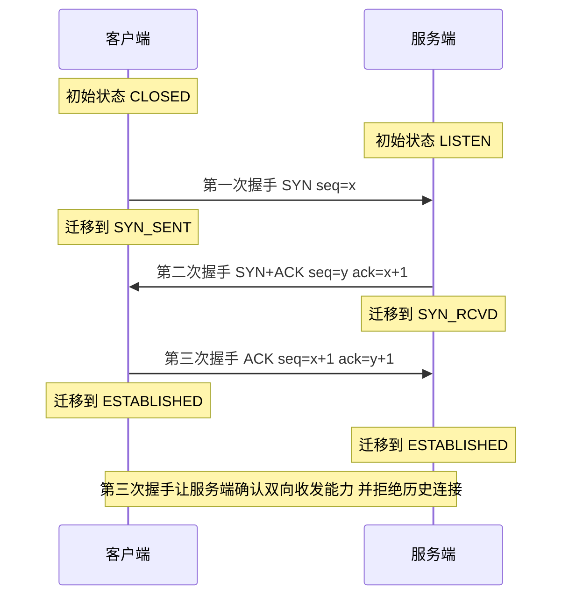

**图 6-2：TCP 四次挥手时序（含 TIME_WAIT 与 CLOSE_WAIT 状态）**

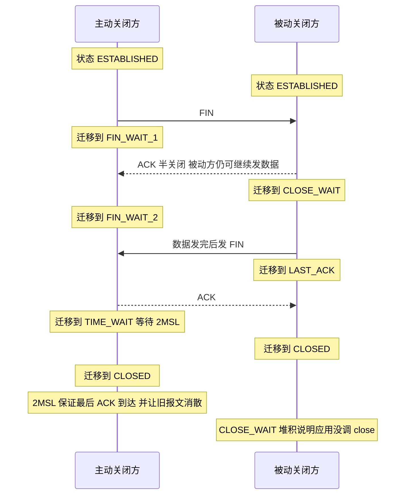

**图 6-3：为什么是三次握手而不是两次（历史失效连接导致服务端资源浪费）**

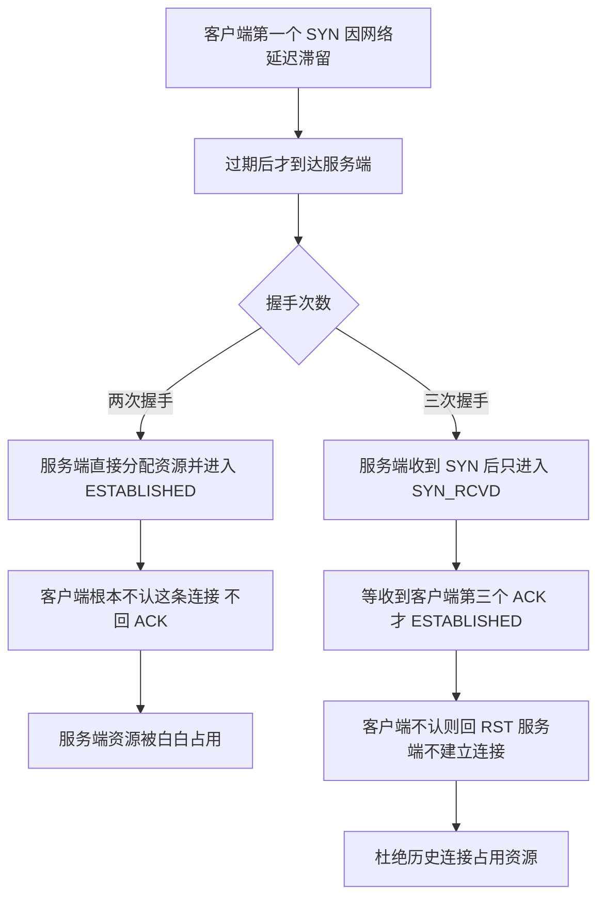

**企业实际处理**：
- 生产上 TIME_WAIT 多（主动关闭方主要是 Nginx/网关）通常无害，但高并发短连接场景会耗尽本地端口，通过 `net.ipv4.tcp_tw_reuse=1`（仅对出向连接）、`net.ipv4.ip_local_port_range` 扩大端口范围、`tcp_max_tw_buckets` 缓解；**不用 `tcp_tw_recycle`**（NAT 环境下会误杀连接，Linux 4.12 后已移除）。
- CLOSE_WAIT 一律当应用 bug 处理：用 `ss -tan state close-wait` 看堆积量，用 `lsof -p <pid>` 看是否接近 fd 上限，再翻代码找未关闭的流/连接。

**为什么这样做**：
- **因为握手目标不是「连上」而是「双方都确认对方收发正常且这是新连接」**：多一次握手换来的是拒绝历史连接的能力，成本（一个 RTT）远小于资源被垃圾连接占用的代价。
- **因为挥手次数由「半关闭」这一 TCP 设计决定**：ACK 与 FIN 分离是刻意的，保留了单向关闭后继续传输的能力，代价是长度不确定。
- **因为 TIME_WAIT 是「主动方买单」的补偿机制**：谁先发起关闭谁承担等待，换来的是可靠的最终 ACK 和干净的网络环境。

**企业级代码示例**（📦 按 JDK 17 书写、未实测）：下面用 Java 演示「两方 TCP 语义」的最小模型（真实握手由内核完成，此处仅示意序列与状态；`SocketChannel` 非阻塞握手需配合 `Selector`）。

```java
import java.net.InetSocketAddress;
import java.nio.channels.SocketChannel;

public class TcpHandshakeDemo {
    public static void main(String[] args) throws Exception {
        // 客户端：connect() 会触发内核完成三次握手（SYN / SYN-ACK / ACK）
        try (SocketChannel ch = SocketChannel.open()) {
            ch.configureBlocking(false);
            boolean connected = ch.connect(new InetSocketAddress("127.0.0.1", 8080));
            while (!ch.finishConnect()) {          // 非阻塞模式下需轮询 finishConnect
                // 此时内核状态机在 SYN_SENT -> ESTABLISHED 间迁移
            }
            System.out.println("connected=" + connected + ", localPort=" + ch.socket().getLocalPort());
            // close() 触发主动关闭：FIN -> ACK -> FIN -> ACK，本方进入 TIME_WAIT 2MSL
        }
    }
}
```

排查命令（真正生产用的）：

```bash
# 各类连接状态数量
ss -s
# 只看 CLOSE-WAIT 连接（应用没关连接的直接证据）
ss -tan state close-wait | head
# 查看某进程的 fd 数量与上限
lsof -p <pid> | wc -l
cat /proc/<pid>/limits | grep "open files"
# 缓解 TIME_WAIT（出向短连接多时）
sysctl -w net.ipv4.tcp_tw_reuse=1
sysctl -w net.ipv4.ip_local_port_range="10000 65000"
```

**企业级代码示例 2：粘包 / 拆包的解决**（📦 按 JDK 17 书写、未实测）：下面用 Java 演示「**长度字段前置**」这一最通用解法——**先读 4 字节长度头，再按长度读 body**；Netty 里等价于 `LengthFieldBasedFrameDecoder`，不用自己写这段。

```java
import java.io.*;

public class LengthPrefixedCodec {
    // 发送端：先写长度头，再写消息体（length + body）
    static void write(OutputStream out, byte[] body) throws IOException {
        DataOutputStream d = new DataOutputStream(out);
        d.writeInt(body.length);   // 4 字节长度头（大端）
        d.write(body);             // 消息体
        d.flush();
    }

    // 接收端：先读长度头知道「一条消息有多少字节」，再按长度读满
    static byte[] read(InputStream in) throws IOException {
        DataInputStream d = new DataInputStream(in);
        int len = d.readInt();          // 读到长度 = 一条完整消息的边界
        byte[] body = new byte[len];
        d.readFully(body);             // 读满 len 字节，不足则继续等 —— 天然解决粘包/拆包
        return body;
    }
}
```

**面试加分项**：
- 主动说「**粘包/拆包是『流』的必然结果，不是 TCP 的 bug**；UDP 有消息边界所以没有这个问题」，把 TCP/UDP 差异和粘包串成一条线。
- 提「**发送方 Nagle 算法会合并小包**，对延迟敏感的 RPC 要设 `TCP_NODELAY=true`（如 Netty 默认开启）」，体现对延迟的理解。
- 主动说出「`tcp_tw_recycle` 已被内核移除、不要用」，体现踩过盘。
- 区分「TIME_WAIT 在客户端 / 服务端」：服务端出现大量 TIME_WAIT 说明是服务端主动关闭（如 Nginx 配了 `keepalive_timeout` 主动断），要反思是不是 keepalive 配短了。
- 补一句：**CLOSE_WAIT 堆积往往伴随 fd 泄漏**，可用 `lsof -p pid | wc -l` 与 `ulimit -n` 对比做二次验证。

### <a id="q2"></a>题 2：IO 模型全解——BIO/NIO/多路复用，select/poll/epoll 区别，LT vs ET，零拷贝是什么？

- **题干**：「讲讲你理解的 IO 模型，阻塞、非阻塞、IO 多路复用有什么区别？epoll 比 select 好在哪？水平触发和边缘触发怎么选？零拷贝你知道吗，Kafka 为什么快？」
- **考察点**：对 IO 底层与高性能网络框架的理解，是「能不能吃透 Kafka/Netty」的前置知识。

**标准答案**：
1. **五种 IO 模型**：① 阻塞 IO（BIO）：线程卡在 read 直到数据就绪；② 非阻塞 IO：read 立即返回，需轮询；③ **IO 多路复用**：用 select/poll/epoll 一次监听多个 fd，就绪后逐个处理，是 Java NIO、Netty、Redis、Nginx 的基础；④ 信号驱动 IO；⑤ 异步 IO（AIO）：内核把数据拷贝完再通知，真正的异步。
2. **select vs poll vs epoll**：
   - **select**：用 `fd_set` 位图，**有 1024 fd 上限**；每次调用要**把 fd 集合从用户态拷到内核态**；返回后需要**遍历全部 fd** 找就绪的，复杂度 O(n)。
   - **poll**：用 `pollfd` 数组，**没有 1024 限制**，但依然是「拷贝 + O(n) 遍历」。
   - **epoll**：`epoll_create` 建内核事件表（红黑树），`epoll_ctl` 增删改 fd，`epoll_wait` 只返回就绪链表，**复杂度 O(1)**；fd 只需注册一次，无需每次拷贝（配合 mmap 更省），天然无 fd 上限。
3. **LT（水平触发）vs ET（边缘触发）**：
   - **LT**：只要 fd 缓冲区里还有可读数据，`epoll_wait` 每次都会通知你。编程简单，即使一次没读完下次还会提醒；**是 epoll 默认模式**。
   - **ET**：只在状态**变化的那一刻**通知一次（数据从无到有）。必须配合**非阻塞 fd 循环读到 `EAGAIN`**，否则残留数据会永远不再触发通知、导致「数据来了却收不到」。ET 减少系统调用次数，性能略好但编码更严格。
4. **零拷贝**：
   - **传统 read+write**：4 次上下文切换、4 次数据拷贝（磁盘→内核页缓存→用户缓冲→socket 缓冲→网卡）。
   - **mmap + write**：3 次拷贝、4 次切换，把内核页缓存映射到用户态，省掉「内核→用户」这一次拷贝。
   - **sendfile**：3 次拷贝、2 次切换；配合 **DMA gather/Scatter（`sendfile` 的 scatter-gather 版本）** 可降到 **2 次拷贝**，数据完全不进用户态。
5. **Kafka 为什么快**（零拷贝只是其中一环）：① **顺序写磁盘**（append-only 日志，顺序写接近内存随机写性能）；② **页缓存（PageCache）**，读写都走 OS 页缓存而非 JVM 堆，避免 GC 与重复拷贝；③ **sendfile 零拷贝** 把消息从页缓存直接送网卡；④ **批量 + 压缩**（Producer 攒批、消息集压缩）；⑤ **分区并行 + 稀疏索引**。综合下来吞吐极高。

**图 6-4：IO 多路复用的演进（select → poll → epoll）**

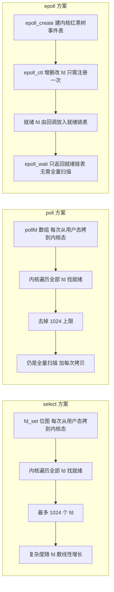

**图 6-5：epoll 的 LT 与 ET 模式对比**

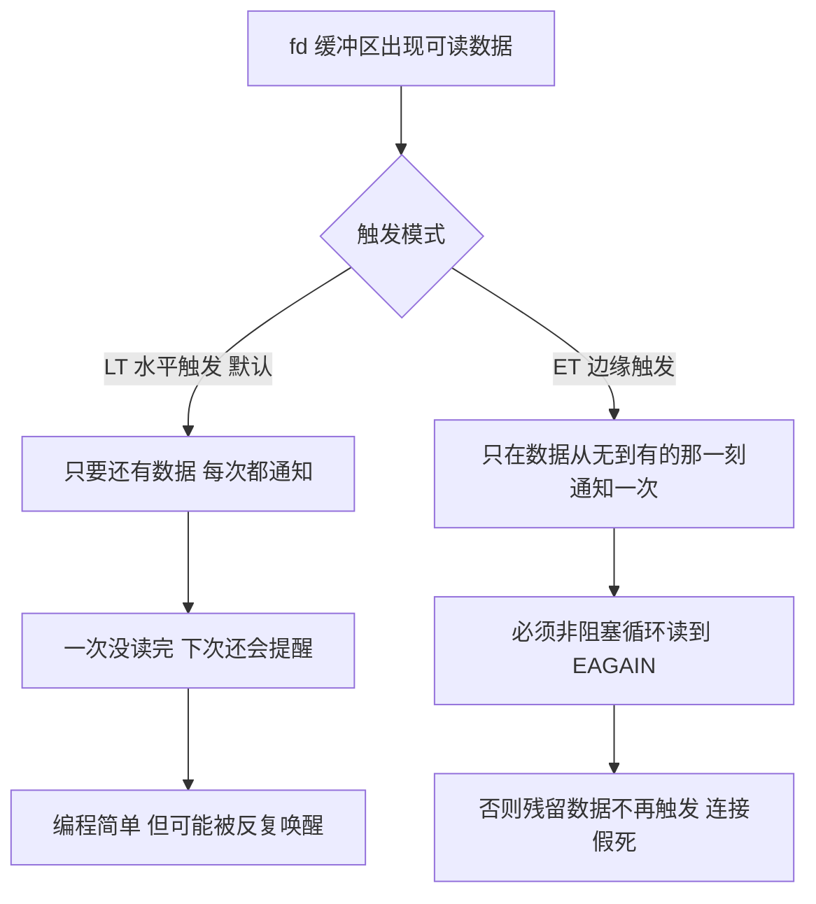

**图 6-6：零拷贝的演进（传统 → mmap → sendfile → DMA gather）**

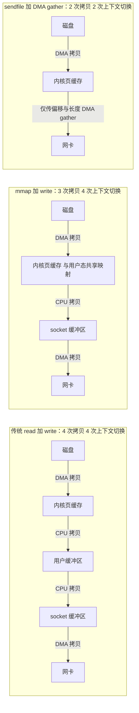

**企业实际处理**：
- 高并发网关/中间件默认走 **epoll + ET（或 LT）+ 非阻塞** 的组合；Netty 的 `EpollEventLoopGroup`（Linux 原生 epoll）比 JDK NIO 性能更稳，还绕开了 JDK 早期 epoll 空轮询 bug。
- Kafka Broker 端用 `sendfile`（Java 的 `FileChannel.transferTo`）做消费拉取的零拷贝传输；**注意开启 TLS/SSL 会破坏零拷贝**（需要用户态加解密），这是安全与性能的权衡点。

**为什么这样做**：
- **因为 IO 性能瓶颈在「系统调用次数」和「数据拷贝次数」**：epoll 把「轮询哪些 fd 就绪」从用户态搬到内核态一次完成，select/poll 每次都要全量 O(n) 扫描，连接数一上万就崩。
- **因为 ET 是「事件驱动」而 LT 是「状态驱动」**：ET 更省调用但要求应用保证一次性读干净；LT 更宽容但可能被反复唤醒。选型看「你更怕丢事件还是更怕多唤醒」。
- **因为零拷贝的本质是「消除不必要的用户态中转」**：数据从不需要被 CPU 搬进搬出时，就别搬，DMA 直接搬运最省。

**企业级代码示例**（📦 按 JDK 17 书写、未实测）：演示 JDK NIO Selector（本质是 epoll 的 Java 封装）与零拷贝 `transferTo`。

```java
import java.io.RandomAccessFile;
import java.net.InetSocketAddress;
import java.nio.ByteBuffer;
import java.nio.channels.*;
import java.util.Iterator;

public class IoModelDemo {
    // 1) IO 多路复用：一个线程监听多个连接（底层 epoll）
    static void multiplexing() throws Exception {
        Selector selector = Selector.open();
        ServerSocketChannel server = ServerSocketChannel.open();
        server.bind(new InetSocketAddress(9000));
        server.configureBlocking(false);                 // 必须非阻塞才能注册到 Selector
        server.register(selector, SelectionKey.OP_ACCEPT);
        while (true) {
            selector.select();                           // 阻塞直到有就绪事件（epoll_wait）
            Iterator<SelectionKey> it = selector.selectedKeys().iterator();
            while (it.hasNext()) {
                SelectionKey key = it.next();
                it.remove();                             // 必须移除，否则重复处理
                if (key.isAcceptable()) {
                    SocketChannel c = ((ServerSocketChannel) key.channel()).accept();
                    c.configureBlocking(false);
                    c.register(selector, SelectionKey.OP_READ);
                } else if (key.isReadable()) {
                    SocketChannel c = (SocketChannel) key.channel();
                    ByteBuffer buf = ByteBuffer.allocate(1024);
                    int n = c.read(buf);                 // ET 模式下需 while 读到 -1/0
                    if (n == -1) c.close();
                }
            }
        }
    }

    // 2) 零拷贝：sendfile，数据不经用户态
    static void zeroCopy(String path, WritableByteChannel out) throws Exception {
        try (FileChannel in = new RandomAccessFile(path, "r").getChannel()) {
            long pos = 0, size = in.size();
            while (pos < size) {
                pos += in.transferTo(pos, size - pos, out); // 底层调用 sendfile
            }
        }
    }
}
```

**面试加分项**：
- 主动提「**JDK NIO 在 Linux 上曾有空轮询 bug**（Selector 无事件却返回），Netty 通过统计空轮询次数达到阈值后重建 Selector 规避」，这是 Netty 选型的正当理由。
- 说清「Java 没有真正的 AIO 优势，Linux 上 AIO 实现不成熟，所以 Netty 走 epoll 而非 AIO」，纠正常见误区。
- 补一句「**ET 必须非阻塞**，因为要循环读到 EAGAIN；阻塞 fd 上循环读会在最后 Read 时挂住线程」。

### <a id="q3"></a>题 3：HTTP/1.1 → HTTP/2 → HTTP/3 的演进，HTTPS 握手，Cookie/Session/JWT 怎么选？

- **题干**：「HTTP/1.1 到 HTTP/2 到 HTTP/3 主要解决了什么问题？HTTPS 握手过程讲一下，为什么既要非对称又要对称加密？Cookie、Session、JWT 你怎么选？跨域是怎么产生的，CORS 怎么处理？」
- **考察点**：web 协议基础 + 鉴权方案取舍，几乎是所有后端面试的必答题。

**标准答案**：
1. **HTTP/1.1**：文本协议、长连接（`Connection: keep-alive`）、支持管道化但**有队头阻塞（HOL）**，浏览器对同域名并发约 6-8 个连接。每个请求头部重复、浪费带宽。
2. **HTTP/2**：① **二进制分帧**（Frame/Stream）；② **多路复用**——一个 TCP 连接上并行跑多个流，解决 HTTP 层队头阻塞；③ **HPACK 头部压缩**（静态表 + 动态表）；④ 服务端推送、流优先级。**遗留问题**：底层还是 TCP，一旦丢包，后面的流全部等重传 → **TCP 层队头阻塞**。
3. **HTTP/3**：基于 **QUIC（跑在 UDP 上）**。每个流独立，某流丢包不影响其他流，**彻底解决队头阻塞**；集成 TLS 1.3，支持 **0-RTT/1-RTT** 建连，弱网切换（连接迁移，如 WiFi 转 4G 不断连）。代价：UDP 在某些网络被限速/QoS 降级。
4. **HTTPS 握手（TLS 1.2 简化版）**：① ClientHello（客户端随机数 + 支持的加密套件）；② ServerHello（服务端随机数 + **证书**）；③ 客户端校验证书链（CA 签名、域名、有效期），生成 pre-master secret，**用服务器公钥加密后发过去**（RSA 密钥交换）；④ 双方用「两个随机数 + pre-master」派生出**对称会话密钥**；⑤ 之后用对称密钥加密通信。
   - **为什么两种加密都用**：**非对称加密安全性高但性能差**（RSA 慢、有长度限制），只用来**安全地协商出对称密钥**；**对称加密快**，用来加密真正的业务数据。各取所长。
   - **TLS 1.3** 进一步简化：废弃 RSA 密钥交换，强制 **ECDHE 前向安全**，1-RTT 握手，会话复用可 0-RTT（但 0-RTT 有重放风险）。
5. **Cookie / Session / Token / JWT**：
   - **Cookie**：浏览器存的小段键值，随请求自动带上，可设 `HttpOnly`（防 XSS 读）、`Secure`（仅 HTTPS）、`SameSite`（防 CSRF）。
   - **Session**：服务端存会话数据（内存/Redis），客户端只存 sessionId。**有状态**，优点是可控（能主动踢下线），缺点是分布式下要共享存储、跨域麻烦。
   - **Token/JWT**：服务端签发，客户端持有。**JWT 结构**：`header.payload.signature`，用 Base64Url 编码（**payload 只是编码不是加密，任何人可解开**），签名用密钥（HMAC）或私钥（RSA/ECDSA）保证不可篡改。
   - **JWT 优缺点**：**无状态**（服务端不存，天然适合分布式/微服务）、可携带声明（exp、用户 id、角色）。缺点：**无法主动失效**（签发即有效，只能靠短过期 + 黑名单/Refresh Token）、**续期麻烦**、**体积大**（每请求都带）、**payload 不能放敏感信息**。
6. **跨域与 CORS**：浏览器**同源策略**要求协议 + 域名 + 端口一致，否则拦截响应。**CORS** 是标准解法：服务端返回 `Access-Control-Allow-Origin` 等响应头。**简单请求**（GET/POST + 安全头）直接发；**非简单请求**（自定义头、PUT/DELETE、JSON）先发 `OPTIONS` **预检请求**，通过后才发真实请求。
7. **HTTP 常见状态码（面试必问，按类背）**：
   - **1xx 信息**：`100 Continue`（客户端可继续发 body）、`101 Switching Protocols`（升级协议，如 WebSocket）。
   - **2xx 成功**：`200 OK`；`201 Created`（创建成功，REST 新建资源返回）；`204 No Content`（成功但无返回体，常用于 DELETE/PUT）；`206 Partial Content`（**断点续传/分片下载**，配合 `Range` 头）。
   - **3xx 重定向**：`301 Moved Permanently`（**永久**重定向，会被浏览器长期缓存）；`302 Found`（**临时**重定向，历史实现会把 POST 改 GET）；`303 See Other`（明确要求改用 GET 取结果）；`304 Not Modified`（**协商缓存命中**，服务端告知「没变，用你本地缓存」，响应无 body）；`307 Temporary Redirect`（临时重定向且**保持原请求方法**）。
   - **4xx 客户端错误**：`400 Bad Request`（请求语法/参数错误）；`401 Unauthorized`（**未认证**——没带或带了无效凭证）；`403 Forbidden`（**已认证但无权限**，再带凭证也没用）；`404 Not Found`；`405 Method Not Allowed`（路径存在但方法不支持，响应带 `Allow` 头）；`429 Too Many Requests`（**被限流**，常配合 `Retry-After` 头）。
   - **5xx 服务端错误**：`500 Internal Server Error`（服务端未捕获异常）；`502 Bad Gateway`（**网关从上游收到无效响应或连接被拒**，后端挂了/端口没监听/返回了非 HTTP 内容）；`503 Service Unavailable`（**服务不可用**，过载或维护中，常带 `Retry-After`）；`504 Gateway Timeout`（**网关等上游超时**，上游处理太慢）。
   - **502 vs 504 的区别与排查方向（加分点）**：**502 是「通不通」的问题**——后端进程是否挂、端口是否监听、上游是否返回了非法响应；**504 是「快不快」的问题**——后端连上了但处理太慢，查慢查询/下游超时/线程池打满、调大网关超时。一句话：**502 看连通性，504 看延迟**。
   - **哪些状态码可以安全重试（加分点）**：**幂等方法 + `502/503/504`** 可重试（属服务端/网络瞬时故障）；`400/401/403/404/405` 重试无意义（客户端错误，重试还是错）；`429` 要按 `Retry-After` 退避后再试。**非幂等的 POST 即便遇到 502/504 也不能盲目重试**，否则可能重复下单/重复扣款。
8. **HTTP 方法的幂等性与安全性（PUT 为什么幂等、POST 为什么不是）**：
   - **两个术语**：**幂等（Idempotent）**——执行一次和执行 N 次，**对服务端状态的副作用相同**；**安全（Safe）**——不改变服务端状态（只读）。
   - **分类**：`GET / HEAD / OPTIONS` **既安全又幂等**（GET 只读、HEAD 只要头、OPTIONS 用于预检/CORS）；`PUT / DELETE` **幂等但不安全**（会改状态，重复执行结果一致）；`POST` **既不幂等也不安全**（每次都会创建/追加）。
   - **为什么 PUT 幂等而 POST 不幂等**：**PUT 的语义是「把资源整体替换到指定 URI」**——`PUT /user/1` 连发三次，`/user/1` 的最终内容都是你提交的那份；**POST 的语义是「向集合追加/创建一个新资源」**——`POST /users` 连发三次会**创建三条记录**，副作用累加，所以不幂等。**推论**：允许客户端指定 URI 的新建用 PUT（天然幂等、方便重试），由服务端分配 ID 的创建用 POST（必须靠业务幂等键去重）。

**图 6-7：HTTPS 的 TLS 握手流程（非对称协商密钥 + 对称加密通信）**

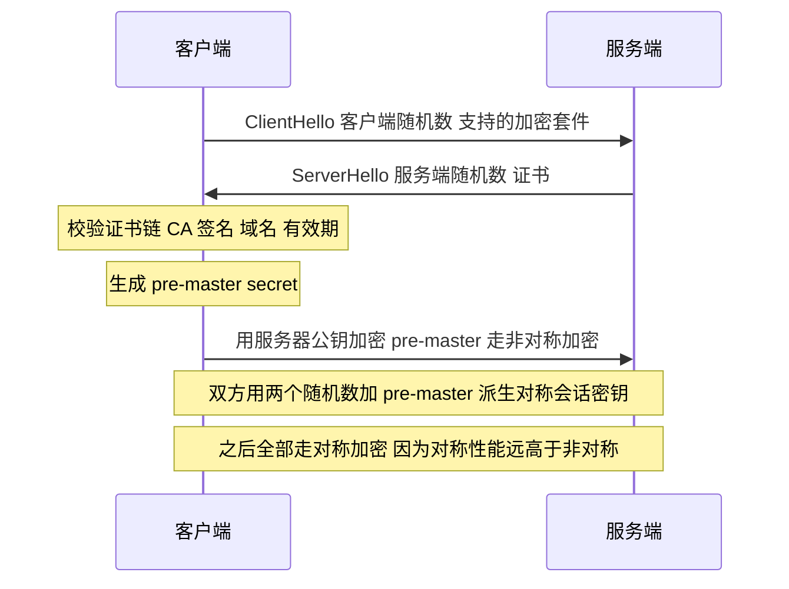

**企业实际处理**：
- 内部微服务（Spring Cloud）多采用 **JWT + 网关统一鉴权**：网关验签并把用户信息透传给下游，下游无状态；配合 **Redis 黑名单/短过期 + Refresh Token** 解决 JWT 无法主动失效的问题。
- 后台管理系统常用 **Session + Redis 集中存储**，因为要「强制下线」「在线列表」这类能力，有状态反而更方便。
- 跨域统一在网关层（Spring Cloud Gateway / Nginx）配置 CORS，避免每个服务各配一遍。

**为什么这样做**：
- **因为 HTTP 演进的主线就是「消除队头阻塞、提高连接利用率」**：1.1→2 在应用层多路复用，2→3 把多路复用下沉到传输层（QUIC over UDP）才真正根治。
- **因为 HTTPS 是「用一次昂贵的非对称，换长期廉价的对称」**：握手只做一次，数据加密走高速对称，成本模型最优。
- **因为无状态是分布式时代的刚需**：JWT 换来水平扩展能力，代价是**放弃服务端对会话的即时控制权**——这是核心权衡，选型就看你更看重「扩展性」还是「可控性」。

**企业级代码示例**（📦 按 JDK 17 书写、未实测）：用 JJWT 库签发/校验一个 HS256 的 JWT（仅示意结构，真实项目应使用 RSA 非对称且密钥放配置中心）。

```java
import io.jsonwebtoken.Jwts;
import io.jsonwebtoken.security.Keys;
import javax.crypto.SecretKey;
import java.nio.charset.StandardCharsets;
import java.util.Date;

public class JwtDemo {
    // 生产环境密钥应来自 Apollo/配置中心，切勿硬编码
    private static final SecretKey KEY =
            Keys.hmacShaKeyFor("replace-with-a-256-bit-secret-key-please".getBytes(StandardCharsets.UTF_8));

    public static String issue(String userId) {
        long now = System.currentTimeMillis();
        return Jwts.builder()
                .subject(userId)
                .claim("role", "risk-admin")
                .issuedAt(new Date(now))
                .expiration(new Date(now + 30 * 60 * 1000L))  // 短过期 + Refresh Token 续期
                .signWith(KEY)                                 // header.payload 签名，防篡改
                .compact();
    }

    public static String verify(String jwt) {
        // 篡改 payload 会导致签名校验失败抛异常
        return Jwts.parser().verifyWith(KEY).build()
                .parseSignedClaims(jwt).getPayload().getSubject();
    }
}
```

跨域响应头（网关层）：

```yaml
# Spring Cloud Gateway 全局 CORS 示意
spring:
  cloud:
    gateway:
      globalcors:
        cors-configurations:
          '[/**]':
            allowedOrigins: "https://risk.example.com"
            allowedMethods: "GET,POST,PUT,DELETE,OPTIONS"
            allowedHeaders: "*"
            allowCredentials: true
            maxAge: 3600
```

**面试加分项**：
- 主动指出「**JWT 的 payload 是 Base64 不是加密**，放手机号、身份证就是泄密」，体现安全意识。
- 说清「**预检请求（OPTIONS）会多一次 RTT**，可以通过 `maxAge` 缓存预检结果降低开销」。
- 补一句「**`SameSite=Lax` 是防 CSRF 的现代默认值**，JWT 放 Cookie 时尤其要配」。
- 主动区分「**502 是后端连不上/回了非法响应，504 是后端处理超时**」并给出排查方向，体现真实线上经验。
- 说清「**幂等方法 + 502/503/504 可安全重试，400/401/403/404/405 重试无意义，非幂等的 POST 遇 502/504 也不能盲目重试**」，这是接口设计的加分认知。
- 用一句话讲透「**PUT 幂等（整体替换指定 URI）而 POST 不幂等（向集合追加/创建）**」，从语义而非记忆层面回答。

### <a id="q4"></a>题 4：Linux 常用排查命令有哪些？CPU 100%、磁盘满、内存涨、连接数爆怎么排查？

- **题干**：「你们生产上出问题怎么排查？CPU 打满了你会看哪些东西？磁盘满了怎么办？内存一直涨是泄漏吗？连接数暴涨怎么定位？」
- **考察点**：真实运维排障能力，是「有没有在生产上真刀真枪干过」的照妖镜。

**标准答案**：
1. **常用命令速查**：
   - **CPU/负载**：`top`、`htop`、`uptime`（看 load average）、`vmstat 1`、`pidstat -u 1 -p <pid>`。
   - **内存**：`free -h`、`vmstat`、`/proc/meminfo`。
   - **磁盘**：`df -h`（分区使用率）、`du -sh *`（目录占用）、`iostat -x 1`（`%util`、`await`）。
   - **网络/连接**：`netstat -anp`、`ss -s` / `ss -tanp`（更快）、`lsof -i:8080`。
   - **JVM**：`jps -l`、`jstat -gcutil <pid> 1000`、`jstack <pid>`、`jmap -histo:live <pid>`、`jmap -dump:format=b,file=heap.hprof <pid>`、`jinfo -flags <pid>`、**Arthas**（`dashboard`/`thread -n 3`/`trace`）。
   - **抓包/系统**：`tcpdump -i eth0 port 8080 -w a.pcap`、`sar -n DEV 1`。
2. **CPU 100% 排查套路**：① `top` 找到 CPU 最高的进程 PID；② `top -Hp <pid>` 找最耗 CPU 的**线程 TID**；③ `printf "%x\n" <tid>` 转 16 进制；④ `jstack <pid> | grep -A 30 <hex_tid>` 找对应线程栈，定位是业务死循环、GC 线程还是 JIT 编译线程；⑤ 若是 GC 导致，用 `jstat -gcutil` 看 Full GC 频率，再 `jmap` dump 分析。
3. **磁盘满排查套路**：① `df -h` 定位是哪个分区满；② `du -sh /* | sort -h` 逐层下钻找大目录；③ 常见元凶：日志未滚动、`nohup.out` 巨大、`/tmp` 堆积、**已删除但被进程持有的文件**——用 `lsof | grep deleted` 找，重启/关闭句柄才释放。
4. **内存涨排查套路**：① `free -h` 看是系统内存还是 JVM 堆；② `jstat -gcutil` 看老年代是否持续增长、Full GC 后不降 → 疑似泄漏；③ `jmap -histo:live` 看对象数量排名；④ `jmap -dump` 导堆，用 **MAT / JProfiler** 分析 **GC Roots 引用链**，找到「谁在持有这些对象不释放」（静态集合、ThreadLocal 未 remove、缓存无上限、监听器未注销）。
5. **连接数爆排查套路**：① `ss -s` 看总连接数与各状态分布；② `ss -tan state close-wait` / `state time-wait` 区分是**应用没关连接（CLOSE_WAIT）**还是**主动关闭太多（TIME_WAIT）**；③ `lsof -p <pid> | wc -l` 对比 `ulimit -n`，判断是否 fd 泄漏；④ 调 `net.core.somaxconn`（accept 队列）、`ulimit -n`、TIME_WAIT 相关内核参数。

**企业实际处理**：
- 生产必备 **Arthas** 在线诊断（`thread -n 3` 一把梭找热点线程、`trace` 定位慢方法），以及 **Prometheus + Grafana + 链路追踪（SkyWalking/ARMS）** 做指标与调用链，出问题先看大盘再进机器。
- JVM 启动参数统一加 `-XX:+HeapDumpOnOutOfMemoryError -XX:HeapDumpPath=/data/dump`，OOM 时自动留证，避免现场丢失。

**为什么这样做**：
- **因为排查必须是「由粗到细、逐层收敛」的漏斗**：先看大盘定位到机器 → 再看进程 → 再看线程/对象 → 最后看代码行，每一步都用命令把范围缩小一半。
- **因为 CPU 高和内存涨的根因往往不在这台机器**：CPU 高可能是上游流量突增或下游变慢导致线程堆积，内存涨可能是缓存没设过期，务必结合链路追踪看全貌。
- **因为「磁盘满」最坑的不是日志文件，而是 `deleted` 但未释放句柄**：逻辑删除后空间不还，只有 `lsof | grep deleted` 能发现，这是经验点。

**企业级代码示例**（📦 按 JDK 17 书写、未实测）：一段「疑似内存泄漏」的典型错误写法与正确写法对照，便于面试举例。

```java
import java.util.Map;
import java.util.concurrent.ConcurrentHashMap;

public class MemoryLeakDemo {
    // 【错误写法】静态 Map 无上限、无过期，持续 key 累积 -> 老年代只增不减
    private static final Map<String, byte[]> CACHE = new ConcurrentHashMap<>();

    public static void bad(String key) {
        CACHE.put(key, new byte[1024 * 1024]); // 每次都塞 1MB，永不释放
    }

    // 【正确写法】用有容量的本地缓存（Caffeine）并设过期/最大条目
    // private static final Cache<String, byte[]> OK =
    //     Caffeine.newBuilder().maximumSize(10_000).expireAfterWrite(Duration.ofMinutes(5)).build();
}
```

排障命令集合（可直接背）：

```bash
# CPU 飙高四步
top -c                                  # 1. 找 PID
top -Hp <pid>                           # 2. 找 TID
printf "%x\n" <tid>                     # 3. 转 16 进制
jstack <pid> | grep -A 30 <hex>         # 4. 定位栈

# 磁盘
df -h ; du -sh /var/* | sort -h
lsof +L1 | grep deleted                 # 找已删除但未释放的文件句柄

# 内存
jstat -gcutil <pid> 1000 10
jmap -histo:live <pid> | head -20
jmap -dump:format=b,file=/tmp/heap.hprof <pid>

# 连接
ss -s
ss -tan state close-wait | wc -l
lsof -p <pid> | wc -l
```

**面试加分项**：
- 主动提「三高（CPU/内存/磁盘）排查时**先看是不是 GC**：`jstat -gcutil` 一眼定生死」，展现 JVM 排障熟练度。
- 说清「**load average 高不代表 CPU 高**：可能是大量 IO 阻塞导致的 D 状态进程，要结合 `vmstat` 的 `r`（运行队列）和 `b`（阻塞）列判断」。
- 补「**Docker/K8s 环境下 `top` 看到的是宿主机数据，要看 cgroup 限额**（`/sys/fs/cgroup/...`）」，体现容器化经验。

### <a id="q5"></a>题 5：单例 DCL 为什么必须加 volatile？策略/责任链/观察者怎么用？Spring 里有哪些设计模式？

- **题干**：「写个单例，为什么 DCL 里要加 volatile？策略模式、责任链模式你项目里怎么用的？Spring 框架里用到了哪些设计模式？SOLID 原则说说你的理解？」
- **考察点**：设计模式的实际落地能力 + 对 Spring 原理的理解 + 面向对象抽象素养。

**标准答案**：
1. **单例三种写法**：
   - **DCL（双重检查锁）**：`synchronized` 保证只创建一次，但**必须给 `instance` 加 `volatile`**。原因：对象创建分三步——① 分配内存 ② 初始化对象 ③ 把引用指向内存。JIT 可能**重排 ②③**，导致别的线程看到「引用非空但对象未初始化」的半成品实例。`volatile` 通过**禁止指令重排（内存屏障）** 杜绝此问题。
   - **静态内部类**：利用**类加载机制的线程安全**（`<clinit>` 只在首次主动使用类时执行一次），实现懒加载且无锁，是**最优雅的写法之一**。
   - **枚举**：`INSTANCE` 天然线程安全、**防反射攻击、防反序列化破坏**，是《Effective Java》推荐写法。
2. **策略模式（风控规则引擎最佳落地）**：把每种预警规则封装成一个 `Strategy` 实现，用 `Map<String, Strategy>` 注册，运行时按规则类型查表执行。**消除 if-else 地毯**，新增规则只需加一个类 + 注册，符合**开闭原则**。
3. **责任链模式（预警规则校验链）**：把多个校验/处理节点串成链（`Pipeline`/`Handler.next()`），请求沿链传递。用于「规则合法性校验 → 权限校验 → 数据完整性校验 → 执行」这类**顺序、可插拔**的流程；Netty 的 `ChannelPipeline`、Servlet 的 `FilterChain` 都是它。
4. **观察者/发布订阅（预警事件通知）**：预警触发后，需要通知短信、邮件、企微、大屏等多个下游；用**事件发布 + 多监听者**解耦，Spring 的 `ApplicationEventPublisher` + `@EventListener` 直接落地。
5. **其他常用**：工厂/抽象工厂（创建规则对象、屏蔽构造细节）、模板方法（`JdbcTemplate`、`RedisTemplate` 把「获取连接→执行→释放」骨架固定，子类填「执行」）、代理（Spring AOP 的 JDK 动态代理 / CGLIB）、建造者（`Lombok @Builder`、复杂对象构建）、适配器（`HandlerAdapter`、`MessageConverter`）、门面（`JdbcTemplate` 门面了 JDBC 复杂性）。
6. **Spring 中的设计模式**：
   - **工厂**：`BeanFactory` / `ApplicationContext`；**单例**：Bean 默认 singleton；**代理**：AOP；**模板方法**：各种 `*Template`；**观察者**：`ApplicationEvent`；**责任链**：`HandlerExecutionChain`（拦截器链）；**适配器**：`HandlerAdapter`；**策略**：`ResourceLoader`、`InstantiationStrategy`；**装饰器**：`BeanWrapper`、`HttpServletRequestWrapper`。
7. **SOLID**：
   - **S** 单一职责：一个类只干一件事（规则类只负责规则计算）。
   - **O** 开闭原则：对扩展开放、对修改关闭（新增规则不改引擎代码）。
   - **L** 里氏替换：子类能透明替换父类，不破坏契约。
   - **I** 接口隔离：接口要小而专，别让实现类实现用不到的方法。
   - **D** 依赖倒置：依赖抽象而非具体实现（引擎依赖 `Rule` 接口而非具体规则类）。

**图 6-8：策略模式在风控规则引擎的落地（新增规则不改老代码）**

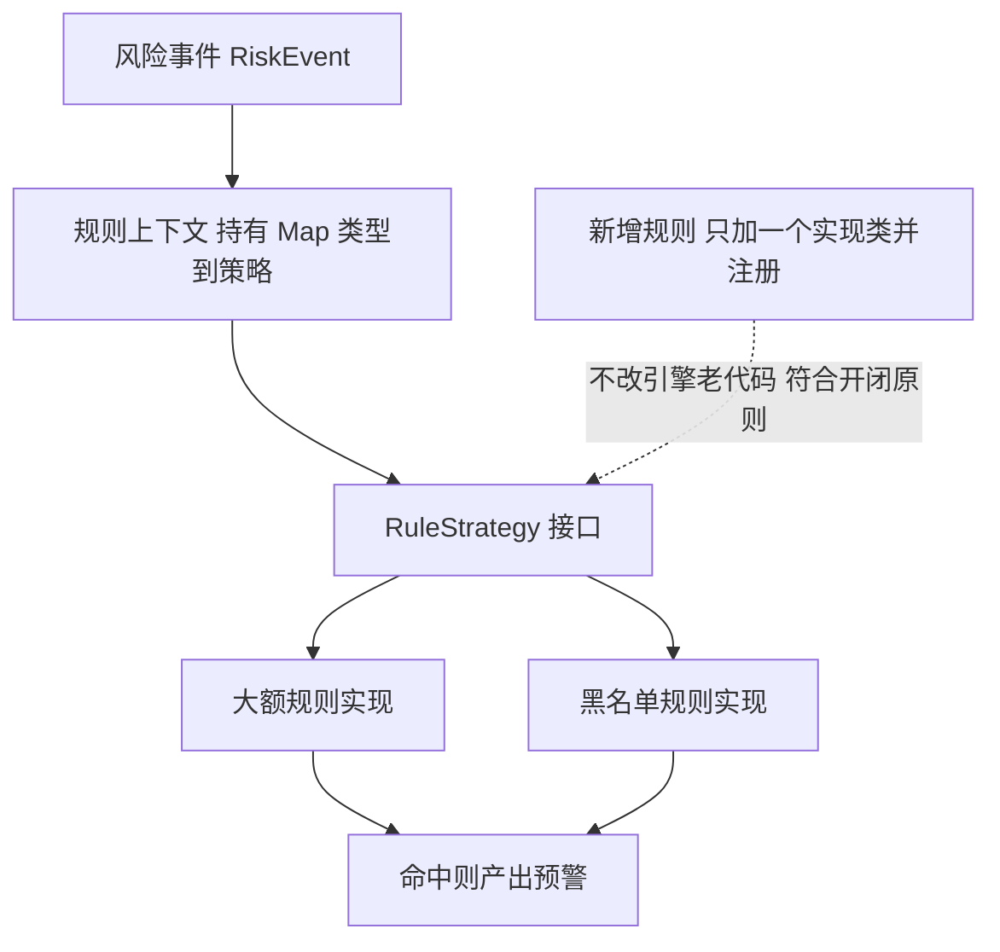

**图 6-9：责任链模式在预警规则校验链的落地（任一环节失败即中断）**

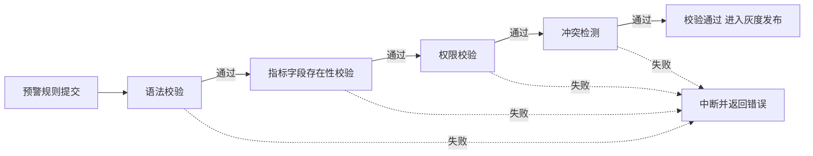

**企业实际处理**：
- 风控规则引擎的骨架就是 **策略 + 工厂 + 责任链 + 观察者** 的组合：规则类型 → 策略；规则对象创建 → 工厂；规则执行前校验 → 责任链；预警输出 → 观察者。
- 用 Spring 容器天然管理这些策略 Bean：**把所有规则 Strategy 注入到 `Map<String, RuleStrategy>`**（Spring 会按 beanName 装配），按 key 直接取，零反射、零 if-else。

**为什么这样做**：
- **因为 volatile 在 DCL 中的角色不是「可见性」而是「禁止重排」**：这是理解 Java 内存模型的关键，很多人答成「保证可见性」就露怯了。
- **因为设计模式的本质是「把变化点封装起来」**：风控系统里规则、通知渠道都是高频变化点，用策略/观察者隔离后，改需求只动新增类，不动核心逻辑。
- **因为 Spring 的设计模式不是炫技而是「可扩展性刚需」**：`HandlerAdapter` 让任意类型的 Controller 都能被统一调度，`BeanPostProcessor` 链让框架能优雅插入 AOP。

**企业级代码示例**（📦 按 JDK 17 书写、未实测）：单例 DCL + 策略注册，演示风控规则引擎的最小骨架。

```java
import java.util.Map;
import java.util.List;
import java.util.function.Function;
import java.util.stream.Collectors;

// ---------- 1) DCL 单例（volatile 禁重排）----------
final class RuleEngineHolder {
    private static volatile RuleEngineHolder instance;   // volatile 关键
    private RuleEngineHolder() {}
    static RuleEngineHolder getInstance() {
        if (instance == null) {                          // 第一次检查：避免每次都加锁
            synchronized (RuleEngineHolder.class) {
                if (instance == null) {                  // 第二次检查：防并发重复创建
                    instance = new RuleEngineHolder();
                }
            }
        }
        return instance;
    }
}

// ---------- 2) 策略模式：风控规则 ----------
interface RuleStrategy {
    String type();                                       // 规则类型标识
    boolean match(RiskEvent event);
}

record RiskEvent(String accountId, long amount, String ip) {}

class BigAmountRule implements RuleStrategy {
    public String type() { return "BIG_AMOUNT"; }
    public boolean match(RiskEvent e) { return e.amount() > 1_000_000; }
}

class BlacklistIpRule implements RuleStrategy {
    public String type() { return "BLACKLIST_IP"; }
    public boolean match(RiskEvent e) { return "10.0.0.1".equals(e.ip()); }
}

// ---------- 3) 工厂 + 注册表：消除 if-else ----------
class RuleRegistry {
    private final Map<String, RuleStrategy> table;

    RuleRegistry(List<RuleStrategy> strategies) {
        // Spring 中直接注入 Map<String, RuleStrategy> 更省事
        this.table = strategies.stream()
                .collect(Collectors.toMap(RuleStrategy::type, Function.identity()));
    }

    RuleStrategy get(String type) { return table.get(type); }
}
```

**面试加分项**：
- 主动说「DCL 里 **volatile 是防指令重排、不是单纯可见性**」，一句话区分高手与背诵党。
- 提到「**枚举单例防反射**：反射构造枚举会抛 `IllegalArgumentException`」，比静态内部类更安全。
- 补一句「**Spring 三级缓存**解决单例 Bean 的循环依赖，本质是提前暴露半成品 Bean 的 `ObjectFactory`」，把设计模式与 Spring 源码打通。

## 进阶实战题（5 道）

### <a id="q6"></a>题 6：风控规则引擎怎么设计？如何支持监管人员零代码配置规则、热更新不重启？

- **题干**：「你简历写了『全配置化的预警规则管理与任务依赖调度，支持监管人员零代码自定义规则』——这个规则引擎你怎么设计的？规则怎么存？怎么做到改了规则不重启就生效？」
- **考察点**：能否把「配置化」这个抽象概念落到**数据结构 + 表达式引擎 + 热更新机制**的具体设计上。

**标准答案**（分层拆解）：
1. **规则的抽象模型**：把一条规则拆成 `规则元数据` + `触发条件（表达式）` + `动作（预警输出）`。
   - 元数据：规则 ID、名称、指标类型、生效时间、优先级、启用状态、适用范围（账户/市场/产品）。
   - 条件：用**表达式**描述，如 `成交金额 > 1000000 && 撤单率 > 0.8 && 时间窗(60s)`。存成**文本表达式 + 参数表**。
   - 动作：告警级别、通知渠道（短信/邮件/企微/大屏）、抑制策略（同一账户 5 分钟内只报一次）。
2. **表达式引擎选型**（这是核心）：三种方案——
   - **Aviator / QLExpress / MVEL**：轻量、性能好、语法类 Java，适合简单算术与逻辑表达式，**推荐主力方案**。
   - **Groovy**：表达能力最强（可写完整逻辑），但**有安全风险**（可执行任意代码），需用 `SecureASTCustomizer` 沙箱限制。
   - **DSL 自研**：完全可控但开发成本高，一般用于超复杂规则。
   - **落地组合**：简单阈值规则用表达式引擎；复杂多步规则用 **规则链（决策表/决策树）**，可视化配置页面组装。
3. **存储与加载**：规则存 DB（元数据）+ 配置中心（Apollo，用于版本与推送），引擎启动时加载到**本地缓存（Caffeine）**，避免每次计算查库。
4. **热更新不重启**：三种机制——
   - **配置中心推送**：Apollo/Nacos 监听变更事件，收到变更后**重新编译表达式 + 原子替换本地缓存引用**（用 `volatile` 或 `AtomicReference` 持有不可变规则集合，实现读写无锁）。
   - **DB 轮询 + 版本号**：引擎定时（如 10s）拉规则版本号，变化则增量加载。
   - **消息通知**：规则变更发 MQ 消息，各实例订阅刷新。
   - **关键**：**替换而非修改**——构建一份全新的不可变规则快照，一次性切换引用，保证计算中的请求要么用旧快照要么用新快照，**绝不出现半更新状态**。
5. **校验与灰度**：规则保存前用**责任链校验**（语法校验 → 指标字段是否存在 → 权限 → 冲突检测）；上线走**灰度**（先只对部分账户生效/影子运行比对结果）。
6. **零代码配置**：前端提供可视化规则编排（选指标 + 选操作符 + 填阈值 + 选时间窗），后端把 UI 模型翻译成表达式，监管人员全程不写代码。

**企业实际处理**：
- 规则表达式统一落库，**带版本号 + 操作人 + 生效时间**，支持**一键回滚**（监管系统对可审计性要求极高）。
- 规则计算走 **Flink 侧或独立规则服务**，规则快照放本地缓存，单条规则匹配微秒级，成千上万条规则用**规则索引（按指标/范围预筛选）** 减少无效匹配。

**为什么这样做**：
- **因为「零代码」的本质是「把变化点从代码里挪到数据里」**：规则是高频变化的业务数据，不是低频变化的代码；用表达式引擎把「逻辑」变成「数据」，改规则就是改数据，无需发版。
- **因为「热更新」的技术核心是「不可变快照 + 原子替换」**：任何「原地修改缓存」的方案都会在并发下产生不一致；用整体替换才能做到无锁、无线程安全问题。
- **因为监管场景要求「可审计、可回滚」**：规则必须版本化留痕，否则出了误报无法追责与恢复。

**企业级代码示例**（📦 按 JDK 17 书写、未实测）：用 Aviator 表达式引擎 + AtomicReference 不可变快照演示热更新。

```java
import com.googlecode.aviator.AviatorEvaluator;
import java.util.List;
import java.util.Map;
import java.util.concurrent.atomic.AtomicReference;

// 规则快照：不可变对象，替换时整体切换
record RuleSnapshot(long version, List<CompiledRule> rules) {}

record CompiledRule(String id, String expr, String level) {}

class HotReloadRuleEngine {
    // 读多写少：用 volatile/AtomicReference 持有不可变快照，读无锁
    private final AtomicReference<RuleSnapshot> current =
            new AtomicReference<>(new RuleSnapshot(0, List.of()));

    // 配置中心变更回调 / DB 轮询触发：构建全新快照后原子替换
    public void reload(long newVersion, List<CompiledRule> newRules) {
        RuleSnapshot snapshot = new RuleSnapshot(newVersion, List.copyOf(newRules));
        current.set(snapshot);              // 一步原子切换，计算线程要么看到旧要么看到新
    }

    public void evaluate(Map<String, Object> event) {
        RuleSnapshot snap = current.get();  // 拿到稳定快照
        for (CompiledRule r : snap.rules()) {
            // Aviator 编译过的表达式，传入上下文变量求值
            Object hit = AviatorEvaluator.execute(r.expr(), event, true);
            if (Boolean.TRUE.equals(hit)) {
                System.out.println("rule " + r.id() + " triggered, level=" + r.level());
            }
        }
    }
}
```

配置中心监听（Apollo 示意）：

```java
// Apollo 变更监听：规则版本变化时触发 reload，全程不重启
// config.addChangeListener(changeEvent -> {
//     if (changeEvent.changesForNamespace("risk-rules") != null) {
//         engine.reload(newVersion, ruleDao.loadAll());
//     }
// });
```

**面试加分项**：
- 主动提「**规则冲突检测**」：多条规则同时命中、或条件互斥，需要优先级/抑制策略，这是真实风控系统的必备设计。
- 说清「**Groovy 沙箱**」与「**表达式引擎性能**」的取舍：Aviator 编译后接近原生 Java，Groovy 更灵活但慢且有安全边界。
- 补一句「**规则快照 + 影子流量**：新规则先在影子链路跑，与旧规则比对结果，一致后再切换」，把「零风险上线」讲透。

### <a id="q7"></a>题 7：接口幂等有哪些设计方案？限流四种算法怎么选？

- **题干**：「支付/下单接口怎么保证幂等？你知道几种幂等方案？限流算法有哪些，你们项目怎么用的？令牌桶和漏桶什么区别？」
- **考察点**：对「防重复」与「防过载」两大横切能力的体系化掌握。

**标准答案**：
1. **接口幂等的 8 种方案**（按场景选，常组合使用）：
   - **① 数据库唯一索引**（最可靠兜底）：业务唯一键（如订单号）建唯一索引，重复插入报 `DuplicateKeyException`。**是最后一道防线，必加**。
   - **② 去重表 / 防重表**：单独建表记录已处理的请求 ID，插入成功才继续；适合无天然唯一键的场景。
   - **③ 乐观锁（版本号/状态位）**：`update ... set version=version+1 where id=? and version=?`，影响行数为 0 说明已处理。
   - **④ 悲观锁（`select ... for update`）**：串行化处理，简单但锁竞争大、易死锁，慎用。
   - **⑤ Redis SETNX**：以业务唯一键（如 `orderId`）`setIfAbsent` 加锁，处理完删除；**必须设过期时间**防死锁。
   - **⑥ Token 机制**：客户端提交前先申请一次性 token，服务端 Redis 校验并删除，`token` 用过即失效；适合表单重复提交。
   - **⑦ 状态机**：业务状态只能单向流转（待支付→已支付），用 `where status='待支付'` 保证只流转一次；**最贴合金融业务**。
   - **⑧ 分布式锁**：跨服务/跨机房的幂等控制，粒度最粗但通用。
   - **组合范式**：Redis SETNX 做前置拦截（快）+ 唯一索引做最终兜底（准）+ 状态机保证业务语义。
2. **限流四种算法**：
   - **固定窗口**：每个时间窗计数，超限拒绝。**简单，但存在临界问题**（窗口边界两侧各放满，瞬时达 2 倍 QPS）。
   - **滑动窗口**：把窗口切分成小格或用 ZSet 存时间戳，窗口随时间滑动。**解决临界问题**，代价是内存开销（Redis ZSet 存请求记录）。
   - **漏桶**：请求先入桶，以**恒定速率**流出。**流量绝对平滑**，能削峰；但**无法应对合理突发**（哪怕桶只受瞬时冲击也要慢慢放）。
   - **令牌桶**：以恒定速率往桶里放令牌，桶有容量上限，请求拿令牌才放行。**允许一定突发**（桶内积累的令牌可一次性消费），是**业界最常用**的方案，如 Guava `RateLimiter`。
   - **选型**：对外 API 网关要「既限制平均速率又容忍突发」→ **令牌桶**；要严格平滑输出（保护下游）→ **漏桶**；简单统计计数 → **滑动窗口**。

**图 6-10：四种限流算法对比（含固定窗口临界问题）**

```mermaid
flowchart TD
    subgraph W1["固定窗口"]
        w1["每个时间窗独立计数 超限拒绝"] --> w2["窗口边界两侧各放满"]
        w2 --> w3["临界瞬间达 2 倍 QPS 经典问题"]
    end
    subgraph W2["滑动窗口"]
        x1["窗口切小格 随时间滑动"] --> x2["解决临界问题"]
        x2 --> x3["代价是内存开销 如 Redis ZSet"]
    end
    subgraph W3["漏桶"]
        l1["请求先入桶 恒定速率流出"] --> l2["流量绝对平滑 能削峰"]
        l2 --> l3["无法应对合理突发"]
    end
    subgraph W4["令牌桶"]
        t1["恒定速率放令牌 桶有容量上限"] --> t2["允许一定突发 可攒着一次花"]
        t2 --> t3["业界最常用 如 Guava RateLimiter"]
    end
```

**图 6-11：接口幂等设计方案的拦截层次对比**

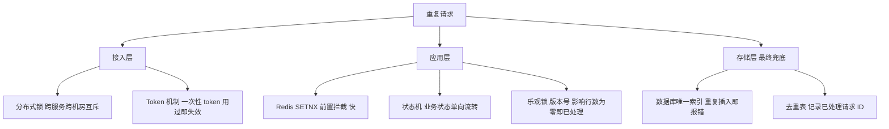

**企业实际处理**：
- **网关层限流**（Sentinel / Spring Cloud Gateway `RequestRateLimiter` + Redis 令牌桶）做全局漏斗；**应用层**用 Sentinel 的 `FlowRule` 做接口级 QPS 限流，配合**熔断降级**（慢调用比例、异常比例触发）保护依赖。
- 幂等是支付/风控的硬要求：**Redis + 唯一索引 + 状态机**三件套是标准配置，任何主链路写操作都必须评估幂等性。

**为什么这样做**：
- **因为幂等的本质是「把一次逻辑上的操作收敛为一次物理执行」**：无论重试多少次，结果一致。不同方案在**性能（Redis 快但可能丢锁）** 与 **可靠性（唯一索引慢但绝对准）** 之间权衡，所以分层组合。
- **因为限流的目标不是「拒绝请求」而是「保护系统」**：算法选择取决于「你要保护谁」——保护 CPU 用令牌桶控总量，保护下游 DB 用漏桶削峰平滑。
- **因为令牌桶和漏桶的本质差异是「桶里装的是令牌还是水」**：装水只能匀速漏（不允许突发），装令牌可以攒着一次花（允许突发）。

**企业级代码示例**（📦 按 JDK 17 书写、未实测）：Redis SETNX 幂等 + 令牌桶限流（Redis Lua 保证原子）。

```java
import org.springframework.data.redis.core.StringRedisTemplate;
import java.time.Duration;

class IdempotentService {
    private final StringRedisTemplate redis;
    IdempotentService(StringRedisTemplate redis) { this.redis = redis; }

    // Redis SETNX 幂等：唯一业务键，成功才处理，设过期防死锁
    public boolean tryAcquire(String bizKey) {
        Boolean ok = redis.opsForValue()
                .setIfAbsent("idem:" + bizKey, "1", Duration.ofMinutes(10));
        return Boolean.TRUE.equals(ok);   // false 表示重复请求，直接返回上次结果
    }
}
```

```lua
-- 令牌桶限流（Redis + Lua 原子操作，📦 示意）
-- KEYS[1]=桶key  ARGV: rate(每秒令牌) capacity(桶容量) now(毫秒) requested(请求令牌数)
local rate     = tonumber(ARGV[1])
local capacity = tonumber(ARGV[2])
local now      = tonumber(ARGV[3])
local requested= tonumber(ARGV[4])

local data = redis.call('HMGET', KEYS[1], 'tokens', 'ts')
local tokens = tonumber(data[1]) or capacity
local ts     = tonumber(data[2]) or now

-- 按流逝时间补充令牌
local delta = math.max(0, now - ts) / 1000.0 * rate
tokens = math.min(capacity, tokens + delta)

local allowed = 0
if tokens >= requested then
  tokens = tokens - requested
  allowed = 1
end
redis.call('HMSET', KEYS[1], 'tokens', tokens, 'ts', now)
redis.call('PEXPIRE', KEYS[1], math.ceil(capacity / rate * 1000))
return allowed
```

**面试加分项**：
- 主动指出「**固定窗口的临界问题**」并用「窗口边界双倍流量」举例，是限流题的经典加分点。
- 说清「**Redis SETNX 幂等一定要设过期时间**，否则进程崩溃后 key 永不过期导致业务永久阻塞」。
- 补「**限流要分维度**：按 IP / 按用户 / 按接口 / 按租户，且要在**集群维度限流**（单机限流 N 台就是 N 倍）」。

### <a id="q8"></a>题 8：主备双活环境下如何做协同调度？如何避免双活双写冲突？任务依赖 A→B→C 怎么实现？

- **题干**：「你简历写了『主备协同调度与自动化执行体系，减少 90% 以上人工干预』——主备双活下怎么协同调度？双写冲突怎么避免？任务依赖 A→B→C，B 依赖 A 完成，这怎么实现？失败了怎么重试？怎么保证不重复执行？」
- **考察点**：分布式协调能力（选主、分布式锁、调度、幂等），是高级岗区分度最高的一类题。

**标准答案**：
1. **主备双活协同调度的核心问题**：两个节点都可能执行定时任务，必须保证**同一时刻只有一个节点真正执行**（避免双写、重复预警）。三个层次：
   - **选主（Leader Election）**：用 **ZooKeeper 临时顺序节点** 或 **etcd/Redis** 选出唯一 Leader，只有 Leader 执行调度。Leader 宕机后临时节点消失，其他节点重新选主，实现**故障自动切换**。
   - **分布式锁（悲观互斥）**：不选主，改为「谁抢到锁谁执行」，用 Redis `SET NX PX` + Lua 释放（校验持有者）或 Redisson 看门狗续期。
   - **数据库乐观锁/抢占**：`update task set owner=? where id=? and owner is null`，天然幂等，无需额外组件。
2. **避免双活双写冲突**：
   - **写路由**：读写分离 + 分片路由，明确「哪个分片的主节点负责哪些数据」，**避免同一份数据被两地同时写**。
   - **冲突检测与仲裁**：若必须双写，用**版本号/时间戳**（last-write-wins）或**业务规则仲裁**（如按账户号路由，同一账户只在固定机房写）。
   - **多数派写入**：跨机房用 **Raft/Paxos 组** 保证一次只有一个 Leader 可写（如 TiDB、etcd 的机制）。
   - **本质**：双活双写冲突的根治办法是**「让同一份数据只有一个写入者」**（分区/选主），而不是「写入后解决冲突」。
3. **任务依赖调度（DAG）实现**：
   - **建模**：把任务依赖建成 **DAG（有向无环图）**，每个任务节点有 `前置依赖列表`。用拓扑排序保证执行顺序。
   - **调度器选型**：**XXL-JOB**（轻量、支持分片和依赖）、**Apache DolphinScheduler**（原生 DAG、可视化）、**Airflow**（Python 生态）；自研则用「任务状态表 + 轮询/事件驱动」。
   - **触发下游**：任务 A 执行成功后，查「谁的依赖包含 A」，把满足全部前置条件的下游任务置为「可执行」并投递到执行队列。
   - **失败重试**：**指数退避重试**（1s、2s、4s...上限 N 次），区分**可重试错误（网络抖动）与不可重试错误（参数错误）**；重试失败则**告警 + 人工介入**，并把下游任务标记为「阻塞」。
   - **保证不重复执行**：每个任务实例有**唯一执行 ID（业务日期 + 任务 ID）**，执行前用 **Redis 分布式锁/DB 唯一索引** 抢占，抢不到直接跳过；配合**幂等**（重跑结果一致）。
   - **断点续跑**：任务状态持久化（待执行/执行中/成功/失败/阻塞），调度器重启后能恢复。

**图 6-12：任务依赖调度 A→B→C 的执行与重试**

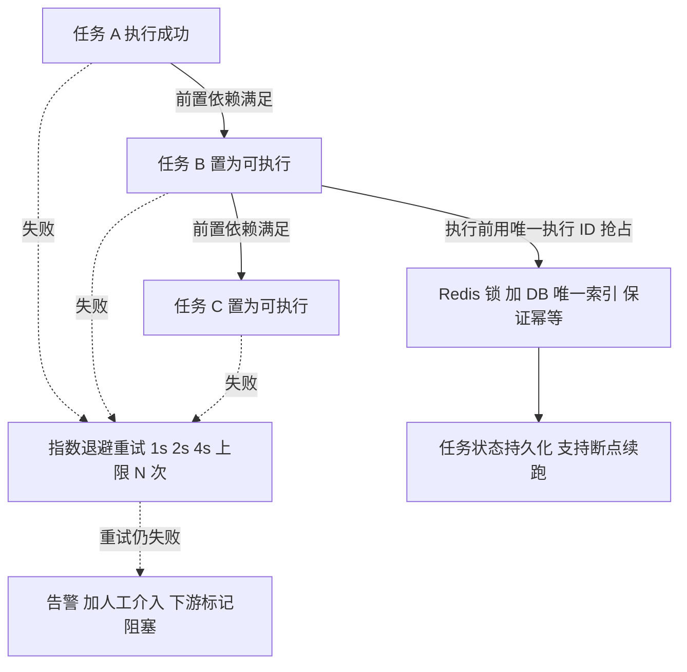

**企业实际处理**：
- 生产调度多用 **XXL-JOB / DolphinScheduler + 数据库状态机 + 分布式锁** 的组合；金融风控场景偏好**自研轻量调度**（可控、可审计），核心是「状态表 + 抢占 + 幂等」三要素。
- 「减少 90% 人工干预」的实现路径：把原本「人工登录机器、手动跑脚本、手动核对结果」的应急操作，变成**配置化的自动任务 + 依赖编排 + 失败自动重试 + 告警**，人只需处理真正异常的场景。

**为什么这样做**：
- **因为协同调度的本质是「在一个可能脑裂的分布式系统里，让大家都认同唯一的执行者」**：选主（共识）与分布式锁（互斥）是同一问题的两种解法，前者适合长周期角色，后者适合短临界区。
- **因为「不重复执行」不能只靠调度器，必须靠业务幂等兜底**：调度器保证「尽量不重复」，但网络分区、GC 停顿等极端场景下重复不可避免，**幂等是最后的正确性保证**。
- **因为重试必须区分错误类型**：盲目重试不可恢复的错误会放大故障（重试风暴），这是「重试」这道题真正的考点。

**企业级代码示例**（📦 按 JDK 17 书写、未实测）：Redis 分布式锁实现任务抢占（避免重复执行）+ 简单 DAG 依赖判断。

```java
import org.springframework.data.redis.core.StringRedisTemplate;
import org.springframework.data.redis.core.script.DefaultRedisScript;
import java.time.Duration;
import java.util.List;
import java.util.Map;
import java.util.UUID;
import java.util.concurrent.ConcurrentHashMap;

class TaskScheduler {
    private final StringRedisTemplate redis;
    TaskScheduler(StringRedisTemplate redis) { this.redis = redis; }

    // 释放锁需校验持有者，防止释放别人的锁（用 Lua 保证原子，📦 示意）
    private static final DefaultRedisScript<Long> UNLOCK = new DefaultRedisScript<>(
            "if redis.call('get', KEYS[1]) == ARGV[1] then " +
            "return redis.call('del', KEYS[1]) else return 0 end", Long.class);

    /** 任务抢占：同一执行实例（业务日期+任务ID）只有一个节点能执行 */
    public boolean acquireTask(String taskKey) {
        String token = UUID.randomUUID().toString();
        Boolean ok = redis.opsForValue()
                .setIfAbsent("lock:task:" + taskKey, token, Duration.ofMinutes(30));
        if (Boolean.TRUE.equals(ok)) {
            // 实际应把 token 传到 finally 里用于释放
            return true;
        }
        return false;   // 别的节点已持有，直接跳过（不重复执行）
    }

    public void releaseTask(String taskKey, String token) {
        redis.execute(UNLOCK, List.of("lock:task:" + taskKey), token);
    }
}

/** DAG 依赖判断：所有前置任务成功才可执行 */
class DagEngine {
    // taskId -> 前置任务ID集合
    private final Map<String, List<String>> deps = new ConcurrentHashMap<>();
    // taskId -> 状态：SUCCESS / RUNNING / PENDING
    private final Map<String, String> status = new ConcurrentHashMap<>();

    public boolean ready(String taskId) {
        return deps.getOrDefault(taskId, List.of())
                   .stream().allMatch(d -> "SUCCESS".equals(status.get(d)));
    }
}
```

**面试加分项**：
- 主动说「**双活双写冲突的根治是分区/选主（单一写入者），而不是事后 conflict resolution**」，一句话体现架构判断力。
- 提「**Redis 分布式锁必须用 Lua 校验 token 释放 + 看门狗续期**（Redisson），否则会出现「锁过期后误删别人锁」的经典 bug」。
- 补「**调度器的时钟问题**：多节点时间不同步会导致定时漂移，生产要配 NTP，且避免依赖绝对时间做唯一性判断」。

### <a id="q9"></a>题 9：缓存与数据库一致性怎么保证？分布式 ID 怎么生成？

- **题干**：「你们怎么保证缓存和数据库一致？先删缓存还是先更库？延迟双删是什么？Canal 用过吗？分布式 ID 有哪些方案，雪花算法时钟回拨怎么办？」
- **考察点**：缓存一致性是高频陷阱题（很多人答错顺序），分布式 ID 是分库分表的前置能力。

**标准答案**：
1. **缓存一致性四种策略对比**：
   - **先更新 DB，再删缓存（Cache Aside，推荐）**：并发下仍可能不一致——读请求在「DB 更新前」读到旧值，在「缓存删除后」把旧值回填，导致缓存长期脏。**但概率低、代价小，是业界默认方案**。
   - **先删缓存，再更新 DB**：不一致概率**更高**——删缓存后、DB 更新前，读请求读到旧值并回填，缓存变成长期脏数据。**不推荐**。
   - **延迟双删**：`删缓存 → 更新 DB → 延迟（如 500ms）再删一次缓存`。第二次删除用来清理「更新期间被并发读回填的旧值」。**注意**：延迟时间难精确、删除失败需重试，只能降低概率不能根除。
   - **订阅 binlog（Canal，最终一致）**：业务只更新 DB，Canal 假装成 MySQL 从库订阅 binlog，解析后**异步删缓存/更新缓存**。**与业务解耦、不侵入代码、可重放**，是大型系统的推荐方案（阿里 Otter 架构）。
2. **兜底手段**：
   - **缓存过期时间**（如 5 分钟）作为最终一致性保底，「再脏也会过期」。
   - **更新缓存 vs 删除缓存**：**优先删除而非更新**（更新缓存会带来并发写覆盖，且很多缓存值计算昂贵）。
   - **强一致场景**：若业务要求强一致（如余额），**别用缓存**，直接读 DB 或加分布式锁串行化。
3. **分布式 ID 方案对比**：
   - **UUID**：本地生成、无网络开销，但**无序**（B+ 树插入随机 IO 差）、占空间大（32 字符）、不可读。**一般不用于主键**。
   - **数据库自增**：简单，但**单点、扩展难**；改进为**号段模式**——一次从 DB 取一批（如 1-1000）缓存在内存，用完再取，**大幅降低 DB 压力**（美团 Leaf-segment 就这思路）。
   - **Redis INCR**：原子自增、性能高，但**依赖 Redis 可用性**（要配持久化与集群），且需处理重启后的 ID 回退。
   - **雪花算法（Snowflake）**：64 位 = `1 符号位 + 41 时间戳(ms) + 10 机器位 + 12 序列号`，**趋势递增、本地生成、高性能（单机 4096/ms）**。10 位机器位通常拆成 `5 位机房 + 5 位机器`。
   - **雪花算法的时钟回拨问题**：若机器时钟回拨（NTP 同步、闰秒），可能生成**重复 ID**。解决：① **检测到回拨就抛异常/等待**（等时钟追上）；② **回拨小幅度则等待，大幅度则告警拒绝服务**；③ **用备用位（预留位）或从 ZK/Redis 重新申请 workerId**；④ **改用 Leaf-snowflake 的 ZK 分配 workerId + 启动时校验时钟**。
4. **选型建议**：**分库分表主键用雪花/号段**（趋势递增利于 B+ 树）；**业务单号用号段或业务前缀 + 雪花**；**严格有序用号段**。

**图 6-13：雪花算法的 64 位分配**

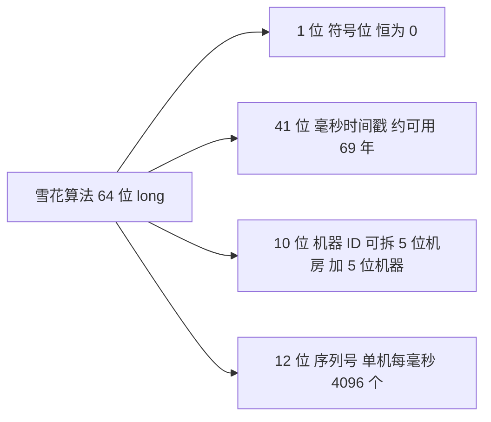

**图 6-14：缓存与数据库一致性的两种更新策略对比**

```mermaid
flowchart TD
    subgraph P1["先删缓存再更新 DB 不推荐"]
        a1["线程1 删除缓存"] --> a2["线程2 读缓存未命中 读 DB 得旧值"]
        a2 --> a3["线程2 把旧值回填缓存"]
        a3 --> a4["线程1 才更新 DB 为新值"]
        a4 --> a5["缓存长期是脏数据 不一致概率更高"]
    end
    subgraph P2["先更新 DB 再删缓存 Cache Aside 推荐"]
        b1["线程1 更新 DB 为新值"] --> b2["线程1 删除缓存"]
        b2 --> b3["极端并发下读请求也可能回填旧值"]
        b3 --> b4["概率低 代价小 配合过期时间兜底"]
    end
    subgraph P3["增强手段"]
        c1["延迟双删 删缓存 更新 DB 后再延迟删一次"] --> c2["订阅 binlog 如 Canal 异步删缓存 最终一致"]
    end
```

**企业实际处理**：
- 缓存一致性生产首选 **「先更库 + 删缓存 + 过期兜底」**，数据量大时加 **Canal** 做异步补偿；对账系统定期比对缓存与 DB 兜底。
- 分布式 ID 生产用 **美团 Leaf（号段 + 雪花双模式）** 或自研雪花，workerId 由 ZK/配置中心统一分配避免冲突。

**为什么这样做**：
- **因为「先更库再删缓存」选的是「不一致概率最低」而非「零不一致」**：分布式下没有免费的强一致，Cache Aside 用极小的不一致窗口换取简单与高性能。
- **因为删除比更新缓存更安全**：更新缓存会引入「两个并发更新以不同顺序到达缓存」导致的覆盖问题，删除只是让下一次读回源，简单可靠。
- **因为雪花算法的时钟回拨是「必须处理的工程缺陷」而非理论问题**：生产机器 NTP 同步、虚拟机迁移都可能触发，不做防护就会产生重复 ID 引发数据错乱。

**企业级代码示例**（📦 按 JDK 17 书写、未实测）：雪花算法精简实现（含时钟回拨检测）。

```java
public class SnowflakeIdGenerator {
    private final long workerId;                       // 0~1023（10 位）
    private static final long EPOCH = 1700000000000L;  // 自定义起始时间
    private static final long WORKER_BITS = 10L;
    private static final long SEQ_BITS = 12L;
    private static final long MAX_SEQ = ~(-1L << SEQ_BITS);        // 4095
    private static final long WORKER_SHIFT = SEQ_BITS;
    private static final long TIME_SHIFT = SEQ_BITS + WORKER_BITS;

    private long lastTimestamp = -1L;
    private long sequence = 0L;

    public SnowflakeIdGenerator(long workerId) {
        if (workerId < 0 || workerId > 1023) throw new IllegalArgumentException("workerId out of range");
        this.workerId = workerId;
    }

    public synchronized long nextId() {
        long now = System.currentTimeMillis();
        if (now < lastTimestamp) {                     // 时钟回拨
            long offset = lastTimestamp - now;
            if (offset > 5) {                          // 回拨过大：拒绝服务，避免生成重复 ID
                throw new IllegalStateException("clock moved backwards by " + offset + "ms");
            }
            // 小幅回拨：自旋等待时钟追上
            while (now < lastTimestamp) now = System.currentTimeMillis();
        }
        if (now == lastTimestamp) {
            sequence = (sequence + 1) & MAX_SEQ;
            if (sequence == 0) {                       // 同一毫秒序列号用尽，等下一毫秒
                while ((now = System.currentTimeMillis()) <= lastTimestamp) { /* spin */ }
            }
        } else {
            sequence = 0L;
        }
        lastTimestamp = now;
        return ((now - EPOCH) << TIME_SHIFT) | (workerId << WORKER_SHIFT) | sequence;
    }
}
```

**面试加分项**：
- 主动指出「**先删缓存再更新 DB 是最差方案**」并解释回填竞态，这是区分「真懂」与「背过」的关键。
- 说清「**延迟双删的第二次删除时间无法精确设定**，只能降低概率，真正可靠的是 binlog 订阅」，体现对方案边界的清醒认知。
- 补「**雪花 ID 的 41 位时间戳只够用约 69 年**（从自定义 EPOCH 算起），且 JS 前端精度只能安全表示 53 位，雪花 ID 传给前端要做字符串化」，是实战踩坑点。

### <a id="q10"></a>题 10：多环境（生产/预发/测试）结果自动化比对校验怎么设计？

- **题干**：「你简历写了『构建了多环境协同的实时/准实时双链路预警执行体系』——多条链路跑同样的规则，你怎么保证结果一致？多环境结果自动化比对怎么设计？」
- **考察点**：对「双链路/多环境一致性验证」这类工程体系建设的系统设计能力，是高级岗的亮点题。

**标准答案**（分层拆解）：
1. **为什么要多环境/双链路比对**：
   - **双链路**：实时链路（Flink 流计算，毫秒/秒级）与准实时链路（批处理/ADB，分钟级）互为**交叉验证**，监管场景要求结果可核对。
   - **多环境**：新版本上线前，在预发环境用**真实（或影子）数据**跑同样的规则，与生产结果比对，验证「改动的正确性」，实现**零风险上线**。
2. **比对系统的设计要素**：
   - **统一口径（最关键）**：两套计算必须用**同一套规则定义**（同一份规则快照）、**同一份数据源语义**（同一时间窗、同一事件时间基准）。口径不一致，比对结果无意义。
   - **对账维度**：预警条数、预警明细（账户 + 规则 ID + 触发时间）、指标计算结果（聚合值）。
   - **主键设计**：用「业务唯一键」（如 `accountId + ruleId + 触发分钟`）作为比对主键，才能精确匹配「哪条多了、哪条少了」。
   - **比对算法**：全量比 + 抽样比结合。全量比条数与哈希（对明细做滚动哈希）；抽样比明细内容（避免海量明细全比）。**差异分类**：**多报（假阳性）、漏报（假阴性）、值不一致**，其中**漏报对监管系统最致命**。
   - **容差处理**：金额、比率类指标允许**极小误差**（浮点/数据源时延导致），配置容差阈值，避免噪声淹没真问题。
3. **执行与调度**：
   - **定时触发**：按业务周期（如 T+1、每小时）启动比对任务，**依赖实时链路与准实时链路都跑完**（用任务依赖调度保证）。
   - **结果落库**：比对任务产出「比对报告」（一致率、差异条数、差异明细），存 DB + 可视化大屏。
   - **差异处理闭环**：差异超阈值 → **自动告警 + 生成核查工单**；人工介入确认是「真 bug」还是「口径差异」，形成「发现 → 定位 → 修复 → 回归」闭环。
4. **工程化要点**：
   - **对账快照隔离**：比对用的数据要能**按批次/按时间点重放**，所以链路必须支持**重跑与溯源**（原始数据留档）。
   - **幂等与可重入**：比对任务本身要幂等，重跑结果一致（用「批次号 + 唯一索引」）。
   - **性能**：海量明细比对用**分片并行** + **布隆过滤器预筛**（快速判断某 key 是否存在，减少 join）。

**企业实际处理**：
- 金融/监管系统的标准做法：**实时链路 + 准实时链路双跑**，每日对账，一致率要求接近 100%，任何漏报都当 P0 处理。
- 新版本上线走**影子流量**：预发环境用生产真实流量（镜像）跑新规则，与生产结果自动比对，差异清零才放量。

**为什么这样做**：
- **因为监管场景的核心诉求是「结果可解释、可核对、可追溯」**：单链路一旦算错无法自证，双链路互证才能满足监管审计。
- **因为「比对」的价值不在发现差异，而在「把差异收敛成闭环」**：只比对不处理等于没做；告警 + 工单 + 回归才是完整体系。
- **因为统一口径是比对有效的前提**：如果两条链路的时间窗定义、事件时间基准不同，比对出来的差异全是噪声，反而误导排查。

**企业级代码示例**（📦 按 JDK 17 书写、未实测）：比对核心逻辑，按业务主键比对两链路结果，分类差异。

```java
import java.util.*;
import java.util.function.Function;
import java.util.stream.Collectors;

record Alert(String accountId, String ruleId, long minuteBucket, double value) {}

class Reconciler {
    /** 用业务唯一键做比对：accountId + ruleId + 分钟桶 */
    static String keyOf(Alert a) {
        return a.accountId() + "|" + a.ruleId() + "|" + a.minuteBucket();
    }

    static Report compare(List<Alert> realtime, List<Alert> batch, double tolerance) {
        Map<String, Alert> rt = realtime.stream().collect(Collectors.toMap(Reconciler::keyOf, Function.identity(), (x, y) -> x));
        Map<String, Alert> bt = batch.stream().collect(Collectors.toMap(Reconciler::keyOf, Function.identity(), (x, y) -> x));

        List<Alert> onlyRealtime = new ArrayList<>();  // 实时多报（假阳性）
        List<Alert> onlyBatch = new ArrayList<>();     // 实时漏报（假阴性，最致命）
        List<String> valueDiff = new ArrayList<>();    // 值不一致（超容差）

        rt.forEach((k, v) -> {
            Alert b = bt.get(k);
            if (b == null) {
                onlyRealtime.add(v);
            } else if (Math.abs(v.value() - b.value()) > tolerance) {
                valueDiff.add(k);
            }
        });
        bt.keySet().forEach(k -> { if (!rt.containsKey(k)) onlyBatch.add(bt.get(k)); });

        return new Report(rt.size(), bt.size(), onlyRealtime.size(), onlyBatch.size(), valueDiff.size());
    }

    record Report(int rtCount, int btCount, int more, int miss, int diff) {}
}
```

**面试加分项**：
- 主动提「**漏报（假阴性）比多报（假阳性）严重得多**」，并说明风控系统对漏报的容忍度极低，体现监管业务敏感度。
- 说清「**比对要能重放**：原始数据留档 + 批次隔离，否则差异无法定位根因」，体现工程严谨性。
- 补「**布隆过滤器加速海量比对**」和「**容差阈值避免浮点噪声**」，展现对大数据量比对的性能意识。

## 高阶架构题（5 道）

### <a id="q11"></a>题 11：如果让你从零设计一个秒级/毫秒级实时风控预警系统，你会怎么做？

- **题干**：「你简历写了实时风控预警系统、秒级/毫秒级延迟——现在假设从零开始，让你设计一个监管级的实时风控预警系统，你会怎么设计？从数据采集到预警输出，讲讲你的架构。」
- **考察点**：**本模块最核心的架构题**，考察分层设计、技术选型、性能与可靠性权衡、以及对简历数字的自洽解释。

**标准答案**（**五层架构 + 落地风险**，可直接背诵）：

**① 需求澄清（先问再答，体现成熟度）**：数据规模（每秒多少笔/多少事件）？延迟目标（秒级还是毫秒级，区分「端到端」还是「规则计算」）？规则复杂度（简单阈值还是多指标组合）？一致性要求（能否容忍极少量丢失）？监管口径（要审计、要可追溯）？**这一层凸显你不是一上来就画图，而是先定边界。**

**② 数据采集层**：
- **事件源**：业务系统埋点（交易、撤单、持仓变动）、**CDC（Canal/Debezium 订阅 binlog）** 捕获写入变更、行情/外部数据接入。
- **采集 Agent**：高性能低开销，本地聚合后批量发送，避免拖垮业务库。
- **关键**：**统一事件模型**（event time、来源、业务主键），为后续乱序处理打基础。

**③ 数据传输层（Kafka）**：
- **分区策略**：**按业务主键（账户 ID）分区**，保证同一账户的事件落同一分区 → **单分区内有序**，风控「同一账户的事件必须有序」的刚需由此满足。
- **可靠性配置**：`acks=all`、`replication.factor>=3`、`min.insync.replicas>=2`、`enable.idempotence=true`。
- **双链路分流**：实时链路走 Flink（秒/毫秒级），准实时链路走批/ADB（分钟级）做交叉验证。

**④ 计算与规则引擎层（Flink + 规则引擎）**：
- **Flink 做有状态流计算**：`keyBy(accountId)` 后用**窗口**（如 60s 滚动/滑动窗口）聚合指标（成交金额、撤单率、笔数），**状态后端用 RocksDB + Checkpoint 保证故障恢复**。
- **事件时间 + Watermark** 处理乱序（详见题 12）。
- **规则引擎**：Flink 内嵌轻量规则引擎（Aviator/QLExpress），规则**快照热更新**；规则分两类——**无状态规则**（单笔金额超限，逐笔判断，毫秒级）与**有状态规则**（60s 内撤单率超限，需窗口聚合，秒级）。**这正是「秒级/毫秒级」双延迟指标的技术来源**：逐笔规则毫秒级，窗口聚合规则秒级。
- **性能优化**：`Async I/O` 访问外部维度数据、`LocalCache` 缓存规则、算子并行度与 Kafka 分区对齐（避免数据倾斜）。

**⑤ 预警输出与通知层**：
- 命中规则 → 生成预警事件（**幂等**：同一账户+规则+时间窗去重）→ 分级（提示/警告/严重）→ 走**观察者模式**分发到短信、邮件、企微、大屏。
- **抑制与聚合**：同一账户短时间大量预警要**合并/抑制**，避免告警风暴淹没真实风险。
- **写入预警结果库（ADB/Hologres）**，供查询与报表。

**⑥ 监控闭环层（简历的「双维度指标监测体系」）**：
- **任务生命周期维度**：任务是否按时启动、Checkpoint 是否成功、消费延迟（Lag）多大。
- **结果全链路维度**：预警条数趋势、规则命中分布、端到端延迟 P99、比对一致率。
- **闭环**：指标异常 → 告警 → 自动降级/重试 → 人工介入，**这就是「减少 90% 人工干预」的落地**：把人工巡检变成指标监控 + 自动处置。

**⑦ 高可用与容灾**：Flink 作业**主备/HA**（JobManager HA + Checkpoint）、Kafka 多副本跨机房、预警服务多实例无状态、**主备协同调度**避免双写（题 8）。

**⑧ 离线对账兜底层（实时/准实时之外的第三层兜底，监管级系统标配）**：
- **三层链路按延迟分层**：**实时链路（逐笔无状态规则）= 毫秒级**——在内存中直接计算，无状态、无等待；**准实时链路（窗口聚合规则）= 秒级**——需要等 Watermark 凑齐窗口才出结果；**离线对账 = T+1**——用 ADB/Hologres 对**全量数据重新计算**，再与实时/准实时的结果逐条比对。
- **离线对账做什么**：把实时链路产出的预警明细（账户 + 规则 + 时间窗）与离线全量重算的结果**按业务唯一键比对**，分类出**多报、漏报、值不一致**；**发现漏报则自动补发预警**，并产出对账报告（与题 10 的多环境比对一脉相承）。
- **为什么必须有这一层**：**监管场景「宁可重复告警，也不能漏报」**——实时链路再稳也可能因丢数、乱序、规则快照切换等瞬时问题漏掉个别预警，离线用全量数据重算能把漏掉的捞回来。**实时链路保证时效、离线对账保证完整性，两者互补**：实时负责「快」，离线负责「全」，这是行业里监管级预警系统的通用兜底做法。

**图 6-15：秒级实时风控预警系统的整体架构**

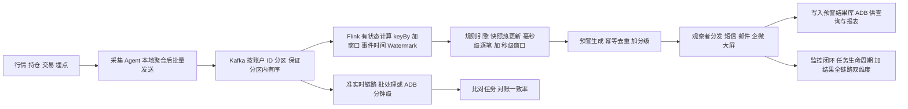

**落地风险与权衡（必须主动说）**：
- **延迟 vs 一致性**：Watermark 等待越久越准确但延迟越高；业务要秒级就必须限制等待，接受极小乱序。
- **Exactly-Once vs 吞吐**：开启 EOS 会牺牲吞吐，需评估是否真需要（题 12）。
- **规则爆炸**：规则越多计算越重，必须做**规则预筛选/索引**。

**企业实际处理**：
- 生产用 **Kafka + Flink + 规则引擎 + ADB** 的组合；Flink 作业配 **Checkpoint + Savepoint** 支持升级与回滚；旁路挂**比对任务**（题 10）做交叉验证。

**为什么这样做**：
- **因为风控的核心矛盾是「延迟与准确性不可兼得」**：想毫秒级必须容忍乱序，想绝对准确必须等窗口关闭。所以**分规则类型实现不同延迟指标**，而不是一刀切。
- **因为「按业务主键分区」是保证账户级事件有序的最省力方案**：比在应用层排序、加序号表的成本低得多。
- **因为监控闭环才是「降本」的关键**：预警系统的价值不只是「报出来」，而是「报得准 + 报得少 + 有人处理」，指标监测体系是把运维从被动救火变成主动治理。

**企业级代码示例**（📦 按 JDK 17 书写、未实测）：Flink 侧的风控主流程骨架（keyBy + 窗口聚合 + 规则计算 + 幂等输出）。

```java
import org.apache.flink.api.common.eventtime.WatermarkStrategy;
import org.apache.flink.streaming.api.datastream.DataStream;
import org.apache.flink.streaming.api.environment.StreamExecutionEnvironment;
import org.apache.flink.api.common.serialization.SimpleStringSchema;
import org.apache.flink.connector.kafka.source.KafkaSource;
import org.apache.flink.connector.kafka.source.enumerator.initializer.OffsetsInitializer;
import java.time.Duration;

public class RiskAlertJob {
    public static void main(String[] args) throws Exception {
        StreamExecutionEnvironment env = StreamExecutionEnvironment.getExecutionEnvironment();
        // 开启 Checkpoint（EOS 基础）
        env.enableCheckpointing(10_000);

        KafkaSource<String> source = KafkaSource.<String>builder()
                .setBootstrapServers("kafka:9092")
                .setTopics("trade-events")
                .setGroupId("risk-group")
                .setStartingOffsets(OffsetsInitializer.latest())
                .setValueOnlyDeserializer(new SimpleStringSchema())
                .build();

        // 事件时间 + 允许 2s 乱序等待
        WatermarkStrategy<String> wm = WatermarkStrategy
                .<String>forBoundedOutOfOrderness(Duration.ofSeconds(2))
                .withTimestampAssigner((e, ts) -> EventParser.eventTime(e));

        DataStream<String> events = env.fromSource(source, wm, "kafka-trade");

        // 按账户分区保证有序 -> keyBy accountId
        // .keyBy(EventParser::accountId)
        //   .window(TumblingEventTimeWindows.of(Time.seconds(60)))
        //   .aggregate(new MetricsAgg(), new WindowResult())
        //   .process(new RuleEvaluateFunction())   // 规则引擎：毫秒级逐笔 + 秒级窗口
        //   .uid("rule-eval")
        //   .addSink(new IdempotentAlertSink());   // 幂等写预警结果

        env.execute("realtime-risk-alert");
    }

    static class EventParser {
        static long eventTime(String e) { return 0L; }   // 解析事件时间
        static String accountId(String e) { return e; }  // 解析账户 ID
    }
}
```

关键配置（Kafka 可靠性，呼应题 12）：

```properties
acks=all
enable.idempotence=true
replication.factor=3
min.insync.replicas=2
unclean.leader.election.enable=false
```

**面试加分项**：
- 主动说「**毫秒级（逐笔无状态规则）与秒级（窗口聚合规则）并存**」，直接把简历的「秒级/毫秒级」讲成有技术依据的双指标，而不是空话。
- 提「**规则预筛选/索引**：不是所有规则都跑所有事件，先按指标类型/适用范围过滤」，体现对大规模规则性能的思考。
- 补「**告警抑制（同一账户同规则时间窗去重）**」，说明你懂真实风控运营，不是只懂技术。
- 主动提「**第三层「离线对账兜底」**：离线用全量数据重算、与实时结果比对、发现漏报自动补发」，点明「**监管级系统实时保时效、离线保完整**」，说明你懂监管「宁可重复告警也不漏报」的底线要求。

### <a id="q12"></a>题 12：如何保证整条实时链路（Kafka→Flink→落地）不丢、不重、不乱序？

- **题干**：「你简历写了『针对 Kafka+Flink 实时数据链路完成容错机制重构与资源调优，解决数据积压、乱序、丢失等核心问题』——那从生产端到落地，你怎么保证端到端不丢、不重、不乱序？」
- **考察点**：**端到端方案设计能力**（不是问 Kafka/Flink 原理，而是问全链路工程方案），高级岗核心。

> **注意**：Kafka 的 ISR/副本原理、Flink 的 Checkpoint/Exactly-Once 机制已有专门模块，本题只讲**端到端如何串联这些机制**与**取舍**。

**标准答案**（**三段式：生产端 → 传输端 → 计算与落地端**）：

**① 不丢（三处都要堵）**：
- **生产端**：`acks=all`（ISR 全部确认才返回）、`retries` 足够大、开启**幂等 Producer**（`enable.idempotence=true`，用 PID + SequenceNumber 防重）、必要时用**事务**保证「发多条消息原子」。**同步发送或带回调**确保拿到确认再认为成功。
- **Broker 端**：`replication.factor>=3`、`min.insync.replicas>=2`、`unclean.leader.election.enable=false`（**绝不让落后副本当 Leader，防止数据丢失**）。
- **消费/计算端**：**先算完再提交 offset**（或 Flink 用 Checkpoint 管理 offset）；**Flink Checkpoint 保证状态与 offset 一致提交**；落地 Sink 用**幂等写或事务写**。
- **兜底**：**死信队列（DLQ）** 存放处理失败的消息，人工/定时补偿，绝不清空。

**② 不重（幂等是唯一解）**：
- **Kafka 幂等 Producer** 解决「生产端重试导致 Broker 重复」。
- **Flink Exactly-Once**：`CheckpointingMode.EXACTLY_ONCE` + 两阶段提交 Sink（如 Kafka Sink 的 2PC）保证「状态与输出」一致。**但这要求 Sink 支持事务**。
- **业务幂等（最关键、最通用）**：即便上游保证 EOS，跨系统落地仍可能重复，所以**落地时用业务唯一键做幂等**——`INSERT ... ON DUPLICATE KEY UPDATE` 或 `upsert`（按主键覆盖），让「重复消费」产生相同结果。
- **权衡**：EOS 有性能开销（事务、Barrier 对齐），**若业务可容忍「至少一次 + 幂等去重」，就用 at-least-once + 幂等替代 EOS，吞吐更高**。

**③ 不乱序（分区 + 事件时间）**：
- **分区内有序**：Kafka 只保证**单分区内有序**，所以**按业务主键（账户 ID）分区**，让需要有序的事件落同一分区。
- **跨分区/多源乱序**：用 **Flink 事件时间（Event Time）+ Watermark**，以数据自带的时间戳为准，Watermark 表示「早于该时间的事件都已到达」，窗口在 Watermark 越过窗口结束时间时触发。
- **处理迟到数据**：`allowedLateness`（窗口关闭后仍接受一定时间的迟到数据）+ **侧输出流（Side Output）** 收集超迟数据单独处理。
- **权衡**：**Watermark 等待越久越准确但延迟越高**——「秒级」目标下只能容忍 1-2s 乱序，接受极小误差。

**④ 数据积压（简历提到的核心问题）**：
- **定位**：看消费 Lag（Kafka `consumer_lag` 指标）、Flink 反压（`backPressure` 指标、Web UI 的 Backpressure 面板）。
- **解决**：① **提升并行度**（与 Kafka 分区数对齐，避免并行度 > 分区数导致空闲）；② **算子链优化 + 消除数据倾斜**（`keyBy` 热点 key 加盐打散）；③ **异步 I/O** 访问外部维度；④ **增大资源**（TaskManager 内存、网络缓冲）；⑤ **降低 Checkpoint 频率**（Checkpoint 期间反压明显）。

**企业实际处理**：
- 生产配置：Kafka 三副本 + `min.insync.replicas=2`；Flink 开 Checkpoint（间隔 10s，`EXACTLY_ONCE`）+ 幂等 Sink；**关键表用 upsert 而非 append**；**对账任务**（题 10）作为最终一致性校验。
- 「容错机制重构」的具体动作通常包括：把「异步发送不检查结果」改成「同步/回调检查 + 死信队列」、给 offset 提交加 Checkpoint 一致性、给下游加幂等键。

**为什么这样做**：
- **因为「端到端不丢」是链路上每一环都要保证，任何一环漏了就全漏**：生产端丢、Broker 丢、消费端丢是三处独立的坑，必须逐环堵。
- **因为「不重」在分布式下**无法靠「不重发」实现**（网络超时本质是不可知），只能靠**幂等让重复无害**——这是根本原因。
- **因为「不乱序」的边界是「分区内」**：跨分区全局有序代价极高（单分区 = 丧失并行），工程上按业务主键分区把「需要有序的范围」局部化，是性价比最高的方案。

**企业级代码示例**（📦 按 JDK 17 书写、未实测）：幂等 Sink（upsert 落地）+ 生产端可靠性配置。

```java
import org.apache.flink.streaming.api.functions.sink.RichSinkFunction;
import java.sql.Connection;
import java.sql.PreparedStatement;

/** 幂等 Sink：按业务唯一键 upsert，重复消费不产生重复行（不依赖 EOS 也能做到不重） */
public class IdempotentAlertSink extends RichSinkFunction<Alert> {
    private transient Connection conn;

    @Override
    public void open(org.apache.flink.configuration.Configuration params) throws Exception {
        // conn = DriverManager.getConnection(...);   // 实际用连接池
    }

    @Override
    public void invoke(Alert a, Context ctx) throws Exception {
        // MySQL 语法：唯一键冲突则更新；重复消费同一 key 结果一致
        String sql = "INSERT INTO risk_alert(account_id, rule_id, minute_bucket, value) " +
                     "VALUES(?,?,?,?) ON DUPLICATE KEY UPDATE value=VALUES(value)";
        try (PreparedStatement ps = conn.prepareStatement(sql)) {
            ps.setString(1, a.accountId());
            ps.setString(2, a.ruleId());
            ps.setLong(3, a.minuteBucket());
            ps.setDouble(4, a.value());
            ps.executeUpdate();
        }
    }
}
```

生产端与 Flink 关键配置：

```yaml
# Kafka
acks: all
enable.idempotence: true
max.in.flight.requests.per.connection: 5   # 幂等开启后 <=5 仍保序
retries: 2147483647
```
```java
// Flink
env.enableCheckpointing(10_000);
env.getCheckpointConfig().setCheckpointingMode(CheckpointingMode.EXACTLY_ONCE);
env.getCheckpointConfig().setMinPauseBetweenCheckpoints(5_000);
env.getCheckpointConfig().setTolerableCheckpointFailureNumber(3);
// 业务幂等 Sink 优先级高于追求 EOS，二者可并存
```

**面试加分项**：
- 主动说「**跨系统落地时，EOS 也无法覆盖外部副作用（如发短信、调第三方），业务幂等才是最后防线**」，展现真正的端到端思维。
- 提「**`max.in.flight.requests.per.connection` 与幂等的配合**：开启幂等后即使并发 5 个请求也能保序」，是细节加分。
- 补「**Kafka 的 `unclean.leader.election.enable=false`** 是防丢的关键开关」，以及「**允许丢失的极端场景才开 true 换取可用性**」的权衡。

### <a id="q13"></a>题 13：接口响应慢怎么优化？怎么把 P99 和峰值 QPS 提升 3 倍？

- **题干**：「简历写『索引重构、SQL 改写，核心接口平均响应耗时降低 65%，数据库峰值 QPS 承载能力提升 3 倍』——具体怎么做的？如果现在有个线上接口很慢，你怎么排查、怎么优化？」
- **考察点**：**性能优化方法论 + 可背诵的优化清单**，且必须能自洽解释简历数字。

**标准答案**（**排查漏斗 + 优化清单 + 数字自洽**）：

**第一步：定位（先量后调，绝不猜测）**
1. **链路追踪**：SkyWalking/ARMS 看调用链，定位慢在哪个服务、哪个方法（RPC？DB？缓存？第三方？）。
2. **指标**：看接口 P99、QPS、线程池活跃数、GC 频率、DB 慢查询日志（`long_query_time`）。
3. **火焰图/Arthas `trace`**：定位到具体代码行，看是 CPU 密集还是 IO 等待。

**第二步：按层次优化（清单式，可直接背）**

**① 数据库层（风控系统 80% 的慢在 DB）**：
- **索引重构**：补齐缺失索引；**遵守最左前缀**（联合索引 `(a,b,c)` 支持 `a`、`a,b`、`a,b,c`）；**覆盖索引**（查询列全在索引里，避免回表）；**避免索引失效**——索引列上用函数、隐式类型转换、`%like` 前缀通配、`or` 连接非索引列、`!=`/`not in` 范围过大。
- **SQL 改写**：避免 `select *`（多用覆盖索引机会）；**大分页改写**（`limit 1000000,10` 换成**游标/where id > 上次最大 id**）；**小表驱动大表**（`in` 子查询改 `join` 或反之）；**减少 join 表数**；**用 `explain` 验证**执行计划（type 达 `range`/`ref`、`rows` 合理、无 `Using filesort`/`Using temporary`）。
- **架构层**：读写分离（主写从读）、分库分表（超大表）、归档冷数据。

**② 缓存层**：
- **热点数据缓存**（Redis），优先读缓存；**多级缓存**（本地 Caffeine + Redis）扛极热点。
- **缓存一致性**（题 9）。

**③ 应用层**：
- **批量替代单条**（`for` 循环查库 → 一次 `batch` 查，N+1 问题）。
- **异步化**（非核心逻辑 `@Async` / MQ 异步，缩短主链路）。
- **连接池调优**（DB 连接池、HTTP 连接池、Redis 连接池大小与超时）。
- **减少序列化/对象拷贝开销**；**JVM 调优**（合理堆大小、GC 器选择、减少 Full GC）。
- **线程池隔离**（不同依赖用独立线程池，避免一个慢依赖拖垮所有）。

**④ 网络/部署层**：合并请求、启用 gzip、CDN、就近部署、HTTP/2。

**第三步：数字自洽（解释 65% / 3 倍）**
- **响应耗时降 65%**：主要来自**索引重构 + SQL 改写**——典型场景是把「全表扫描 + 回表 + filesort」的慢 SQL 优化成「覆盖索引 + range 扫描」，单条 SQL 从 200ms → 50ms；叠加**批量查询消除 N+1**，接口整体 P99 从 X → 0.35X。
- **峰值 QPS 提升 3 倍**：DB 侧每请求扫描行数/锁持有时间下降 → **单请求占用的 DB 资源减少**，同等 DB 资源能承载 3 倍 QPS；叠加**读写分离 + 缓存分流**，DB 峰值压力再降。
- **话术要点**：说清「优化前后用**压测**对比（如 JMeter 梯度加压），指标是 P99 与最大 QPS，不是拍脑袋」。

**企业实际处理**：
- 上线前必做**压测**（题 14）建立基线；**慢 SQL 治理**用 DB 的慢查询日志 + 定期 review `explain`；**索引变更**走 DBA review（生产加索引用 `online DDL`/`gh-ost` 避免锁表）。
- 生产**加索引要谨慎**：加索引会拖慢写入、占空间，不是越多越好（写入放大）。

**为什么这样做**：
- **因为「先量后调」是性能优化的铁律**：没有数据支撑的优化都是猜测，且容易优化错地方（瓶颈在 DB 却去调 JVM 参数）。
- **因为 DB 通常是第一瓶颈且索引收益最高**：一次索引重构的收益往往超过大量代码重构，性价比最高。
- **因为「QPS 提升」的数学本质是「单请求资源占用下降」**：QPS ≈ 资源 / 单请求资源占用，优化单请求的 DB 扫描量就等价于提升 QPS，这是数字之间的因果关系。

**企业级代码示例**（📦 按 JDK 17 书写、未实测）：慢 SQL 优化前后对比 + `explain` 验证思路。

```sql
-- 【优化前】select *、回表、filesort、大分页（📦 示意）
SELECT * FROM risk_alert
WHERE DATE(create_time) = '2026-10-10'          -- 索引列上用函数 -> 失效
  AND status != 'DELETED'                        -- != 走不了索引（选择性低）
ORDER BY create_time DESC
LIMIT 1000000, 10;                               -- 深分页：扫 100 万行再丢

-- 【优化后】覆盖索引 + 范围查询 + 游标分页
-- 建联合索引： (status, create_time, account_id)
SELECT id, account_id, rule_id, create_time
FROM risk_alert
WHERE status = 'ACTIVE'
  AND create_time >= '2026-10-10 00:00:00'
  AND create_time <  '2026-10-11 00:00:00'
  AND id > 1000000                               -- 游标分页，避免深分页
ORDER BY id
LIMIT 10;

-- 用 explain 验证：type=range、key=idx_status_time、Extra 无 Using filesort/temporary
EXPLAIN SELECT id FROM risk_alert WHERE status='ACTIVE' AND create_time >= '2026-10-10';
```

批量查询消除 N+1（📦 示意）：

```java
import java.util.List;
import java.util.Map;
import java.util.stream.Collectors;

// 【错误写法】N+1：循环里单条查库
// for (Long id : ids) { mapper.selectById(id); }

// 【正确写法】一次批量查，内存分组
List<Alert> all = mapper.selectByIds(ids);
Map<Long, List<Alert>> grouped = all.stream()
        .collect(Collectors.groupingBy(Alert::getAccountId));
```

**面试加分项**：
- 主动说「**加索引不是越多越好**：写入放大、占用空间，且优化器可能选错索引」以及「**生产加索引用 gh-ost/online DDL 避免锁表**」，体现生产经验。
- 提「**深分页 `limit 1000000,10` 的性能陷阱**」并给出游标分页解法，是经典高分点。
- 补「**优化要有基线**：压测拿到优化前的 P99 和最大 QPS，优化后再测，用数字说话」，直接呼应简历的 65%/3 倍。

### <a id="q14"></a>题 14：如何设计一个高可用系统？容量怎么估？压测怎么做？

- **题干**：「你们系统的可用性目标是多少？怎么做到高可用？上线前容量怎么估算？压测怎么做？」
- **考察点**：架构稳定性设计 + 容量规划 + 压测方法论，是资深岗的标配三连问。

**标准答案**：

**① 高可用的核心原则**：
- **消除单点**：任何组件都要有冗余（服务多实例、DB 主从、Redis 集群、Kafka 多副本、网关多节点）。
- **无状态化**：应用实例无状态，会话外置（Redis），才能随意扩缩容与故障转移。
- **故障隔离**：线程池隔离、舱壁模式（不同依赖用独立资源池）、机房/可用区隔离，防止「局部故障扩散为全局雪崩」。
- **限流、降级、熔断**（三件套）：限流防过载（题 7）；降级保证「非核心功能可牺牲」（如风控系统在极端流量下先关报表、保核心预警）；熔断（Sentinel/Hystrix）在依赖持续失败时快速失败，避免线程堆积。
- **超时与重试**：所有 RPC/DB/缓存调用设**合理超时**（没有超时的调用是定时炸弹）；重试要**退避 + 幂等**，避免重试风暴。
- **监控与演练**：全链路监控 + 告警 + **混沌工程/故障演练**（主动杀节点验证容灾能力）——**没演练过的容灾等于没有容灾**。
- **目标量化**：可用性用「几个 9」衡量——99.9%（年停机 8.76h）、99.99%（52.6min）、99.999%（5.26min）。

**② 容量估算方法论**：
- **QPS 估算公式**：`峰值 QPS ≈ 日活用户数 × 人均请求数 / 86400 × 峰值系数`。**峰值系数**通常取 2-5（互联网业务），极端活动取 10。
- **二八定律**：80% 流量集中在 20% 时间（如 1 天中 4.8 小时），可用来校准峰值。
- **单机容量**：通过压测得出单实例能扛多少 QPS，再 `机器数 = 峰值QPS / 单机QPS × 冗余系数(1.5~2)`。
- **存储估算**：`日增数据量 × 保留天数 × 副本数 × (1 + 索引膨胀比)`。
- **留足冗余**：按「峰值 × 1.5~2 倍」规划，应对突发与故障时的流量转移。

**③ 压测怎么做**：
- **工具**：JMeter（功能全、易上手）、wrk/`ab`（轻量高并发）、gatling；分布式压测用 `JMeter 集群` 或云压测。
- **流程**：① 明确目标（目标 QPS、P99 阈值）；② 准备**贴近生产的数据量与分布**（数据太少测不出真实性能）；③ **梯度加压**（逐步提升并发，观察 RT/QPS/错误率曲线）；④ **找拐点**——QPS 不再上升而 RT 陡增的点就是**容量上限**；⑤ 观察各层瓶颈（应用 CPU、DB、缓存、网络）。
- **关注指标**：QPS/TPS、RT（平均 + **P99/P999**）、错误率、资源利用率（CPU/内存/IO/连接数）、GC 频率。
- **陷阱**：压测机自身成为瓶颈（压测端要够强）、未预热（JIT 未生效）、未隔离（压测影响生产）、数据倾斜未模拟。

**企业实际处理**：
- 上线前压测建基线；大促前**全链路压测**（生产影子流量）；**容量水位监控**（CPU/连接数达 70% 告警）。
- 高可用靠**多活/多机房 + 故障演练**，风控等核心系统要求 **99.99%**。

**为什么这样做**：
- **因为高可用的本质不是「不出故障」而是「出故障时系统仍可用」**：假设「组件一定会挂」，靠冗余、隔离、降级把故障的影响面压到最小。
- **因为容量估算必须留冗余**：按峰值算出的容量在「单机房故障」时会被另一机房承接，冗余系数就是为故障转移预留的。
- **因为压测的价值在于「暴露瓶颈」而非「刷一个好看的 QPS 数字」**：梯度加压找出拐点和各层瓶颈，才能针对性扩容与优化。

**企业级代码示例**（📦 按 JDK 17 书写、未实测）：Sentinel 限流 + 熔断降级规则配置（Spring Boot）。

```java
import com.alibaba.csp.sentinel.annotation.SentinelResource;
import com.alibaba.csp.sentinel.slots.block.RuleConstant;
import com.alibaba.csp.sentinel.slots.block.degrade.DegradeRule;
import com.alibaba.csp.sentinel.slots.block.degrade.DegradeRuleManager;
import com.alibaba.csp.sentinel.slots.block.flow.FlowRule;
import com.alibaba.csp.sentinel.slots.block.flow.FlowRuleManager;
import java.util.ArrayList;
import java.util.List;

public class SentinelConfig {

    // 限流：接口 QPS 达到 500 直接快速失败（保护自身）
    public static void initFlowRule() {
        List<FlowRule> rules = new ArrayList<>();
        FlowRule rule = new FlowRule("riskAlertApi");
        rule.setGrade(RuleConstant.FLOW_GRADE_QPS);
        rule.setCount(500);
        rules.add(rule);
        FlowRuleManager.loadRules(rules);
    }

    // 熔断降级：慢调用比例 > 50% 则熔断 10s（保护依赖不被拖死）
    public static void initDegradeRule() {
        List<DegradeRule> rules = new ArrayList<>();
        DegradeRule rule = new DegradeRule("downstreamMetricApi")
                .setGrade(RuleConstant.DEGRADE_GRADE_RT)   // 按 RT 熔断
                .setCount(500)                              // RT > 500ms 记为慢调用
                .setSlowRatioThreshold(0.5)                 // 慢调用比例阈值
                .setMinRequestAmount(20)
                .setStatIntervalMs(10_000)
                .setTimeWindow(10);                         // 熔断 10s
        rules.add(rule);
        DegradeRuleManager.loadRules(rules);
    }

    // 业务方法声明资源 + 降级兜底方法
    @SentinelResource(value = "riskAlertApi", blockHandler = "fallback")
    public String queryAlert(String accountId) {
        return "ok";
    }

    public String fallback(String accountId, com.alibaba.csp.sentinel.slots.block.BlockException ex) {
        return "当前请求过多，请稍后重试";   // 被限流/熔断时的兜底返回
    }
}
```

压测常用命令（📦 示意）：

```bash
# wrk 梯度压测：12 线程 400 连接，持续 60s
wrk -t12 -c400 -d60s --latency http://127.0.0.1:8080/api/risk/alert
```

**面试加分项**：
- 主动说「**没有超时的 RPC 是定时炸弹**」，并强调所有外部调用必须设超时，是资深岗的共识点。
- 提「**故障演练（混沌工程）**：随机杀 Pod、注入延迟，验证降级熔断是否真的生效」，体现「演练过的容灾才算数」。
- 补「**压测一定要用生产量级的数据**：数据量小，DB 走全表扫描都比走索引快，测不出真实瓶颈」。

### <a id="q15"></a>题 15：线上 CPU 100% / 内存泄漏 / 接口超时怎么排查？怎么带初级开发、做技术方案评审？

- **题干**：「线上突然 CPU 100%，你怎么处理？内存泄漏怎么定位？接口大面积超时怎么办？另外你简历写了带初级开发、做方案评审——你是怎么带的？技术方案评审你会关注什么？」
- **考察点**：**故障应急方法论 + 软技能**（带人、评审），是高级岗「技术之外」的关键考察，很多人栽在这里。

**标准答案**：

**① 线上 CPU 100% 应急**（**先止血后定位**）：
- **止血**：若有熔断/限流，先限流或摘除异常节点（从负载均衡摘掉），避免影响面扩大；必要时重启（先 dump 证据）。
- **定位**：`top` → `top -Hp` → `printf "%x"` → `jstack` 五步定位热点线程（题 4）。
- **常见根因**：死循环（代码 bug）、GC 疯狂（内存不够或泄漏）、大量线程上下文切换（锁竞争）、正则回溯爆炸、频繁 Full GC。
- **常见场景**：流量突增（限流扩容）、慢查询导致线程堆积（DB 优化）、某依赖超时重试风暴。

**② 内存泄漏定位**：
- **应急**：`-XX:+HeapDumpOnOutOfMemoryError` 已在 OOM 时留档；手动 `jmap -dump` 保住现场后重启。
- **定位**：`jstat -gcutil` 看老年代 Full GC 后不降 → 泄漏；`jmap -histo:live` 看对象排名；**MAT 分析 dump**，看**支配树 / GC Roots 引用链**，找「谁在持有对象」。
- **常见根因**：静态集合无上限、ThreadLocal 未 `remove`（线程池复用导致泄漏）、监听器/回调未注销、缓存无过期、连接/流未关闭、`ClassLoader` 泄漏（热部署）。

**③ 接口超时排查**：
- **定位**：链路追踪看是哪一段慢（服务 A → 服务 B → DB → 第三方）；看线程池是否打满（`jstack` 看大量线程卡在 `wait`/socket read）。
- **常见根因**：某依赖变慢（DB 慢查询、第三方接口挂）、连接池耗尽、锁竞争、GC 停顿、下游限流。
- **处置**：设超时 + 快速失败 + 降级；扩容；优化慢点。

**图 6-16：线上问题的分层排查路径**

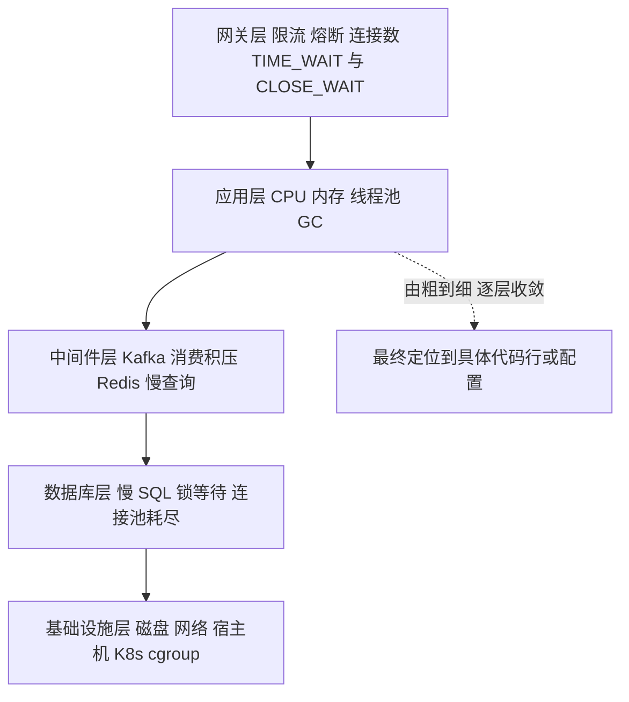

**④ 故障处理的方法论（高级岗看这个）**：
- **止血优先于根因**：先恢复业务（限流/降级/重启/切流），再离线分析根因，最后复盘改进。
- **保留现场**：dump、日志、线程栈必须先留存，重启后现场就没了。
- **沟通与升级**：及时同步进度，重大故障按预案升级，不硬扛。
- **复盘闭环**：事后写故障报告（时间线、根因、影响、改进项），改进项要落地（加监控、加超时、加演练）。

**⑤ 怎么带初级开发（软技能）**：
- **定标准**：先讲清代码规范、Git 流程、提交与评审要求。
- **任务拆解**：把大任务拆成「有明确输入输出、可验证」的小任务，难度递进，避免一上来给太难的。
- **Code Review 教学**：不直接改代码，而是**指出问题 + 讲清为什么**，引导他自己改；重点培养「边界条件、异常处理、日志、幂等」的工程意识。
- **结对与文档**：关键模块结对开发；把架构、部署、排查步骤写成文档，降低他的上手成本。
- **允许犯错 + 兜底**：给安全空间试错，但关键路径做好把关与兜底。
- **成长反馈**：定期 1v1，明确他的成长方向（技术深度 vs 广度的选择）。

**⑥ 技术方案评审关注什么（软技能）**：
- **需求理解**：方案是否真正解决业务问题？边界条件想清楚了吗？
- **方案对比**：有没有给出**多个方案 + 选型理由**（不是只给一个）？权衡讲清了吗？
- **技术风险**：性能、并发、数据一致性、兼容性、安全、可回滚。
- **可运维性**：监控、告警、日志、灰度、回滚方案、容量评估。
- **落地计划**：任务拆解、排期、依赖、人员。
- **评审输出**：结论（通过/打回/有条件通过）+ 待办项 + 责任人。

**企业实际处理**：
- 生产必有 **监控大盘 + 告警**（Prometheus/ARMS），故障走**预案（Runbook）**：什么指标触发什么处置动作，写死成文档，值班人照做即可——**这就是「减少 90% 人工干预」在运维侧的体现**。
- 带人与评审是高级岗的日常：把「能自己写」升级为「让团队写对」，是进阶的必经之路。

**为什么这样做**：
- **因为线上故障的第一原则是「恢复优先」**：用户在意的是「能不能用」，根因可以事后慢慢查，止血慢一秒损失就多一秒。
- **因为「保留现场」是定位根因的前提**：重启会清空堆与线程栈，没有现场就只能靠猜，导致同类故障反复出现。
- **因为带人的本质是「把你的经验变成团队的能力」**：你自己快不如团队快，评审与教学是把个人能力转化为组织能力的手段，也是高级岗的核心价值。

**企业级代码示例**（📦 按 JDK 17 书写、未实测）：ThreadLocal 泄漏的典型错误与正确写法（内存泄漏高频考点）。

```java
public class ThreadLocalLeakDemo {
    // 【错误写法】线程池里线程被复用，ThreadLocal 不 remove -> 值随线程常驻，泄漏
    private static final ThreadLocal<byte[]> BUF = new ThreadLocal<>();

    public void bad() {
        BUF.set(new byte[1024 * 1024]);   // 用完不清理
        // 线程归还池中，value 一直被 ThreadLocalMap 强引用
    }

    // 【正确写法】try-finally 保证 remove
    public void good() {
        BUF.set(new byte[1024]);
        try {
            // do work
        } finally {
            BUF.remove();                  // 必须移除，避免线程复用导致泄漏
        }
    }
}
```

常用排障命令速背（📦）：

```bash
# CPU 100%
top -Hp <pid> ; printf "%x\n" <tid> ; jstack <pid> | grep -A 30 <hex>

# 内存泄漏
jstat -gcutil <pid> 1000 10
jmap -histo:live <pid> | head -20
jmap -dump:format=b,file=/tmp/heap.hprof <pid>   # 再用 MAT 分析

# 接口超时：看线程都在等什么
jstack <pid> | grep -A 5 "java.lang.Thread.State" | head -50
```

**面试加分项**：
- 主动说「**止血优先、保留现场、复盘闭环**」三步法，把「排查」上升到「故障管理」，是高级岗的分水岭。
- 提「**ThreadLocal 在线程池中不 remove 会泄漏**」这个具体案例，比空谈「可能泄漏」有说服力。
- 带人部分补一句「**我 review 时不直接改代码，而是让他自己改并讲清原因，这样他才有成长**」，体现教练思维而非甩锅思维。
- 评审部分补「**方案必须有回滚方案和灰度计划**」，体现对生产稳定性的敬畏。

## 一句话主线

**基础题拼的是「原理有没有追到根」（TCP 为什么三次、epoll 为什么快、volatile 为什么禁重排）；设计模式拼的是「变化点有没有被封装」（策略/责任链/观察者隔离规则与通知）；场景题拼的是「有没有端到端思维」——先澄清需求定边界，再分层拆解（采集→传输→计算→输出→监控），选型讲权衡（延迟 vs 准确、EOS vs 吞吐、冗余 vs 成本），落地讲风险与回滚，最后把简历数字（秒级/毫秒级、90%、65%、3 倍、小时级→分钟级）讲成有技术依据的因果链。**

## 面试官深挖追问

1. **「TCP 第三次握手的 ACK 丢了会怎样？」** → 服务端会重传 SYN+ACK，客户端已 ESTABLISHED 会回 ACK 并可能带数据，服务端收到后建立连接；强调「三次握手对 ACK 丢失有容忍机制」。
2. **「epoll 的 ET 模式下如果没读干净会怎样？」** → 残留数据不再触发通知，连接「假死」；答法提示：必须非阻塞循环读到 `EAGAIN`，或降级用 LT。
3. **「零拷贝为什么 Kafka 开了 SSL 就不生效了？」** → TLS 需要在用户态加解密，数据必须进用户态，`sendfile` 用不了；答法提示：安全与性能的权衡，可改用更快的加密套件或硬件加速。
4. **「JWT 怎么实现主动失效？」** → 短过期 + Refresh Token + Redis 黑名单（登出/封禁时把 jti 加入黑名单直到过期）；点明「无状态与可控性不可兼得」。
5. **「你的规则引擎如果规则上千条，性能怎么办？」** → 规则预筛选/索引（按指标类型、适用范围先过滤）+ 表达式预编译 + 快照本地缓存；答法提示：避免每条规则全量求值。
6. **「Redis SETNX 幂等，如果服务处理到一半崩了怎么办？」** → key 有过期时间会自动释放，但业务可能处理到一半（部分成功）；答法提示：唯一索引 + 状态机兜底，保证「要么全成要么可重试」。
7. **「主备双活，主挂了备怎么知道？切换要多久？」** → 靠心跳 + 临时节点/ZK session 超时；答法提示：说明探测周期与切换时间（秒级），并说清「脑裂」怎么防（fencing token）。
8. **「任务依赖 A→B→C，A 成功了但发下游事件丢了怎么办？」** → 调度器状态持久化 + 定时补偿扫描（扫「前置成功但自身未触发」的任务）；答法提示：不能只靠一次事件通知，要有对账补偿。
9. **「你说 QPS 提升 3 倍，那是不是加机器也能做到？你的优化到底省了什么？」** → 优化省的是「单请求的 CPU/IO/DB 资源占用」，加机器是加资源；答法提示：强调「优化让单位资源产出更高，扩容有成本上限，优化没有」。
10. **「Flink 开了 Exactly-Once 就能保证不重复吗？」** → 不能，EOS 只覆盖 Flink 内部状态与支持事务的 Sink；跨外部系统的副作用（发短信）仍需业务幂等；答法提示：给出「EOS 保内部一致，业务幂等保外部一致」的边界。
11. **「你怎么证明你的规则引擎改了规则后确实生效了，且没引入回归？」** → 影子流量比对（题 10），新旧规则结果自动比对，差异清零才放量。
12. **「带了几个初级开发？他们出过线上事故吗？你怎么处理的？」** → 具体讲一次：先止血、再看是他疏忽还是流程缺失，最后补流程（评审/测试/监控）而不是只批评人；答法提示：落到「用人性化方式把能力补上」。
13. **「技术方案评审，如果两个人吵起来怎么办？」** → 把争论拉回「数据和目标」：用压测/原型验证，或按「可回滚的小步试错」先上线再定论；答法提示：评审的目的是做对的事，不是赢辩论。
