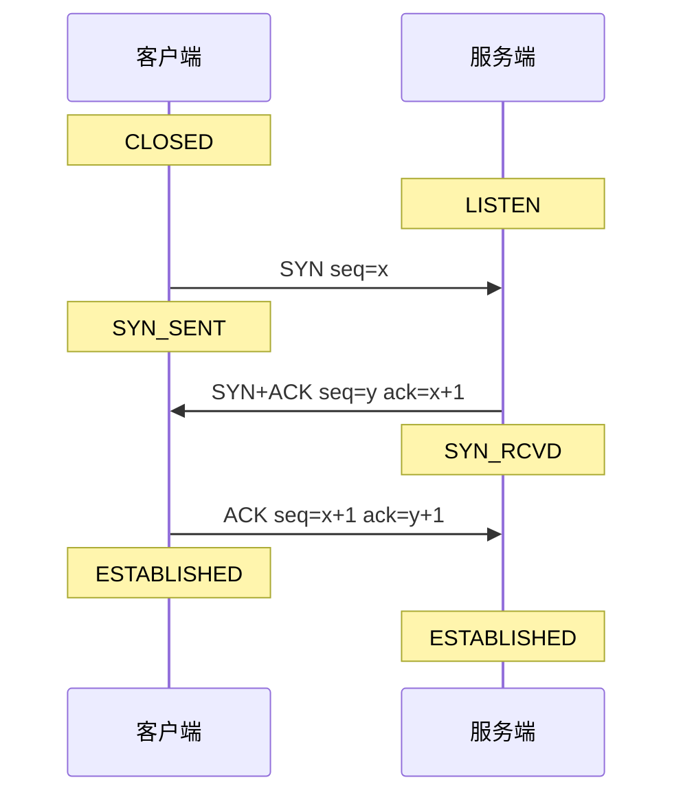

# 06 · 基础与场景设计 速记版（考前 10 分钟扫一遍）

> **一句话主线**：基础题答「原理追到根」（TCP 三次不是两次、epoll 比 select 快在 O(1)、volatile 是禁重排不是可见性）；设计模式答「变化点被封装」（策略管规则、责任链管校验、观察者管通知）；场景题答「先澄清需求定边界 → 分层拆解 → 选型讲权衡 → 落地讲风险与回滚」，并把简历数字讲成有技术依据的因果链。

## 网络与 OS 基础（8 条）

| # | 面试题 | 关键词速答 |
|---|--------|-----------|
| 1 | 为什么 TCP 是三次握手？ | 两次无法确认客户端接收能力 + 防历史连接占资源；四次挥手因半关闭（ACK 与 FIN 不能合并），被动方可能还有数据要发 |
| 2 | TIME_WAIT 为什么 2MSL？ | 保证最后 ACK 到达对端（丢了会重传 FIN）+ 让旧报文消散不影响同四元组新连接；主动关闭方买单 |
| 3 | CLOSE_WAIT 过多说明什么？ | 应用 bug：收到 FIN 后没调 close()；查连接池未归还、异常分支没 finally close、fd 泄漏（lsof -p vs ulimit -n），改内核参数没用 |
| 4 | select/poll/epoll 区别？ | select 1024 上限 + 每次拷贝 + O(n) 遍历；poll 无上限仍 O(n)；epoll 红黑树注册 + 就绪链表 O(1)，fd 只注册一次 |
| 5 | LT vs ET？ | LT（默认）有数据就通知，简单宽容；ET 只状态变化通知一次，必须非阻塞循环读到 EAGAIN，否则数据「假死」 |
| 6 | 零拷贝是什么？Kafka 为什么快？ | 传统 read+write 4 拷贝 4 切换；mmap 3 拷贝；sendfile 3 拷贝 2 切换、DMA gather 2 拷贝。Kafka 快 = 顺序写 + 页缓存 + sendfile + 批量压缩 + 分区并行 |
| 7 | HTTPS 为什么两种加密都用？ | 非对称（慢、安全）只用来协商出对称会话密钥；对称（快）加密业务数据；TLS1.3 强制 ECDHE 前向安全，1-RTT/0-RTT |
| 8 | HTTP/1.1→2→3 解决什么？ | 1.1 文本+队头阻塞；2 二进制分帧+多路复用+HPACK 但仍 TCP 层队头阻塞；3 基于 QUIC(UDP) 彻底解决 HOL + 0-RTT + 连接迁移 |

**图 6-17：TCP 三次握手时序（扫一眼记住状态迁移）**

## 设计模式与工程实践（6 条）

| # | 面试题 | 关键词速答 |
|---|--------|-----------|
| 9 | DCL 单例为什么必须加 volatile？ | 对象创建 ①分配内存②初始化③赋引用，JIT 可能重排②③ → 别的线程拿到半初始化实例；volatile 禁重排。另有静态内部类（类加载线程安全）、枚举（防反射防反序列化） |
| 10 | 策略/责任链/观察者怎么用在风控？ | 策略：一规则一类，Map 注册消 if-else；责任链：规则校验链顺序可插拔；观察者：预警事件多通道通知（Spring ApplicationEvent） |
| 11 | Spring 里有哪些设计模式？ | 工厂(BeanFactory)、单例(默认 Bean)、代理(AOP)、模板方法(*Template)、观察者(ApplicationEvent)、责任链(HandlerExecutionChain)、适配器(HandlerAdapter) |
| 12 | 接口幂等 8 方案？ | ①唯一索引(兜底必加)②去重表③乐观锁版本号④悲观锁⑤Redis SETNX(必设过期)⑥Token 一次性⑦状态机(金融最贴合)⑧分布式锁；组合：SETNX 拦截 + 唯一索引兜底 + 状态机保证语义 |
| 13 | 限流四算法怎么选？ | 固定窗口(简单但临界双倍流量)、滑动窗口(解决临界、耗内存)、漏桶(恒定速率削峰、不容突发)、令牌桶(允许突发、最常用如 Guava RateLimiter) |
| 14 | 分布式 ID 怎么选？雪花时钟回拨怎么办？ | UUID(无序)、自增(单点)、号段模式(批量取号降 DB 压力)、Redis INCR、雪花(41 时间+10 机器+12 序列，趋势递增)。回拨：小幅自旋等待、大幅抛异常拒绝服务、ZK 重分配 workerId |

**图 6-18：四种限流算法对比（记住固定窗口的临界问题）**

## 场景设计题（8 条）

| # | 面试题 | 关键词速答 |
|---|--------|-----------|
| 15 | 秒级/毫秒级实时风控预警系统怎么设计？ | 五层：采集(埋点+CDC) → 传输(Kafka 按账户分区保序) → 计算(Flink 窗口聚合+规则引擎) → 输出(分级+观察者通知+抑制) → 监控(任务生命周期+结果全链路双维度)。毫秒级=逐笔无状态规则，秒级=窗口聚合规则 |
| 16 | 规则引擎怎么零代码 + 热更新？ | 规则=元数据+表达式(Aviator/QLExpress)+动作；存 DB+配置中心；热更新 = 不可变规则快照 + AtomicReference 原子替换（不原地改）；保存前责任链校验 + 灰度 + 版本回滚 |
| 17 | 主备双活怎么协同调度？双写冲突怎么防？ | 选主(ZK 临时节点/etcd) 或分布式锁(Redis SET NX Lua 校验释放+看门狗) 保证唯一执行者；双写冲突根治=让同一份数据只有一个写入者（分区/选主），而非事后冲突解决 |
| 18 | 任务依赖 A→B→C 怎么实现？ | 建 DAG + 拓扑排序；A 成功后查依赖含 A 的下游置可执行；失败指数退避重试、区分可重试/不可重试；防重复=唯一执行 ID(业务日期+任务ID) + Redis 锁/唯一索引 + 幂等；状态持久化支持断点续跑 |
| 19 | 端到端怎么保证不丢不重不乱序？ | 不丢：acks=all + 幂等 Producer + rf>=3 + min.insync.replicas=2 + unclean.leader.election=false + 最后提交 offset + DLQ；不重：EOS + 业务幂等 upsert；不乱序：按账户分区保分区内有序 + EventTime/Watermark + allowedLateness + 侧输出 |
| 20 | 多环境结果自动化比对怎么设计？ | 统一口径(同一规则快照+同一时间窗)是前提；比对主键=账户+规则+分钟桶；差异分类多报/漏报(漏报最致命)/值不一致；容差阈值；差异超阈值告警+工单+回归闭环；原始数据留档支持重放 |
| 21 | 接口慢怎么优化（65%/3 倍）？ | 定位(链路追踪→慢 SQL→火焰图) → DB(索引重构:最左前缀/覆盖索引/避免函数失效;SQL 改写:避 select */游标分页替代深分页/小表驱动;explain 验证) → 缓存(多级) → 应用(批量消 N+1/异步/连接池/线程池隔离) → 网络(gzip/HTTP2)。65%=单 SQL 200ms→50ms，3 倍 QPS=单请求 DB 资源占用下降 |
| 22 | 高可用 + 容量 + 压测？ | 高可用=消单点+无状态+隔离+限流降级熔断+超时重试+演练；容量=峰值 QPS≈日活×人均请求/86400×峰值系数(2-5)，机器数=峰值/单机×冗余(1.5-2)；压测=JMeter 梯度加压找拐点，看 P99/错误率/资源；关注「没有超时的 RPC 是定时炸弹」 |

## 必背速查

| 项 | 内容 | 说明 |
|----|------|------|
| TCP 序列号 | SYN(seq=x) → SYN+ACK(seq=y,ack=x+1) → ACK(seq=x+1,ack=y+1) | 握手确认双向收发能力 |
| TIME_WAIT | 2MSL，主动关闭方等待 | 保最终 ACK + 旧报文消散；reuse=1 可用，tw_recycle 已移除勿用 |
| epoll vs select | O(1) 就绪链表 vs O(n) 全量遍历；无 1024 上限 vs 有 | epoll_create/ctl/wait 三步 |
| 零拷贝对比 | read+write 4 拷贝4 切换 / mmap 3 拷贝 / sendfile 3 拷贝2 切换 / DMA gather 2 拷贝 | Kafka 用 sendfile，开 TLS 失效 |
| IO 模型 | BIO / NIO(非阻塞) / 多路复用(核心) / 信号驱动 / AIO | Netty=主从 Reactor(1 boss + N worker)，绕开 JDK NIO 空轮询 bug |
| HTTP 演进 | 1.1 文本+长连接+HOL / 2 二进制分帧+多路复用+HPACK / 3 QUIC over UDP | HTTP/2 仍有 TCP 层 HOL，HTTP/3 才根治 |
| 状态码 | 200 301 302 304 400 401 403 404 405 429 500 502 503 504 | 429 限流、502 网关错、504 网关超时 |
| 幂等语义 | GET/PUT/DELETE 幂等，POST 不幂等 | 写接口必须评估幂等 |
| JWT 结构 | header.payload.signature，Base64Url（非加密，可解开） | 无状态优点 vs 无法主动失效缺点；短过期+黑名单+Refresh Token |
| 限流四算法对比 | 固定窗口(临界问题) / 滑动窗口(解决临界耗内存) / 漏桶(匀速不容突发) / 令牌桶(容突发最常用) | 令牌桶本质=攒令牌可一次花 |
| 幂等方案对比 | 唯一索引(最可靠) / Redis SETNX(快但需过期) / 状态机(语义最贴合) / Token(表单防重) | 组合使用：拦截+兜底+语义 |
| 分布式 ID 对比 | UUID(无序) / 自增(单点) / 号段(降 DB 压力) / Redis INCR(依赖可用性) / 雪花(趋势递增需处理回拨) | 雪花 64 位=1+41+10+12；41 位约 69 年 |
| 缓存一致性 | 先更库再删缓存(+过期兜底) 优于 先删缓存再更库(回填竞态更严重) | 延迟双删只是降概率；Canal 订阅 binlog 最终一致 |
| 故障处理三步 | 止血优先 → 保留现场 → 复盘闭环 | 重启前先 dump |
| 带人三步 | 定标准 + 任务拆解(可验证) + Review 引导自己改 | 关键路径把关兜底 |
| 方案评审看什么 | 需求理解 / 多方案对比 / 技术风险 / 可运维性(灰度回滚) / 落地计划 | 输出结论+待办+责任人 |
| 简历数字 | 秒级/毫秒级、减少 90% 人工干预、-65% 耗时、3 倍 QPS、小时级→分钟级 | 每个都要能讲成技术因果 |

## 答题模板

**场景设计题通用框架（五步，背书用）：**
1. **澄清需求定边界**：先问数据量、延迟目标、一致性要求、规则复杂度、是否要审计——体现成熟度，不一上来画图。
2. **分层拆解**：采集层 → 传输层 → 计算层 → 输出层 → 监控层（风控/数据链路的通用骨架）。
3. **关键技术选型**：每层给出具体组件 + 为什么选它（Kafka 按业务主键分区保序、Flink 事件时间+窗口、规则引擎表达式快照热更新）。
4. **权衡取舍**：延迟 vs 准确（Watermark 等待）、EOS vs 吞吐、JWT 无状态 vs 可控、冗余 vs 成本——**主动说权衡是高级岗的标志**。
5. **落地风险与回滚**：灰度、影子流量比对、可重放、告警闭环、回滚方案、容量评估。

**「接口慢怎么优化」可背诵清单（按收益排序）：**
1. **定位**：链路追踪 → 慢 SQL 日志 → Arthas `trace` / 火焰图，先量后调。
2. **DB 索引**：补缺失索引；最左前缀；覆盖索引免回表；避免索引失效（函数、隐式转换、`%前缀`、`or`、`!=`）。
3. **SQL 改写**：禁 `select *`；游标分页替代 `limit 1000000,10` 深分页；小表驱动大表；减 join；`explain` 验证（type=range/ref，无 filesort/temporary）。
4. **缓存**：Redis 热点 + 本地 Caffeine 多级；一致性用「先更库再删缓存 + 过期兜底」。
5. **应用**：批量查消 N+1；非核心逻辑异步/MQ；连接池与线程池调优与隔离；JVM GC 调优。
6. **架构**：读写分离、分库分表、冷热归档。
7. **验证**：压测拿优化前后 P99 与最大 QPS 对比（65% / 3 倍数字来源），加索引走 online DDL/gh-ost 避免锁表。
